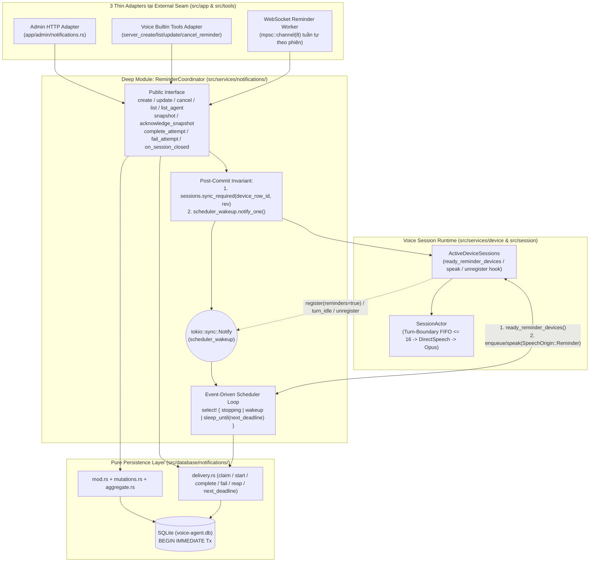
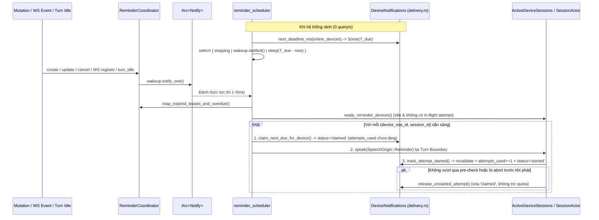

# Kế hoạch Triển khai Chi tiết: Đồng bộ hóa & Tối ưu Hiệu năng `voice-reminders` (`codebase-design`)

> [!IMPORTANT]
> Tài liệu này đã được cập nhật toàn diện sau vòng **`/code-review` 2 trục (Standards & Spec)**:
> 1. **Standards**: Đặt Deep Module điều phối tại tầng dịch vụ [`ReminderCoordinator`](file:///Users/lamphuchai/Desktop/project_rust/AI_Agent_Voice_rust/crates/voice-agent-server/src/services/notifications/mod.rs) (giữ `src/database/` thuần SQLite, không import ngược `crate::services`), tách SQL giao nhận sang [`src/database/notifications/delivery.rs`](file:///Users/lamphuchai/Desktop/project_rust/AI_Agent_Voice_rust/crates/voice-agent-server/src/database/notifications/delivery.rs), gom tham số rời rạc vào `MutationContext`, và xử lý tuần tự sự kiện WS qua bounded channel mỗi phiên.
> 2. **Spec**: Tách 2 pha `'claimed'` (chưa trừ quota) → `'started'` (chỉ tăng `attempts_used` khi thực sự bắt đầu phát), giữ `next_attempt_at_ms` thuần túy cho retry backoff, tính hạn chờ ACK theo thời lượng audio + hard cap, miễn rate-limit 1s cho `SpeechOrigin::Reminder` kèm hàng đợi FIFO tối đa 16 mục tại ranh giới lượt hội thoại (turn boundary), và bổ sung đầy đủ đặc tả Ticket 08 / 09 / 10.

---

## 1. Kiến trúc Tổng thể & Seam Placement

### 1.1. Bảng ánh xạ Module theo từ vựng `codebase-design`

| Module | Vai trò sau khi làm sâu (Deepened) | Dependency Category | Seam & Test Surface |
| :--- | :--- | :--- | :--- |
| [`ReminderCoordinator`](file:///Users/lamphuchai/Desktop/project_rust/AI_Agent_Voice_rust/crates/voice-agent-server/src/services/notifications/mod.rs) | **Deep Module trung tâm tại tầng Service**: Sở hữu trọn vẹn lifecycle nghiệp vụ của Reminder (CRUD, CAS, Idempotency, Snapshot Sync, 2-phase Lease Claim → Start → Complete/Fail/Uncertain/Expire) **và** đảm bảo bất biến: mọi thay đổi `schedule_revision` đều tự động phát `sync_required` + đánh thức Scheduler ngay sau khi SQLite commit. Không dùng `Option<Arc<ActiveDeviceSessions>>` (luôn bắt buộc đủ dependency khi khởi tạo). | **Local-substitutable** (`DeviceNotifications` SQLite + `ActiveDeviceSessions` in-process + injectable clock) | Seam chính cho cả 3 Adapter (Admin HTTP, Voice Builtin Tools, WebSocket) và các integration test đầu-cuối. |
| [`DeviceNotifications`](file:///Users/lamphuchai/Desktop/project_rust/AI_Agent_Voice_rust/crates/voice-agent-server/src/database/notifications/mod.rs) + [`delivery.rs`](file:///Users/lamphuchai/Desktop/project_rust/AI_Agent_Voice_rust/crates/voice-agent-server/src/database/notifications/delivery.rs) | **Pure SQLite Repository**: Thực thi các giao dịch `BEGIN IMMEDIATE` nguyên tử cho CRUD (`mutations.rs`), truy vấn tổng hợp (`aggregate.rs`) và quản lý trạng thái lease/deadline (`delivery.rs`). **Tuyệt đối không import `crate::services`**. | **Local-substitutable** (SQLite file/tempdir) | Được gọi bởi `ReminderCoordinator`; test trực tiếp các bất biến SQL/CAS/Idempotency. |
| [`ActiveDeviceSessions`](file:///Users/lamphuchai/Desktop/project_rust/AI_Agent_Voice_rust/crates/voice-agent-server/src/services/device/active_sessions.rs) | **In-process Session Registry**: Quản lý kết nối WS vật lý, kiểm tra khả năng nhận Reminder speech không khóa (`ready_reminder_devices`), miễn rate-limit 1s cho `SpeechOrigin::Reminder`, thu hồi ngay attempt `'started'` sang `'uncertain'` khi rớt WS, và phát tín hiệu đánh thức Scheduler khi thiết bị kết nối hoặc vừa về trạng thái rảnh (`Idle`). | **In-process** | Seam nội bộ phối hợp với `ReminderCoordinator` và `SessionActor`. |
| [`reminder_scheduler`](file:///Users/lamphuchai/Desktop/project_rust/AI_Agent_Voice_rust/crates/voice-agent-server/src/services/notifications/reminder_scheduler.rs) | **Event-Driven Worker**: Ngủ chính xác đến `next_deadline_ms` (`sleep_until`) kết hợp `tokio::sync::Notify` (**0 query/giây khi rảnh**), thu hồi lease quá hạn và đẩy tối đa 16 reminder đến hạn vào hàng đợi FIFO theo ranh giới lượt hội thoại của thiết bị. | **In-process** | Ẩn hoàn toàn sau `ReminderCoordinator`; kiểm thử qua hành vi đầu-cuối. |
| **Adapters** ([`admin/notifications.rs`](file:///Users/lamphuchai/Desktop/project_rust/AI_Agent_Voice_rust/crates/voice-agent-server/src/app/admin/notifications.rs), [`websocket.rs`](file:///Users/lamphuchai/Desktop/project_rust/AI_Agent_Voice_rust/crates/voice-agent-server/src/app/transport/websocket.rs), [`tools/builtin.rs`](file:///Users/lamphuchai/Desktop/project_rust/AI_Agent_Voice_rust/crates/voice-agent-server/src/tools/builtin.rs)) | **Thin Adapters**: Chỉ chuyển đổi định dạng HTTP/WS/LLM Tool Call sang `MutationContext` và gọi `ReminderCoordinator`; không tự gọi `publish_sync` hay giữ logic SQL/lập lịch. | Adapter tại Seam ngoài | Public HTTP `/api/admin/...` và WebSocket `/voice/v1/`. |

### 1.2. Sơ đồ Luồng Kiến trúc Mới (Tuân thủ chiều phụ thuộc `app` → `services` → `database`)



---

## 2. Thiết kế Chi tiết Từng Hạng mục

### Pha 1: Tách Tầng `ReminderCoordinator` (`services`) & `DeviceNotifications` (`database`)

**File liên quan:**
- [`crates/voice-agent-server/src/services/notifications/mod.rs`](file:///Users/lamphuchai/Desktop/project_rust/AI_Agent_Voice_rust/crates/voice-agent-server/src/services/notifications/mod.rs) *(mới)*
- [`crates/voice-agent-server/src/database/notifications/mod.rs`](file:///Users/lamphuchai/Desktop/project_rust/AI_Agent_Voice_rust/crates/voice-agent-server/src/database/notifications/mod.rs)
- [`crates/voice-agent-server/src/database/notifications/mutations.rs`](file:///Users/lamphuchai/Desktop/project_rust/AI_Agent_Voice_rust/crates/voice-agent-server/src/database/notifications/mutations.rs)
- [`crates/voice-agent-server/src/database/notifications/aggregate.rs`](file:///Users/lamphuchai/Desktop/project_rust/AI_Agent_Voice_rust/crates/voice-agent-server/src/database/notifications/aggregate.rs)
- [`crates/voice-agent-server/src/database/notifications/delivery.rs`](file:///Users/lamphuchai/Desktop/project_rust/AI_Agent_Voice_rust/crates/voice-agent-server/src/database/notifications/delivery.rs) *(mới — tách từ `mod.rs` để giữ mỗi file < 500 dòng theo `CONTEXT.md`)*
- [`crates/voice-agent-server/src/app/admin/notifications.rs`](file:///Users/lamphuchai/Desktop/project_rust/AI_Agent_Voice_rust/crates/voice-agent-server/src/app/admin/notifications.rs)

#### 1.1. Xóa bỏ Data Clump bằng `MutationContext`
Thay vì truyền 6–7 tham số `&str` rời rạc vào `create`, `update`, `cancel`, gom chúng vào struct có kiểu rõ ràng tại [`src/database/notifications/mod.rs`](file:///Users/lamphuchai/Desktop/project_rust/AI_Agent_Voice_rust/crates/voice-agent-server/src/database/notifications/mod.rs):

```rust
#[derive(Clone, Copy, Debug, PartialEq, Eq)]
pub enum ReminderSource {
    Admin,
    Voice,
    Device,
}

impl ReminderSource {
    pub fn as_str(self) -> &'static str {
        match self {
            Self::Admin => "admin",
            Self::Voice => "voice",
            Self::Device => "device",
        }
    }
}

#[derive(Clone, Debug)]
pub struct MutationContext {
    pub caller: String,
    pub request_id: String,
    pub audit_request_id: String,
    pub source: ReminderSource,
    pub agent_scope: Option<String>,
}
```

#### 1.2. Thiết kế `ReminderCoordinator` không có Half-Baked Dependency
Tại [`src/services/notifications/mod.rs`](file:///Users/lamphuchai/Desktop/project_rust/AI_Agent_Voice_rust/crates/voice-agent-server/src/services/notifications/mod.rs), `ReminderCoordinator` yêu cầu đầy đủ `DeviceNotifications`, `Arc<ActiveDeviceSessions>` và `Arc<tokio::sync::Notify>` ngay khi khởi tạo trong [`AppState`](file:///Users/lamphuchai/Desktop/project_rust/AI_Agent_Voice_rust/crates/voice-agent-server/src/app/state.rs):

```rust
#[derive(Clone)]
pub struct ReminderCoordinator {
    repo: DeviceNotifications,
    sessions: Arc<ActiveDeviceSessions>,
    scheduler_wakeup: Arc<tokio::sync::Notify>,
}

impl ReminderCoordinator {
    pub fn new(
        repo: DeviceNotifications,
        sessions: Arc<ActiveDeviceSessions>,
        scheduler_wakeup: Arc<tokio::sync::Notify>,
    ) -> Self {
        Self {
            repo,
            sessions,
            scheduler_wakeup,
        }
    }

    /// Bất biến trung tâm: gọi ngay sau mọi transaction làm tăng `schedule_revision`.
    fn notify_schedule_changed(&self, device_row_id: i64, schedule_revision: i64) {
        self.sessions.sync_required(device_row_id, schedule_revision);
        self.scheduler_wakeup.notify_one();
    }

    pub fn wake_scheduler(&self) {
        self.scheduler_wakeup.notify_one();
    }
}
```

#### 1.3. Tự động hóa `notify_schedule_changed` cho MỌI Mutation
Các phương thức của `DeviceNotifications` trả về `(MutationResult, i64 /* device_row_id */)` sau khi `tx.commit().await?`, và `ReminderCoordinator` chịu trách nhiệm gọi `self.notify_schedule_changed(device_row_id, result.schedule_revision)` tại một nơi duy nhất cho:
- `ReminderCoordinator::create(device, ctx, input)`
- `ReminderCoordinator::update(device, reminder_id, ctx, patch)`
- `ReminderCoordinator::cancel(device, reminder_id, ctx, expected_revision)`
  - **Tác dụng**: Sửa triệt để lỗi [`admin::notifications::cancel`](file:///Users/lamphuchai/Desktop/project_rust/AI_Agent_Voice_rust/crates/voice-agent-server/src/app/admin/notifications.rs#L181-L212) quên gọi `publish_sync`, đồng thời xóa bỏ hoàn toàn hàm `publish_sync` và truy vấn phụ `database.device_row_id(device)` khỏi [`app/admin/notifications.rs`](file:///Users/lamphuchai/Desktop/project_rust/AI_Agent_Voice_rust/crates/voice-agent-server/src/app/admin/notifications.rs#L232-L240).
- `ReminderCoordinator::complete_attempt(...)`
- `ReminderCoordinator::fail_attempt(...)` (khi reminder chạm ngưỡng chuyển sang `'expired'`)
- `ReminderCoordinator::reap_expired_leases_and_overdue(...)` (cho từng `(device_row_id, new_schedule_revision)` vừa có reminder chuyển sang `'expired'`).

#### 1.4. Đồng bộ chính xác `sync_status` trong cả `list` và `list_agent`
- Trong [`DeviceNotifications::list`](file:///Users/lamphuchai/Desktop/project_rust/AI_Agent_Voice_rust/crates/voice-agent-server/src/database/notifications/mod.rs#L349-L379) và [`DeviceNotifications::list_agent`](file:///Users/lamphuchai/Desktop/project_rust/AI_Agent_Voice_rust/crates/voice-agent-server/src/database/notifications/aggregate.rs#L41-L99):
  - Xóa dòng gán cứng `item.sync_status = "pending".into()` tại [`aggregate.rs:80`](file:///Users/lamphuchai/Desktop/project_rust/AI_Agent_Voice_rust/crates/voice-agent-server/src/database/notifications/aggregate.rs#L79-L81); dùng chung một hàm tính `compute_sync_status(&mut tx, device_row_id, &item, capability_state)` cho cả `list` và `list_agent`.
  - `ReminderCoordinator` truyền trạng thái kết nối thực tế từ `self.sessions.device_reminder_capability(device_row_id)`:
    - Nếu thiết bị đang kết nối WS nhưng `session.features.reminders == false` → trả `sync_status = "unsupported"` đúng theo [`spec.md:83`](file:///Users/lamphuchai/Desktop/project_rust/AI_Agent_Voice_rust/.scratch/voice-reminders-direct-tts/spec.md#L83).
    - Nếu `acked_revision == schedule_revision` và `item.id` nằm trong `acked_ids` → `"acked"`.
    - Nếu `acked_revision == schedule_revision` và `item.status == "pending"` nhưng nằm ngoài top-16 (`acked_ids`) → `"out_of_window"`.
    - Các trường hợp còn lại → `"pending"`.

---

### Pha 2: Nâng cấp `ActiveDeviceSessions` & Hàng đợi FIFO tại Ranh giới Lượt Hội thoại (`SessionActor`)

**File liên quan:**
- [`crates/voice-agent-server/src/services/device/active_sessions.rs`](file:///Users/lamphuchai/Desktop/project_rust/AI_Agent_Voice_rust/crates/voice-agent-server/src/services/device/active_sessions.rs)
- [`crates/voice-agent-server/src/session/interaction/direct_speech.rs`](file:///Users/lamphuchai/Desktop/project_rust/AI_Agent_Voice_rust/crates/voice-agent-server/src/session/interaction/direct_speech.rs)
- [`crates/voice-agent-server/src/session/actor/delivery.rs`](file:///Users/lamphuchai/Desktop/project_rust/AI_Agent_Voice_rust/crates/voice-agent-server/src/session/actor/delivery.rs)
- [`crates/voice-agent-server/src/session/actor/ingress.rs`](file:///Users/lamphuchai/Desktop/project_rust/AI_Agent_Voice_rust/crates/voice-agent-server/src/session/actor/ingress.rs)

#### 2.1. Miễn Rate-Limit 1 Giây cho `SpeechOrigin::Reminder`
Theo [`voice_reminders_protocol_contracts.md:41`](file:///Users/lamphuchai/Desktop/project_rust/AI_Agent_Voice_rust/docs/voice_reminders_protocol_contracts.md#L41) và [`Ticket 07`](file:///Users/lamphuchai/Desktop/project_rust/AI_Agent_Voice_rust/.scratch/voice-reminders-direct-tts/issues/07-online-scheduler-and-turn-boundary-delivery.md), giới hạn 1 request/giây chỉ áp dụng cho Admin/Client Direct TTS, **không** áp dụng cho chuỗi Reminder FIFO đến hạn cùng lúc.
- Trong [`ActiveDeviceSessions::speak`](file:///Users/lamphuchai/Desktop/project_rust/AI_Agent_Voice_rust/crates/voice-agent-server/src/services/device/active_sessions.rs#L65-L94):
  ```rust
  let is_reminder = matches!(request.origin, SpeechOrigin::Reminder { .. });
  if !is_reminder && session.last_accepted_at.is_some_and(|t| now.duration_since(t) < RATE_LIMIT_WINDOW) {
      return Err(DirectSpeechError::RateLimited);
  }
  ```

#### 2.2. Hàng đợi FIFO Tối đa 16 Reminder tại Ranh giới Lượt Hội thoại (Turn-Boundary Queue)
Theo [`spec.md:97-103`](file:///Users/lamphuchai/Desktop/project_rust/AI_Agent_Voice_rust/.scratch/voice-reminders-direct-tts/spec.md#L97-L103) và [`Ticket 07`](file:///Users/lamphuchai/Desktop/project_rust/AI_Agent_Voice_rust/.scratch/voice-reminders-direct-tts/issues/07-online-scheduler-and-turn-boundary-delivery.md):
- Khi thiết bị đang ở trạng thái `Listening` (đã nhận speech đầu vào), `Processing` hoặc `Speaking`, reminder **không được** chen ngang cắt lời mà phải đợi tới ranh giới kết thúc lượt hội thoại (safe turn boundary) rồi phát tuần tự theo thứ tự `(due_at_ms, id)`.
- Thiết kế kết hợp giữa `ActiveDeviceSession` và `SessionActor`:
  1. Mỗi phiên thiết bị theo dõi trạng thái `in_flight_attempt: Option<InFlightReminderAttempt>` và trạng thái bận của `SessionActor` (thông qua tín hiệu `turn_idle` từ `SessionActor` khi chuyển về `SessionState::Idle` và `output.is_empty()`).
  2. Khi `SessionActor` vừa kết thúc một lượt hội thoại (`Processing`/`Speaking`/`Listening` → `Idle`) hoặc vừa nhận `reminder.played` / `reminder.failed`:
     - Gọi `scheduler_wakeup.notify_one()` để `reminder_scheduler` lập tức nạp reminder kế tiếp theo đúng thứ tự `(due_at_ms, id)` (giới hạn tối đa 16 reminder đến hạn mỗi đợt xả hàng đợi).
  3. Ngay trước khi `SessionActor` chuyển một Reminder từ hàng đợi sang bắt đầu phát (`SpeechOutput` gửi frame đầu tiên / `tts.state: start`):
     - Thực hiện callback `ReminderCoordinator::start_claimed_attempt(attempt_id, estimated_audio_duration_ms)` để kiểm tra lại `devices.enabled = 1`, `r.status = 'pending'`, tăng `attempts_used += 1`, chuyển attempt từ `'claimed'` sang `'started'` và ấn định `lease_until_ms` theo thời lượng audio.
     - Nếu người dùng barge-in (`abort`) hoặc đóng phiên **trước khi** reminder kịp bắt đầu phát, attempt đang ở trạng thái `'claimed'` được hủy bỏ qua `release_unstarted_attempt` mà **không bị trừ quota `attempts_used`**.

#### 2.3. Đánh thức Scheduler & Thu hồi Ngay khi Rớt WS (`unregister`)
1. Khi [`ActiveDeviceSessions::register`](file:///Users/lamphuchai/Desktop/project_rust/AI_Agent_Voice_rust/crates/voice-agent-server/src/services/device/active_sessions.rs#L33-L56) được gọi với `features.reminders == true`: gọi `scheduler_wakeup.notify_one()`.
2. Khi [`ActiveDeviceSessions::unregister(device_row_id, session_id)`](file:///Users/lamphuchai/Desktop/project_rust/AI_Agent_Voice_rust/crates/voice-agent-server/src/services/device/active_sessions.rs#L58-L63) được gọi (thiết bị ngắt kết nối WS):
   - Kích hoạt `ReminderCoordinator::on_session_closed(device_row_id, session_id)`:
     - Mọi attempt có `status = 'claimed'` (chưa bắt đầu phát) của `session_id` đó được xóa/thu hồi ngay mà **không tốn lượt thử**.
     - Mọi attempt có `status = 'started'` (đã phát nhưng mất WS trước khi nhận `reminder.played`) của `session_id` đó lập tức chuyển sang `status = 'uncertain'`, cập nhật `next_attempt_at_ms = now + backoff` (hoặc chuyển reminder sang `'expired'` nếu `attempts_used >= 3`), giúp thiết bị vừa reconnect lại không phải đợi kẹt suốt 120s lease cũ.

---

### Pha 3: Thiết kế lại `reminder_scheduler` & `delivery.rs` — 2-Phase Claim/Start & Event-Driven Timer

**File liên quan:**
- [`crates/voice-agent-server/src/database/notifications/delivery.rs`](file:///Users/lamphuchai/Desktop/project_rust/AI_Agent_Voice_rust/crates/voice-agent-server/src/database/notifications/delivery.rs) *(mới)*
- [`crates/voice-agent-server/src/services/notifications/reminder_scheduler.rs`](file:///Users/lamphuchai/Desktop/project_rust/AI_Agent_Voice_rust/crates/voice-agent-server/src/services/notifications/reminder_scheduler.rs)

#### 3.1. Các hằng số Policy chuẩn (theo ADR-0090, Ticket 07 & Ticket 08)
```rust
pub const MAX_REMINDER_ATTEMPTS: i64 = 3;
pub const CLAIM_PRE_START_LEASE_MS: i64 = 10_000;   // 10s tối đa cho bước chuẩn bị/admission trước khi phát
pub const MIN_ACK_TIMEOUT_MS: i64 = 15_000;         // Tối thiểu 15s chờ ACK sau khi bắt đầu phát
pub const MAX_ACK_TIMEOUT_MS: i64 = 120_000;        // Hard cap 120s cho bài nói dài
pub const SINK_LATENCY_BUDGET_MS: i64 = 10_000;     // Độ trễ mạng + buffer loa ESP32
pub const LATENESS_GRACE_MS: i64 = 86_400_000;      // 24h
pub const RETRY_BACKOFF_MS: [i64; 3] = [5_000, 15_000, 60_000];
pub const MAX_SESSION_REMINDER_FIFO: usize = 16;

pub fn compute_ack_timeout_ms(estimated_audio_ms: i64) -> i64 {
    (estimated_audio_ms.saturating_add(SINK_LATENCY_BUDGET_MS))
        .clamp(MIN_ACK_TIMEOUT_MS, MAX_ACK_TIMEOUT_MS)
}
```

#### 3.2. Vòng đời Attempt 2 Pha (`'claimed'` → `'started'`) & Giữ `next_attempt_at_ms` Thuần Túy Cho Backoff

Để tuân thủ tuyệt đối [`ADR-0090`](file:///Users/lamphuchai/Desktop/project_rust/AI_Agent_Voice_rust/docs/adr/0090-reminder-storage-sync-and-delivery-state.md), [`spec.md:93-94`](file:///Users/lamphuchai/Desktop/project_rust/AI_Agent_Voice_rust/.scratch/voice-reminders-direct-tts/spec.md#L93-L94) và [`Ticket 08`](file:///Users/lamphuchai/Desktop/project_rust/AI_Agent_Voice_rust/.scratch/voice-reminders-direct-tts/issues/08-playback-ack-retry-and-expiry.md) (*"Claim chưa start recover/release không trừ quota; started mất WS/ACK uncertain"*):

1. **Pha A — `claim_next_due_for_device(device_row_id, session_id)`**:
   - Không ghi đè `next_attempt_at_ms = lease_until_ms` và **chưa tăng `attempts_used`**.
   - Chống claim trùng bằng mệnh đề `NOT EXISTS` trên các attempt đang giữ lease hợp lệ (`status IN ('claimed', 'started') AND lease_until_ms > now`):
   ```sql
   SELECT r.id, r.device_row_id, r.message
   FROM device_reminders r
   JOIN devices d ON d.id = r.device_row_id
   LEFT JOIN agents a ON a.id = d.agent_id
   WHERE r.device_row_id = ?1
     AND d.enabled = 1
     AND (r.created_by_agent_key IS NULL OR COALESCE(a.reminders_enabled, 1) = 1)
     AND r.status = 'pending'
     AND r.due_at_ms <= ?2
     AND (r.next_attempt_at_ms IS NULL OR r.next_attempt_at_ms <= ?2)
     AND r.attempts_used < 3
     AND NOT EXISTS (
         SELECT 1 FROM reminder_delivery_attempts att
         WHERE att.reminder_id = r.id
           AND att.status IN ('claimed', 'started')
           AND att.lease_until_ms > ?2
     )
   ORDER BY r.due_at_ms, r.id
   LIMIT 1
   ```
   - Chèn dòng vào `reminder_delivery_attempts` với `status = 'claimed'` và `lease_until_ms = now + CLAIM_PRE_START_LEASE_MS`.

2. **Pha B — `mark_attempt_started(attempt_id, session_id, estimated_audio_ms)` (Ngay trước khi phát gói âm thanh đầu tiên)**:
   - Mở `BEGIN IMMEDIATE` transaction, kiểm tra lại (revalidate):
     - Thiết bị vẫn `d.enabled = 1`, reminder vẫn `r.status = 'pending'`, và attempt đang `status = 'claimed'` thuộc đúng `session_id`.
   - Nếu hợp lệ:
     - Tăng `device_reminders.attempts_used = attempts_used + 1`, `updated_at_ms = now`.
     - Cập nhật `reminder_delivery_attempts`: `status = 'started'`, `lease_until_ms = now + compute_ack_timeout_ms(estimated_audio_ms)`, `updated_at_ms = now`.
   - Nếu không còn hợp lệ (ví dụ Admin vừa hủy reminder hoặc disable thiết bị trong vài ms chuẩn bị):
     - Xóa dòng `'claimed'` và trả lỗi để `SessionActor` hủy phát ngay trước khi phát ra loa.

3. **Pha Hủy Trước Khi Phát — `release_unstarted_attempt(attempt_id)`**:
   - Chỉ xóa dòng `WHERE id = ? AND status = 'claimed'`. Vì `attempts_used` chưa bị tăng ở Pha A, reminder giữ nguyên số lần thử và sẵn sàng cho lượt kế tiếp ngay khi phiên rảnh.

#### 3.3. Thu hồi Lease Quá hạn Chính xác (`reap_expired_leases_and_overdue`)
Sửa triệt để lỗi edge-case của Reaper (không bao giờ đánh dấu `expired` cho reminder có lần thử thứ 3 đang phát hợp lệ với `lease_until_ms > now`):
1. **Dọn các claim chưa kịp bắt đầu phát (`status = 'claimed' AND lease_until_ms <= now`)**:
   - Xóa các dòng `'claimed'` quá hạn mà không trừ `attempts_used`.
2. **Xử lý các attempt đã bắt đầu phát nhưng quá hạn chờ ACK (`status = 'started' AND lease_until_ms <= now`)**:
   - Tìm danh sách `(attempt_id, reminder_id, device_row_id, attempts_used, due_at_ms)` thỏa `att.status = 'started' AND att.lease_until_ms <= now`.
   - Chuyển chỉ những attempt đó sang `att.status = 'uncertain'`, `updated_at_ms = now`.
   - Với từng `reminder_id` vừa bị chuyển sang `'uncertain'` (nếu `r.status = 'pending'`):
     - Nếu `attempts_used >= MAX_REMINDER_ATTEMPTS` (3) **hoặc** `now >= due_at_ms + LATENESS_GRACE_MS`:
       - Chuyển `r.status = 'expired'`, `next_attempt_at_ms = NULL`, `updated_at_ms = now`.
       - Tăng `device_reminder_sync.schedule_revision += 1` và ghi nhận `(device_row_id, new_revision)` để phát `notify_schedule_changed` sau khi commit.
     - Ngược lại (`attempts_used < 3`):
       - Đặt `r.next_attempt_at_ms = now + RETRY_BACKOFF_MS[(attempts_used - 1).clamp(0, 2)]`.
3. **Xử lý các reminder chờ quá 24h (`status = 'pending' AND due_at_ms + LATENESS_GRACE_MS <= now` và không có attempt `'started'` đang trong hạn lease)**:
   - Chuyển sang `r.status = 'expired'`, tăng `schedule_revision += 1` và phát `notify_schedule_changed`.

#### 3.4. Tính toán `next_deadline_ms` (Loại bỏ hoàn toàn `interval(1s)`)
Hàm `next_deadline_ms(&self, online_device_ids: &[i64]) -> Result<Option<i64>, NotificationError>` tại [`delivery.rs`](file:///Users/lamphuchai/Desktop/project_rust/AI_Agent_Voice_rust/crates/voice-agent-server/src/database/notifications/delivery.rs) tính thời điểm (epoch ms) sớm nhất tiếp theo cần thức dậy:
1. `min_lease_ms`:
   ```sql
   SELECT MIN(lease_until_ms)
   FROM reminder_delivery_attempts
   WHERE status IN ('claimed', 'started')
   ```
2. `min_expiry_ms`:
   ```sql
   SELECT MIN(due_at_ms) + 86400000
   FROM device_reminders
   WHERE status = 'pending'
   ```
3. `min_online_due_ms` (chỉ truy vấn khi `online_device_ids` không rỗng):
   ```sql
   SELECT MIN(MAX(r.due_at_ms, COALESCE(r.next_attempt_at_ms, r.due_at_ms)))
   FROM device_reminders r
   JOIN devices d ON d.id = r.device_row_id
   WHERE r.status = 'pending'
     AND d.enabled = 1
     AND r.attempts_used < 3
     AND r.device_row_id IN (...)
     AND NOT EXISTS (
         SELECT 1 FROM reminder_delivery_attempts att
         WHERE att.reminder_id = r.id
           AND att.status IN ('claimed', 'started')
     )
   ```
4. Lấy `earliest_ms = min(min_lease_ms, min_expiry_ms, min_online_due_ms)`:
   - Nếu `earliest_ms == None`: Scheduler ngủ vô thời hạn (`std::future::pending()`), chỉ thức dậy khi `wakeup.notified()` hoặc `stopping.cancelled()` (**0 query/giây**).
   - Nếu `earliest_ms <= now`: Xử lý các thiết bị đang `ready_reminder_devices()`; nếu có thiết bị online đến hạn nhưng đang bận lượt hội thoại (`Listening`/`Processing`/`Speaking`), scheduler không busy-spin mà ngủ chờ tín hiệu `wakeup.notified()` (được kích hoạt ngay khi `SessionActor` về `Idle`).



---

### Pha 4: Chuẩn hóa WebSocket Reminder Adapter & Protocol Contract

**File liên quan:**
- [`crates/voice-agent-server/src/protocol/client.rs`](file:///Users/lamphuchai/Desktop/project_rust/AI_Agent_Voice_rust/crates/voice-agent-server/src/protocol/client.rs)
- [`crates/voice-agent-server/src/app/transport/websocket.rs`](file:///Users/lamphuchai/Desktop/project_rust/AI_Agent_Voice_rust/crates/voice-agent-server/src/app/transport/websocket.rs)

1. **Bổ sung `ReminderEvent::Failed` trong [`protocol/client.rs:120-134`](file:///Users/lamphuchai/Desktop/project_rust/AI_Agent_Voice_rust/crates/voice-agent-server/src/protocol/client.rs#L120-L134)**:
   - Thêm biến thể:
     ```rust
     Failed {
         reminder_id: String,
         attempt_id: String,
         reason: String,
     }
     ```
   - Parse `"event": "failed"` với `reason` thuộc tập hợp lệ (`"output_unavailable"`, `"playback_aborted"`, `"decode_failed"`).
   - Khi nhận `ReminderEvent::Failed`, gọi `coordinator.fail_attempt(device_db_id, &session_id, &reminder_id, &attempt_id, &reason).await`:
     - Xác thực `(device_row_id, session_id, reminder_id, attempt_id)` đang ở trạng thái `'started'` (hoặc `'claimed'`).
     - Cập nhật `reminder_delivery_attempts.status = 'failed'`, `error_code = reason`, `updated_at_ms = now`.
     - Nếu `attempts_used >= 3` hoặc đã quá `due_at_ms + LATENESS_GRACE_MS`: chuyển `device_reminders.status = 'expired'`, tăng `schedule_revision += 1`, gửi `delivery_result` (`outcome: "failed"`, `revision: new_schedule_revision`) và gọi `notify_schedule_changed`.
     - Nếu `attempts_used < 3`: đặt `next_attempt_at_ms = now + backoff`, gửi `delivery_result` (`outcome: "failed"`, `revision: current_schedule_revision`) và gọi `wake_scheduler()`.

2. **Chuẩn hóa trường `"outcome"` trong `delivery_result` tại [`websocket.rs:1123-1126`](file:///Users/lamphuchai/Desktop/project_rust/AI_Agent_Voice_rust/crates/voice-agent-server/src/app/transport/websocket.rs#L1123-L1126)**:
   - Khớp chính xác 100% với golden fixture [`tests/fixtures/voice_reminders_protocol_v1.json:93-101`](file:///Users/lamphuchai/Desktop/project_rust/AI_Agent_Voice_rust/crates/voice-agent-server/tests/fixtures/voice_reminders_protocol_v1.json#L93-L101) (sử dụng `"outcome"`, bỏ trường `"status"` sai chuẩn):
     ```rust
     let text = serde_json::json!({
         "type": "reminder",
         "event": "delivery_result",
         "session_id": session_id,
         "reminder_id": reminder_id,
         "attempt_id": attempt_id,
         "outcome": outcome, // "completed" | "failed" | "uncertain"
         "revision": revision,
     }).to_string();
     ```

3. **Worker Tuần tự theo Phiên với Bounded Channel (`mpsc::channel(8)`)**:
   - Trong [`websocket.rs`](file:///Users/lamphuchai/Desktop/project_rust/AI_Agent_Voice_rust/crates/voice-agent-server/src/app/transport/websocket.rs), tạo một `let (reminder_tx, mut reminder_rx) = tokio::sync::mpsc::channel::<ReminderEvent>(8);` và **một** task worker duy nhất cho mỗi kết nối WS.
   - Nhánh `receiver.next()` đẩy `ReminderEvent` vào `reminder_tx` mà không chặn luồng đọc frame âm thanh `Message::Binary` hay lệnh `abort`.
   - Worker đọc tuần tự từ `reminder_rx`, đảm bảo thứ tự nghiêm ngặt `sync_request` → `sync_ack` → `played` / `failed` trên cùng một phiên mà không sinh ra unbounded task.

---

### Pha 5: Hợp nhất Voice Builtin Tools, Turn Context & Studio Assistant Target ([ADR-0091](file:///Users/lamphuchai/Desktop/project_rust/AI_Agent_Voice_rust/docs/adr/0091-reminder-authorization-and-turn-context.md), Ticket 09 & 10)

**File liên quan:**
- [`crates/voice-agent-server/src/tools/builtin.rs`](file:///Users/lamphuchai/Desktop/project_rust/AI_Agent_Voice_rust/crates/voice-agent-server/src/tools/builtin.rs)
- [`crates/voice-agent-server/src/session/actor/tools/catalog.rs`](file:///Users/lamphuchai/Desktop/project_rust/AI_Agent_Voice_rust/crates/voice-agent-server/src/session/actor/tools/catalog.rs)
- [`crates/voice-agent-server/src/session/actor/tools/execution.rs`](file:///Users/lamphuchai/Desktop/project_rust/AI_Agent_Voice_rust/crates/voice-agent-server/src/session/actor/tools/execution.rs)
- [`crates/voice-agent-server/src/session/interaction/prompt.rs`](file:///Users/lamphuchai/Desktop/project_rust/AI_Agent_Voice_rust/crates/voice-agent-server/src/session/interaction/prompt.rs)
- [`crates/voice-agent-server/src/app/admin/devices.rs`](file:///Users/lamphuchai/Desktop/project_rust/AI_Agent_Voice_rust/crates/voice-agent-server/src/app/admin/devices.rs)
- [`crates/voice-agent-server/src/app/mod.rs`](file:///Users/lamphuchai/Desktop/project_rust/AI_Agent_Voice_rust/crates/voice-agent-server/src/app/mod.rs)

#### 5.1. Giải quyết dứt điểm Split-Brain giữa `ADR-0127` (`VoiceTaskSubmit`) và `ADR-0091` (`DeviceNotifications`)
1. **Triển khai 4 Builtin Tools chuẩn của `ADR-0091` / [`Ticket 09`](file:///Users/lamphuchai/Desktop/project_rust/AI_Agent_Voice_rust/.scratch/voice-reminders-direct-tts/issues/09-voice-reminder-tools-and-turn-context.md)**:
   - Bổ sung `server_create_reminder`, `server_list_reminders`, `server_update_reminder`, `server_cancel_reminder` vào [`tools/builtin.rs`](file:///Users/lamphuchai/Desktop/project_rust/AI_Agent_Voice_rust/crates/voice-agent-server/src/tools/builtin.rs), chỉ quảng bá trong `catalog.rs` khi Agent có `reminders_enabled == true`.
   - Đối với `VoiceTaskSubmit` ([`services/task_flow/voice.rs`](file:///Users/lamphuchai/Desktop/project_rust/AI_Agent_Voice_rust/crates/voice-agent-server/src/services/task_flow/voice.rs)):
     - Trong phiên Voice của thiết bị, khi LLM gọi `server_*_reminder` (hoặc các alias `reminder_create`/`reminder_list`/`reminder_complete`/`reminder_delete`), `SessionActor` định tuyến toàn bộ thao tác Reminder của thiết bị qua `ReminderCoordinator` trên `voice-agent.db` (thay vì ghi vào `tasks.db`).
     - Xóa bỏ hàm phát tắt `deliver_task_reminder_to_devices` trong [`app/mod.rs:489-532`](file:///Users/lamphuchai/Desktop/project_rust/AI_Agent_Voice_rust/crates/voice-agent-server/src/app/mod.rs#L489-L532) và sửa nhánh `TaskFeedItem::ResyncRequired` tại [`app/mod.rs:467`](file:///Users/lamphuchai/Desktop/project_rust/AI_Agent_Voice_rust/crates/voice-agent-server/src/app/mod.rs#L467) (`continue` kèm log cảnh báo thay vì `break` làm chết ngầm background loop).

#### 5.2. Kiểm tra Quyền Trực tiếp (`agents.reminders_enabled`) & Turn Snapshot (`<reminder_policy>`, `<reminders_info>`)
1. **Live DB Permission Guard**:
   - Ngay trước khi thực thi bất kỳ tool `server_create_reminder` / `server_update_reminder` / `server_cancel_reminder`, truy vấn nhanh `agents.reminders_enabled` từ SQLite. Nếu Admin vừa thu hồi quyền (`reminders_enabled == false`) khi phiên WS đang mở, từ chối thực thi ngay lập tức với mã lỗi `reminders_disabled`.
2. **Turn-Consistent Prompt Snapshot ([`prompt.rs`](file:///Users/lamphuchai/Desktop/project_rust/AI_Agent_Voice_rust/crates/voice-agent-server/src/session/interaction/prompt.rs))**:
   - Khi bắt đầu lượt hội thoại (`compose_turn_system`), nếu `reminders_enabled == true`, chụp một snapshot bất biến trong phạm vi lượt đó gồm:
     - `<reminder_policy>`: Quy tắc gọi tool và yêu cầu không xác nhận thành công trước khi tool trả về `status = "saved"`.
     - `<reminders_info>`: Danh sách tối đa các reminder `pending` sắp tới của thiết bị mục tiêu (kèm `id`, `message`, `due_at_ms`, `revision`) để người dùng có thể nói *"đổi lời nhắc uống thuốc sang 8 giờ tối"* hoặc *"hủy lời nhắc họp"* ngay trong 1 lượt hội thoại.
3. **Buffered Speech Confirmation**:
   - Giữ cơ chế buffer đầu ra của LLM trong vòng tool call cho đến khi transaction của `ReminderCoordinator` commit thành công và trả kết quả `saved`.

#### 5.3. Studio Assistant (`__system_default_device__`) Explicit Target Binding ([`Ticket 10`](file:///Users/lamphuchai/Desktop/project_rust/AI_Agent_Voice_rust/.scratch/voice-reminders-direct-tts/issues/10-studio-assistant-target-binding.md))
- Thiết bị ảo `__system_default_device__` (Studio Assistant trên trình duyệt) không tự mang lịch ngoại tuyến.
- Bổ sung endpoint `PUT /api/admin/system/assistant-device/reminder-target` nhận `{ "session_id": "...", "target_device_id": "..." }`:
  - Lưu binding tạm thời trên RAM (gắn chặt với `session_id` hiện tại của Studio Assistant + TTL ngắn 15 phút).
  - Kiểm tra thiết bị vật lý đích (`target_device_id`) phải cùng `agent_id`, đang `enabled = 1` và không phải là `__system_default_device__`.
  - Nếu Studio Assistant gọi tool tạo/sửa/hủy/xem reminder khi chưa chọn thiết bị đích hoặc binding đã hết hạn/đổi `session_id`, tool trả về lỗi có cấu trúc `target_selection_required` thay vì tự đoán thiết bị.

---

## 3. Chiến lược Kiểm thử (`scripts/agent-test.sh`)

Tuân thủ nghiêm ngặt `AGENTS.md` (luôn dùng `scripts/agent-test.sh`, chạy targeted tests trước workspace tests, không bao giờ chạy trực tiếp `cargo test`):

1. **Unit & Integration Tests tại Seam của `ReminderCoordinator` & `reminder_scheduler`**:
   - **2-Phase Claim → Start & Không Phát Lặp**:
     - Tạo reminder đến hạn → Scheduler claim (`status = 'claimed'`) → Khi bắt đầu phát chuyển sang `status = 'started'`, `attempts_used == 1`.
     - Trong suốt thời gian chờ `reminder.played`, không có lệnh `DirectSpeech` thứ hai được gửi cho cùng reminder.
     - Nếu `speak()` bị từ chối trước khi phát (`SessionBusy`), `release_unstarted_attempt` xóa `'claimed'` và `attempts_used` vẫn bằng `0`.
   - **Reaper Chính xác ở Lần thử Thứ 3**:
     - Khi attempt thứ 3 (`attempts_used == 3`) đang phát hợp lệ (`status = 'started'`, `lease_until_ms > now`), chạy `reap_expired_leases_and_overdue()` phải giữ nguyên reminder ở `status = 'pending'`. Chỉ khi `now >= lease_until_ms` mà vẫn chưa có `reminder.played` thì attempt mới chuyển sang `'uncertain'` và reminder chuyển sang `'expired'`.
   - **Rớt WS Giữa Chừng (`on_session_closed`)**:
     - Khi attempt đang `'started'` mà thiết bị ngắt kết nối WS, attempt lập tức chuyển sang `'uncertain'` và lên lịch backoff mà không phải chờ hết 120s.
   - **Sequential FIFO Không Bị Chặn Bởi Rate-Limit 1s**:
     - Tạo 3 reminder cùng `due_at_ms` trên 1 thiết bị → Lần lượt gửi `reminder.played` cho từng reminder ngay lập tức (< 100ms) → Cả 3 reminder được phát nối tiếp thành công mà không gặp `DirectSpeechError::RateLimited`.
   - **Turn-Boundary Queue**:
     - Khi `SessionActor` đang ở `Listening` (đã có audio người dùng) hoặc `Speaking`, reminder đến hạn được giữ lại ở ranh giới lượt và tự động phát ngay khi lượt hội thoại kết thúc về `Idle`.
2. **Protocol & Voice Tool Tests**:
   - Kiểm tra `delivery_result` trả `"outcome": "completed" | "failed" | "uncertain"` khớp [`voice_reminders_protocol_v1.json`](file:///Users/lamphuchai/Desktop/project_rust/AI_Agent_Voice_rust/crates/voice-agent-server/tests/fixtures/voice_reminders_protocol_v1.json).
   - Kiểm tra thu hồi quyền `agents.reminders_enabled = false` giữa phiên chặn ngay tool call, và Studio Assistant trả `target_selection_required` khi chưa bind thiết bị vật lý.

---

## 4. Thứ tự Triển khai Đề xuất

| Bước | Nội dung thực hiện | File chính tác động |
| :--- | :--- | :--- |
| **Bước 1** | Tách [`database/notifications/delivery.rs`](file:///Users/lamphuchai/Desktop/project_rust/AI_Agent_Voice_rust/crates/voice-agent-server/src/database/notifications/delivery.rs), bổ sung `MutationContext`, tạo [`ReminderCoordinator`](file:///Users/lamphuchai/Desktop/project_rust/AI_Agent_Voice_rust/crates/voice-agent-server/src/services/notifications/mod.rs) tự động hóa `sync_required` + `Notify` sau commit, sửa bug `cancel` thiếu sync và sửa `list_agent` `sync_status`. | `src/database/notifications/*`, `src/services/notifications/mod.rs`, `src/app/admin/notifications.rs` |
| **Bước 2** | Triển khai vòng đời 2 pha `'claimed'` → `'started'`, hạn ACK động theo thời lượng audio, miễn rate-limit 1s cho `SpeechOrigin::Reminder`, thu hồi ngay khi rớt WS, và nâng cấp `reminder_scheduler` sang Event-Driven (`next_deadline_ms` + `Notify` + Turn-Boundary FIFO). | `src/services/notifications/reminder_scheduler.rs`, `src/services/device/active_sessions.rs`, `src/session/actor/*` |
| **Bước 3** | Bổ sung `ReminderEvent::Failed`, chuẩn hóa `"outcome"` trong `delivery_result`, và đưa xử lý WS Reminder vào worker tuần tự `mpsc::channel(8)` mỗi phiên. | `src/protocol/client.rs`, `src/app/transport/websocket.rs` |
| **Bước 4** | Triển khai 4 Voice Builtin Tools (`server_*_reminder`), kiểm tra quyền `reminders_enabled` trực tiếp, inject `<reminder_policy>` / `<reminders_info>`, và hỗ trợ Studio Assistant target binding (`Ticket 09` & `Ticket 10`). | `src/tools/builtin.rs`, `src/session/actor/tools/*`, `src/session/interaction/prompt.rs`, `src/app/admin/devices.rs` |
