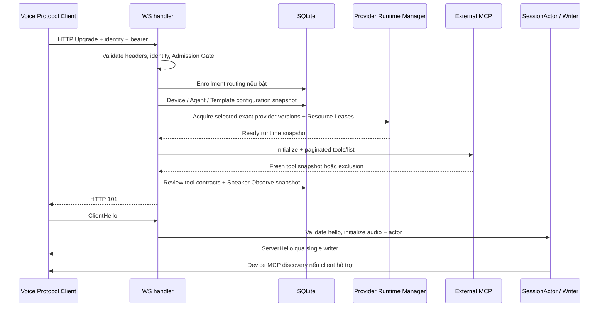

# Phân tích thời gian kết nối WebSocket

Ngày: 2026-10-11. Source baseline: `596d340`.
Phạm vi của báo cáo baseline: kiểm tra flow và đề xuất cải tiến; lúc đo baseline chưa sửa production code/config. Việc triển khai sau đó và kết quả mới được ghi ở [implementation.md](implementation.md).

Kết luận: đường trước HTTP 101 chứa cả chuẩn bị runtime bắt buộc và discovery External MCP tùy chọn. Có thể tái hiện việc một MCP chậm kéo dài kết nối WS dù Voice Session vẫn được admit. Provider riêng của Template còn cold là khả năng thứ hai có cơ sở từ code, chưa được đo bằng model thật trong lần kiểm tra này.

Mục tiêu ms, mốc bắt đầu/kết thúc, client và thời gian thực tế chưa được cung cấp. Ngưỡng 250 ms trong probe chỉ dùng để chứng minh phép đo có khả năng báo lỗi, không phải SLO đã thống nhất. Không có Voice Agent production container đang chạy trong workspace để đo trực tiếp; không dùng process qualification khác đang chạy làm đối tượng thử nghiệm.

## Flow đầy đủ



Nhánh enrollment của Device chưa đăng ký là Enrollment Session riêng, không đi qua acquire conversational providers. OTA, nếu client gọi trước, thêm một request/admission round trip ngoài sơ đồ.

- Trước 101: [handler](../../crates/voice-agent-server/src/app/websocket.rs), [profile resolver](../../crates/voice-agent-server/src/app/state.rs), [DB admission](../../crates/voice-agent-server/src/database/admission.rs).
- Sau 101: `handle_socket` trong cùng file; `hello_timeout_ms` chỉ giới hạn chờ ClientHello, không làm nhanh công việc trước upgrade.
- [Flow 01 hiện có](../../docs/flows/01-websocket.md) bắt đầu sau HTTP upgrade nên không mô tả phần quan trọng nhất khi đo connect.

Đo riêng:

1. `connect → 101`: TCP/TLS/proxy và toàn bộ pre-upgrade admission.
2. `101 → ServerHello`: client gửi hello, khởi tạo actor/audio, writer gửi hello.
3. `listen/detect → first audio`: ASR/LLM/TTS/delivery; không phải thời gian kết nối.

## Bằng chứng đo được

Probe chạy production entrypoint trong **Qualification Build**, SQLite file riêng, provider xác định đã nạp trước bind, HTTP MCP giả lập trên loopback. Không cần credential, không gọi remote model; fixture writes chỉ xảy ra khi process sở hữu DB đã dừng.

```bash
cargo build --locked -p voice-agent-server --bin voice-agent-server --features qualification-providers
python3 .scratch/ws-connection-latency/probe.py \
  --binary /mnt/storage/ai-agent-voice/target/debug/voice-agent-server --budget-ms 250
```

5 kết nối tuần tự mỗi case, median của lần chạy có budget check:

| Case | TCP | Sau TCP → 101 | Sau 101 → ServerHello | Tổng |
| --- | ---: | ---: | ---: | ---: |
| Không bind External MCP | 0,13 ms | 2,38 ms | 0,96 ms | 3,43 ms |
| MCP nhanh | 0,13 ms | 8,99 ms | 0,96 ms | 9,99 ms |
| MCP initialize chậm 600 ms | 0,13 ms | 609,32 ms | 0,97 ms | 610,32 ms |
| Cùng MCP chậm, discovery budget 100 ms | 0,12 ms | 104,18 ms | 0,85 ms | 105,08 ms |

Output cuối: `AssertionError: connection budget exceeded`, exit 1. Chỉ case MCP chậm vượt ngưỡng minh họa 250 ms. [budget-check.log](budget-check.log) lưu output; [measurements.json](measurements.json) lưu từng sample của lần chạy gần nhất.

Các self-check của probe xác nhận nhận được ServerHello hợp lệ ở mọi case, MCP nhanh thực sự đi qua `tools/list`, MCP chậm làm tăng latency ≥450 ms so với baseline, và budget ngắn giảm ≥350 ms so với cùng MCP chậm. Chạy bỏ `--budget-ms` để kiểm tra cơ chế này mà không áp SLO minh họa.

Giới hạn: đây là đo localhost/debug build, không phải production p95/p99 hay firmware. Qualification providers trong probe dùng đường runtime legacy; phần socket, DB admission và External MCP là code thật dùng chung. Không đo cold load của Provider Runtime Manager, TLS, nginx, OTA hay playback trên thiết bị.

## Những điểm đã xác minh trong code

### 1. External MCP fail-soft vẫn chặn trước upgrade

`resolve_session_profile` chuẩn bị profile/runtime xong rồi mới await `resolve_external_mcp`. Handler chỉ trả upgrade sau khi toàn bộ resolver và Speaker Observe hoàn tất. Fail-soft có nghĩa lỗi MCP không từ chối Voice Session, nhưng không có nghĩa không tốn thời gian chờ.

[External MCP Manager](../../crates/voice-agent-server/src/tools/external_mcp/manager.rs) resolve các server bằng `join_all`: đã song song giữa các MCP, nhưng vẫn chờ tập kết quả hoặc budget. Default per-server 3.000 ms, overall 5.000 ms; giảm budget có thể loại capability chậm khỏi immutable session snapshot. `features.mcp=false` chỉ tắt Device MCP discovery sau hello, không bỏ External MCP của Agent.

Đây là cơ chế gây chậm đã đo được. Chỉ kết luận nó là nguyên nhân ở môi trường người dùng khi Agent thực sự bind External MCP và trace cho thấy thời gian nằm tại đây.

### 2. Deployment defaults warm; Template riêng chưa chắc warm

[startup_providers](../../crates/voice-agent-server/src/app/mod.rs) luôn acquire VAD/ASR/LLM/TTS defaults trước bind và `retain_deployment` giữ chúng đến shutdown. TTS default `preload=false` không khiến default TTS bị bỏ preload. Worker của remote TTS được tạo không đồng nghĩa remote inference đã warm.

Ngược lại, [ConfiguredTemplateProfile::prepare](../../crates/voice-agent-server/src/session/runtime_profile.rs) acquire lần lượt provider của selected Template, dùng một deadline chung. Provider mới/revision mới hoặc runtime hết idle TTL có thể phải tải asset, build, init worker và warmup ngay trước 101. Config production đặt `max_parallel_loads=1`, admission deadline 15.000 ms và idle TTL 600.000 ms cho runtime có thể evict.

[ProviderPrewarm](../../crates/voice-agent-server/src/services/provider_prewarm.rs) đã có coalescing, bounded queue và singleflight qua manager; không cần thêm cache/module mới. Tuy nhiên:

- Startup chỉ enqueue default Templates, không await chúng Ready; worker debounce 100 ms rồi xử lý tuần tự.
- [Query startup prewarm](../../crates/voice-agent-server/src/database/providers.rs) không lấy Device Template overrides.
- [Device mutation](../../crates/voice-agent-server/src/app/admin/devices.rs) đổi override/Agent chưa gọi prewarm; bind provider và set default Template đã có hook.
- Speculation có thể bị drop khi busy; metadata `/ready` kiểm tra deployment defaults, không chứng nhận mọi Template đã warm.
- Pilot Admission giữ cold preparation độc quyền với active voice/enrollment. Tăng số loader không tự động vượt được giới hạn này và có thể tăng memory peak.

### 3. Đo hiện tại chưa bao phủ đúng mốc

Metric `ws_admission` chỉ bọc `resolve_session_profile`: gồm DB/profile/runtime/External MCP, bỏ enrollment routing, Speaker Observe và phần socket/hello. Các histogram hiện có hữu ích cho snapshot/queue/build/acquisition, nhưng chưa tách External MCP khỏi tổng.

Log `ServerHello sent; voice session connected` nằm ngay sau enqueue hello và **trước khi spawn writer**. Nó chưa chứng minh socket send thành công hay client đã nhận hello. Không nên lấy timestamp log này làm mốc kết thúc kết nối.

### 4. SQLite và network là hướng kiểm tra tiếp, chưa kết luận

DB graph được đọc bounded trong transaction; không có N+1 theo Template. Enrollment routing có thêm registration query, Speaker Observe có thêm policy/candidate reads, MCP review có công việc DB sau discovery. Pool wait/lock contention có thể làm tail latency tăng; busy timeout 5.000 ms là giới hạn chờ, không phải delay cố định. Không giảm validation hoặc bỏ DB để tiết kiệm vài query.

[nginx config](../../docker/nginx.conf) đã bật HTTP/1.1 upgrade và tắt proxy buffering. Chưa có số đo trực tiếp-versus-proxy hoặc OTA/client nên chưa quy lỗi cho Docker/nginx. [VieNeu evidence cũ](../vieneu-http-live/websocket-flow.json) ghi first audio khoảng 4.763 ms sau detect, không ghi handshake latency.

## Phương án cải tiến theo thứ tự

| Ưu tiên | Thay đổi | Lợi ích | Giới hạn/rủi ro |
| --- | --- | --- | --- |
| 1 | Bổ sung timing theo từng đoạn, lấy mốc ServerHello từ client hoặc writer send thành công | Chọn đúng nút thắt và đo p50/p95/p99 | Không tự làm nhanh kết nối |
| 2 | Cấp discovery budget nhỏ cho External MCP theo SLO đã chốt | Ít thay đổi nhất; phép thử 610 → 105 ms | MCP chậm bị loại khỏi session đến lần reconnect |
| 3 | Sau DB admit, overlap chuẩn bị runtime và External MCP trong module resolver hiện có | Đoạn này từ `T_runtime + T_mcp` thành gần `max(T_runtime, T_mcp)` | Warm runtime vốn nhanh nên gain nhỏ; cần giữ cancellation/accounting đúng |
| 4 | Prewarm selected default/Device override sau commit và ở startup | Giảm kết nối cold ở các profile thực sự dùng | Hint vẫn best-effort, không bảo đảm resident vĩnh viễn |
| 5 | Nếu cần SLO ngay sau restart: chuẩn bị selected deployment profiles trước bind | Chuyển cold cost khỏi kết nối đầu | Startup lâu hơn, phải bounded theo memory và có chính sách rõ khi profile lỗi |

Budget 100 ms là **ví dụ đã thử**, chưa phải giá trị khuyến nghị cố định cho MCP production. Có thể thử bằng các config hiện có `mcp.external.per_server_resolution_timeout_ms` và `overall_resolution_budget_ms` (overall phải ≥ per-server), rồi đo tỷ lệ tools bị exclude. Giá trị phải dành dư địa cho network/DB/core admission. Không giảm request timeout của tool execution cùng discovery nếu người dùng vẫn cần tool chạy lâu.

Prewarm chỉ acquire exact Provider Versions của selected profiles, dùng manager và budget hiện có; không preload mọi switch candidate. Không tăng `max_parallel_loads` hay giữ thêm model vô hạn trước khi có RAM/load evidence.

## Thiết kế module và seam

Giữ `AppState::resolve_session_profile(device_id) -> Result<EffectiveSessionProfile, SessionProfileAdmissionError>` làm external **interface**: caller nhận profile immutable và Resource Leases, không phải học ordering của preload, secret, MCP discovery hoặc provider revisions. Tập trung timing, budget và overlap vào **implementation** của module hiện có để tăng **depth**, **locality** và **leverage**. Không thêm wrapper `WsConnectionManager` chỉ chuyển tiếp lời gọi.

Các internal **seam** đã đủ dùng: Provider Runtime Manager materializer có production FactoryMaterializer và test materializers; External MCP transport có remote server thật và scripted HTTP adapter trong integration tests. Dùng chúng để tạo deterministic slow/cold scenarios. Kiểm tra readiness/latency cuối cùng qua HTTP upgrade và ClientHello/ServerHello — cùng interface mà Voice Protocol Client dùng.

| Thiết kế | Đánh giá |
| --- | --- |
| Giữ readiness trước 101, tối ưu công việc bên trong resolver | Ưu tiên: giữ protocol/error semantics, diff nhỏ |
| Upgrade sớm rồi load runtime trước ServerHello | Chỉ chuyển chờ từ `open` sang hello; không giảm thời gian ready, đổi lỗi HTTP sang WS close |
| Gửi hello sớm rồi chuẩn bị tools/runtime sau | Đổi meaning của Ready và immutable Session Tool Catalog; cần lifecycle/protocol mới |
| Cache tool catalog cũ rồi dùng ngay | Mâu thuẫn fresh observation/approval drift semantics của ADR-0053 |

Hai thiết kế gửi sớm cần xét lại [ADR-0073](../../docs/adr/0073-required-database-and-device-admission.md); không thể triển khai như tối ưu trong suốt. Tools bổ sung sau hello hoặc catalog cũ mâu thuẫn [ADR-0053](../../docs/adr/0053-external-mcp-is-fail-soft-in-v1.md) và immutable snapshot của [ADR-0052/0071](../../docs/adr/0071-versioned-provider-runtime-manager.md). Giữ validation/audio init trước khi thay session cũ theo [ADR-0036](../../docs/adr/0036-initialize-replacement-session-before-displacing-incumbent.md).

## Phạm vi khi triển khai

- Timing/budget/overlap: `app/state.rs`, `app/websocket.rs`, `services/provider_runtime/metrics.rs`, các DTO/UI đọc system metrics nếu schema đổi, và config deployment nếu chỉ tuning budget.
- Prewarm: `app/mod.rs`, `services/provider_prewarm.rs`, `database/providers.rs`, Device override/Agent mutation callers; giữ các hook provider/template hiện có.
- Tests/fixtures: `tests/ws_protocol.rs`, `tests/external_mcp_admission.rs`, `tests/provider_runtime_manager.rs`, fixture DB và scripted MCP. Không thêm dependency, exports hay schema migration cho bước tối thiểu.
- Đồng bộ `docs/flows/01-websocket.md` nếu mở rộng scope sang pre-upgrade; cập nhật docs/config contract nếu có behavior change.

Acceptance cần chốt SLO và đo từ client: warm no-MCP, warm fast/slow/unavailable MCP, cold selected Template, reconnect cùng Device, reconnect sau idle TTL, sau mutation revision/override, và cold acquisition trong khi pipeline/enrollment đang bận. Đảm bảo denied Device vẫn 403, runtime lỗi vẫn 503 trước 101, MCP lỗi chỉ exclude tools, Resource Leases giữ đúng snapshot, shutdown/cancellation không release native capacity sớm.

Kiểm tra đã thực hiện: build qualification; probe có budget check đỏ và self-check; các integration suites WS/MCP/runtime manager được chạy riêng, kết quả ghi trong `validation.log`.

Chưa kiểm tra production, firmware, model cold load hay p95/p99 thực tế. Giảm MCP discovery budget có thể làm session thiếu tools; prewarm dùng thêm tài nguyên và chưa bảo đảm SLO sau idle/eviction.
