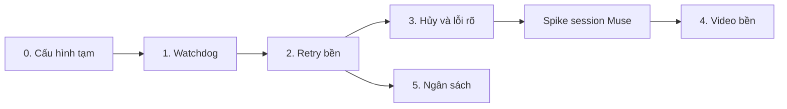

# Triển khai độ bền Job và Agent

Cập nhật: 2026-11-01

Thiết kế gốc: [agent-job-durability-redesign.md](agent-job-durability-redesign.md). Tài liệu đó trả lời "làm gì và vì sao"; tài liệu này trả lời "sửa ở đâu, theo thứ tự nào, kiểm tra ra sao".

Vị trí dòng code lấy tại: repo chính `6c7ad3e5`, `orchestrator_agent_rs` `62ff25f`, `orchestrator_task_rs` `9560fa0` (nhánh `feat/video-continuation-key`). Trong tài liệu, `agent/` là `vendor/orchestrator_agent_rs/src`, `task/` là `vendor/orchestrator_task_rs/src`, `server/` là `crates/voice-agent-server/src`, `gw/` là `server/providers/llm/gateway`.

## Tóm tắt

Triển khai sáu giai đoạn, mỗi giai đoạn phát hành độc lập được. Giai đoạn 0 và 1 đã đủ tránh lỗi cắt stream của job `c79757ba`; giai đoạn 2 mới là thay đổi lớn nhất, vì đưa trạng thái chờ vào mọi nơi đang coi "không phải `running`" là đã kết thúc.

Đối chiếu với code cho thấy 15 điểm thiết kế chưa tính tới, hoặc sẽ không chạy nếu làm đúng như chữ. Ba điểm chặn trực tiếp:

- Migration `agent_runs` không thể chạy qua sqlx như bình thường vì khóa ngoại `ON DELETE RESTRICT`.
- `video_create` là tool `Mutating`, nên sau restart run bị chặn trước khi tool có cơ hội nối lại video.
- Toàn bộ lỗi của gateway đang bị gộp, nên chưa thể phân loại tạm thời hay vĩnh viễn nếu không sửa `LlmError`.

Các quyết định xử lý nằm ở mục [Điều chỉnh so với thiết kế](#điều-chỉnh-so-với-thiết-kế). Chúng được áp dụng xuyên suốt tài liệu này. Phần đã có trong code nằm ở mục [Nền đã có từ đợt sửa Muse video](#nền-đã-có-từ-đợt-sửa-muse-video). Tiến độ thực tế và việc còn lại nằm ở mục [Trạng thái triển khai](#trạng-thái-triển-khai).

## Trạng thái triển khai

Cập nhật bổ sung ngày 2026-11-01, tiếp nối snapshot review ở repo chính `7be4c6a0`, agent `e1a73b6`, task `faa6d7e`. Phần bổ sung đã commit ở agent `a88bbd1` và task `533be88` trên các nhánh hiện tại.

**Code giai đoạn 1–5 đã được bổ sung và kiểm chứng tại local; giai đoạn 4 chưa đủ điều kiện phát hành.** Spike Muse thật và kill/restart với tài khoản thật vẫn chưa chạy. Test giả không chứng minh session/file tồn tại sau khi WebSocket thực sự đứt.

### Các phần đã bổ sung

| Phần | Thay đổi |
| --- | --- |
| Build và ngân sách | Import `Future`; giữ migration `0008_run_budget.sql`; kiểm thử ngân sách trên cây thật, gồm nhánh dừng vì hết ngân sách |
| Shutdown | Tool `Resumable` trả `CANCELLED` vì shutdown không settle invocation; backend giữ operation mở; grace ngắn không rơi về 20s |
| Session | Chỉ ghi `remote_deleted_at` sau ACK xóa; mở lại client bằng account cho session khôi phục; dọn mọi SID kể cả nhiều operation cùng Continuation Key |
| Recovery | Giữ session cho turn `interrupted` còn phục hồi được; `RecoveryContext` dùng chung cho scheduled, user và operator resume |
| Journal | Lưu chính xác lượt đang chờ trong `request_json.pending_turn` trước mọi POST; sửa thời lượng và nhắc đính kèm đều có checkpoint; đếm sửa theo từng lô |
| Mất ACK | Lỗi transport/timeout khi gửi durable turn trả `TOOL_OUTCOME_UNKNOWN`, giữ session và invocation để đối soát, không failover tạo video khác |
| Lô và deadline | Checkpoint phân biệt `submitting`/`running`; deadline tuyệt đối giữ qua restart; 900s cho lô đầu + 800s cho mỗi lô tiếp; không gửi lô/repair sau hạn; thiếu video ở hạn cuối là timeout |
| Dữ liệu cũ | `running`, `batch_index > 0` nhưng thiếu `pending_turn` là checkpoint mơ hồ: trả outcome unknown để đối soát, không lấy lại lô cũ hai lần |
| Muse chat | Deadline nội bộ luôn là `max_total + 30s`, kể cả config cũ dưới 60s |
| UI Jobs | Timeline/inspector/tree hiện trạng thái chờ; hiện output từng phần khi lỗi/dừng/hủy; lịch retry có bộ đếm theo cấu hình; cảnh báo sau 5 phút quan sát trạng thái chờ |
| Đồng bộ Task | `run.started` kích hoạt đọc trạng thái hiện tại; khi run chạy lại thì xóa lý do/lịch chờ và phát `TaskProgress(Running)` |
| Domain docs | Job Budget theo turn, dùng chung qua attempt; follow-up nhận ngân sách mới. ADR 0132/0134 ghi rõ adapter coverage và hợp đồng checkpoint |

Bộ đếm retry dùng giới hạn thực tế: `max_resume_attempts=9` tương ứng 10 attempt kể cả lần đầu; cấu hình mặc định 10 lần phục hồi tương ứng 11 attempt. Không ghi cứng “/10” trên UI.

### Sửa sau code review ngày 2026-11-01

Review hai trục (chuẩn của repo và guide này) trên repo chính `6c7ad3e5...9d200b28`, agent `62ff25f...a88bbd1`, task `9560fa0...533be88`. Ở repo chính, các sửa dưới đây đã commit trên nhánh `worktree-durability-remaining`. **Ở hai vendor, chúng chưa commit:** vẫn nằm trong working tree, trên nền agent `a88bbd1`, task `533be88`.

| Phát hiện | Cách sửa | Vị trí |
| --- | --- | --- |
| Timeout tổng của crate `llm` đua với watchdog | `timeout_seconds` đặt bằng `max_total + 30s`, vì crate không có `read_timeout`. Bổ sung vào ADR 0132 | `agent/gateway/client.rs` |
| Adapter OpenAI còn dùng `.timeout(timeout_ms)` | Dùng chung timeout profile; client chỉ giữ `connect_timeout` và `read_timeout`; deadline tổng nằm ở `execute_operation` | `server/providers/llm/openai/provider.rs` |
| Lỗi đọc/ghi journal bị nuốt hoặc trả sai mã | Trả `TOOL_OUTCOME_UNKNOWN`. Khi người dùng hủy thì vẫn trả `CANCELLED` và ghi log cảnh báo | `task/tools/media_video.rs` |
| Tên hàm gần thuật ngữ cần tránh | Đổi `release_operation_session` thành `release_recorded_job_session` | `gw/muse/pool/job_sessions.rs` |
| Lỗi tạm thời khi nối lại làm operation `failed` | Thêm mã `TOOL_RETRY_LATER`: giữ invocation, run sang `waiting_retry`, attempt sau gọi lại cùng `invocation_id`. Bổ sung vào ADR 0134 | `task/tools/media_video.rs`, `agent/executor/dispatch.rs`, `agent/runtime/settle.rs` |
| Task mất lý do và lịch chờ khi con đang chờ | Thêm `Orchestrator::waiting_descendant`; `resume_waiting` đánh thức cả con cháu nhiều tầng | `agent/store/recovery.rs`, `task/runtime/dispatch_core.rs` |
| Event đến muộn đưa Task đã hủy về `running` | `clear_task_waiting` và `mark_task_waiting` chặn theo status; watcher bỏ qua Task đã kết thúc | `task/store/task_ops.rs`, `task/runtime/watcher.rs` |
| `TaskTerminal` của hủy phát khi run còn chạy, session sống tới sweep | Thử xóa lại mỗi 2s, tối đa 40s, rồi giao cho sweep 5 phút | `server/services/task_flow/mod.rs` |
| `CONTEXT_LIMIT` của con báo `retryable="true"`; `partial_result` không bị cắt | Thêm vào danh sách không retry; cắt theo `tool_output_cap_bytes` và giữ thẻ đóng `</subagent>` | `agent/subagent/outcome.rs`, `agent/executor/dispatch.rs` |
| `resume_waiting` báo thành công khi run bị chặn hoặc hết lượt | Trả lỗi `InvalidInput`. Trạng thái `interrupted`/`failed` vẫn được ghi | `agent/store/recovery.rs`, `agent/orchestrator/session.rs` |

Hai thay đổi hành vi cần biết khi phát hành:

- `resume_waiting` giờ trả lỗi khi đổi routing rồi bấm "Chạy tiếp", thay vì OK.
- Adapter OpenAI với `timeout_ms: 60000` cũ giờ có `max_total` là 10 phút, theo quy tắc của ADR 0132, nên provider treo mất lâu hơn mới bị cắt.

Không sửa:

- `wait_reason` và `retry_reason`: giữ nguyên vì guide quy định cả hai tên, và đổi `wait_reason` cần migration.
- Các smell chỉ là judgement call: không refactor, trừ chuỗi "Waiting…" bị lặp đã gộp thành `project_task_waiting`.

### Kiểm chứng và việc còn lại

Chi tiết lệnh, kết quả và các ranh giới chưa chạy: [biên bản kiểm chứng](providers/agent-job-durability-validation-2026-10-31.md).

- Migration trên bản sao nhất quán của ba `orchestrator.db` và `tasks.db` thật: đã pass; `foreign_key_check` rỗng và `integrity_check=ok`. Không migrate DB gốc.
- Test targeted cho watchdog, shutdown/restart, video journal, deadline, cleanup, budget và UI: đã pass. Full workspace và full suite của hai vendor đã pass; web được kiểm chứng riêng theo biên bản.
- Sau các sửa ngày 2026-11-01: full suite của hai vendor, toàn workspace và clippy `-D warnings` pass trên bản đã áp patch (xem biên bản). Không chạy lại test web vì không sửa web.
- Phần thử lại xóa session khi hủy (`release_terminal_job_sessions`) đã có test `terminal_release_waits_for_the_active_run_then_deletes_the_session_once`, dựng Orchestrator thật và VM giả.
- Ba lỗi kiểm thử đã tìm ra nguyên nhân gốc và sửa, chi tiết ở [biên bản](providers/agent-job-durability-validation-2026-10-31.md#đợt-bổ-sung-ngày-2026-11-01). Thay đổi vendor nằm ở [patch](providers/patches/orchestrator_agent_rs-durability-remaining.patch), **chưa áp vào repo agent**.
- `cargo fmt --check` ở repo chính đã sạch.
- Công cụ và runbook cho chín phép đo đã có ở [spike độ bền session Muse](providers/muse-durability-spike.md), nhưng **chưa chạy với tài khoản thật**. Kill thật và xác nhận số session Muse thật còn lại bằng 0 cũng chưa chạy. Chỉ dùng fallback `VIDEO_SESSION_LOST` nếu phép đo chứng minh không thể resume; hiện chưa có bằng chứng để chọn fallback đó.
- Chưa merge hai nhánh vendor vào `main` và chưa triển khai server.
- `data/orchestrator-prompts/media_creator.md` được ghi đè từ `agent_settings.json` mỗi lần boot, nên sửa file `.md` không có tác dụng. Dữ liệu đang chạy còn override cũ, thiếu hướng dẫn `same job`. Trước phát hành, dừng server và chạy `scripts/sync-media-creator-prompt.py <agent_settings.json> vendor/orchestrator_task_rs/src/prompts.rs --apply` trên từng môi trường: script chỉ thay mục video, giữ các mục khác, có backup. Override còn nhắc `tts_synthesize` và `artifact_create` dù `allowed_tools` không có; giữ nguyên vì chưa xác định được đó là tùy chỉnh hay bản seed cũ.
- Giai đoạn 0 là cấu hình runtime, chưa xác nhận trên Admin/log. Timeout profile mới và deadline Muse chat đã loại bỏ nhánh cắt sớm do config cũ trong code.

Không gọi giai đoạn 4 là hoàn tất trước khi các gate Muse thật đạt. Các sửa độ bền trong nhánh này có thể commit độc lập với việc xác nhận phát hành.

## Điều chỉnh so với thiết kế

| # | Thiết kế giả định | Code thực tế | Quyết định |
| --- | --- | --- | --- |
| 1 | Tạo lại `agent_runs` bằng migration, tắt khóa ngoại | sqlx-sqlite 0.8.6 luôn chạy migration trong transaction và bỏ qua `-- no-transaction`, nên `PRAGMA foreign_keys=OFF` không có tác dụng. `tool_invocations.run_id` là `ON DELETE RESTRICT`, nên `DROP TABLE` thất bại khi có dữ liệu | Chạy migrator trên một connection riêng mở với `foreign_keys(false)`, rồi kiểm tra `PRAGMA foreign_key_check`. Xem [Migration](#migration-tạo-lại-agent_runs) |
| 2 | Thêm trạng thái chờ là đủ | `RunStatus::is_terminal` là `self != Running` (`agent/types.rs:112`). Trạng thái mới sẽ bị coi là đã kết thúc: `await_child` trả lỗi cho cha, và `from_run_status` rơi vào `_ => Failed` | Đổi `is_terminal` thành liệt kê tường minh và rà các nơi dùng theo [bảng ở giai đoạn 2](#các-nơi-đang-ngầm-hiểu-running-là-đang-sống) |
| 3 | Run chờ thì nhả slot, session vẫn được bảo vệ | `idx_one_running_run_per_session` chỉ có `WHERE status='running'`. Run đang chờ không chặn `submit`, nên follow-up có thể chen vào giữa turn | Đổi thành unique index trên cả `running`, `waiting_retry`, `waiting_user` |
| 4 | "Nhả slot root" khi job chờ | Root đang chờ con vẫn là `running` và giữ slot. `max_concurrent_root_runs` mặc định là 2 (`server/config/orchestrator_wiki.rs:65`), nên hai job có con đang chờ quota sẽ chặn mọi job khác hàng giờ | `spawn_unowned` không đếm root có con đang chờ. Giới hạn trở thành giới hạn mềm |
| 5 | Phân loại lỗi trong runtime | `LlmError` chỉ có `Failed`, `Rejected`, `UnsupportedCapability`, và `TimedOut` mới thêm cho Muse. `gateway_executor.rs:229` gộp 429, hết account và lỗi mạng thành `Provider`; lỗi giữa stream thành `Protocol`. `HttpRejected` gồm cả 400 và 500 | Sửa `WireError`, `LlmError` và ánh xạ executor ngay đầu giai đoạn 2, không để tới giai đoạn 3 |
| 6 | Recovery tìm operation dở rồi nối lại | `video_create` là `Mutating`, nên `recover_run_inner` đặt `TOOL_OUTCOME_UNKNOWN` và không bao giờ gọi lại tool. `replay_safe` chỉ nhận tên tool | Thêm `ToolEffect::Resumable`: tool được gọi lại cùng `invocation_id` và tự đọc `tool_operations` |
| 7 | Operation có `running`, `downloading`, `submitting` | Crash sau khi commit artifact, trước khi settle invocation, sẽ tải và tạo artifact lần hai | Thêm trạng thái `committed` lưu `artifact_ids`; gọi lại tool thì trả kết quả đã có |
| 8 | Hủy thì xóa session Muse | Shutdown dùng chung token với hủy. Nếu xử lý giống nhau, restart có kế hoạch sẽ xóa video đang render | Phân biệt lý do: người dùng hủy thì xóa session, shutdown thì giữ. Áp dụng cho session của cả job, xem #14 |
| 9 | Dùng message `synthetic` để nhắc model | Bảng cho phép role này nhưng `agent/` không có code đọc nó | Chèn hướng dẫn tạm thời vào request như `STEP_LIMIT_GUIDANCE` (`runtime/model.rs:186`), không ghi transcript |
| 10 | Giới hạn step toàn job | `run_steps` đọc theo từng attempt, nên mỗi lần resume đếm lại từ 0 | `capped` tính trên tổng step của `turn_id`, sửa ngay từ giai đoạn 2 |
| 11 | Run có trạng thái `stopped` | Thiết kế chỉ thêm `stopped` vào `tasks`, nhưng sơ đồ trạng thái vẽ ở cấp run | Run kết thúc bằng `completed` hoặc `failed` kèm `error_code='BUDGET_EXHAUSTED'`; Task đọc mã này để ra `stopped` |
| 12 | Bỏ deadline riêng của Muse chat | `invoke` và `collect_chat_stream` không đi qua watchdog của vendor, nên sẽ không còn giới hạn nào | Giữ deadline nội bộ bằng `max_total + 30s` để watchdog luôn báo trước |
| 13 | Giai đoạn 1, 2, 5 sửa vendor | Giai đoạn 3 và 4 cũng sửa vendor (`ToolContext`, `ToolEffect`, bảng mới) | Mọi giai đoạn trừ giai đoạn 0 đều có thay đổi ở vendor |
| 14 | Mỗi operation có một session, xóa ngay khi xong | Session Muse nay thuộc cả job: sửa thời lượng, chia lô và retry dùng chung. Xóa sau `committed` đầu tiên sẽ làm mất ngữ cảnh của các lần gọi sau | Xóa khi job kết thúc hoặc hết TTL. `remote_session_id` có thể trùng giữa nhiều operation của một job |
| 15 | Thêm `LlmError::Timeout` ở giai đoạn 2 | Code đã có `LlmError::TimedOut` với cùng ý nghĩa | Giai đoạn 2 đổi tên `TimedOut` thành `Timeout`, không giữ cả hai |

Ngoài ra, `valid()` chỉ chấp nhận `timeout_ms` tối đa 600.000 (`gw/config.rs:57`), trong khi `max_total_ms` của Muse là 1.800.000. Trường mới cần miền giá trị riêng.

## Nền đã có từ đợt sửa Muse video

Đợt sửa sau job `eb0a5434` đã làm một phần giai đoạn 3 và 4, nhưng chỉ ở mức trong một process và chưa kiểm chứng với Muse thật. Các giai đoạn dưới đây dựng tiếp trên phần này, không làm lại.

| Cơ chế | Vị trí | Giai đoạn dùng tiếp | Còn thiếu |
| --- | --- | --- | --- |
| Session theo job: `video_create` gửi `root_session_id` làm `continuation_key`; registry ghim account và cho các lần gọi cùng job chạy nối tiếp | `gw/muse/pool/job_sessions.rs`, `task/tools/media_video.rs`, `gw/provider/muse_ops.rs:258` | 3, 4 | Nằm trong RAM, mất khi restart |
| Giữ session sau khi xong hoặc timeout; dùng lại session sẵn có | `retain_session` (`gw/muse/pool/lease.rs:40`), `acquire_existing_session` (`gw/muse/pool/mod.rs:162`) | 4 | Chưa phân biệt lý do hủy |
| Đo thời lượng MP4, thiếu quá 5s thì nhắc tiếp trong session, tối đa 2 lần | `run_media_batch` (`gw/muse/workflow/media/mod.rs:200`) | 4 | Trạng thái chưa lưu bền |
| Chia lô 61–120s; vượt giới hạn provider thì báo `INVALID_ARGUMENT`, không cắt ngầm | `format_video_batches` (`gw/muse/workflow/prompt.rs`), `task/tools/media_video.rs` | 4 | Giả định 6 clip mỗi lượt chưa kiểm chứng |
| Thu hồi video làm xong muộn sau một lần timeout | `recover_finished_video` (`gw/muse/workflow/media/mod.rs:580`) | 4 | Xem bảng lỗi dưới đây |
| Lỗi timeout riêng | `LlmError::TimedOut`, chuỗi `TIMEOUT:` ở `media_backend.rs:343` | 2, 3 | Đổi tên và có mã lỗi riêng |
| `video_create` dừng khi thấy cờ hủy (kiểm tra mỗi 200ms) | `task/tools/media_video.rs:382` | 3 | Tool khác chưa có; chưa có ân hạn cưỡng bức |
| Dòng `requested=… actual=… complete=… next_action=…` trong text cho model | `task/tools/media_video.rs`, `MEDIA_CREATOR_PROMPT` | 4 | Bản `data/orchestrator-prompts/media_creator.md` đang chạy không tự cập nhật, vì seed chỉ ghi khi file chưa tồn tại |

Review đợt đó phát hiện các lỗi sau. Bảng này giữ lại làm yêu cầu gốc; tình trạng hiện tại xem ở [Trạng thái triển khai](#trạng-thái-triển-khai):

| Lỗi | Sửa ở |
| --- | --- |
| Hủy không xóa session, vì lease đã `retain_session` | Giai đoạn 3 |
| Lần gọi đầu bị hủy giữa chừng chưa ghi vào registry, nên session đó không bao giờ được dọn | Giai đoạn 3 |
| Thông báo `TIMEOUT:` hứa giữ phần đã làm, nhưng job nhiều lô vẫn chạy lại từ lô 1 | Giai đoạn 3 |
| MP4 không đo được thời lượng bị coi là đủ, nên có thể báo `complete=true` | Giai đoạn 3 |
| Thu hồi nhiều lô so file của lô cuối với tổng thời lượng, nên luôn thất bại; lô sau hết giờ thì trả phần đã có và không đặt cờ timeout | Giai đoạn 4 |
| Thu hồi so với yêu cầu mới, nên retry đổi prompt hoặc thời lượng có thể nhận video cũ | Giai đoạn 4 |
| Không lấy được lease của account đã ghim thì mở session mới trên account khác, không xóa session cũ | Giai đoạn 4 |
| TTL 1 giờ chỉ được quét khi có lần gọi video khác, nên server rảnh thì session còn mãi | Giai đoạn 4 |
| Timeout của Muse chat cũng thành `TimedOut` nhưng chưa có test | Giai đoạn 2 |
| Video 61s tạo lô thứ hai dài khoảng 1 giây | Giai đoạn 4 |

## Chuẩn bị

### Ba repo git

`/vendor/` nằm trong `.gitignore` của repo chính. Hai crate vendor là repo riêng, được nối qua `[patch.crates-io]`.

- Commit ở repo chính không chứa thay đổi vendor, nên reviewer không thấy phần đó nếu không được chỉ.
- Nhánh `feat/video-continuation-key` của `orchestrator_task_rs` chưa vào `main`. Repo chính từ `47a49102` trở đi cần nhánh này mới build được, nên phải merge trước khi bắt đầu giai đoạn 1.
- Mỗi PR ở repo chính phải ghi SHA vendor tương ứng. Thứ tự commit: `orchestrator_agent_rs`, `orchestrator_task_rs`, rồi repo chính.
- `GatewayError`, `ToolEffect` và `LlmProviderConfig` là API công khai không có `non_exhaustive`, nên thay đổi ở đây là phá vỡ tương thích. Nâng `orchestrator-agent` lên `0.5.0` và sửa yêu cầu phiên bản ở cả `Cargo.toml` gốc lẫn `vendor/orchestrator_task_rs/Cargo.toml`. Nếu không, `[patch]` sẽ không áp dụng.

### ADR và tài liệu miền

Dùng skill `domain-modeling`. Số ADR tiếp theo là 0132.

| ADR | Nội dung | Viết trước |
| --- | --- | --- |
| 0132 | Mô hình timeout: một watchdog, ba giới hạn | Giai đoạn 1 |
| 0133 | `waiting_retry`, retry bền, ngân sách | Giai đoạn 2 |
| 0134 | `tool_operations`, `ToolEffect::Resumable` và session Muse theo job | Giai đoạn 4 |

ADR 0133 phải nêu rõ ngoại lệ với hai ADR đang hiệu lực:

- **ADR 0023** cấm retry ở tầng provider. Retry mới nằm ở tầng Agent Run, chỉ cho Background Task. Voice giữ nguyên một lần gọi. Thêm liên kết từ 0023 sang 0133.
- **ADR 0095** nói không tự retry ở cấp job và step. Ghi rõ quyết định đó vẫn áp dụng cho tool không rõ kết quả, còn lỗi LLM thì không.

Thêm vào `GLOSSARY.md`: Waiting Retry, Job Budget, Tool Operation, Request Limits, Job Session, Continuation Key.

### Chạy test

Không gọi `cargo test` trực tiếp. Hai crate vendor nằm ngoài workspace, nên dùng lệnh `run`:

```bash
# Crate server
scripts/agent-test.sh targeted watchdog voice-agent-server

# Crate vendor
scripts/agent-test.sh run -- cargo test --quiet --manifest-path vendor/orchestrator_agent_rs/Cargo.toml watchdog
scripts/agent-test.sh run -- cargo test --quiet --manifest-path vendor/orchestrator_task_rs/Cargo.toml waiting

# Web
scripts/agent-test.sh web test
```

Chạy test đích trước, `full` sau cùng. Test `*_live_*` cần tài khoản thật, không thuộc điều kiện hoàn thành.

## Thứ tự và phụ thuộc



| Giai đoạn | Repo bị sửa | Migration | Rollback bằng binary cũ |
| --- | --- | --- | --- |
| 0 | Chỉ dữ liệu cấu hình | Không | Được |
| 1 | agent, server, web | `agent` 0005 | Phải khôi phục backup |
| 2 | agent, task, server, web | `agent` 0006, `task` 0002 | Phải khôi phục backup |
| 3 | agent, task, server | Không | Được |
| 4 | agent, task, server | `agent` 0007 | Phải khôi phục backup |
| 5 | agent, task, server | `agent` 0008 | Phải khôi phục backup |

Binary cũ không chạy được trên DB mới, vì sqlx báo `VersionMissing` khi thấy migration lạ. Do đó backup trước khi phát hành là bước bắt buộc, không phải phòng hờ.

## Giai đoạn 0: cấu hình tạm

Không sửa code. Qua Admin, đặt `timeout_ms` của GPT-5.6-luna thành 300.000 và Muse chat thành 600.000.

Trước khi đổi, kiểm tra provider đó có đang dùng cho voice không. Voice lấy giới hạn từ cùng `timeout_ms` (`server/config/providers.rs:143`), nên nếu dùng chung thì voice sẽ chờ lâu hơn khi provider treo.

Timeout không nằm trong `routing_fingerprint`, nên việc đổi không làm chặn resume của run cũ.

**Xong khi:** không còn job đứt ở mốc 60s trong log.

## Giai đoạn 1: watchdog

Mục tiêu là stream còn dữ liệu thì không bị cắt, stream treo thì bị cắt đúng mức idle. Trạng thái job chưa đổi: hết giờ vẫn thành `timed_out`.

### Vendor agent

| File | Thay đổi |
| --- | --- |
| `agent/config.rs:250` | Thay `request_timeout: Duration` bằng `limits: RequestLimits` |
| `agent/gateway/watchdog.rs` (mới) | Theo dõi tín hiệu và báo hết hạn |
| `agent/gateway/types.rs:199` | Thêm `StreamEvent::Activity` |
| `agent/gateway/error.rs:5` | Thêm `Stalled`, `RequestLimitExceeded` |
| `agent/gateway/client.rs:296` | Thay `tokio::time::timeout` bằng watchdog |
| `agent/gateway/client.rs:127,150` | So sánh `limits`; `timeout_seconds` dùng `max_total + 30s` để watchdog luôn báo trước (ADR 0132) |
| `agent/gateway/collect.rs:208,216` | Phát `Activity` cho mọi chunk |
| `agent/runtime/terminal.rs:43` | `Stalled`, `RequestLimitExceeded` cũng thành `TimedOut` (tạm thời) |
| `agent/runtime/model.rs:105` | Đo tín hiệu và ghi `llm_attempts` |
| `agent/store/delete.rs` | Xóa `llm_attempts` theo session family |
| `migrations/0005_llm_attempts.sql` (mới) | Bảng đo lường |

Có 45 chỗ dựng `LlmProviderConfig` bằng struct literal trên 38 file, chủ yếu là test. Sửa cơ học bằng `RequestLimits::uniform(d)`, vốn giữ nguyên hành vi cũ.

```rust
#[derive(Debug, Clone, Copy, PartialEq, Eq)]
pub struct RequestLimits {
    pub first_byte: Duration,
    pub idle: Duration,
    pub max_total: Duration,
}

impl RequestLimits {
    /// Cả ba giới hạn bằng nhau: giữ hành vi deadline cũ cho test và host chưa chuyển đổi.
    pub const fn uniform(limit: Duration) -> Self {
        Self { first_byte: limit, idle: limit, max_total: limit }
    }
}
```

```rust
// agent/gateway/watchdog.rs
pub(crate) enum Expiry { Stalled, LimitExceeded }

pub(crate) struct Watchdog {
    limits: RequestLimits,
    started: Instant,
    /// Mili giây từ `started` tới tín hiệu gần nhất; 0 nghĩa là chưa có tín hiệu.
    last_signal_ms: AtomicU64,
}

impl Watchdog {
    pub(crate) fn touch(&self);
    /// Chờ tới khi vượt giới hạn. Tính lại mốc sau mỗi lần thức, nên `touch` không cần đánh thức.
    pub(crate) async fn expired(&self) -> Expiry;
}
```

Mốc tiếp theo là `min(started + max_total, mốc idle)`. Mốc idle là `started + first_byte` khi chưa có tín hiệu, và `last_signal + idle` khi đã có. `max_total` luôn áp dụng, kể cả khi còn `Activity`.

Ba chỗ dễ làm sai:

1. **Gọi `touch` trước `ThinkStreamFilter`.** Khi model đang ở trong `<think>`, bộ lọc trả chuỗi rỗng và `sink` không được gọi. Nếu `touch` nằm sau bộ lọc, model đang suy nghĩ sẽ bị coi là treo. Trong `client.rs`, gọi ở đầu `filtered_sink`; trong `collect.rs`, phát `Activity` ở đầu nhánh `Some(Ok(chunk))`.
2. **`Activity` phải đi tiếp tới sink của runtime.** `stream_step` cần nó để đo `llm_attempts`. Sink hiện tại dùng `if let TextDelta`, nên không bị ảnh hưởng.
3. **Provider `llm` crate không để lộ reasoning.** Với provider API key thường, thời gian suy nghĩ chỉ được bảo vệ bởi `first_byte`. Đây là giới hạn đã biết, nên đặt `first_byte` đủ rộng.

```sql
-- migrations/0005_llm_attempts.sql
CREATE TABLE IF NOT EXISTS llm_attempts (
    id TEXT PRIMARY KEY,
    run_id TEXT NOT NULL REFERENCES agent_runs(id),
    step INTEGER NOT NULL,
    started_at INTEGER NOT NULL DEFAULT (unixepoch()),
    first_byte_ms INTEGER,
    last_activity_ms INTEGER,
    chars_received INTEGER NOT NULL DEFAULT 0,
    outcome TEXT NOT NULL
);
CREATE INDEX IF NOT EXISTS idx_llm_attempts_run ON llm_attempts(run_id, step);
```

`outcome` là `completed`, hoặc `error_code` của lỗi. Ghi lỗi best-effort như `record_usage`: thất bại chỉ log, không làm hỏng run. Sink là `Fn`, nên dùng atomic để đếm trong `stream_step`.

### Server

| File | Thay đổi |
| --- | --- |
| `server/providers/llm/mod.rs:204` | Thêm `LlmEvent::Activity` |
| `server/providers/llm/mod.rs:622` | `collect_chat_stream` bỏ qua `Activity` |
| `server/workers/llm/mod.rs:410,482` | Voice bỏ qua `Activity`, không gia hạn timer của voice |
| `server/benchmark/provider/llm.rs:30` | Bỏ qua `Activity` |
| `server/services/task_flow/agent_settings/gateway_executor.rs:268` | Chuyển thành `StreamEvent::Activity` |
| `gw/wire_codex.rs:491` | Phát `Activity` cho mọi event SSE, kể cả reasoning |
| `gw/wire_anthropic.rs`, `wire_gemini.rs`, `wire_openai.rs` | Phát `Activity` cho mọi dòng SSE, kể cả ping |
| `gw/provider/mod.rs:108` | Đổi `.timeout()` thành `connect_timeout` và `read_timeout` |
| `gw/config.rs` | Thêm `timeout_profile`, `first_byte_ms`, `idle_ms`, `max_total_ms` |
| `.../provider_catalog/discovery.rs:125,149,205,253` | Đọc profile và giữ tương thích `timeout_ms` |
| `.../provider_catalog/resolved.rs:360` | Dựng `limits` từ profile |
| `gw/provider/muse_ops.rs:85` | Abort task khi stream bị drop |
| `gw/muse/workflow/chat/mod.rs` | Phát tín hiệu hoạt động, sửa text cụt |

**Giới hạn Activity:** phát tối đa một lần mỗi giây trên mỗi stream, vì kênh `tx` không giới hạn và SSE có thể rất dày.

**Reqwest:** `read_timeout = max(first_byte, idle) + 30s` và `connect_timeout = 15s`. `read_timeout` chỉ là lưới an toàn mạng, nên phải dài hơn watchdog để giữ nguyên tắc một watchdog duy nhất.

`self.http` cũng được dùng ở chỗ khác và sẽ mất deadline tổng khi bỏ `.timeout()`:

- `run_vision`: bọc `tokio::time::timeout(max_total)` trong `execute_operation`.
- Bootstrap và credential của Muse, qua `muse/pool/mod.rs:105`: đặt `.timeout(30s)` trên từng request.

**Profile:**

| Profile | Dùng cho | `first_byte` | `idle` | `max_total` |
| --- | --- | --- | --- | --- |
| `interactive` | Voice | 30s | 30s | 2 phút |
| `standard` | LLM thường | 120s | 90s | 10 phút |
| `agentic` | Muse | 180s | 180s | 30 phút |

Số của `interactive` chưa có trong thiết kế và là giá trị khởi điểm. Binding Muse mặc định `agentic`, còn lại `standard`.

Video Muse không dùng bảng này. Deadline của một lần gọi là `max(timeout_ms, 900s + 800s × (số lô − 1))` (`muse_ops.rs:247`), tối đa 1.700s với hai lô, và phải luôn thấp hơn `VIDEO_CREATE_TIMEOUT` là 1.800s. Khi bỏ `timeout_ms`, không dùng trực tiếp `max_total` cho video, vì miền hợp lệ của trường này tới 2 giờ.

```rust
pub fn resolve(profile: Option<TimeoutProfile>, custom: CustomLimits, legacy_timeout_ms: u64) -> RequestLimits
```

`timeout_ms` cũ chỉ thay `max_total` khi lớn hơn mặc định. Miền hợp lệ của trường mới: `first_byte` và `idle` từ 1s tới 1 giờ, `max_total` từ 1s tới 2 giờ, và `idle <= max_total`. Giữ nguyên miền của `timeout_ms` để config cũ vẫn hợp lệ.

**Muse chat:** đổi callback của `run_chat_turn_once` từ `FnMut(String)` thành `FnMut(ChatSignal)`.

```rust
pub(crate) enum ChatSignal { Delta(String), Activity }
```

Phát `Activity` khi nhận event khớp session (`agent.status` đang hoạt động, `task.*`, approval) và khi lượt poll thấy `is_agent_working` hoặc `has_active_tool_task`.

Sửa `chat/mod.rs:364`: thêm cờ `completed`, chỉ đặt `true` ở các nhánh `break` đã xác nhận xong. Hết vòng lặp mà `completed == false` thì trả `WorkflowFailure::Timeout`, kể cả khi đã có text. Đây là nguyên nhân khiến text cụt được coi là thành công.

**Task mồ côi** (`muse_ops.rs:102`): giữ `tokio_util::task::AbortOnDropHandle` trong closure của `poll_fn`. Stream bị drop thì task bị abort, `VmOperationLease` drop theo và xóa session, và không còn `report_outcome(Success)` sau khi client đã bỏ cuộc.

### Admin web

`ProviderFormModal.vue` chọn profile trước, chỉ hiện ba trường số khi chọn tùy chỉnh. Giữ `timeout_ms` khi đọc dữ liệu cũ. Cập nhật `ProviderFormModal.test.ts`.

### Test

| Test | Vị trí | Kiểm tra |
| --- | --- | --- |
| `watchdog_*` | `agent/gateway/tests.rs`, `#[tokio::test(start_paused = true)]` | Stream đều 5 phút không bị cắt; ngừng giữa chừng thì cắt đúng mức idle; không có byte thì cắt ở `first_byte`; `Activity` đều vẫn bị chặn ở `max_total` |
| `watchdog_think_block` | Như trên | Chỉ có `<think>` trong 3 phút vẫn không bị coi là treo |
| `llm_attempt_recorded` | `tests/m1_single_agent.rs` | Có bản ghi cho cả thành công và lỗi |
| `muse_truncated_is_error` | `gw/muse/tests/chat.rs` | Có text rồi hết hạn thì trả lỗi |
| `muse_stream_drop_aborts` | `gw/muse/tests/chat.rs` | Drop stream thì session bị xóa, không có `report_outcome` |
| `codex_reasoning_activity` | `gw/tests.rs` | Event reasoning sinh `Activity` |
| `voice_ignores_activity` | `server/workers/llm` | Voice không gia hạn khi nhận `Activity` |
| `profile_resolve_*` | `gw/config.rs` | `timeout_ms: 60000` cũ vẫn đọc được, không còn cắt ở 60s |

**Xong khi:** stream chậm nhưng đều vượt 60s vẫn hoàn thành, stream treo bị cắt đúng mức idle, và `llm_attempts` đủ dữ liệu để phân biệt hai trường hợp.

## Giai đoạn 2: retry bền

Mục tiêu là lỗi tạm thời không còn làm job kết thúc. Làm ba bước theo thứ tự: phân loại lỗi, retry nhanh, rồi trạng thái chờ.

### Bước 1: phân loại lỗi

Server trước, vì hiện lỗi mất thông tin trước khi tới vendor.

```rust
// gw/provider/wire.rs
pub(crate) enum WireError {
    NoLease(NoLeaseKind),                         // CoolingDown | NeedsReauth | Unavailable
    RateLimited { retry_after_secs: Option<u64> },
    Unauthorized,
    HttpRejected,    // 4xx
    HttpUnavailable, // 5xx: tách khỏi HttpRejected
    Other,
}

// server/providers/llm/mod.rs
pub enum LlmError {
    Failed,
    Rejected,
    UnsupportedCapability(&'static str),
    RateLimited { retry_after_secs: Option<u64> },
    Transient,
    Timeout, // đổi tên từ TimedOut đang có
    Unauthorized,
}
```

- `check_wire_status` (`wire.rs:138`) trả `HttpUnavailable` cho 5xx. Failover pool giữ nguyên cho cả hai.
- `chat.rs:59` giữ lại nguyên nhân từ `hub.acquire_lease`: `AccountCoolingDown` thành `CoolingDown`; `AccountReauthRequired` thành `NeedsReauth`.
- `WorkflowFailure::into_llm_error` (`workflow/mod.rs:19`): quota thành `RateLimited { Some(3600) }`, transient thành `Transient`, auth thành `Unauthorized`, timeout thành `Timeout`.
- Voice (`server/workers/llm/mod.rs:311,378,401,426`) thêm nhánh coi các biến thể mới như `Failed`, trừ `Timeout`: biến thể này đã ánh xạ sang `LlmInvokeError::Timeout` (dòng 316). Chỉ workflow Muse tạo ra nó, nên voice dùng provider khác không đổi hành vi.
- Thêm test cho Muse chat khi hết hạn, vì nhánh này đã trả `TimedOut` mà chưa có test.

```rust
// agent/gateway/error.rs
pub enum GatewayError {
    // biến thể hiện có...
    Stalled,
    RequestLimitExceeded,
    RateLimited { retry_after_secs: Option<u64> },
}

pub(crate) enum FailureClass {
    Retryable { retry_after: Option<Duration> },
    RetryOnceThenSplit,
    NeedsUser,
    Permanent,
    Cancelled,
}
```

| `GatewayError` | Mã | Loại |
| --- | --- | --- |
| `Stalled` | `PROVIDER_STALLED` | `Retryable` |
| `Timeout`, `Transport`, `Provider` | giữ nguyên | `Retryable` |
| `Protocol` | `PROVIDER_PROTOCOL_ERROR` | `Retryable` (stream cụt, response rỗng) |
| `RateLimited` | `PROVIDER_RATE_LIMITED` | `Retryable` với `retry_after` |
| `RequestLimitExceeded` | `REQUEST_LIMIT_EXCEEDED` | `RetryOnceThenSplit` |
| `Auth` | `PROVIDER_AUTH_FAILED` | `NeedsUser` |
| `NotConfigured`, `InvalidRequest` | giữ nguyên | `Permanent` |
| `ContextOverflow` | `CONTEXT_LIMIT` | Giữ luồng compact hiện có |
| `Cancelled` | `CANCELLED` | `Cancelled` |

Trong `gateway_executor.rs`: `NoLease(CoolingDown)` thành `RateLimited { None }`, `NoLease(NeedsReauth)` thành `Auth`, `HttpRejected` thành `InvalidRequest`, `HttpUnavailable` và `Other` thành `Provider`. Nhánh lỗi giữa stream (dòng 256) đọc biến thể `LlmError` thay vì luôn trả `Protocol`.

### Bước 2: retry nhanh

Sửa vòng lặp ở `agent/runtime/model.rs:74`:

- Tối đa 2 lần sau 5s và 30s. Profile `agentic` chỉ 1 lần để tránh tốn quota Muse. Thêm `fast_retries: u8` vào `RequestLimits`.
- Sleep phải chọn cùng `cancel.cancelled()`.
- `retry_after` lớn hơn 30s thì bỏ qua vòng nhanh, sang thẳng `waiting_retry`.
- Mỗi lần retry dùng `step_id` mới và một dòng `llm_attempts` mới.
- Lỗi khi `compact` đi qua cùng cách xử lý thay vì `fail` trực tiếp.

An toàn vì `complete` chỉ trả `Ok` khi response đã xong, và chưa có gì được commit trước khi đó.

**Chia nhỏ đầu ra:** đếm trong `llm_attempts` các dòng `REQUEST_LIMIT_EXCEEDED` cùng `turn_id` và `step`. Từ lần thứ hai trở đi, `step_request` chèn `SPLIT_OUTPUT_GUIDANCE` như `STEP_LIMIT_GUIDANCE`. Bộ đếm nằm trong DB nên còn nguyên qua các attempt.

### Bước 3: trạng thái chờ

#### Migration: tạo lại `agent_runs`

```sql
-- migrations/0006_run_waiting_states.sql
-- Chạy với foreign_keys=OFF; xem SessionStore::open.
DROP INDEX IF EXISTS idx_runs_session;
DROP INDEX IF EXISTS idx_runs_turn;
DROP INDEX IF EXISTS idx_one_running_run_per_session;

CREATE TABLE agent_runs_new (
    -- giữ nguyên toàn bộ cột và ràng buộc của agent_runs, chỉ đổi CHECK của status:
    -- status IN ('running','completed','failed','cancelled','timed_out','interrupted',
    --            'waiting_retry','waiting_user')
    next_attempt_at INTEGER,
    retry_reason TEXT,
    CHECK ((status = 'waiting_retry') = (next_attempt_at IS NOT NULL))
);
INSERT INTO agent_runs_new (/* cột cũ */) SELECT /* cột cũ */ FROM agent_runs;
DROP TABLE agent_runs;
ALTER TABLE agent_runs_new RENAME TO agent_runs;

CREATE INDEX idx_runs_session ON agent_runs(session_id, started_at);
CREATE INDEX idx_runs_turn ON agent_runs(session_id, turn_id, resume_attempt);
CREATE UNIQUE INDEX idx_one_active_run_per_session ON agent_runs(session_id)
    WHERE status IN ('running','waiting_retry','waiting_user');
CREATE INDEX idx_runs_next_attempt ON agent_runs(next_attempt_at)
    WHERE status = 'waiting_retry';
```

Hai điểm cần giữ khi viết file thật:

- **Chép cả `rowid`.** `candidate_filter` so sánh `z.rowid > r.rowid`, nên `INSERT` phải liệt kê `rowid` tường minh ở cả hai vế. Nếu không, thứ tự turn có thể đổi.
- **Xóa `next_attempt_at` khi rời `waiting_retry`.** CHECK ở trên yêu cầu điều này, nên mọi câu `UPDATE` đưa run ra khỏi trạng thái chờ phải đặt cột về `NULL`, gồm bước `RETRY_DUE` và `finish_run_without_final`.

Sửa `SessionStore::open` (`agent/store/session.rs:25`):

```rust
// Migrator chạy trên connection riêng: PRAGMA trong transaction không có tác dụng.
let mut migrator_conn = options.clone().foreign_keys(false).connect().await?;
sqlx::migrate!("./migrations").run(&mut migrator_conn).await?;
let violations: Vec<SqliteRow> = sqlx::query("PRAGMA foreign_key_check")
    .fetch_all(&mut migrator_conn)
    .await?;
if !violations.is_empty() {
    return Err(/* migrate error, không mở store */);
}
migrator_conn.close().await?;
// Sau đó mới mở pool với foreign_keys(true) như cũ.
```

`mark_stale_runs_interrupted` chỉ quét `running`, nên run đang chờ giữ nguyên qua restart, đúng như mong muốn.

#### Chuyển trạng thái

```rust
// agent/store/run.rs
/// CAS từ `running`. `next_attempt_at = None` nghĩa là `waiting_user`.
pub(crate) async fn suspend_run(
    &self, run_id: &str, next_attempt_at: Option<i64>,
    code: &str, message: &str,
) -> Result<bool, OrchestratorError>;

pub(crate) async fn due_waiting_runs(&self, now: i64) -> Result<Vec<String>, OrchestratorError>;
```

Điểm tập trung là `fail_with_detail` (`terminal.rs:16`), vì mọi lỗi gateway đều đi qua đó:

| Loại | Hành động |
| --- | --- |
| `Retryable` | Tính backoff và `suspend_run`. Nếu `resume_attempt + 1 > max_resume_attempts`, `finish` thành `failed` với `RECOVERY_ATTEMPTS_EXHAUSTED` |
| `NeedsUser` | `suspend_run` với `next_attempt_at = None` |
| `Permanent` | `finish` thành `failed`, như hiện tại |

Backoff: 1, 5, 15, rồi 30 phút mỗi lần, lấy `max(backoff, retry_after)`. Vị trí trong dãy là số attempt có `retry_reason` trong cùng `turn_id`, để crash recovery không làm dãn lịch.

`suspend_run` trả về `Settlement::Terminal`, để supervisor bỏ theo dõi và worker nhả slot. Phát event mới `RUN_WAITING` sau commit, chứa `reason` và `next_attempt_at`, để watcher cập nhật.

#### Chạy lại

Dùng lại `recover_run_inner` để giữ các kiểm tra an toàn: đổi routing, đóng delegation, hết số lần.

```rust
// Trong một transaction:
// 1. CAS waiting_retry -> interrupted, error_code = 'RETRY_DUE', giữ retry_reason.
// 2. recover_run_inner(tx, run_id, policy).
```

Thêm `RETRY_DUE` vào `RECOVERABLE_CODES`, đồng thời sửa `candidate_filter` để `NOT EXISTS` xét cả ba trạng thái đang sống. Vì hai bước nằm chung transaction, unique index mới không bị vi phạm.

Trong `Shared::reconcile` (`supervisor.rs:307`), gọi `resume_due_waiting` trước `spawn_unowned`. `RecoveryPolicy` đang được dựng ở `builder.rs:307` và `lifecycle.rs:130`. Đưa phần dựng đó thành một `RecoveryContext` dùng chung và đặt vào `Shared`. Chu kỳ sweep 30s là đủ chính xác cho lịch tính bằng phút.

`waiting_user` không có lịch. Thêm `Orchestrator::resume_waiting(caller, session_id)` và một endpoint Admin đặt cạnh endpoint hủy. Nút "Chạy tiếp" trên UI gọi endpoint đó sau khi đăng nhập lại.

Từ giai đoạn 2 tới khi có giai đoạn 5, `waiting_user` chưa có giới hạn thời gian, nên job có thể chờ mãi. Cần có cảnh báo job chờ lâu ngay trong giai đoạn 2, không để tới giai đoạn 5.

#### Các nơi đang ngầm hiểu `running` là đang sống

| Vị trí | Hiện tại | Sửa thành |
| --- | --- | --- |
| `agent/types.rs:112` `is_terminal` | `!= Running` | Liệt kê trạng thái kết thúc; thêm `is_waiting()` |
| `agent/types.rs:448` | Family active khi có `Running` | Tính cả trạng thái chờ |
| `agent/subagent/outcome.rs:98` | `Running` là lỗi | Thêm hai trạng thái chờ vào nhánh không thể xảy ra |
| `agent/store/recovery.rs:232` `active_run_family` | Chỉ `running` | Tính cả chờ, ở cha và con |
| `agent/store/run.rs:192` `finish_run_without_final` | `WHERE status='running'` (3 câu) | `IN` cả ba, để hủy được run đang chờ |
| `agent/store/delete.rs:39` | Đếm `running` | Đếm cả chờ |
| `agent/store/run.rs` `run_steps` | Theo attempt | Thêm `turn_steps`; dùng cho `capped` |
| `task/types/task.rs:12` `TaskStatus` | Không có chờ | Thêm `Waiting`, `Stopped`; `Stopped` là kết thúc |
| `task/types/task.rs:33` `from_db` | Lạ thì `Failed` | Thêm hai giá trị mới |
| `task/types/task.rs:44` `from_run_status` | `_ => Failed` | Hai trạng thái chờ thành `Waiting`; bỏ nhánh `_` nếu được |
| `task/runtime/dispatch_core.rs:288` | Chỉ `Running` là chưa xong | `!res.status.is_terminal()`; đồng bộ `wait_reason` rồi trả `false` |
| `task/types/execution.rs:80` | So với `Running` | Tính cả chờ |
| `server/services/task_flow/projections.rs:6,17` | `_ => "queued"` | Thêm `waiting`, `stopped`, `waiting_retry`, `waiting_user` |
| `apps/admin-web/src/api/types/agent-jobs.ts:125,146` | Thiếu trạng thái | Thêm vào union type |
| `apps/admin-web/src/pages/jobs/JobsPage.vue:45,49` | Thiếu trạng thái | Thêm `waiting`, `stopped`; `waiting` tính vào `activeCount` |

Sau khi thêm biến thể, grep toàn bộ `RunStatus::Running`, `status = 'running'` và `TaskStatus::Running` để rà lại. `dispatch_core.rs:157` đã đúng: Task `Waiting` sẽ gọi `submit`, nhận `SESSION_BUSY` từ index mới, rồi xếp vào hàng đợi follow-up.

`tasks` không có CHECK trên `status`, nên migration `task` chỉ thêm cột:

```sql
-- vendor/orchestrator_task_rs/migrations/0002_task_waiting.sql
ALTER TABLE tasks ADD COLUMN wait_reason TEXT;
ALTER TABLE tasks ADD COLUMN next_attempt_at INTEGER;
```

#### Slot root

```rust
// Trong spawn_unowned, thay cho đếm owned.values().filter(|o| o.root):
let parked = self.store.roots_parked_on_waiting_child().await?;
let mut active_roots = owned.iter()
    .filter(|(id, o)| o.root && !parked.contains(*id))
    .count();
```

Root bị coi là "đỗ" khi có invocation `running` trỏ tới turn con có attempt mới nhất đang chờ. Worker của root vẫn sống trong bộ nhớ nhưng gần như không tốn tài nguyên. Khi con chạy tiếp, số root đang hoạt động có thể tạm vượt giới hạn; chấp nhận điều này vì con vốn đã không tính vào giới hạn.

Khi lỗi đọc DB, coi như không có root nào đang đỗ, để không vượt giới hạn.

#### Kết quả subagent có cấu trúc

`ToolError` chỉ có `code` và `message`, và được dựng ở rất nhiều nơi, nên không mở rộng nó. Thêm biến thể cho `Delegation`:

```rust
pub(crate) enum Delegation {
    Done(Result<ToolOutcome, ToolError>),
    Failed(ChildFailure),
    Cancelled,
}

pub(crate) struct ChildFailure {
    pub session_id: String,
    pub status: RunStatus,
    pub stop_reason: String,
    pub retryable: bool,
    pub partial_result: Option<String>,
}
```

`dispatch.rs:89` dựng `Settled { failed: true, .. }` với `result_json` chứa năm trường trên. Phần model đọc theo định dạng đã có:

```xml
<subagent sessionID="..." state="failed" retryable="true" stop_reason="RECOVERY_ATTEMPTS_EXHAUSTED">
phần đã làm
</subagent>
```

`retryable` là `true` khi hết số lần resume hoặc gặp lỗi tạm thời, `false` khi `TOOL_OUTCOME_UNKNOWN`, `RECOVERY_BLOCKED`, `BUDGET_EXHAUSTED`, lỗi vĩnh viễn và hủy.

`partial_result` là text assistant gần nhất của turn con, thông qua hàm mới `latest_turn_text`. Không có text thì lấy tool result gần nhất. `settle` sẽ cắt theo `tool_output_cap_bytes`.

Thêm `partial_output: Option<String>` vào `AgentResult`, lấy bằng cùng hàm. `settle_or_advance_task` ghi vào `output_preview` khi không có `output`, để job lỗi không còn preview rỗng.

### Giao diện

- Job chờ hiện lý do và lịch: "Chờ GPT-5.6-luna, thử lại lúc 12:45 (lần 2/10)". Trình duyệt tự đổi múi giờ từ `next_attempt_at`.
- `waiting_user` hiện lý do và nút "Chạy tiếp".
- Job lỗi vẫn hiện `output_preview` và nút chạy tiếp qua follow-up.
- Thêm nhánh vào `JobUnifiedTimeline.vue`, `JobLlmTimeline.vue`, `JobActivityInspector.vue` và `domain/jobs/unified-activity.ts`.

### Test

Mở rộng `ScriptedGateway` (`agent/test_support.rs:47`) để kịch bản có thể trả lỗi theo lượt gọi.

| Test | Vị trí | Kiểm tra |
| --- | --- | --- |
| `migration_preserves_runs` | `tests/m5_recovery.rs` | DB 0005 có đủ invocation và message, sau migrate giữ nguyên dữ liệu, `rowid` và `foreign_key_check` rỗng |
| `gateway_error_class_*` | `agent/gateway/tests.rs` | Khớp bảng phân loại |
| `executor_maps_wire_errors` | `.../gateway_executor.rs` | 429 giữ `retry_after`; 500 khác 400; hết account thành `RateLimited` |
| `fast_retry_then_success` | `tests/m1_single_agent.rs` | Lỗi hai lần rồi thành công, run không rời `running` |
| `fast_retry_cancelled` | Như trên | Hủy trong lúc sleep |
| `waiting_retry_survives_restart` | `tests/m5_recovery.rs` | Giữ `next_attempt_at`, chạy tiếp đúng giờ |
| `reproduce_c79757ba` | `tests/m3_parent_child.rs` | Root timeout ở step 3, attempt mới dùng lại kết quả con, số lần chạy con là 1 |
| `child_waiting_parent_stays` | Như trên | Con chờ, cha không nhận lỗi và không gọi model |
| `child_exhausted_structured` | Như trên | Cha nhận đủ năm trường |
| `root_slot_released` | `tests/m4_continuous.rs` | Hai root có con chờ, root thứ ba vẫn chạy với giới hạn 2 |
| `followup_during_waiting` | `tests/m4_continuous.rs` | Nhận `SESSION_BUSY`, follow-up chạy sau khi turn xong |
| `cancel_waiting_run` | `tests/m5_recovery.rs` | Hủy run chờ không cần worker; con đang chờ cũng bị hủy |
| `resume_blocked_on_config_change` | Như trên | Đổi routing thì thành `PROVIDER_CONFIG_CHANGED` |
| `steps_cap_across_attempts` | Như trên | Cap tính trên cả turn |
| `task_waiting_not_failed` | `vendor/orchestrator_task_rs/tests` | Run chờ thì Task `waiting`, không phát `TaskTerminal` |
| `split_guidance_after_two_limits` | `tests/m1_single_agent.rs` | Có hướng dẫn trong request, không có trong transcript |

Test migration phải chạy thêm trên bản sao `orchestrator.db` thật, không chỉ dữ liệu tự tạo.

**Xong khi:** timeout ở bước tổng hợp không làm chạy lại subagent, và kill process trong lúc chờ không làm mất lịch.

## Giai đoạn 3: hủy và lỗi rõ ràng

Mục tiêu là hủy dừng video trong 30s, và job hiện đúng lý do thất bại.

### Truyền hủy

`dispatch.rs:113` chỉ đặt một cờ `AtomicBool`. `video_create` đã tự đọc cờ này mỗi 200ms và trả `CANCELLED` (`media_video.rs:382`), nhưng `image_create` thì chưa, và tool treo không đọc cờ vẫn giữ run. Làm tiếp như sau:

| File | Thay đổi |
| --- | --- |
| `agent/tool.rs:73` | `ToolContext` thêm `cancel_token()` và `cancel_reason() -> Option<CancelReason>` |
| `agent/executor/dispatch.rs:96` | Sau khi hủy, chờ tối đa `CANCEL_GRACE`, rồi drop future và trả `Dispatch::Cancelled` |
| `task/tools/media_video.rs:168`, `media_image.rs:108` | Trait backend nhận `&MediaCallContext` |
| `task/tools/media_video.rs:382` | Bỏ vòng kiểm tra cờ mỗi 200ms khi token đã đi tới backend |
| `.../media_backend.rs:311` | `select!` giữa token và `provider.invoke` |

```rust
pub enum CancelReason { User, Shutdown }

/// Token của worker là con của token shutdown, nên đọc token shutdown trước để biết lý do.
#[derive(Clone)]
pub struct CancelSignal {
    token: CancellationToken,
    shutdown: CancellationToken,
}

impl CancelSignal {
    pub fn token(&self) -> &CancellationToken;
    pub fn reason(&self) -> Option<CancelReason>;
}

pub struct MediaCallContext {
    pub cancel: CancelSignal,
}
```

`ToolExecutor` cần giữ thêm token shutdown để dựng `CancelSignal`.

Code chỉ khai báo capability `chat_cancel`, chưa có endpoint, nên không phụ thuộc vào nó. Nếu sau này có API hủy thì gọi thêm khi nhả session.

Drop future của `run_muse_media` không còn xóa session, vì `video_create` luôn có `continuation_key` nên lease đã `retain_session`. Quy tắc mới:

| Sự kiện | Session của job |
| --- | --- |
| Hủy một lần gọi tool, job còn chạy | Giữ |
| Job kết thúc, kể cả do người dùng hủy | Xóa |
| Job ở `waiting_retry` hoặc `waiting_user` | Giữ, `JOB_SESSION_TTL` là 1 giờ, dài hơn mức chờ tối đa 30 phút |
| Shutdown | Giữ |
| Lỗi account (`fail_account`) | Xóa, đã có |

Cách làm:

- Thêm `release_job_session(key)` vào `gw/muse/pool/job_sessions.rs`: lấy session trong slot, xóa trên VM, gỡ entry.
- Server nghe `TaskEvent::TaskTerminal { task }` và gọi hàm đó với `task.session_id`. Follow-up sau đó sẽ mở session mới.
- Xác nhận shutdown không phát `TaskTerminal`. Nếu có phát, bỏ qua khi `CancelReason::Shutdown`.
- Ghi session vào slot trước khi gọi `execute_media_turn_on_lease`, không đợi lượt xong. `session_id` do client tạo nên đã biết từ đầu; nhờ vậy lần gọi đầu bị hủy vẫn được dọn.

`shutdown_grace` mặc định 30s, bằng thời gian ân hạn của tool, nên shutdown có thể thất bại vì đua nhau. Đặt `CANCEL_GRACE = 30s` khi người dùng hủy, `min(20s, max(shutdown_grace - 5s, shutdown_grace / 2))` khi shutdown. Vế `shutdown_grace / 2` để `shutdown_grace` từ 5s trở xuống không làm ân hạn về 0, vốn khiến tool hợp tác bị drop trước khi kịp trả kết quả.

Đợt này shutdown giữ session trên Muse, nhưng registry nằm trong RAM nên sau restart không nối lại được và session đó không ai dọn. Giai đoạn 4 mới giải quyết.

### Lỗi rõ ràng

`VideoGeneratorBackend::generate_video` đang trả `Result<_, String>`, nên timeout hiện chỉ còn chuỗi `TIMEOUT: …` bọc trong `VIDEO_GENERATION_FAILED`. Đổi kiểu lỗi:

```rust
pub struct MediaBackendError {
    pub code: String,      // VIDEO_GENERATION_TIMEOUT, PROVIDER_RATE_LIMITED, ...
    pub message: String,   // đã sanitize
    pub retryable: bool,
}
```

- `media_backend.rs:343` ánh xạ từ `LlmError`, thay cho chuỗi tạm. Không hứa giữ phần đã làm khi job nhiều lô chưa nối tiếp được từ lô dở.
- `workflow/mod.rs:29`: chuyển lý do từ `tracing::debug!` sang `tracing::warn!`, đồng thời ghi vào `last_error_detail` qua `record_wire_detail` trong `run_muse_media`.
- `media_video.rs:390` đưa `code` vào `ToolError`, thay cho chuỗi `LLM completion failed`.
- MP4 không đo được thời lượng: `build_generated_video_payload` không lấy số yêu cầu làm số thật, và dòng trạng thái ghi `complete=unknown` thay vì `complete=true`.

### Test

| Test | Vị trí | Kiểm tra |
| --- | --- | --- |
| `cancel_video_within_grace` | `tests/m5_process.rs`, thời gian giả | Tool không đọc cờ hủy vẫn bị dừng sau 30s |
| `cancel_tree_while_child_renders` | `tests/m3_parent_child.rs` | Cha và con cùng dừng trong ân hạn |
| `shutdown_completes_with_slow_tool` | `tests/m5_process.rs` | Không còn lỗi "shutdown is incomplete" |
| `video_create_stops_waiting_for_the_provider_when_the_job_is_cancelled` | `task/tools/media_video_tests.rs` | Đã có |
| `job_terminal_deletes_session` | `gw/muse/tests/media.rs` | Job kết thúc thì session bị xóa |
| `cancel_first_call_is_tracked` | Như trên | Lần gọi đầu bị hủy giữa chừng vẫn được xóa khi job kết thúc |
| `unmeasurable_video_not_complete` | `task/tools/media_video_tests.rs` | Báo `complete=unknown` |
| `video_timeout_code` | `task/tools/media_video_tests.rs` | Job hiện `VIDEO_GENERATION_TIMEOUT`. Phía provider đã có `video_timeout_is_reported_as_timed_out_and_keeps_the_job_session` |

**Xong khi:** hủy job đang render dừng cả cây trong 30s, job kết thúc không để lại session Muse, và job video thất bại nêu đúng lý do.

## Giai đoạn 4: video bền

Mục tiêu là kill server giữa lúc render, khởi động lại vẫn có video.

### Spike bắt buộc

Rủi ro lớn nhất của thiết kế nằm ở đây. Viết script đo với tài khoản Muse thật và ghi kết quả vào `docs/providers/`.

| Câu hỏi | Cách đo | Nếu không đạt |
| --- | --- | --- |
| Session còn sống sau khi WebSocket đứt? | Gửi video, ngắt kết nối 1, 5, 15 phút, đọc `/chat/history` | Chỉ giữ được trong một process |
| Có cần cùng account? | Đọc history bằng account khác | Khóa `account_key`, không failover |
| `session_id` client tạo có được giữ không? | So sánh `Uuid` ở `pool/mod.rs:281` với `assigned_id` | Không đối soát được `submitting` |
| History có đủ `presentation` khi không có stream? | Gọi candidates với `stream_presentations` rỗng | Phải đọc thêm từ event |
| Bỏ ngang có còn tính quota? | So sánh quota trước và sau | Giảm retry video |
| Vì sao 900s thất bại? | Log mức `info` một lượt thất bại | Có thể sửa ngay, không cần chờ giai đoạn 4 |
| Giới hạn 6 clip tính theo lượt hay theo session? | Tạo 6 clip, rồi yêu cầu thêm clip trong cùng session | Mỗi lô mở session riêng và gửi lại đủ kịch bản; các lô có thể kém liền mạch |
| Muse có dùng lại clip cũ khi được nhắc trong cùng session? | Trả video thiếu nhịp, gửi nhắc `MISSING_DURATION`, so sánh nội dung và thời lượng | Bỏ vòng sửa, tạo lại cả video |
| File trên VM còn đọc được sau khi lượt kết thúc và sau khi đứt kết nối? | Gọi `/fs/read` sau 1, 5, 15 phút | Lưu file của từng lô thành artifact trước khi gửi lô sau |

**Nếu spike thất bại:** vẫn làm `tool_operations` để có theo dõi và đối soát, nhưng `running` sau restart thành lỗi `VIDEO_SESSION_LOST` thay vì poll tiếp.

### Hợp đồng

```sql
-- migrations/0007_tool_operations.sql
CREATE TABLE IF NOT EXISTS tool_operations (
    id TEXT PRIMARY KEY,
    invocation_id TEXT NOT NULL UNIQUE REFERENCES tool_invocations(id),
    provider_ref TEXT,
    account_key TEXT,
    remote_session_id TEXT,
    continuation_key TEXT,
    batch_index INTEGER NOT NULL DEFAULT 0,
    repairs_used INTEGER NOT NULL DEFAULT 0,
    batch_paths_json TEXT CHECK (batch_paths_json IS NULL OR json_valid(batch_paths_json)),
    user_turns_before INTEGER,
    request_json TEXT CHECK (request_json IS NULL OR json_valid(request_json)),
    status TEXT NOT NULL CHECK (status IN
        ('submitting','running','downloading','committed','cancelled','failed','expired')),
    artifact_ids_json TEXT CHECK (artifact_ids_json IS NULL OR json_valid(artifact_ids_json)),
    result_json TEXT CHECK (result_json IS NULL OR json_valid(result_json)),
    remote_deleted_at INTEGER,
    last_activity_at INTEGER NOT NULL DEFAULT (unixepoch()),
    deadline_at INTEGER NOT NULL,
    created_at INTEGER NOT NULL DEFAULT (unixepoch())
);
CREATE INDEX IF NOT EXISTS idx_tool_operations_open ON tool_operations(status)
    WHERE status IN ('submitting','running','downloading');
```

Khóa theo `invocation_id` là đúng, vì recovery giữ `id` của invocation và chỉ đổi `run_id`. Thêm xóa bảng này vào `agent/store/delete.rs`.

Một job có thể có nhiều operation dùng chung `remote_session_id`. Các cột mới phục vụ việc này:

- `continuation_key`: khôi phục registry `job_sessions` sau restart từ operation gần nhất của job. Registry vẫn giữ khóa nối tiếp trong RAM, còn bảng này là nguồn dữ liệu bền.
- `batch_index`, `repairs_used`: một video có thể gồm nhiều lượt, nên phải nối đúng lô và không vượt số lần sửa.
- `batch_paths_json`: đường dẫn file của các lô đã xong, vì history chỉ cho thấy lượt cuối. Bảng này cũng sửa lỗi thu hồi job nhiều lô.
- `user_turns_before`: số `message.user` của session trước khi gửi, dùng cho đối soát.
- `request_json`: thời lượng và prompt đã gửi. Thu hồi so với yêu cầu này, và chỉ trả video khi lần gọi mới là retry của chính yêu cầu đó.

```rust
pub enum ToolEffect { ReadOnly, Mutating, Resumable }

impl ToolContext {
    /// Chỉ đọc và ghi bản ghi của đúng invocation hiện tại.
    pub fn operation(&self) -> ToolOperationHandle<'_>;
}

impl ToolOperationHandle<'_> {
    pub async fn current(&self) -> Result<Option<ToolOperation>, ToolError>;
    pub async fn begin(&self, deadline_at: i64, provider_ref: &str) -> Result<ToolOperation, ToolError>;
    pub async fn advance(&self, update: OperationUpdate) -> Result<(), ToolError>;
}
```

Sửa hai chỗ để `Resumable` có hiệu lực:

- `executor/permissions.rs:51`: `replay_safe_names` nhận cả `Resumable`, nên `recover_run_inner` không chặn run.
- `dispatch.rs` `abnormal`: `Resumable` còn operation mở trả `Dispatch::Unknown(TOOL_OUTCOME_UNKNOWN)` khi timeout/panic; lỗi đọc store cũng giữ outcome unknown. Chỉ khi không có operation mở mới trả `Settled::failure`. Tool tự giữ `deadline_at`, nên `tool.timeout()` phải dài hơn deadline.

`video_create` đổi sang `Resumable`. Tool không đổi giữ `Mutating`, nên `Resumable` chỉ áp dụng cho tool đã thực sự kiểm soát việc gọi lại.

### Luồng trong tool

Trong `task/tools/media_video.rs:320`:

```text
current = op.current()
  None                     -> op.begin(), gọi backend submit
  submitting               -> đối soát, xem bảng dưới
  running                  -> backend resume
  downloading              -> backend download
  committed                -> trả kết quả từ result_json, không gọi backend
  failed/expired/cancelled -> trả lỗi đã lưu
```

Tool luôn tạo dòng `submitting` trước khi gọi backend, kể cả với provider không hỗ trợ nối lại. Nhờ vậy provider khác cũng không bị gửi lại mù sau crash.

Đối soát `submitting` là câu trả lời mặc định cho câu hỏi mở:

| Kết quả đọc `/chat/history` theo `remote_session_id` | Xử lý |
| --- | --- |
| Số `message.user` lớn hơn `user_turns_before` | Chuyển `running`, poll tiếp |
| Số `message.user` bằng `user_turns_before` | Chưa gửi được: gửi lại với cùng session |
| Không đọc được, hoặc provider không đối soát được | Trả `ToolError` mã `TOOL_OUTCOME_UNKNOWN` |

Session dùng chung nên history có thể đã có lượt cũ, vì vậy phải so số lượt thay vì kiểm tra có `message.user` hay không. Hàng đầu và hàng hai cần spike xác nhận `session_id` được giữ. Vì `session_id` do client tạo trước khi gửi, ta ghi nó ngay ở `submitting`.

Tool chỉ trả được `ToolError`, nên `run_host` cần đổi lỗi có mã này thành `Dispatch::Unknown` khi effect là `Resumable`. Run sẽ dừng ở `interrupted` như luồng hiện có: session từ chối input mới, operator có thể resolve, và mỗi lần khởi động lại sẽ thử đối soát một lần trong giới hạn `max_resume_attempts`.

Thứ tự ghi của bước cuối phải là: `artifacts().put` cho mọi file, rồi `advance(committed, artifact_ids, result_json)`. Bước này không xóa session, vì session thuộc cả job; việc xóa nằm ở mục [Dọn dẹp](#dọn-dẹp). Crash ở giữa khiến artifact file có thể bị thừa nhưng không có tác dụng phụ khác; `artifact_staging_grace` đã xử lý file chưa có metadata.

### Provider

`media_backend` chỉ có `Arc<dyn LlmProvider>`, nên thêm capability có mặc định:

```rust
pub trait LlmProvider {
    fn durable_media(&self) -> Option<&dyn DurableMediaProvider> { None }
}

#[async_trait]
pub trait DurableMediaProvider: Send + Sync {
    async fn submit(&self, op: &LlmOperation, io: &dyn OperationJournal) -> Result<LlmOutput, LlmError>;
    async fn resume(&self, state: &OperationState, io: &dyn OperationJournal) -> Result<LlmOutput, LlmError>;
}
```

`execute_media_turn_on_lease` (`media/mod.rs:130`) đã tách thành `collect_media_turn`, `run_media_batch` và `download_video_parts`, và lặp theo lô. Chỉ cần thêm journal: ghi `batch_index`, `repairs_used` và `batch_paths_json` sau mỗi lượt, để `resume` vào đúng vòng lặp. Sau đó:

- Không cần thêm `detach()`: `retain_session` (`lease.rs:40`) đã nhả op mà không xóa session.
- Không cần thêm `attach_session`: dùng `acquire_existing_session` (`pool/mod.rs:162`), kiểm tra account bằng `gateway_account_key` (`pool/mod.rs:170`).
- `collect_media_turn` chạy được với `stream_presentations` rỗng, vì khi nối lại không còn stream cũ. `recover_finished_video` (`media/mod.rs:580`) đã đọc theo cách này, nhưng mới được kiểm chứng với transport giả.
- `recover_finished_video` so với `request_json` của operation và cộng cả `batch_paths_json`, không so với yêu cầu mới.
- Bỏ đường rơi về pool ở `muse_ops.rs:258`: job đã có session mà không lấy được lease của account đó thì coi là lỗi tạm thời, trừ khi đã xóa session cũ. Như vậy không còn session mồ côi trên account cũ.
- `format_video_batches` không tạo lô lẻ quá ngắn: phần dư dưới một clip được gộp vào lô trước nếu còn chỗ, hoặc làm tròn lên một clip đầy đủ.
- `execute_muse_with_auth_refresh_and_failover` (`muse_ops.rs:182`) chỉ failover khi operation chưa `running`, và mọi lần thử dùng chung `deadline_at` thay vì cấp 900s mới.
- `hub.acquire_lease(Account(key))` có thể báo `AccountCoolingDown` khi nối lại. Thêm đường đọc token không cần lease khỏe, vì việc poll không tốn quota. Nếu hub không cho phép, operation chuyển `waiting_retry` thông qua lỗi tạm thời.

### Dọn dẹp

Supervisor thêm một sweep chậm, mỗi 5 phút, đặt ở server vì cần client Muse:

- Job đã kết thúc mà operation chưa có `remote_deleted_at`: xóa session một lần, rồi đặt `remote_deleted_at` cho mọi operation cùng `remote_session_id`. Đây là lưới an toàn cho `release_job_session` của giai đoạn 3, nhất là khi server restart lúc đang chờ sự kiện.
- Operation mở mà invocation đã kết thúc: đánh dấu `failed`. Chỉ xóa session nếu job cũng đã kết thúc.
- Quá `deadline_at`: chuyển `expired`, giữ session nếu job còn chạy.
- Quét cả `job_sessions` trong RAM theo TTL, để session không còn phụ thuộc vào việc có lần gọi video tiếp theo.

### Test

| Test | Vị trí | Kiểm tra |
| --- | --- | --- |
| `resumable_recovered_not_blocked` | `tests/m5_recovery.rs` | `Resumable` được gọi lại cùng `invocation_id`; `Mutating` vẫn bị chặn |
| `kill_while_running` | `task/tools/media_video_tests.rs` | Không gọi submit lần hai, có artifact |
| `kill_while_downloading` | Như trên | Tải lại, một artifact |
| `kill_while_submitting_*` | Như trên | Đúng ba hàng của bảng đối soát |
| `kill_after_committed` | Như trên | Không tải lại, không tạo artifact trùng |
| `shutdown_keeps_session` | `gw/muse/tests/media.rs` | Shutdown không xóa session |
| `restart_restores_job_session` | Như trên | Operation cũ khôi phục registry, lần gọi sau dùng cùng session và account |
| `kill_between_batches` | `task/tools/media_video_tests.rs` | Nối từ lô dở, không tạo lại lô đã xong |
| `reconcile_with_prior_turns` | Như trên | Session đã có lượt cũ vẫn đối soát đúng `submitting` |
| `retry_with_new_request_not_recovered` | `gw/muse/tests/media.rs` | Đổi prompt hoặc thời lượng thì không nhận video cũ |
| `video_calls_with_same_continuation_key_share_one_muse_session`, `short_video_is_repaired_in_the_same_session_until_target_duration_is_met`, `ninety_second_video_runs_two_batches_in_one_session_and_returns_both_parts`, `retry_after_timeout_recovers_a_video_that_finished_late_without_a_new_request` | Như trên | Đã có, phải giữ xanh |
| `no_failover_while_running` | Như trên | Không tạo video thứ hai |
| `shared_deadline` | Như trên | Failover không gia hạn |
| Kill thật | Thủ công với tài khoản thật | Kill server giữa render, khởi động lại vẫn có video |

**Xong khi:** kịch bản kill thật đạt, và số session Muse còn lại sau khi chạy test bằng 0.

## Giai đoạn 5: ngân sách

Mục tiêu là job chạy lâu luôn dừng có kiểm soát, kèm kết quả từng phần.

### Dữ liệu

```sql
-- migrations/0008_run_budget.sql
ALTER TABLE agent_runs ADD COLUMN budget_json TEXT
    CHECK (budget_json IS NULL OR json_valid(budget_json));
```

Không cần tạo lại bảng. `NULL` nghĩa là không giới hạn, để các run cũ giữ nguyên hành vi.

```rust
#[derive(Serialize, Deserialize, Clone)]
pub struct RunBudget {
    pub started_at: i64,        // không đổi qua các attempt
    pub total_deadline_at: i64, // tính cả thời gian chờ
    pub active_limit_secs: u64,
    pub reserve_secs: u64,
    pub max_tokens: Option<u64>,
    pub waited_secs: u64,       // thời gian con đang chờ, trừ khỏi thời gian chạy
}
```

`orch.submit` thêm biến thể nhận `SubmitOptions { budget }`, không đổi chữ ký cũ. `create_and_start_task` (`dispatch_core.rs:19`) chọn ngân sách theo `TaskSource`:

| `TaskSource` | Thời gian chạy | Tổng | Dự trữ |
| --- | --- | --- | --- |
| `Voice` | 5 phút | 5 phút | 30s |
| `Api`, `Chat` | 2 giờ | 24 giờ | 10 phút |
| `Schedule`, `Autoflow` | 2 giờ | 12 giờ | 10 phút |

Thiết kế chưa nêu `Chat` và `Autoflow`; bảng trên xếp chúng theo mức tương đương. Token mặc định không giới hạn, vì chưa có số đo.

### Cơ chế

| Vị trí | Hành vi |
| --- | --- |
| `agent/store/admission.rs` | Con nhận ngân sách với deadline `min(riêng, cha − dự trữ)` |
| `agent/store/recovery.rs` | Attempt mới chép `budget_json` từ attempt trước |
| `agent/runtime/mod.rs:217` | Trước mỗi step, tính thời gian chạy và token trên cả turn |
| `agent/runtime/model.rs:182` | Từ 80%: chèn `BUDGET_WRAP_UP_GUIDANCE`. Từ 100%: `capped = true` |
| `agent/store/recovery.rs` (`resume_due_waiting`) | Quá `total_deadline_at`: không tạo attempt mới, kết thúc với `BUDGET_EXHAUSTED` |
| `agent/supervisor.rs` | Quá `deadline + reserve` mà worker chưa dừng: hủy cả family với mã `BUDGET_EXHAUSTED` |

Thời gian chạy lấy tổng thời gian các attempt của root trừ `waited_secs`. Khi con rời trạng thái chờ, `resume_due_waiting` cộng thời gian chờ vào root. Nhờ vậy con chờ quota không làm root hết ngân sách chạy, nhưng tổng 24 giờ vẫn giữ giới hạn trên.

Chốt kết quả dùng luồng `capped` có sẵn (`runtime/mod.rs:227`), rồi đặt `error_code='BUDGET_EXHAUSTED'` trên run `completed` để giữ final message. `complete_run` cần thêm tham số mã này.

Ánh xạ Task ở `settle_or_advance_task`: mã `BUDGET_EXHAUSTED` thành `TaskStatus::Stopped`, bất kể run là `completed` hay `failed`. Không đặt mã này cho `Cancelled`.

### Test

| Test | Vị trí | Kiểm tra |
| --- | --- | --- |
| `budget_wrap_up_guidance` | `tests/m4_continuous.rs` | 80% có hướng dẫn, chưa có trong transcript |
| `budget_capped_text_only` | Như trên | 100% không còn tool, có final message, Task `stopped` |
| `budget_inherited_with_reserve` | `tests/m3_parent_child.rs` | Con kết thúc trước cha đúng phần dự trữ |
| `budget_expired_while_waiting` | `tests/m5_recovery.rs` | Không tạo attempt mới, giữ kết quả từng phần |
| `budget_kept_across_attempts` | Như trên | Resume không cấp lại thời gian |
| `child_wait_not_counted` | `tests/m3_parent_child.rs` | Con chờ không trừ thời gian chạy của root |
| `budget_hard_stop` | Như trên | Tool treo vẫn bị hủy |

**Xong khi:** job hết ngân sách vẫn có kết quả từng phần và trạng thái `stopped`.

## Kiểm thử bắt buộc theo thiết kế

| Yêu cầu trong thiết kế | Giai đoạn | Test |
| --- | --- | --- |
| Stream đều 5 phút không bị cắt | 1 | `watchdog_*` |
| Chỉ có reasoning trong 3 phút không bị coi là treo | 1 | `watchdog_think_block`, `codex_reasoning_activity` |
| Ngừng gửi giữa chừng: cắt đúng idle, rồi retry | 1, 2 | `watchdog_*`, `fast_retry_then_success` |
| Tái hiện `c79757ba` | 2 | `reproduce_c79757ba` |
| Kill khi `waiting_retry` | 2 | `waiting_retry_survives_restart` |
| Kill khi video ở ba trạng thái | 4 | `kill_while_*` |
| Hủy khi con đang render | 3 | `cancel_tree_while_child_renders` |
| Nhiều job chờ, slot được nhả | 2 | `root_slot_released` |
| Job 2 giờ với lỗi ngẫu nhiên | 5 | Xem dưới đây |

Test cuối dùng `ScriptedGateway` với lỗi ngẫu nhiên có seed cố định và `start_paused`, để 2 giờ giả chạy trong vài giây. Điều kiện đạt là job `completed` hoặc `stopped`, kèm lý do. Đặt ở `tests/m5_recovery.rs`, sau khi xong giai đoạn 5.

## Phát hành

Áp dụng cho mọi giai đoạn có migration:

1. Commit vendor trước, ghi SHA vào PR của repo chính.
2. `scripts/agent-test.sh full`, rồi `scripts/agent-test.sh web test`.
3. Dừng server. Backup bằng `sqlite3 orchestrator.db ".backup ..."` và tương tự cho `tasks.db`. Không sao chép file trực tiếp, vì dùng WAL.
4. Chạy migration trên bản sao trước, kiểm tra `foreign_key_check` rỗng.
5. Khởi động, theo dõi `llm_attempts` và các chỉ số trong thiết kế.

Với giai đoạn 2, trước khi rollback phải khôi phục backup của cả hai DB. Binary cũ gặp `waiting_retry` sẽ báo `unknown run status`, còn `from_db` sẽ đọc `waiting` thành `Failed`.

## Câu hỏi mở và cách xử lý

| Câu hỏi | Xử lý trong lúc chưa có câu trả lời |
| --- | --- |
| Muse có API hủy lượt chat không? | Hủy job bằng cách xóa session khi job kết thúc (giai đoạn 3) |
| Session sống bao lâu, có cần cùng account? | Spike trước giai đoạn 4; trong một process đã khóa cùng account, TTL 1 giờ |
| Giới hạn 6 clip tính theo lượt hay theo session? | Code giả định theo lượt; đo trong spike |
| Muse có dùng lại clip cũ khi được nhắc tiếp không? | Code giả định có; đo trong spike |
| Crash ở `submitting` thì sao? | Đối soát qua history; không đối soát được thì dùng `TOOL_OUTCOME_UNKNOWN` |
| 900s thất bại do đâu? | Đo trong spike, kết hợp log mức cao hơn ở giai đoạn 3 |
| Bỏ ngang có tính quota? | Đo trong spike; trong lúc đó Muse retry nhanh tối đa 1 lần |
| Mức timeout đã đúng chưa? | Dùng số khởi điểm; chỉnh theo p99 của `llm_attempts` sau giai đoạn 1 |
| `interactive` nên đặt bao nhiêu? | Dùng số tạm ở giai đoạn 1; voice vẫn có timer riêng |
