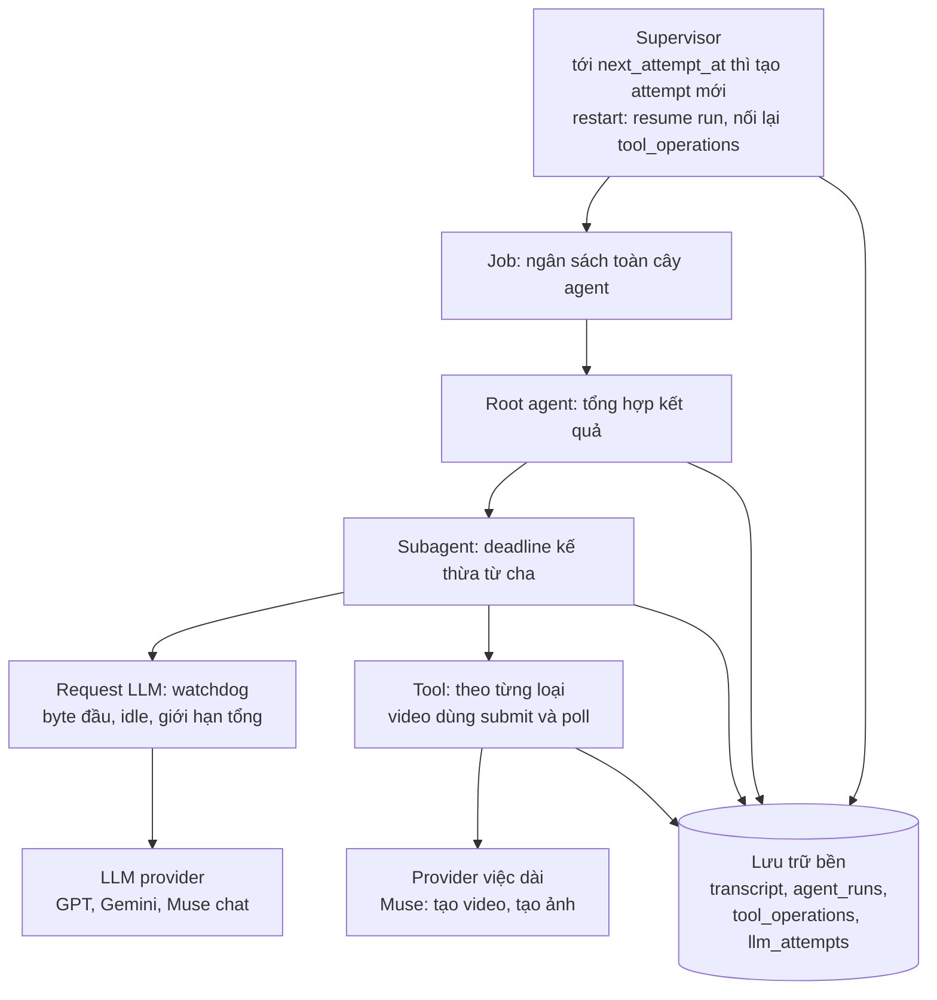
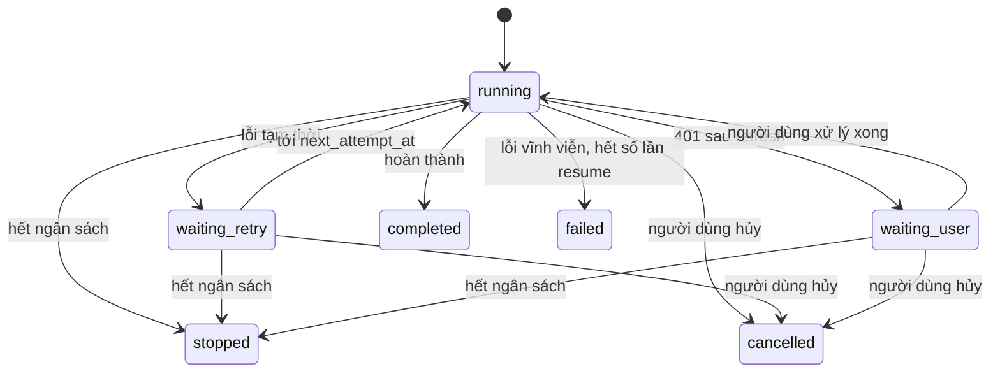

# Thiết kế lại độ bền Job và Agent

Cập nhật: 2026-10-31

> **Thiết kế gốc, cập nhật trạng thái 2026-11-01.** Phần “Hiện trạng” và các bảng lỗi bên dưới ghi nhận thời điểm phân tích, trước các sửa đổi độ bền. Khi triển khai, dùng [hướng dẫn hiện hành](agent-job-durability-implementation-guide.md), đặc biệt mục “Điều chỉnh so với thiết kế” và “Trạng thái triển khai”; không dùng các bảng này để kết luận lỗi vẫn tồn tại.

Đợt sửa Muse video sau job `eb0a5434` đã thêm session theo job, sửa thời lượng trong session, chia lô, lỗi timeout riêng và dừng `video_create` khi hủy, nhưng chỉ trong một process. Chi tiết ở [hướng dẫn triển khai](agent-job-durability-implementation-guide.md#nền-đã-có-từ-đợt-sửa-muse-video). Các bảng bằng chứng bên dưới mô tả trạng thái lúc phân tích, kèm ghi chú nơi đã thay đổi.

## Tóm tắt

Đề xuất: lỗi tạm thời không còn làm job kết thúc. Run sẽ chuyển sang chờ, rồi tự chạy tiếp từ bước đã lưu gần nhất.

Hiện một request LLM hết 60s là đủ làm hỏng cả job. Job `c79757ba` đã mất kết quả tìm kiếm sau 297s theo đúng cách này, dù nền tảng lưu bền đã có sẵn: transcript theo từng bước và recovery khi khởi động lại.

Bốn quyết định chính:

1. **Phát hiện treo bằng idle timeout**, không dùng deadline cứng cho cả request. Stream còn dữ liệu thì không bị cắt.
2. **Thêm trạng thái `waiting_retry`.** Timeout, lỗi 429 và lỗi mạng đều tự chạy tiếp, dùng lại cơ chế resume có sẵn.
3. **Giới hạn job bằng ngân sách**, gồm thời gian, step và token. Hết ngân sách thì job dừng có kiểm soát và giữ kết quả từng phần.
4. **Tách việc dài của provider thành submit và poll.** Video có `operation_id` lưu bền, nên server restart hoặc timeout vẫn lấy lại được.

"Không chết" ở đây có giới hạn: job vẫn có thể kết thúc khi người dùng hủy, hết ngân sách, gặp lỗi vĩnh viễn hoặc hết số lần resume. Khi đó job luôn nêu rõ lý do và giữ phần đã làm.

## Hiện trạng

Hệ thống đã lưu bền tiến độ khá tốt, nhưng lại coi lỗi tạm thời là kết thúc. Lỗi nằm ở chính sách xử lý, không nằm ở tầng lưu trữ.

### Giữ lại

| Thành phần | Có sẵn | Vị trí |
| --- | --- | --- |
| Transcript bền | Commit assistant message và invocation trước khi chạy tool | `vendor/orchestrator_agent_rs/src/runtime/mod.rs` |
| Recovery khi restart | Run `interrupted` được resume, tối đa 10 lần | `config.rs:85`, `store::recovery` |
| Không replay mù | Tool `Mutating` không rõ kết quả thì không chạy lại | `executor/dispatch.rs:173` |
| Chờ subagent | Không áp timeout tool lên cả subagent | `executor/dispatch.rs:81` |
| Resume subagent | Cha nối lại session con bằng `session_id` | `subagent/` |
| Follow-up | Gửi lượt mới vào session cũ khi task không chạy | `runtime/dispatch_core.rs:157` |

### Phải sửa

| Vấn đề | Bằng chứng | Vị trí |
| --- | --- | --- |
| Deadline cứng cắt cả stream đang chạy | `gpt-5.6-luna` bị cắt đúng 60.000 ms ở step 3 | `gateway/client.rs:298` |
| Timeout là trạng thái kết thúc | Run `timed_out`, job `failed`, `output_preview` rỗng | `runtime/terminal.rs:43` |
| Không retry khi timeout | Chỉ retry khi tràn context | `runtime/model.rs:81` |
| Reqwest cũng có deadline tổng | Cùng giá trị `timeout_ms`, tính cả lúc đọc body | `provider/mod.rs:108` |
| Muse bị coi như một request LLM | Luồng chat có 120s; video thành công đã mất 192–344s | `workflow/chat/mod.rs:158` |
| Hết giờ là mất video | Lease bị drop thì xóa session Muse. Nay session được giữ trong process, nhưng restart vẫn mất | `pool/lease.rs:79` |
| Hủy không tới Muse | Root hủy ở giây 780, tool chạy thêm 778s. Nay `video_create` tự dừng, nhưng Muse vẫn không nhận lệnh hủy và session chưa được xóa | `executor/dispatch.rs:113` |
| Lỗi bị làm mờ | Video 900s chỉ còn `LLM completion failed`. Nay có `TimedOut` và chuỗi `TIMEOUT:`, chưa có mã lỗi riêng | `workflow/mod.rs:29` |
| Task chạy mồ côi | Task không bị abort, có thể báo `Success` cho hub | `provider/muse_ops.rs:102` |

### Diễn biến job `c79757ba`

| Thời điểm | Sự kiện | Thời gian | Kết quả |
| --- | --- | --- | --- |
| T+9s | `agent_search` (Muse) lần 1 | 120s | Timeout |
| T+129s | Root resume subagent | 4s | OK |
| T+133s | `agent_search` lần 2 | 104s | OK, 5.548 token output |
| T+237s | Root `gpt-5.6-luna` tổng hợp | 60s | Timeout, job failed |

DB chưa cho biết step 3 đang viết chậm hay bị treo, vì phần text nhận được đã bị bỏ.

## Mục tiêu và cam kết

Mục tiêu là job nền chạy nhiều giờ mà không chết vì lỗi tạm thời, và không mất phần việc đã lưu.

### Cam kết

| Sự cố | Hành vi cam kết |
| --- | --- |
| Provider treo hoặc timeout | Tự thử lại bước đó, các bước trước giữ nguyên |
| 429, hết account tạm thời, lỗi mạng | Job chuyển sang chờ, hết thời gian chờ thì chạy tiếp |
| Stream đang có dữ liệu | Không bị cắt cho tới giới hạn tổng |
| Muse đang báo còn hoạt động | Không bị coi là treo |
| Server restart hoặc crash | Job tự resume khi khởi động; video đang chạy được poll tiếp |
| Subagent lỗi | Cha nhận kết quả có cấu trúc và phần đã làm |
| Người dùng hủy | Cả cây agent và việc trên provider đều dừng, trong thời gian ân hạn |
| Job không thể tiếp tục | Nêu rõ lý do, giữ kết quả từng phần, có thể chạy tiếp bằng follow-up |

### Khi nào job được phép kết thúc lỗi

Chỉ có bốn trường hợp: người dùng hủy, hết ngân sách, lỗi vĩnh viễn (sai cấu hình, bị từ chối nội dung, mất quyền), hoặc hết số lần resume.

Tool `Mutating` không rõ kết quả thì không tự chạy lại. Tool phải có cách đối soát; nếu không, job dừng ở trạng thái chờ người quyết định.

### Ngoài phạm vi

- Chạy phân tán nhiều node. Hệ thống vẫn là một process, theo ADR 0095.
- Đổi sang workflow engine ngoài như Temporal. Transcript và recovery hiện tại đã đủ nền tảng.
- Khôi phục text đang stream dở sau crash. Chỉ bước đã commit mới được giữ; bước dở sẽ gọi lại model.
- Luồng voice realtime. Luồng này cần timeout ngắn và dùng profile riêng.

## Kiến trúc đích

Kiến trúc đích tách bốn tầng, mỗi tầng chỉ xử lý một loại sự cố. Phát hiện treo dùng idle timeout, còn chạy quá lâu thì ngân sách chặn.



Các tầng ghi tiến độ vào lưu trữ bền, nên lỗi ở tầng dưới không làm mất phần đã làm. Supervisor đọc lại trạng thái đó để chạy tiếp job.

| Tầng | Bắt lỗi gì | Cơ chế | Khi tới giới hạn |
| --- | --- | --- | --- |
| Job | Chạy quá lâu, tốn quá nhiều | Ngân sách thời gian và token | Dừng cả cây, giữ kết quả từng phần |
| Agent run | Lặp vô ích | Giới hạn step, deadline mềm | Yêu cầu agent chốt kết quả |
| Request LLM | Provider treo | Watchdog theo hoạt động | Retry, rồi chuyển sang chờ |
| Tool | Tool treo, việc dài | Timeout theo tool, submit và poll | Tuỳ tác dụng phụ, không replay mù |

Giữ ba nguyên tắc: mỗi request chỉ có một watchdog, deadline chỉ siết lại khi đi xuống, và thời gian chờ con không tính vào timer request của cha.

## Thiết kế chi tiết

Mỗi cơ chế dưới đây dùng lại nền tảng có sẵn khi có thể. Các con số là mức khởi điểm, cần chỉnh theo số đo thực tế.

### Request LLM: một watchdog, ba giới hạn

Watchdog nằm ở `gateway/client.rs` và là nơi duy nhất quyết định timeout của request.

| Giới hạn | LLM thường | Muse chat | Mã lỗi |
| --- | --- | --- | --- |
| Chờ byte đầu | 120s | 180s | `PROVIDER_STALLED` |
| Idle giữa hai tín hiệu | 90s | 180s | `PROVIDER_STALLED` |
| Giới hạn tổng | 10 phút | 30 phút | `REQUEST_LIMIT_EXCEEDED` |

Thay đổi cần làm:

- Thêm `StreamEvent::Activity`. Event này chỉ gia hạn watchdog, không ghi vào transcript.
- `wire_codex.rs` phát `Activity` cho mọi event SSE, kể cả reasoning. Nếu không, model `high` sẽ bị coi là treo khi đang suy nghĩ.
- Workflow Muse phát `Activity` từ `agent.status`, `task.*` và `has_active_tool_task`.
- Reqwest ở `provider/mod.rs:108` đổi từ `.timeout()` sang `connect_timeout` và `read_timeout`.
- Bỏ deadline riêng của Muse chat. `chat/mod.rs:364` trả lỗi khi lượt chưa hoàn tất, không trả text cụt như thành công.
- Task của `spawn_muse_chat_stream` được abort khi stream bị drop, qua `AbortOnDrop`.

Nếu một bước chạm giới hạn tổng hai lần, retry nguyên trạng sẽ lại thất bại. Runtime thêm message `synthetic` yêu cầu model chia nhỏ đầu ra, ví dụ viết báo cáo qua tool theo từng phần.

### Phân loại lỗi và cách xử lý

| Lỗi | Loại | Xử lý |
| --- | --- | --- |
| `PROVIDER_STALLED`, mạng, 5xx, stream cụt | Tạm thời | Retry nhanh, rồi `waiting_retry` |
| 429, hết account tạm thời | Tạm thời | `waiting_retry`, tôn trọng `retry_after` |
| `REQUEST_LIMIT_EXCEEDED` | Tạm thời có điều kiện | Retry một lần, rồi yêu cầu chia nhỏ |
| Tràn context | Có sẵn | Compact rồi thử lại, giữ nguyên |
| 401 sau khi đã refresh | Cần người | `waiting_user`, báo cần đăng nhập lại |
| Sai cấu hình, bị từ chối nội dung | Vĩnh viễn | Kết thúc lỗi, giữ kết quả từng phần |

### Retry và resume

Có hai vòng retry:

1. **Vòng nhanh, trong run:** thêm vào `runtime/model.rs:81`, tối đa 2 lần, sau 5s và 30s. An toàn vì chỉ response hoàn tất mới được commit và sinh tool call.
2. **Vòng bền, qua `waiting_retry`:** kết thúc attempt hiện tại, lưu `next_attempt_at`, nhả slot root. Supervisor tạo attempt mới cùng `turn_id` với `resume_attempt + 1`.

Thời gian chờ là 1, 5, 15 phút, rồi 30 phút mỗi lần, giới hạn bởi `max_resume_attempts` và ngân sách. Quota của Muse có cooldown 3600s, nên job chờ qua được mà không chết.



Cả hai trạng thái chờ đều lưu bền, nên server restart không làm mất lịch thử lại. Mọi trạng thái kết thúc đều giữ kết quả từng phần.

### Subagent

- Con chạy cùng hai vòng retry. Trong khi con ở `waiting_retry`, invocation của cha vẫn `running`, không tốn lượt model.
- Con hết số lần resume thì trả cho cha: `status`, `partial_result`, `stop_reason`, `retryable`, `session_id`.
- Cha chỉ retry con theo `retryable`, không phải đoán từ chuỗi lỗi. Quyết định này vẫn do model của cha đưa ra.
- Kết quả con đã có trong transcript cha, nên cha retry bước tổng hợp không phải chạy lại con. Đây là điểm khắc phục trực tiếp lỗi của `c79757ba`.

### Ngân sách job

Ngân sách được tạo ở root và truyền xuống cây agent. Deadline của con là `min(deadline riêng, deadline cha − phần dự trữ)`.

| Nguồn job | Thời gian chạy | Tổng kể cả chờ | Dự trữ tổng hợp |
| --- | --- | --- | --- |
| Voice | 5 phút | 5 phút | 30s |
| API, admin | 2 giờ | 24 giờ | 10 phút |
| Theo lịch | 2 giờ | 12 giờ | 10 phút |

Tới 80% ngân sách, agent nhận message `synthetic` yêu cầu chốt kết quả. Tới 100%, request bị chuyển sang text-only theo cơ chế `steps` cap đang có, để agent vẫn viết được kết quả trong phần dự trữ.

### Tool chạy dài: submit và poll

`video_create` tách thành các bước có trạng thái lưu bền:

1. Ghi `tool_operations` ở trạng thái `submitting`, trước khi gọi provider.
2. Gửi yêu cầu, lưu `remote_session_id` và `account_key`, chuyển sang `running`.
3. Poll `/chat/history` theo `remote_session_id` tới khi có file hoặc hết hạn.
4. Tải file, commit artifact, ghi kết quả vào invocation.
5. Giữ session Muse cho các lần gọi sau của job. Session chỉ bị xóa khi job kết thúc hoặc hết TTL.

Một video có thể gồm nhiều lượt trong cùng session: chia lô cho video trên 60s và nhắc bổ sung khi video thiếu. Trạng thái bền phải lưu đang ở lô nào và file của các lô đã xong. Nhiều operation của một job dùng chung `remote_session_id`.

Khi restart, recovery tìm operation dở và xử lý theo trạng thái:

| Trạng thái khi restart | Xử lý |
| --- | --- |
| `running` | Poll tiếp bằng `remote_session_id` |
| `downloading` | Tải lại file |
| `submitting` | Không rõ đã gửi chưa: đối soát nếu có thể, nếu không thì xử lý theo câu hỏi mở về gửi lại |

Failover chỉ được chạy khi không còn operation nào đang sống, và dùng chung `deadline_at` thay vì cấp 900s mới mỗi lần. Timeout của Muse thành `LlmError::Timeout` (code hiện đặt tên `TimedOut`, sẽ đổi ở giai đoạn 2), để job hiện được `VIDEO_GENERATION_TIMEOUT`.

### Hủy

- Runtime truyền `CancellationToken` xuống `media_backend` và `run_media_turn_once`.
- Khi người dùng hủy job: gọi cancel của Muse nếu có, rồi xóa session và đánh dấu operation `cancelled`. Hủy một lần gọi tool mà job còn chạy, hoặc shutdown, thì giữ session.
- Sau 30s ân hạn mà tool chưa dừng thì runtime abort và ghi trạng thái rõ ràng, không chờ hết 900s như hiện tại.

## Dữ liệu, cấu hình và quan sát

Thay đổi chủ yếu là thêm cột và bảng mới, nên dữ liệu cũ vẫn đọc được và có thể triển khai từng phần.

### Schema

| Bảng | Thay đổi | Mục đích |
| --- | --- | --- |
| `agent_runs` | Thêm `waiting_retry` và `waiting_user` vào CHECK; thêm `next_attempt_at`, `retry_reason` | Lưu trạng thái chờ qua restart |
| `agent_runs` | Thêm `budget_json` | Ngân sách truyền xuống cây agent |
| `tool_operations` (mới) | `invocation_id`, `provider_ref`, `account_key`, `remote_session_id`, `status`, `last_activity_at`, `deadline_at` | Theo dõi và nối lại việc dài |
| `llm_attempts` (mới) | `run_id`, `step`, `started_at`, `first_byte_ms`, `last_activity_ms`, `chars_received`, `outcome` | Phân biệt chậm với treo |
| `tasks` | Thêm `stopped` (hết ngân sách), trạng thái `waiting` và `wait_reason` | Hiển thị trên UI |

SQLite không sửa được CHECK tại chỗ, nên migration `agent_runs` phải tạo lại bảng. Cần backup `orchestrator.db` trước khi chạy.

### Cấu hình provider

`timeout_ms` được thay bằng profile. Giá trị cũ vẫn đọc được và chỉ dùng làm `max_total_ms` nếu nó lớn hơn mức mặc định, để các provider đang lưu 60s không tiếp tục bị cắt.

```json
{
  "timeout_profile": "agentic",
  "first_byte_ms": 180000,
  "idle_ms": 180000,
  "max_total_ms": 1800000
}
```

Ba profile có sẵn là `interactive` cho voice, `standard` cho LLM thường và `agentic` cho Muse. Form ở `ProviderFormModal.vue` chọn profile trước và chỉ hiện ba trường trên khi tùy chỉnh.

### Giao diện job

- Job đang chờ hiện lý do và thời điểm thử lại, ví dụ "Chờ GPT-5.6-luna, thử lại lúc 12:45 (lần 2/10)".
- Video đang chạy hiện thời gian đã chạy và lần hoạt động cuối.
- Job kết thúc lỗi vẫn hiện kết quả từng phần, kèm nút chạy tiếp qua follow-up.

### Chỉ số cần theo dõi

| Chỉ số | Ý nghĩa |
| --- | --- |
| `first_byte_ms`, `request_total_ms` theo provider (p50, p99) | Căn cứ chỉnh các mức timeout |
| Số lần retry và resume theo mã lỗi | Provider nào gây sự cố |
| Tỉ lệ job hoàn thành sau resume | Thiết kế có cứu được job không |
| Job ở `waiting` quá lâu | Phát hiện job bị kẹt |
| Số operation mồ côi, session Muse chưa xóa | Rò rỉ quota |

## Lộ trình và kiểm thử

Triển khai sáu giai đoạn, việc ít rủi ro làm trước. Giai đoạn 0 và 1 đã đủ tránh lỗi cắt stream của `c79757ba`.

| Giai đoạn | Nội dung | Điều kiện hoàn thành |
| --- | --- | --- |
| 0. Cấu hình tạm | Đặt GPT-5.6-luna 300s, Muse chat 600s | Không còn job đứt ở mốc 60s |
| 1. Watchdog | Idle timeout, `Activity`, profile, bỏ deadline trùng, sửa text cụt, abort task mồ côi, `llm_attempts` | Stream chậm nhưng đều vượt 60s vẫn xong; stream treo bị cắt đúng mức idle |
| 2. Retry bền | Phân loại lỗi, retry nhanh, `waiting_retry`, trạng thái trên UI, kết quả subagent có cấu trúc | Timeout ở bước tổng hợp không làm chạy lại subagent |
| 3. Hủy và lỗi rõ ràng | Truyền hủy xuống Muse, mã lỗi rõ, xóa session khi job kết thúc | Hủy dừng video trong 30s, job kết thúc không để lại session |
| 4. Video bền | `tool_operations`, submit và poll, nối lại khi restart | Kill server giữa lúc render, khởi động lại vẫn có video |
| 5. Ngân sách | Ngân sách job, truyền xuống con, phần dự trữ, deadline mềm | Hết ngân sách vẫn có kết quả từng phần |

Giai đoạn 1, 2 và 5 sửa `vendor/orchestrator_agent_rs`, nên cần ADR riêng: một cho mô hình timeout, một cho `waiting_retry`, một cho `tool_operations`.

### Kiểm thử bắt buộc

- [ ] Provider giả stream đều trong 5 phút: request không bị cắt.
- [ ] Provider giả chỉ gửi event reasoning trong 3 phút: không bị coi là treo.
- [ ] Provider giả ngừng gửi giữa chừng: bị cắt đúng mức idle, rồi retry.
- [ ] Tái hiện `c79757ba`: root timeout ở step 3, attempt mới dùng lại kết quả subagent.
- [ ] Kill process khi đang `waiting_retry`: restart vẫn giữ lịch thử lại.
- [ ] Kill process khi video `running`, `downloading` và `submitting`: đúng hành vi cho từng trạng thái.
- [ ] Hủy job khi subagent đang render: cả cây dừng trong 30s.
- [ ] Nhiều job cùng chờ: slot root được nhả, job khác vẫn chạy.
- [ ] Job 2 giờ với provider giả gây lỗi ngẫu nhiên: hoàn thành hoặc dừng có lý do rõ.

Test chạy qua `scripts/agent-test.sh`, theo chính sách của repo.

## Rủi ro và câu hỏi mở

Rủi ro lớn nhất là khả năng nối lại session Muse: video bền phụ thuộc vào điều này và nó chưa được kiểm chứng.

| Rủi ro | Giảm thiểu |
| --- | --- |
| Session Muse không sống qua khi đứt kết nối | Làm spike trước giai đoạn 4; nếu thất bại thì chỉ giữ được kết nối trong một process |
| Retry làm tốn quota | Giới hạn số lần theo provider; Muse retry nhanh tối đa 1 lần |
| Heartbeat giả giữ request treo mãi | Giới hạn tổng luôn áp dụng, kể cả khi còn `Activity` |
| Job chờ mãi không ai biết | Ngân sách tổng 24 giờ, có cảnh báo job chờ lâu |
| Retry bước lớn lặp lại cùng một lỗi | Sau hai lần chạm giới hạn tổng, yêu cầu chia nhỏ đầu ra |
| Migration `agent_runs` tạo lại bảng | Backup trước, test trên bản sao dữ liệu thật |
| Sửa sâu vào crate vendor | Mỗi thay đổi hợp đồng có ADR và test riêng |

### Câu hỏi mở

- [ ] Muse có API hủy lượt chat không? Mới thấy capability `chat_cancel`, chưa thấy endpoint trong code và `reference/`.
- [ ] Session Muse còn sống bao lâu sau khi WebSocket đứt, và có cần cùng account không?
- [ ] Crash ở `submitting` thì tự gửi lại hay chờ người quyết định?
- [ ] 900s fail của video là do Muse còn render hay do không nhận ra video đã xong? Cần log mức cao hơn để kết luận.
- [ ] Provider có tiếp tục tính quota khi client bỏ ngang lượt không?
- [ ] Giới hạn 6 clip của Muse tính theo từng lượt hay theo session? Chia lô đang giả định theo lượt.
- [ ] Muse có dùng lại clip cũ khi được nhắc tiếp trong cùng session không? Vòng sửa thời lượng đang giả định có.
