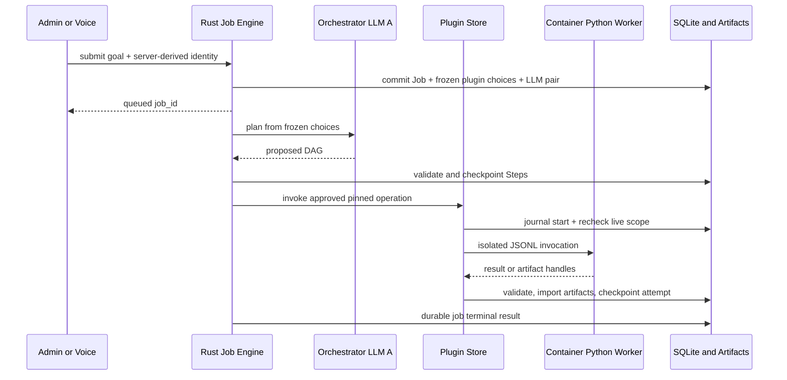

# Agent Job Runtime + Executable Plugin Store — Codebase Design v1.5.1

> **Status:** P0 foundation and P3 source integration implemented; P1/P2 real rootless gates, P3 real Voice/LLM/Python/browser E2E and P4 deployment qualification remain open. Production submits require managed planner/Worker readiness and an admissible provider pair. See [P0 evidence](../P0-IMPLEMENTATION.md) and [P3 source/live-host evidence](../P3-IMPLEMENTATION.md). **Repository/branch:** `hailp-vn38/ai-agent-voice`, `integration/voice-reminders-direct-tts` (reviewed 2026-10-13). Supersedes the v1.5 design and its PONYTAIL review as the implementation contract. Keep Reminder/Direct TTS ADR 0087–0091 and migration `0104_device_reminders.sql` intact; Background uses 0105 and additive Step contract migration 0106.
>
> **Critical correction from v1.4.2:** A plugin is an **executable Python package with its own code**, not an MCP tool mapping. Background Plugin Store never dispatches via External MCP, System MCP or Device MCP; existing MCP functionality remains unchanged and independent.

## 0. Decisions / intentionally small V1

1. **Global Background Settings:** Admin Web `/background` saves `{enabled, orchestrator_llm_provider, worker_llm_provider}` with revision/`If-Match` in SQLite; both LLM Provider refs use the existing source-qualified DB/config Provider Catalog. Budget/concurrency caps are deployment TOML with hard bounds and are snapshotted into each Job. Never borrow reserved Voice capacity or use Agent Template as fallback.
2. **All Agents may submit Background Jobs:** There is **no Agent-level `background_enabled` field, switch, grant, migration, Admin endpoint or Web toggle**. Every currently admitted Agent (managed physical Device or authenticated Studio Virtual Device Voice Session) may ask the server-owned `server_create_job` builtin to submit a Job. Live Device/Agent admission, the global Background enable switch, global capacity and approved plugin policy still apply; `reminders_enabled` stays completely independent.
3. **Executable Plugin V1:** Python **3.12** plugin packages containing `plugin.toml`, `pyproject.toml`, `uv.lock`, source and input/output JSON Schemas. **uv** installs exactly locked dependencies in the isolated build step, not at Job runtime. Execution uses a restricted **container worker** managed by Rust; one invocation per container (no daemon, warm pool or interpreter embedded in Rust). No MCP bridge, host command-execution interface, per-plugin LLM provider, remote repository URL installs, user-provided Dockerfiles, JS/WASM runtime, or Python install during Job.
4. **Distribution V1:** Admin installs a local uploaded ZIP or selects a pre-shipped curated ZIP; both enter the same validated package pipeline and are **admin-trusted packages only**. V1 does **not** claim to securely host adversarial untrusted code. Deployment must pass container security preflight before accepting executable plugins; otherwise disable Install/Activate/Run (fail closed). A future public/remote marketplace requires separate supply-chain and sandbox qualification.
5. **Global plugin lifecycle:** install creates `disabled`; only authenticated Admin successfully **Activate**s to `ready`. Reproducible environment and package/image digest are pinned. Fatal worker/bootstrap/import/sandbox failures change `ready -> error` durably; transient upstream 429, empty search, bad user input, cancellation or capacity rejection do **not**. `error` blocks all Agents and requires successful Admin re-activation. Diagnostic Test never changes stored status.
6. **No side-effect fiction:** V1 exposes only Admin-reviewed `safe_read` operations (public data collection/search/analysis), but Python code is opaque; labeling it `safe_read` does not prove freedom from side effects. No automatic re-execution after crash/error. Attempt start/outcome are durably journaled; ambiguity becomes `unknown_outcome`. Admin manually retries by creating a **new Job** after reviewing potential duplicated effects. Other operation classes are unsupported.
7. **Durable execution:** one process-owned Rust Job scheduler, SQLx SQLite checkpoints, bounded DAG, global Orchestrator + Worker LLM pair, bounded artifact storage. No Redis, distributed leases, notifications/outbox, Telegram push, Voice completion TTS, Document refs, or Job WebSocket progress/status stream in V1. Web polls Jobs endpoints; the existing **LLM tool-result pathway** delivers only the immediate create receipt.
8. **Separate domains:** Reminder scanner, Device cache ACK, Playback ACK and Direct Speech remain untouched. Background Job completion does not speak, create reminders or send Reminder WS frames. `features.mcp=false` only pertains to Device MCP; the **server-owned Job creation builtin is not an MCP tool** and requires no extra Agent enablement. Register its definition at admitted Voice Session catalog creation; the LLM, not WS connect, decides whether to issue a tool call.

## 1. Existing codebase seams and where to integrate

| Existing source on integration branch | Integration v1.5 |
|---|---|
| `crates/voice-agent-server/src/app/state.rs`, `app/mod.rs`, `lifecycle.rs` | Initialize one shared `Arc<BackgroundRuntime>` after DB migrations, pass a bounded submit handle through WS runtime construction, and own one scheduler start/stop; preserve existing `reminder_scheduler_started` guard. Never spawn one Job runtime per router/Voice connection. |
| `database/mod.rs`, migrations | Append-only Background/Job/Plugin tables, short SQLx transactions; **no Agent schema/DTO change for Background**. No Job entities in `database/notifications.rs`; database-level queue admission and idempotency belong to `database/jobs.rs`. |
| `services/reminder_scheduler.rs`, `services/active_device_sessions.rs`, `session/direct_speech.rs` | Existing Reminder/Direct TTS only. No Job execution or notification reused in V1. |
| `app/admin/mod.rs`, `api/client.ts` | Reuse Admin bearer, trusted Origin, `If-Match`, revision errors; add Background/Job/Plugin routes. **Do not modify Agent CRUD for Background permissions**. |
| `tools/builtin.rs`, `session/actor/tools/{catalog,round,builtin_actions}.rs`, `session/event.rs`, `session/prompt.rs` | Add one builtin `server_create_job` to admitted LLM catalogs and `ToolTarget::Builtin`; inject the submit handle through `SessionRuntimes`/actor construction, and complete the same Tool Round through typed mailbox events, without blocking SessionActor. No Agent Background grant check, no Python in Voice turn. |
| `providers/runtime_catalog.rs`, `services/provider_runtime`, `workers/llm` | Resolve two source-qualified global Background LLMs; add non-Voice admission class/quotas without overloading Diagnostic single-slot exception. |
| `database/tool_security.rs` (`publication` lock) | Reuse publication coordination for **Device disable/delete/reassign, Agent disable/delete, global/plugin policy changes** and worker-start authorization. No Agent Background permission or MCP approvals; never call External MCP for plugins. |
| `tools/external_mcp/*`, `tools/system_mcp/*` | No modification to plugin runtime. Ordinary MCP tooling retains existing per-Agent approval and guards. |
| `apps/admin-web/src/router/index.ts`, `config/navigation.ts` | Add `/background`, `/plugins`, `/jobs` pages and Details. Maintain Voice/Reminder nav and Studio tabs. |
| `AgentDetailPage.vue`, `StudioTabs.vue`, `AgentReminders.vue` | Keep current Agent and Reminder screens **without any Background toggle**; optional read-only link to Admin Jobs, no separate Agent capability UI. |
| `apps/admin-web/src/stores/assistant.ts` | Show only durable `job_id` receipt and link; Voice WS is not a job progress channel. |

Target files (proposed, not present): `src/services/background/{mod.rs,plugin_store.rs,plugin_runner.rs,job_engine.rs,job_scheduler.rs,artifacts.rs}`, `src/database/{background.rs,plugins.rs,jobs.rs}`, `src/app/admin/{background.rs,plugins.rs,jobs.rs}`; `apps/admin-web/src/api/{background,plugins,jobs}.ts`. Prefer a single `background/` module with internal files over publicly exposed one-method wrapper modules.

## 2. Deep module interfaces / ownership

Two public deep interfaces for Plugin Store and Job Engine; Background LLM pair resolution and scheduler lifecycle are their internal dependencies, not standalone public interfaces. Installer, image builder, worker launch, job attempts and artifacts remain internal implementation seams:

```rust
// Conceptual Rust contracts. Validation, authorization and persistence are inside modules.
impl PluginStore {
    async fn install(&self, uploaded_zip: PackageSource, admin: &AdminPrincipal) -> Result<PluginView, PluginError>;
    async fn activate(&self, plugin_id: &str, expected_revision: i64, admin: &AdminPrincipal) -> Result<PluginView, PluginError>;
    async fn invoke(&self, choice: &FrozenPluginOperation, input: Value, ctx: &JobExecutionContext) -> Result<PluginOutcome, PluginError>;
}
impl JobEngine {
    async fn submit(&self, input: SubmitJob, caller: &JobRequester) -> Result<JobReceipt, JobError>;
    async fn get(&self, job_id: JobId, caller: &AdminPrincipal) -> Result<JobView, JobError>;
    async fn cancel(&self, job_id: JobId, caller: &AdminPrincipal) -> Result<JobView, JobError>;
    async fn retry(&self, old_job_id: JobId, caller: &AdminPrincipal) -> Result<JobReceipt, JobError>;
}
```

`PluginStore::invoke` internally delegates to one concrete container runner (no `PluginRunner` trait family until there is another runtime). Only Rust can transition Job/Step state, reserve budgets, pass verified inputs, start containers, persist outputs and grant access to artifact readers. The Python script is **untrusted task code/data** even when approved; its stdout is never interpreted as a policy decision.

The Reminder and Job schedulers are distinct tasks; short SQLite transactions and separate resource admission avoid starvation. Job scheduling must start only after migration, durable recovery and the runner preflight have been attempted; the scheduler has a bounded periodic DB scan even if its immediate wake signal is lost. Its wake signal is only an optimization, not the sole way for queued Jobs to start. Startup must ensure exactly one Background scheduler **per deployment**: take an exclusive process-level deployment lock on the SQLite database's companion lockfile before enabling the scheduler, fail startup if unavailable, and release on process exit (OS file-lock auto-release after crash). Never assume one `Arc<AtomicBool>` protects across processes; test two process startups.

## 3. Python plugin package and `plugin.toml` contract

```text
weibo-crawler.zip
  plugin.toml
  pyproject.toml
  uv.lock
  instructions.md
  src/main.py
  src/crawler.py
  schemas/search.input.json
  schemas/search.output.json
```

```toml
manifest_version = 1
[plugin]
id = "weibo-crawler"
name = "Weibo Crawler"
version = "1.0.0"
description = "Collect public posts, page by page"
[runtime]
kind = "python_container"
python = "3.12"
entrypoint = "src/main.py"
protocol = "jsonl-v1"
[permissions]
network_hosts = ["weibo.com", "m.weibo.cn"]
[agent]
instructions = "instructions.md"
[operations.search_posts]
description = "Search public posts"
provides = ["social.search"]
sources = ["weibo"]
input_schema = "schemas/search.input.json"
output_schema = "schemas/search.output.json"
replay = "safe_read"
```

Manifest is **declarative**; it requests capabilities, does not grant them. No MCP `server_key`, `tool`, URL or Provider credentials in the manifest. Admin approves the reviewed **effective** operation/network/storage permissions by package digest. Changes require a new package digest and approval. Reject unknown manifest keys/operation types/runtime kinds. Operation names, declared `provides` capabilities and `sources` identifiers, and input/output schemas are bounded and validated by Rust. These manifest declarations support eligibility at submit, but **do not prove** the content actually came from a source; required-source coverage must be supported by validated output provenance/artifacts. The sandbox/egress policy (not the Python source) prevents access to unapproved destinations. Instructions are data for the Worker LLM; never expand permissions.

`pyproject.toml` uses Python 3.12 and a committed `uv.lock` (no bare `requirements.txt` fallback). Pin package index/source policy and compare the installed dependency set to the lock. A manifest-only ZIP is not an installable executable plugin. Installer uses pinned trusted uv and pinned base image version/digest; `uv sync --locked --no-dev --no-install-project` only in isolated build; image contains runtime Python, `.venv`, plugin source and a fixed host-owned runner/entrypoint. Run `/plugin/.venv/bin/python /plugin/src/main.py` (or equivalent fixed argv) with `PYTHONDONTWRITEBYTECODE=1`; never invoke `uv` from the worker. If `src/main.py` is standalone, its dependencies are available on the interpreter search path. Reject stale lock, unsupported interpreter/ABI/architecture, undeclared dynamic install, VCS/editable/local path dependencies, unapproved package sources and dependency post-install requests. Do not execute `uv lock` in the installer (it could silently change versions). Native wheels must match target architecture. Builder is isolated too: dependency resolution/install may execute package build hooks; **never run build against host credentials/database/Docker socket**. V1 may refuse source distributions and unsupported native system dependencies rather than invent a generic OS package installer.

**Minimal stdin/stdout protocol:** one request per invocation, exactly one bounded JSON line to stdout for result; logs to stderr (redacted/capped). No persistent interpreter RPC, extra message broker or plugin-to-server callback route in V1.

```json
{"schema_version":1,"request_id":"job-step-attempt-id","operation":"search_posts","arguments":{"keyword":"AI","limit":20},"artifact_dir":"/work/out"}
```

```json
{"schema_version":1,"request_id":"job-step-attempt-id","ok":true,"result":{"records":[{"source_id":"weibo","source_url":"https://weibo.com/example/post1","text":"Example"}],"next_cursor":null,"done":true},"artifacts":[]}
```

Rust validates `request_id`, one-line framing, UTF-8, max bytes, JSON schema, elapsed time, exit code and artifact references. `artifact_dir` is a **fixed container path**, not a host-selectable mount. Plugin may create only files under `/work/out`; Rust imports bounded regular files by safe relative name, safe file-descriptor checks, size/hash, MIME allowlist and quotas; Python cannot register artifacts by absolute host path. The plugin process cannot send a `cancel`/`approve`/`dispatch` instruction as a result. A worker may finish with a structured application-level error, distinct from a broken worker runtime. Source URLs and identifiers are **plugin-reported evidence** validated against schemas and allowed host patterns, not cryptographic proof that the remote website actually returned those records.

## 4. Package installation, isolation and permissions

**Source V1:** privileged Admin uploads ZIP (or selects a deployment-curated ZIP) using a bounded upload endpoint. No URL/Git install and no user-created Dockerfile. ZIP parsing limits compressed/uncompressed size, entry count/depth, rejects absolute/`..` paths, symlinks/devices, duplicates and extraction escapes; hash canonical approved package bytes. Stage under server-controlled `data/plugins/staging/` with atomic publication. ZIP validation and image build never happen inside the Admin request's DB transaction.

**Install state machine:** `absent -> [validate/build in temporary staging] -> disabled`. Use one bounded installer build slot separate from the Python execution and Voice limits, with a documented finite install deadline (V1 default 120s, configurable within server hard caps); failure/timeout cleans staging and leaves installed version unchanged. V1 does not introduce a second durable installer queue; packages too large or slow to build are rejected with a typed diagnostic. Failed validation/build returns a bounded error and cleans staging, leaving any previous installed version untouched. Active version may not be replaced or uninstalled while a **nonterminal Job** pins it (return `409 plugin_in_use`); update is explicit re-install after those Jobs terminalize. This keeps one active version per plugin ID without a package-version registry. Avoid linking package directories by untrusted IDs; use validated IDs and digests.

**Artifact layout:**

```text
data/plugins/
  packages/<plugin-id>/<version>/<package-sha256>/  # immutable extracted ZIP + manifest/lock
  staging/<install-uuid>/                            # never executable as installed
  workspaces/<job-id>/<attempt-id>/                  # bounded disposable input/output
  # Container environment is an image pinned by OCI image digest, not an untracked .venv.
data/job-artifacts/<job-id>/<artifact-id>
```

`plugin_installations` records one active `{plugin_id, version, package_digest, image_digest, status, revision, last_error_code?, timestamps, approved_permissions_json}`; retain immutable files/images while referenced by a nonterminal Job or its active worker. GC after retention/absence of references. Image cache key includes package digest (which already covers uv.lock), Python base image digest, architecture and build policy version. Package source and image digest must both match at invoke; never run a mutable image tag from a Job.

**Container hardening preflight (enforced, not advertised only):** V1 deploys on Linux with a dedicated rootless Docker Engine (or explicitly verified equivalent pinned runtime); Rust invokes a fixed allowlisted `docker` argv via `tokio::process::Command`, not a shell. The runner uses a dedicated least-privileged rootless/user-namespaced account, non-root UID, read-only root filesystem, only specific read-only package mount (if needed) and size-bounded `/work` writable mount, no host DB/config/sockets, `--cap-drop=ALL`, no-new-privileges, default/restrictive seccomp, bounded CPU/RAM/PIDs/wall time, max workers=2 initially, output/log caps, no privileged mode, no host network/PID mount. Never expose runtime control sockets to a container; use fixed image/entrypoint and no user-supplied runtime flags. The runtime-control account itself is privileged and must be dedicated/audited. A container alone does **not** guarantee safe execution of adversarial code; evaluate host/kernel and operator trust model.

**Networking:** default `network=none` for non-network plugins. For networked plugins, use an isolated container network whose ONLY external route is a controlled egress proxy/firewall. Do NOT combine `network=none` with a supposedly reachable HTTP proxy; it cannot access that proxy. The worker must not be able to bypass the proxy, and DNS resolution, CONNECT, redirects, resolved IPs and repeat resolution must be filtered against approved public destinations. Public crawler domains require an *enforced egress policy* (dedicated controlled network + proxy/firewall/DNS restrictions), including blocking metadata/private/link-local/localhost access and redirect/DNS rebinding paths. TOML/manifest `network_hosts` is a request, **not security enforcement**. If enforceable allowlisting is absent, Activate/Run of networked plugins must fail closed (`egress_policy_unavailable`). Do not give a worker the Rust Server's `DATABASE_URL`, provider API keys, user sessions or host environment. V1 does not inject arbitrary third-party credentials into plugins; authenticated/private crawlers are deferred until a narrow secret injection/revocation contract is defined.

**Test / Activate:** Admin Test runs sandbox preflight + optional deterministic fixture smoke-test **under the same reviewed permission and egress enforcement as Run** with bounded CPU/network and returns diagnostics **without changing plugin status**. Activate checks package/image digests, base/image policy, reviewed permissions and sandbox readiness, then atomically transitions `disabled|error -> ready` with `If-Match`. Disable makes it unavailable for **new** starts. A package with requests that deployment cannot enforce remains `disabled` regardless of the Admin checkbox. Reuse the same status column, not derived heartbeat flags. If policy approval changes while `ready`, require an atomic disable and fresh Activate; do not silently broaden running grants.

**Worker execution:** Rust writes a durable attempt reservation with an attempt ID and marks `start_requested` durably BEFORE requesting container start, allocates a fresh workspace, prepares the container in non-running state, and performs live authorization **immediately before start**. One attempt == one container invocation per Plugin Step; receipt of container-start acknowledgement is NOT atomic with SQLite and any `start_requested` attempt without provable terminal evidence is `unknown_outcome`; Python may internally make bounded upstream requests, but the Rust host does not automatically launch a second container for that Step. No automatic retry or warm process pool in V1. While running, capture bounded stdout/stderr; await with deadline/cancel and kill/reap on timeout/revocation/shutdown; record exit + classified outcome. A crashed Rust process may leave an orphan container alive: label containers with Job/Step/Attempt and run a startup orphan reaper, and require a deployment watchdog/runner policy for eventual termination if server stays down. **Orphan cleanup alone does not prove that no side effects occurred**. Record unknown outcome rather than replay.

### Plugin health classification

| Observed outcome | Durable plugin status | Job/Step |
|---|---|---|
| Malformed args, empty search, external HTTP 429/5xx, allowed network outage | Keep `ready`; show transient failure on Step | `failed` or policy partial result |
| Timeout/cancellation from Job deadline or explicit cancel | Keep `ready`; kill attempt; preserve ambiguity if started | `failed`/`cancelled` + attempt outcome |
| Import failure, missing declared dependency, missing image/ABI, worker protocol breach, repeated crash attributable to package, invalid sandbox policy | CAS `ready -> error`; no further dispatch | `failed/plugin_runtime_error` |
| Admin disable / permission revocation / package mismatch | `disabled` or derived `blocked`; do not invent automatic `error` | Block new dispatch; started attempt uncertain |

Operator **Test** must never silently reset `error`; only successful explicit **Activate** restores `ready`. A failed activation keeps original status and actionable safe diagnostics. Code failures are not automatically infrastructure-wide failure: don't mark unrelated plugins `error` due to shared container host outage; report `runtime_unavailable` and stop dispatch globally until preflight passes.

## 5. Job flow, snapshot and authorization

**Submit:** Admin or admitted Voice Agent submits bounded `{goal, output_format, allow_partial, required_sources[], required_capabilities[]}` with server-derived **Job Requester Scope**. Commit atomic queue admission, payload-bound idempotency, immutable Request Contract, exact source-qualified Orchestrator/Worker LLM pair and config digests, limits, **`plugin_choices_json` snapshot at submit** (bounded approved `(plugin_id, version, package_digest, image_digest, operation, permission_digest)` tuples). Shortlist includes only currently `ready` plugins, reviewed `safe_read` operations, their declared `provides/sources` identifiers and enforceable permissions. Every submit-time `required_capabilities` and `required_sources` token must be matched against these bounded manifest identifiers, not free text. If any explicitly required capability lacks an eligible operation at submit, reject `capability_unavailable` before Job insertion; optional requirements may be omitted with visible warnings. Never create an unbounded waiting state. Submit is not a guarantee of continued eligibility. Production readiness preflight must reject submission when planner, worker backend or scheduler is absent: a partially implemented deployment must not accept Jobs it can never process. Keep global Background disabled during P0-P2 rollout.

**Plan:** Orchestrator gets *only* Job's frozen plugin choices (not the current global catalog); produces a bounded typed DAG. Rust validates each Step against that snapshot, dependencies, schemas, input limits, Request Contract and budgets. A plugin-backed Step invokes exactly one pinned operation in one container; its Python code may internally page upstream data within limits. Other Steps use Worker LLM only. **Replan also can only select from the original Job choices**. Later plugin installs, activation or expanded grants never enlarge a queued/planning/running Job's authority. New Job from manual retry takes a new snapshot. Plugin disabled/error/revoked after submit can narrow eligibility but never expand it.

**Voice requester authorization:** persist the exact original Device + Agent DB identities and non-reusable incarnations (not user-supplied display IDs), original assignment and `requester_scope`. Existing `devices.id` / `agents.id` and `created_at` must be audited for reuse; if deletion and reinsertion could recreate the same tuple, add an immutable server-assigned incarnation UUID during forward migration instead of trusting the public ID. Every admitted Agent may submit; **no `background_enabled` check exists**. At each worker start, check **live** managed Device exists/incarnation unchanged/`enabled`, Device still assigned to original Agent, live Agent exists/`enabled`, and global Background enabled. Admin-submitted Job needs live global/Plugin policy, not a Device. Device disable/delete/reassign and Agent disable/delete plus global enable/disable and plugin status/permission changes must participate in the *same publication coordination* as worker start; otherwise a DB check followed by a container start can race revocation. For the V1 Voice builtin, only **create** is exposed; job read/cancel remain authenticated Admin HTTP actions. Admin may inspect historical Jobs.

**Atomicity of start versus revocation:** reuse existing `Database.tool_security.publication` as a **synchronization primitive**, not an MCP permission checker. Update **all** relevant Device mutation write paths (existing Admin CRUD and internal enrollment/deletion if any), Agent mutation paths, Background global switch and Plugin activation/disable/permissions; only modifying the new Job code is insufficient. Device/Agent mutation and global/plugin disable take the write side covering their commits; dispatch prepares inert container first, then takes the read side, rechecks live Device/Agent assignment, global switch, plugin status, approved permissions/image digest and budget, and **starts the worker before releasing read side**. No nested publication lock; never hold a SQLite write lock across container start or a lock during long-running execution. Confirmed container start is the authority linearization point; started workers may act after later revocation, so cancel/kill best effort and retain `unknown_outcome` evidence. Bound container start time; no image builds under publication lock. Race tests must cover actual start, not validation alone.

**Orchestrator:** global Provider A proposes `plan/replan/finish`; Sub-Agent Provider B executes bounded Step LLM work. Rust owns state, not the model. Each Job Step has immutable step_key, dependencies, schema, required flag, operation pin and attempt. Only one active attempt/step and no implicit operation switches. Rust determines `succeeded|partial_success|failed` from frozen explicit source/capability requirements and validated provenance in results/artifacts (source ID plus bounded evidence URLs or records), not manifest claims alone or LLM `finish` assertions. If structured sources are absent, status includes `coverage_basis=goal_only_unverified` rather than claiming semantic proof.



**No MCP tool mapping, transport, MCP fingerprint review or MCP grant table exists in this flow.** Existing external MCP is for ordinary Voice/MCP tools only. The Python plugin is not itself an Agent and does not independently choose LLM providers.

## 6. SQLite persistence, attempt journal and recovery

Use the **next free forward-only migration after Reminder migration 0104**; no changes to Device Reminder tables. V1 stores one active package version per plugin, one plan representation and one budget ledger:

```text
background_settings  (id=1, enabled, orchestrator_provider_ref, worker_provider_ref,
                      revision, updated_at)
plugin_installations (plugin_id PK, version, package_digest, image_digest,
                      approved_permissions_json,
                      status [disabled|ready|error], revision,
                      last_error_code?, last_error_at?, installed_at, updated_at)
jobs                 (id UUID PK, requester_scope, requester_kind, origin_agent_incarnation?,
                      origin_device_incarnation?, goal, request_contract_json, request_fingerprint,
                      plugin_choices_json, status, plan_revision,
                      orchestrator_provider_ref, orchestrator_provider_revision/digest,
                      worker_provider_ref, worker_provider_revision/digest,
                      settings_revision, budget_limit_json, budget_used_json, deadline_at,
                      retry_of_job_id?, idempotency_key?, error_code?, result_json?, timestamps)
job_steps            (job_id, step_key, plan_revision, plugin_id?, plugin_version?,
                      package_digest?, image_digest?, operation?,
                      arguments_json, input_refs_json, output_schema_json,
                      dependencies_json, required, status, attempt, error_code?, result_json?, timestamps)
job_artifacts        (id, job_id, step_key?, relative_path, media_type, size_bytes,
                      sha256, created_at, retention_until?)
```

**No separate job_attempts table in V1:** `job_steps` records exactly one dispatched attempt per Step. Store `attempt_id`, `attempt_state=reserved|start_requested|started|finished|unknown_outcome`, `worker_instance_id?`, `started_at?`, `finished_at?`, `exit_reason?` on that Step; append-only audit entry only where existing audit facility is already available. A Step is never automatically retried. Reserving an attempt **before** container start is conservative: after an unprovable start/crash, record `unknown_outcome`; do not silently replay. Only a verified prepared-but-never-started container can be abandoned without consuming a started-operation entitlement. `job_steps` remains the only DAG representation: no `jobs.plan_json` or step-level usage ledger. `jobs.budget_used_json` contains totals and per-Step counters; atomic compare-and-set increments **before** LLM/worker dispatch, including after restart.

**Indices/constraints:** `jobs(status, created_at)`, `(requester_scope, created_at)`, `(requester_scope, idempotency_key)` UNIQUE when key non-null, `job_steps(job_id,status)` and `(job_id,step_key)` UNIQUE; schema version, checked JSON size and enum constraints. Do not cascade-delete historical Job/Step records on Agent/Device/Plugin deletion. One active package per plugin ID means upgrades reject until nonterminal dependent Jobs finish, even when they are only queued.

**Job state machine:** `queued -> planning -> running -> succeeded|partial_success|failed`; `queued|planning|running -> cancelling -> cancelled`; deadline expiry produces `failed/deadline_exceeded` unless already in cancellation. Terminal states immutable; `partial_success` only on submit-time `allow_partial=true` with usable artifacts + disclosed unsatisfied requirements. Cancellation commit outranks any later success CAS; success commit first makes later cancellation return `409 job_terminal`. Persist failed required dependencies and skip descendants before Job terminalization. Waiting for capacity still consumes absolute submit-time deadline.

**Startup recovery (mandatory):**

- `queued`: restart scheduling only when exact provider, installed plugin package/image and frozen permission snapshot remain resolvable, **live Device/Agent assignment and global/plugin authorization** hold and deadline is unexpired; otherwise fail with typed reason. No silent provider/image update.
- `planning` or `running`: stop/reap labeled orphan containers; record every started/possibly started incomplete Step as `unknown_outcome`; terminalize Job `failed/interrupted` (not requeue, no replay). Checkpointed completed Steps remain immutable.
- `cancelling`: **terminalize `cancelling -> cancelled` on startup in a single idempotent transaction**, marking unstarted Steps `cancelled/skipped` and any started/possibly started unacknowledged worker `unknown_outcome`; trigger bounded orphan kill/reconciliation independently, but do not leave Job nonterminal waiting for a vanished in-memory cancellation ACK. Release queue capacity and Job-state uninstall blockers on terminal commit; **active-worker pins remain until the owned containers are actually stopped**. Reject new starts while unreaped worker count exceeds limits. `cancelled` is **not proof an external effect was undone**. Re-running startup recovery makes no additional transitions.
- Orphan container reaper enumerates **only owned labeled workers**; stop/kill with bounded grace, inspect/reconcile last known start state, clean workspaces after DB/artifact safety checks. Never delete arbitrary containers. Until a runner watchdog guarantees termination on host death, document residual post-crash execution risk; no exactly-once guarantee.

`POST /jobs/{id}/retry` is Admin-only and creates **a new, linked Job** with current model/plugin snapshots and new idempotency key. Old status, errors and artifacts remain. New Job is permitted only for `failed`/`cancelled` terminal requests after explicit safe-read review; potentially started work triggers a visible unknown-outcome warning, and no mutation-class execution is permitted. No auto retry on worker failure, dependency failure, crash or restart.

## 7. Voice Session builtin `server_create_job` (single tool, not MCP)

**Admission / Tool Definition:** The deployment bootstrap creates `BackgroundRuntime` and shares only its submit handle with WS session creation (`AppState -> websocket SessionRuntimes -> SessionActor`), rather than constructing Job Engine per Voice session. On successful `/voice/v1/` admission of an **enabled managed Device** (physical Device or authenticated `web_assistant` Virtual Device via the existing origin-bound ticket) with an assigned enabled Agent, add `server_create_job` to the existing **immutable LLM-visible builtin catalog** (`tools/builtin.rs`, `session/actor/tools/catalog.rs`). Connection setup **registers a Tool Definition, not an executable tool_call**. The LLM emits a real `ToolCall` in a later Conversational Turn only when the user asks for background work; a Voice LLM runtime incapable of emitting function/tool calls cannot invoke this builtin (the Agent remains eligible but creation via Voice is unavailable until its LLM supports Tool Calls). no Job is created merely by connecting. Reserve the name in `is_builtin_tool_name`, resolve it to `ToolTarget::Builtin`, and advertise it in `offers_answer_changing_tools`. Implement an explicit `server_create_job -> LlmThenTts` branch in `round_result_delivery()`; do not inherit `self.mcp.result_delivery`, because a Device with Direct TTS/Silent tool policy may otherwise swallow the receipt. For this builtin `round_result_delivery = LlmThenTts` (never Direct TTS of JSON or silent). Device MCP capability `features.mcp` has no authority over this builtin; existing Reminder/Direct Speech/protocol frames are unchanged. The catalog may retain the declaration after global Background is disabled; **live execution must still reject** with a typed tool error. No Agent-level opt-in.

**Tool input** (schema in `ToolDefinition`; model-supplied values are untrusted):

```json
{"name":"server_create_job","arguments":{"goal":"Collect current public AI discussion on Weibo","output_format":"summary","allow_partial":false,"required_sources":["weibo"],"required_capabilities":["social.search"]}}
```

- Bound `goal`, arrays and UTF-8/JSON length; reject unknown fields and forged routing/identity fields (`device_id`, `agent_id`, `requester_scope`, `provider`, `plugin_id`, `idempotency_key`). Rust supplies identity from authenticated WS admission, not text, speaker match or LLM args. `required_sources` and capability names are **requirements**, not authorization to run a plugin. Existing foreground Tool Round limits and request deadline still apply.
- Dispatch through `SessionActor::execute_builtin_tool` and existing sequential Tool Round. Perform a **bounded asynchronous** `JobEngine::submit` call: reserve the in-flight call in the existing sequential Tool Round, spawn bounded DB submission, then deliver a typed `SessionEvent::JobSubmitCompleted { session_id, turn_id, generation, tool_call_id, outcome }` into that actor's bounded mailbox. Match all four identities before `complete_tool_call`; ignore stale or closed-session completions rather than re-entering a later turn. An actor mailbox loss does **not** roll back a committed Job; log the durable job_id to audit. Ensure event delivery cannot indefinitely stall the in-flight Tool Round (bounded submit timeout, bounded mailbox send and turn shutdown cleanup). Do not block actor event loop on SQLite, package/image checks or scheduling; never start Python in a Voice turn. Register the completion variant in `session/actor/ingress.rs::run` and all exhaustive `SessionEvent` matches, including deferred ingress handling; a dropped/late result must clear the associated in-flight state and never be attached to a newer batch. Cap the submit concurrency independently of the actor mailbox and count pending submissions to avoid mailbox saturation.
- Validate live global enable, configured/admissible LLM pair, queue capacity, Device incarnation/enabled/current assignment and Agent existence/enabled **again at Job submit**. No `background_enabled` or per-Agent grants. Scope the idempotency fingerprint to server-established Device+Agent incarnation and **server-generated `(session_id, turn_id, ToolCall.id)`**; duplicate delivery after a commit must retrieve the same Job, not create a second. This key is not provided by the model. Treat a disconnect after commit as a persisted Job with an undelivered tool receipt; do not resubmit automatically.

**Tool results** (the existing LLM ToolResult, no new WebSocket message type):

```json
{"created":true,"job_id":"<server-generated-uuid>","status":"queued"}
```

```json
{"created":false,"isError":true,"error":{"code":"background_disabled"}}
```

Add a narrow `server_create_job` case inside existing `complete_tool_call`: serialize the bounded builtin JSON unchanged into the ToolResult, set `isError` on rejection, call `record_tool_call` and `dispatch_next_tool`, bypassing MCP-only `parse_xiaozhi_direct_response` and MCP normalization. Do not add a second ToolResult transport or executor. `ToolTarget::Builtin` must win name resolution; reject/omit external/device/system tool catalog collisions with reserved `server_create_job` rather than presenting two same-named definitions. The Rust handler maps expected rejection to bounded stable codes (`invalid_arguments`, `background_disabled`, `device_not_authorized`, `agent_unavailable`, `llm_provider_unavailable`, `background_capacity_unavailable`, `queue_full`, `capability_unavailable`, `database_unavailable`). `created:true` **requires successful SQLite commit and a durable Job ID**; all confirmed precommit failures return `created:false` and no fabricated ID. Wrap the error envelope with `"isError":true` for the existing `complete_tool_call` failure/status path, while preserving `created:false` in the LLM-visible JSON. If a commit may have succeeded but confirmation is lost, consult the idempotency record before reporting a definitive failure; otherwise surface `submission_outcome_unknown` and do not blindly replay. The tool Result must use the existing `complete_tool_call` error contract and emit `isError=true` on the outer result object; `created=false` alone must not be mistaken for success by `round.rs`. The LLM may only say “Job đã được tạo và đang chờ xử lý” upon actual success; **never promise execution finished, artifact exists, or a future spoken notification**. The Web client receives its usual speech/text and optional best-effort `type:"tool"` status from existing WS flow, not a `job_created` WS protocol extension. A Studio Virtual Device remains **Device/Agent scoped**, never elevated to Admin Job API privileges merely because its WS ticket came from Admin Web. Voice UI has no guaranteed machine-readable Job ID: the existing WS text contains it only when the LLM chooses to mention it; the authoritative ID is returned in the internal ToolResult and Admin `/jobs`. UI must not parse tool-status events as durable creation receipts. Display a clickable Job ID only when the authenticated Admin Job page can resolve it; do not expose Admin artifact access through the Device.

At connection time there is **no model ToolCall and zero Jobs created**. The server offers one Tool Definition; only a later LLM-generated ToolCall triggers submission. The receipt means **created**, not **completed**. A pending Job continues independently if the Device disconnects after the commit.

## 8. Admin HTTP and Web UI contracts

All paths below are under `/api/admin`; existing bearer, trusted Origin and revision `If-Match` behavior apply. Exact new HTTP DTOs must be typed and deny unknown security/routing fields. Backend caps upload bytes, malformed ZIP entries and stdout/artifact sizes independently of Web validation.

| HTTP | Semantics |
|---|---|
| `GET/PUT /background/settings` | Singleton global enabled + two source-qualified LLM Provider references; PUT revisioned. Budget settings stay in TOML. |
| `GET /plugins` and `GET /plugins/{id}` | Installed/catalog listing, version/digests, runtime Python/image, requested vs approved permissions, blockers, safe error metadata; no separate permissions GET. |
| `POST /plugins/install` | Authenticated bounded multipart ZIP (or curated package id); validate/build first, commit `disabled` last. Do not accept remote URLs or client Dockerfiles. |
| `PUT /plugins/{id}/permissions` | Admin review/replace operation and network grants with `If-Match`; grant cannot exceed manifest/deployment capabilities. Scope by package digest. |
| `POST /plugins/{id}/test` | Isolated preflight/smoke test only; returns diagnostics, never changes status. |
| `POST /plugins/{id}/activate` | One action for `disabled|error -> ready` after strict policy/image/permission check; UI labels Enable/Reset by current status. |
| `POST /plugins/{id}/disable` | Stop new dispatch; cancel running workers best effort; revision guarded. |
| `DELETE /plugins/{id}` | Uninstall once no nonterminal Jobs/active workers pin the package; preserve historical digests/artifacts. |
| `GET/POST /jobs` | Admin paginated list / submit, durable receipt after DB commit. |
| `GET /jobs/{id}` | Frozen requester/provenance, plan, step outcomes/attempt uncertainty, artifact links, error/retry lineage. |
| `POST /jobs/{id}/cancel` | Conditional transition to `cancelling`; terminal `cancelled` after acknowledgement or restart recovery. |
| `POST /jobs/{id}/retry` | Admin-only new Job; reject nonterminal Job and unsupported unsafe operation. |
| `GET /jobs/{id}/artifacts/{artifactId}` | Authenticated server-mediated streaming; safe content headers and ownership/path checks. |

**Idempotency:** Client `Idempotency-Key` is bounded (suggest max 128 ASCII), scoped by immutable server-derived `requester_scope` and normalized request fingerprint (goal, required sources/capabilities, partial policy, operation submit/retry and retry_of_job_id). First success `201`, same key/same payload `200` previous receipt, same key/different payload `409`; replay lookup precedes current capacity checks. Voice tools use a server-produced session/turn/tool-call key, not an LLM-created ID. SQLite performs conditional bounded queue INSERT under a write transaction; never rely on an in-memory counter. Job deadline includes waiting, planning, worker invocation and output publication.

**Agent UI and WS:** Keep current Studio Reminders tab/policy; **no Background toggle or Agent grant** anywhere. The `server_create_job` builtin is advertised to the LLM in **every admitted managed Device Voice Session** (physical and ticket-authenticated Studio Virtual Device) regardless of Device `features.mcp`; it performs live Background/global/Device/Agent checks on invocation. Only Admin HTTP gets Job list/detail/cancel/retry/artifacts in V1; Voice creation returns a durable `job_id` receipt, not progress. No automatic tool invocation on WS connect or websocket handshake.

**Admin Web:** `/background` (provider pair/master switch), `/plugins` (ZIP upload, package/permissions, build log, Activate/Disable/Reset), `/jobs` (list/detail/steps/status/artifacts/new-Job retry). Reuse existing Vue Router, i18n, `api/client.ts` and optimistic revision helpers. Poll bounded; no Job SSE, WS job frames, notifications or bell. Do not label an install error as “MCP disconnected”; distinguish `dependency_install_failed`, `image_build_failed`, `sandbox_unavailable`, `egress_policy_unavailable`, `worker_protocol_error`, `plugin_runtime_error`, `authority_revoked`, `unknown_outcome`, `capability_unavailable`, `configuration_changed`.

## 9. Runtime limits, output handling and cancellation

V1 example deployment limits (validate under hard caps in TOML, not editable per plugin in Web): **2 active Jobs, 2 worker containers, 12 DAG Steps/Job, 2 replans, 8 Worker LLM rounds/Step, 1 Python worker invocation/Plugin Step, 300s Step timeout, 1800s Job deadline, 20 MiB artifact/Job, 256 MiB global artifacts, 30-day terminal retention**. Container memory default **512 MiB**, CPU **1**, PIDs **64**; actual deployment may lower limits. Check structural Background capacity before accepting Work; selected LLM with only Voice-reserved capacity returns `background_capacity_unavailable` rather than falling back to Diagnostic/Voice. Temporary saturation is queued to deadline without busy-looping. Maintain separate bounded queues/permits for Background LLM, Python workers, and installer build; do not run any container build under a Voice/ASR/TTS capacity permit. A queued Job whose deadline expires or pinned providers/plugins are no longer eligible must transition to a terminal typed failure, never wait indefinitely. On every Job submit/worker completion/config change, signal the scheduler; a periodic DB scan is mandatory as fallback.

**Configuration ownership:** `background_settings.enabled` and the two Provider refs live in SQLite via Admin Web. Deployment TOML holds **only** hard resource/runtime policies; example names below are proposed, not fields that already exist in the branch:

```toml
[background.limits]
max_active_jobs = 2
max_container_workers = 2
job_deadline_seconds = 1800
step_timeout_seconds = 300
artifact_bytes_per_job = 20971520

[background.python]
runtime = "rootless_docker"
python_version = "3.12"
network_default = "none"
```

The Agent does not have a TOML switch or database `background_enabled` flag. V1 deployment must explicitly provision the rootless container runner; if unavailable, worker execution and plugin activation fail closed.

**No MCP 16/64 KiB result limit applies to executable plugins.** Instead use a new **bounded worker stdout limit** (e.g. 64 KiB JSON envelope), JSON Schema and Artifact Store quotas. Python may paginate internally within one bounded invocation, or write output files under `/work/out`, and Rust validates/imports them; do not base64 entire crawls or put raw pages in the LLM prompt. Inputs to subsequent Steps are bounded typed envelopes `{step_key,status,summary,output_schema_version,artifact_ids,record_count,warnings}`; artifact references must belong to same Job and declared dependency. The Worker LLM never receives raw unrestricted files or filesystem paths.

**Artifact commit:** stage inside Job workspace, enforce file type/size/quota/hash, publish by same-filesystem atomic rename, then commit SQLite metadata; handle renamed-orphan and missing-file cases with bounded janitor. Never claim cross-resource atomicity between filesystem and DB. Refuse symlink/path traversal/hardlink escape; no writable package mount. Persist byte reservations/quota usage and error status even when disk is exhausted. Cleanup installed package/images only after no nonterminal Job or active worker references, and keep historical version/digest provenance in Steps.

**Replan:** only when all active Step attempts reach terminal acknowledged state (quiescent barrier), never while Python is still running or being cancelled. New plan may add new Steps or supersede pending ones; it cannot delete completed Steps, reuse step keys, change prior arguments/requirements, or select plugin operations outside `jobs.plugin_choices_json`. CAS `(job_id,step_key,plan_revision,attempt,status)` ignores late results; `UnknownOutcome` remains evidence. Reserve LLM calls/worker launches in one durable budget ledger before start. No speculative automatic retry after timeouts.

**Cancellation:** signal all in-flight containers using runner's bounded stop/kill; on failed or missing confirmation record started attempts as unknown. Only after no known worker remains running (or terminalized by crash recovery with residual-risk record) move `cancelling -> cancelled`. A deleted/disabled Device or Agent revocation blocks new launches and requests stop of active Voice-origin workers. Later worker output cannot resurrect `cancelled`. Incomplete cancellation is recovered on next startup as specified in §6.

## 10. Execution walkthrough and phases

**Scenario:** Admin configures global LLM A Orchestrator + LLM B Worker, uploads `weibo-crawler.zip` and `x-research.zip`. Rust validates ZIP, builds immutable Python 3.12 images from pinned uv.lock, stores disabled installations. Admin reviews and activates. An enrolled physical Device (or ticket-authenticated Studio Virtual Device) connects to `/voice/v1/`; its admitted Agent has `server_create_job` in the immutable tool catalog **without a per-Agent switch**. User asks “Research AI from Weibo and X”; the LLM calls `server_create_job`; Rust commits a Job with frozen plugin choices/model revisions and returns `{created:true,job_id,status:"queued"}` to the *same Tool Round*. The LLM can confirm the request was queued, not completed. Rust later plans DAG and runs isolated Python code. X crashes on import, becomes `error`; the Step/Job fails retaining Weibo artifacts. Admin repairs, tests, activates and manually retries as a new Job. Reassigning the Device before worker start denies the original Job.

**Phase ordering and release gates:** See [`IMPLEMENTATION-PHASES.md`](../IMPLEMENTATION-PHASES.md). P2 proves real Python invocation through the Job Engine test seam (not yet Voice E2E); P3 is the first complete Voice -> queued Job -> Orchestrator -> Worker -> artifact -> Admin Web tracer. P4 qualifies failure/race isolation; none of P0-P2 individually establishes feature readiness. Avoid treating an HTTP receipt alone as a completed end-to-end Job.

### Required wiring / no disconnected modules

| Producer -> consumer | Contract that must connect | Deterministic integration test |
|---|---|---|
| Admin `/background/settings` -> SQLite -> BackgroundRuntime | Singleton revisioned setting read on submit, scheduler and runtime provider admission; no per-Agent flag | Disable global setting after Job queued; next worker start denied; re-enable does not silently replay failed work |
| Plugin ZIP upload -> isolated uv build -> installation -> activation -> frozen choices | Exact package+image digest and approved operation visible to next Job submit; no staging directory executable | Install/Activate plugin A; submit Job; activate plugin B later; Job A cannot select B |
| WS admission -> `SessionRuntimes` -> SessionActor -> LLM tool catalog | Shared submit handle and server-derived Device/Agent scope; tool name offered independently of `features.mcp` | Physical and ticket-authenticated Studio WS with both feature values; zero Jobs created at connect |
| LLM ToolCall -> builtin async submission -> `SessionEvent::JobSubmitCompleted` -> original Tool Round | Same session, turn, generation and call ID; `isError` handled; force `LlmThenTts` even when Device MCP is Silent/DirectTts | Same turn says queued on committed Job; late result after abort cannot pollute next turn |
| Job commit -> scheduler tick/wake -> global LLM A -> validated `job_steps` | One scheduler owned by process; persisted capacity/deadline; no queued row forgotten after dropped wake | Submit while idle; observe `queued -> planning -> running` without restarting server |
| `job_steps` -> authorization -> rootless container -> JSONL -> artifacts -> Step CAS | Real pinned Python code and locked libraries executed; output parsed/validated and persisted before terminal Job | Real network-free `fixture-echo` plugin generates an artifact; Job reaches `succeeded` |
| Terminal DB result -> Admin Jobs polling -> detail/artifact download | Authenticated consistent Job/Step/artifact reader; content ownership enforced | Job appears with final status and downloadable checked artifact after WS disconnect |
| Device/Agent/admin policy mutation -> publication write -> worker-start read | No new container start after revocation commit; started attempt cancellation is best effort | Race disable/reassign/delete against actual `docker start`, inspect unknown-outcome evidence |

**Deployment readiness is separate from module compilation.** A full E2E run requires SQLite migration, global LLM pair that actually supports plan/worker requests, registered Python fixture plugin, rootless runner, packages/lock cache, sufficient non-Voice capacity and (for crawlers) enforced outbound network policy. Without those, return a typed disabled/unavailable failure; never claim the feature works. For an executable low-risk qualification, first run the network-free fixture; then qualify a real networked crawler on the deployed Linux host. Browser tests alone cannot certify network isolation.

**Potential bottleneck contract:** Python installs/builds use a distinct single-slot semaphore and do not hold a SQLite transaction; Job scheduler DB queries are paginated/bounded with backoff; two container permits and Background LLM capacity are separate from Voice admission; stdout, stderr, artifacts and LLM context are byte/token bounded. Record queue wait, SQLite commit latency, build duration, provider admission wait, container preparation/start, tool result delivery time and orphan count. Run concurrent Voice ASR/TTS + Reminder + Background fixture tests and verify Voice reservation, no deadlock, no forgotten Job and finite cancellation. A capacity bottleneck may cause a queued Job to fail at deadline, but cannot silently stall it or borrow Voice-only capacity.

## 11. Domain and ADR continuity

| Canonical domain term | Definition (avoid conflation) |
|---|---|
| **Job Requester Scope** | Immutable server-derived `admin:deployment` or Voice exact Device+Agent incarnation; not the name of a user/Speaker. |
| **Plugin Package** | Immutable archive containing Python code and metadata; different from an installation row or container image. |
| **Plugin Installation** | One selected pinned package and environment image for a plugin ID, persisted `disabled|ready|error`. |
| **Plugin Operation** | Manifest-declared typed Python entrypoint command validated by Rust; **not an MCP Tool**. |
| **Plugin Permission Grant** | Admin-reviewed subset of a package's requested network/operation capabilities, enforced at runtime; global for all admitted Agents. |
| **Frozen Plugin Choices** | Immutable set of eligible operations pinned when a Job is accepted; revoke narrows, later grants never expand it. |
| **Worker Attempt** | One reserved/started isolated invocation, with outcome potentially unknown after interruption; not a Reminder Delivery Attempt. |
| **Job Artifact** | Job-owned immutable, bounded output blob with server-controlled access. |
| **Unknown Outcome** | Evidence that a started/possibly-started worker's external effects cannot be proven or undone. |

ADRs **0092** durable requester/all-Agent Voice submission, **0093** executable Python plugin packages and global grants, **0094** Rust validated DAG and frozen choices, **0095** durable crash/cancel recovery, **0096** global LLM pair/Voice reservation, **0097** persisted fail-stop plugin health. Canonical files live under repository [`docs/adr/`](../../adr/). ADR 0092/0095/0096 are accepted architecture with P0 implementation boundaries; ADR 0093/0094/0097 remain *Proposed*. Existing Voice MCP ADRs 0069 etc. are neither superseded nor reused as Plugin Runtime authorizations. Branch ADR 0087–0091 belong to Reminder; do not overwrite them. A future public plugin marketplace needs a separate ADR for its stronger security and provenance model.

## 12. Normative acceptance matrix (implement and test; no claims before tests)

| # | P | Mandatory contract / deterministic evidence |
|---|---|---|
| 1 | P0 | Exact Voice requester Device+Agent incarnation; disabling/deleting/reassigning Device or disabling/deleting Agent blocks starts; Admin historical read still works. |
| 2 | P0 | Racing Device disable/reassign/delete, Agent disable/delete and global Background/plugin disable versus *actual* container start is linearized by existing publication coordination. No nested lock and no lock held during full execution. |
| 3 | P0 | Crash immediately after persisted `cancelling`: restart terminalizes `cancelled`, releases active Job capacity/uninstall reference; started attempt remains `unknown_outcome`. Repeated startup recovery idempotent. |
| 4 | P0 | Queued only resumes exact pinned provider/package; planning/running crash fails interrupted and reaps only owned orphan workers without replay. Crash after worker start preserves uncertainty. |
| 5 | P0 | Submission snapshot blocks plugin activation/new grant between submit/planning/replan; revocation always narrows; Admin retry new Job gets new snapshot. |
| 6 | P0 | Same scope/idempotency key/same payload returns `200`, different payload `409`; concurrent queue-full submits never exceed limit. |
| 7 | P1 | Uploaded ZIP path traversal, duplicate, symlink, ZIP bomb, oversize and invalid schema rejected; no arbitrary URL/Dockerfile and no extraction escape. |
| 8 | P1 | `uv.lock` stale/absent, unsupported Python ABI, unapproved index/source and native build hook isolation fail closed; image + base digests immutable. No `uv sync` on dispatch. |
| 9 | P1 | Network-free container cannot reach internet/host secrets; network-required plugin cannot Activate without enforced egress policy; no container socket or host env access. |
| 10 | P1/P2 | Executable plugin Python code actually runs with isolated locked deps; JSONL validation catches multi-line/oversize/malformed output and schema mismatch. |
| 11 | P2 | Plugin crash/import failure sets persisted `error` and blocks others; bad args, empty results, HTTP 429 and cancellation do not mark `error`; Admin Test does not reset; explicit Activate does. |
| 12 | P2 | Python worker cannot write outside scoped workspace; artifact quota/hash/ownership enforced, rename+DB rollback orphan reconciled, missing file errors typed. |
| 13 | P2/P3 | Budget reservations survive restart/uncertain outcomes; Background cannot occupy Voice-only LLM capacity; temporary saturation queues within deadline. |
| 14 | P3 | Plan DAG rejects cycles, unknown operations, unapproved plugin choices, changed Step arguments, missing input dependencies; replan only after quiescence. |
| 15 | P3 | Required-source coverage and partial-output policy are immutable; incompatible output schema or missing plugin fails correctly; `document_refs` not accepted. |
| 16 | P3 | `server_create_job` appears in admitted physical and authenticated Studio Virtual Device sessions' LLM catalogs with `features.mcp=true` and `false`; accepted LLM tool call returns `{created:true,job_id,status:"queued"}` **only after DB commit** through normal ToolResult and subsequent LLM response. `tool_status` is only best-effort; no plugin invocation calls MCP Manager. |
| 17 | P3 | Invalid args, global disabled, unavailable providers, queue full, stale/disabled Device or missing Agent return `{created:false,isError:true,error:{code}}`; no fake success or unpersisted job_id. Async completion never blocks SessionActor, never completes a stale turn, and an ACK lost after DB commit is replay-safe. |
| 18 | P0/P3 | Every admitted Agent may create Jobs without Agent grant/migration/toggle, while revoking Device/Agent existence or global switch still blocks new starts. Caller-supplied `device_id`, `agent_id`, `provider_id`, `requester_scope` are rejected. |
| 19 | P4 | Reminder migration 0104, active Device sessions, Reminder controls/ACK/Direct TTS and Web Reminders tabs regressions all pass while Job scheduler runs. |
| 20 | P4 | Job has no notification/outbox/WS/SSE/TTS completion path; Test/Activate/Retry require Admin; cancellation cannot resurrect terminal Job. |
| 21 | P4 | Real sandbox preflight and network egress enforcement tested on deployment Linux host; tests without real sandbox do not qualify adversarial-code execution. |
| 22 | P0/P3 | `AppState -> SessionRuntimes -> SessionActor` passes shared JobEngine submit handle; actor never constructs its own JobEngine, and WS admission does not create a Job. |
| 23 | P3 | Explicit `server_create_job` `LlmThenTts` delivery independent of Device MCP DirectTts/Silent; no collision with discovered tool names; builtin result does not enter MCP direct-response detection. |
| 24 | P3 | Async completion covers `session/actor/ingress.rs`, deferred ingress/shutdown, turn/generation/call fences, bounded mailbox saturation and lost result after committed submission; no stale Job receipt spoken. |
| 25 | P0/P3 | Queued Job progresses after a dropped scheduler wake via bounded periodic scan; cancelled/revoked/expired/structurally impossible work becomes terminal, never hangs forever. |
| 26 | P1/P2 | Bounded synchronous installer rejects long build/timeout without publishing partial installation; install build cannot occupy worker/LLM/Voice permits or long SQLite transaction. |
| 27 | P2 | Network-free fixture plugin runs real pinned Python dependency and emits validated artifact through `JobEngine -> PluginStore.invoke -> container -> artifact`; code/CLI mocks alone do not pass. |
| 28 | P3 | Complete live Voice -> ToolCall -> SQLite queued -> Orchestrator -> plugin code -> Worker LLM -> terminal Job -> authenticated Web result/artifact without touching MCP/Reminder. |
| 29 | P4 | Under concurrent Voice/Reminder/Background load, collect bounded queue wait/SQLite latency/container startup/provider wait; no starvation, deadlock or unbounded memory. |
| 30 | P4 | Networked plugin can reach only allowlisted external domains through deployed egress policy (no proxy bypass, metadata/private IP or redirect/DNS rebinding); network-free profile stays offline. |
| 31 | P3/P4 | Voice model without tool-call support cannot invoke builtin; detect/report prerequisite rather than marking deployment ready. |
