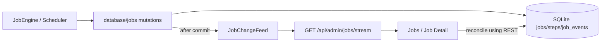

# Agent Job Realtime Updates — Implementation Design v3

Status: implemented for review on `integration/voice-reminders-direct-tts`, 2026-10-13. Runtime qualification is pending.

## Decision

SQLite is the **authoritative Job Read View**. A bounded in-process `JobChangeFeed` publishes ephemeral Job ID invalidations **after successful DB commit**. Authenticated Admin SSE sends hints; REST retrieves actual Job, Step, artifact metadata and per-Job durable Event timeline. Signals do not execute work or grant authority.



Retain the single-process deployment lock and durable recovery. Do **not** add Redis, a message broker, generic event repository, SSE sequence table, another WebSocket, plugin callback HTTP endpoints, per-Agent permissions or new config switches.

## Domain model

- **Job**: durable work owned by Rust Job Engine, independent of Voice Session and browser.
- **Job Event**: durable, append-only per-Job timeline entry with `sequence` in `job_events`. It is not a Job status command.
- **Job Change Signal**: best-effort, non-durable invalidation instructing observers to reconcile with SQLite.
- **Job Read View**: current consistent projection of `jobs`, `job_steps` and `job_artifacts` returned by Admin REST, distinct from admission-time `JobSnapshot`.
- **Worker Attempt**: one possibly started isolated execution; its `unknown_outcome` handling is unchanged.

Only the latter two domain terms need additions to root `GLOSSARY.md`; do not duplicate `Job Event` or `JobSnapshot`.

## Existing code / implementation placement

| Seam | Files | Required behavior |
|---|---|---|
| Durable writes | `database/jobs/{submission,orchestration,execution,recovery,events}.rs` | Publish after guarded UPDATE or transaction commit, never after rollback/no-op |
| Notifications | `database/jobs/change_feed.rs`, `database/mod.rs` | Clone-shared bounded `broadcast::Sender<String>`, `subscribe()`, `publish_committed()`; dropped hints are harmless |
| Consistent read | `database/jobs/mod.rs`, `steps.rs` | Read Job, Steps and Artifacts in one short SQLite read transaction |
| Orchestrator Step | `services/background/orchestration.rs` | Move visible LLM attempt transition from inline SQL into database mutation method |
| Retention | `services/background/artifacts.rs` | Remove `job_events` before deleting parent Job to respect FK; notify after commit |
| Admin transport | `app/admin/{background,mod}.rs` | SSE route behind existing Bearer authentication |
| Admin Web | `api/job-updates.ts`, `pages/jobs/{JobsPage,JobDetailPage}.vue` | `fetch()` SSE with Bearer, dirty refresh, reconnect and visibility reconciliation |

Do not change `plugins/{runner,protocol,dispatch}.rs`: both `python_container` and `rust_container` use the same one-result `jsonl-v1` worker protocol. Live percentage progress **inside** a plugin is a different feature.

## Post-commit coverage

Confirm signal for fresh submit (Admin or Voice), claim `queued -> planning`, plan attempt/rejection/publication, Step/attempt transitions and result, `running -> cancelling`, terminal state, and retention removal. A replayed idempotency key must not send a new signal; unchanged UPDATE must not send one. Startup recovery can send signals without subscriber because a reconnect always reads SQLite.

Signal is `{job_id}` only. Never include model output, private prompt, plugin stdout, artifact paths, credentials or status/terminal authority. The broadcast channel does not carry retry or delivery guarantees. Its send must not block the SQLite writer.

## SSE contract

`GET /api/admin/jobs/stream` requires the existing Admin `Authorization: Bearer` header and returns `401` before subscription if invalid.

```text
event: ready
data: {}

event: job_changed
data: {"job_id":"<uuid>"}

event: resync_required
data: {}
```

Server registers the broadcast receiver before `ready`, emits `resync_required` on `Lagged`, sets `Cache-Control: no-cache, no-transform`, disables proxy buffering and sends keepalive about every 15s. Do not synthesize a global `id:` or claim support for `Last-Event-ID`; durable `/jobs/{id}/events?after=N` has an independent per-Job cursor.

Existing Admin GET/POST/Retry/Cancel/Artifact endpoints remain unchanged.

## Browser reconciliation

Use authenticated `fetch` streaming, not native EventSource with a query-string token. One listener per mounted page; no global registry. Parse split UTF-8, CRLF, bounded SSE frames. Stop retry on 401/403; reconnect with bounded exponential backoff on transient disconnect and reconcile every time a connection resumes.

Call REST after `ready`, after `job_changed`, after lag, after reconnect, when tab becomes visible, or during 60s fallback. During in-flight GET, mark dirty and perform another read afterwards. Coalesce repeated invalidations (~200 ms). Abort stale requests on Job ID / route change and unmount. Jobs list invalidates across filter/pagination changes; Job Detail invalidates only for matching `job_id`, deduplicates per-Job timeline sequence, and replays all available pages. A missing Job after retention is an expected 404. SSE failures never change Job terminal state.

## Qualification gates

1. Unauthenticated `GET /jobs/stream` returns 401. An authenticated open stream receives `ready`, then a `job_changed` for a newly committed Job.
2. Commit failure / rollback / idempotency replay / no-op cannot announce a new committed change.
3. Verify status transitions including those without `job_events`; verify eventual convergence after lost notification, restart, broadcast lag and browser reconnect.
4. Job Read View is a coherent snapshot and events cursor never crosses Job identity.
5. Delete a terminal Job with durable Events after retention without FK failure; snapshot 404 and list updates.
6. Web test: Bearer header, parser split UTF-8/CRLF, 401 stop, route change abort, resync and visibility fallback, no 5-second polling.
7. Regression: Admin create/cancel/retry/artifact, Voice submit receipt, Python/Rust plugin sandbox, existing Reminder/Voice routing.

Follow `AGENTS.md`: run tests only through `scripts/agent-test.sh`: `targeted job_stream`, `targeted terminal_job_retention`, `package`, then `full`; use `check`, `web test`, `web typecheck`, `web build`, and `run -- cargo fmt --check` / `run -- cargo clippy --workspace --all-targets -- -D warnings` for other checks. Preserve the script's nonzero results and inspect only bounded diagnostics. Exercise SSE through the real deployment proxy. No test pass is asserted by this document.

## PONYTAIL decisions

Removed from the previous long proposal: eight-term taxonomy, generic EventBus/repository port, configurable SSE infrastructure, shared ref-counted WebSocket/SSE manager, extra event replay store, duplicate phase charts and speculative Worker Progress Protocol v2. Keep only one bounded sender, one transport handler, one browser adapter and two existing pages. Domain vocabulary is recorded once in the glossary and the architectural trade-off once in ADR 0100.

## Known unrelated follow-ups

The branch currently has two ADR 0099 files (`agent-job-responses-provider-routing` and `rust-executable-plugin-runtime`). Resolve numbering separately, without rewriting accepted historical decisions as part of SSE. If plugin live progress/data is later required, design a separate bounded Worker Progress Protocol with its own security and replay semantics.
