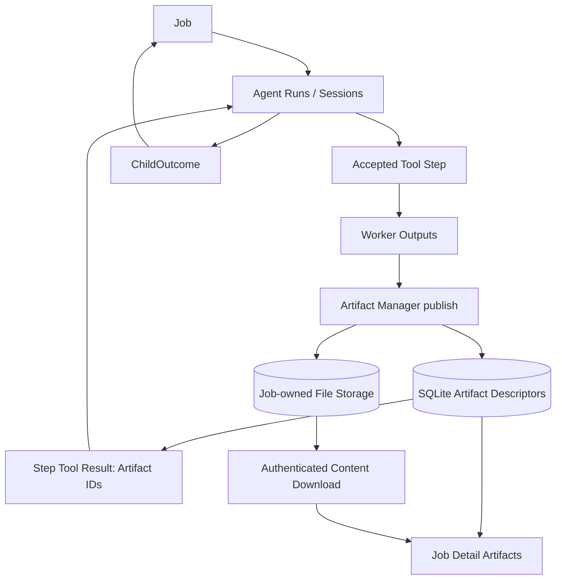
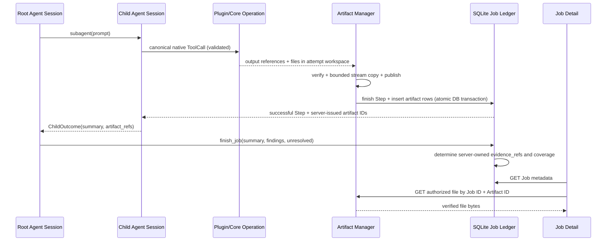

# Agent Job V3 - Unified Artifacts: Implementation Specification

**Status:** Implementation-ready design (not implemented)  
**Repository:** `hailp-vn38/ai-agent-voice`  
**Reference branch:** `feat/agent-job-v3-opencode-session-runtime` (reviewed 2026-10-15)  
**Scope:** Agent Job `hierarchical_v3` ONLY.  
**Related decisions:** `docs/adr/0114-opencode-agent-session-tool-delegation.md`, `docs/flows/10-agent-job-opencode-v3.md`.

## 1. Goal, scope, and explicit decisions

An Agent Job can produce zero or more durable files, and the admin Job Detail page must display them in a unified gallery. Support audio (MP3/WAV/OGG/FLAC), video (MP4/WebM), images (PNG/JPEG/WebP/GIF), source code (Rust, Python, JS/TS, HTML/CSS, SQL, etc.), TXT/Markdown/JSON/CSV, PDF and arbitrary downloadable binary files. Unsupported previews fall back to Download. The files are products of successful Tool Steps, not fabricated model response fields.

Locked scope decisions:

1. **V3 only.** Do not introduce a new engine, mode discriminator, or V1/V2 compatibility branch. Preserve existing migrations and stored V3 data as needed; this does not imply a runtime dispatcher by version.
2. **Local filesystem + SQLite.** Use one Job-owned folder, no directory partitions for root vs subagent or media type, no S3/MinIO or storage interface for hypothetical providers.
3. **Simple security.** Reuse existing admin Bearer authentication and Job ownership. Keep essential path containment, file-type safety, size limits and escaping. No separate signed URLs, per-artifact permissions, malware scanner, or preview authorization system.
4. **Keep V3 OpenCode contracts.** Root `subagent`/`finish_job`, Child `submit_result`, canonical assistant ToolCall/ToolResult replay, source-URL coverage, pinned provider/tool authority and matched tool-call IDs are not redesigned.
5. **Files remain after Job completes.** Default retention for completed Job files is **disabled**; deleting a Job removes its files. Optional retention may be configured explicitly. Ensure disk quotas are enforced.
6. **No user upload flow.** Artifacts are created by approved Core/External Plugin Operations, not by a browser upload form.
7. **Job Request output format stays textual.** The current `JobRequest.output_format` (`summary`, `text`, `json`, `markdown`) describes the final textual answer, NOT the types of files a Step can publish. Do not add one enum variant per media type to that field.
8. **Browser previews are bounded in the first delivery.** Preview media with authorized `fetch` and Blob URLs. Videos larger than `preview_blob_max_bytes` are Download-only until an explicitly approved native streaming authentication solution exists. This avoids pretending an HTML `<video>` element can send the app's Bearer header. Backend file storage itself MUST stream large files without accumulating them in memory.

### Non-goals

- Specialized content-generation logic in Artifact Manager (TTS, video encoding, code generation are separate tools/plugins).
- A generic cross-service media/attachment platform.
- In-browser execution of generated HTML/JS/Python, SVG inline preview, PDF scripting or archive extraction.
- Public artifact URLs; notifications; image/video transcoding; thumbnails stored on disk; browser uploads; separate object storage; an all-provider media-transcoding pipeline.
- Rewriting the current Timeline B view or Agent Session persistence.

## 2. Codebase baseline (confirmed source)

| Path | Current behavior / change trigger |
| --- | --- |
| `crates/voice-agent-server/src/services/background/artifacts.rs` | Artifact root appends `.job-artifacts` to the **database filename**; validates hash/size and reconciles orphan files; terminal Job retention currently 30 days. |
| `crates/voice-agent-server/src/services/background/plugins/protocol.rs` | `ArtifactRef` has `path`, `media_type`, optional `size_bytes` and `sha256`; at most 16 entries per Worker response. |
| `crates/voice-agent-server/src/services/background/plugins/dispatch.rs` | Reads files from per-attempt `/work/out` and only accepts `text/plain`, `text/markdown`, `application/json`; `ArtifactData.bytes` loads all bytes into RAM. |
| `crates/voice-agent-server/src/services/background/execution.rs` | Copies bytes from `Vec<u8>` into `.{uuid}.staging`, renames, commits job-step/artifact metadata. |
| `crates/voice-agent-server/src/database/jobs/execution.rs` | `finish_plugin_success` enforces per-Job limit plus hardcoded 256 MiB global cap, commits Step and artifact rows. |
| `crates/voice-agent-server/src/database/jobs/artifacts.rs` | Checks artifact metadata and Job ownership; read model only exposes a minimal subset. |
| `crates/voice-agent-server/src/database/jobs/mod.rs` | Job view selects only `id, media_type, size_bytes, sha256` for each artifact. |
| `crates/voice-agent-server/migrations/0105_background_jobs.sql` | Existing `job_artifacts` table: `id, job_id, step_key, relative_path, media_type, size_bytes, sha256, created_at, retention_until`. |
| `crates/voice-agent-server/src/app/admin/background.rs` | Authenticated GET artifact streams as octet-stream with attachment disposition and UUID filename, no inline preview protocol. |
| `apps/admin-web/src/api/agent-jobs.ts` | Fetches artifact as Blob using existing Bearer-aware client. |
| `apps/admin-web/src/api/types/agent-jobs.ts` | `JobArtifact` has only four fields. |
| `apps/admin-web/src/pages/jobs/JobDetailPage.vue` | Artifacts list shows UUID/MIME/size and Download only. |
| `crates/voice-agent-server/src/config/background.rs` | Default + maximum `artifact_bytes_per_job` is 20 MiB. |
| `compose.prod.yaml` | Host mount `/mnt/storage/ai-agent-voice/docker/prod/data` -> `/app/data`. |

**Important exact current path:** with default `database.url = "sqlite://data/voice-agent.db"` and container `WORKDIR /app`, current persisted artifacts are at `/app/data/voice-agent.db.job-artifacts/<job_id>/<artifact_id>`, not `/app/data/.job-artifacts/`. The new root below is a requested change, not a statement about the currently deployed files.

## 3. Domain model and ownership

### 3.1 Terms

- **Job Artifact**: an immutable file published by a successfully accepted Job Tool Step, owned by exactly one Agent Job and referenced by a server-issued Artifact ID.
- **Artifact ID**: server-created UUID identifying an artifact within its Job; never a filesystem path, filename, source URL, Step Key or model-generated ID.
- **Artifact File**: physical bytes associated with an Artifact ID; stored under a server-owned Job directory using the ID as disk filename.
- **Display Filename**: sanitized human-facing name (for example `narration.mp3`); NOT an on-disk path or identity.
- **Artifact Descriptor**: the immutable recorded metadata for a published artifact: Job/Step ownership, filename, media type, bytes, digest and creation time.
- **Artifact Evidence Reference**: an Artifact ID obtained from the persisted Job ledger and delivered to an Agent through an authorized Tool Result / ChildOutcome. A URL is never an Artifact Evidence Reference.
- **Artifact Preview**: browser-only representation of an artifact's bytes; it is not the file's authoritative representation and cannot change artifact ownership or state.
- **Worker Output**: a temporary file created inside the Plugin attempt's output directory before publication; it is NOT yet a Job Artifact.

### 3.2 Relationships and invariants



Invariants:

1. `Job -> 0..N Artifact`; `Artifact -> exactly 1 Job`; each published Artifact belongs to exactly one successful Tool Step. A step may publish up to the current 16-output protocol cap. Empty artifacts are allowed if useful, subject to limits.
2. A Step is associated with its owning Agent Run via existing Step/Run references; **do not duplicate `agent_run_id` as an independently supplied plugin field**. Resolve `agent_run_id` by joining existing database records where present.
3. Artifact ID is created only by Rust; Worker may propose a path/name/type but not artifact ownership, ID, or Step ownership.
4. Publication is all-or-nothing for the Step's output set; no Step `succeeded` row may reference missing/uncommitted artifacts.
5. Artifact bytes and published metadata are immutable. A changed file name/content is a NEW artifact, not an overwrite.
6. A Child can cite only Artifact IDs attributable to its owned successful Steps; Root `finish_job` continues to derive final evidence from the Job ledger without taking evidence IDs from the model.
7. File count, quota, and valid paths are checked before admission; filename or MIME never grants execution permission.
8. Job SSE stays a metadata-only invalidation. Content and model transcripts do not go into SSE events.

### 3.3 Scenarios to validate the model

- Child A creates `report.md`, Child B creates another `report.md` in the same Job: different IDs, no overwrite, both visible with provenance.
- Child produces `output.mp3` and `cover.png` in one Worker attempt: both committed, or neither committed if one fails checksum/quota.
- A worker claims an artifact path `../private.txt` or a symlink: reject the attempt. No arbitrary filesystem read.
- A Step returns text-only data and no file: valid Step, empty artifact list; no fake evidence.
- A Root tries to cite an HTTP URL as an Artifact ID: invalid; source URLs follow independent verified-source coverage.
- A browser refreshes while a Job is running: committed artifacts appear in the authoritative Job read view even before Job reaches terminal status.
- Job is deleted: SQLite rows and Job folder are removed; retry jobs have their OWN folders and remain unaffected.
- Server crashes after publishing file but before SQLite commit: startup reconciliation deletes orphan published bytes; no false published artifact is exposed.

## 4. Module design and seams

Use existing `services/background/artifacts.rs` as the external seam of one **deep module** (it may have private internal files). Do **not** create a hypothetical `StorageBackend` interface with only one adapter. Keep SQL owned by `database/jobs`, not spread through HTTP handlers or Vue.

Suggested internal Rust interface (illustrative, not literal source drop-in):

```rust
struct ArtifactInput {
    source_path: PathBuf,         // confined to server-issued worker output dir
    filename: String,            // display only
    media_type: String,          // validated/normalized
    declared_size: Option<u64>,
    declared_sha256: Option<String>,
}

struct ArtifactContext<'a> {
    job_id: &'a str,
    step_key: &'a str,
    attempt_id: &'a str,
}

impl ArtifactManager {
    async fn publish_step_outputs(
        &self,
        context: ArtifactContext<'_>,
        inputs: Vec<ArtifactInput>,
    ) -> Result<Vec<JobArtifactView>, JobError>;

    async fn open_checked(
        &self,
        job_id: &str,
        artifact_id: &str,
    ) -> Result<(tokio::fs::File, ArtifactDescriptor), JobError>;

    async fn purge_job(&self, job_id: &str) -> Result<(), JobError>;
}
```

`publish_step_outputs` owns validation, bounded streaming copy, SHA-256, sibling-directory staging, atomic rename, directory fsync, DB publication call and rollback/orphan recovery. Keep the DB method responsible for the transaction that finishes the Step and inserts artifacts; do not introduce a second transaction in Artifact Manager.

`open_checked` must keep Job-scoped lookup and safe file opening; replace large-file full read/hash-on-every-request with a documented integrity policy (see section 8). Existing no-follow and regular-file checks remain.

## 5. Physical storage layout

### 5.1 New layout

With the default SQLite location:

```text
/app/data/
  voice-agent.db
  plugins/workspaces/<job-id>/<attempt-id>/out/    # temporary Worker outputs
  job-artifacts/
    <job-id>/
      <artifact-id>                                  # binary/text, no extension
      <artifact-id>
      .<artifact-id>.staging                         # transient publish file only
```

Production host bind mount from the reviewed `compose.prod.yaml`:

```text
/mnt/storage/ai-agent-voice/docker/prod/data/job-artifacts/<job-id>/<artifact-id>
```

This host path is from Compose configuration, not a verified live-host observation. **Base `compose.yaml` alone has no full `/app/data` persistent mount.** Deployment must include a data bind mount or durable volume before running media workloads.

Do not create `audio/`, `video/`, `root/`, `subagent/` subfolders. The `filename` and `media_type` live in SQLite. Example disk name `49f...-uuid` may display as `narration.mp3`.

### 5.2 Migration from the existing root

Present code creates `<resolved-db-file>.job-artifacts`; new code chooses `<db-parent>/job-artifacts`. Migration must preserve already stored V3 artifacts, without any V1/V2 runtime path branching:

1. At startup, after exclusive deployment ownership is acquired and before Job worker dispatch/reconciliation, compute `old_root` and `new_root` from the resolved durable SQLite file path.
2. If `old_root` exists and `new_root` does not, atomically rename old root to new root **on the same filesystem**, then fsync parent. Existing DB `relative_path = "<job-id>/<artifact-id>"` remains correct.
3. If both roots exist and either has nonempty published contents, fail startup with a clear diagnostic; never silently merge or discard.
4. If neither exists, create the new root lazily/at startup. If the old root is empty, its removal is safe after verification.
5. Run the existing orphan reconciliation against the **new** root. Migration should be idempotent across crash/restart.
6. Provide a focused migration test with a real preexisting V3 artifact and a restart; verify bytes/hash and the existing descriptor still resolve.

Do NOT change migration `0105` or invent an additional old-version runtime mode. This path migration is a one-time physical location change only.

## 6. SQLite descriptor and Job read view

Create forward-only `crates/voice-agent-server/migrations/0118_job_artifact_media.sql` (0117 is the latest reviewed DB migration). Preserve existing table and foreign keys. Minimum additions:

```sql
ALTER TABLE job_artifacts
  ADD COLUMN filename TEXT NOT NULL DEFAULT '';

CREATE INDEX IF NOT EXISTS job_artifacts_job_created
  ON job_artifacts(job_id, created_at, id);
```

`filename` is display-only, sanitized server-side to at most 128 UTF-8 bytes and never contains `/`, `\\`, control characters or `.` / `..` special names. Existing rows with empty `filename` display their Artifact UUID as fallback. Do not backfill a fictional extension. Preserve `media_type`, `size_bytes`, `sha256`, `relative_path`, `step_key`, `created_at`, `retention_until`.

Minimal HTTP read view (avoid storing derived `kind` or `previewable` in DB):

```json
{
  "id": "<server-uuid>",
  "job_id": "<job-uuid>",
  "step_key": "s-001",
  "agent_run_id": "<child-agent-run-uuid>",
  "filename": "narration.mp3",
  "media_type": "audio/mpeg",
  "size_bytes": 5242880,
  "sha256": "<64 lowercase hex chars>",
  "created_at": "2026-10-15T10:00:00Z"
}
```

`agent_run_id` is NULL if existing Step provenance cannot resolve it; derive it from authoritative Step/Run rows instead of adding a redundant column. The frontend derives viewer kind from media type and allowed filename extensions. Update `JobArtifactView`, `database/jobs/mod.rs` query, `apps/admin-web/src/api/types/agent-jobs.ts` and REST tests together.

## 7. Plugin output protocol and admission

Continue using the existing protocol: Worker writes files into `/work/out` and returns one newline-terminated JSON response on stdout (bounded by existing protocol limit). No base64 binary payloads in tool result JSON.

Keep original fields; add one optional display field to `ArtifactRef`:

```json
{
  "schema_version": 1,
  "request_id": "<attempt-uuid>",
  "ok": true,
  "result": { "summary": "Audio synthesized" },
  "artifacts": [
    {
      "path": "narration.mp3",
      "filename": "narration.mp3",
      "media_type": "audio/mpeg",
      "size_bytes": 5242880,
      "sha256": "<64 lowercase hex chars>"
    }
  ],
  "error": null
}
```

- `path`: still the local output basename in the Worker directory, no traversal, path separator or NUL; keep the current single-file basename constraint. Supporting multiple files does NOT require accepting nested paths.
- `filename`: optional; default to `path`, canonicalized for display only; not used as physical path.
- `media_type`: normalized from an explicit, small set of supported media families; unknown types may be accepted as `application/octet-stream` and Download-only, according to a published mapping.
- `size_bytes`, `sha256`: optional client declarations checked against streamed actual data; server always computes and stores its own digest and size.
- Keep existing limit of 16 files per Worker attempt unless a concrete use case justifies changing it.
- Simple binary classification: allow common listed MIME types; verify media extension compatibility, file regularity and bounded content. Do NOT add antivirus/scanning/transcoding, but never render active HTML/SVG/JS as live page content.
- Keep `result` bounded by existing output schema/JSON protocol. Never stuff file contents into `result` or Agent Session messages.

Example MIME/viewer table:

| Media family | Accepted examples | Browser viewer |
| --- | --- | --- |
| Audio | `audio/mpeg`, `audio/wav`, `audio/ogg`, `audio/flac` | `<audio>` if browser supports codec |
| Video | `video/mp4`, `video/webm` | `<video>` via authenticated Blob URL within preview cap |
| Image | `image/png`, `image/jpeg`, `image/webp`, `image/gif` | `` via Blob URL |
| Source | `text/plain`, `text/x-python`, `text/x-rust`, `text/javascript`, `text/css`, `text/html`, `application/sql` | Escaped, read-only code viewer; NEVER execute/embed HTML |
| Text/data | `text/markdown`, `application/json`, `text/csv` | Escaped Markdown, JSON tree, bounded table |
| PDF/ZIP/Other | `application/pdf`, `application/zip`, `application/octet-stream` | Download first; optional future viewer |

## 8. Streaming publication, limits, and integrity

### 8.1 Replace `Vec<u8>` across the artifact path

Current path `read_artifacts -> Vec<ArtifactData.bytes> -> finish_plugin -> Vec<u8> staging` must be changed so the plugin worker's output is copied using **bounded chunks**, not read into memory. A possible internal value is `ArtifactInput { source_path, media_type, filename, declared_size, declared_sha256 }`; the file must be consumed before the Worker attempt workspace is deleted. Reorder the existing cleanup accordingly, but only after the worker process has been reaped, so there is no concurrent writer.

Copy across the Plugin attempts volume and destination volume (they may be different filesystems): create `job-artifacts/<job-id>/.<artifact-uuid>.staging` via `create_new`; stream copy while computing hash and checking size/quota; `sync_all` the file; rename staging to `<artifact-uuid>` within the destination directory; sync destination directory; perform existing transactional Step success + artifact descriptor insertion; expose IDs only after commit. On failure remove all outputs of this Step (both staging and published-but-uncommitted files), record Step failure, and do not claim artifact success. On restart orphan reconciliation cleans files not present in SQLite.

To avoid a failed attempt contaminating another Step, use only files tied to the relevant Worker attempt; no directory-wide import/globbing. Validate every declared output before publishing any. Any transient copies must be bounded and cleaned.

### 8.2 Proposed deployment quotas (editable defaults, not settled operational sizing)

| Setting | Initial proposal | Notes |
| --- | ---: | --- |
| `artifact_max_file_bytes` | 512 MiB | One published artifact |
| `artifact_bytes_per_job` | 1 GiB | Sum of all published artifacts in one Job |
| `artifact_global_bytes` | 10 GiB | Aggregate retained files across Jobs |
| `artifact_max_files_per_step` | 16 | Already enforced by Worker protocol |
| `artifact_preview_blob_max_bytes` | 64 MiB | Browser preview cap; larger video Download only |
| `artifact_preview_text_max_bytes` | 1 MiB | Safe code/text rendering cap |
| `artifact_retention_days` | `null` (disabled) | No automatic expiration by default |

Expose these under the existing `[background.limits]` and/or a compact `[background.artifacts]` config (choose one canonical nesting; avoid duplicate sources of truth). Existing `BackgroundLimits::valid()` rejects values >20 MiB: change both default and permitted upper bound. Replace hardcoded global `256 * 1024 * 1024` with the configured quota. Re-evaluate budget bounds for actual disk capacity. Keep Job-scoped budget semantics consistent with immutable Job snapshots, and global quota as deployment-controlled runtime cap.

Prevent integer overflow (`checked_add`), negative sizes and unbounded allocation. Validate total disk usage in a DB transaction before commit; temporary disk usage also needs a per-attempt cap and bounded concurrency. Return stable error codes such as `artifact_quota_exceeded`, `artifact_invalid_type`, `artifact_checksum_mismatch`, `artifact_storage_unavailable`.

### 8.3 Integrity/read policy

Preserve the current invariant that a published Artifact ID refers to exactly one Job and file. Validate SHA-256 during publish. Do not compute a 500 MiB file hash afresh on **each** browser Range request; for the first implementation, since the preview/download endpoint remains full-file fetch, it may stream with the existing checked file path, but avoid a full `Vec<u8>`. A later native Range implementation must define a safe integrity policy (for example immutable storage plus file metadata/snapshot verification with validated files and no outside writes) before claiming it is production-ready. Do not weaken the existing `O_NOFOLLOW`/regular-file checks.

## 9. Admin HTTP contract and browser previews

### 9.1 Required first-delivery HTTP changes

Keep existing authenticated endpoints:

- `GET /api/admin/jobs/{job_id}`: includes expanded artifact descriptors.
- `GET /api/admin/jobs/{job_id}/artifacts/{artifact_id}`: authorized Download, returns the stored file as `application/octet-stream`, `Content-Disposition: attachment` with sanitized UTF-8 display filename, `X-Content-Type-Options: nosniff`, `Cache-Control: no-store`. If metadata filename missing, use UUID fallback. Never trust arbitrary file paths supplied by clients.

No new content endpoint is needed for the first phase. The current `agentJobsApi.artifact` already uses an Authorization-aware `requestBlob` call. Frontend reads the bytes as Blob and constructs `URL.createObjectURL(new Blob([blob], { type: artifact.media_type }))` **only for approved preview types and limited sizes**. Revoke Blob URLs on close/unmount/change of Job. For files above the preview cap use Download, not a fake nonworking `<video src="/api/admin/...">`.

**Explicit limitation:** native seek/partial transfer for very large audio/video is **not** in the first-phase UI. Browser Blob preview downloads the entire file first; large video previews are postponed. A future extension can add HTTP Range/`206` + an authenticated delivery mechanism, but this design intentionally does not add tokens, signed URLs, new cookies or a custom MediaSource player to the first implementation.

### 9.2 Viewer registry

Use a private registry of lightweight Vue viewers; no plugin system for viewers:

```ts
type ViewerKind =
  | 'audio' | 'video' | 'image'
  | 'code' | 'markdown' | 'json' | 'csv'
  | 'download'

function viewerFor(artifact: JobArtifact): ViewerKind;
```

Proposed location: `apps/admin-web/src/components/jobs/artifacts/`:

- `JobArtifactGallery.vue`: grid/list, file icon, display filename, size, MIME, created date, optional Agent Run/Step label.
- `ArtifactPreviewDialog.vue`: preview shell with Close/Download and loading/error state.
- `ArtifactAudioPreview.vue`, `ArtifactVideoPreview.vue`, `ArtifactImagePreview.vue`.
- `ArtifactCodePreview.vue`: HTML-escaped source view, line numbers, copy, client-only syntax highlighting if existing dependencies suffice; no code execution.
- `ArtifactDataPreview.vue`: bounded escaped Markdown/JSON/CSV; CSV parsed into capped row/column count to prevent browser freezes.

Continue to use Timeline B unchanged. Add gallery to the existing Artifact section of Job Detail. Every artifact has Download, whether or not it has a viewer. Gallery derives group type from MIME/extension without duplicating a new DB enum.

### 9.3 UX acceptance

- MP3: show filename, size, Play/Pause, progress and Download for valid <=64 MiB artifact.
- MP4/WebM: show usable video player for supported codec and <=64 MiB; for >64 MiB show Download + clear size notice, not a broken media player.
- PNG/JPEG: show image zoom/fit; no uncontrolled giant image lists.
- `.rs`, `.py`, `.ts`, `.js`, `.html`: show escaped code with line numbers; HTML is NOT executed.
- JSON/CSV/MD: bounded readable preview; invalid UTF-8 or oversize -> Download.
- ZIP/PDF/unknown: Download, no speculative viewer.
- Slow/failing download: spinner and error state; no frozen UI; all object URLs are revoked when no longer needed.
- Accessibility: keyboard-operable buttons/dialog, media controls, descriptive file icon and filename.

## 10. V3 flow compatibility



No new Root tool. No new `subagent` params. An existing Job can keep `output_format: "text"` while publishing MP3/MP4/source-code artifacts from authorized Steps. Child evidence eligibility must remain scoped to its own successful Steps and persisted Runs. Source URLs remain `coverage.verified_source_urls`, not artifacts. Root final evidence remains server-derived. New user-visible artifact filename, kind or caption must not give the model authority to claim execution success.

## 11. Lifecycle and retention

- **Running Job:** Step-success artifacts appear immediately after commit; a later Job failure does not destroy already committed artifacts, unless the Job itself is deleted. UI may show partial outputs with accurate Step/Job status.
- **Successful Job:** artifacts retained indefinitely by default, bounded by quotas.
- **Failed/cancelled Job:** already committed artifacts remain if Job record remains; failed attempts with no committed Step cannot publish half a set.
- **Explicit Job delete:** reuse existing endpoint; delete the Job folder only after worker/process termination is enforced and DB delete is committed. Retried Jobs own separate folders.
- **Automatic retirement:** disabled by default. If configured, job-level expiration deletes Job rows and corresponding folder; do not expire individual files while they remain referenced by a readable Job unless explicitly designed later.
- **Crash repair:** startup reconciliation handles orphan bytes, staging files and directories; bound scans and log anomalies. Never delete files of a live running attempt (single-process ownership and worker reaping invariant).
- **Backups:** include both SQLite and `/app/data/job-artifacts/`; copying SQLite alone does NOT restore artifacts. Keep data directory persistent across container recreation.

## 12. Implementation work packages, in dependency order

### P0 - DB descriptor and storage root

1. Add `0118_job_artifact_media.sql` and DB tests for `filename`; implement deterministic V3 startup path migration under deployment lock.
2. Change artifact `root()` to parent-of-DB `job-artifacts/`; keep current UUID storage names.
3. Extend database Job view (`step_key`, `agent_run_id` via join, `filename`, `created_at`) and Rust/TypeScript contract tests.
4. Update config with proposed quota and retention controls. Do not delete old migrations.

**Exit:** existing V3 artifact survives path migration/restart; GET Job exposes correct metadata.

### P1 - Worker binary publication (critical path)

1. Add optional `filename` to `ArtifactRef` without breaking current Worker response format.
2. Extend accepted media families; maintain paths, file count, checksum and output-schema validation.
3. Replace `Vec<ArtifactData.bytes>` with owned bounded file descriptors/paths and stream-copy pipeline; reorder workspace cleanup only after publishing completes.
4. Preserve all-or-nothing Step and artifact publication on quota/hash/crash failures; adjust transactional SQL and error codes.
5. Add fixture Plugin outputs for MP3, MP4, PNG, `.py`, JSON and ZIP (files may be small valid samples; no external model credentials).

**Exit:** supported binary artifact published and retrieved without whole-file RAM buffering; no partial Step success.

### P2 - HTTP download and web gallery

1. Return extended metadata with job detail and use safe filenames for downloads.
2. Add `JobArtifactGallery` and viewer registry, specialized bounded previews, Blob URL lifecycle.
3. Keep Timeline B and SSE invalidation contract untouched.
4. Implement Web unit/UI tests for viewer routing, preview size limits, HTML escaping, failure recovery, download filename, blob cleanup.

**Exit:** user can view supported small MP3/MP4/images/source text and download all types; oversized preview falls back to Download.

### P3 - Operational hardening and acceptance

1. Add integration tests for restart/orphan cleanup, multiple Worker output files, competing Jobs, global quota, disabled retention and explicit deletion.
2. Confirm Compose production data mount persists files across container rebuild/recreation; document disk monitoring.
3. Run Rust formatting/Clippy/integration tests and web typecheck/build/tests; record exact commands/results in implementation PR.
4. Update `CONTEXT.md`, Job V3 flow document and glossary; add one concise ADR for Job-owned immutable local file storage.

**Exit:** complete end-to-end V3 Root -> Child -> Plugin -> Artifact -> finish_job -> Job Detail flow passes tests.

### Deferred follow-up (not required for implementation acceptance)

- Browser seeking large videos via authenticated Range transfer, without a complex token architecture.
- Persistent thumbnail generation, optional media transcoding, embedded PDF viewer, ZIP content browsing, object storage adapters.

## 13. Acceptance test matrix

| ID | Case | Expected |
| --- | --- | --- |
| A01 | V3 Child calls approved Plugin producing MP3 and PNG | Both files stored, IDs delivered as matched Tool Result and visible in Job detail. |
| A02 | Plugin produces MP4 (small), Python source, JSON | All downloadable; MP4/code/JSON rendered by correct viewer. |
| A03 | Unknown binary/ZIP | Saved and downloadable; fallback viewer. |
| A04 | Same filename emitted in two Steps | Distinct artifact IDs; no overwrite; correct Step/Agent provenance. |
| A05 | Worker emits wrong digest or declared size | Step fails; zero new committed artifacts; no retained orphan after reconcile. |
| A06 | Worker output path escapes or is symlink | Rejected; no arbitrary host file is read. |
| A07 | Job/file/global quota exceeded | Stable failure code; other existing artifacts unaffected. |
| A08 | 256+ MiB output in bounded runtime | Streaming copy; no material `Vec<u8>` proportional to file size. |
| A09 | Kill process between renamed file and DB commit | Restart reaps/reconciles orphan; no ghost descriptor. |
| A10 | Legacy filesystem root contains a V3 artifact | One-time move preserves Job artifact lookup and digest. |
| A11 | Root sends URL as Artifact Evidence Reference | Rejected per current V3 contract; no invented artifact. |
| A12 | Child resumes same Session and produces a new file | New Step/Run ownership correct; old files unaffected. |
| A13 | Job is running but Step completed | New artifact visible in authoritative read; SSE only signals resync. |
| A14 | Delete Job with artifacts | Job folder removed; retry/other Job folders untouched. |
| A15 | Job older than 30 days with default retention disabled | Job and artifacts remain until explicit deletion. |
| A16 | Browser opens HTML source artifact | HTML displayed as text, never executed; Blob URL cleaned. |
| A17 | Browser attempts oversized MP4 preview | Explicit Download fallback, no unauthorized direct-video URL. |
| A18 | Browser unauthenticated download/wrong Job ID | Existing `401`/`404` semantics preserved. |
| A19 | Source-only summary Job without files | No phantom artifacts; V3 completion/coverage unchanged. |
| A20 | Plugin binary files and Root `finish_job` | Server-issued evidence refs, matched ToolResults and final coverage unchanged. |

## 14. Concrete file-change map

| Change | Files |
| --- | --- |
| Forward-only migration | `crates/voice-agent-server/migrations/0118_job_artifact_media.sql` |
| Storage and startup relocation | `crates/voice-agent-server/src/services/background/artifacts.rs`, `runtime.rs` |
| Streaming step publication | `services/background/execution.rs`, `services/background/plugins/dispatch.rs`, `services/background/plugins/protocol.rs` |
| Metadata SQL and atomic Step completion | `database/jobs/artifacts.rs`, `database/jobs/execution.rs`, `database/jobs/mod.rs` |
| Limits/retention | `config/background.rs`, `services/background/artifacts.rs` and scheduler/runtime call sites |
| Download semantics | `app/admin/background.rs` and its existing router mapping |
| Web types and requests | `apps/admin-web/src/api/types/agent-jobs.ts`, `apps/admin-web/src/api/agent-jobs.ts` |
| Artifact Gallery | `apps/admin-web/src/components/jobs/artifacts/*`, `apps/admin-web/src/pages/jobs/JobDetailPage.vue` |
| V3 regression checks | Existing `services/background/tests/*`, `services/background/agent_loop/*` fixtures, `apps/admin-web` tests |
| Documentation | `GLOSSARY.md`, `CONTEXT.md`, `docs/flows/10-agent-job-opencode-v3.md`, new ADR |

## 15. Domain Modeling deliverables to apply when implementing

### 15.1 Suggested `GLOSSARY.md` patch

Append a section to the existing root `GLOSSARY.md` (domain definitions only, no storage paths or implementation details):

```md
## Agent Job Artifacts

**Job Artifact**:
An immutable file published by an accepted Job Tool Step and owned by exactly one Job.
_Avoid_: Worker Output, Tool Result, attachment link

**Artifact ID**:
Server-issued identity of one Job Artifact, distinct from a display filename, URL or Step Key.
_Avoid_: filename, file path, source URL

**Display Filename**:
Human-facing file name attached to a Job Artifact; not its identity or ownership key.
_Avoid_: Artifact ID, storage path

**Worker Output**:
Temporary file produced by a Plugin Worker Attempt before the Job accepts it as an Artifact.
_Avoid_: published Job Artifact, Tool Result

**Artifact Evidence Reference**:
A Job-owned Artifact ID authorized from the persisted Step ledger for use as Agent evidence.
_Avoid_: source URL, model-generated file reference

**Artifact Preview**:
Read-only UI representation of a Job Artifact; it is not a new artifact or execution result.
_Avoid_: generated output, live HTML execution
```

Maintain the glossary's existing `Child Evidence Reference` term as the narrower **Child-owned subset** of Artifact Evidence References; do not replace or conflate it.

### 15.2 Suggested ADR (create at `docs/adr/0115-job-owned-local-artifacts.md` only when implementing)

```md