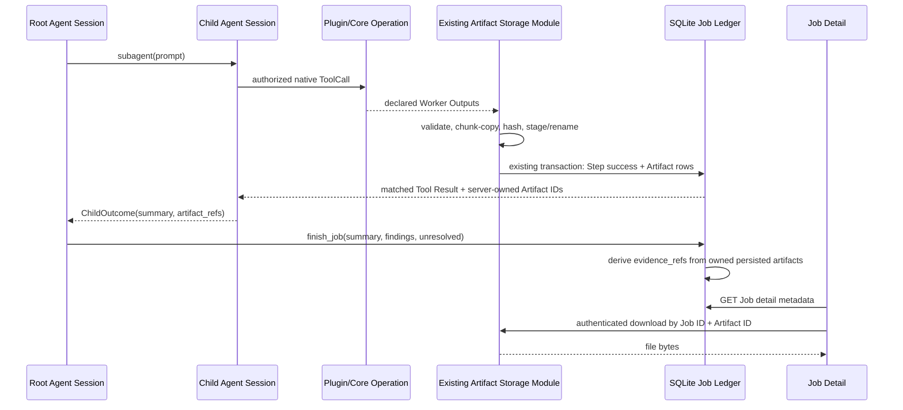

# Agent Job V3 - Unified Artifacts: Implementation Specification

**Status:** Implementation-ready design; not implemented. Updated after Ponytail Review (2026-10-15).  
**Repository:** `hailp-vn38/ai-agent-voice`  
**Reference branch:** `feat/agent-job-v3-opencode-session-runtime`  
**Scope:** `hierarchical_v3` only.  
**Related:** `docs/adr/0114-opencode-agent-session-tool-delegation.md`, `docs/flows/10-agent-job-opencode-v3.md`.

## 1. Goal and decisions

An Agent Job can produce **zero or more immutable downloadable files** created by accepted Tool Steps. Admin Job Detail shows an Artifact Gallery with bounded previews for MP3/WAV/OGG/FLAC, MP4/WebM, PNG/JPEG/WebP/GIF, source code, TXT/Markdown/JSON/CSV; PDF, ZIP and unsupported binary files are downloadable. The Artifact subsystem **does not** synthesize audio or video: the selected Plugin/Core Operation must actually generate the bytes.

1. **V3 only:** do not introduce V1/V2 runtime dispatch, a second agent runtime, or a new ToolCall/ToolResult protocol. Keep existing schema migrations and preserve stored V3 artifacts when moving the disk root.
2. **Reuse the existing Rust module:** extend `services/background/artifacts.rs`, `plugins/dispatch.rs`, `background/execution.rs`, and `database/jobs/*`. No new `ArtifactManager` class or hypothetical storage adapter.
3. **Local disk + SQLite:** one directory per Job, named artifact bytes by Rust-generated UUID; display name and metadata live in `job_artifacts`.
4. **Keep Worker stdout schema v1 unchanged:** `ArtifactRef.path` already identifies an output basename; the server uses that basename to derive the display filename. No additional `filename` field in the Worker Protocol.
5. **Simple security:** keep existing Admin Bearer auth, Job-scoped lookup, safe output paths, no-follow/regular-file checks and escaped text rendering. Do not build signed URLs, preview sessions, antivirus or separate media permissions.
6. **Retain completed Jobs by default:** disable the current automatic 30-day expiry for Job rows and their artifacts. Explicit Job deletion removes owned files. Do **not** add configurable retention until required.
7. **Browser preview uses authorized `requestBlob`:** Blob URL for approved types up to **64 MiB**, text rendering up to **1 MiB**; larger/unsupported media has Download only. This intentionally does not provide seeking of large remote video.
8. `JobRequest.output_format` still describes the textual final answer, not artifact types. Do not add media values to it.
9. Preserve the approved **Timeline B**. Only extend its existing Artifacts area.

**Out of scope:** browser uploads, transcoding, generated thumbnails, public links, object storage, running generated code/HTML, a new source-evidence mechanism, and changes to Root/Child agent orchestration.

## 2. Confirmed branch baseline

| Existing location | Relevant behavior |
| --- | --- |
| `crates/voice-agent-server/src/services/background/artifacts.rs` | Computes `<database-file>.job-artifacts` root; contains checked open, orphan reconciliation, deletion and terminal-Job 30-day expiry. |
| `services/background/plugins/protocol.rs` | Worker `ArtifactRef { path, media_type, size_bytes?, sha256? }`; maximum 16 references. |
| `services/background/plugins/dispatch.rs` | Worker outputs from `/work/out`; only 3 text MIME types accepted; reads each file entirely into `Vec<u8>` before removing its attempt workspace. |
| `services/background/execution.rs` | Writes staged file, renames, then calls existing Step + artifact publication path. |
| `database/jobs/execution.rs` | Job budget and a hardcoded global **256 MiB** budget; Step success and artifact rows committed transactionally. |
| `database/jobs/artifacts.rs`, `database/jobs/mod.rs` | Job ownership and metadata lookup; Job view currently exposes only ID, MIME, size, hash. |
| `migrations/0105_background_jobs.sql` | `job_artifacts(id,job_id,step_key,relative_path,media_type,size_bytes,sha256,created_at,retention_until)`. |
| `app/admin/background.rs` | Authenticated artifact download streams as `application/octet-stream`, UUID filename, `attachment`; no Range. |
| `apps/admin-web/src/api/agent-jobs.ts` | Existing Bearer-aware Blob download. |
| `apps/admin-web/src/pages/jobs/JobDetailPage.vue` | Artifact table with Download, no preview. |
| `config/background.rs` | `artifact_bytes_per_job` defaults to **20 MiB**; config validation rejects larger values. |
| `compose.prod.yaml` | Host bind mount `/mnt/storage/ai-agent-voice/docker/prod/data` to `/app/data`. |

The default SQLite URL is `sqlite://data/voice-agent.db` with container working directory `/app`. **Current** artifacts are stored in `/app/data/voice-agent.db.job-artifacts/<job-id>/<artifact-id>`. The new folder below is a **proposed change**, not the current implementation. Base `compose.yaml` alone does not persist the complete `/app/data`; production requires the existing bind mount or equivalent durable volume.

## 3. Domain model and invariants

Use only these new glossary terms, in addition to the existing `Agent Run`, `Job Step`, `Child Evidence Reference` and V3 session vocabulary:

- **Job Artifact:** immutable file published by an accepted Job Tool Step and owned by exactly one Job.
- **Worker Output:** temporary file produced by an executing Plugin before its Step publication is accepted.
- **Display Filename:** human-readable name of a Job Artifact, never an ownership key or a disk path.

The **Artifact ID** is the existing Rust-issued UUID. The existing **Child Evidence Reference** continues to mean the Artifact IDs that a Child may cite from its own accepted Steps. Do not add another evidence-reference concept or confuse verified source URLs with artifact IDs.

Invariants:

1. A Job has 0..N Artifacts. Each Artifact has one owning Job and one successful Step; one Step may publish up to the existing 16-output limit. Root and Child share the Job storage directory.
2. Rust issues UUIDs and owns Job, Step and Agent Run attribution. A Worker provides only output path/MIME/check declarations, never IDs or authority.
3. A Step's artifacts commit **as one set**; if any declared output fails validation, quota or persistence, the Step does not become successful and no new artifact descriptors become visible.
4. Published bytes and metadata are immutable. Two Steps can both produce `report.md` without collision because disk filenames are UUIDs.
5. The existing Step record already identifies its Agent Run/Session. The UI associates an artifact's `step_key` with the Job Detail Step/Timeline data; **do not add `agent_run_id` to the artifact descriptor or add a new SQL JOIN only for the gallery**.
6. Root `finish_job` accepts only `summary`, `findings`, `unresolved`; Rust derives final `evidence_refs` from persisted owned artifacts. Child ownership checks and URL-source coverage remain unchanged.
7. Job SSE continues to signal changes only; full content is fetched through the authenticated artifact endpoint.

Concrete cases: two Children can produce same-named files; one Worker can produce MP3 + cover PNG; a Step may yield no artifacts; retry creates a distinct Job directory; a failed attempt cannot expose half-published outputs. See the acceptance matrix for executable checks.

## 4. Storage layout and one-time move

**Target directory:**

```text
/app/data/
  voice-agent.db
  plugins/workspaces/<job-id>/<attempt-id>/out/  # temporary Worker output
  job-artifacts/
    <job-id>/
      <artifact-uuid>                               # immutable bytes, any media
      .<artifact-uuid>.staging                      # transient during commit
```

Production host equivalent, if the reviewed Compose mount is used:

```text
/mnt/storage/ai-agent-voice/docker/prod/data/job-artifacts/<job-id>/<artifact-uuid>
```

This is a configured host path, not a direct observation of the running host. No `audio/`, `video/`, `root/` or `subagent/` directory partitions; filename, MIME and Step provenance are stored in SQLite.

**Move old V3 files without introducing a version branch:**

1. Under the existing exclusive deployment lock, **before worker dispatch and orphan reconciliation**, compute old root (`<resolved-db-file>.job-artifacts`) and new root (`<db-parent>/job-artifacts`).
2. If only the old root exists, rename it to the new root on the same filesystem and sync the parent directory; `relative_path = <job-id>/<artifact-id>` remains valid.
3. If only the new root exists, use it. If neither exists, create lazily. If both contain published content, **fail startup** with diagnostics rather than merging. Empty extra roots may be removed after checking they contain no files.
4. Reconcile orphan/staging entries from the new root after relocation. Keep this idempotent across restart/crash; verify with an actual preexisting V3 artifact fixture.

Do not rewrite migration `0105` and do not add a persistent runtime switch for old and new layouts.

## 5. Database descriptor and admin read view

Create the next available forward-only migration (reviewed candidate `0118_job_artifact_media.sql`; **confirm the latest migration number on the implementing branch before creation**):

```sql
ALTER TABLE job_artifacts ADD COLUMN filename TEXT NOT NULL DEFAULT '';
```

No new media kind table, per-type status enum, duplicate `agent_run_id`, or speculative index. Keep the existing table, FKs and identity semantics. Derive `filename` from the accepted `ArtifactRef.path` basename at publication; sanitize it to a bounded UTF-8 display string without separators/control characters. Existing records with `filename = ''` display their UUID. Never use `filename` for file path lookup.

Extend the existing Job detail artifact read view, without changing its ownership model:

```json
{
  "id": "<artifact-uuid>",
  "step_key": "step-001",
  "filename": "narration.mp3",
  "media_type": "audio/mpeg",
  "size_bytes": 5242880,
  "sha256": "<sha256>",
  "created_at": "2026-10-15T10:00:00Z"
}
```

Use existing Job/Step and Timeline data to display which Child created the file. Preserve the current fields and response shape other than the needed metadata additions. Web derives viewer kind from MIME + filename extension; no persisted preview flag. Update `JobArtifactView`, `database/jobs/mod.rs`, Rust read tests and `apps/admin-web/src/api/types/agent-jobs.ts` together.

## 6. Plugin outputs: no protocol expansion

Keep Worker stdout `schema_version=1` and existing `ArtifactRef` fields. Example:

```json
{
  "schema_version": 1,
  "request_id": "<attempt-uuid>",
  "ok": true,
  "result": { "summary": "Audio generated" },
  "artifacts": [
    {
      "path": "narration.mp3",
      "media_type": "audio/mpeg",
      "size_bytes": 5242880,
      "sha256": "<sha256>"
    }
  ],
  "error": null
}
```

`path` is an output **basename** inside `/work/out` (no path traversal, nested paths, symlinks or NUL). Validate regular files; compare optional declared size and digest with actual bytes and use the computed values in SQLite. Maintain 16 outputs maximum and the existing JSON result/output-schema limits. The Worker never supplies artifact IDs. No base64 media in JSON responses or canonical Agent transcripts.

Accept these media families, falling back to `application/octet-stream` + Download for unknown binary (without a new media type taxonomy):

| Media | Examples | Browser behavior |
| --- | --- | --- |
| Audio | `audio/mpeg`, `audio/wav`, `audio/ogg`, `audio/flac` | Native `<audio>` if codec supported, under preview cap. |
| Video | `video/mp4`, `video/webm` | Native `<video>` if codec supported, under preview cap. |
| Images | `image/png`, `image/jpeg`, `image/webp`, `image/gif` | `` preview. |
| Code | `.rs`, `.py`, `.ts`, `.js`, `.html`, `.css`, `.sql` | Escaped, read-only `<pre>`; **never execute or embed generated HTML**. |
| Text/data | TXT, MD, JSON, CSV | Escaped, bounded text preview; no new Markdown/CSV rendering framework. |
| Other | PDF, ZIP, unknown/octet-stream | Download only. |

Recognize common MIME types and compatible extensions in the server's existing validation path. MIME/extension is only an input and viewer hint, not evidence of safe executable content. Keep `application/octet-stream` as safe download fallback. A Core Operation that already produces files should use the same Step publication implementation, **not** a separate store or protocol; do not claim a new Core TTS/video producer exists as part of this work.

## 7. Bounded streaming publication and quotas

**Critical change:** replace `read_artifacts -> Vec<ArtifactData.bytes> -> Step publication` with bounded file copy **without introducing a new public ArtifactManager interface**. Extend the existing module/functions at the current seam. The current Worker attempt directory is removed before the later Step publication; change the execution/cleanup order so output files remain available until the Step's artifact publication succeeds or fails. Worker process must be reaped before reading outputs. A small internal owned path/cleanup guard is acceptable only if necessary for lifetime management; no parallel orchestration module.

Publication sequence:

1. Validate the Worker artifact references, path containment, regular-file status, declared digest/size, file count and budgets; do not glob/import undeclared files.
2. For each file, create a UUID staging file with `create_new` under `<job-id>` and **stream copy** in bounded chunks, verifying checksum and counting bytes.
3. Flush/sync staged files, rename within the destination folder and sync the directory.
4. Use the **existing** `database/jobs/execution.rs` transaction to record Step success and insert **all** Artifact rows. Only after commit return the Rust-issued Artifact IDs in the Step Tool Result.
5. On any failure, clean this Step's new staging/published-but-uncommitted files; on crash, `artifacts::reconcile` removes orphan files not referenced in SQLite. Avoid deleting previously committed files.

Source attempt volume and published file volume may be different; **do not rename directly across them**. Any staging bytes count toward bounded temporary-disk usage. Keep integer overflow checks and existing no-follow/regular-file validation. Never allocate a `Vec<u8>` proportional to output size.

**Minimal config in existing `[background.limits]`:**

```toml
[background.limits]
artifact_bytes_per_job = 1073741824  # 1 GiB (initial proposal)
artifact_global_bytes = 10737418240  # 10 GiB (initial proposal)
```

These are proposal defaults, not measured storage sizing. Change `BackgroundLimits::valid()` to permit the proposed per-Job quota, and replace the hardcoded 256 MiB aggregate cap with `artifact_global_bytes`. Preserve immutable Job-snapshot budgets and make the aggregate cap deployment-controlled. A single file cannot exceed its remaining Job budget, so **do not add a separate per-file configuration**. Keep the current 16-files-per-Step protocol limit. Validate the global usage and new descriptor sizes transactionally before recording Step success; bound concurrent staging by the existing job/worker concurrency policy. Errors must be stable and distinguish quota, invalid output and storage failure.

**Integrity:** hash on publication, record `sha256`/size, and retain existing checked-open semantics for download. The current reader verifies before streaming; be aware this involves full-file hashing per download. Do not replace it with a speculative cache, new integrity interface or HTTP Range support in this release.

## 8. HTTP download and minimal web gallery

Continue to use the authenticated endpoints already present:

- `GET /api/admin/jobs/{job_id}` supplies the extended Artifact descriptors.
- `GET /api/admin/jobs/{job_id}/artifacts/{artifact_id}` remains the Download endpoint (`application/octet-stream`, `attachment`, `nosniff`, `no-store`) and uses the sanitized display filename in Content-Disposition, UUID fallback for older records.

The current `agentJobsApi.artifact` uses a Bearer-aware `requestBlob`. Reuse it for authorized preview: after checking **64 MiB** media cap and **1 MiB** text/code cap, fetch file, create a Blob URL for approved audio/video/image and revoke it on close, route change or Job change. For text/code read bounded content and interpolate as escaped text (`<pre>`); do not run generated HTML/JS. Oversize, unsupported media/codec or invalid text -> Download. HTML media tags cannot pass the admin Bearer header themselves; do not point `<video src>` directly to the authorized backend endpoint. No Range/206, extra auth cookies, MediaSource player or signed URL in this release.

Only two new Vue files, under `apps/admin-web/src/components/jobs/artifacts/`:

- `JobArtifactGallery.vue`: card/list presentation, filename, MIME, size, Download and Preview actions; optional Step/Child label resolved from existing Timeline/Step data.
- `ArtifactPreviewDialog.vue`: native `<audio controls>`, `<video controls>`, ``, escaped `<pre>` and fallback Download, with loading/error state and Blob URL cleanup. Keep any tiny `viewerFor(artifact)` decision function private to this file or a directly reused existing utility; **no viewer registry or specialized viewer modules**.

Reuse `apps/admin-web/src/pages/jobs/JobDetailPage.vue` Artifact section and existing download request helper. Preserve Timeline B layout and Job SSE invalidation. Do not add syntax-highlighter, CSV parser, Markdown renderer or media-player dependency for this feature. Preview cap constants live in the frontend (not a separate server configuration), and Download works for any accepted binary size.

## 9. V3 flow (unchanged orchestration)



The actual Tool/Child/Root call IDs and provider-neutral Session records remain managed by V3, not by artifact presentation. `coverage.verified_source_urls` is independent from artifact IDs. A text-output Job may publish binary files through its Steps.

## 10. Retention and recovery

- **Running/failed/cancelled Job:** a previously committed Step's artifacts remain readable as long as the Job exists. An uncommitted attempt cannot expose new files.
- **Completed Job:** disable the current automatic **30-day Job retirement** by default. No retention config, alternate expiration algorithm or periodic file sweeper is added. Existing `expire_terminal` call sites must no longer retire Jobs automatically.
- **Explicit Job delete:** reuse current deletion path; after worker exit and database removal, remove only the deleted Job's folder. A retry Job owns a separate folder.
- **Crash restart:** run existing reconciliation after the one-time root move; remove orphan staged/published files, never files backed by committed descriptors.
- **Disk capacity:** quota exhaustion rejects new publications without deleting existing Jobs automatically. Operator can delete Jobs to free space.
- **Deployment/backup:** production must persist `/app/data`. Backup both the SQLite database and `/app/data/job-artifacts`; SQLite alone cannot restore file bytes.

## 11. Implementation plan (files and exit conditions)

### P0 — Data and root relocation

- In `migrations/`, add the `filename` column with a forward-only migration; update `database/jobs/mod.rs` and the Job detail Rust/TypeScript types to return `filename`, `step_key` and `created_at`, not a redundant `agent_run_id`.
- In `services/background/artifacts.rs` and startup code, switch to `<db-parent>/job-artifacts` with the idempotent one-time V3 root migration and reconciliation before dispatch.
- In `config/background.rs` and `database/jobs/execution.rs`, add only the two quota settings from section 7; disable automatic terminal Job retirement at its existing call site.

**Exit:** a preexisting V3 file survives restart/move; metadata is readable; quota config parses.

### P1 — Binary output publication (critical path)

- In `plugins/dispatch.rs`, retain the protocol from `plugins/protocol.rs`; accept approved MIME families and preserve Worker output files until publication.
- In `services/background/execution.rs` and `services/background/artifacts.rs`, replace whole-file buffering with bounded chunked staging/copy, SHA-256 and idempotent cleanup.
- In `database/jobs/execution.rs`, keep atomic Step success and descriptor insert, with configurable global quota; add Rust fixtures for MP3/MP4/PNG/code/ZIP, no external model credentials.

**Exit:** one Step publishes multiple binary/text files, no partial commit and no memory usage proportional to file size.

### P2 — Download and preview UI

- In `app/admin/background.rs`, use the saved display filename for authenticated download without changing route/auth semantics.
- In `apps/admin-web/src/api/types/agent-jobs.ts`, reuse `api/agent-jobs.ts` Blob request; add `JobArtifactGallery.vue` and `ArtifactPreviewDialog.vue` to the current `JobDetailPage.vue` artifact section.
- Test type/size routing, safe escaped code display, media controls, Blob cleanup, failed network requests and Download fallback.

**Exit:** bounded MP3/MP4/image/code preview works and arbitrary files download; Timeline B unchanged.

### P3 — End-to-end verification and docs

- Run DB migration/restart/orphan/global quota/delete checks and the V3 Root→Child→Plugin→Artifact→`finish_job` fixture. Verify existing Child evidence, session resume and source-URL coverage behavior.
- Verify production Compose storage persistence across container recreation; run Rust fmt/Clippy/tests and frontend typecheck/build/tests; record exact results in the implementation PR.
- Update `CONTEXT.md`, `docs/flows/10-agent-job-opencode-v3.md` and the root `GLOSSARY.md`; add a concise ADR documenting immutable Job-owned local storage and the SQLite/filesystem crash recovery trade-off.

**Exit:** regression suite passes for V3 and the Job Detail can view/download committed artifacts.

## 12. Acceptance matrix

| ID | Scenario | Required result |
| --- | --- | --- |
| A01 | V3 Child produces MP3 + PNG in one Plugin Step | Two distinct persisted files; matched Tool Result carries Rust-issued refs; Job Detail lists both. |
| A02 | MP4 + `.py` + JSON from a Step | Correct small-media preview, escaped source/text preview and Download. |
| A03 | ZIP or unknown binary | Persisted and downloadable, no unsafe embedded preview. |
| A04 | Two Children produce identical `report.md` filename | Distinct UUIDs; Step ownership shown from existing Timeline/Step data. |
| A05 | Wrong checksum/declared size on one of two outputs | Step fails; neither output committed; cleanup on failure/restart. |
| A06 | `../` path, symlink or non-regular Worker output | Rejected without reading arbitrary host files. |
| A07 | Per-Job/global quota exceeded | Stable failure; previous artifacts unchanged. |
| A08 | File hundreds of MiB | Streaming publication, bounded RAM; downloaded without whole-file buffer. |
| A09 | Crash after rename but before DB transaction commit | Restart reconciliation removes orphan, no visible phantom artifact. |
| A10 | Existing V3 artifact in old disk root | One-time move preserves ID, bytes, digest and download across restart. |
| A11 | Root attempts to use a source URL as an artifact ref | No fabricated artifact; original `finish_job`/coverage contract remains authoritative. |
| A12 | Child Session resumes and generates another file | New artifact linked through its successful Step, old artifacts intact. |
| A13 | Job still running after a Step succeeds | Committed artifact appears on the Job read view; SSE remains metadata-only. |
| A14 | Explicit deletion of Job containing files | Own folder removed; retry/other Job folders untouched. |
| A15 | Completed Job older than 30 days | Job/artifacts persist by default until explicit deletion. |
| A16 | HTML/JS source preview | Escaped text only, no execution/iframe/embedded webpage. |
| A17 | MP4 exceeds 64 MiB cap | Download offered; no broken direct `<video>` URL or unauthorized fetch. |
| A18 | Unauthenticated/wrong Job artifact request | Existing `401`/`404` ownership behavior retained. |
| A19 | V3 source-only summary with no files | No phantom artifacts; source-URL verification unaffected. |
| A20 | Binary-producing Child and Root completion | Server-derived final evidence refs, matched Tool Results and provider Session history unchanged. |

## 13. Domain Modeling changes to apply during implementation

Append only these terms to the existing root `GLOSSARY.md`:

```md
## Agent Job Artifacts

**Job Artifact**:
An immutable file published by an accepted Job Tool Step and owned by exactly one Job.
_Avoid_: Worker Output, Tool Result

**Worker Output**:
A temporary file produced by a Plugin Worker Attempt, before publication as a Job Artifact.
_Avoid_: Job Artifact

**Display Filename**:
A human-readable name for a Job Artifact, distinct from its identity and ownership.
_Avoid_: Artifact ID, file path
```

Do not add `Artifact Evidence Reference`: existing **Child Evidence Reference** already captures the necessary domain meaning for Child provenance, and Rust-owned Root evidence remains a separate V3 rule.

When implementation changes are committed, add one brief ADR (confirm the next free ADR number on that branch; **do not reuse an occupied number**) recording the decision to reuse SQLite + Job-owned local immutable files instead of a second storage system, and why transactional DB writes plus crash reconciliation are necessary.

---

**Source anchors:** `services/background/{artifacts,execution}.rs`, `services/background/plugins/{dispatch,protocol}.rs`, `database/jobs/{artifacts,execution,mod}.rs`, `app/admin/background.rs`, `config/background.rs`, `apps/admin-web/src/{api,pages/jobs}`, `GLOSSARY.md`, ADR 0114.

**Implementation status:** specification only; this edit changes the Markdown document, **not** repository code, migrations, glossary or ADR files.