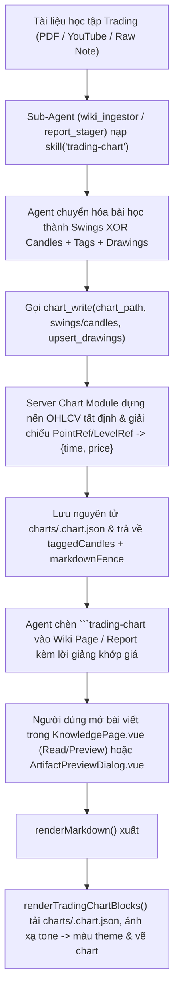

# Thiết kế Chart trong Markdown Viewer cho Knowledge (Trực quan hóa Kiến thức Trading)

- **Trạng thái:** Đề xuất kiến trúc (đã rà soát qua 2 trục `/code-review` + `/codebase-design` và `/writing-for-agents`)
- **Mục tiêu cốt lõi:** Giúp **Sub-Agent** chuyển hóa các kiến thức, mẫu hình và kịch bản trong tài liệu học tập về trading (Price Action, Smart Money Concepts, mô hình giá, chiến lược giao dịch...) thành **biểu đồ nến tương tác chân thật** ngay trong các khung đọc Markdown của **Admin Web** (`KnowledgePage.vue` — cả Reading view lẫn Compose preview — và hộp thoại xem trước báo cáo `ArtifactPreviewDialog.vue`).
- **Phạm vi:** Minh họa trực quan kiến thức (illustrative & educational visualization) từ nội dung tài liệu; không phải bảng giá realtime hay nhận định thị trường trực tiếp.
- **Định hướng:** Pure Markdown Fence (`trading-chart`) + Progressive DOM Hydration (`renderTradingChartBlocks`) + Deep Chart Synthesis Module (`HostTool` đăng ký vào `Orchestrator`) + Self-contained Chart Document JSON (`charts/<slug>.chart.json`).

## 1. Bối cảnh & Mục tiêu

Khi **Sub-Agent** (`wiki_ingestor`, `wiki_curator`, `report_stager`) biên soạn một tài liệu học tập về trading (từ sách PDF, video YouTube, bài viết phân tích hoặc ghi chú chiến lược), tài liệu thường mô tả các cấu trúc thị trường và mẫu hình nến như:
- *Mô hình nến đảo chiều:* Pin Bar, Fakey, Inside Bar, Bullish/Bearish Engulfing, Morning/Evening Star.
- *Cấu trúc thị trường & SMC/ICT:* Break of Structure (BOS), Change of Character (CHoCH), Order Block (OB), Fair Value Gap (FVG), Liquidity Sweep (quét thanh khoản).
- *Mô hình giá cổ điển & Chiến lược:* Vai-Đầu-Vai, Hai Đỉnh/Hai Đáy, Wyckoff Accumulation/Distribution, vùng Entry / Stop Loss (SL) / Take Profit (TP), kịch bản Breakout & Retest.

Các mục tiêu chính của thiết kế:

1. **Biểu đồ nến chân thật ngay trong bài viết Markdown:** Hiển thị xen kẽ với heading, paragraph, list, bảng và Mermaid trong **Wiki Page** (`wiki/`), **Raw Working Note** (`sources/`) và báo cáo Markdown (`Job Artifact`).
2. **Agent mô tả ở mức ngữ nghĩa kiến thức (High Leverage):** Agent chỉ cần mô tả kịch bản sóng giá (`swings`) hoặc chuỗi nến mẫu hình (`candles`), gắn nhãn mốc (`tag`) và neo chú thích (`drawings`) theo `tag` + `price_at` (`open`/`high`/`low`/`close`) cùng vai trò ngữ nghĩa (`tone`). Module phía server tự động dựng thành chuỗi nến OHLCV chân thật và biên dịch ra tọa độ `{ time, price }` chính xác.
3. **Markdown gọn sạch, Chart Document tự chứa (Self-contained):** File Markdown chỉ chứa 1 dòng tham chiếu `{"src":"charts/<slug>.chart.json"}`. File `.chart.json` lưu trọn vẹn cả bộ nến minh họa (3–500 nến) lẫn danh sách `drawings` để hiển thị lại nhất quán 100% ở mọi nơi mà không phụ thuộc nguồn dữ liệu bên ngoài.
4. **An toàn & Tách biệt:** Không thực thi mã JS/HTML từ AI; các file `.chart.json` trong `charts/` không kích hoạt nhầm **Wiki Auto-Flow** và không làm nhiễu **Search Projection** / **Graph Projection**.

## 2. Ngoài phạm vi

- Không kết nối luồng giá thị trường trực tiếp (live market feed / exchange WebSocket).
- Không xây dựng một trang giao dịch độc lập thay cho trình đọc Markdown của Knowledge.
- Không yêu cầu người dùng phải tự vẽ tay trên giao diện mới có biểu đồ minh họa.
- Không thực thi code tùy ý do AI tạo trong Markdown.

## 3. Quyết định kiến trúc (Deep Modules & Seams)

Toàn bộ hệ thống gồm **3 Deep Modules** đặt tại các **seam** thực tế của repository:

```text
┌─────────────────────────────────────────────────────────────────────────┐
│ 1. Markdown Fence Module (`apps/admin-web/src/lib/markdown.ts`)         │
│    Interface nhỏ: `renderMarkdown(markdown: string): string` (pure)     │
│    Ẩn bên trong: nhận diện fence `trading-chart`, escape an toàn,       │
│    sinh placeholder `<pre class="knowledge-trading-chart">`.            │
│    (Hợp nhất làm nguồn render Markdown duy nhất; xóa bản trùng lặp      │
│    `pages/knowledge/readingMarkdown.ts` và pass-through `./markdown.ts`)│
└───────────────────────────────────┬─────────────────────────────────────┘
                                    │ Seam: DOM Placeholder (`data-trading-chart-source`)
                                    ▼
┌─────────────────────────────────────────────────────────────────────────┐
│ 2. Browser Chart Hydration Module (`renderTradingChartBlocks`)          │
│    Interface nhỏ: `renderTradingChartBlocks(root, dark, deps?)`         │
│    Ẩn bên trong: parse payload `src`, tải `.chart.json`, kiểm chứng &   │
│    chuẩn hóa dữ liệu (`validateAndNormalizeChartModel`), ánh xạ bảng    │
│    màu từ `tone` theo theme `dark`/`light`, quản lý ResizeObserver.     │
├───────────────────────────────────┬─────────────────────────────────────┤
│    Seam 2a: `ChartFetcher`        │    Seam 2b: `ChartEngineAdapter`    │
│    (Admin HTTP vs In-Memory Fake) │    (Lightweight Charts vs Test Spy) │
└───────────────────────────────────▲─────────────────────────────────────┘
                                    │ Seam: Admin HTTP (`GET /api/admin/knowledge/charts/*`)
┌───────────────────────────────────┴─────────────────────────────────────┐
│ 3. Server Chart Synthesis & Storage Module                              │
│    (`crates/voice-agent-server/src/services/task_flow/charts/`)         │
│    Interface nhỏ:                                                       │
│    - 2 `HostTool` (`chart_write`, `chart_get`) đăng ký vào              │
│      `Orchestrator::builder` tại `services/task_flow/mod.rs`            │
│    - Route đọc `GET /api/admin/knowledge/charts/{*path}` cho Admin Web  │
│    Ẩn bên trong (Deep Implementation):                                  │
│    - Bộ dựng nến tất định (Deterministic Candle Synthesizer) từ         │
│      `swings[]` + `pattern` hoặc từ mảng `candles[]` (`oneOf`).         │
│    - Tự động cấp trục thời gian chuẩn và giải chiếu nhãn `tag` / `bar`  │
│      + `price_at` trong `drawings[]` sang `{ time, price }` tuyệt đối.  │
│    - Kiểm tra bất biến OHLC (`high >= max(open, close)`, `low <= min`), │
│      chống path traversal, quản lý `revision` (CAS) và ghi đĩa nguyên tử│
└─────────────────────────────────────────────────────────────────────────┘
```

### 3.1 Kỷ luật Deep Module & Đặt Seam

1. **Hợp nhất `Markdown Fence Module` (`apps/admin-web/src/lib/markdown.ts`):**
   - Hiện tại trong `apps/admin-web`, `pages/knowledge/markdown.ts` chỉ là một pass-through nông re-export từ `@/lib/markdown`, còn `pages/knowledge/readingMarkdown.ts` là bản cài đặt trùng lặp cũ (chỉ còn được gọi trong `markdown.test.ts` và thiếu hỗ trợ Mermaid).
   - Khi triển khai, xóa bỏ `pages/knowledge/readingMarkdown.ts` và `pages/knowledge/markdown.ts`, dùng duy nhất `@/lib/markdown` cho mọi nơi hiển thị Markdown (`KnowledgePage.vue` Reading view, `KnowledgePage.vue` Compose preview và `ArtifactPreviewDialog.vue`).
2. **Ẩn tính toán thuần bên trong `Browser Chart Hydration Module`:**
   - Bước kiểm tra schema, chuẩn hóa tọa độ hình chữ nhật `price-zone` và ánh xạ `tone` sang mã màu theo theme (`validateAndNormalizeChartModel`) là tính toán thuần in-process nên nằm ẩn bên trong implementation của module, được kiểm thử trực tiếp qua interface của `renderTradingChartBlocks(root, dark, { fetcher, engineAdapter })` với 2 seam thực tế có 2 adapter:
     - `fetcher`: Admin HTTP adapter (production) và In-Memory Fake (test).
     - `engineAdapter`: TradingView Lightweight Charts adapter (production) và In-Memory Spy (test).
3. **Đặt `Server Chart Synthesis & Storage Module` trong `voice-agent-server`:**
   - Vì `WorkspaceToolKit` gốc nằm ở crate ngoài `orchestrator_flow_rs`, module chart được đặt tại `crates/voice-agent-server/src/services/task_flow/charts/`, cài đặt trait `HostTool` cho `chart_write` và `chart_get`, rồi đăng ký trực tiếp vào `Orchestrator::builder` tại `crates/voice-agent-server/src/services/task_flow/mod.rs` (cạnh vòng lặp `toolkit.all_host_tools`). Đồng thời cập nhật định nghĩa **Workspace ToolKit** trong `GLOSSARY.md` để phản ánh khả năng tạo biểu đồ minh họa.

## 4. Cấu trúc lưu trữ trong Vault & Tương tác với `Wiki Auto-Flow`

Cấu trúc thư mục trong vault của `WikiEngine` (`llm-wiki-rs`):

```text
<vault_dir>/
├── sources/                                  # Không gian `raw` (Raw Working Note - .md)
│   └── trading/smc/
│       └── order-block-and-fvg-guide.md
├── wiki/                                     # Không gian `wiki` (Wiki Page - .md)
│   └── concepts/
│       └── order-block-fvg-entry.md
└── charts/                                   # Self-contained Chart Document JSON
    └── order-block-fvg-entry.chart.json
```

- **Một file `.chart.json` tự chứa cho mỗi biểu đồ:** File `charts/<slug>.chart.json` chứa cả mảng `candles` (từ 3 đến 500 cây nến minh họa, dung lượng 2–20 KB) và mảng `drawings`.
- **Không kích hoạt `Wiki Auto-Flow` & không làm bẩn chỉ mục:** `Wiki Auto-Flow`, **Search Projection** và **Graph Projection** chỉ quét các tệp `.md` trong `sources/` và `wiki/`, bỏ qua thư mục `charts/`.

## 5. Cú pháp trong Markdown & Các điểm gắn Hydrate trên UI

````markdown
# Cấu trúc Bullish Order Block và Fair Value Gap (FVG)

Khi giá phá vỡ đỉnh cấu trúc trước đó (BOS) bằng một nhịp tăng xung lực mạnh, vùng nến giảm cuối cùng trước nhịp tăng trở thành **Bullish Order Block (OB)**, đồng thời khoảng trống giá giữa nến thứ 1 và nến thứ 3 tạo ra **Fair Value Gap (FVG)**.

```trading-chart
{"src":"charts/bullish-ob-fvg-example.chart.json"}
```

## Giải thích điểm vào lệnh trên biểu đồ

- **Order Block (101.5 – 103.0):** Vùng cầu nơi dòng tiền lớn bắt đầu đẩy giá phá vỡ cấu trúc tại mốc `108.0`.
- **Fair Value Gap (103.0 – 105.2):** Khoảng mất cân bằng giá đóng vai trò nam châm hút giá quay về lấp đầy.
- **Điểm xác nhận (Retest Pin Bar):** Cây nến rút chân dài quét vào vùng FVG/OB tại `102.2` trước khi bật tăng lên mục tiêu `114.0`.
````

### Các vị trí gọi `renderTradingChartBlocks` trên `Admin Web`

Để biểu đồ hiển thị nhất quán ở mọi nơi có Markdown:
1. **`KnowledgePage.vue` — Reading View:** Gọi `renderTradingChartBlocks(readerViewport.value, dark.value)` cùng lúc với `renderMermaidBlocks` trong watcher `[() => renderedBody.value, viewMode, dark]`.
2. **`KnowledgePage.vue` — Compose Preview:** Khi bật `preview` trong chế độ soạn thảo (`viewMode === 'compose' && preview`), gọi `renderMermaidBlocks` và `renderTradingChartBlocks` trên khung preview container sau `nextTick()`.
3. **`ArtifactPreviewDialog.vue` (và khung xem báo cáo Markdown của Job):** Gọi `renderMermaidBlocks` và `renderTradingChartBlocks` trên phần tử chứa `v-html` của báo cáo Markdown để các biểu đồ do `report_stager` tạo trong `markdown_create` hiển thị đầy đủ.

## 6. Chart Document Schema (Sau khi Server Module biên dịch & lưu đĩa)

File `charts/bullish-ob-fvg-example.chart.json` trên đĩa luôn ở dạng chuẩn hóa: mọi `swings`, `pattern` và tham chiếu symbolic (`tag`, `bar`, `price_at`) đã được **Server Chart Module** biên dịch thành mảng `candles[]` và tọa độ `{ time, price }` tường minh; các `drawings` sử dụng trường ngữ nghĩa `tone` để trình duyệt tự chọn màu chuẩn theo giao diện sáng/tối (`dark`/`light`):

```json
{
  "schemaVersion": 1,
  "revision": 1,
  "id": "bullish-ob-fvg-example",
  "title": "Minh họa Bullish Order Block + FVG & Retest Entry",
  "symbol": "PA-EXAMPLE",
  "timeframe": "1h",
  "display": {
    "height": 420,
    "showVolume": true,
    "fitContent": true
  },
  "candles": [
    {"time": 1704067200, "open": 104.2, "high": 105.0, "low": 103.5, "close": 104.8, "volume": 120},
    {"time": 1704070800, "open": 104.8, "high": 108.0, "low": 104.5, "close": 107.6, "volume": 210, "tag": "swing-high"},
    {"time": 1704074400, "open": 107.6, "high": 107.8, "low": 101.5, "close": 103.0, "volume": 180, "tag": "ob-candle"},
    {"time": 1704078000, "open": 103.0, "high": 109.5, "low": 102.9, "close": 109.2, "volume": 420, "tag": "impulse-mid"},
    {"time": 1704081600, "open": 109.2, "high": 113.5, "low": 105.2, "close": 113.0, "volume": 380, "tag": "bos-peak"}
  ],
  "drawings": [
    {
      "id": "bos-line",
      "type": "trend-line",
      "points": [
        {"time": 1704070800, "price": 108.0},
        {"time": 1704081600, "price": 108.0}
      ],
      "label": "BOS (108.0)",
      "tone": "structure",
      "style": "dashed",
      "width": 2
    },
    {
      "id": "bullish-ob",
      "type": "price-zone",
      "from": {"time": 1704074400, "price": 101.5},
      "to": {"time": 1704103200, "price": 103.0},
      "label": "Bullish Order Block (101.5 - 103.0)",
      "tone": "demand"
    },
    {
      "id": "fvg-zone",
      "type": "price-zone",
      "from": {"time": 1704074400, "price": 103.0},
      "to": {"time": 1704103200, "price": 105.2},
      "label": "FVG (103.0 - 105.2)",
      "tone": "supply"
    },
    {
      "id": "entry-note",
      "type": "text",
      "anchor": {"time": 1704103200, "price": 102.2},
      "text": "Pin Bar Retest (Entry)",
      "tone": "warning"
    },
    {
      "id": "tp-level",
      "type": "horizontal-line",
      "price": 114.0,
      "label": "Take Profit (114.0)",
      "tone": "bullish",
      "style": "dotted"
    }
  ]
}
```

### 6.1 Các bất biến (Invariants) của Chart Document

1. **Quản lý phiên bản (`schemaVersion: 1`, `revision >= 1`):** `revision` tăng đơn điệu sau mỗi lần ghi thành công để kiểm soát xung đột (`expected_revision`).
2. **Bất biến của mảng `candles[]`:**
   - Số lượng nến từ `3` đến `500`.
   - Mỗi cây nến có `open, high, low, close` hữu hạn, `high >= max(open, close)`, `low <= min(open, close)`, `high >= low`, `volume >= 0` (nếu có).
   - Trường `time` (Unix seconds) tăng dần nghiêm ngặt (`candles[i].time < candles[i+1].time`).
   - Trường tùy chọn `tag` (`^[a-zA-Z0-9_-]{1,40}$`) là duy nhất trong mảng `candles[]`, dùng để đánh dấu các cây nến mấu chốt phục vụ giải chiếu tọa độ khi tạo/cập nhật `drawings`.
3. **Bất biến của mảng `drawings[]` & Bảng màu Ngữ nghĩa (`tone`):**
   - `drawings[].id` duy nhất trong cùng tài liệu; tối đa `50` drawings trên một biểu đồ.
   - `drawings[].type` thuộc allowlist: `horizontal-line`, `trend-line`, `price-zone`, `text`.
   - Thay vì bắt Agent truyền mã màu hex cứng dễ sai lệch giữa nền sáng/tối, mỗi drawing nhận trường `tone` thuộc tập hợp:
     - `"bullish"`: Hỗ trợ, Take Profit, mục tiêu tăng (xanh lá).
     - `"bearish"`: Kháng cự, Stop Loss, thanh khoản bán (đỏ).
     - `"demand"`: Vùng cầu, Bullish Order Block, vùng tích lũy (xanh ngọc bán trong suốt).
     - `"supply"`: Vùng cung, Bearish Order Block, Fair Value Gap / Imbalance (cam/vàng hổ phách bán trong suốt).
     - `"structure"`: Đường BOS, CHoCH, Trendline, Neckline, kênh giá (xanh dương).
     - `"warning"`: Nhãn chú ý, điểm vào lệnh, nến tín hiệu Pin Bar / Sweep (vàng sáng).
     - `"neutral"`: Ghi chú phụ, đường tham chiếu trung tính (xám).

## 7. Thiết kế Deep Interface cho AI Agent Tools (`chart_write` & `chart_get`)

### 7.1 Quy tắc nguồn nến (`oneOf`: `swings` XOR `candles` vs. Cập nhật chỉ Drawings)

Tránh nhập nhằng khi gọi `chart_write`:

1. **Khi tạo mới một biểu đồ (file `chart_path` chưa tồn tại):**
   - Caller bắt buộc truyền **đúng 1 trong 2** trường nguồn nến (`swings` **hoặc** `candles`, loại trừ lẫn nhau — `oneOf`).
   - Nếu truyền cả hai cùng lúc -> trả lỗi `conflicting_candle_sources`. Nếu thiếu cả hai khi tạo mới -> trả lỗi `missing_candle_source`.
2. **Khi cập nhật một biểu đồ đã có (file `chart_path` đã tồn tại):**
   - **Cập nhật chỉ `drawings` / `title` / `display` (không truyền `swings` lẫn `candles`):** Server giữ nguyên mảng `candles[]` hiện có trong file `.chart.json` (cùng toàn bộ các nhãn `tag` gắn trên các cây nến đó) và giải chiếu `upsert_drawings[]` / `remove_drawing_ids[]` trên bộ nến hiện tại.
   - **Tái tạo lại bộ nến (có truyền `swings` hoặc `candles`):** Server sinh lại mảng `candles[]` mới, sau đó giải chiếu lại toàn bộ `drawings` còn giữ lại theo bộ nến mới.

#### Chế độ 1 — `swings[]` (Dựng theo kịch bản sóng giá vĩ mô: 15–150 nến)
Dùng khi minh họa cấu trúc xu hướng, BOS/CHoCH, Order Block, FVG, Hai Đỉnh/Hai Đáy, Breakout & Retest:

```json
{
  "swings": [
    {"tag": "origin", "price": 100.0},
    {"tag": "sh1", "price": 108.0, "bars": 8},
    {"tag": "ob-candle", "price": 101.5, "bars": 5, "pattern": "bearish-last-down"},
    {"tag": "bos-peak", "price": 113.5, "bars": 6, "impulse": true},
    {"tag": "retest", "price": 102.2, "bars": 9, "pattern": "bullish-pinbar"},
    {"tag": "tp-hit", "price": 115.0, "bars": 8, "impulse": true}
  ]
}
```
- **Bên trong Server Chart Module:**
  - Nội suy `bars` cây nến giữa 2 mốc liên tiếp bằng PRNG tất định (seed băm từ `chart_id` + chỉ số nhịp sóng) để tạo thân nến và râu nến xen kẽ tự nhiên.
  - Khi một nhịp sóng có `"impulse": true` (và `bars >= 3`): tạo cụm nến xung lực thân dài kèm khoảng trống giá (Fair Value Gap) tự nhiên ở giữa nhịp đó, đồng thời tự động gắn nhãn `"<tag>-fvg-start"` vào cây nến thứ nhất của nhịp xung lực và `"<tag>-fvg-end"` vào cây nến thứ ba của nhịp xung lực. Nhờ đó, **Sub-Agent** có thể vẽ vùng `price-zone` cho FVG cực kỳ đơn giản bằng `from: {"tag": "bos-peak-fvg-start", "price_at": "high"}` và `to: {"tag": "bos-peak-fvg-end", "price_at": "low"}` (với nhịp tăng) mà không cần cơ chế đặc biệt nào khác!
  - Khi gặp `"pattern"` tại điểm kết thúc nhịp sóng (`"bullish-pinbar"`, `"bearish-pinbar"`, `"bullish-engulfing"`, `"bearish-engulfing"`, `"doji"`, `"fakey-bullish"`, `"fakey-bearish"`, `"bearish-last-down"`, `"bullish-last-up"`): tạo cây nến tại đúng mốc `tag` mang hình thái chuẩn sách giáo khoa.

#### Chế độ 2 — `candles[]` (Khai báo từng cây nến cho mẫu hình vi mô: 3–25 nến)
Dùng khi bài học mổ xẻ chi tiết từng cây nến của một mẫu hình ngắn (ví dụ: *3 nến Morning Star*, *3 nến FVG*, *Inside Bar*):
```json
{
  "candles": [
    {"open": 105.0, "high": 105.5, "low": 100.0, "close": 100.5, "tag": "c1-bearish"},
    {"open": 100.2, "high": 101.0, "low": 99.2, "close": 100.4, "tag": "c2-star"},
    {"open": 100.6, "high": 106.0, "low": 100.4, "close": 105.6, "tag": "c3-confirm"}
  ]
}
```
Server tự động cấp chuỗi `time` cách đều theo `timeframe`.

### 7.2 Quy tắc giải chiếu tọa độ Symbolic (`PointRef` & `LevelRef`) nhất quán

Trong `upsert_drawings[]` của `chart_write`, mọi tọa độ đều dùng quy tắc thống nhất và được Server Chart Module biên dịch sang `{ time, price }` hoặc `price` cố định trước khi lưu vào `.chart.json`:

1. **`PointRef` (dùng cho `points[]` của `trend-line`, `from`/`to` của `price-zone`, và `anchor` của `text`):**
   - Xác định trục thời gian (chọn 1):
     - `"tag": "<candle_tag>"` — lấy timestamp của cây nến mang nhãn `tag`.
     - `"bar": <int>` — lấy timestamp theo chỉ số cây nến (`0` là nến đầu tiên, `-1` là nến cuối cùng).
   - Xác định trục giá (chọn 1):
     - `"price_at": "open" | "high" | "low" | "close"` — lấy đúng mức giá `open`/`high`/`low`/`close` của cây nến được chọn ở trên.
     - `"price": <number>` — chỉ định mức giá số cụ thể.
2. **`LevelRef` (dùng cho `horizontal-line`):**
   - Cho phép truyền trực tiếp `"price": <number>`, **hoặc** truyền `"at": { "tag": "<candle_tag>", "price_at": "open" | "high" | "low" | "close" }` (ví dụ đặt đường thanh khoản ngang đúng bằng đáy `low` của cây nến `"equal-low"`). Server giải chiếu thành trường `"price": <number>` trong `.chart.json`.

### 7.3 Bảng đặc tả 2 công cụ trong `Workspace ToolKit`

| Tool | Mục đích & Độ sâu (Depth) | Tham số đầu vào chính | Kết quả trả về (Observable Outcome) |
|---|---|---|---|
| `chart_write` | Tạo mới hoặc cập nhật nguyên tử một biểu đồ minh họa kiến thức trong **1 lần gọi duy nhất**: dựng mảng OHLCV từ `swings` XOR `candles` (hoặc giữ nguyên `candles` cũ khi chỉ sửa `drawings`), giải chiếu mọi `PointRef`/`LevelRef` trong `upsert_drawings[]`, lưu vào `charts/<slug>.chart.json` và trả về `markdownFence` kèm bảng `taggedCandles`. | `chart_path` (`"charts/<slug>.chart.json"`), `title?`, `symbol?`, `timeframe?`, `swings?` (XOR `candles?`), `upsert_drawings[]?`, `remove_drawing_ids[]?`, `replace_all_drawings?` (bool), `expected_revision?`, `display?` | `{ chartId, chartPath, revision, candleCount, taggedCandles: Record<tag, {bar, time, open, high, low, close}>, drawingCount, markdownFence }` |
| `chart_get` | Đọc lại cấu hình của một biểu đồ đã có (`charts/<slug>.chart.json`) kèm danh sách các mốc `taggedCandles`, biên giá `minLow..maxHigh` và danh sách `drawings` hiện tại để **Sub-Agent** chỉnh sửa hoặc bổ sung chú thích mà không phải dựng lại nến. | `chart_path` (`"charts/<slug>.chart.json"`) | `{ chart, revision, summary: { candleCount, firstBarTime, lastBarTime, minLow, maxHigh, taggedCandles }, markdownFence }` |

### 7.4 Phân quyền Sub-Agent trong `AGENT_SPECS`

- Cấp công cụ `chart_write`, `chart_get` và **Built-in Job Skill** `trading-chart` cho `wiki_ingestor`, `wiki_curator` (Flow 2 — `wiki_root`) và `report_stager` (Flow 1 — `daily_root`), đồng thời thêm vào `CUSTOM_DAILY_SUBAGENT_TOOLS` và `CUSTOM_WIKI_SUBAGENT_TOOLS`.

## 8. Built-in Job Skill (`builtin-skills/trading-chart/SKILL.md`)

Theo nguyên lý *"Single source of truth"* và *"One trigger per branch"* của `/writing-for-agents`, toàn bộ hướng dẫn khi nào dùng, cách chọn giữa `swings` và `candles`, cách neo tọa độ `tag`/`price_at` và bảng màu `tone` được đặt tập trung trong tài liệu skill duy nhất dưới đây (seed tại `crates/voice-agent-server/builtin-skills/trading-chart/SKILL.md`):

```markdown
---
name: trading-chart
description: "Synthesize interactive OHLCV candlestick charts (`trading-chart`) via `chart_write` and `chart_get` when illustrating candlestick patterns, market structure (BOS/CHoCH, Order Block, FVG, Liquidity Sweep), or trade setups (Entry/SL/TP) in Wiki pages and Markdown reports."
---

# Trading Concept Chart Visualization Skill (`trading-chart`)

## 1. Format Selection Rules
- **Use `trading-chart` (`chart_write` / `chart_get`)** to visualize candlestick patterns (Pin Bar, Engulfing, Fakey, Morning Star), market structure (BOS, CHoCH, Order Block, FVG, Liquidity Sweep), chart patterns (Double Bottom, Head & Shoulders, Wyckoff), or trade setups (Entry/SL/TP).
- **Use a `mermaid` block** (`flowchart TD`, `stateDiagram-v2`) for trading checklists, risk-management decision trees, or bot execution workflows.
- **Use a Markdown table** for static backtest metrics, parameter matrices, or win-rate comparisons.

## 2. Three-Step Execution Workflow

### Step 1 — Map the Trading Concept to `swings` XOR `candles` with `tag` Anchors
Choose **exactly one** candle source mode (or omit both when updating drawings on an existing chart):
1. **Macro Structure (`swings` — 15 to 150 bars)**:
   Provide ordered turning points `{ "tag", "price", "bars"?, "impulse"?, "pattern"? }`:
   - Name every key pivot referenced in the lesson with a unique `tag` (`"sh1"`, `"ob-candle"`, `"sweep-low"`, `"bos-peak"`, `"retest-entry"`, `"tp-hit"`).
   - Set `"impulse": true` on strong breakout legs (when `bars >= 3`, the synthesizer automatically creates a Fair Value Gap and tags the 1st and 3rd impulse bars as `"<tag>-fvg-start"` and `"<tag>-fvg-end"`).
   - Set `"pattern"` at signal pivots (`"bullish-pinbar"`, `"bearish-pinbar"`, `"bullish-engulfing"`, `"bearish-engulfing"`, `"doji"`, `"fakey-bullish"`, `"fakey-bearish"`, `"bearish-last-down"`, `"bullish-last-up"`).
2. **Micro Candlestick Pattern (`candles` — 3 to 25 bars)**:
   Provide explicit bars `{ "open", "high", "low", "close", "volume"?, "tag"? }` when explaining exact multi-bar anatomy (e.g., 3-bar Morning Star, Inside Bar).
3. **Completion criterion**: Every pivot, zone boundary, and signal candle discussed in the lesson has a deterministic `tag`.

### Step 2 — Synthesize Chart & Anchor Drawings Atomically (`chart_write`)
1. Define 2–6 focused drawings in `upsert_drawings` using symbolic `PointRef` (`{"tag": "<tag>" | "bar": <int>, "price_at": "open"|"high"|"low"|"close" | "price": <num>}`) and semantic `tone` (`"bullish" | "bearish" | "demand" | "supply" | "structure" | "warning" | "neutral"`):
   - `horizontal-line`: `{ "id", "type": "horizontal-line", "price": <num> | "at": {"tag", "price_at"}, "label", "tone", "style"?: "solid"|"dashed"|"dotted" }`
   - `trend-line`: `{ "id", "type": "trend-line", "points": [PointRef, PointRef], "label"?, "tone", "style"?, "width"?: 2 }`
   - `price-zone`: `{ "id", "type": "price-zone", "from": PointRef, "to": PointRef, "label"?, "tone" }`
   - `text`: `{ "id", "type": "text", "anchor": PointRef, "text" (<= 60 chars), "tone" }`
2. Concept-to-Drawing Reference:
   - **Order Block (OB)**: `price-zone` with `tone: "demand"` (or `"supply"`) from `{"tag": "ob-candle", "price_at": "low"}` to `{"tag": "retest-entry", "price_at": "high"}`.
   - **Fair Value Gap (FVG)**: `price-zone` with `tone: "supply"` from `{"tag": "bos-peak-fvg-start", "price_at": "high"}` to `{"tag": "retest-entry", "price": <fvg_top>}` (or `"bos-peak-fvg-end"` `"low"`).
   - **BOS / CHoCH / Neckline**: `trend-line` (`style: "dashed"`, `tone: "structure"`) from the broken swing pivot horizontally to the breakout bar.
   - **Liquidity Sweep**: `horizontal-line` (`style: "dashed"`, `tone: "bearish"`, `at: {"tag": "equal-low", "price_at": "low"}`) + `text` (`tone: "warning"`) at `{"tag": "sweep-low", "price_at": "low"}`.
3. Call `chart_write` **once** (if modifying drawings on an existing chart without regenerating candles, call `chart_get(chart_path)` first, omit `swings`/`candles`, and pass `expected_revision`).
4. **Completion criterion**: `chart_write` succeeds and returns `taggedCandles` with resolved prices and the `markdownFence` snippet (` ```trading-chart\n{"src":"charts/<slug>.chart.json"}\n``` `).

### Step 3 — Embed `markdownFence` & Align Educational Walkthrough
1. Insert the returned `markdownFence` verbatim into the Wiki page (`wiki_write_file` / `wiki_patch_file`) or Markdown report (`markdown_create`) directly under the concept explanation.
2. Write a structured walkthrough beneath the chart citing the exact labels and resolved price levels from `taggedCandles`.
3. **Completion criterion**: The Markdown document is saved, and every price level, zone, and pattern name in the prose matches the visual chart annotations.
```

## 9. Flow tổng thể từ Tài liệu học tập đến Hiển thị trên Admin Web



## 10. UI/UX trong trình đọc Markdown (`Admin Web`)

- Chart xuất hiện đúng vị trí fenced code block `trading-chart` trong bài viết học tập.
- Chiều cao mặc định `420px` (cấu hình được qua `display.height` trong khoảng `240..=720px`), tự động co giãn theo chiều rộng vùng đọc và đồng bộ bảng màu `tone` theo giao diện sáng/tối (`dark` từ `useTheme()`).
- Hỗ trợ zoom, pan, crosshair và nút **"Fit Content"** (đưa khung nhìn về lại trọn vẹn mẫu hình minh họa sau khi người học phóng to/kéo ngang).
- Header của khung chart hiển thị rõ `title` của ví dụ minh họa, `timeframe` và chú giải ngắn các nhãn trên biểu đồ.
- Nếu file `.chart.json` bị thiếu hoặc lỗi, hiển thị thông báo lỗi gọn ngay tại khung chart đó mà không ảnh hưởng tới văn bản bài học xung quanh.

## 11. Xử lý lỗi, Bảo mật và Giới hạn tài nguyên

- **Không thực thi mã:** Không `eval`, không chèn HTML/SVG thô từ Chart Document vào DOM; mọi nhãn văn bản (`label`, `title`, `text`) đều được escape hoặc vẽ qua API text của chart engine.
- **Chống Path Traversal:** Đường dẫn `src` trong block `trading-chart` và `chart_path` trong `chart_write` bắt buộc nằm trong thư mục `charts/*.chart.json` của vault; từ chối mọi đường dẫn chứa `..` hoặc thoát ra ngoài vault.
- **Tính tất định (Determinism):** Bộ dựng nến từ `swings[]` sử dụng PRNG có seed băm từ `(chart_id, swing_index)` để cùng một đầu vào luôn sinh ra đúng một bộ nến cố định, đồng thời lưu kết quả `candles[]` trực tiếp vào `.chart.json`.
- **Kiểm tra hợp lệ nghiêm ngặt khi ghi:**
  - Nếu truyền đồng thời cả `swings` và `candles` -> trả lỗi `conflicting_candle_sources`.
  - Nếu tạo mới mà thiếu cả `swings` và `candles` -> trả lỗi `missing_candle_source`.
  - Nếu `upsert_drawings` tham chiếu tới một `tag` không tồn tại trong `candles[]` -> trả lỗi `unknown_candle_tag` kèm danh sách các `tag` hợp lệ hiện có để Agent sửa ngay trong lượt gọi tiếp theo.
- **Giới hạn kích thước:** Tối đa `500` cây nến và `50` drawings trên một biểu đồ; kích thước file `.chart.json` tối đa `256 KB`.

## 12. Chiến lược kiểm thử qua Interface (`/codebase-design`)

Theo nguyên lý *"The interface is the test surface"* và *"Accept dependencies, don't create them"*, hệ thống được kiểm thử tại 3 seam:

1. **Unit test cho `Markdown Fence Module` (`apps/admin-web/src/pages/knowledge/markdown.test.ts`)**:
   - Xóa `readingMarkdown.ts` và `pages/knowledge/markdown.ts`, chuyển toàn bộ test trong `markdown.test.ts` sang kiểm thử trực tiếp `@/lib/markdown`.
   - Xác minh `renderMarkdown()` chuyển fenced block `trading-chart` thành `<pre class="knowledge-trading-chart" data-trading-chart-source="true">` đã escape an toàn, không ảnh hưởng tới **Wiki Link** hay Mermaid.
2. **Unit test cho `Browser Chart Hydration Module` (`renderTradingChartBlocks`)**:
   - Kiểm thử thông qua interface `renderTradingChartBlocks(root, dark, { fetcher, engineAdapter })` với `fetcher` giả lập và `engineAdapter` spy để xác minh:
     - Các ca dữ liệu chuẩn, `candles` sai thứ tự thời gian, `high < low`, `price-zone` đảo chiều `from`/`to`, `schemaVersion` lạ.
     - Ánh xạ `tone` sang bảng màu dark/light, vòng đời mount/resize/unmount và hiển thị lỗi cục bộ khi `fetcher` trả lỗi.
3. **Unit & Integration test cho `Server Chart Synthesis & Storage Module` (`chart_write` / `chart_get`)**:
   - Kiểm thử bộ dựng nến từ `swings[]`: đảm bảo mọi cây nến sinh ra thỏa mãn `high >= max(open, close)`, `low <= min(open, close)`, `time` tăng dần nghiêm ngặt, đúng giá tại các mốc `tag`, tự sinh nhãn `<tag>-fvg-start` / `<tag>-fvg-end` khi `impulse: true`, và đúng hình thái nến khi gắn `pattern`.
   - Kiểm thử hợp đồng `oneOf` (`swings` XOR `candles`) khi tạo mới và giữ nguyên `candles[]` khi cập nhật chỉ `drawings`.
   - Kiểm thử giải chiếu `PointRef` và `LevelRef` (`tag` + `price_at` / `bar` -> `{ time, price }`), tính idempotent khi `upsert_drawings` cùng `id`, kiểm soát xung đột `expected_revision` và đảm bảo file trong `charts/` không kích hoạt **Wiki Auto-Flow**.

## 13. Kế hoạch triển khai theo giai đoạn

### Phase 1 — Hợp nhất Markdown Module & Browser Chart Hydrator MVP
- Xóa `apps/admin-web/src/pages/knowledge/readingMarkdown.ts` và `apps/admin-web/src/pages/knowledge/markdown.ts`; mở rộng `renderMarkdown()` trong `apps/admin-web/src/lib/markdown.ts` để xuất `<pre class="knowledge-trading-chart" data-trading-chart-source="true">`.
- Xây dựng module `renderTradingChartBlocks` (cùng `ChartEngineAdapter` vẽ biểu đồ nến OHLCV + drawings tương tác) và gắn vào cả 3 điểm hiển thị: `KnowledgePage.vue` (Reading view), `KnowledgePage.vue` (Compose preview) và `ArtifactPreviewDialog.vue`.
- Mở route Admin HTTP `GET /api/admin/knowledge/charts/{*path}` chỉ đọc trong phạm vi thư mục `charts/` của vault.

### Phase 2 — Công cụ `chart_write` / `chart_get` & Built-in Job Skill `trading-chart`
- Triển khai `Server Chart Synthesis & Storage Module` tại `crates/voice-agent-server/src/services/task_flow/charts/` và đăng ký 2 `HostTool` (`chart_write`, `chart_get`) vào `Orchestrator::builder` trong `crates/voice-agent-server/src/services/task_flow/mod.rs`.
- Thêm `crates/voice-agent-server/builtin-skills/trading-chart/SKILL.md` vào `BUILTIN_SKILLS`, cấp quyền cho `wiki_ingestor`, `wiki_curator`, `report_stager` và cập nhật `GLOSSARY.md`.

### Phase 3 — Mở rộng mẫu hình nâng cao
- Bổ sung thêm các preset mẫu hình nến/cấu trúc và các loại drawing nâng cao (Fibonacci retracement, Risk/Reward box chuyên biệt, đường MA/RSI minh họa) khi có nhu cầu từ tài liệu học tập thực tế.
