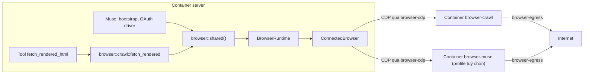

# Module Chromium dùng chung — phương án thiết kế và triển khai

> **Trạng thái:** Đề xuất, chưa triển khai. Lập ngày 2026-10-31.
>
> **Mức kiểm chứng:** Phần hiện trạng được rút ra từ đọc code và chưa tái hiện khi chạy. Phần triển khai Docker chưa được thử trên homelab; các giả định cần xác minh nằm ở [Phase 0](#phase-0--poc-trên-homelab).
>
> **Môi trường đích:** Homelab Debian chạy `compose.prod.yaml`; máy dev macOS.

Thuật ngữ thiết kế (module, interface, seam, adapter, depth) dùng theo nghĩa của skill `codebase-design`.

## 1. Quyết định

| Câu hỏi | Quyết định |
|---|---|
| Code quản lý browser đặt ở đâu? | Module `crate::browser` trong `vela-server` |
| Chromium chạy ở đâu trên production? | Container riêng, không nằm trong image server |
| Server điều khiển Chromium thế nào? | CDP qua Docker network nội bộ |
| Máy dev chạy thế nào? | Server tự spawn Chromium cục bộ |
| Tách crawl và Muse thế nào? | Hai browser process riêng. Cookie Muse không nằm cùng process với web lạ |
| Tool crawl dùng browser thế nào? | Qua `fetch_rendered`, không bao giờ cầm CDP |
| Có dùng `--no-sandbox` khi crawl không? | Không. Nếu không bật được sandbox thì dừng và xem lại phương án |

**Mục đích sử dụng:** fallback lấy token và login của Muse hiện tại, cùng các tool crawl sẽ mở rộng sau.

**Ngoài phạm vi:**
- Screenshot, PDF, nhiều tab trong một session.
- Hàng đợi crawl nhiều trang.
- Kỹ thuật che giấu automation hoặc vượt captcha.
- Cho plugin truy cập CDP trực tiếp.

## 2. Hiện trạng

Đường dẫn trong mục này tính từ `crates/vela-server/src/`.

### 2.1. Nơi đang dùng Chromium

| Caller | Mục đích | Vị trí |
|---|---|---|
| `SharedMusePool` | Fallback lấy WSS khi HTTP thất bại | `providers/llm/gateway/muse/pool/connect.rs:84` |
| `MuseOAuthDriver::verify_and_renew_session` | Tier 3 khi gia hạn phiên | `services/llm_gateway/vendors/muse.rs:227` |
| `MuseOAuthDriver::poll_pkce_session` | Login tương tác, bắt cookie | `services/llm_gateway/vendors/muse.rs:354` |

Phần tái dùng được là `muse/cdp/session.rs`, `muse/cdp/engine.rs` và hai trait trong `muse/cdp/mod.rs`. Fake adapter đã có ở `services/llm_gateway/tests.rs:761`. Riêng `muse/cdp/bootstrap.rs` chứa logic của Muse nên ở lại Muse.

### 2.2. Vấn đề cần giải quyết

| # | Vấn đề | Vị trí | Hậu quả |
|---|---|---|---|
| 1 | Mỗi pool tạo một `CdpBrowserEngine(19222)`, driver tạo thêm một engine cùng cổng | `muse/pool/mod.rs:100`, `vendors/muse.rs:64` | Engine mới kết nối xoá mọi context nó không sở hữu (`cdp/engine.rs:157`), có thể giết phiên đang chạy của engine khác |
| 2 | Chromium do engine đã spawn nó giữ, với `kill_on_drop` | `cdp/engine.rs:84`, `muse/pool/mod.rs:92` | Xoay credential làm drop pool cũ, có thể kill Chromium đang được engine khác dùng |
| 3 | Gắn vào bất kỳ process nào nghe trên cổng | `cdp/engine.rs:73`, `:250` | Cookie phiên có thể bị gửi cho process lạ. Thêm vào đó là `--remote-allow-origins=*` và profile ở đường dẫn temp đoán được |
| 4 | Sự kiện CDP bị bỏ, `navigate` không chờ load | `cdp/session.rs:59`, `cdp/bootstrap.rs:79-83` | JS có thể chạy khi trang chưa load xong, kể cả trang challenge |
| 5 | `cdp_port`, `headless` không có tác dụng | `gateway/config.rs:135`, `gateway/descriptor.rs:128` | UI cho chỉnh nhưng engine dùng hằng số 19222/19223 |
| 6 | Image production không có Chromium | `docker/server.Dockerfile:32` | Trong Docker, fallback luôn lỗi và login tương tác không chạy được |
| 7 | Shutdown không đóng Chromium | `lifecycle.rs:363` | Engine nằm trong static nên có thể để lại process mồ côi, lần chạy sau gắn lại vào đó |
| 8 | Login bỏ dở không được dọn | `vendors/muse.rs:49-50`, `vendors/mod.rs` | Tab treo, `login_unavailable_states` chỉ tăng; `OAuthVendorDriver` không có hàm huỷ |
| 9 | Không có test nào chạy `CdpSession`/`CdpBrowserEngine`, stderr bị bỏ, không giới hạn tab | `cdp/engine.rs:87` | Lỗi Chromium thật khó chẩn đoán, có thể lấn RAM của luồng voice |
| 10 | `#[cfg(test)]` rẽ nhánh trong constructor production | `muse/pool/mod.rs:96-103`, `vendors/muse.rs:62-74` | Code production và test đi theo hai đường khác nhau |

### 2.3. Các ràng buộc phát hiện được

- **`fetch_html` không nằm trong repo.** Tool này thuộc crate `orchestrator-flow` 0.1.2 (`src/tools/web.rs`), tải trang bằng `curl` và cache theo URL trong `HtmlWorkspace`. Vì thế không sửa được tại chỗ. Tuy nhiên `HtmlWorkspace::insert_cached_html` là public, nên có đường nối sang tool mới (xem [mục 6](#6-lớp-crawl)).
- **`LlmGatewayConfig` có `deny_unknown_fields`** (`gateway/config.rs:103`). Xoá thẳng `cdp_port`/`headless` sẽ làm hỏng việc đọc `config_json` đã lưu (xem [mục 8](#8-cấu-hình)).
- **`compose.yaml` chưa có giới hạn tài nguyên hay network tự định nghĩa.** Voice hiện chưa được bảo vệ khỏi một process ăn hết RAM.

## 3. Các phương án đã cân nhắc

### 3.1. Vị trí code

| Phương án | Đánh giá |
|---|---|
| **Module `crate::browser` (chọn)** | Hợp với workspace một crate, giữ được client CDP gọn và fake sẵn có |
| Crate riêng | Chưa có caller ngoài server. Sau này tách vẫn dễ nếu `browser` không import phần còn lại của crate |
| `chromiumoxide` | Thêm dependency lớn trong khi chỉ dùng vài lệnh CDP, và vẫn phải tự làm vòng đời, vốn là chỗ đang lỗi |

### 3.2. Vị trí process Chromium

| Tiêu chí | Trong container server | Container riêng (chọn) |
|---|---|---|
| Secret | Chung với `secrets.env`, `credential-keys.json`, `data/` | Container không có các file này |
| Sandbox bị thủng | Mất toàn bộ secret | Thiệt hại nhỏ hơn nhiều |
| RAM và voice | Chung giới hạn, OOM có thể giết voice | Giới hạn riêng, OOM chỉ chết browser |
| Chặn LAN | Đi chung đường mạng với server | Chặn riêng theo subnet |
| Nâng cấp Chromium | Build lại image server | Độc lập với server |
| Độ đơn giản | Đơn giản hơn, không có CDP qua mạng | Thêm service và firewall |

Crawl nghĩa là liên tục chạy code không đáng tin, nên các tiêu chí về cô lập nặng hơn độ đơn giản.

## 4. Kiến trúc



Cấu trúc module:

```text
crates/vela-server/src/browser/
├── mod.rs         # Interface: Browser, BrowserSession, kiểu dữ liệu, shared(), init()
├── runtime.rs     # BrowserRuntime: chọn adapter theo role, giới hạn session, shutdown
├── connected.rs   # Adapter: nối vào Chromium ngoài process (Docker)
├── launched.rs    # Adapter: tự spawn Chromium (máy dev)
├── session.rs     # BrowserSession trên CDP, dùng chung cho hai adapter
├── cdp.rs         # Internal seam: WebSocket, ghép cặp response, sự kiện
└── crawl.rs       # fetch_rendered: chính sách URL, giới hạn, trả HTML
```

`cdp.rs` là internal seam: không caller nào ngoài module được dùng trực tiếp. Muse giữ `bootstrap.rs` vì nó biết về `__HATCH_GATEWAY_INIT__`. Module `browser` không biết gì về Muse.

## 5. Interface

```rust
#[derive(Clone, Copy, PartialEq, Eq, Hash, Debug)]
pub enum BrowserRole {
    /// Mở web không đáng tin. Không bao giờ chứa cookie của người dùng.
    Crawl,
    /// Chỉ mở site đã biết, được phép mang cookie (Muse fallback).
    Trusted,
    /// Có cửa sổ để người dùng đăng nhập. Chỉ có ở máy dev.
    Interactive,
}

pub enum BrowserAvailability {
    Available,
    Unavailable { reason: String },
}

pub struct SessionRequest {
    pub role: BrowserRole,
    pub cookies: Vec<CookieParam>,
    pub block_resources: Vec<ResourceKind>, // Image, Media, Font
}

pub enum WaitUntil { Committed, DomContentLoaded, Load }

pub struct PageLoad {
    pub http_status: Option<u16>,
    pub final_url: String,
}

#[async_trait]
pub trait Browser: Send + Sync {
    fn availability(&self, role: BrowserRole) -> BrowserAvailability;
    async fn open_session(&self, req: SessionRequest)
        -> Result<Arc<dyn BrowserSession>, BrowserError>;
}

#[async_trait]
pub trait BrowserSession: Send + Sync {
    async fn navigate(&self, url: &str, wait: WaitUntil, timeout: Duration)
        -> Result<PageLoad, BrowserError>;
    async fn evaluate_json(&self, expr: &str, await_promise: bool, timeout: Duration)
        -> Result<Value, BrowserError>;
    async fn cookies(&self, urls: &[&str]) -> Result<BTreeMap<String, String>, BrowserError>;
    async fn close(&self);
}

pub enum BrowserError {
    Unavailable(String), // Chưa cấu hình hoặc không kết nối được
    Busy,                // Hết chỗ sau acquire_timeout
    Crashed,             // Mất browser giữa session; mở session mới là phục hồi
    Protocol(String),
    JsException(String),
    Timeout,
}
```

### 5.1. Những điều caller phải biết

- Một session là một browser context cô lập và đúng một page. Muốn hai page thì mở hai session.
- `close()` idempotent. Quên `close()` thì `Drop` vẫn dọn theo kiểu best-effort, nhưng code nên gọi tường minh.
- Session giữ một suất trong `max_sessions` cho tới khi đóng. Vì vậy không giữ session qua các thao tác dài không liên quan tới browser.
- Mọi thao tác đều bắt buộc có timeout.
- Sau `BrowserError::Crashed`, session cũ không dùng lại được. Mở session mới sẽ tự kết nối lại.
- Giá trị cookie không xuất hiện trong log hay `Debug`, giữ nguyên hành vi của `CookieParam` hiện tại.
- `BrowserRole::Crawl` từ chối `SessionRequest` có cookie. Đây là invariant bảo mật, không phải quy ước.
- Không có thao tác nào lộ CDP thô ra ngoài module.

### 5.2. Vì sao interface có hình dạng này

| So với hiện tại | Lợi ích |
|---|---|
| Bỏ `context_key` và `dispose_context` | Caller không còn tự đặt key hay nhớ thứ tự đóng |
| Gộp page vào session | Mọi caller hiện tại đều dùng đúng một page |
| `navigate` chờ theo `WaitUntil` và trả `PageLoad` | Sửa lỗi 4, và crawl biết được status |
| `availability()` | UI hiển thị đúng khả năng, thay cho `login_unavailable_states` |

**Seam `Browser` là seam thật**, vì có ba adapter: `ConnectedBrowser`, `LaunchedBrowser` và fake trong test. Phiên bản chưa cấu hình trả `Unavailable` cho mọi role.

**Không thêm** `set_cookie`, `screenshot` hay `subscribe_events` cho đến khi có caller thực sự cần. Sự kiện CDP dùng bên trong để chờ load và lấy status.

## 6. Lớp crawl

```rust
pub struct CrawlLimits {
    pub timeout: Duration,
    pub max_html_bytes: usize,
}

pub struct RenderedPage {
    pub final_url: String,
    pub http_status: Option<u16>,
    pub html: String,
}

pub async fn fetch_rendered(
    browser: &dyn Browser,
    url: &str,
    limits: CrawlLimits,
) -> Result<RenderedPage, CrawlError>;
```

`fetch_rendered` đảm nhận:
- Chỉ chấp nhận `http`/`https`, từ chối URL có userinfo.
- Phân giải host và từ chối IP private, loopback, link-local trước khi điều hướng. Bước này chỉ nhằm báo lỗi sớm và rõ ràng; lớp chặn thật là firewall ở [mục 9.3](#93-firewall-trên-host-debian), vì trang vẫn có thể tự gọi tới địa chỉ khác hoặc đổi DNS.
- Chặn ảnh, media, font.
- Luôn đóng session, kể cả khi lỗi.

### 6.1. Nối vào tool của agent

Thêm `HostTool` mới tên `fetch_rendered_html`, không sửa `fetch_html`:

1. Tool gọi `fetch_rendered`, lưu HTML thành artifact như `fetch_html`, rồi gọi `HtmlWorkspace::insert_cached_html(url, html)`.
2. Các tool `html_extract_*` dùng lại HTML đó theo cùng URL.
3. Đăng ký bằng `builder.register_tool` ở `services/task_flow/mod.rs:246-250`.
4. Thêm vào các danh sách tool trong `services/task_flow/agent_settings/specs.rs` (ví dụ `SOURCE_COLLECTOR_TOOLS`, dòng 64).
5. Cập nhật `crates/vela-server/builtin-skills/web-fetch-policy/SKILL.md`: chỉ dùng `fetch_rendered_html` khi `fetch_html` cho thấy trang rỗng do cần JavaScript, ví dụ `p_count` quá thấp.

Agent chọn tool tường minh, không fallback ngầm, vì render tốn tài nguyên hơn `curl` nhiều.

**Cần kiểm tra khi làm:** `WorkspaceToolKit` có cho lấy `html_workspace` hay không. Nếu không, cần bổ sung accessor trong `orchestrator-flow` rồi nâng version; không fork crate chỉ vì việc này.

### 6.2. Plugin

Plugin crawl sau này gọi qua server, không nhận CDP. ADR 0101 coi plugin là được tin cậy và không giới hạn đích mạng, nên không dựa vào plugin để tự giữ an toàn. Mọi đường crawl đều đi qua `fetch_rendered`.

### 6.3. Crawl nhiều trang

Khi có nhu cầu này, cần thêm giới hạn tốc độ theo host, tôn trọng `robots.txt` và hàng đợi bền vững. Tài liệu này không thiết kế phần đó.

## 7. Implementation bên trong module

### 7.1. `BrowserRuntime`

- Một instance duy nhất cho toàn process, truy cập qua `browser::shared()` theo mẫu `SharedGatewayHub::global()`, vì `default_vendor_drivers()` và `GLOBAL_POOLS` đều là global.
- `browser::init(config)` gọi lúc khởi động. Khi chưa init, `shared()` trả về bản `Unavailable`. Nhờ đó xoá được các nhánh `#[cfg(test)]` (lỗi 10), test vẫn truyền fake qua constructor.
- Giữ `Semaphore` theo `max_sessions`; hết chỗ sau `acquire_timeout` thì trả `Busy`.
- `shutdown()` gọi từ `RuntimeLifecycle::shutdown` (`lifecycle.rs:363`).

### 7.2. `ConnectedBrowser` (production)

- Lấy WebSocket URL từ `/json/version`, gửi `Host: localhost` và thay host trong URL trả về bằng endpoint đã cấu hình.
- Kết nối lười và tự kết nối lại khi mất. Không bao giờ spawn process.
- Khi kết nối, xoá context không thuộc mình. Việc này giờ an toàn vì server là chủ duy nhất của browser đó; nó dọn rác từ lần server chạy trước.
- Vòng đời process do compose lo (`restart`, `mem_limit`).

### 7.3. `LaunchedBrowser` (máy dev)

- Bật bằng `--remote-debugging-port=0`, đọc `DevToolsActivePort` trong profile để lấy cổng. Cách này loại bỏ xung đột cổng và việc gắn vào process lạ (lỗi 1, 3).
- Profile riêng mỗi lần chạy, quyền `0700`, xoá khi đóng. Không xoá lock file của profile khác.
- Bỏ `--remote-allow-origins=*`, vì client Rust không gửi `Origin`. Cần xác nhận khi chạy thử.
- Theo dõi `Child`: phát hiện process chết sớm, giữ phần cuối stderr để đưa vào `Unavailable`.
- Tự tắt sau `idle_timeout` khi không có session.
- Ghi pid file để dọn process mồ côi lúc khởi động, kiểm tra command line có chứa thư mục profile của mình rồi mới kill.

### 7.4. `cdp.rs`

Giữ phần lớn `CdpSession` hiện tại, thêm:
- Sự kiện được đưa vào kênh có giới hạn thay vì bị bỏ, phục vụ chờ load và lấy status tài liệu chính.
- Cho phép đặt header `Host` khi kết nối WebSocket.
- Sửa race ở `get_or_create_context` bằng cách tạo context theo session, không cache theo key.

## 8. Cấu hình

```toml
[browser]
max_sessions = 4            # giá trị khởi đầu, chốt ở Phase 0
acquire_timeout_secs = 10

[browser.crawl]
kind = "connect"
endpoint = "http://browser-crawl:9222"

# Chỉ bật khi Cloudflare thực sự chặn fallback HTTP của Muse
# [browser.trusted]
# kind = "connect"
# endpoint = "http://browser-muse:9222"

# Máy dev
# [browser.interactive]
# kind = "launch"
# headless = false
# executable_path = "/Applications/Google Chrome.app/Contents/MacOS/Google Chrome"
# idle_timeout_secs = 300
```

Role không được cấu hình sẽ là `Unavailable`. `CHROMIUM_PATH` vẫn được dùng làm giá trị ghi đè cho `launch`.

**Tách role `Trusted` khỏi `Crawl`:** không có cấu hình nào cho phép hai role trỏ về cùng một endpoint; `init` báo lỗi nếu gặp.

### 8.1. Gỡ `cdp_port` và `headless`

Do `deny_unknown_fields`, phải làm theo hai bước:

1. **Bản đầu:** giữ hai field trong `LlmGatewayConfig` với `#[serde(default, skip_serializing)]` và bỏ qua giá trị. Gỡ khỏi `gateway/descriptor.rs:128,138`, `MuseCatalogOptions`, `provider_catalog/discovery.rs:197-202,349-360`, `provider_catalog/resolved.rs:296-297`, `agent_settings/gateway_executor.rs:88-89`, `services/llm_gateway/hub.rs:838-839`, và các test.
2. **Bản sau:** khi `config_json` đã được ghi lại không còn hai field, xoá hẳn khỏi struct.

**Cần kiểm tra:** `provider_catalog/resolved.rs:72` dùng `muse_options.is_some()`, và `discovery.rs:197` tính giá trị này một phần từ `cdp_port`/`headless`. Khi gỡ phải giữ nguyên hành vi với provider chỉ đặt `account_concurrency`.

## 9. Triển khai trên homelab

### 9.1. Image browser

```dockerfile
# docker/browser.Dockerfile
FROM debian:bookworm-slim
RUN apt-get update && apt-get install -y --no-install-recommends \
      chromium chromium-sandbox fonts-noto-core socat ca-certificates \
    && rm -rf /var/lib/apt/lists/*
COPY docker/browser-entrypoint.sh /usr/local/bin/browser-entrypoint
USER 1000:1000
ENTRYPOINT ["/usr/local/bin/browser-entrypoint"]
```

Entrypoint bật `chromium --headless=new --remote-debugging-port=9223 --user-data-dir=/tmp/profile --disable-dev-shm-usage --disable-background-networking`, rồi dùng `socat` chuyển `0.0.0.0:9222` sang `127.0.0.1:9223`. Nếu Chromium thoát thì entrypoint thoát theo, để compose restart.

### 9.2. Compose

```yaml
# Thêm vào compose.prod.yaml
services:
  server:
    networks:
      default: {}
      browser-cdp:
        ipv4_address: 172.30.51.2

  browser-crawl: &browser
    image: vela-browser:${IMAGE_TAG:-local}
    build: { context: ., dockerfile: docker/browser.Dockerfile }
    restart: unless-stopped
    init: true
    user: "${APP_UID:-1000}:${APP_GID:-1000}"
    mem_limit: 2g            # giá trị khởi đầu, chốt ở Phase 0
    cpus: 2
    pids_limit: 512
    shm_size: 512m
    read_only: true
    tmpfs: ["/tmp:size=512m"]
    networks:
      browser-cdp:
        ipv4_address: 172.30.51.10
      browser-egress: {}

  browser-muse:
    <<: *browser
    profiles: [muse-browser]
    mem_limit: 1g
    networks:
      browser-cdp:
        ipv4_address: 172.30.51.11
      browser-egress: {}

networks:
  browser-cdp:
    internal: true
    ipam: { config: [{ subnet: 172.30.51.0/24 }] }
  browser-egress:
    enable_ipv6: false
    ipam: { config: [{ subnet: 172.30.50.0/24 }] }
```

Chỉ `server` và các browser được gắn vào `browser-cdp`. CDP không có xác thực, nên `web` và plugin runner tuyệt đối không được gắn vào. Không publish cổng CDP ra host.

### 9.3. Firewall trên host Debian

Tách network là chưa đủ, vì hai lý do:
- Docker bridge vẫn NAT ra LAN, nên trang độc gọi được router, NAS.
- Browser chung `browser-cdp` với server, nên trang độc có thể gọi cổng 8000 của server.

```bash
# Chặn browser đi vào LAN và các dải private
for net in 10.0.0.0/8 172.16.0.0/12 192.168.0.0/16 169.254.0.0/16 100.64.0.0/10; do
  iptables -I DOCKER-USER -s 172.30.50.0/24 -d "$net" -j DROP
done

# Browser không được chủ động mở kết nối sang server; server gọi browser vẫn được
iptables -I DOCKER-USER -s 172.30.51.10 -d 172.30.51.2 -m conntrack --ctstate NEW -j DROP
iptables -I DOCKER-USER -s 172.30.51.11 -d 172.30.51.2 -m conntrack --ctstate NEW -j DROP
```

Rule phải được lưu qua reboot, ví dụ bằng `iptables-persistent` hoặc một systemd unit chạy sau Docker. Rule thứ hai chỉ có hiệu lực khi lưu lượng cùng bridge đi qua iptables (`br_netfilter`), nên bắt buộc phải kiểm chứng ở Phase 0.

**Rủi ro đã biết:** `fetch_html` hiện gọi `curl` ngay trong container server, không đi qua các lớp này. Tôi không thấy dấu hiệu chặn IP private khi lọc nhanh `tools/web.rs`, nhưng chưa đọc hết file. Đây là rủi ro SSRF sẵn có, nằm ngoài phạm vi tài liệu này.

### 9.4. Login Muse trên homelab

Máy không có màn hình nên dùng cách dán cookie. `availability(Interactive)` trả `Unavailable`, Admin UI ẩn luồng mở cửa sổ. Phải sửa hint tiếng Anh ở `apps/admin-web/src/i18n/messages.ts:1106`, vì nó khẳng định cửa sổ Chromium đã mở trên server.

## 10. Thay đổi phía Muse

| Vị trí | Thay đổi |
|---|---|
| `muse/cdp/` | Xoá; `bootstrap.rs` chuyển thành `muse/browser_bootstrap.rs` |
| `extract_wss_via_chromium` | Nhận `&dyn Browser`, dùng role `Trusted`, `WaitUntil::Load`, thu gọn phần dọn dẹp về `session.close()` |
| `muse/pool/mod.rs:96-103` | Bỏ tạo engine; dùng `browser::shared()`, fake truyền qua `new_with_options` |
| `vendors/muse.rs:36-40, 62-74` | Bỏ hằng số cổng và hai engine |
| `login_pages` | Giữ `Arc<dyn BrowserSession>` theo `state`, role `Interactive` |
| `login_unavailable_states` | Xoá, thay bằng `availability(Interactive)` |
| `OAuthVendorDriver` | Thêm `abandon_pkce_session(state)` mặc định no-op; hub gọi khi session hết `OAUTH_SESSION_TTL` hoặc bị huỷ |
| `services/llm_gateway/tests.rs:761` | Chuyển fake sang trait mới, giữ nguyên các kịch bản |

Khi `Trusted` chưa cấu hình, tier 3 báo `Unavailable` và đi theo nhánh lỗi sẵn có của tier này. Log một lần rõ ràng là fallback đang tắt.

## 11. Kiểm thử

Mọi lần chạy đều qua `scripts/agent-test.sh`; chạy `targeted` trước, `full` sau.

| Tầng | Cách kiểm | Nội dung |
|---|---|---|
| Caller của `Browser` | Fake adapter, trong bộ nhớ | Luồng Muse, `fetch_rendered`, xử lý từng `BrowserError`, chính sách URL |
| `BrowserRuntime` | Fake adapter | Giới hạn session, `Busy`, role chưa cấu hình, invariant cookie của `Crawl` |
| `cdp.rs` | WebSocket server giả trong test | Ghép response, timeout, đóng kết nối, sự kiện |
| Hai adapter | Chromium thật và HTTP server local | Load thật, status, cookie, cô lập giữa hai session, chặn resource, crash rồi phục hồi, shutdown không sót process |
| Compose | Script trên homelab | Các kiểm tra ở Phase 0 |

Test Chromium thật chỉ chạy khi có biến `BROWSER_TEST_EXECUTABLE`; khi đặt biến mà Chromium lỗi thì test phải fail, không được bỏ qua. Stage test trong Docker chưa có Chromium, nên cần bổ sung biến này vào quy trình kiểm định.

Test ở tầng interface thay thế các test cũ gắn với `context_key`/`dispose_context`, không xếp chồng thêm.

## 12. Lộ trình

**Trước khi bắt đầu:** commit các thay đổi đang dở trên nhánh hiện tại. `hub.rs`, `provider/mod.rs` và `gateway_executor.rs` đều đang có thay đổi chưa commit và đều bị Phase 4 chạm tới.

### Phase 0 — PoC trên homelab

Chỉ dùng Dockerfile, compose và `curl`/script, không sửa Rust. **Phải đạt hết mới đi tiếp.**

| # | Kiểm tra | Đạt khi | Nếu không đạt |
|---|---|---|---|
| 1 | CDP từ server sang browser | `/json/version` và WebSocket chạy được qua `browser-crawl:9222` với `Host: localhost` | Đổi cách proxy; không publish cổng |
| 2 | Sandbox dưới user 1000 | `chrome://sandbox` báo đầy đủ, không có `--no-sandbox` | Thử seccomp profile riêng. Nếu vẫn không được, dừng và xem lại |
| 3 | Chặn LAN | Từ browser không gọi được IP LAN nhưng ra được Internet | Sửa rule |
| 4 | Chặn browser gọi server | Trang trong browser không gọi được `172.30.51.2:8000`, còn server vẫn gọi được CDP | Dùng proxy CDP riêng trên network tách biệt |
| 5 | RAM và tải | Đo 5 session với trang nặng; OOM chỉ làm chết browser, voice không bị ảnh hưởng | Giảm `max_sessions`, chốt `mem_limit` |
| 6 | Rule sau reboot | Rule và container còn nguyên sau khi khởi động lại host | Sửa cách lưu rule |

Sau Phase 0, ghi quyết định thành ADR mới trong `docs/adr/` và cập nhật tài liệu này theo số liệu đo được.

### Phase 1 — Tách `crate::browser`

- Tạo module với interface mới và fake adapter, chuyển `CdpSession`.
- `LaunchedBrowser` thay `CdpBrowserEngine`.
- Muse dùng `browser::shared()`, xoá `muse/cdp/`.
- **Xong khi:** test Muse qua fake đều pass, toàn process chỉ còn một runtime. Giải quyết lỗi 1, 2, 3, 7, 10.

### Phase 2 — Sự kiện CDP và `ConnectedBrowser`

- Thêm sự kiện, `WaitUntil`, `PageLoad`, sửa bootstrap Muse.
- Thêm `ConnectedBrowser`, phần `[browser]` trong config, gắn vào `RuntimeLifecycle`.
- Đưa Dockerfile và compose từ PoC vào repo.
- **Xong khi:** test Chromium thật pass với cả hai adapter. Giải quyết lỗi 4, 6, 9.

### Phase 3 — Lớp crawl

- Thêm `fetch_rendered`, tool `fetch_rendered_html`, cập nhật skill `web-fetch-policy`.
- **Xong khi:** agent lấy được nội dung một trang chỉ render bằng JavaScript qua `fetch_rendered_html` rồi `html_extract_article` trên homelab.

### Phase 4 — Dọn cấu hình và UI

- Gỡ `cdp_port`/`headless` theo [mục 8.1](#81-gỡ-cdp_port-và-headless).
- Thêm `abandon_pkce_session`, Admin UI hiển thị theo `availability`, sửa hint i18n.
- **Xong khi:** `config_json` cũ vẫn đọc được, login bỏ dở không để lại tab. Giải quyết lỗi 5, 8.

Phase 3 và Phase 4 độc lập nhau, có thể đổi thứ tự.

## 13. Rủi ro còn lại

| Rủi ro | Mức | Cách xử lý |
|---|---|---|
| Không bật được sandbox trong container | Cao, chặn phương án | Kiểm ở Phase 0, không có đường lui bằng `--no-sandbox` cho crawl |
| Chromium có lỗ hổng mới | Trung bình | Build lại image browser định kỳ để lấy bản vá Debian; việc này độc lập với server |
| Host firewall bị mất sau khi đổi cấu hình Docker | Trung bình | Script kiểm tra ở Phase 0 được giữ lại để chạy lại sau mỗi lần đổi hạ tầng |
| Trang độc tốn CPU hoặc RAM | Thấp | Giới hạn của container, timeout và `max_sessions` |
| Debian bookworm không có đúng gói như dự kiến | Thấp | Phát hiện ngay khi build ở Phase 0 |
