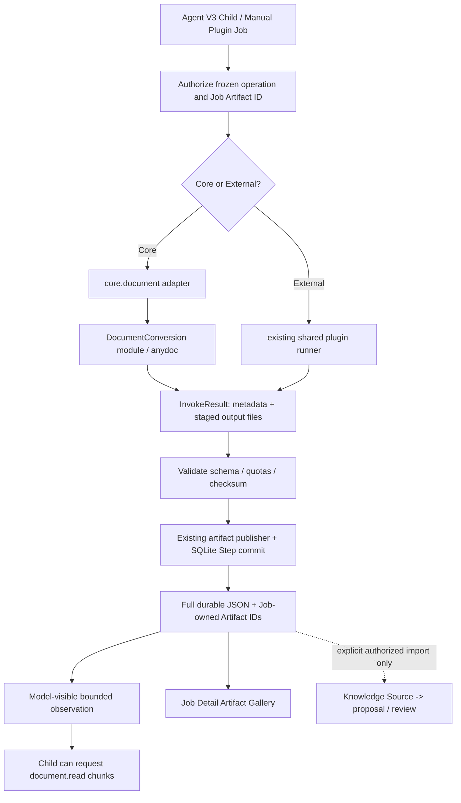

# Core Document + AnyDoc & Large Tool Results — Implementation Specification (V3)

> **Status:** Implementation in progress on `feat/core-anydoc-large-tool-results-v3`; GitHub Actions validation is in progress; avoid marking the implementation complete until the CI gates pass. Reviewed specification (2026-10-19).
> **Date:** 2026-10-19
> **Repository:** [`hailp-vn38/ai-agent-voice`](https://github.com/hailp-vn38/ai-agent-voice)
> **Reference branch:** `feat/knowledge-memory-v3-file-first-index` (inspected tree: `05e29830b08d63dbd726b7b7aa61958e4b8024fa`; re-check head before implementation).
> **Scope:** Agent Job V3 (`hierarchical_v3`), manual plugin jobs (`plugin_operation_v3`), built-in Core Document, shared external plugin result transport, Job Artifacts.
> **Primary decision:** Expand **the existing `core.document`** using [`firecrawl/anydoc`](https://github.com/firecrawl/anydoc), and introduce a **shared Large Tool Result policy** delivered independently from the AnyDoc adapter. Do not create `core.anydoc`, an artificial Store installation, a new Job engine, or a separate artifact database.

## 1. Goal, constraints and non-goals

### Goal

1. Convert PDF/Word/Excel/PowerPoint and other supported documents into Markdown natively in Rust, available to Agent Job and manual operation workflows.
2. Preserve the **entire** successful output: large structured JSON may be stored inline within an increased configurable bound; bigger content and binary outputs are stored as immutable, Job-owned Artifacts.
3. Let Root/Child agents consume large outputs through bounded, resumable observations; **Tool output size is independent of LLM context size**.
4. Retain durable tool-call pairing, provenance, Core activation policy, frozen Job authority, Job deletion, recovery, and Timeline B.
5. Reuse common conversion logic later in Knowledge Source ingestion, without allowing a tool call to publish Wiki content directly.

### Non-goals

- No changes to voice-session WebSocket framing, Device MCP result limits, or ESP32 protocol.
- No mandatory OCR, hosted conversion, embedded-image export, image understanding, semantic summary, or autonomous Wiki publication in V1.
- No second generic plugin framework, external `anydoc` plugin package, generic storage provider, or new artifact repository.
- No automatic promotion of arbitrary Job output into Knowledge.
- No forced migration of existing Core `document.extract` / `document.inspect` contracts or existing JSONL-v1 external packages.

## 2. Audited baseline and authoritative seams

Verified against the named branch (source paths are relative to repository root):

| Existing location | Observed contract / issue |
| --- | --- |
| `src/tools/core/catalog.rs` (under `crates/voice-agent-server`) | Six static groups including `core.document`; enable/disable stored in `core_plugin_settings`. |
| `src/tools/core/contracts.rs` | Static `OPERATIONS` (12 operations); `REVISION = "1"`; immutable frozen Core choices use `plugin_id="core"`. |
| `src/tools/core/expanded/document.rs` | `document.extract` and `document.inspect` currently accept only TXT/Markdown/JSON by `artifact::read_owned_text`. |
| `src/tools/core/expanded/artifact.rs` | Current helper bounds text input at **1 MiB**; existing artifact ownership verification must be retained. |
| `src/tools/core/execution.rs` | Core invoke produces JSON and currently returns **zero output artifacts**; `bound_text_result` caps serialized JSON to **64 KiB** and may truncate `text`. |
| `src/services/background/execution.rs` | `InvokeResult { result, artifacts, workspace }`; publisher stages and hashes artifact bytes, assigns UUIDs, and commits Step + artifact rows through `finish_plugin_success`. |
| `src/database/jobs/execution.rs` | `finish_plugin_success` rejects serialized Step JSON over **65,536 bytes**. |
| `src/services/background/plugins/protocol.rs` | External JSONL-v1 stdout maximum **64 KiB**; up to 16 declared artifact references. |
| `src/services/background/plugins/builder.rs` | Private runner RPC max ~**80 KiB** request and response. |
| `src/bin/plugin-runtime.rs` | `STDOUT_LIMIT=64 KiB`; `RPC_LIMIT=80 KiB`; worker `RLIMIT_FSIZE=20 MiB`. |
| `plugins/rust-plugin-sdk/src/lib.rs` | `MAX_RESPONSE=65,536`, SDK attachment cap **1 MiB**, buffered `Outcome.attach`. |
| `src/database/jobs/sessions.rs` | **32 KiB/message** and **64 KiB/transcript**; append currently reads and revalidates entire transcript. |
| `src/services/background/models.rs` | Aggregated model messages limited to **64 KiB** per call. |
| `src/services/background/agent_loop/results.rs` | Generic Tool Result excerpt **3,500 chars**, web article excerpt **6,000 chars**; preserve matched Call/Result pair. |
| `src/services/background/coverage.rs` | Final coverage result **64 KiB** and special source verification for web extracts <=6,000 observed chars. |
| `src/services/background/manual_admission.rs` | Manual artifact bindings: max **4**, max **20 MiB** total, verified completed source Job, imported under new Job identity. |
| `src/config/background.rs` | Default artifact quota **512 MiB/Job**, **4 GiB global**, max **2 GiB/Job**; separate step/deadline/capacity limits. |
| `plugins/document-analysis` | Existing external Rust document parser; must not silently break existing installations or Jobs. |
| `services/knowledge/sources.rs` | Knowledge raw Source currently Markdown-oriented and separately size-bounded; binary conversion alone is **not** Knowledge import. |

Key ADRs / design invariants:

- [`ADR 0114`](adr/0114-opencode-agent-session-tool-delegation.md): Root/Child native tools, durable transcripts and matched tool observations.
- [`ADR 0115`](adr/0115-core-plugin-activation-policy.md): Core policy checks at transactional Step start, frozen choice maximum authority.
- [`ADR 0116`](adr/0116-plugin-value-settings-and-manual-jobs.md): manual no-LLM Job and pinned plugin settings.
- [`ADR 0117`](adr/0117-knowledge-core-plugin-adapter.md): Knowledge Core owns canonical Source/Wiki publication.
- [`ADR 0115 (artifacts)`](adr/0115-job-owned-local-artifacts-v3.md): existing Job Artifact ownership and durable publisher.
- [`Flow 10`](flows/10-agent-job-opencode-v3.md), [`Flow 11`](flows/11-core-plugin-activation-v3.md), [`Flow 12`](flows/12-plugin-settings-and-manual-operation-v3.md).

**Before editing:** verify current branch head, current migrations, and test baselines; these findings describe the inspected tree, not a guarantee of no later commits.

## 3. Approved architecture



### Module and seam decisions

| Module | Public interface | Hidden implementation / responsibility |
| --- | --- | --- |
| **DocumentConversion** | `convert(bytes, format_hint, limits) -> ConvertedDocument` | AnyDoc format detection, conversion to Markdown, deterministic error mapping, output/size limits. No DB, Job ID or Knowledge imports. |
| **Core Document adapter** | `document.convert`, `document.read`; keep old `extract`, `inspect` | Job-scoped artifact lookup, byte validation, calling DocumentConversion, staging derived Markdown. |
| **Tool Result publication** | Existing `InvokeResult` → Step + artifacts | Shared schema validation, artifact hashing/atomic publication, result-size enforcement, server-assigned IDs. Core and External share one publication path. |
| **Agent Tool Result observation** | Existing `agent_loop/results.rs::plugin_tool_result` | Extend this function with bounded, schema-aware excerpts and continuation metadata. No separate projection module or registry. |

No speculative `DocumentProvider` registry or standalone Context Projection module is needed. Keep the existing `plugin_tool_result` function as the LLM-facing seam; extract a private helper only if a second real caller appears. Share DocumentConversion with Knowledge when a real second caller exists.

## 4. AnyDoc dependency and conversion behavior

### Dependency and platform

- Initial upstream baseline: **`anydoc = "=0.2.4"`** (verify crate and lockfile before merging); MIT license.
- Upstream declares `rust-version = "1.88"`; project pins Rust `1.98.1`. Run Cargo compatibility and vulnerability/dependency review, including the PDF and ZIP stacks.
- Use `anydoc::to_markdown_bytes(&bytes, format)` for conversion. For signatures that cannot identify format (notably CSV), supply an explicit, validated format hint from trusted artifact metadata/extension.
- Use `Format::from_bytes` first. Do **not** blindly trust extension/MIME. If content contradicts a supplied hint, prefer content detection or reject according to a deterministic rule; log a safe diagnostic.
- AnyDoc handles searchable PDF locally; scanned/image-only PDF can report `NeedsOcr`. Rust crate does **not** provide hosted OCR. OCR is deferred and must be explicit if added.
- PDF conversion path is different from non-PDF: `anydoc::to_document` does not support PDF; conversion must call `to_markdown_bytes`.
- AnyDoc `to_document` exposes embedded assets for supported non-PDF formats, but exporting those assets is **out of scope for V1**; Markdown may contain alt-text rather than downloadable images.

Supported candidate extensions: `doc`, `docx`, `docm`, `pdf`, `ppt`, `pptx`, `pptm`, `pps`, `ppsx`, `ppsm`, `pot`, `xls`, `xlsx`, `xlsm`, `xlsb`, `odt`, `ods`, `odp`, `rtf`, `epub`, `csv`. Maintain compatibility for `txt`, `md`, and JSON through their preexisting logic; do not claim AnyDoc parses them.

### Internal interface sketch (not a required exact Rust signature)

```rust
pub struct ConversionLimits {
    pub max_input_bytes: u64,
    pub max_markdown_bytes: u64,
}

pub struct ConvertedDocument {
    pub markdown: String,
    pub format: DocumentFormat,
}

pub fn convert_document(
    input: &[u8],
    hint: Option<DocumentFormat>,
    limits: &ConversionLimits,
) -> Result<ConvertedDocument, ConversionError>;
```

Do not compute or persist hashes in `ConvertedDocument`. Read the verified source digest from the existing Job Artifact record and let the existing publisher compute the output SHA-256. The Step summary may echo server-derived digests for provenance but must not become a second authoritative hash store.

### Conversion limits (initial defaults, tunable after benchmarks)

| Bound | Proposed default | Reason |
| --- | --- | --- |
| Binary input to `document.convert` | **20 MiB** | Compatible with current manual binding aggregate cap; configurable extension in later phase. |
| Markdown output per conversion | **64 MiB** | Enough for most documents; constrained further by remaining Job artifact quota. |
| Concurrent in-process conversion tasks | **1** | Prevent multiple expensive parser jobs from exhausting RAM. |
| Conversion runtime soft deadline | **60 s** | Respect overall Step and Job deadline. |
| General worker Step timeout | Existing **300 s** max | Do not expand automatically just for document conversion. |

**Safety caveat:** `spawn_blocking` prevents blocking the async reactor but cannot forcibly stop a CPU-bound native parser at timeout. Fail closed for future scheduling and cancel publication when late; true hard kill/CPU/memory guarantees require a supervised subprocess for untrusted/very large inputs. Do not claim that async timeout kills AnyDoc; qualify this behavior in tests and deploy policy.

### Error handling (reuse existing Job/Plugin errors)

Only conversion-specific errors need new stable codes:

| Conversion error | Condition | Result |
| --- | --- | --- |
| `unsupported_document_format` | Unsupported or undetectable document format | Failed Step; no artifact |
| `needs_ocr` | Image-only/scanned PDF, when reported by AnyDoc | Failed Step; no automatic network/OCR fallback |

Malformed/encrypted input, ownership mismatch, input/output quotas, storage failure and cancellation reuse existing `PluginError` / `JobError` mappings unless AnyDoc exposes a reliable subtype that is materially useful. A timeout of `spawn_blocking` **does not kill the native parser**; cancel publication and block further concurrency until the blocking call ends. Do not add a second error hierarchy, reveal local paths or log source content.

## 5. Core Document operation contracts

### Existing operations — backward compatible

- `document.extract` keeps **existing** TXT/Markdown/JSON input/output schemas and truncation behavior for jobs frozen under contract revision `1`.
- `document.inspect` keeps **existing** semantics for those text formats. Do not quietly reinterpret it as universal binary document inspection.
- Introduce new operations in static catalog; still `plugin_id="core"`, Core group `core.document`, no fake package installation.
- **Do not globally increment `REVISION` and invalidate existing frozen choices.** If new operations need a revised contract format, introduce operation-specific revision handling while continuing to decode historical choices.

### `document.convert` — new operation

Request:

```json
{
  "artifact_id": "{job-owned-source-artifact-uuid}"
}
```

Authoritative stored Step result (small metadata only; all values known before publication):

```json
{
  "status": "converted",
  "format": "docx",
  "source_sha256": "{verified-source-artifact-sha256}",
  "characters": 24500,
  "markdown_bytes": 37320,
  "output_filename": "converted.md",
  "provenance": [
    {
      "source": "artifact",
      "records": ["{source-artifact-uuid}"],
      "capabilities": ["document_convert"]
    }
  ]
}
```

Artifact UUIDs are **server-owned publication receipts**, not inputs invented by the LLM. The artifact publisher computes and commits output SHA-256; the existing `job_step_artifact_refs(job_id, step_key)` lookup injects the real published IDs into the subsequent Tool Result observation:

```json
{
  "status": "succeeded",
  "step_key": "step-key",
  "evidence_refs": ["{published-markdown-artifact-uuid}"],
  "result": {
    "format": "docx",
    "characters": 24500,
    "markdown_bytes": 37320
  }
}
```

**Decision:** avoid storing a made-up `markdown_artifact_id` inside the pre-publication result. A client needing it reads `evidence_refs` / the Job Artifact list returned **after** transactional success. If a convenience `markdown_artifact_id` is later exposed in an HTTP read model, derive it from the committed artifact row, never from a model/tool-supplied string.

`document.convert` reads only verified Job Artifact content. No raw `path`, `url`, untrusted local pathname or arbitrary base64 bytes in its arguments. Core operation is classified as source-side `safe_read`: reading source + producing a derived Job-owned immutable artifact does not mutate external state. The Step's artifact effect still obeys existing one-success publication, quota and delete/recovery rules.

### `document.read` — new operation

Request:

```json
{
  "artifact_id": "{published-markdown-artifact-uuid}",
  "offset": 0,
  "max_chars": 8000
}
```

Response:

```json
{
  "text": "# Introduction\n...",
  "offset": 0,
  "next_offset": 8000,
  "truncated": true,
  "size_bytes": 37320
}
```

Contract:

- `offset` and `next_offset` count **Unicode scalar values**, not bytes; `next_offset` is `null` only when complete. Validate overrun, end-of-file, non-UTF-8, artifact ownership and `text/markdown` MIME.
- Default `max_chars=8000`, maximum `32000`; a caller can request a larger result than the model-visible budget, but the persisted Step result must still be complete.
- Read via checked Job Artifact access; **do not** call the old 1 MiB `read_owned_text` helper for large converted documents.
- Avoid loading a 50 MiB file for every page. Implement bounded reader logic and, if profiling shows repeated offset scans expensive, add a local internal seek index; no new public index database in V1.
- Replayable pagination: same committed artifact ID + offset + max_chars yields the same slice; no mutation while reading.
- The evidence/capability of reading is not by itself proof that the entire document was inspected or that its assertions are true.

### `document.extract` alternative NOT selected

Do not replace `document.extract` with a full, multi-format, multi-MB response: it would change frozen schema/semantics, make context overflow more likely, and weaken old workflows. New operation `document.convert` is the durable, format-preserving path.

## 6. Large Tool Result architecture for *all* Agent V3 tools

### Mandatory distinction between three budgets

1. **Execution output:** the actual bytes produced by a tool (file/media/JSON). Subject to per-Job/storage quotas and runtime limits.
2. **Durable Step result:** schema-validated JSON metadata or inline structured output that can be replayed. Larger than previous 64 KiB but never an unbounded blob.
3. **LLM observation:** a compact projection with authoritative metadata, excerpts and continuation handles. Size governed by provider context budget and per-observation limits, *not* by execution output size.

### Configuration (reuse existing `[background.job_output]`, no new parallel policy)

```toml
[background.job_output]
inline_bytes = 1048576
message_bytes = 2097152
transcript_bytes = 4194304
request_bytes = 131072
input_token_budget = 262144
output_token_reserve = 8192
```

| Limit | Default | Configurable ceiling / notes |
| --- | --- | --- |
| Structured inline result / Step | **1 MiB** | **8 MiB** operator upper ceiling (requires large-result qualification) |
| External JSONL stdout envelope | **1 MiB** | JSONL-v1 single-line preserved; artifact payload never put inside JSONL stdout |
| Model-visible result / call | **16 KiB** | **64 KiB** with model-context budgeting |
| Aggregate LLM request messages | **128 KiB** | **512 KiB** *and* provider token window |
| Durable Session transcript / Session | **4 MiB** | **32 MiB**, without reserializing full history on every append |
| Artifacts / Job | Existing **512 MiB** | Existing max **2 GiB** (respect remaining quota) |
| Global artifact capacity | Existing **4 GiB** | Respect existing background configuration validator |

These are the intended post-change defaults; existing Job snapshots retain their pinned policy. The current implementation reuses the pre-existing `JobOutputLimits` model; the per-document model-visible excerpt is bounded in `plugin_tool_result`, not a new config field. Bytes refer to serialized UTF-8 JSON where applicable; allow for escaping/metadata. Count model tokens separately using the pinned provider's actual context, reserve completion headroom and tool schemas. Reject oversized requests rather than silently sending over context.

### Delivery rules

- **Inline JSON:** persist the complete schema-validated result within both the pinned `inline_bytes` limit and the existing SQLite row limit. The current `jobs` and `job_steps` schema retains a 64 KiB JSON CHECK; larger JSON uses the server-declared artifact delivery envelope below, even with a larger provider context. Raising the transport budget alone does not qualify 1 MiB inline database storage; that requires a separate schema migration.
- **File-backed output:** if the **operation contract already declares files**, publish those files through the existing Job Artifact publisher and retain a compact Step metadata JSON. The publisher generates all real artifact IDs.
- **Server-declared delivery envelope:** Agent Job V3 already exposes `read_job_output` as its shared, pinned output contract. After validating the original tool result against its declared output schema, the publisher may promote JSON that cannot fit the effective inline/model budget into `tool-output.json` and persist a server-issued envelope (`delivery=artifact`, `artifact_id`, `sha256`, `size_bytes`, `continuation_tool=read_job_output`). This is a transport/storage representation, not a new plugin output schema; all result bytes are retained. JSON beyond the 8 MiB transport ceiling is rejected and must be supplied as a declared file attachment.
- **No loss:** truncate only the *model-visible observation* with `observation_truncated=true` and an actionable read/offset reference. Existing `web.extract` pagination (`truncated`, `next_offset`) is unchanged; `coverage.rs` retains its 6,000-character source proof.

### External plugin transport (retain JSONL-v1)

Keep one JSONL-v1 response from the worker. The runner writes its bounded stdout to a **fixed, server-derived** attempt file (for example, `<attempt-root>/stdout.jsonl`, outside plugin-controlled `out/`). `GetAttempt` sends only status, byte count and SHA-256, **not a path** or the full stdout. Using the existing validated Job/attempt IDs and configured attempt workspace, the server opens the expected file, verifies regular-file/no-symlink, size and SHA-256, then applies the current request-ID and output-schema validation.

- Private runner RPC remains ~80 KiB. SDK, `protocol.rs`, runner stdout capture and Step JSON quota share the selected 1 MiB default. No new stdout-path abstraction or alternate transport protocol.
- Retain `MAX_REQUEST` ~64 KiB initially; arguments reference verified artifacts instead of embedding document bytes.
- Raise/parameterize worker `RLIMIT_FSIZE` (currently 20 MiB) from server-owned quotas. Job/global artifact quotas and disk limits remain authoritative.
- Add **only** SDK `Outcome::attach_file(...)` using bounded streaming copy plus SHA-256; retain `Outcome::attach(...)` for existing packages. No speculative `attach_reader` variant.
- Preserve JSONL-v1 backward compatibility, subprocess reaping, malformed-output failures, and no replay of ambiguous external attempts.

### Durable transcript / model projection

- Extend **`agent_loop/results.rs::plugin_tool_result`** directly. Keep schema-aware status/error, artifact IDs, bounded excerpt, `observation_truncated` and available offset metadata; do not instantiate a new projection module.
- Persist the full Step JSON once; append only bounded observations to `job_agent_messages`, never a second 1–8 MiB copy of the result.
- In `database/jobs/sessions.rs`, **reuse the transactional `SUM(length(CAST(payload_json AS BLOB)))` budget query** instead of creating a new persisted byte counter or migration. Validate the new message against the remaining budget; validate Tool Call/Result pairing incrementally on append and on replay, without deserializing the entire transcript at each append. Do not compromise existing canonical pairing/uniqueness checks.
- Model requests have a separate byte/token budget. Assemble a context view preserving system instruction, task, currently unresolved Tool Call/Result pair, recent observations and needed artifact references. Do not fabricate model-visible messages. Avoid unbounded `read_messages` replay at every provider call.
- Preserve pinned providers, immutable Job authority and legacy snapshot deserialization. New limits are versioned/frozen for new Jobs; historical jobs must retain their accepted contract.
- Keep `submit_result` / `finish_job` concise; large outputs go to artifacts. `coverage.rs` still uses authoritative Step/Artifact proof but must not copy all large Step payloads into one bounded final summary.

## 7. Artifact publication and crash consistency

**Reuse:** `services/background/execution.rs::execute_plugin_step_cancel`, `artifacts::stage_output`, `database/jobs/execution.rs::finish_plugin_success`, `job_step_artifact_refs` and `job_artifacts`.

Required order:

1. Admission freezes operation and policy/settings revisions. Source artifact ownership and digest are verified when Step runs.
2. Core Document converts to Markdown and writes **one attempt-local** `converted.md` output under a server-controlled workspace. File paths are generated by Rust; the model supplies no path.
3. `InvokeResult.artifacts` points to staged output. No new artifact ID or success message is visible yet.
4. The existing publisher assigns UUIDs, copies/hashes with byte quota, atomically stages/renames and syncs the destination directory.
5. Within one SQLite transaction, insert committed `job_artifacts` rows **and** mark Step success with schema-validated result metadata.
6. Only after commit does Agent Child receive a matched Tool Result with server-derived `evidence_refs`. UI Job Detail likewise reads committed rows only.
7. On rejection/cancellation/failure: no successful Step, no dangling reference; staging paths cleaned, safe recovery/reconciliation handles orphaned files. A failed artifact step must not publish partial Markdown as a successful result.

**Implementation concern:** `core::invoke` currently has neither an attempt workspace nor output artifacts. Pass the already authoritative attempt identity/context through the Core dispatch path (no second registry) and return an `InvokeResult` with `ArtifactData`/workspace. Avoid writing directly to Job Artifact final path in `document.rs`.

**Test the crash window** between rename and DB commit: if the process dies, reconciliation must clean an unreferenced file; a restarted Job must not repeat an ambiguous external worker action.

## 8. Manual Job artifact import and Knowledge reuse

### Manual Plugin Job

Existing manual operation admission imports up to **4** artifacts from completed source Jobs and at most **20 MiB aggregate** into a fresh Job before the single Step. Use its binding mechanism for `document.convert` (e.g. JSON Pointer `/artifact_id`); the tool references the **new** Job-owned ID after import. No direct filesystem paths in Admin HTTP.

For V1, the **20 MiB** cap is consistent with AnyDoc input limit. Larger input support in a later phase must extend both the conversion input cap **and** `manual_admission.rs` checked import path, streaming copy/hash, quotas and idempotency fingerprint. Do not simply raise `20 * 1024 * 1024` while keeping buffered `read_artifact`.

### Knowledge (follow-up integration)

Do **not** implement Knowledge import or invent future Source directory structures in this release. Follow [ADR 0117](adr/0117-knowledge-core-plugin-adapter.md): a later, explicitly authorized Knowledge import may reuse DocumentConversion and record original bytes/version/provenance. `document.convert` alone cannot publish Wiki, create Drafts or bypass the Knowledge review queue.

## 9. Exact code change plan

Paths below are relative to repository root.

| Phase | File / area | Concrete change |
| --- | --- | --- |
| P0 | `crates/voice-agent-server/src/config/background.rs` | Reuse `[background.job_output]` `JobOutputLimits` with changed defaults/validation; preserve pinned historical policy. |
| P0 | `src/database/jobs/execution.rs` | Remove hard-coded 64 KiB Step cap in favor of bounded policy; keep transactional quota/authorization. |
| P0 | `src/tools/core/execution.rs` | Remove global 64 KiB Core-only truncation as a storage rule; keep explicit pagination semantics for old tools. |
| P0 | `src/services/background/plugins/protocol.rs` | Increase JSONL stdout cap to 1 MiB while retaining one-line and schema validation. |
| P0 | `src/bin/plugin-runtime.rs` and `src/services/background/plugins/runner.rs` | Fixed attempt-owned `stdout.jsonl`, size/hash in small `GetAttempt` RPC; adjust file-size limits. |
| P0 | `plugins/rust-plugin-sdk/src/lib.rs` | Coordinated 1 MiB JSONL response; add `attach_file` only, keeping legacy `attach`. |
| P1 | `src/database/jobs/sessions.rs` | Raise durable budget; reuse transactional byte SUM; check incremental pairing without full-history deserialize on each append. |
| P1 | `src/services/background/models.rs` | Separate request-byte limit from provider token budget; cap tool schemas separately. |
| P1 | `src/services/background/agent_loop/results.rs` | Extend existing `plugin_tool_result` with bounded structured observation; no new module. |
| P1 | `src/services/background/coverage.rs` | Keep authoritative source evidence checks; bound terminal summary rather than serializing all full Step results. |
| P2 | `crates/voice-agent-server/Cargo.toml` | Add pinned AnyDoc dependency; validate lockfile and MSRV. |
| P2 | `src/services/document_conversion.rs` (or grouped module) | Internal pure AnyDoc conversion to Markdown/format; existing artifacts own hashing. |
| P2 | `src/tools/core/contracts.rs`, `catalog.rs`, `expanded.rs` | Register `document.convert` and `document.read` with typed schemas and coverage metadata. |
| P2 | `src/tools/core/expanded/document.rs` | New Core operations, validated artifact reads and pagination; keep old functions unchanged. |
| P2 | `src/services/background/execution.rs` | Pass attempt context and accept Core-staged `ArtifactData` into existing publisher. |
| P2 | `src/services/background/artifacts.rs` | Add bounded/streamed input reading where required; reuse checked-open and hash verification. |
| P2 | `src/services/background/manual_admission.rs` | Confirm existing 20 MiB binding path works; enlarge only with streaming copy in future. |
| P0/P1/P2 | Existing test suites under `src/tools/core`, `services/background/tests`, `plugins/rust-plugin-sdk` | Focused conversion, large JSON, artifact lifecycle, pairing/resume tests in each independent track. |
| Follow-up | Knowledge Source import | Separate, explicitly authorized work under ADR 0117; not a requirement for P2. |
| P2 | Admin Web Job Detail existing Artifact Gallery | Verify `converted.md` preview/download; **no redesign**. |

`src/...` abbreviates `crates/voice-agent-server/src/...` in this table.

**Database migrations:** None expected. Reuse `job_steps.result_json`, `job_artifacts` and the existing transactional Session byte SUM. Do not create an AnyDoc table or a speculative Session byte-counter migration.

## 10. Implementation tracks / delivery order

**Two independent tracks:** **T — Large Tool Result transport/session** and **D — Core AnyDoc**. `D` uses the existing small metadata `InvokeResult` and artifact publisher, so conversion need **not wait** for the large JSON transport/session refactor. Integrate both tracks only where Tool Result observation budgets require it.

### Track T0 — External large-result transport

- [ ] Add shared result budgets and explicit legacy defaults; wire SDK → fixed runner stdout file → existing output validator → Step DB for **1 MiB inline JSON**.
- [ ] `Outcome::attach_file` supports a 100 MiB file within existing job quotas; no file bytes in RPC or SDK-sized `Vec`.
- [ ] Preserve old JSONL-v1 packages, cancellation, reaping and malformed-result behavior.

### Track T1 — Agent Session + model-facing observation (after T0 transport, independently testable)

- [ ] Increase Session and model-request budgets; reuse transactional SUM instead of a new Session counter.
- [ ] Extend existing `plugin_tool_result` with bounded typed observation and continuation guidance.
- [ ] Preserve matched Call/Result pairing, historic snapshots and `coverage.rs` web-source verification.

### Track D — `core.document` + AnyDoc (can run parallel to T0/T1)

- [ ] Pin AnyDoc; implement `DocumentConversion` (Markdown/format only) and error mapping.
- [ ] Add `document.convert`, `document.read` in static Core Document catalog, preserving revision-1 frozen choices and existing `extract`/`inspect` behavior.
- [ ] Pass authoritative attempt context to Core dispatch; publish `converted.md` using existing artifact publisher and Job-owned SHA/UUID.
- [ ] Verify manual binding with the existing 20 MiB cap and Admin Web Artifact Gallery, plus offline searchable-PDF/DOCX/XLSX/PPTX tests.
- [ ] **Before T1 integration:** generic Child observation still clips around 3,500 characters; do not claim the agent saw an entire `document.read` result. Use small pages and server-derived artifact IDs. **After T1 integration:** preserve exact `next_offset`/`observation_truncated` for arbitrary document pages, and run end-to-end Agent read/analysis tests.

**Release gate:** T0 and T1 must be complete before advertising **general-purpose Large Tool Result** support. D may ship earlier with small metadata/artifacts and explicitly bounded Agent reads. Knowledge/OCR are follow-up work, not blockers.

## 11. Verification and failure test matrix

| Test | Input | Required result |
| --- | --- | --- |
| `anydoc_docx_headings_tables` | DOCX with headings, links, tables | Ordered meaningful Markdown; no invented image content. |
| `anydoc_pdf_text` | Searchable PDF | Real extracted content and correct output digest. |
| `anydoc_pdf_scan` | Scanned PDF | `needs_ocr`, no HTTP fallback. |
| `anydoc_xlsx_pptx` | Spreadsheet and slides | Content in GFM; source format metadata correct. |
| `anydoc_csv_explicit_hint` | CSV with no magic signature | Explicit format hint resolves parser; invalid hints fail. |
| `anydoc_invalid_encrypted` | Broken/password-protected files | Known failure, no success artifacts. |
| `anydoc_output_limit` | Large/expansive document | No partial successful publication, controlled capacity failure. |
| `inline_json_500k`, `inline_json_1m` | Valid plugin JSON | Byte-for-byte preserved, schema verified, no false `response_too_large`. |
| `over_inline_with_attachment` | >1 MiB payload as attached file | Publish full bytes; compact structured result, IDs after commit. |
| `over_inline_without_attachment` | >configured inline limit | Explicit `tool_result_too_large`; no arbitrary JSON wrapping. |
| `streamed_artifact_100m` | Binary/Markdown 100 MiB | No runner 20 MiB file-size rejection; hash/size/quotas enforced. |
| `artifact_wrong_job` | Artifact UUID from unrelated Job | Access denied before reading bytes. |
| `artifact_symlink_tamper` | Symlink/replaced bytes | Fail closed; do not follow path; no successful Step. |
| `document_read_pages` | Unicode Markdown >1 MiB | No skipped/duplicated scalars; resume offsets deterministic. |
| `model_projection` | Full 1 MiB Step JSON | LLM receives bounded projection + retrieval handle, full Step retained. |
| `transcript_pairing_resume` | Native Tool Call then crash/resume | Matched Tool Result once; no fabricated pending message. |
| `core_disable_race` | Admin PATCH before/after Step start | Exact ADR 0115 semantics maintained. |
| `publication_crash` | Crash after rename, before DB commit | Reconcile orphan; no false artifact receipt. |
| `manual_binding` | Completed Job source into new manual Job | New owned input UUID, stable idempotency replay, converter success. |
| `web_provenance_regression` | Incomplete `web.extract` pages | Source completion still fails correctly. |
| `legacy_external_plugin` | Existing JSONL-v1 small output | Unchanged result, package, replay behavior. |
| `large_tool_timeline` | Job with large file | Timeline stable; Artifact Gallery preview bounded, full download available. |

### Verification commands (from repo root, adjust to existing CI targets)

```bash
cargo fmt --all --check
cargo check -p voice-agent-server
cargo clippy -p voice-agent-server --all-targets -- -D warnings
cargo test -p voice-agent-server --lib
# External SDK/package tests must run in their independent workspaces:
cd plugins/rust-plugin-sdk && cargo test
```

Run existing background live/E2E tests, Rust plugin qualification (`scripts/check-rust-plugin.sh` as appropriate), and Admin Web test suite according to repository scripts. Do not assert CI succeeded unless it actually ran.

## 12. Release and rollback

- Enable 1 MiB inline, 4 MiB Session and the existing Job artifact quotas first; 8 MiB/32 MiB remain opt-in only after stress tests.
- Reuse existing Step error codes, durations, artifact count/size and Job event telemetry. Record document format/`needs_ocr` only where relevant; never log source contents or secrets. Add counters only after an observed operational need.
- Keep historical Step/artifact data readable. If rollback is needed, disabling `core.document` blocks new Core Step starts per ADR 0115 but does not retroactively cancel already accepted Steps. Never delete old package/Artifact records to roll back.

## 13. Definition of done

Complete the test matrix in §11, plus one smoke run for each document family and one 100 MiB output stress run. Evidence must show:

- `core.document` operations use the existing Core toggle and Job publisher; historic frozen operations and the external `document-analysis` package still work.
- Large structured JSON stays complete through runner/SQLite; large files are available by committed Job Artifact IDs, not synthesized by LLM.
- Resume, cancellation, manual import, ownership, hash/quota checks, web coverage and bounded Agent observations pass without changing Voice Session/Device MCP.
- Neither OCR nor Knowledge/Wiki publication is enabled implicitly. Attach command output and relevant regression results to implementation PR.

## 14. Document updates required during implementation

- Add one compact **ADR amendment** covering Large Tool Result persistence versus model-visible observation and the choice to extend existing Core Document; avoid duplicating this implementation guide.
- Update `docs/flows/10-agent-job-opencode-v3.md`, `docs/flows/11-core-plugin-activation-v3.md`, `docs/flows/12-plugin-settings-and-manual-operation-v3.md` for new operations, metadata-only runner RPC, limits and failure semantics.
- Update `docs/agent-job-v3-artifacts-implementation.md` only for SDK `attach_file` and the new output bound; do not copy this spec wholesale.
- Update Knowledge ADR/Flow 13 **only if** the later explicit import is implemented; this release does not claim the current Source vault accepts binaries.

---

**Final design decision:** **AnyDoc is the conversion implementation behind `core.document`. Large outputs are a shared Job V3 capability. Full bytes live in bounded Step JSON or immutable Job Artifacts; LLMs receive only a budgeted, accurate projection.** This is intentionally a deep-module extension of the current Rust architecture, not a parallel orchestration or document storage system.
> **Review implementation checkpoint:** P0 Core catalog/Clippy fixes, bounded 8 MiB output retrieval, policy-aligned external stdout, incremental Session append, AnyDoc soft deadline and focused regression tests were committed. Final acceptance depends on CI and integration tests.

> **Second review pass:** model context projection now retains paired Tool Call/Result groups while omitting older groups from the provider request; the full Session and Step ledgers are unchanged.

> **Manual acceptance:** the new integration test exercises completed-source import, conversion, Markdown artifact publication, and Job ownership; its result must be validated by CI before release.

> **Final CI gate:** Rustfmt applied to the current implementation; verify the clean workflow run for this revision before merge.
