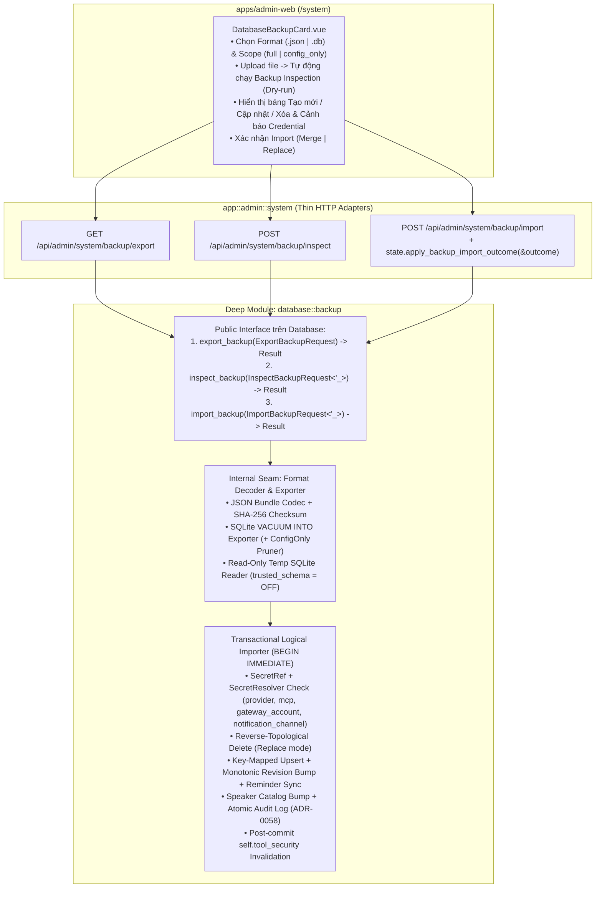

# Tài Liệu Triển Khai: Backup Data — Xuất / Nhập Database Trực Tuyến (`database::backup` & Admin Web `/system`)

> **Repository:** `AI_Agent_Voice_rust` (`crates/voice-agent-server` + `apps/admin-web`)  
> **Đối chiếu code:** nhánh hiện tại (`ADR 0127..0131` — `Database`, `ProviderRuntimeManager`, `LlmGatewayHub`, `NotificationHub`, `Orchestrator`, `KnowledgeMcp`)  
> **Kỷ luật thiết kế:** Áp dụng bộ từ vựng **Deep Module** từ [`.agents/skills/codebase-design/SKILL.md`](../.agents/skills/codebase-design/SKILL.md) & [`DEEPENING.md`](../.agents/skills/codebase-design/DEEPENING.md), đồng bộ với từ vựng chuẩn trong [`GLOSSARY.md`](../GLOSSARY.md) và [`CONTEXT.md`](../CONTEXT.md).  
> **Mục tiêu:** Cung cấp khả năng **Sao lưu (Export)**, **Xem trước (Dry-run Inspect)** và **Khôi phục / Nhập trực tuyến (Online Transactional Import)** cho cơ sở dữ liệu hệ thống ngay trên giao diện **Admin Web UI (`/system`)** và qua **Admin HTTP API (`/api/admin/system/backup/*`)** mà không cần tắt server hay làm gián đoạn các phiên đang hoạt động.

---

## Bảng Quyết định Thiết kế (Shallow Trap vs. Deepened Decision)

| Khía cạnh | Shallow Trap (Bẫy thiết kế nông cần tránh) | Deepened Decision (Quyết định thiết kế sâu được chốt — `ADR-0131`) |
| :--- | :--- | :--- |
| **1. Ranh giới Module & Seam chuyển đổi định dạng `.json` vs `.db` (`DEEPENING.md`)** | Phơi bày 5 hàm rời rạc trên `Database` (`export_bundle`, `export_sqlite`, `read_bundle_from_sqlite`, `inspect_bundle`, `import_bundle`) kèm danh sách tham số rời rạc `(payload, options, secret_resolver)`, buộc HTTP handler `app/admin/system.rs` phải tự phân nhánh định dạng, quản lý file tạm và tự biết `store_dir`. | Gom vào một **Deep Module** duy nhất `crates/voice-agent-server/src/database/backup/` với **đúng 3 entry points** nhận 1 struct request đồng nhất trên `Database`: `export_backup(ExportBackupRequest)`, `inspect_backup(InspectBackupRequest)`, `import_backup(ImportBackupRequest)`. Caller truyền `BackupCompanionSettings` (`background_settings`, `knowledge_mcp_settings`) vào `ExportBackupRequest` để `Database` không chạm tới filesystem `store_dir`; việc nhận diện magic header `"SQLite format 3\0"`, chạy `VACUUM INTO` và đọc file `.db` tạm ở chế độ read-only (`PRAGMA trusted_schema = OFF; PRAGMA cell_size_check = ON;`) là **Internal Seam** hoàn toàn ẩn bên trong module. |
| **2. Bất biến `ProviderVersion` & `AUTOINCREMENT id` khi Import trực tuyến (`ADR-0071`)** | Ghi đè trực tiếp file vật lý `voice-agent.db` khi `SqlitePool` đang mở WAL, hoặc ép `INSERT` lại `providers.id` và `revision` cũ (làm hỏng WAL/SHM và khiến `ProviderRuntimeManager` cấp nhầm runtime cũ đang cache hoặc bị `Quarantined`). | Mọi thao tác Import (dù nguồn là `.json` hay `.db`) đều thực thi qua **Transactional Logical Importer** (`BEGIN IMMEDIATE`) định danh theo **Resource Key** (`key`, `device_id`, `account_key`): bản ghi mới nhận `AUTOINCREMENT id` mới; bản ghi cập nhật tăng `revision = existing.revision + 1` (không bao giờ hạ `revision`). |
| **3. Bảo mật Credential đã mã hóa AES-256-GCM (`ADR-0083`, `ADR-0130`)** | Giải mã ra plaintext khi xuất, dùng sai AAD scope `"mcp_server:<key>"` thay vì `"mcp:<key>"`, hoặc gán `NULL` cho `llm_gateway_accounts.credential_json` (vi phạm `TEXT NOT NULL` trong `0140_llm_gateway_credential_limit.sql:12`). | Giữ nguyên bản mã niêm phong khi xuất với đúng 4 AAD scope trong codebase: `provider:<key>`, **`mcp:<key>`** (`app/admin/mcp/servers.rs:103`), `gateway_account:<account_key>`, `notification_channel:<kind>`. Khi `inspect`/`import`, tạo `SecretRef` qua `credentials::reference(scope, Some(record), None)` (`database/security/credentials.rs:37-40`) và gọi `SecretResolver::resolve(&secret_ref)` trên **cả 4 bảng**; nếu khác khóa máy chủ và `clear_unreadable_credentials = true`, đặt `NULL` cho 3 bảng nullable và đặt `credential_json = "{}"` kèm `status = 'reauth_required'` cho `llm_gateway_accounts`, đồng thời báo cáo chi tiết trong `warnings`. |
| **4. Bẫy Unique Index & Khóa ngoại trên Virtual Device `web_assistant` (`0102_managed_web_assistant.sql`)** | Khớp tất cả dòng trong bảng `devices` và `history_messages.device_id` theo chuỗi `device_id`. Vì `assistant_device.rs:82` sinh `device_id` ngẫu nhiên (`web_assistant_<uuid>`) dưới unique index `ux_devices_single_web_assistant ON devices(kind) WHERE kind = 'web_assistant'`, import sang DB đã có sẵn `web_assistant` sẽ nổ lỗi `UNIQUE constraint failed: devices.kind` hoặc mất liên kết `history_messages.device_id` (`INTEGER REFERENCES devices(id)`). | Tách biệt rõ: dòng `kind = 'web_assistant'` là singleton **Virtual Device**, được khớp theo `WHERE kind = 'web_assistant'` (giữ nguyên `device_id` hiện hữu hoặc cập nhật metadata/agent/template). Các bản ghi `history_messages` và `device_reminders` trong gói backup ghi kèm `device_kind`: nếu `device_kind == 'web_assistant'` thì ánh xạ `devices(id)` theo `WHERE kind = 'web_assistant'`; nếu `kind == 'physical'` thì khớp theo chuỗi `device_id`. |
| **5. Bẫy `ON DELETE RESTRICT`, `ON DELETE CASCADE`, `CHECK` & `UNIQUE` khi `Import` (`0001`, `0017`, `0104`, `0137`)** | Xóa bảng `speakers`, `providers`, `agents` trực tiếp gây lỗi `ON DELETE RESTRICT` hoặc nổ lỗi `CHECK (status = 'committed' AND speaker_id IS NOT NULL)` trên `speaker_quick_captures` (`0017_builtin_speaker_identification.sql:48-55`); bỏ sót `device_reminder_sync` (`0104_device_reminders.sql:6-35`) gây lỗi `invalid_snapshot`; hoặc upsert `notifications_inbox` chỉ theo `id` gây lỗi `UNIQUE constraint failed: notifications_inbox.dedup_key` (`0137_notification_hub.sql:31-33`). | • Thực thi xóa theo đúng **thứ tự ngược khóa ngoại (reverse-topological order)**: xóa `speaker_quick_captures` & `speaker_enrollment_drafts` trước khi xóa `agent_speaker_candidates` & `speakers`.<br>• Đồng bộ `device_reminder_sync.schedule_revision >= MAX(device_reminders.schedule_revision)` và dọn `device_reminder_cached_items` sau khi import `device_reminders`.<br>• Khớp `notifications_inbox` theo `id OR dedup_key`.<br>• Báo trước trong `BackupInspectionReport` số dòng `history_messages` và `device_reminders` bị kéo theo do `ON DELETE RESTRICT`/`ON DELETE CASCADE` khi xóa `agents` hoặc `devices` ở chế độ `Replace` + `ConfigOnly`. |
| **6. Ghi nhận `Admin Audit Event` nguyên tử (`ADR-0058`) & Tự động Invalidate `ToolSecurity` bên trong `Database` Seam** | Ghi `admin_audit_events` ngoài transaction, hoặc buộc caller bên ngoài phải nhớ gọi `db.tool_security.invalidate_system_mcp()` sau `db.import_backup(...)` (rò rỉ trách nhiệm nội bộ của `Database` qua seam). | `db.import_backup(ImportBackupRequest)` ghi `audit(...)` (`resource_type = "database_backup"`, `action = "import"`) ngay bên trong cùng transaction trước khi `commit()`, và **tự động thu hồi `self.tool_security`** (`invalidate_system_mcp()` cùng các agent/server/speaker/template bị tác động) ngay sau khi `tx.commit().await` thành công trước khi trả `BackupImportOutcome` về cho caller. |
| **7. Đồng bộ trạng thái Runtime hậu Import (`Locality` trên `AppState`)** | Để HTTP handler `app/admin/system.rs` trực tiếp chọc vào 7 trường nội bộ của `AppState` (Feature Envy / Divergent Change), hoặc gọi `kmcp.reload_from_disk()` khi hàm này chưa tồn tại trên `KnowledgeMcp`. | Bổ sung `pub fn reload_from_disk(&self, cfg: &WikiMcpConfig)` trên `KnowledgeMcp` (`tools/knowledge_mcp/mod.rs`) và đóng gói điều phối hậu import vào `AppState::apply_backup_import_outcome(&self, outcome: &BackupImportOutcome)` để `app::admin::system` giữ đúng vai trò thin HTTP adapter. |

---

## 1. Từ vựng Domain (`GLOSSARY.md` & `CONTEXT.md`) & Ghi chú ADR

### 1.1. Từ vựng Domain chuẩn hóa (`## Database Backup & Transactional Restore`)

Đã bổ sung vào [`GLOSSARY.md`](../GLOSSARY.md) và [`CONTEXT.md`](../CONTEXT.md) (tuân thủ [`GLOSSARY-FORMAT.md`](../.agents/skills/domain-modeling/GLOSSARY-FORMAT.md)):

- **Database Backup Bundle**:
  Gói sao lưu khả chuyển chứa cấu hình mong muốn, danh mục thiết bị và giọng nói, bí mật đã niêm phong và dữ liệu lưu trữ theo phạm vi đã chọn, định danh tài nguyên bằng khóa nghiệp vụ bất biến thay vì khóa nguyên nội bộ của cơ sở dữ liệu.
  _Avoid_: raw database dump, migration journal, plaintext credential export
- **Database Snapshot**:
  Bản chụp tệp vật lý nhất quán tại một thời điểm của cơ sở dữ liệu điều khiển chính, được xuất thành một tệp độc lập mà không làm gián đoạn các phiên đang hoạt động.
  _Avoid_: live WAL file copy, filesystem volume clone, partial table dump
- **Backup Inspection**:
  Bước đánh giá chỉ đọc trên một bản sao lưu ứng viên để báo cáo số lượng tài nguyên, các thay đổi thêm mới, cập nhật hoặc xóa bỏ dự kiến, cùng khả năng tương thích của khóa giải mã bí mật trước khi áp dụng.
  _Avoid_: dry-run migration, schema diff, live import

### 1.2. Ghi chú Supersession & Mở rộng ADR (`docs/agents/domain.md`)

> _Supersedes một phần [ADR-0057](adr/0057-database-enabled-startup-dependency.md) và [ADR-0063](adr/0063-forward-only-schema-migrations.md) đối với điều khoản giới hạn backup/restore chỉ ở tầng operator ("Backup/restore không thuộc application V1") thông qua [ADR-0131](adr/0131-database-backup-export-and-transactional-import.md): bổ sung cơ chế xuất/nhập database trực tuyến thuộc sở hữu ứng dụng, đồng thời giữ nguyên bất biến Forward-only Schema Migration._

---

## 2. Kiến trúc Deep Module (`crates/voice-agent-server/src/database/backup/`)

### 2.1. Sơ đồ Kiến trúc & Kỷ luật Seam



### 2.2. Định nghĩa Kiểu dữ liệu & Interface (`crates/voice-agent-server/src/database/backup/mod.rs`)

```rust
#[derive(Clone, Copy, Debug, Default, PartialEq, Eq, Serialize, Deserialize)]
#[serde(rename_all = "snake_case")]
pub enum BackupFormat {
    #[default]
    Json,
    Sqlite,
}

#[derive(Clone, Copy, Debug, Default, PartialEq, Eq, Serialize, Deserialize)]
#[serde(rename_all = "snake_case")]
pub enum BackupScope {
    /// Toàn bộ cấu hình cốt lõi + Device Reminders (kèm device_reminder_sync) + History Messages
    /// + Notifications Inbox + Companion Settings được truyền vào qua BackupCompanionSettings.
    #[default]
    Full,
    /// Chỉ các bảng cấu hình cốt lõi (Providers, Templates, Agents, MCP Servers, Devices,
    /// Speakers & Voiceprints, LLM Gateway Accounts, Notification Channel Configs, System MCP Grants).
    ConfigOnly,
}

#[derive(Clone, Copy, Debug, Default, PartialEq, Eq, Serialize, Deserialize)]
#[serde(rename_all = "snake_case")]
pub enum ImportMode {
    /// Upsert theo khóa nghiệp vụ: thêm mới nếu chưa có, cập nhật & tăng revision nếu đã có,
    /// giữ nguyên các bản ghi hiện hữu không nằm trong gói backup.
    #[default]
    Merge,
    /// Đồng bộ theo gói backup: xóa các tài nguyên không nằm trong gói backup theo thứ tự ngược khóa ngoại,
    /// cập nhật/thêm mới các bản ghi trong gói backup, vẫn bảo toàn revision tăng đơn điệu.
    Replace,
}

#[derive(Clone, Debug, Default, PartialEq, Eq, Serialize, Deserialize)]
pub struct BackupCompanionSettings {
    pub background_settings: Option<serde_json::Value>,
    pub knowledge_mcp_settings: Option<serde_json::Value>,
}

#[derive(Clone, Debug, Default)]
pub struct ExportBackupRequest {
    pub format: BackupFormat,
    pub scope: BackupScope,
    /// Được tầng ứng dụng nạp từ `store_dir` khi `scope == BackupScope::Full`
    /// để `Database` hoàn toàn độc lập với đường dẫn filesystem của Orchestrator.
    pub companion_settings: BackupCompanionSettings,
}

#[derive(Clone, Copy, Debug, PartialEq, Eq, Serialize, Deserialize)]
pub struct BackupImportOptions {
    pub mode: ImportMode,
    pub scope: BackupScope,
    pub clear_unreadable_credentials: bool,
}

impl Default for BackupImportOptions {
    fn default() -> Self {
        Self {
            mode: ImportMode::Merge,
            scope: BackupScope::Full,
            clear_unreadable_credentials: true,
        }
    }
}

pub struct InspectBackupRequest<'a> {
    pub payload: &'a [u8],
    pub options: BackupImportOptions,
    pub secret_resolver: &'a dyn SecretResolver,
}

pub struct ImportBackupRequest<'a> {
    pub request_id: &'a str,
    pub payload: &'a [u8],
    pub options: BackupImportOptions,
    pub secret_resolver: &'a dyn SecretResolver,
}
```

**3 Entry Points trên `Database`**:
1. `pub async fn export_backup(&self, req: ExportBackupRequest) -> Result<ExportedBackup, BackupError>`
2. `pub async fn inspect_backup(&self, req: InspectBackupRequest<'_>) -> Result<BackupInspectionReport, BackupError>`
3. `pub async fn import_backup(&self, req: ImportBackupRequest<'_>) -> Result<BackupImportOutcome, BackupError>`

---

## 3. Chi tiết Xử lý các Bảng và Ràng buộc Schema SQLite

### 3.1. Danh sách các bảng được ánh xạ trong `DatabaseBackupBundle`

| Thứ tự | Nhóm / Bảng SQLite | Khóa nghiệp vụ (Natural Key) | Quy tắc Ánh xạ Khóa ngoại & Bất biến khi Import |
| :--- | :--- | :--- | :--- |
| **1** | `providers` | `key` | • Nếu đã có: `UPDATE` cấu hình và đặt `revision = existing.revision + 1` (`ADR-0071`).<br>• Nếu chưa có: `INSERT` để nhận `AUTOINCREMENT id` mới.<br>• Kiểm tra giải mã `credential_json` qua `credentials::reference("provider:<key>", Some(record), None)` + `SecretResolver::resolve`; nếu không đọc được và `clear_unreadable_credentials = true`, đặt `credential_json = NULL`. |
| **2** | `agent_templates` | `key` | • Upsert theo `key`, tăng `revision = existing.revision + 1` nếu cập nhật. |
| **3** | `template_provider_bindings` | `(template_key, provider_type)` | • Xóa binding cũ của các `template_id` được chạm tới và chèn lại: nếu `provider_source = 'database'` thì tra `provider_id` từ `provider_key`; nếu `provider_source = 'config'` thì giữ `config_provider_key`. |
| **4** | `agents` | `key` | • Upsert theo `key`, tăng `revision` và `reminder_policy_revision` nếu cập nhật. |
| **5** | `agent_template_assignments` | `(agent_key, template_key)` | • Đồng bộ danh sách gán template cho từng `agent_key` và bảo toàn duy nhất 1 `is_default = 1`. |
| **6** | `mcp_servers`<br>`agent_mcp_bindings`<br>`external_tool_observations`<br>`agent_external_tool_allowlist` | `mcp_servers.key`<br>`(agent_key, server_key)`<br>`(server_key, original_name)`<br>`(agent_key, server_key, original_name)` | • Upsert `mcp_servers` theo `key`, tăng `revision`, kiểm tra `credential_json` với đúng AAD **`scope = "mcp:<key>"`** (`app/admin/mcp/servers.rs:103`, `database/mcp/external_mcp.rs:91`); nếu không đọc được và `clear_unreadable_credentials = true`, đặt `credential_json = NULL`.<br>• Ánh xạ `mcp_server_id` và `agent_id` cho 3 bảng liên kết công cụ. |
| **7** | `devices` | • `kind = 'web_assistant'`: khớp theo `kind`<br>• `kind = 'physical'`: khớp theo `device_id` | • Bảo toàn chỉ mục duy nhất `ux_devices_single_web_assistant ON devices(kind) WHERE kind = 'web_assistant'`.<br>• Ánh xạ `agent_key -> agent_id` và `template_key -> template_id`. |
| **8** | `speakers`<br>`speaker_voiceprints`<br>`agent_speaker_policies`<br>`agent_speaker_candidates`<br>`agent_speaker_template_grants`<br>`speaker_calibration_catalog`<br>`speaker_calibration_evidence` | `speakers.key`<br>`(speaker_key, embedding_space)`<br>`agent_key`<br>`(agent_key, speaker_key)`<br>`(agent_key, speaker_key, template_key)`<br>`singleton id = 1`<br>`(calibration_revision, candidate_set_digest)` | • Mã hóa `speaker_voiceprints.vector` (`BLOB`) sang Base64 trong JSON Bundle.<br>• Khi xóa `speakers` ở chế độ `Replace`, xóa trước `speaker_quick_captures` và `speaker_enrollment_drafts` của speaker đó để không nổ lỗi `CHECK` constraint.<br>• Sau khi cập nhật nhóm `speakers`, tăng `UPDATE speaker_catalog SET revision = revision + 1 WHERE id = 1`. |
| **9** | `llm_gateway_accounts` | `account_key` | • Upsert theo `account_key`. Kiểm tra `credential_json` với `scope = "gateway_account:<account_key>"`. Vì cột `llm_gateway_accounts.credential_json` có ràng buộc **`TEXT NOT NULL`** (`0140_llm_gateway_credential_limit.sql:12`), nếu không giải mã được trên máy chủ mới và `clear_unreadable_credentials = true`, đặt `credential_json = "{}"` và `status = 'reauth_required'` để Admin đăng nhập lại mà không vi phạm `NOT NULL`. |
| **10** | `notification_settings_state`<br>`notification_channel_configs`<br>`system_mcp_grants` | `singleton id = 1`<br>`channel_kind`<br>`singleton id = 1` | • Cập nhật cấu hình thông báo và quyền System MCP, tăng `revision`.<br>• Kiểm tra `encrypted_credential` với `scope = "notification_channel:<channel_kind>"`; nếu không đọc được và `clear_unreadable_credentials = true`, đặt `encrypted_credential = NULL`. |
| **11** | *(Khi `scope == Full`)*<br>• `device_reminders` + `device_reminder_sync` + `device_reminder_cached_items`<br>• `history_messages`<br>• `notifications_inbox` | `device_reminders.id`<br>`(session_id, sequence)`<br>`notifications_inbox.id` / `dedup_key` | • Ghi kèm `device_kind` (`'web_assistant'` \| `'physical'`) cho `device_reminders` và `history_messages`: nếu `device_kind == 'web_assistant'` thì tra `devices.id` (`INTEGER`) qua `WHERE kind = 'web_assistant'`; nếu `'physical'` thì tra qua `WHERE device_id = ?`.<br>• Sau khi upsert/xóa `device_reminders` của một `device_row_id`, cập nhật `device_reminder_sync(device_row_id, schedule_revision)` sao cho `schedule_revision >= MAX(device_reminders.schedule_revision)` và xóa `device_reminder_cached_items` của thiết bị đó (`0104_device_reminders.sql:6-35`, `database/notifications/mod.rs:146-205`).<br>• Với `notifications_inbox`, khớp theo `WHERE id = ?1 OR (dedup_key IS NOT NULL AND dedup_key = ?2)` để không vi phạm `dedup_key TEXT UNIQUE` (`0137_notification_hub.sql:31-33`). |

### 3.2. Thứ tự Xóa an toàn trong `ImportMode::Replace` & Danh sách bảng `ConfigOnly Pruner`

1. **Khi chạy `ImportMode::Replace`**, trước khi upsert, giao dịch thực hiện xóa các tài nguyên hiện có nhưng không xuất hiện trong gói backup theo đúng thứ tự ngược khóa ngoại:
   - **Bước 1 (`scope == Full`)**: Xóa `notifications_inbox` (kéo theo `notification_outbox` qua `ON DELETE CASCADE`), `history_messages`, và `device_reminders` không nằm trong gói backup; đồng thời dọn `device_reminder_cached_items` và nâng `device_reminder_sync.schedule_revision` cho các thiết bị có reminder bị xóa.
   - **Bước 2 (`scope == ConfigOnly`)**: Đối với các `agents` hoặc `devices` vật lý bị loại bỏ bởi `Replace`, xóa trước các dòng `history_messages` tham chiếu tới `agent_id` đó (vì `history_messages.agent_id` có `ON DELETE RESTRICT`), và lưu ý việc xóa `devices` vật lý ở Bước 4 sẽ kéo theo `ON DELETE CASCADE` trên `history_messages` (`0001_initial_database.sql:104`) và `device_reminders` (`0104_device_reminders.sql:16`) của thiết bị đó. `BackupInspectionReport` tính toán và cảnh báo trước tổng số dòng `history_messages` / `device_reminders` bị xóa kéo theo này.
   - **Bước 3**: Xóa `speaker_quick_captures` và `speaker_enrollment_drafts` của các `speakers` sắp bị xóa $\rightarrow$ xóa `agent_speaker_candidates` và `agent_speaker_template_grants` $\rightarrow$ xóa `speakers` không nằm trong gói backup.
   - **Bước 4**: Xóa `devices` (`kind = 'physical'`) không nằm trong gói backup (không bao giờ xóa dòng singleton `kind = 'web_assistant'` nếu DB đã có).
   - **Bước 5**: Xóa `agent_mcp_bindings`, `agent_external_tool_allowlist`, `external_tool_observations`, `mcp_servers` không nằm trong gói backup.
   - **Bước 6**: Xóa `agent_template_assignments` và `template_provider_bindings` của các agent/template/provider bị loại bỏ $\rightarrow$ xóa `agents`, `agent_templates`, `providers`, `llm_gateway_accounts` không nằm trong gói backup.

2. **Danh sách bảng cần dọn trong `ConfigOnly Pruner` khi xuất `.db` (`BackupFormat::Sqlite` + `BackupScope::ConfigOnly`)**:
   - Sau khi chạy `VACUUM INTO` ra file `.db` tạm, mở kết nối tới file tạm và xóa sạch dữ liệu các bảng runtime/phiên không thuộc cấu hình cốt lõi rồi chạy `VACUUM;` để không còn trang dữ liệu dư thừa:
     `notification_outbox`, `notifications_inbox`, `reminder_delivery_attempts`, `reminder_mutation_keys`, `device_reminder_cached_items`, `device_reminders`, `device_reminder_sync`, `history_messages`, `device_enrollments`, `speaker_enrollment_samples`, `speaker_enrollment_drafts`, `speaker_quick_captures`, `admin_audit_events`, `system_mcp_token_revocations`.

---

## 4. Thiết kế Admin HTTP API & Đồng bộ Runtime

### 4.1. Các Endpoint HTTP (`/api/admin/system/backup/*`)

| Method & Path | Query Params | Request Body | Response |
| :--- | :--- | :--- | :--- |
| `GET /api/admin/system/backup/export` | `format=json\|sqlite` (`default=json`)<br>`scope=full\|config_only` (`default=full`) | *(Trống)* | `200 OK` kèm `Content-Disposition: attachment; filename="voice-agent-backup-YYYYMMDD-HHMMSS.{json\|db}"` và `Cache-Control: no-store`. |
| `POST /api/admin/system/backup/inspect` | `mode=merge\|replace` (`default=merge`)<br>`scope=full\|config_only` (`default=full`)<br>`clear_unreadable_credentials=true\|false` (`default=true`) | Raw bytes của file `.json` hoặc `.db` (tối đa `MAX_BACKUP_BODY = 64 MiB`) | `200 OK` trả về JSON `BackupInspectionReport`. |
| `POST /api/admin/system/backup/import` | `mode=merge\|replace` (`default=merge`)<br>`scope=full\|config_only` (`default=full`)<br>`clear_unreadable_credentials=true\|false` (`default=true`) | Raw bytes của file `.json` hoặc `.db` (tối đa `MAX_BACKUP_BODY = 64 MiB`) | `200 OK` trả về JSON `BackupImportReport`. |

### 4.2. Cấu trúc JSON `BackupInspectionReport` & `BackupImportReport`

```json
{
  "detected_format": "json",
  "bundle_scope": "full",
  "effective_scope": "full",
  "mode": "merge",
  "created_at": 1761808000,
  "server_version": "0.1.0",
  "includes_background_settings": true,
  "includes_knowledge_mcp_settings": true,
  "totals": {
    "to_create": 4,
    "to_update": 8,
    "to_delete": 0,
    "unchanged": 2
  },
  "resources": [
    { "resource": "providers", "in_backup": 3, "to_create": 1, "to_update": 2, "to_delete": 0 },
    { "resource": "agent_templates", "in_backup": 2, "to_create": 0, "to_update": 2, "to_delete": 0 },
    { "resource": "agents", "in_backup": 2, "to_create": 0, "to_update": 2, "to_delete": 0 },
    { "resource": "mcp_servers", "in_backup": 1, "to_create": 1, "to_update": 0, "to_delete": 0 },
    { "resource": "devices", "in_backup": 2, "to_create": 1, "to_update": 1, "to_delete": 0 },
    { "resource": "speakers", "in_backup": 1, "to_create": 1, "to_update": 0, "to_delete": 0 },
    { "resource": "llm_gateway_accounts", "in_backup": 1, "to_create": 0, "to_update": 1, "to_delete": 0 },
    { "resource": "device_reminders", "in_backup": 2, "to_create": 0, "to_update": 0, "to_delete": 0 },
    { "resource": "history_messages", "in_backup": 15, "to_create": 0, "to_update": 0, "to_delete": 0 },
    { "resource": "notifications_inbox", "in_backup": 5, "to_create": 0, "to_update": 0, "to_delete": 0 }
  ],
  "credentials": {
    "total_encrypted": 3,
    "decryptable": 3,
    "unreadable": 0,
    "unreadable_items": []
  },
  "warnings": []
}
```

### 4.3. Đồng bộ Trạng thái RAM sau khi Commit (`AppState::apply_backup_import_outcome`)

- **Bên trong `Database::import_backup`** (trước khi hàm trả về `Ok(outcome)`):
  - Ngay sau khi `tx.commit().await` thành công, `Database` tự gọi `self.tool_security.invalidate_system_mcp()` và thu hồi các grant cache của agent/server/speaker/template bị thay đổi để đảm bảo **Locality** ngay bên trong seam `Database`.
- **Trên `AppState::apply_backup_import_outcome(&self, outcome: &BackupImportOutcome)`**:
  1. **Background Settings (`agent_settings.json`)**: Nếu `outcome.effective_scope == BackupScope::Full` và `outcome.companion_settings.background_settings` có dữ liệu:
     - Lưu xuống `self.config.orchestrator.store_dir` (`save_persisted_settings`) và render lại prompt (`write_agent_prompts`).
     - Cập nhật `self.admin_task_control.lock()` (`background_enabled_override`, `background_revision`, `background_settings`) rồi gọi `sync_orchestrator_from_state(self).await`.
  2. **Knowledge MCP Settings (`knowledge_mcp_settings.json`)**: Nếu `outcome.effective_scope == BackupScope::Full` và `outcome.companion_settings.knowledge_mcp_settings` có dữ liệu:
     - Lưu xuống `self.config.orchestrator.store_dir.join("knowledge_mcp_settings.json")`.
     - Nếu `self.knowledge_mcp.get()` đã khởi tạo, gọi phương thức mới `kmcp.reload_from_disk(&self.config.orchestrator.wiki_mcp)` (bổ sung trên `KnowledgeMcp` tại `crates/voice-agent-server/src/tools/knowledge_mcp/mod.rs`) để cập nhật ngay `RwLock<PersistedKnowledgeMcpSettings>` trong RAM.
  3. **LLM Gateway Hub**: Gọi `let _ = self.llm_gateway_hub.reload_snapshot().await;`.
  4. **WebAssistantAuth**: Gọi `self.web_assistant.invalidate();`.
  5. **Provider Prewarm**: Nếu `self.provider_prewarm` đang bật, kích hoạt prewarm cho các template đang được chọn.

---

## 5. Thiết kế Giao diện Admin Web (`apps/admin-web/`)

1. **API Client & Types**:
   - [`apps/admin-web/src/api/types/system.ts`](../apps/admin-web/src/api/types/system.ts): Định nghĩa `BackupFormat`, `BackupScope`, `ImportMode`, `BackupResourceCount`, `BackupCredentialSummary`, `BackupInspectionReport`, `BackupImportReport`.
   - [`apps/admin-web/src/api/system.ts`](../apps/admin-web/src/api/system.ts): Thêm `exportBackup(format, scope)`, `inspectBackup(file, options)`, `importBackup(file, options)`.
2. **Component `DatabaseBackupCard.vue`**:
   - Đặt tại [`apps/admin-web/src/components/system/DatabaseBackupCard.vue`](../apps/admin-web/src/components/system/DatabaseBackupCard.vue) và hiển thị trên [`apps/admin-web/src/views/SystemView.vue`](../apps/admin-web/src/views/SystemView.vue).
   - Chia làm 2 khối rõ ràng:
     - **Xuất dữ liệu (Export Backup)**: Chọn định dạng (`JSON Bundle (.json)` hoặc `SQLite Snapshot (.db)`), chọn phạm vi (`Full` hoặc `Config-Only`), nút tải xuống.
     - **Nhập / Khôi phục dữ liệu (Import / Restore)**: Chọn file `.json` hoặc `.db`, chọn chế độ (`Merge` hoặc `Replace`), chọn phạm vi (`Full` hoặc `Config-Only`), hiển thị trạng thái shimmer `.card-shimmer` (`role="status"`, `aria-busy="true"`) khi đang phân tích file, bảng tổng hợp chi tiết kết quả `Backup Inspection`, cảnh báo khóa mã hóa `CredentialCipher` (nếu có), và nút xác nhận thực thi kèm `ConfirmDialog.vue`.

---

## 6. Kế hoạch Kiểm chứng Tự động (`scripts/agent-test.sh`)

1. **Kiểm tra quy tắc đặt câu lệnh SQL**:
   - `python3 scripts/check-sqlx-placement.py` $\rightarrow$ `PASS: production SQLx queries belong to database/`.
2. **Kiểm thử Unit & Integration Backend (`crates/voice-agent-server`)**:
   - Round-trip xuất/nhập định dạng `.json` (`BackupFormat::Json`) và `.db` (`BackupFormat::Sqlite` qua `VACUUM INTO`, bao gồm `ConfigOnly Pruner`).
   - Kiểm tra chế độ `ImportMode::Merge` (tăng `revision`, giữ nguyên bản ghi ngoài gói backup, xử lý trùng `notifications_inbox.dedup_key`, đồng bộ `device_reminder_sync.schedule_revision`) và `ImportMode::Replace` (xóa sạch bản ghi dư thừa an toàn với `ON DELETE RESTRICT` và `speaker_quick_captures` `CHECK` constraint, không lỗi `ux_devices_single_web_assistant`, bảo toàn liên kết `history_messages` của `web_assistant`).
   - Kiểm tra tương thích `CredentialCipher` với đúng 4 AAD scope (`provider:<key>`, `mcp:<key>`, `gateway_account:<account_key>`, `notification_channel:<kind>`) khi nhập trên cùng khóa và khi nhập sang khóa mới (`clear_unreadable_credentials = true`, đặt `"{}"` + `reauth_required` cho `llm_gateway_accounts`).
   - Kiểm tra ghi nhận `admin_audit_events` nguyên tử (`resource_type = "database_backup"`, `action = "import"`) và tự động thu hồi `db.tool_security` ngay sau khi commit.
