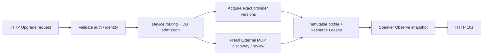
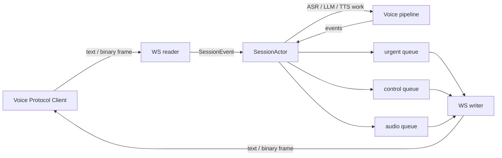
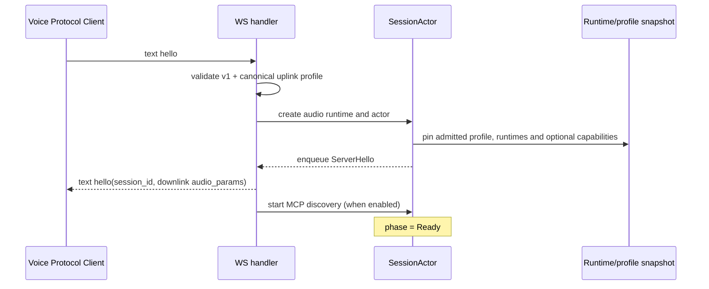
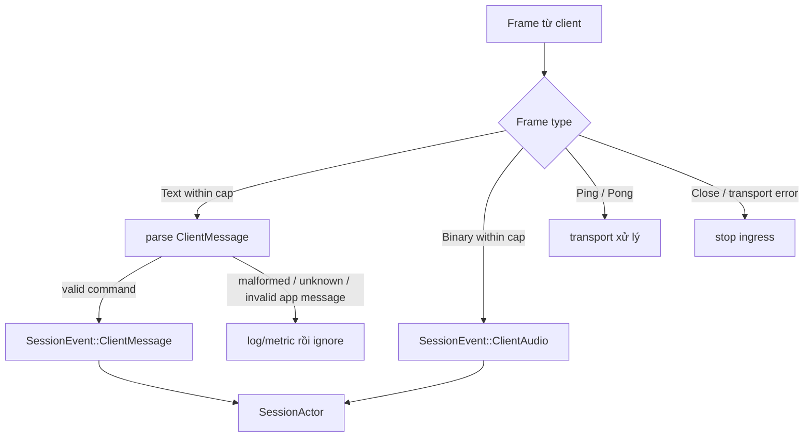
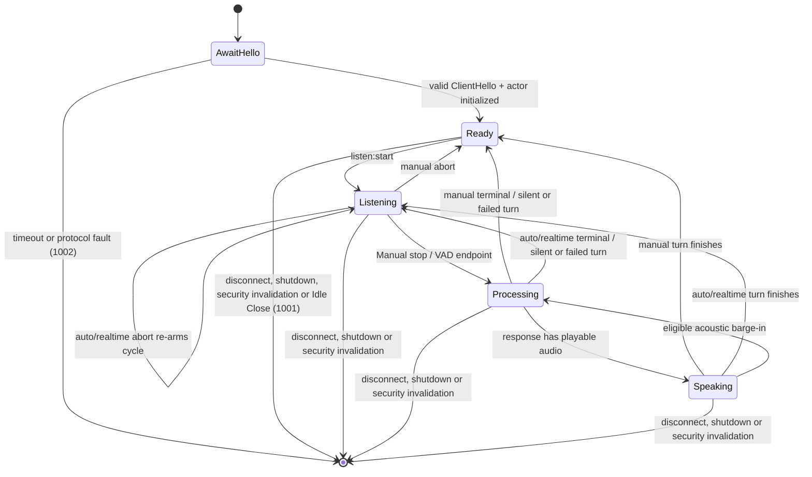
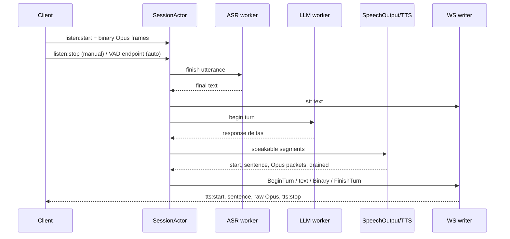
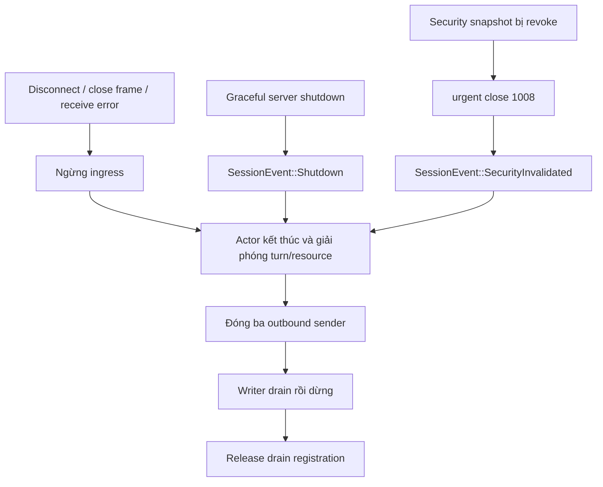

# Flow 01 — Luồng bên trong WebSocket

## 1. Phạm vi

Tài liệu này mô tả admission trước HTTP upgrade, handshake ứng dụng, routing
frame, lifecycle của `SessionActor`, writer và đóng kết nối. OTA discovery và
Enrollment Session riêng được mô tả trong
[ADR 0073](../adr/0073-required-database-and-device-admission.md) và
[ADR 0074](../adr/0074-websocket-enrollment-session.md).

Một Voice Session thuộc đúng một WebSocket connection và một `Device ID`.
`session_id` được cấp trước upgrade, dùng cho cả Voice Session và persistent
transcript (nếu profile bật), nhưng không phải credential.

### Admission trước HTTP upgrade

Handler kiểm tra Admission Gate và identity, rồi chọn nhánh xác thực theo
`devices.kind` do server quản lý. Physical/Unknown giữ Voice bearer và enrollment;
Virtual Device bắt buộc ticket một lần, trusted Origin và revision hiện tại,
không fallback sang Voice bearer. Nhánh web đi qua cùng admission/profile/runtime.
Chi tiết ticket, thu hồi phiên và ACK opt-in: [Studio Assistant API](../api/studio-assistant.md).
Device chưa đăng ký có thể đi vào Enrollment Session; Device đã đăng ký được
admit bằng một configuration snapshot bounded từ SQLite. Sau đó resolver chạy
chuẩn bị selected runtime và discovery External MCP song song:



Toàn bộ quyết định trước 101 nằm trong
[`admission::admit`](../../crates/voice-agent-server/src/app/transport/websocket/admission.rs):
handler chỉ nhận `Admission` (Voice hoặc Enrollment) hoặc đúng một `Rejection`;
mỗi `Rejection` tự mang HTTP response và log `ws_auth` (`reason_code`,
`bearer_auth_result`, `device_admission_result`), nên mọi lần từ chối đều được
log cùng một cách. WebSocket Writer nằm ở
[`writer.rs`](../../crates/voice-agent-server/src/app/transport/websocket/writer.rs);
phần trọng tài playback (`PlaybackArbiter`) không làm I/O và bảo đảm mỗi lệnh
turn kết thúc bằng đúng một `TurnClosed`.

Runtime bắt buộc lỗi vẫn trả HTTP 503 trước upgrade, hủy phần discovery còn
chờ; native attempts vẫn do manager giữ accounting đến completion. MCP lỗi
chỉ exclude tools. Hai phần cùng thành công hoặc MCP bị exclude mới hoàn tất
profile; không dùng tool catalog cũ hoặc bổ sung tools vào session sau hello.

Deployment defaults được nạp trước bind. Startup prewarm thêm enabled default
Templates và overrides của enabled Devices có assignment hợp lệ. Admin create,
đổi Agent/override, re-enable Device hoặc claim enrollment enqueue prewarm sau
DB commit. Đây là hint bounded, best-effort, không phải bảo đảm mọi Template
đã Ready khi `/ready` trả 200.

TTS instance có `preload=true` được nạp và retain trước bind, kể cả khi không
phải deployment default. Production config bật lựa chọn này cho ZeroTTS để
tránh idle eviction và chuyển cold load sang startup. Một ZeroTTS Physical
Replica vẫn giữ bốn ONNX sessions: text encoder và prefix step được tạo trên
một luồng, đồng thời local frame decode được tạo trên luồng khởi tạo; codec
được tạo sau đó. Tối đa hai graph loads chạy đồng thời trong một attempt;
mọi luồng được join trước khi báo completion/error, rồi retained worker mới
warmup và publish Ready. Preload tăng thời gian boot và RAM/reservations thường
trú; không chứng nhận remote inference đã warm.

Production config dành tối đa 500 ms cho tổng External MCP discovery, 400 ms
cho mỗi server. Server vượt budget không đóng Voice Session nhưng có thể làm
session thiếu tools. Budget discovery không thay đổi timeout thực thi tool.

Managed runtime metrics bổ sung các phase dưới `provider_runtime.metrics.duration_ms.phases`
trong Admin system status:

| Phase | Khoảng thời gian |
| --- | --- |
| `ws_routing` | Device/enrollment routing sau kiểm tra identity |
| `ws_runtime` | Chuẩn bị selected profile và acquire runtime |
| `ws_external_mcp` | Đọc bindings, discovery và review tool contracts |
| `ws_speaker` | Speaker Observe snapshot |
| `ws_pre_upgrade` | Handler entry đến trả response upgrade/rejection |
| `ws_hello_wait` | Trong socket, chờ frame ClientHello đầu tiên |
| `ws_hello_init` | Validate hello và khởi tạo audio/actor đến enqueue ServerHello |
| `ws_hello_send` | Enqueue ServerHello đến writer send thành công |
| `ws_connect` | Handler entry đến writer send ServerHello thành công |

Các phase stage tính cả lần lỗi/hủy; `ws_hello_send` và `ws_connect` chỉ tính
lần send thành công. Vì runtime và MCP overlap, không cộng các stage để suy
ra total. Log `ws_connected` chỉ phát sau send thành công, kèm total,
pre-upgrade và after-upgrade ms, không chứa identity hoặc payload.
`ws_connect` không gồm DNS/TCP/TLS trước handler và không chứng minh client đã
nhận hello. SLO end-to-end phải đo tại Voice Protocol Client; first audio là
một mốc riêng của Conversational Turn.

## 2. Tổng quan



- Reader chỉ kiểm giới hạn transport, parse text và chuyển thành
  `SessionEvent`; không chạy ASR, LLM hay TTS.
- `SessionActor` là owner duy nhất của state Voice Session và là producer của
  các outbound queue.
- Writer là task duy nhất gọi `WebSocket::send`. Ba queue bounded có thứ tự ưu
  tiên `urgent > control > audio`.

## 3. Handshake trong socket

Ngay sau upgrade, server chờ đúng một text `hello` trong
`server.hello_timeout_ms`. Ping/Pong keepalive trước hello là transport control,
không bị coi là message đầu tiên. Trước `ServerHello`, socket chưa có Voice Session
sẵn sàng nhận command hoặc audio.



Client hello V1 hợp lệ:

```json
{
  "type": "hello",
  "version": 1,
  "transport": "websocket",
  "audio_params": {
    "format": "opus",
    "sample_rate": 16000,
    "channels": 1,
    "frame_duration": 60
  },
  "features": {
    "pipeline_status": false,
    "speaker_status": false,
    "aec": false,
    "mcp": false
  }
}
```

`features` là các capability assertion tùy chọn; field feature chưa biết vẫn
tương thích. Server không negotiate audio profile. Nó luôn trả downlink Opus
24 kHz, mono, frame 60 ms:

```json
{
  "type": "hello",
  "transport": "websocket",
  "session_id": "…",
  "audio_params": {
    "format": "opus",
    "sample_rate": 24000,
    "channels": 1,
    "frame_duration": 60
  }
}
```

Binary frame đầu tiên, JSON lỗi, message không phải `hello`, hoặc hello sai
version/transport/profile đều đóng socket với code `1002` trước khi actor được
tạo. Frame vượt `websocket.max_frame_bytes` đóng `1009`. Nếu audio runtime,
speech output hoặc effective profile không khởi tạo được sau hello hợp lệ,
server đóng connection mới bằng `1011`, không gửi custom error. Một reconnect
lỗi vì thế không thay thế một Voice Session đang khỏe của cùng Device ID.

## 4. Ingress sau handshake



Sau handshake, malformed JSON, message không biết, command sai schema hoặc
sai phase không làm chết Voice Session: reader/actor ghi telemetry và ignore.
Riêng text hoặc binary vượt frame cap vẫn đóng `1009` trước parse/decode.
Message phân mảnh cũng bị giới hạn ở cùng cap (`max_message_size`): kết nối kết
thúc ngay khi phần đã ghép vượt cap, không đệm tới mặc định của thư viện. Khi
mailbox control đầy, reader đóng `1013`; audio mailbox đầy chỉ drop frame để
giữ bounded memory.

Text command V1 có thể mang `session_id`. Field này vắng mặt hoặc chuỗi rỗng
được chấp nhận vì tương thích; chuỗi không rỗng phải khớp session hiện tại.

| Client message | Ý nghĩa trong WS |
| --- | --- |
| `hello` | Chỉ hợp lệ là frame đầu tiên; hoàn tất application handshake. |
| `listen` với `state: start` và `mode: manual\|auto\|realtime` | Arm hoặc reset capture cycle. |
| `listen` với `state: stop` | Chỉ finalize Manual capture đang active. |
| `listen` với `state: detect` | Đưa text đã detect vào actor theo contract protocol. |
| `abort` | Interruption idempotent của capture/turn đang có. |
| `mcp` | Route response/request Device MCP khi MCP đã được bật. |
| binary | Một raw uplink Opus packet V1, không có header ứng dụng. |

Chi tiết capture/VAD, ASR, interrupt và MCP lần lượt ở [Flow 02](02-vad.md),
[Flow 03](03-asr.md), [Flow 06](06-interrupt-cancellation.md) và
[Flow 07](07-device-mcp.md).

### Heartbeat, Idle Close và write timeout

| Config `[websocket]` | Mặc định | Ý nghĩa |
| --- | ---: | --- |
| `ping_interval_ms` | 20 000 | Writer gửi Ping định kỳ; `0` tắt. |
| `idle_timeout_ms` | 60 000 | Không nhận frame nào (kể cả Pong) trong khoảng này ⇒ Idle Close `1001`; `0` tắt. |
| `write_timeout_ms` | 10 000 | Giới hạn mỗi lần send; peer ngừng đọc ⇒ writer coi là lỗi và kết thúc. |

Khi bật idle close, `ping_interval_ms` phải dương và nhỏ hơn `idle_timeout_ms`
để peer khỏe luôn có Ping để trả lời trong cửa sổ idle. Ping đi qua WebSocket
Writer như mọi frame khác; reader chỉ đo thời điểm frame inbound cuối cùng.

Chỉ Web Assistant tham gia credential publication. Physical Device không bao
giờ chờ guard này, nên một System save hoặc một Web Assistant admission chậm
không chặn Device reconnect.

## 5. State của Voice Session



`Ready` nghĩa là socket còn sống nhưng không thu microphone; không dùng tên
`Idle` để tránh lẫn với timeout transport. Chỉ `Listening` nhận audio cho
capture bình thường. Khi `Speaking`, audio chỉ được đưa vào Barge-in Watch nếu
mode Auto/Realtime đã arm, client đã assert `features.aec=true`, và cả hai cờ
server cho phép tin assertion này. Manual không có acoustic barge-in.

## 6. Một conversational turn trên cùng socket



`SessionActor` giữ dialogue, generation và turn state trong RAM của connection.
Provider worker không sở hữu WebSocket hay session state; mọi event quay lại
actor trước khi được gửi. Một final ASR non-empty phát đúng một `stt` trước khi
LLM turn bắt đầu. Sau terminal outcome, Manual về `Ready`; Auto/Realtime re-arm
về `Listening` theo policy.

## 7. Outbound ordering và cancellation

Writer serialize mọi outbound traffic. Một playback bình thường có thứ tự:

```text
tts:start → tts:sentence_start (zero or more) → raw Opus packets → tts:stop
```

`tts:start` chỉ được gửi khi đã có audio phát được. `tts:stop` bình thường chỉ
được gửi sau packet cuối đã drain. `BeginTurn`, `FinishTurn` và `AbortTurn` là
semantic command giữa actor và writer; chỉ writer tạo các wire control tương
ứng và báo terminal outcome về actor.

Khi `abort` hoặc acoustic barge-in thắng race:

1. Actor invalidate `GenerationGate` rồi cancel producer của turn cũ.
2. Actor gửi `AbortTurn` qua urgent lane.
3. Writer drop JSON/audio stale tại điểm gửi, phát tối đa một `tts:stop` nếu
   `tts:start` đã được gửi, rồi báo `TurnClosed(Aborted)`.

Packet đã được writer gửi trước điểm invalidation không thể thu hồi; sau đó
không payload scoped-to-turn cũ nào được admit. Nếu urgent stop không thể được
admit sau một `tts:start`, đó là session-integrity failure và session fail
closed, không retry vô hạn.

## 8. Đóng socket và failure boundary



Server shutdown có controlled-close path để actor và writer hoàn tất outbound
đã xếp trước khi connection kết thúc. Security invalidation (ví dụ profile,
speaker grant/policy hoặc external-tool guard bị revoke) đóng với `1008` và
không cho dispatch mới. Peer close, receive error, hoặc writer failure cũng
kết thúc actor; không có retry socket hay resume session trong V1.

## 9. Invariants và test contract

- Một connection có một immutable runtime/profile snapshot và một `session_id`.
- Chỉ một writer gọi `WebSocket::send`; tất cả queue đều bounded.
- `tts:start` luôn trước Opus đầu tiên của turn; không Opus stale sau
  `tts:stop`.
- Chỉ hello hợp lệ đi qua `AwaitHello`; lỗi protocol ở giai đoạn đó đóng `1002`.
- Lỗi application sau handshake không phá Voice Session khỏe; frame quá lớn
  luôn đóng `1009`.
- Audio V1 ingress/egress là raw Opus; canonical uplink là 16 kHz mono 60 ms,
  downlink là 24 kHz mono 60 ms.
- Disconnect/shutdown/cancellation phải giải phóng actor, worker lease và
  connection drain registration.

Chạy regression của module bằng:

```bash
./scripts/test-module.sh ws
```

## Studio Assistant: manual ACK và terminal status

`features.turn_status=true` chỉ có hiệu lực trên Virtual Device đã xác thực bằng
ticket. `listening_ready` được gửi sau ASR worker Opened; browser mới được gửi
`detect` hoặc Opus 16 kHz mono 60 ms. Admission/capture bị từ chối trả `rejected`
có reason code an toàn. Accepted text tiếp tục dùng đúng một `stt` echo.
`completed` bám writer TurnClosed Normal sau packet cuối và `tts:stop`;
`failed/cancelled` bám terminal/release của actor, kể cả lỗi trước `tts:start`.
ESP32 không nhận extension này dù quảng cáo flag trên Physical Device.
System Save invalidate ticket và đóng cả web socket đang đợi ClientHello;
publication giữ profile snapshot không bị xen một settings write trước upgrade.


### Tool execution status (opt-in)

Physical Device chỉ nhận message server-to-client `type:"tool"` khi khai báo
`features.tool_status=true` trong `ClientHello` (mặc định false để giữ tương thích).
**Studio Assistant luôn nhận trạng thái tool** sau khi xác thực Virtual Device, kể cả
khi `features.tool_status` vắng mặt/false. Đây là chính sách server, độc lập với
`features.mcp=false` (chỉ tắt Device MCP) và `features.turn_status`.
ClientHello là frame **client → server**; server không gửi riêng field `tool_status`
trong ServerHello. Chỉ khi LLM thực sự dispatch tool đã admit mới có event `type:"tool"`.

```json
{"type":"tool","session_id":"...","turn_id":1,"name":"handle_exit_intent","state":"started"}
```

`state` có ba giá trị `started`, `completed`, `failed`. Payload chỉ có
`type`, `session_id`, `turn_id`, `name`, `state`; không có arguments,
results, secrets hoặc tool error diagnostics. Chỉ phát khi executor đã admit và
resolve tool; `completed/failed` được phát sau khi ToolResult ghi nhận.
Các event đi qua `OutboundMessage::TurnText` và generation gate hiện có;
trường hợp cancel/stale hoặc bounded control queue đầy có thể bỏ event mà không
thay đổi việc thực thi tool hoặc kết quả turn. Client chỉ dùng status để hiển
thị tạm thời; không suy luận turn đã hoàn thành từ tool status.
