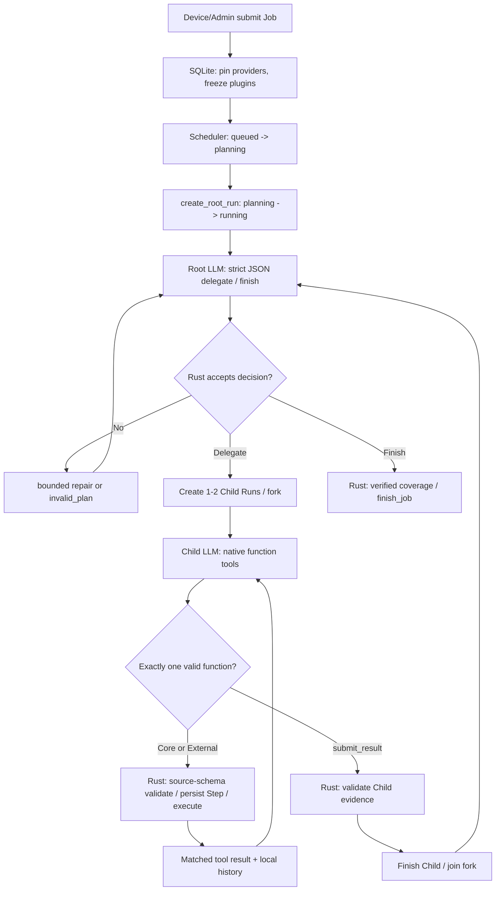
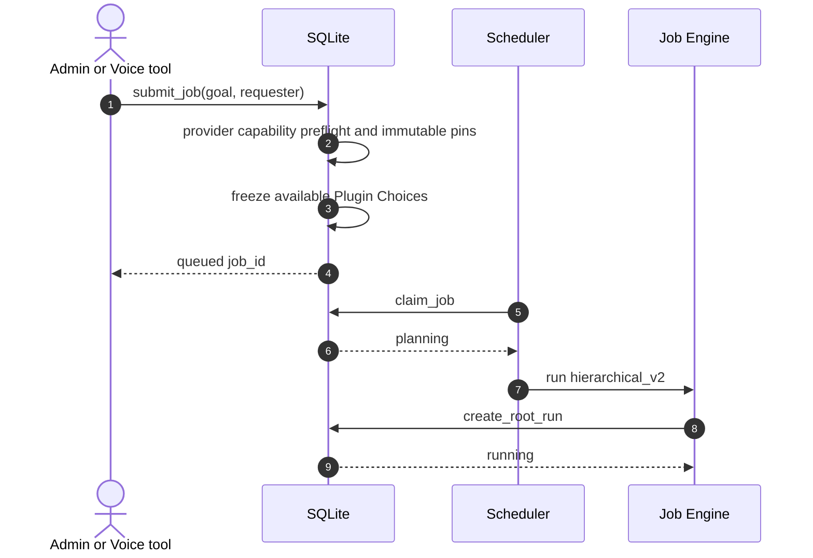
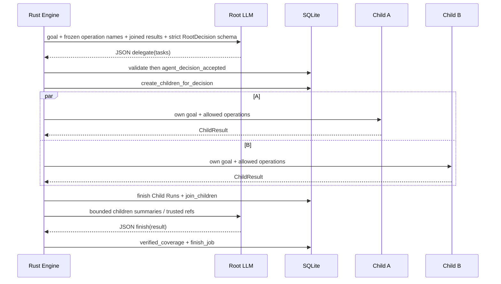
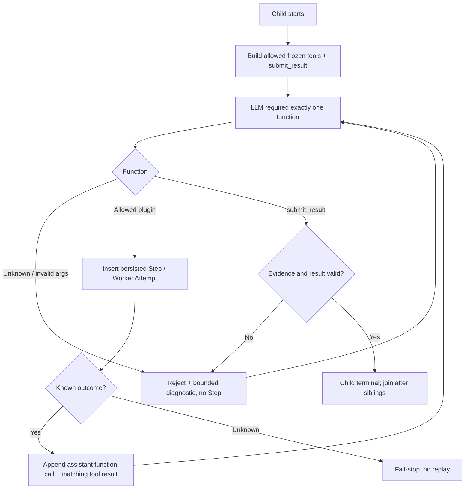
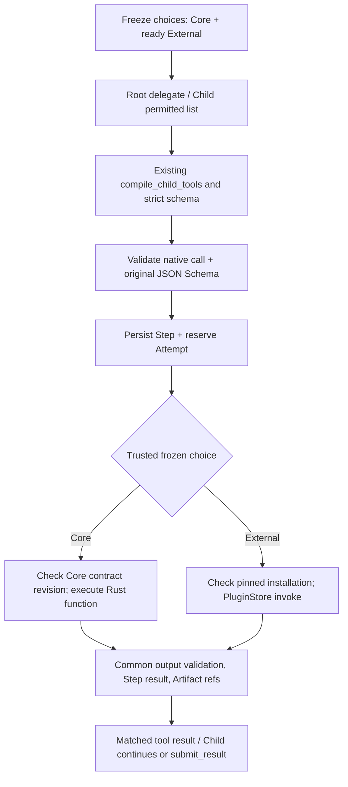

# Flow 08 — Agent Job Hybrid (Root Structured / Child Tools)

Status: implementation branch `feat/agent-job-hybrid-structured-tools`. Related: [implementation contract](../agent-job-hybrid-implementation.md), [ADR 0103](../adr/0103-hierarchical-agent-job-v2.md), [hybrid decision](../adr/0113-hybrid-agent-job-native-tool-calling.md).

## Overview

Rust owns state, permission, quota and execution. An LLM function call is a **proposal**, not authority.

## Submission and durable states

Legacy `dag_v1` persisted records retain their DAG executor. A retry retains its execution mode. Child cannot spawn another Child; Root can fork at most two concurrently and only after the preceding group is joined.

## Root delegate / finish

Root never receives complete Child transcripts, plugin raw contents or provider call IDs. Rust validates `task_key, role, goal, allowed_operations, evidence_refs, budgets` before advancing.

## Child function loop and protocol mappings

| Transport | Native strict request | Matching local history |
|---|---|---|
| Chat Completions | `response_format.json_schema` for Root; `tools[].function.strict=true` for Child | `assistant.tool_calls[].id` + `role=tool,tool_call_id` |
| Responses | `text.format.json_schema` for Root; `tools[].strict=true` for Child | `output.function_call.call_id` + `input.function_call_output.call_id` |

Child mode sets `tool_choice=required` and `parallel_tool_calls=false`; if upstream rejects these, fail rather than downgrading. Each accepted plugin Step yields a matched Tool Result with its persisted `step_key` and the server-owned artifact UUIDs in `evidence_refs`. Child may cite only evidence from its own succeeded Steps. Invalid `submit_result.evidence_refs` get a precise validation code and allowed IDs for bounded correction, rather than silently re-fetching the same URL. `submit_result` closes only Child and creates no plugin Step. A validated plugin call creates one durable Step using `insert_dynamic_step` and executes through the existing Plugin Runtime.

## Failure / recovery / observation

- Root invalid decision ⇒ `agent_decision_rejected`, bounded repair, then `invalid_plan` if exhausted.
- Child invalid/unauthorized function ⇒ reject whole turn; never partially dispatch multiple calls; tool error result only if the rejected call has a usable ID.
- Known plugin failure ⇒ record failed Step and matched Tool Result, let Child choose next function. Unknown worker outcome ⇒ fail-stop and no replay.
- Provider refusal/incomplete/unsupported strict ⇒ model failure, **no automatic fallback** to Chat JSON text or vendor-managed agent execution.
- Cancel/deadline/revocation and failed-on-restart semantics unchanged.
- Timeline B derives LLM / Root fork / Child tool Step / Child finish / join / Job terminal from durable `job_events` and Job Read View; provider `call_id` is only local Child history.

The canonical acceptance matrix is in [the implementation guide](../agent-job-hybrid-implementation.md); do not duplicate it here.

## Core Operations in-process (ADR 0114)

Core Operations are always frozen at submission alongside ready External Plugin Operations.
Only the Root-selected, Child-allowed subset is presented to native Function Calling.
Core does **not** have a Plugin Store installation, ZIP, image or worker subprocess.

Frozen Core JSON records `kind=core`, `plugin_id=core`, `operation` and `contract_revision`; External JSON stays unchanged.
Scheduler, Step start and Job finalization check Core contract revisions rather than querying
`plugin_installations`. Older persisted External choices continue to work.

Core v1: `core.web.fetch`, `core.data.json_query`, `core.artifact.read_text`.
No new tool registry, agent framework, migration, Store lifecycle or UI.
`dag_v1` remains supported; when a frozen Core choice appears in an older DAG
execution path, its revision is recorded in the existing Step version field.

**Release caveat:** Core is in-process and not sandboxed. New SSRF/DNS/IP/redirect
and filesystem policy for Core is explicitly deferred (Risk 2). Do not expose
`core.web.fetch` to untrusted/public tenants until independently reviewed.
Core preserves the existing cancellation/deadline, bounded output, schema, owned artifact
and durable Attempt contracts.
