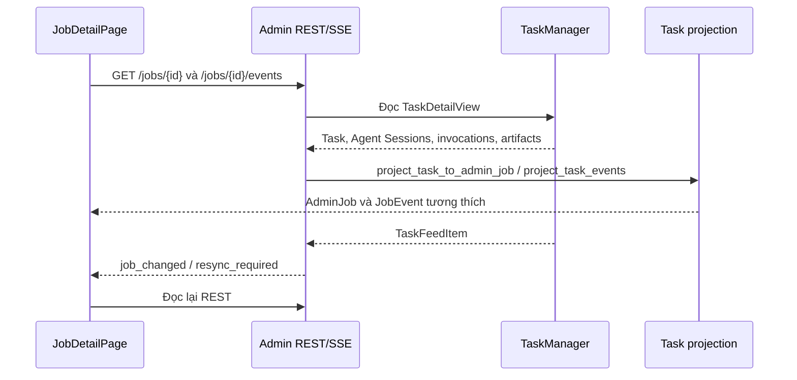

# Flow 09 — Task nền trên Jobs Web Timeline

Cập nhật: 2026-11-01. Runtime theo [ADR 0127](../adr/0127-orchestrator-flow-task-and-wiki-runtime.md); luồng server và artifact xem [Flow 16](16-task-flow-multi-kind-artifacts.md).

## Quyền sở hữu và nguồn dữ liệu

`TaskManager` sở hữu Background Task; Orchestrator sở hữu Session, Run và Tool Invocation. `/api/admin/jobs*` giữ tên API để tương thích Admin Web. Các trường `steps` và `agent_runs` là projection, không chứng minh còn bảng `job_steps` hay `job_agent_runs` của JobEngine cũ.

Nguồn triển khai:

- `crates/vela-server/src/app/admin/background/jobs.rs`: REST và SSE.
- `crates/vela-server/src/services/task_flow/projections.rs`: ánh xạ Task và dựng events.
- `apps/admin-web/src/pages/jobs/JobDetailPage.vue`: đọc dữ liệu và reconcile.
- `apps/admin-web/src/domain/jobs/{unified-activity,llm-activity}.ts`: dựng timeline phía Web.

SSE phát `ready`, `job_changed` và `resync_required`. Đây là tín hiệu yêu cầu đọc lại; trạng thái hiển thị lấy từ REST. Trang gom refresh trong 200 ms, đọc events theo cursor và refresh dự phòng mỗi 60 giây khi Job chưa kết thúc. Reconnect và tab visibility cũng kích hoạt reconcile.

## Ánh xạ timeline

| Dữ liệu hiện tại | JSON tương thích / hành vi |
|---|---|
| Agent Session | `agent_run_id = session_id`, quan hệ cha từ `parent_session_id` |
| Latest Run | Trạng thái, `run_id`, `turn_id`, attempt, token và lý do chờ |
| Tool Invocation | `steps`, `step_started`, `step_finished` |
| Task kết thúc | `job_finished`, trạng thái từ TaskManager |
| Task artifacts | Metadata và URL tải xuống thuộc Task |

`agent_run_id` của projection hiện đại diện Session; không đồng nhất nó với `run_id` của một attempt. `project_task_events` dựng thứ tự sự kiện từ `TaskDetailView`, lồng hoạt động Child vào lời gọi `subagent` của Root. `sequence` là cursor của projection này, không phải sequence từ một bảng append-only `job_events`. Timestamp của events hiện được dựng từ thời điểm tạo Task; không dùng nó làm bằng chứng thời gian thực của từng invocation.

## Trạng thái chờ và kết quả từng phần

- `TaskStatus::Waiting` hiển thị `waiting`; Run giữ `waiting_retry` hoặc `waiting_user`, lý do và `next_attempt_at`.
- UI hiển thị lịch retry, bộ đếm theo cấu hình, nút resume và cảnh báo sau năm phút quan sát trạng thái chờ.
- `TaskStatus::Stopped` hiển thị `stopped`. Job lỗi, hủy hoặc dừng có thể hiển thị `output_preview` từng phần.
- Run chờ chưa kết thúc; không hiển thị execution complete chỉ vì Run khác `running`.

Timeline chỉ đọc. Tool arguments, kết quả và hội thoại do REST trả về nằm sau Admin authentication; không đưa các nội dung đó vào tín hiệu SSE. Việc hủy, resume, retry và xóa đi qua API riêng, không suy ra thành công từ nội dung model hay timeline.

## Kiểm chứng khi sửa luồng

Dùng `scripts/agent-test.sh` cho các kiểm tra phù hợp với thay đổi: projection Task, timeline nhóm Root/Child, waiting/stopped, partial output và reconcile sau reconnect. Bằng chứng độ bền hiện có nằm ở [biên bản kiểm chứng](../providers/agent-job-durability-validation-2026-10-31.md); các gate provider thật được ghi riêng trong biên bản.
