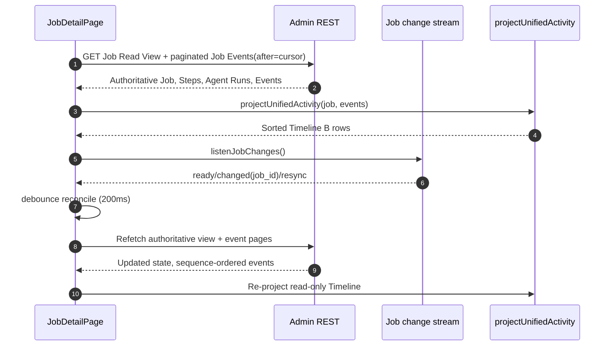
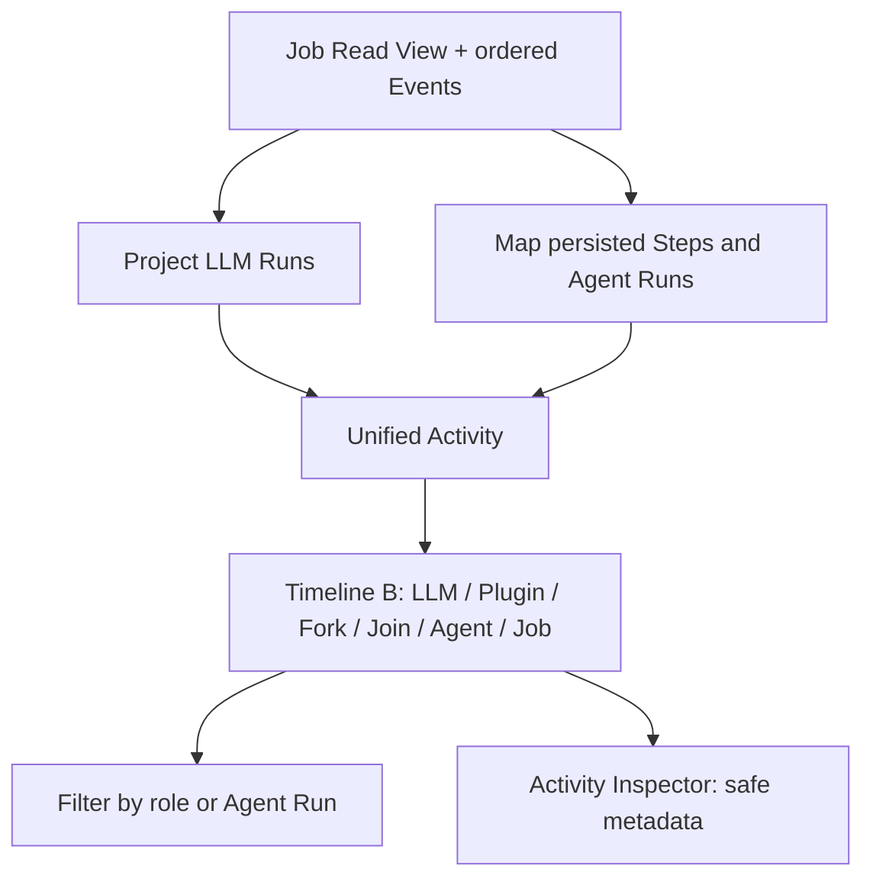

# Flow 09 — Agent Job Web Timeline B

Status: current Admin Web projection preserved by Hybrid V2. This file documents the **read-only** Web side separately from the [Rust server flow](08-agent-job-hybrid.md). Source seams: `apps/admin-web/src/pages/jobs/JobDetailPage.vue`, `apps/admin-web/src/domain/jobs/unified-activity.ts` and `llm-activity.ts`.

## Boundary and ownership

The SSE stream is **only an invalidation signal**. Never infer plugin success, LLM acceptance, job completion or an Agent Run transition from the SSE packet itself. On reconnect, tab visibility, or resync, fetch the Job Read View and paginate immutable events after the last accepted `sequence`. The UI filters duplicates by sequence and keeps a 60-second fallback refresh while an observed Job is active.

## Timeline projection

| Durable source | Timeline B row | Invariant |
|---|---|---|
| `llm_run_started` + associated activity | LLM Run, provider identity, usage and decision diagnostics | No raw prompt/function args |
| `agent_decision_accepted(action=delegate)` | Delegate/Fork | Rust accepted the Root action before Child creation |
| `job_agent_runs` Read View | Agent lanes, labels and run status | Agent Run ≠ LLM Run |
| `step_started`/`step_finished` + Job Steps | Plugin Operation row | One row per persisted `step_key`; Read View owns state |
| `agent_decision_rejected` | Diagnostic within the corresponding LLM Run | Rejected function creates no Plugin Step |
| `agent_run_finished` | Child terminal row | `submit_result` is not a Step |
| `join_completed` | Join row | One unique join per fork group |
| `job_finished` | Job terminal row | Status and coverage come from Rust/SQLite |

## Nested execution display

The projection retains committed sequence order. The timeline groups each Child's activities under its durable `parent_agent_run_id`, indented 36px with a teal branch beside the violet Root axis. Each branch can collapse independently; LLM Runs, Plugin Operations and `agent_run_finished` stay inside their owning Child. Concurrent Child groups appear in first-activity order, with chronological activity and original timestamps inside each group; the visual list is therefore not a globally chronological ordering across concurrent Children. Fork and Join remain on the Root axis.

Delegate events use `fork_group_id`, or native `turn_id`/`run_id`, to correlate with Child `fork_group_id`. Fork and Join share a member count from Join metadata when present, otherwise durable Child identities, then legacy count metadata. Fork cards show available Child roles and goal excerpts. Creation events supply parent/role relationships when the read view has not yet caught up; missing relationships remain ungrouped rather than fabricated. Filters and Inspector selection retain activity IDs.

## Invariants

- Keep the existing Job Detail B layout, Agent/role filters, selection and activity inspector. Hybrid native function calls **do not** create a separate browser-side tool executor.
- Provider `call_id` is **local to the Child's LLM context**, not a durable Job Step identity. Plugin rows use the persisted `step_key`; no row is generated for rejected proposals.
- Child `submit_result` only finishes that Child Run; the Job terminal status belongs to a later Root decision and coverage verification.
- Missing or delayed LLM activity metadata may affect observability but must not override authoritative Job/Step status.
- Read-only history must not display full model input, raw plugin output, secret headers or credentials.
- Existing `dag_v1`, Reminder and Voice-session UI flows are unaffected.

## Regression checks

Verify timeline rendering for: two concurrent children with one join; plugin A→B→Child completion; three rejected Child tool calls without Step rows; unknown plugin outcome; completion after stream reconnection; and legacy DAG Job Detail without Agent Runs. Use `unified-activity.test.ts` for deterministic event projection cases and authenticated REST/SSE integration for cursor behavior.
