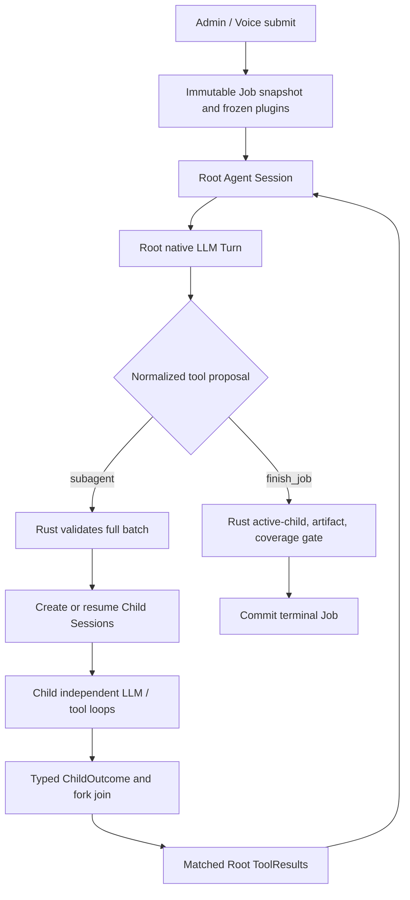
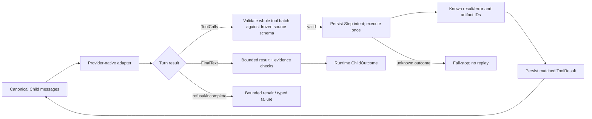
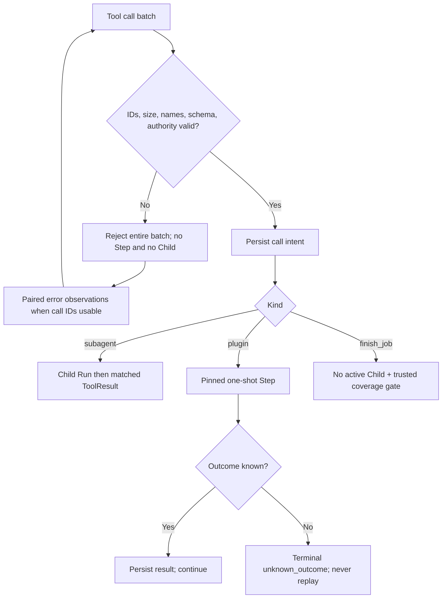

# Flow 10 — Agent Job V3: OpenCode-style sessions, prompts and multi-provider communication

> [Implementation](../agent-job-opencode-implementation.md) · [ADR 0114](../adr/0114-opencode-agent-session-tool-delegation.md). Native foreground flow first. Background notifications are deferred.

## End-to-end


## Root -> Child delegation (foreground)
```mermaid
sequenceDiagram
 participant Root as Root Session
 participant Adapter as Provider Adapter
 participant Coordinator as Rust Coordinator
 participant DB as Database
 participant Child as Child Session
 Root->>Adapter: Canonical Messages + [subagent, finish_job]
 Adapter-->>Coordinator: Native subagent ToolCall(id, agent, prompt, sessionID?)
 Coordinator->>Coordinator: Validate complete batch, authority, budget, route
 Coordinator->>DB: Persist delegation intent and child ownership
 Coordinator->>Child: New or resumed independent Session
 Child-->>Coordinator: ChildOutcome(status, summary, artifact_refs)
 Coordinator->>DB: Finish Child Runs; join once
 Coordinator-->>Root: ToolResult(call_id = original id, result = ChildOutcome)
 Root->>Adapter: Replay canonical matched ToolCall / ToolResult
```

## Prompt construction
```text
Child new Session:
  system = specialist role instructions
  system += runtime safety instructions and child-only tool rules
  user = exact Root-authored subagent.prompt
  tools = ONLY pinned/frozen authorized plugin operations
Child resume:
  retain system prefix, prior canonical assistant/tool pairs, exact provider pin
  append user = new Root-authored subagent.prompt
  create new AgentRun linked to same Child Session
```
Child never inherits Root's raw transcript or its siblings' observations.

## Child tool loop


## Provider message adapters
| Canonical | OpenAI Chat | OpenAI Responses | Anthropic | Gemini |
|---|---|---|---|---|
| Assistant ToolCall | assistant.tool_calls/id | function_call/call_id | tool_use/id | functionCall plus native metadata |
| Tool Result | role=tool/tool_call_id | function_call_output/call_id | tool_result/tool_use_id | functionResponse |
| Final text | assistant content | output_text | text block | text part |

Only *actually implemented and qualified* adapters are enabled. Existing code includes Chat and Responses native paths on the feature branch; Anthropic and Gemini require separate implementations and real fixtures. Native thought/reasoning metadata stays within its originating Session route and is never transferred from Child to Root. Root receives only a server-wrapped ChildOutcome.

## Validation and recovery


## Foreground limitations and rollout
- At most two simultaneous Child calls; no recursive subagents.
- `subagent(background=true)` returns `background_subagent_not_enabled` until a later inbox/notification release.
- `subagent.model` must equal the already pinned worker route. Root and Child may have distinct pinned providers, never dynamic hot-swap.
- `hierarchical_v3` is new-only; persisted V2 and DAG jobs retain existing flows.
- Root cannot finish before all required children resolve, or without verified artifacts/coverage.
- Timeline B continues to derive Job events and Agent Run/Step projections; transcript data is never exposed in SSE.

## Acceptance map
A01 prompt; A02 fork/join; A03 tool chains and final text; A04 resume; A05-A07 provider portability; A08-A10 rejection and completion gate; A11 unknown replay; A12 capacity; A13 pin/revocation; A14 regression; A15 Timeline.
