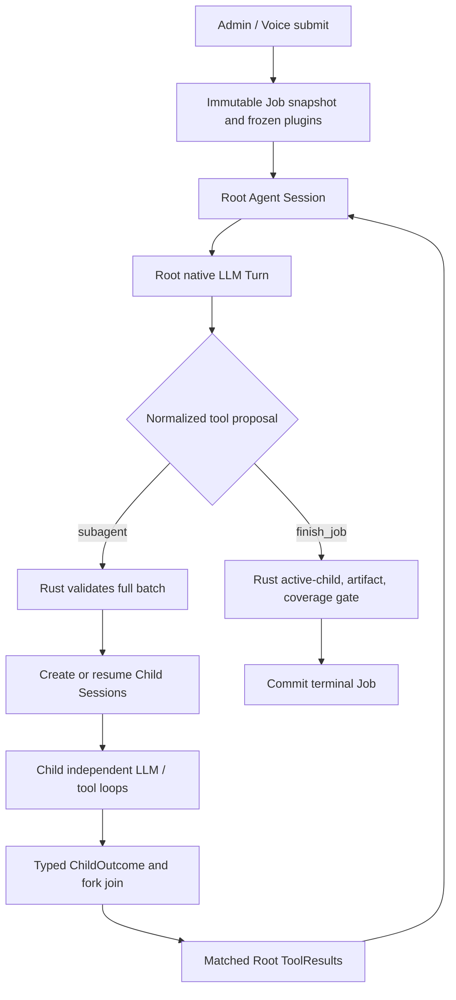
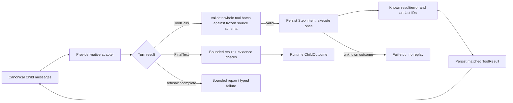
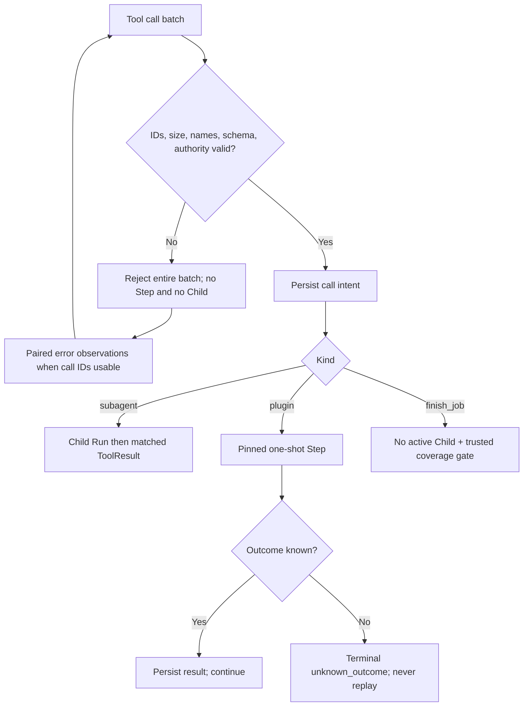

# Flow 10 — Agent Job V3: OpenCode-style sessions, prompts and multi-provider communication

> [Implementation](../agent-job-opencode-implementation.md) · [ADR 0114](../adr/0114-opencode-agent-session-tool-delegation.md). Native foreground flow first. Background notifications are deferred.

## End-to-end


## Root -> Child delegation (foreground)
```mermaid
sequenceDiagram
 participant Root as Root Session
 participant Adapter as Provider Adapter
 participant Coordinator as Rust Coordinator
 participant DB as Database
 participant Child as Child Session
 Root->>Adapter: Canonical Messages + [subagent, finish_job]
 Adapter-->>Coordinator: Native subagent ToolCall(id, agent, prompt, sessionID?)
 Coordinator->>Coordinator: Validate complete batch, authority, budget, route
 Coordinator->>DB: Persist delegation intent and child ownership
 Coordinator->>Child: New or resumed independent Session
 Child-->>Coordinator: ChildOutcome(status, summary, artifact_refs)
 Coordinator->>DB: Finish Child Runs; join once
 Coordinator-->>Root: ToolResult(call_id = original id, result = ChildOutcome)
 Root->>Adapter: Replay canonical matched ToolCall / ToolResult
```

## Prompt construction
```text
Child new Session:
  system = specialist role instructions
  system += runtime safety instructions and child-only tool rules
  user = exact Root-authored subagent.prompt
  tools = ONLY pinned/frozen authorized plugin operations
Child resume:
  retain system prefix, prior canonical assistant/tool pairs, exact provider pin
  append user = new Root-authored subagent.prompt
  create new AgentRun linked to same Child Session
```
Child never inherits Root's raw transcript or its siblings' observations.

## Child tool loop


## Provider message adapters
| Canonical | OpenAI Chat | OpenAI Responses | Anthropic | Gemini |
|---|---|---|---|---|
| Assistant ToolCall | assistant.tool_calls/id | function_call/call_id | tool_use/id | functionCall plus native metadata |
| Tool Result | role=tool/tool_call_id | function_call_output/call_id | tool_result/tool_use_id | functionResponse |
| Final text | assistant content | output_text | text block | text part |

Only *actually implemented and qualified* adapters are enabled. Existing code includes Chat and Responses native paths on the feature branch; Anthropic and Gemini require separate implementations and real fixtures. Native thought/reasoning metadata stays within its originating Session route and is never transferred from Child to Root. Root receives only a server-wrapped ChildOutcome.

## Validation and recovery


## Foreground limitations and rollout
- At most two simultaneous Child calls; no recursive subagents.
- `subagent(background=true)` returns `background_subagent_not_enabled` until a later inbox/notification release.
- `subagent.model` must equal the already pinned worker route. Root and Child may have distinct pinned providers, never dynamic hot-swap.
- `hierarchical_v3` is new-only; persisted V2 and DAG jobs retain existing flows.
- Root cannot finish before all required children resolve, or without verified artifacts/coverage.
- Timeline B continues to derive Job events and Agent Run/Step projections; transcript data is never exposed in SSE.

## Acceptance map
A01 prompt; A02 fork/join; A03 tool chains and final text; A04 resume; A05-A07 provider portability; A08-A10 rejection and completion gate; A11 unknown replay; A12 capacity; A13 pin/revocation; A14 regression; A15 Timeline.


## Grounded single-article summary and URL proof

A real Job with goal "tóm tắt ... https://..." formerly showed five
core.web.extract(mode=page,max_chars=1000) calls scanning navigation;
Child produced a qualified summary, Root compressed it into a potentially
misleading summary, and Job coverage said goal_only_unverified despite success.

The corrected path preserves the same OpenCode-style Session/ToolResult flow:

```mermaid
sequenceDiagram
    participant Root as Root Agent Session
    participant Child as Child Session
    participant Web as Core web.extract
    participant Store as Job Steps + Session Store
    participant Finish as Rust finish_job gate
    Root->>Child: subagent(prompt="Read/summarize URL; keep caveats")
    Child->>Web: mode=article,max_chars<=6000,offset=0
    Web-->>Child: article text, truncated, next_offset, provenance
    Child->>Store: Persist paired ToolCall and visible ToolResult
    opt Article result truncated
        Child->>Web: same URL/mode,next_offset
        Web-->>Child: next article text
    end
    Child-->>Root: ChildOutcome(output,verified_source_urls from own Session)
    Root->>Finish: finish_job(summary,findings,unresolved)
    alt URL unverified/incomplete
        Finish-->>Root: Matched ToolResult source_not_fully_verified
        Root->>Child: subagent(sessionID=old,prompt="Continue the article")
    else Complete server-verified Step provenance
        Finish->>Store: Terminal Job; keep Child summary for single-URL text task
    end
```

**Trust boundary:** verified_source_urls is reconstructed from persisted,
successful core.web.extract observations with matching HTTP status, URL,
declared provenance, continuous offsets and final untruncated text visible
in tool messages. Do not treat a title/HTTP 200/menu text as verified content.
URL evidence is not an artifact ID. The terminal coverage basis for this
narrow case is goal_url_verified (or goal_url_unverified), with requested_url,
verified_source_urls and source_complete on the Job result. A Root rejection
remains one matched ToolResult in its own transcript.

This is source-completeness verification, not semantic truth verification. The
user's text may still contain incorrect claims; content trust and citation
credibility checks are independent policies.


## `finish_job` source and artifact contract

`finish_job` is not an artifact authoring tool. Root sends only `summary`, `findings` and `unresolved`. Rust derives `result.evidence_refs` from persisted Job-owned artifact IDs. Verified URL evidence belongs to `result.coverage.verified_source_urls` and **cannot** masquerade as an artifact or Step key.

```mermaid
sequenceDiagram
    participant R as Root Agent
    participant F as Rust finish_job gate
    participant DB as Job ledger
    R->>F: finish_job(summary,findings,unresolved,evidence_refs=URL)
    F-->>R: Matched ToolResult finish_job_server_owned_evidence + guidance
    R->>F: finish_job(summary,findings,unresolved)
    F->>DB: Resolve server-owned artifact IDs + source coverage
    DB-->>F: No artifact; URL verified from Step provenance
    F->>DB: Finish Job, evidence_refs=[], coverage.verified_source_urls=[URL]
```

Legacy extra fields are **not silently ignored**: the original tool schema rejects them and the normal Root repair budget applies. `ChildResult.evidence_refs` remains separately controlled by the Child's optional completion function and per-Run artifact ownership checks.
