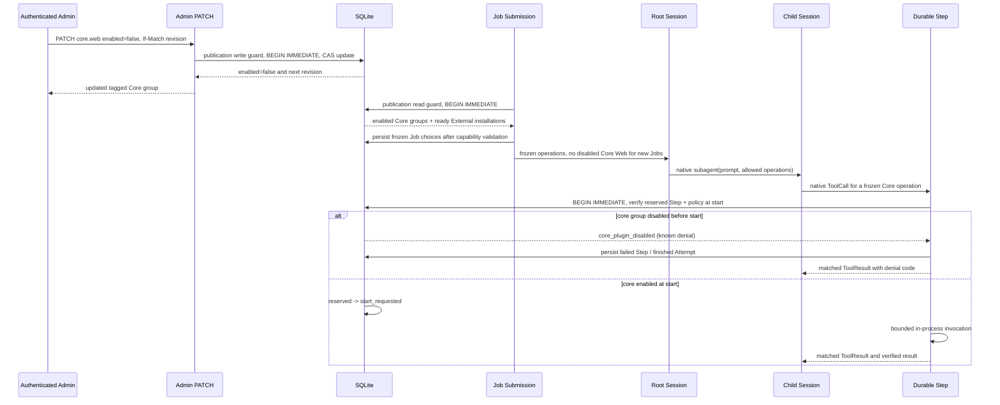
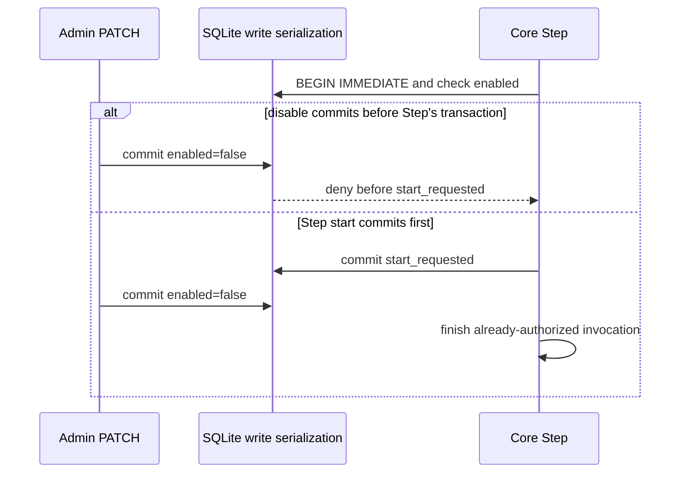

# Flow 11 — Core Plugin Activation and Agent Job V3

Reference: [ADR 0115](../adr/0115-core-plugin-activation-policy.md), [Flow 10](10-agent-job-opencode-v3.md).

## Mutable policy versus immutable Job authority

Core groups are compiled into the server. Only their current `enabled` flag is mutable. Every new Job freezes its allowed operations from the enabled Core subset and the already-ready External installations. A frozen choice is the **maximum** authority, not permission to bypass a later Core disable. Re-enabling a group never extends existing frozen choices.

## Concurrent disable and Step start

The Core Step waiting for semaphore capacity or merely `reserved` has not started. Current enablement must be checked at the actual `start_requested` transaction. Do not recheck at `mark_plugin_started`, during invocation or at result publication.

## Durable Agent Session considerations

Root `subagent` and `finish_job` tools remain unchanged. Child native function definitions derive from frozen, Child-allowed operations, even if a Core group was disabled after Job submission. A now-disabled call still writes a durable failed Step and one canonical Tool Result paired to the original ToolCall ID; no provider-native protocol mutation or message rewriting is needed. When a Child Session resumes, it retains its old frozen authority. A group re-enabled later does not add new operations.

Neither scheduler `job_eligible` nor successful Job finalization should revalidate the live enabled state across all previously frozen Core choices. Such global checks would cancel unrelated Jobs, although their actual Step start remains permissible. Requirements that cannot be satisfied without a disabled operation remain subject to Rust-owned evidence/coverage checks.

## Management contract

- `GET /api/admin/plugins/builtin`: four static groups with `kind=built_in`, `tags=[core]`, `enabled`, `status`, `revision`, runtime and operation descriptions.
- `PATCH /api/admin/plugins/builtin/{id}`: `If-Match: "<revision>"`, `{"enabled":true|false}`; on success increment revision even if enabled is unchanged.
- `404` unknown group, `409` stale revision, `400` malformed header/body, `503` storage/unavailable.
- External `/api/admin/plugins` remains a separate Store installation listing. Core has no ZIP/image, Install, Uninstall or Test Image actions.

## Failure guarantees

A known policy denial is `core_plugin_disabled`, not `unknown_outcome` or `plugin_runtime_error`. No Worker health degradation and no forced Job-wide cancellation. Database failures fail closed and do not manufacture a successful Tool Result. Existing source/coverage gates, operation contracts, output bounds and Core Web Risk 2 deferral remain unchanged.
