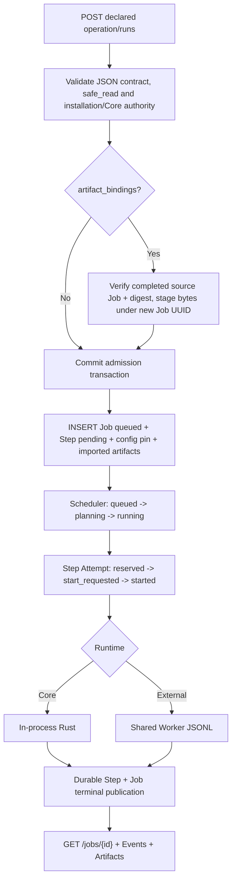

# Flow 12 — Plugin Value Settings and Manual Operation V3

**Status:** Implemented on `feat/plugin-settings-manual-run-v3` (2026-10-15), pending CI / deployment verification. Supplements [Flow 10](10-agent-job-opencode-v3.md) and [Flow 11](11-core-plugin-activation-v3.md).

## A. Settings write and immutable authority

```mermaid
sequenceDiagram
    participant Admin as Admin Web/API
    participant Store as PluginStore
    participant DB as SQLite
    participant Cipher as CredentialCipher
    Admin->>Store: GET /plugins/{key}/settings
    Store->>DB: read current revision
    Store-->>Admin: schema + public values + secret_set only
    Admin->>Store: PUT settings; If-Match: revision
    Store->>Store: validate flat local JSON Schema
    Store->>Cipher: seal x-secret values
    Store->>DB: BEGIN IMMEDIATE; CAS pointer + INSERT immutable version
    DB-->>Admin: new revision (redacted)
```

Core Plugin activation uses the existing `core_plugin_settings.enabled` and independent revision. External activation uses the installation status and revision. If package/schema changes, GET returns `needs_reconfiguration: true`; old secrets are not migrated into a new package. PUT with the current revision can create a new, compatible configuration. The previously pinned version is immutable.

## B. Agent Job Root/Sub Agent

```text
Admin / Device Job submission (hierarchical_v3)
 -> authoritative admission + frozen plugin choices
 -> pin current plugin value config revisions by catalog Plugin Key
 -> Root Agent Session -> subagent tool -> Child Agent Session
 -> Child selects frozen Plugin Operation
 -> durable Step start permission under transaction
 -> resolve Job-pinned values + sealed credentials
 -> Core execution (Rust) OR External JSONL Worker (settings key only if declared)
 -> validated Step result and Job-owned artifacts
 -> ChildOutcome -> Root; original flow unchanged
```

A Job without value-config pins never obtains the live current credentials. Core group IDs `core.web`, `core.data`, `core.document`, `core.artifact` remain catalog identities, and frozen wire choice retains `plugin_id=core`.

## C. Manual operation Job



Manual mode `plugin_operation_v3` creates **one Step**, zero Agent Runs, zero LLM calls and no Provider Pins. It is independent of Agent Background enabled/model readiness, while sharing scheduling capacity, authenticated Admin ownership, Step-start checks, cancellation, deadlines, unknown-worker handling and restart reconciliation. The `Idempotency-Key` header replays the same accepted Job only for identical initial operation arguments and artifact binding references; mismatched requests return `idempotency_conflict`.

**Core disable policy:** per ADR 0115, a disabled Core group blocks Steps not yet accepted at `start_requested`. Disabling after that point does not revoke the started Step. A plugin-only Job uses the exact same semantics.

## D. External JSONL compatibility

```json
{"schema_version":1,"request_id":"<attempt-id>","operation":"fetch_url","arguments":{"url":"https://example.org"},"artifact_dir":"/work/out","settings":{"default_max_chars":4096}}
```

The `settings` member exists **only** when the installed manifest declares `[settings]`. Legacy JSONL-v1 packages without that descriptor see their original request shape. Bundled Rust SDK `Request.settings` is optional. No secret values enter stored Job arguments, artifacts metadata, events, tool traces, HTTP settings responses or LLM prompts. The worker process necessarily receives decrypted credentials in the one-shot request; it must not log them.

## E. Observability, cleanup, and limits

- `GET /api/admin/plugins/{key}/runs?page=1&page_size=20&operation=...` returns the existing Job read model filtered in SQL, not frontend post-filtering.
- An imported input is a Job-owned artifact with null `step_key`; outputs retain their real Step attribution.
- Initial input import is limited to four bindings and at most 20 MiB aggregated, bounded further by the Job artifact quota. Paths are never accepted from HTTP.
- Existing terminal delete uses the Job table FK to remove config pins. Immutable historical config versions are retained rather than garbage-collected while referenced.
- Server stops or crashes: recover Steps and Job through existing fail-closed Job recovery; do not replay uncertain external side effects.

## F. Error handling and settings security (post-review)

The database persists a scoped `sealed:` secret reference rather than an unwrapped Cipher JSON record. This is validated before reading back a value; the next revision re-encrypts a retained secret for the new revision's scope. Legacy records that were incorrectly stored as raw encrypted JSON are accepted only when AES-GCM authenticates them under the original expected scope. Neither raw nor wrapped secret is sent in Admin GET responses.

The decrypted Settings JSON is limited to 16 KiB at save and dispatch (total serialized size), keeping shared-worker `jsonl-v1` request below its 65,535-byte bound alongside the separately bounded operation arguments.

Terminal publication retries are bounded: at most three attempts, each at most five seconds. On persistent database failure the executor stops accepting work and requires startup fail-closed recovery, rather than keeping a task alive indefinitely. This does not change the Agent Root/Sub-Agent loop.

## G. Qualification

Rust formatting/check/tests, Admin Web typecheck/tests, SQLite forward migration on existing user DB with nonempty Jobs and foreign keys, external settings worker E2E via Installer/Runner sockets, and Rust plugin packaging must pass before merging. This implementation was pushed without local Rust/Web verification in the available environment.

## H. yt-dlp Core manual operations

`core.yt_dlp` remains a statically linked Rust Core operation group in both `hierarchical_v3` and `plugin_operation_v3`. The manual operation UI uses the existing operation JSON Schemas. For video metadata and flat playlists, the tool returns bounded normalized objects; transcripts and downloaded audio can return staged files through `InvokeResult.artifacts`. Only the existing Step publication assigns immutable artifact IDs and commits their references.

Enablement stays under the Core policy CAS; executable readiness is a separate input to *new* Job admission. Retried provisions never change the frozen choice of an accepted Job or the permissions of an already-started Step. The existing Job Timeline and Artifact Gallery display work and outputs, with no new execution mode or standalone yt-dlp view.

## Manual AnyDoc conversion and large external outputs (ADR 0126)

A manual operation uses the existing `ArtifactInputBinding` at `/artifact_id`, importing a verified artifact from a completed source Job into the new Job. The initial conversion input cap remains 20 MiB across this existing binding. The native Core converter stages `converted.md`, with final artifact UUIDs assigned by the Job publisher. For external plugins, JSONL-v1 remains unchanged but the shared runner writes large stdout into a fixed, non-plugin-controlled attempt file and returns metadata over the small Unix RPC; the Job executor verifies size/digest before validating schema. `Outcome::attach_file` streams large files under existing artifact quotas.
