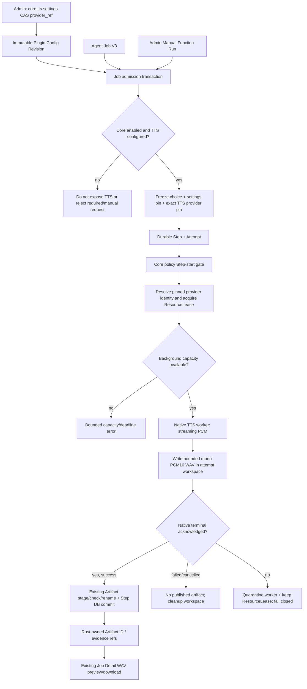

# Flow 13 — Core TTS Provider → WAV Job Artifact (V3)

Related: [Implementation](../core-tts-plugin-v3-implementation.md), [ADR 0117](../adr/0117-core-tts-provider-pinning.md), [Flow 10](10-agent-job-opencode-v3.md), [Flow 11](11-core-plugin-activation-v3.md), [Flow 12](12-plugin-settings-and-manual-operation-v3.md).

## Invocation and messages

- Child native tool: `p_core_tts_synthesize({"text":"..."})`. It is projected from frozen `plugin_id="core",operation="tts.synthesize"`; no provider credentials or paths in LLM arguments. Sub-Agent receives one matched ToolResult with a server-validated Job Artifact reference, then sends bounded `ChildOutcome` to Root.
- Admin: `POST /api/admin/plugins/core.tts/operations/tts.synthesize/runs` with `{"arguments":{"text":"..."}}` creates one durable `plugin_operation_v3` Job, without Agent Session or LLM calls. Existing Functions and Runs tabs are reused.
- The operation returns WAV file metadata `{filename:"speech.wav",media_type:"audio/wav",duration_ms,sample_rate_hz,size_bytes}`. Rust's publication layer creates artifact UUIDs; the model may not choose them.
- `JobRequest.output_format` remains a textual report format. This flow does not transmit the artifact as Opus over the Voice WebSocket.

## Recovery and permission invariants

Core enablement is a live Step-start permission; settings and exact TTS provider identity are frozen at Job admission. A queued Job with a changed/deleted/recreated TTS provider fails closed; never load a new version as fallback. No TTS provider means ordinary Agent Jobs can still use other Core operations.

Native cancellation is cooperative and bounded; a task abort still triggers worker cancellation and conservatively retains the resource lease. A succeeded Step is published only after a complete valid WAV and the existing Artifact transaction. Crash-before-commit cannot publish an orphan WAV. Unknown native outcomes are never replayed automatically.

**Qualification:** execute real Voice+Background contention, cancellation/quarantine and Job-owned media download tests on a native-TTS-capable host.

## Post-review safety notes

- `retry()` evaluates durable TTS Step attempt state, not the presence of a frozen TTS tool. A Job which never started TTS remains eligible for the established safe-read retry contract.
- Worker saturation is bounded waiting for Background slots only; it does not borrow Voice reservation.
- Each TTS attempt tracks the physical worker reset receipt; another worker's reset cannot hold its provider lease.
- Native temporary files live exclusively under `plugins/tts-workspaces/<job-id>/<attempt-id>`. Startup reaper removes these isolated UUID-only directories after deployment locking/recovery, without touching External Plugin Runner files.
- Activation requires an existing resolvable TTS provider and matching Core Settings revision, independently of the runtime availability checks made when the Job Step starts.
