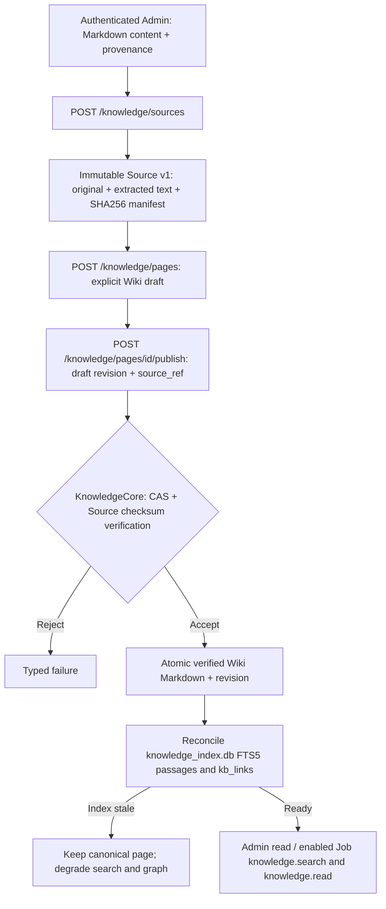
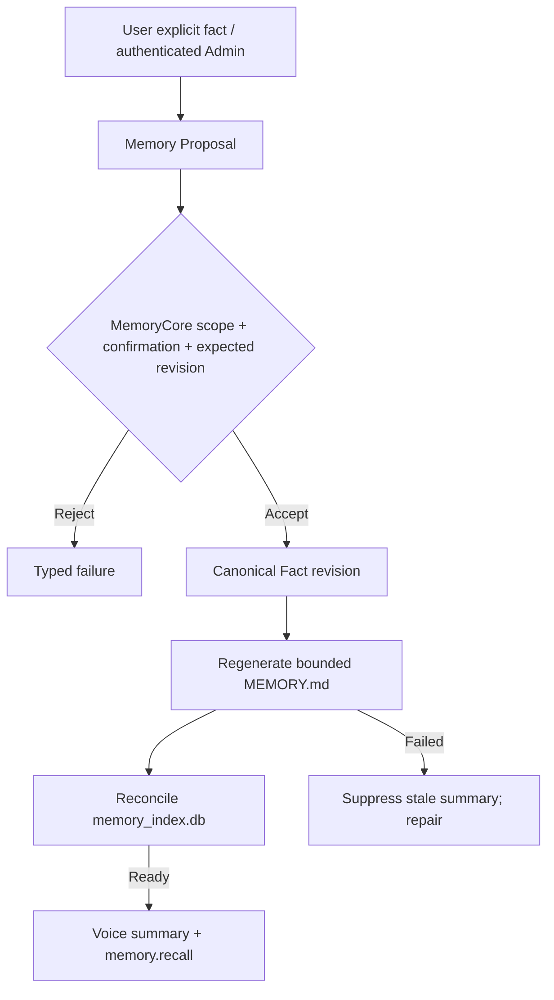
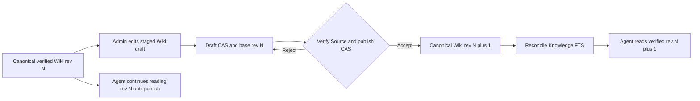
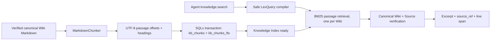

# Knowledge + Memory V3 — data flows

Normative DB and recovery contract: [database-layout-v3.md](../knowledge/database-layout-v3.md). Domain interfaces: [implementation-v3.md](../knowledge/implementation-v3.md).





Each index has its own SQLx migrator and health. Full scanner failure preserves old rows but does not serve them as current. The application database remains the exclusive durable Job scheduler; no second ingest event/state store. Neither the Root nor Child receives an arbitrary filesystem-write tool.

## Implementation reality / admission policy

On this branch, authenticated Admin imports original **text Markdown**, creates a Wiki draft and explicitly publishes a verified Wiki revision. Source import alone does not create a Wiki page or make the Source searchable by Job tools. The Admin supplies the Wiki title/body; no LLM extraction or summarization runs in these requests. Publishing verifies the referenced Source bytes, not the factual accuracy of the Wiki body.

Background Job V3 can only search/read published Wiki pages and recall confirmed Memory after its Core group is enabled by Admin; no Agent-driven Source ingestion or Wiki publication tool is exposed. Job Artifact promotion, research-generated proposals and automatic publication remain future work. Memory proposals in the second diagram currently enter through authenticated Admin, not automatic Voice writes or prompt injection.

The current Knowledge Web has **Reading/Compose/Graph** modes and can create Raw and draft Wiki notes inline and edit/save them with CAS. It does **not** expose a visible Source import or publish action in the current template, despite preserving the authenticated Admin endpoints and some script functions. Use the Admin routes below for immutable Source import and verified Wiki publication. The graph may show canonical **new draft** nodes to Admin, but no draft is Agent-retrievable.


## Planned AI Ingest after the Graph / Settings commits — not implemented

See the [AI Ingest specification](../knowledge/ai-ingest-auto-publish-implementation-v3.md), [2026-10-19 branch audit](../knowledge/ai-ingest-branch-reconciliation-2026-10-19.md) and [ADR 0123](../adr/0123-knowledge-ingest-job-execution-and-review-policy.md).

~~~mermaid
flowchart TD
  A[Committed immutable Source ref + SHA256] --> B[Submit proposed knowledge_ingest_v3 Job]
  B --> C[Qualified Knowledge-specific Provider Pin]
  C --> D[LLM Strict Structured Wiki Proposal]
  D --> E[Rust KnowledgePolicyGate: evidence + duplicate + WikiLink checks]
  E -->|Eligible directly grounded new Wiki| F[Stage KnowledgeCore draft then publish with CAS]
  E -->|Conflict/missing support/link ambiguity/draft target| R[Pending Review logical queue]
  F --> G[Verified Markdown in wiki/]
  G --> H[Reconcile FTS chunks and kb_links in knowledge_index.db]
  R --> I[Admin reviews with Source + current Wiki + Markdown preview]
  I -->|Approve after revalidate| F
~~~

Current physical **Raw/Wiki/Drafts** selection and separate `/knowledge/settings` route stay in place. `/knowledge/settings` currently has a **preview-only page**, not a working provider selector; the future Review is a logical workspace, **not** another physical root. The native Graph implementation is read-only and must not be mistaken for an evidence/publish decision engine. Job-owned execution records belong in the existing app DB; links and graph projection are derived from Markdown.

## Add a document through the Admin API

All paths below are relative to `/api/admin`; every request requires `Authorization: Bearer <admin_token>`. Knowledge storage requires a durable application SQLite path; its parent directory owns `knowledge/` and the independent Memory storage. Admin writes do not require enabling the Job Core group.

| Step | Method and path | Request / response |
|---|---|---|
| Import evidence | `POST /knowledge/sources` | JSON `{name, content, provenance}` → `201` Source metadata including `id`, `version`, `sha256`, `size_bytes`, `media_type` |
| Inspect evidence | `GET /knowledge/sources`, `GET /knowledge/sources/{id}` | `{items:[Source]}`; individual read returns `{text}` |
| Create draft | `POST /knowledge/pages` | JSON `{title, body, source_ref?, expected_revision?:0}` → `201` full Wiki record, initially `status:"draft"`, `revision:1` |
| Publish | `POST /knowledge/pages/{id}/publish` | JSON `{expected_revision, source_ref:"src_ID:1"}` → `200` full Wiki record with `status:"verified"` |
| Browse | `GET /knowledge/pages?limit=100`, `GET /knowledge/pages/{id}` | `{items:[overview]}`; individual read returns the full editable record, including a staged draft when present |
| Search | `GET /knowledge/pages?q=term&limit=20` | Admin search returns `{items:[hit]}`, including drafts; Job search serves verified pages only |
| Check / repair index | `GET /knowledge/index`, `POST /knowledge/index/rebuild` | Index health; explicit rebuild returns `{indexed}` |

Import accepts UTF-8 Markdown **inside JSON**, not multipart upload, a local filesystem path or a URL to fetch. `content` must be nonblank and at most 256 KiB; `name` must be nonblank, at most 255 bytes and contain no control characters; `provenance` must be nonblank and at most 1024 bytes. The Admin JSON body limit also applies. PDF/DOCX/image/audio/video extraction is not implemented. Each import creates a new Source ID at version `1`; there is no Source update endpoint or import deduplication.

Example from the repository root, using this flow document as both evidence and Wiki body. Requires Bash, `curl`, `jq`, and a configured `ADMIN_TOKEN`; set `BASE_URL` to the running server origin. This creates a new Source and Wiki page each time it runs.

```bash
set -euo pipefail
: "${BASE_URL:?Set the server origin, without /api/admin}"
: "${ADMIN_TOKEN:?Set the Admin bearer token}"
DOCUMENT=docs/flows/13-knowledge-v3.md

source_json=$(jq -n --rawfile content "$DOCUMENT" \
  --arg name "13-knowledge-v3.md" \
  --arg provenance "Repository: docs/flows/13-knowledge-v3.md" \
  '{name:$name, content:$content, provenance:$provenance}' |
  curl --fail-with-body --silent --show-error \
    -H "Authorization: Bearer $ADMIN_TOKEN" -H 'Content-Type: application/json' \
    --data-binary @- "$BASE_URL/api/admin/knowledge/sources")
source_ref=$(jq -er '.id + ":" + (.version | tostring)' <<<"$source_json")

draft_json=$(jq -n --rawfile body "$DOCUMENT" \
  --arg title "Knowledge + Memory V3 — data flows" --arg source_ref "$source_ref" \
  '{title:$title, body:$body, source_ref:$source_ref, expected_revision:0}' |
  curl --fail-with-body --silent --show-error \
    -H "Authorization: Bearer $ADMIN_TOKEN" -H 'Content-Type: application/json' \
    --data-binary @- "$BASE_URL/api/admin/knowledge/pages")
page_id=$(jq -er '.id' <<<"$draft_json")
draft_revision=$(jq -er '.revision' <<<"$draft_json")

jq -n --argjson expected_revision "$draft_revision" --arg source_ref "$source_ref" \
  '{expected_revision:$expected_revision, source_ref:$source_ref}' |
  curl --fail-with-body --silent --show-error \
    -H "Authorization: Bearer $ADMIN_TOKEN" -H 'Content-Type: application/json' \
    --data-binary @- "$BASE_URL/api/admin/knowledge/pages/$page_id/publish"

curl --fail-with-body --silent --show-error \
  -H "Authorization: Bearer $ADMIN_TOKEN" \
  "$BASE_URL/api/admin/knowledge/pages/$page_id"
curl --fail-with-body --silent --show-error \
  -H "Authorization: Bearer $ADMIN_TOKEN" "$BASE_URL/api/admin/knowledge/index"
```

Use the returned draft `revision` for publication rather than assuming a revision number. Initial draft `1` publishes as verified revision `2`. For Job access, Admin must additionally enable `core.knowledge` and admit a new Job with the relevant frozen Core operations; existing Jobs do not gain tools automatically. The Admin GET above confirms the editable page, not Job tool authorization.

Failures use `{error:{code,request_id}}`: `400 invalid_arguments` or `invalid_path`, `401 unauthorized`, `404 not_found`, `409 revision_conflict`, and `503 index_stale` or `knowledge_unavailable`. On a revision conflict, reload the editable record and reconcile changes before resubmitting. A publication may commit canonical Markdown before index reconciliation fails: after a `503`, read the page and check index health before retrying. Restore missing or damaged canonical evidence before rebuilding; rebuild does not repair Source bytes.

## Corrected published Wiki edit flow

Read `GET /knowledge/pages/{id}`, then send `PUT /knowledge/pages/{id}` with the complete `{title, body, source_ref, expected_revision}` using that editable record's revision. Save before publishing: the publish endpoint reads the stored draft and does not accept editor text. If the evidence changed, import a new Source and use its reference. Publish with the revision returned by PUT and the selected `source_ref`.

For an accepted revision `N`, the first staged draft is `N+1`; subsequent draft saves advance its own revision. Publishing advances the canonical revision to `N+1` even if the draft has been saved several times. Admin reads show the staged draft; Agent reads retain accepted revision `N` until publication succeeds.



Admin and Job reuse one Rust Runtime; the Job tools cannot read staged drafts. The Knowledge index is marked stale when immutable Source evidence disappears or fails SHA256 validation. Memory index health is independent.

## QMD-inspired Markdown passage indexing (Knowledge-only)



The existing source-confirmation policy remains authoritative; no Agent can retrieve staged drafts. `memory.recall` uses the same safe lexical compilation but stays at confirmed active owner-Fact granularity. No new database, wire protocol, or background Agent runtime is introduced.

## AI processing extension (2026-10-19)

Knowledge AI processing reuses the Agent Job scheduler with a single pinned analysis provider. Immutable Source evidence and canonical graph/link validation gate publication; initial drafts and unverified links never gain Agent authority from Graph presence. Backend Analyze/Review APIs and the existing Settings page are documented in [AI ingest verification](../knowledge/ai-ingest-verification-v3.md). The physical explorer, editor and Graph layouts remain unchanged. Remote deployment acceptance is not implied by local checks.
