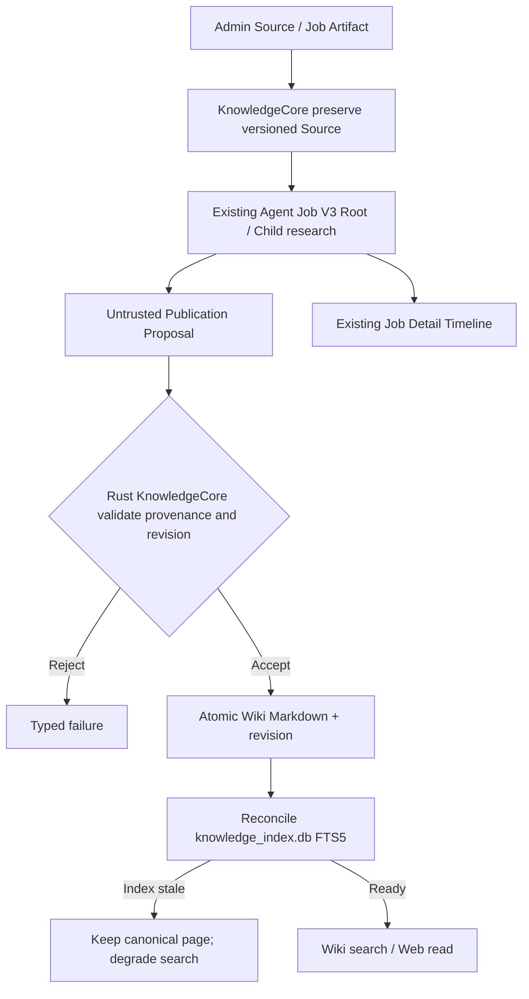
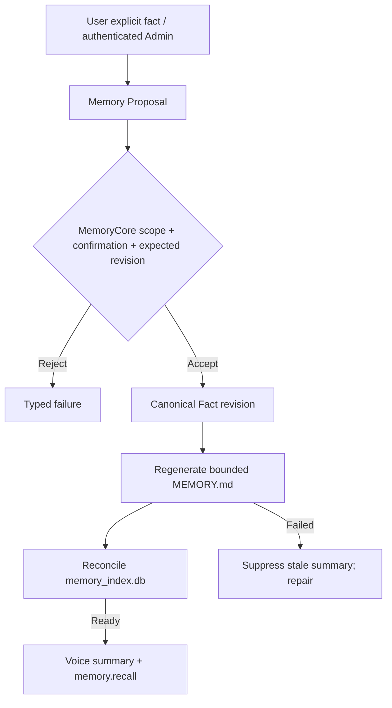

# Knowledge + Memory V3 — data flows

Normative DB and recovery contract: [database-layout-v3.md](../knowledge/database-layout-v3.md). Domain interfaces: [implementation-v3.md](../knowledge/implementation-v3.md).

Each index has its own SQLx migrator and health. Full scanner failure preserves old rows but does not serve them as current. The application database remains the exclusive durable Job scheduler; no second ingest event/state store. Neither the Root nor Child receives an arbitrary filesystem-write tool.

## Implementation reality / admission policy

On this branch, authenticated Admin imports original **text Markdown** and explicitly publishes a verified Wiki revision. Background Job V3 can only search/read published Wiki pages and recall confirmed Memory after its Core group is enabled by Admin; no Agent-driven Source ingestion or Wiki publication tool is exposed. The diagrams above describe the future Job-driven proposal path, not a shipped automatic write capability.
