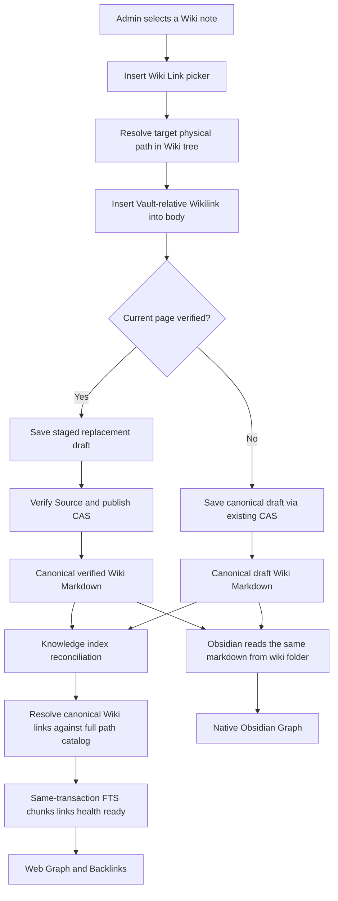
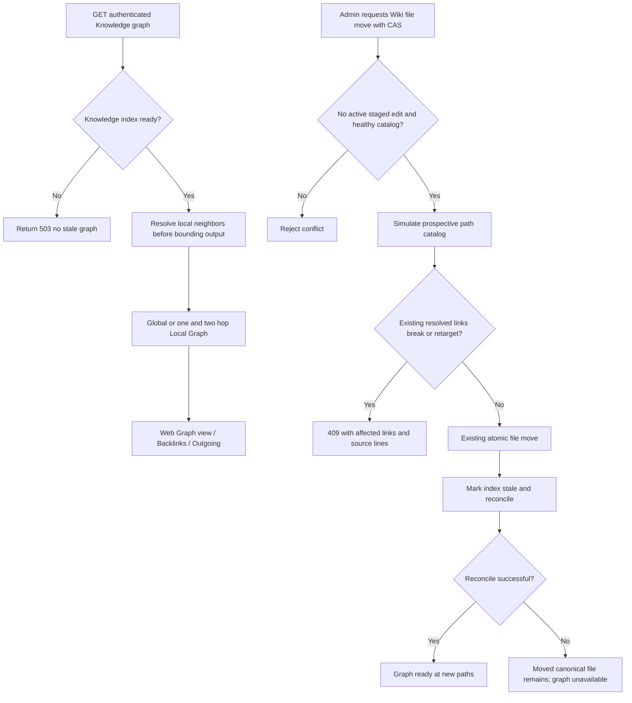

# Knowledge V3 — Graph View and Obsidian link flow (implementation committed)

- Date: 2026-10-19
- Status: code implemented in branch; this document describes current flow, while exact HEAD CI and interactive Obsidian acceptance must still be verified.
- Contract: [Knowledge Graph implementation](../knowledge/wiki-graph-view-implementation-v3.md) and [ADR 0124](../adr/0124-wiki-wikilinks-graph-projection.md).
- Existing Knowledge + Memory V3 flows remain [in flow 13](13-knowledge-v3.md).

## Author a link through the Knowledge Web editor



Staged drafts/ never contribute unaccepted replacement relationships. Knowledge Graph is Admin-only; Job tools continue source-verified Wiki search/read and are not extended to graph traversal.

## Graph query and move protection



## Storage ownership

```text
<main database directory>/
  knowledge/
    wiki/                      # Canonical Markdown and canonical Wikilinks
      AI/Agent.md
      AI/LLM.md
    drafts/                    # Pending replacements not in accepted graph
    revisions/                 # Canonical history
    raw/                       # Working notes and immutable Source snapshots
    knowledge_index.db         # Rebuildable kb_documents, FTS, chunks, kb_links
  memory/
    memory_index.db            # No change
```

Obsidian Vault root = knowledge/wiki/. Opening the Markdown directly in Obsidian does not require that Obsidian read knowledge_index.db. Do not use Obsidian to write into the live canonical vault until an explicit external-edit reconciliation protocol is implemented.

## AI processing extension (2026-10-19)

Knowledge AI processing reuses the Agent Job scheduler with a single pinned analysis provider. Immutable Source evidence and canonical graph/link validation gate publication; initial drafts and unverified links never gain Agent authority from Graph presence. Backend Analyze/Review APIs and the existing Settings page are documented in [AI ingest verification](../knowledge/ai-ingest-verification-v3.md). The physical explorer, editor and Graph layouts remain unchanged. Remote deployment acceptance is not implied by local checks.
