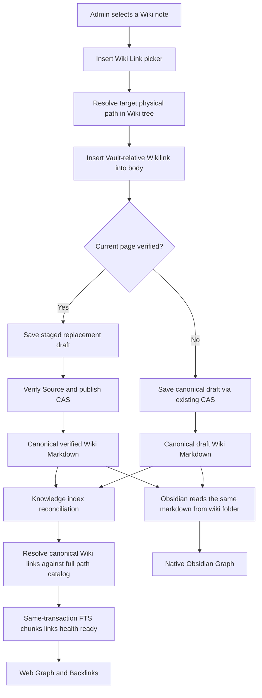
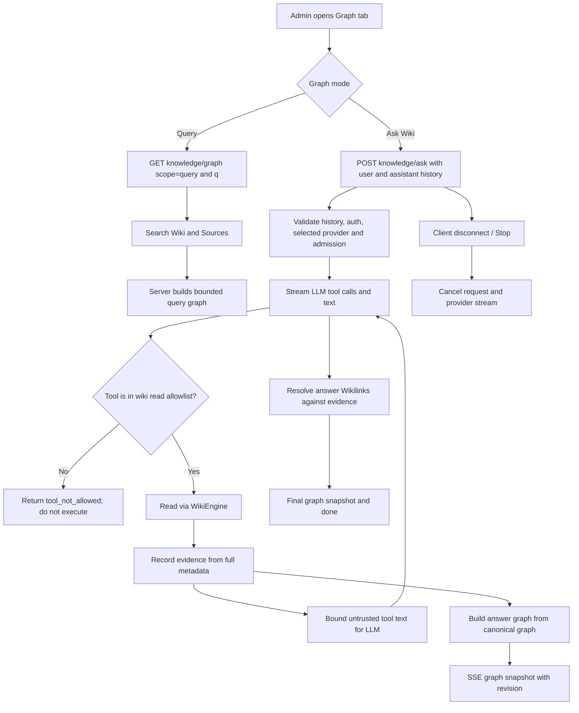
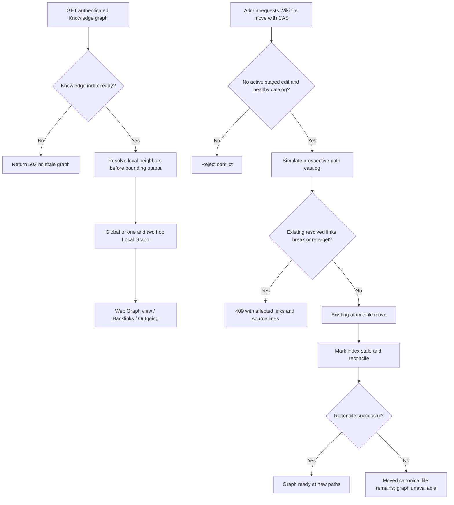

# Knowledge V3 — Graph View, Wiki Chat, and Obsidian link flow

- Date: 2026-11-02
- Status: implementation available locally; live-provider Wiki Chat acceptance is separate and must not be inferred from source tests.
- Contract: [Knowledge Graph implementation](../knowledge/wiki-graph-view-implementation-v3.md), [Wiki Chat implementation](../knowledge/wiki-chat-graph-implementation.md), [ADR 0124](../adr/0124-wiki-wikilinks-graph-projection.md), and [ADR 0138](../adr/0138-admin-read-only-wiki-chat-and-answer-graph.md).
- Existing Knowledge + Memory V3 flows remain [in flow 13](13-knowledge-v3.md).

## Author a link through the Knowledge Web editor



Staged drafts/ never contribute unaccepted replacement relationships. Knowledge Graph is Admin-only; Job tools continue source-verified Wiki search/read and are not extended to graph traversal.

## Query graph and read-only Wiki Chat

The graph tab keeps Global and Local behavior and adds two paths. Query graph searches Wiki and Source without an LLM. Wiki Chat streams a bounded read-only turn; the server derives the answer graph from tool evidence and canonical Wikilinks. The browser holds the temporary conversation and cancels the request on Stop or disconnect.



The read allowlist is `wiki_query`, `wiki_get`, and `wiki_multi_get`; Knowledge MCP enablement does not gate this Admin feature. Tool-result text is marked untrusted, and paths are captured before text truncation. A model-generated Wikilink outside the evidence remains plain text. The query and answer graphs use only resolved Wikilinks already present in the server graph projection, consistent with ADR 0124.

The chat provider is selected separately in Background settings (`wiki_chat_llm_provider`); saving requires the Chat tag and tool support. The setting is persisted with existing Background settings and does not add a database migration. Missing configuration returns `wiki_chat_not_configured` instead of silently selecting a provider.

See the [Knowledge Wiki Chat API contract](../api/knowledge-wiki-chat.md) for request limits, SSE events, errors, and settings fields.

## Graph query and move protection



## Storage ownership

```text
<main database directory>/
  knowledge/
    wiki/                      # Canonical Markdown and canonical Wikilinks
      AI/Agent.md
      AI/LLM.md
    drafts/                    # Pending replacements not in accepted graph
    revisions/                 # Canonical history
    raw/                       # Working notes and immutable Source snapshots
    knowledge_index.db         # Rebuildable kb_documents, FTS, chunks, kb_links
  memory/
    memory_index.db            # No change
```

Obsidian Vault root = knowledge/wiki/. Opening the Markdown directly in Obsidian does not require that Obsidian read knowledge_index.db. Do not use Obsidian to write into the live canonical vault until an explicit external-edit reconciliation protocol is implemented.

## AI processing extension (2026-10-19)

Knowledge AI processing reuses the Agent Job scheduler with a single pinned analysis provider. Immutable Source evidence and canonical graph/link validation gate publication; initial drafts and unverified links never gain Agent authority from Graph presence. Backend Analyze/Review APIs and the existing Settings page are documented in [AI ingest verification](../knowledge/ai-ingest-verification-v3.md). The physical explorer, editor and Graph layouts remain unchanged. Remote deployment acceptance is not implied by local checks.
