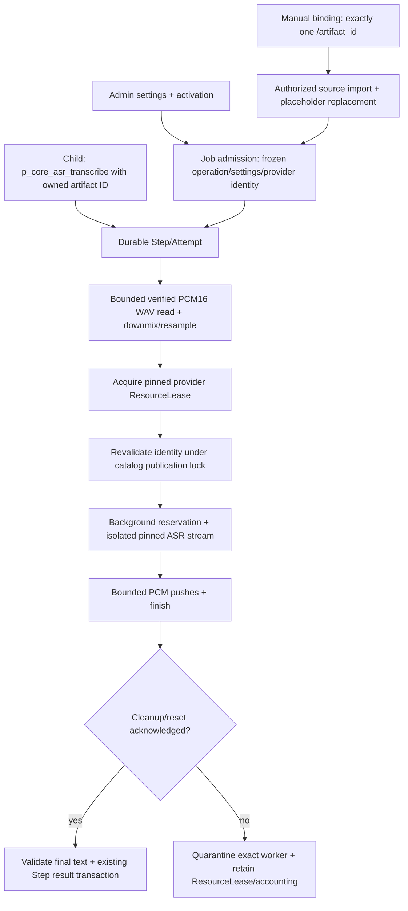

# Flow 15 — Job-owned WAV → Core ASR final text (V3)

Related: [spec](../../.scratch/core-asr/spec.md), [Core settings/manual runs](12-plugin-settings-and-manual-operation-v3.md), [Core TTS](13-core-tts-v3.md), [ASR stream pinning](../adr/0040-asr-worker-pool-stream-pinning.md).

`core.asr` is statically bundled and initially disabled. Admin saves exactly one `provider_ref` using Plugin Value Settings CAS, then enables the group with the independent activation revision. Activation checks an enabled, resolvable ASR provider; runtime capacity is checked when executing.

Agent and Manual admission freeze the `asr.transcribe` revision (`1`), immutable Plugin Config revision, and a separate `job_asr_provider_pins` row containing canonical provider reference, incarnation, revision and non-secret configuration digest. Missing optional ASR does not prevent unrelated Agent Jobs. Required transcription and Manual Runs reject unavailable configuration. Historical Jobs gain no new authority.

## Entry points

- Child: `p_core_asr_transcribe({"artifact_id":"<current Job artifact>"})`. No path, URL, base64 or provider override is accepted. The Child receives the complete final text as untrusted source content, without the generic 3,500-character excerpt truncation.
- Admin: `POST /api/admin/plugins/core.asr/operations/asr.transcribe/runs` with `arguments: {artifact_id:""}` and exactly one `artifact_bindings` entry at `/artifact_id`. The existing admission imports an authorized artifact from a completed source Job, substitutes its new ID before schema validation, and preserves idempotency/rollback. This mode makes no LLM calls.
- Output is exactly `{"text":"..."}`. Whitespace-only recognition succeeds as `{"text":""}`. No output artifact is created; imported inputs retain the normal Job artifact lifecycle.

## Bounds and ownership

Input must be one complete RIFF/WAVE with integer PCM16, one or two channels, 8–48 kHz, nonempty and at most 180 seconds. Encoded bytes are capped at the smaller of 20 MiB and the Job quota before full-file reading. Validate actual chunk extents, sample count, channel alignment and checked allocation sizes. Stereo is averaged; noncanonical rates use a bounded windowed-sinc low-pass converter to mono 16 kHz on a blocking worker. Enrollment's mono/16-kHz/12-second calibration parser is unchanged.

Return at most 16,000 Unicode characters. The serialized transcript must also fit the existing ToolResult message budget; reserve envelope space within 32 KiB and fail on overflow, rather than silently cutting text. Consequently, some Unicode-heavy or heavily escaped transcripts hit the byte limit before the character limit.

The operation deadline covers reading, conversion, runtime acquisition, saturation and inference. Background work never borrows Voice reservation or an Active Turn permit. Each attempt owns a separate event queue and one physical worker across bounded command pushes and finish; Voice supervision cannot consume these events.

Cancellation, timeout and Future drop request cleanup of that exact worker. Worker acknowledgement follows native session destruction/reset and permit release. A noninterruptible offline decode may continue physically after logical cancellation; if cleanup grace expires, quarantine retains the slot and versioned provider lease. Quarantined work is not automatically replaced or replayed. Retry authority depends on durable started/uncertain ASR attempts, not merely a frozen, unused ASR capability. Fresh explicit Manual Runs use ordinary admission.

## Verification record

Deterministic coverage lives in `tools/core/asr*_tests.rs`, `workers/asr/background_tests.rs`, `services/background/tests/asr.rs`, and `PluginManagePanel.test.ts`. It exercises WAV limits/conversion, contracts, pins/settings, manual imports/idempotency, Child delivery, Background capacity/backpressure, cancellation, task drop and quarantine. All checks use `scripts/agent-test.sh`. The final workspace run passed **1,003 tests**, with **15 opt-in tests ignored** and no failures. Web passed **331 tests across 72 files** and typechecking. Formatter and Rust checking passed. Detailed commands are in [verification](../../.scratch/core-asr/verification.md).

Two independent review axes and the resolved provider snapshot race are recorded in [the review](../../.scratch/core-asr/review.md).

Real Zipformer/Gipformer inference, simultaneous real Voice+Background contention, and cancellation during real offline native decode are **NOT_RUN** in this implementation session. Deterministic gate-based workers establish ownership and accounting behavior without claiming physical native interruption.
