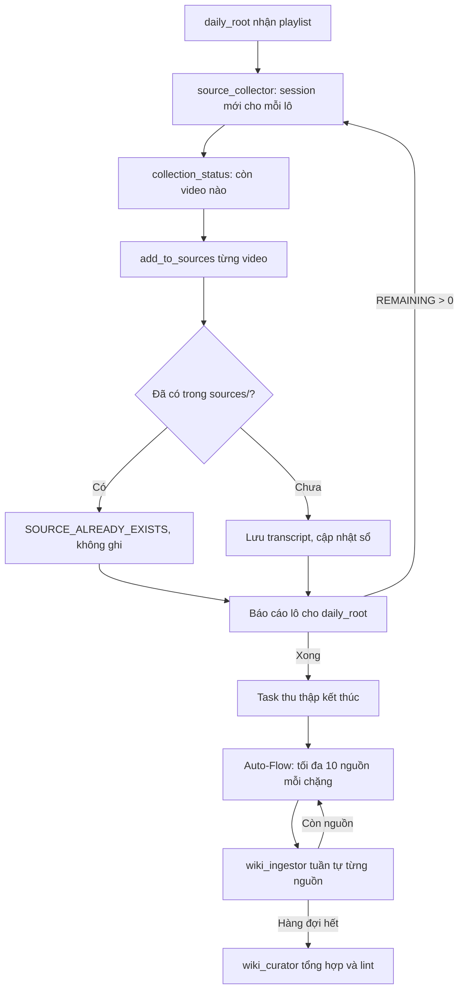

# Thu thập nhiều nguồn và nạp vào Wiki

Flow này xử lý một playlist hoặc nhiều tài liệu: lưu nội dung gốc vào `sources/` theo từng lô nhỏ, rồi Auto-Flow ingest vào `wiki/`. Quyết định thiết kế ở [ADR 0136](../adr/0136-collection-ledger-and-bounded-autoflow-batches.md).

## Boundary

- **Vào:** `daily_root` được yêu cầu rõ ràng lưu một playlist hoặc nhiều tài liệu vào `sources/`, hoặc có file mới trong `sources/`.
- **Ra:** nội dung gốc trong `sources/`, các trang trong `wiki/`, và báo cáo số lượng theo từng trạng thái.
- **Không gồm:** phân tích nội dung khi thu thập, chạy phân tán nhiều node, giao diện Admin cho các route mới.

## Sequence



## Invariants

- Một video có tối đa một file trong `sources/`, nhận ra theo `video_id`, không theo tên file.
- Nội dung khác nhau không bao giờ ghi đè nhau, kể cả khi dùng `force`.
- `sources/` là sự thật cho nguồn đã lưu; Collection Ledger chỉ giữ những gì `sources/` không thể hiện, như lỗi hoặc không có phụ đề.
- Tool `Mutating` không rõ kết quả không tự chạy lại.
- Chỉ chặng kết thúc và lỗi không do provider mới tính lỗi cho nguồn.

## Lỗi và cách làm tiếp

| Tình huống | Hành vi |
| --- | --- |
| Bấm Retry trên job thu thập | Task mới đọc `collection_status`; video đã có không bị tải hay ghi lại |
| Server restart | Sổ theo dõi và `sources/` vẫn còn; run được resume theo ADR 0133 |
| Video không có phụ đề | Ghi `no_transcript`, không thử lại, lô chạy tiếp |
| `yt-dlp` lỗi hoặc treo | Mỗi lệnh tối đa 120 giây; ghi `failed`; đủ 3 lần lưu lỗi thì thành `gave_up` |
| Chạm step cap | Task `stopped` với `STEP_LIMIT_REACHED`; cha thấy `incomplete="true"` và giao lô tiếp theo |
| Hết ngân sách | Task `stopped`; dùng Follow-up hoặc Retry để chạy tiếp phần còn lại |
| Ingest dở | Chặng sau chỉ tạo các trang còn thiếu |
| Source lỗi 3 chặng | Bị cách ly; hàng đợi và chặng tổng hợp vẫn chạy. Nguồn tự ra khỏi cách ly khi đủ trang hoặc file đổi sau lần lỗi cuối |
| Chặng hỏng giữa chừng | Chỉ nguồn đầu tiên còn dở bị tính lỗi; các nguồn sau không bị tính |
| Provider lỗi | Không tính lỗi cho nguồn nào; thử lại sau 30 phút |
| Tool ghi không rõ kết quả | Task `interrupted`; Admin đối soát qua API rồi Task chạy tiếp |

## Xử lý nguồn đã có

| Trường hợp | Kết quả |
| --- | --- |
| Cùng `video_id` hoặc cùng `content_sha256`, wiki đã xong | `already_ingested`, không ghi |
| Cùng định danh, wiki chưa xong | `pending_ingest`, không ghi, Auto-Flow làm tiếp |
| Khác `video_id`, transcript giống hệt | `duplicate_of`, không ghi |
| Trùng tên file, khác định danh | Lưu file riêng, không ghi đè |
| Người dùng yêu cầu làm lại | `force=true`: video và nội dung giống hệt ghi lại đúng đường dẫn cũ rồi ingest lại; nội dung đã đổi được lưu thành file riêng |

## Admin API

| Route | Mục đích |
| --- | --- |
| `GET /api/admin/knowledge/quarantined-sources` | Liệt kê nguồn bị cách ly |
| `POST /api/admin/knowledge/quarantined-sources/release` | Đưa một nguồn về hàng đợi, body `{"source_rel_path": "sources/..."}` |
| `POST /api/admin/jobs/{id}/invocations/{invocation_id}/resolve` | Ghi kết luận cho tool bị kẹt, xem bên dưới |

Body của route đối soát:

```json
{ "decision": "no_effect", "evidence": "Đã kiểm tra: không có file nào được ghi" }
```

```json
{
  "decision": "completed",
  "tool_call_id": "call_1",
  "result_text": "Kết quả agent sẽ nhận",
  "evidence": "Đã kiểm tra: file đã được ghi đầy đủ"
}
```

Lấy `invocation_id` và `tool_call_id` từ step tương ứng trong chi tiết Job. Khi tool thuộc subagent, thêm `session_id` bằng `agent_run_id` của step đó. Lấy `invocation_id` và `tool_call_id` từ chi tiết Job.

## Cấu hình

`TaskRuntimeConfig` có các giá trị mặc định sau:

| Trường | Mặc định |
| --- | --- |
| `autoflow_batch_size` | 10 |
| `autoflow_max_source_attempts` | 3 |
| `autoflow_collection_wait_max` | 2 giờ |

## Test contract

- `llm-wiki-rs`, `tests/autoflow_planning.rs`: tra nguồn theo định danh, ingest dở, chia lô, cách ly, ingest lại.
- `orchestrator-flow`, `tests/integration/collection_batch.rs`: chống trùng, không ghi đè, sổ theo dõi qua Retry, `yt-dlp` treo, chờ thu thập, cách ly, đối soát tool.
- `orchestrator-agent`, `tests/m4_continuous.rs`: step cap và giới hạn retry theo tiến độ.
- `orchestrator-agent`, `tests/m3_parent_child.rs`: cha thấy con dừng ở step cap.
