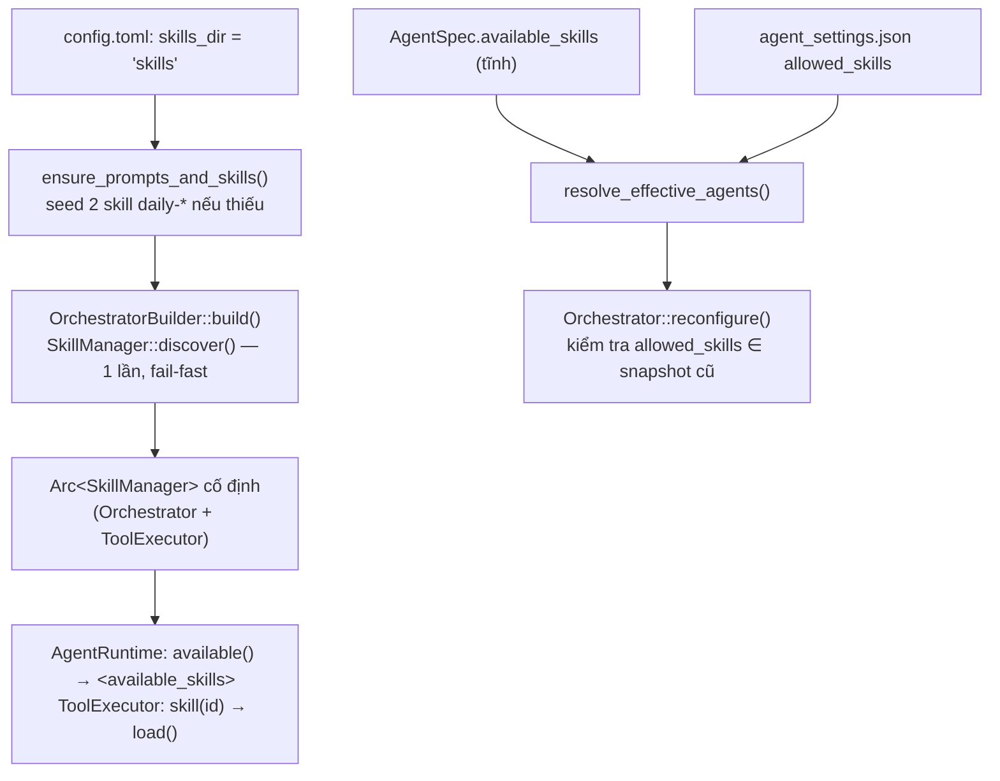
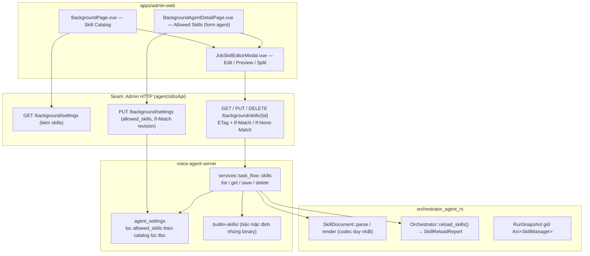

# Job Skill Catalog & Web Management — Hướng dẫn Triển khai (v2)

> **Repository:** `AI_Agent_Voice_rust` (`voice-agent-server`, `apps/admin-web`) & `orchestrator_agent_rs`  
> **Kỷ luật thiết kế:** [`/codebase-design`](file:///Users/lamphuchai/Desktop/project_rust/.agents/skills/codebase-design/SKILL.md) (**Module**, **Interface**, **Implementation**, **Depth**, **Seam**, **Adapter**, **Leverage**, **Locality**) & [`GLOSSARY.md`](file:///Users/lamphuchai/Desktop/project_rust/AI_Agent_Voice_rust/GLOSSARY.md)  
> **Mục tiêu:** Admin **xem**, **thêm**, **chỉnh sửa trực tiếp** (`Edit / Preview / Split`), **khôi phục mặc định** và **xoá** (chỉ Custom) **Job Skill** trên Web, áp dụng cho các Agent Run tiếp theo mà không cần restart server.

**Thay đổi so với v1** (sau review `/codebase-design`):

| # | Vấn đề ở v1 | Quyết định ở v2 |
| :--- | :--- | :--- |
| 1 | Server tự viết `FrontmatterCodec` riêng → escape `\"` không đọc lại được bằng `parse_frontmatter` | Một codec công khai duy nhất `SkillDocument` trong `orchestrator_agent_rs`, có test round-trip |
| 2 | `assigned_agents` trong API skill tạo đường ghi thứ hai vào `allowed_skills`, bỏ qua revision | Bỏ. Gán skill cho Sub-Agent **chỉ** qua Agent Settings (`PUT /background/settings` + `If-Match`) |
| 3 | Xoá skill phải sửa `agent_settings.json` + rollback đa tài nguyên | Lọc `allowed_skills` theo catalog trên đĩa **lúc đọc**; xoá chỉ đụng một tài nguyên (thư mục skill) |
| 4 | Quét skill bên trong `reconfigure` → 1 skill hỏng chặn cả việc sửa provider | `Orchestrator::reload_skills()` riêng, bỏ qua skill hỏng kèm báo cáo; `reconfigure` không quét đĩa |
| 5 | Bản mặc định Built-in được `include_str!` từ chính `skills/` mà Admin sửa | Bản mặc định nằm ở thư mục riêng của server `builtin-skills/`; `skills/` là bản runtime |
| 6 | 6 hàm CRUD + `/restore` + `GET /skills` ánh xạ 1:1 route | Interface 4 hàm `list / get / save / delete`; Restore = `save` với nội dung mặc định |
| 7 | Không có kiểm soát ghi đồng thời | `ETag` (sha256) + `If-Match` / `If-None-Match: *`, mutex tuần tự hoá thao tác ghi |
| 8 | Lệnh `agent-test.sh integration` không tồn tại | Dùng `targeted <filter> voice-agent-server` |

**Ràng buộc đã chốt:**
- Skill thuộc về **server**: thư mục runtime vẫn là `skills/` của `AI_Agent_Voice_rust` (`config.toml`: `skills_dir = "skills"`), **không** chuyển sang `data/orchestrator-skills`. Bản mặc định của Built-in Skill cũng do server sở hữu (không lấy từ `llm_wiki` hay `orchestrator_flow_rs`).
- **Chỉ xoá Custom Skill** (Option A). Built-in Skill được xem, sửa và khôi phục mặc định.

---

## 1. Từ vựng Domain

Dùng các thuật ngữ có sẵn tại [`GLOSSARY.md`](file:///Users/lamphuchai/Desktop/project_rust/AI_Agent_Voice_rust/GLOSSARY.md#L137-L148): **Job Skill**, **Skill Catalog**, **Loaded Skill**. Bổ sung 2 thuật ngữ:

- **Built-in Job Skill**: Một trong 6 Job Skill chuẩn do server cung cấp (`wiki-taxonomy`, `wiki-ingest`, `wiki-query`, `wiki-lint`, `daily-synthesis-staging`, `daily-task-reminder`). Bản mặc định được nhúng trong binary để seed khi thiếu và để khôi phục; Admin có thể sửa nội dung nhưng không xoá được.
  _Avoid_: system plugin, locked skill
- **Custom Job Skill**: Job Skill do Admin tạo trong `skills_dir`, không có bản mặc định trong binary; có thể sửa và xoá vĩnh viễn.
  _Avoid_: user plugin, uploaded script

---

## 2. Flow hiện tại (tóm tắt)



Các điểm chạm chính: [`skill.rs`](file:///Users/lamphuchai/Desktop/project_rust/orchestrator_agent_rs/src/skill.rs), [`builder.rs`](file:///Users/lamphuchai/Desktop/project_rust/orchestrator_agent_rs/src/orchestrator/builder.rs#L198-L215), [`session.rs` (`reconfigure`)](file:///Users/lamphuchai/Desktop/project_rust/orchestrator_agent_rs/src/orchestrator/session.rs#L42-L86), [`runtime/mod.rs`](file:///Users/lamphuchai/Desktop/project_rust/orchestrator_agent_rs/src/runtime/mod.rs#L162-L172), [`workspace_seed.rs`](file:///Users/lamphuchai/Desktop/project_rust/AI_Agent_Voice_rust/crates/voice-agent-server/src/services/task_flow/workspace_seed.rs), [`specs.rs`](file:///Users/lamphuchai/Desktop/project_rust/AI_Agent_Voice_rust/crates/voice-agent-server/src/services/task_flow/agent_settings/specs.rs#L32-L33), [`catalog.rs`](file:///Users/lamphuchai/Desktop/project_rust/AI_Agent_Voice_rust/crates/voice-agent-server/src/services/task_flow/agent_settings/catalog.rs#L394-L425).

---

## 3. Kiến trúc mục tiêu



### 3.1. Phân loại dependency & seam (`DEEPENING.md`)

- `skills_dir` + `Orchestrator` là **Local-substitutable** (test bằng `TempDir` và `Orchestrator` thật). **Không** tạo `trait SkillRepository`: chỉ có một adapter thì seam là giả định.
- Seam thật duy nhất mới thêm ở server là HTTP (adapter production + mock Vitest ở Web).
- **Một chủ sở hữu cho mỗi state:**
  - Nội dung skill (`skills/<id>/SKILL.md`) → chỉ `services::task_flow::skills` ghi.
  - Gán skill cho Sub-Agent (`allowed_skills`) → chỉ Agent Settings ghi.
  - Định dạng `SKILL.md` → chỉ `SkillDocument` trong engine biết.

---

## 4. Engine — `orchestrator_agent_rs`

### 4.1. Codec công khai `SkillDocument`

Thêm vào [`skill.rs`](file:///Users/lamphuchai/Desktop/project_rust/orchestrator_agent_rs/src/skill.rs) và re-export ở `lib.rs`:

```rust
#[derive(Debug, Clone, PartialEq, Eq)]
pub struct SkillDocument {
    pub id: String,
    pub name: String,
    pub description: String,
    pub body: String,
}

#[derive(Debug, Clone, PartialEq, Eq)]
pub enum SkillDocumentError {
    InvalidId,
    MissingFrontmatter,
    MissingName,
    MissingDescription,
    InvalidField(&'static str), // ký tự điều khiển / xuống dòng trong name|description
    EmptyBody,
    TooLarge { size: usize, max: usize },
}

impl SkillDocument {
    /// Parse `SKILL.md` theo đúng quy tắc mà `SkillManager` dùng khi index.
    pub fn parse(id: &str, text: &str, max_bytes: usize) -> Result<Self, SkillDocumentError>;
    /// Render đảm bảo `parse(render(doc)) == doc` (bất biến round-trip).
    pub fn render(&self) -> Result<String, SkillDocumentError>;
}

pub fn valid_skill_id(id: &str) -> bool; // đổi từ pub(crate) sang pub
```

**Quy tắc render** (khớp với [`parse_frontmatter`](file:///Users/lamphuchai/Desktop/project_rust/orchestrator_agent_rs/src/skill.rs#L293-L317), vốn chỉ bỏ cặp nháy ngoài cùng và **không unescape**):
- Bọc giá trị trong `"..."` **không escape**. Dấu `"`, `\`, `:` bên trong vẫn đọc lại đúng nguyên văn.
- Từ chối `\r`, `\n` và ký tự điều khiển trong `name`/`description` (`InvalidField`).
- `name` 1..=128 ký tự, `description` 1..=1024 ký tự, `body` khác rỗng sau `trim`, tổng byte ≤ `max_bytes`.
- `SkillManager::index_one` chuyển sang gọi `SkillDocument::parse`, nên engine và server dùng **cùng một** implementation.

### 4.2. `Orchestrator::reload_skills()` tách khỏi `reconfigure`

```rust
pub struct SkillReloadReport {
    pub loaded: Vec<String>,                 // skill id đã nạp
    pub skipped: Vec<(String, String)>,      // (id, lý do) — skill hỏng bị bỏ qua
}

impl Orchestrator {
    /// Quét lại `skills_dir` và hoán đổi snapshot cho các run **mới**.
    /// Skill hỏng bị bỏ qua (kèm `tracing::warn!`) thay vì làm hỏng cả lần reload.
    /// Không kiểm tra `allowed_skills` của agent: skill bị thiếu chỉ không xuất hiện trong
    /// catalog và `skill(id)` trả `SKILL_NOT_FOUND`.
    pub async fn reload_skills(&self) -> Result<SkillReloadReport, OrchestratorError>;
}
```

- `SkillManager::discover` khi **startup giữ nguyên fail-fast** (bất biến hiện hành). Thêm biến thể `discover_lenient(root, max_bytes) -> (SkillManager, Vec<(String, String)>)` dùng cho reload. Trùng `name` giữa 2 skill: giữ skill có id nhỏ hơn theo thứ tự, skill còn lại vào `skipped`.
- `Orchestrator` lưu `skills_dir: Option<PathBuf>` và `skills: Arc<RwLock<Arc<SkillManager>>>`, dùng chung với [`ToolExecutor`](file:///Users/lamphuchai/Desktop/project_rust/orchestrator_agent_rs/src/executor/mod.rs#L98-L135).
- `reconfigure` **không quét đĩa**; vẫn kiểm tra `allowed_skills` theo snapshot hiện hành. Sửa provider không bao giờ bị chặn bởi một thư mục skill hỏng.

### 4.3. Mỗi Agent Run dùng cố định một snapshot

- `RunSnapshot` ([`runtime/model.rs`](file:///Users/lamphuchai/Desktop/project_rust/orchestrator_agent_rs/src/runtime/model.rs#L22-L26)) thêm `skills: Arc<SkillManager>`, lấy **một lần** đầu `execute_inner`.
- `ToolExecutor::definitions` và `ToolExecutor::run` nhận `&SkillManager` từ snapshot của run thay vì tự đọc. Catalog trong prompt và `skill(id)` luôn nhất quán trong cùng một run; reload chỉ ảnh hưởng run sau.

### 4.4. Tài liệu engine

- [`docs/04-skills.md` §4.3](file:///Users/lamphuchai/Desktop/project_rust/orchestrator_agent_rs/docs/04-skills.md#L19) đang ghi "không hot reload": cập nhật thành "startup fail-fast; host có thể gọi `reload_skills()` (lenient, theo run)".
- Thêm ADR vào [`docs/13-adrs.md`](file:///Users/lamphuchai/Desktop/project_rust/orchestrator_agent_rs/docs/13-adrs.md): *Host-triggered skill reload with per-run snapshot*.

---

## 5. Server — `voice-agent-server`

### 5.1. Bản mặc định Built-in do server sở hữu

- `git mv skills/<id>/SKILL.md crates/voice-agent-server/builtin-skills/<id>/SKILL.md` cho cả 6 skill (2 skill `daily-*` lấy nội dung hiện có trong `skills/`, không import `DAILY_*_SKILL` từ `orchestrator_flow_rs` để seed nữa).
- Thêm `skills/` vào `.gitignore`: đây là **dữ liệu runtime** của server; seed tạo lại khi thiếu.
- Module `services/task_flow/skills/builtin.rs`:

```rust
pub(crate) const BUILTIN_SKILLS: &[(&str, &str)] = &[
    ("wiki-taxonomy", include_str!("../../../../builtin-skills/wiki-taxonomy/SKILL.md")),
    ("wiki-ingest", include_str!("../../../../builtin-skills/wiki-ingest/SKILL.md")),
    ("wiki-query", include_str!("../../../../builtin-skills/wiki-query/SKILL.md")),
    ("wiki-lint", include_str!("../../../../builtin-skills/wiki-lint/SKILL.md")),
    ("daily-synthesis-staging", include_str!("../../../../builtin-skills/daily-synthesis-staging/SKILL.md")),
    ("daily-task-reminder", include_str!("../../../../builtin-skills/daily-task-reminder/SKILL.md")),
];
pub(crate) fn builtin_default(id: &str) -> Option<&'static str>;
```

  (Đường dẫn tính từ `src/services/task_flow/skills/`; test unit kiểm tra cả 6 bản mặc định parse được bằng `SkillDocument::parse`.)
- [`ensure_prompts_and_skills`](file:///Users/lamphuchai/Desktop/project_rust/AI_Agent_Voice_rust/crates/voice-agent-server/src/services/task_flow/workspace_seed.rs#L36-L49) seed cả 6 skill khi `skills/<id>/SKILL.md` chưa có; không ghi đè bản Admin đã sửa.
- **Đường dẫn runtime:** giữ `skills_dir = "skills"`. Bỏ fallback `CARGO_MANIFEST_DIR` trong [`task_flow/mod.rs`](file:///Users/lamphuchai/Desktop/project_rust/AI_Agent_Voice_rust/crates/voice-agent-server/src/services/task_flow/mod.rs#L160-L173) (đường dẫn lúc biên dịch, không tồn tại trong container); seed sẽ tạo thư mục. Kiểm tra lại các test đang dựa vào fallback này.

### 5.2. Agent Settings lọc theo catalog lúc đọc

- Đổi tên `AgentSpec.available_skills` → `suggested_skills` (chỉ còn ý nghĩa thứ tự gợi ý), giữ `default_allowed_skills`.
- `build_agent_definitions`, `project_agents_json`, `validate_agent_overrides` nhận thêm `skill_ids: &BTreeSet<String>` (catalog hiện hành).
- Trong [`resolve_effective_agents`](file:///Users/lamphuchai/Desktop/project_rust/AI_Agent_Voice_rust/crates/voice-agent-server/src/services/task_flow/agent_settings/catalog.rs#L394-L405):
  - Root (`AgentMode::Primary`): `available_skills = []`, `allowed_skills = []`.
  - Sub-Agent: `available_skills` = `suggested_skills ∩ skill_ids` (giữ thứ tự) + phần còn lại của `skill_ids` (theo alphabet).
  - `allowed_skills` = (`ovr.allowed_skills` hoặc `default_allowed_skills`) **∩ `skill_ids`**.
- Hệ quả: skill bị xoá tự biến mất khỏi Agent Definition; `reconfigure` không gặp `UnknownSkill`; **không** cần sửa `agent_settings.json` khi xoá.
- [`save_settings`](file:///Users/lamphuchai/Desktop/project_rust/AI_Agent_Voice_rust/crates/voice-agent-server/src/app/admin/background.rs#L155-L173): sau khi merge `current.agents` + `incoming`, loại id không còn trong `skill_ids` khỏi `allowed_skills` rồi mới validate. Id cũ trong JSON được dọn tự nhiên ở lần lưu kế tiếp, vẫn dưới kiểm soát revision.
- Nguồn `skill_ids`: `skills::catalog_ids(state)` (đọc snapshot của `Orchestrator` nếu có, ngược lại quét `skills_dir` bằng `SkillDocument::parse`).

### 5.3. Deep Module `services::task_flow::skills`

```rust
pub struct JobSkillSummary {
    pub id: String,
    pub name: String,
    pub description: String,
    pub is_builtin: bool,
    pub is_modified: bool,          // Built-in: nội dung trên đĩa khác bản mặc định
    pub size_bytes: usize,
    pub used_by_agents: Vec<String>,// read-only, tính từ Agent Settings hiệu lực
    pub etag: String,               // sha256 hex của SKILL.md
}

pub struct JobSkillDetail {
    pub summary: JobSkillSummary,
    pub body: String,
    pub default: Option<SkillDefaults>, // chỉ Built-in: name/description/body mặc định
}

pub struct SaveJobSkill { pub name: String, pub description: String, pub body: String }

pub enum Precondition { Create, Match(String /* etag */) }

pub async fn list(state: &AppState) -> Result<Vec<JobSkillSummary>, SkillCatalogError>;
pub async fn get(state: &AppState, id: &str) -> Result<JobSkillDetail, SkillCatalogError>;
pub async fn save(state: &AppState, id: &str, input: SaveJobSkill, pre: Precondition)
    -> Result<JobSkillDetail, SkillCatalogError>;
pub async fn delete(state: &AppState, id: &str, etag: &str) -> Result<(), SkillCatalogError>;
```

**Bất biến ẩn sau interface:**

1. **Tuần tự hoá ghi:** một `tokio::sync::Mutex<()>` trong `AppState` bao quanh `save`/`delete`.
2. **Validate qua codec engine:** `SkillDocument { id, name, description, body }.render()` rồi `parse(...)` lại; `name` không trùng skill khác trong catalog (`DuplicateSkillName`).
3. **Precondition:**
   - `Create` mà `skills/<id>` đã tồn tại → `AlreadyExists`.
   - `Match(etag)` mà etag hiện tại khác → `EtagMismatch`; skill không tồn tại → `NotFound`.
4. **Ghi nguyên tử:** ghi `skills/<id>/.SKILL.md.<uuid>.tmp` → `fsync` → `rename` đè `SKILL.md`. Từ chối nếu `skills/<id>` là symlink.
5. **Áp dụng:** `orchestrator.reload_skills()`; nếu `id` nằm trong `report.skipped` → khôi phục nội dung cũ (hoặc xoá thư mục vừa tạo), reload lại, trả `InvalidDocument(reason)`. Sau đó `sync_orchestrator_from_state(state)` để Agent Definition nhận catalog mới. Khi Orchestrator tắt (`state.orchestrator == None`), bước 2 vẫn đảm bảo nội dung hợp lệ.
6. **Xoá:** Built-in → `BuiltinCannotBeDeleted`. Custom → kiểm tra etag, `remove_dir_all(skills/<id>)`, `reload_skills()`, `sync_orchestrator_from_state()`. **Không** sửa `agent_settings.json`.
7. **Khôi phục mặc định** không phải thao tác riêng: Web gửi `save` với `detail.default` và etag hiện tại.

Chỉ có **một tài nguyên bền vững** bị ghi trong mỗi thao tác (thư mục skill), nên rollback chỉ cần khôi phục một file.

---

## 6. Admin HTTP — `app/admin/background.rs`

| Method & Path | Header | Kết quả |
| :--- | :--- | :--- |
| `GET /api/admin/background/settings` | — | Thêm `"skills": JobSkillSummary[]` cạnh `"agents"` |
| `GET /api/admin/background/skills/{id}` | — | `200` + `JobSkillDetail`, header `ETag: "<sha256>"` |
| `PUT /api/admin/background/skills/{id}` | `If-None-Match: *` (tạo) **hoặc** `If-Match: "<etag>"` (sửa) | `201` khi tạo / `200` khi sửa, kèm `ETag` mới |
| `DELETE /api/admin/background/skills/{id}` | `If-Match: "<etag>"` | `204` |

Đăng ký ở [`app/admin/mod.rs`](file:///Users/lamphuchai/Desktop/project_rust/AI_Agent_Voice_rust/crates/voice-agent-server/src/app/admin/mod.rs#L123-L127). Body `PUT`: `{ "name", "description", "body" }`.

| `SkillCatalogError` | HTTP | `error.code` |
| :--- | :--- | :--- |
| `InvalidSkillId` | 400 | `invalid_skill_id` |
| `InvalidDocument(reason)` | 400 | `invalid_skill_document` (`reason` trong `error.detail`) |
| `TooLarge` | 400 | `skill_too_large` |
| `BuiltinCannotBeDeleted` | 400 | `builtin_skill_cannot_be_deleted` |
| `NotFound` | 404 | `not_found` |
| `DuplicateSkillName` | 409 | `duplicate_skill_name` |
| `AlreadyExists` | 412 | `skill_already_exists` |
| `EtagMismatch` | 412 | `skill_etag_mismatch` |
| thiếu cả `If-Match` và `If-None-Match` | 428 | `precondition_required` |
| `Io` / runtime chưa sẵn sàng | 503 | `runtime_unavailable` |

---

## 7. Web — `apps/admin-web`

### 7.1. Contract & client

[`types/agent-jobs.ts`](file:///Users/lamphuchai/Desktop/project_rust/AI_Agent_Voice_rust/apps/admin-web/src/api/types/agent-jobs.ts):

```typescript
export interface JobSkillSummary {
  id: string; name: string; description: string
  is_builtin: boolean; is_modified: boolean; size_bytes: number
  used_by_agents: string[]; etag: string
}
export interface JobSkillDetail extends JobSkillSummary {
  body: string
  default?: { name: string; description: string; body: string } | null
}
export interface SaveJobSkillInput { name: string; description: string; body: string }
// BackgroundSettings: thêm `skills?: JobSkillSummary[]`
```

[`agent-jobs.ts`](file:///Users/lamphuchai/Desktop/project_rust/AI_Agent_Voice_rust/apps/admin-web/src/api/agent-jobs.ts):

```typescript
getSkill(id: string, signal?: AbortSignal): Promise<JobSkillDetail>
saveSkill(id: string, input: SaveJobSkillInput, pre: { create: true } | { etag: string }): Promise<JobSkillDetail>
deleteSkill(id: string, etag: string): Promise<void>
```

### 7.2. `JobSkillEditorModal.vue` (NEW)

- Trường `id` (chỉ nhập khi tạo, regex `^[a-z0-9][a-z0-9_-]{0,63}$`, gợi ý từ `name`), `name`, `description`.
- Trình soạn thảo `body` 3 chế độ **Edit / Preview / Split** dùng `renderMarkdown` ([`lib/markdown.ts`](file:///Users/lamphuchai/Desktop/project_rust/AI_Agent_Voice_rust/apps/admin-web/src/lib/markdown.ts)), đếm dòng và byte so với 65 536.
- **Built-in:** badge `Built-in` / `Đã tùy chỉnh`; nút **Khôi phục mặc định** đổ `detail.default` vào form (người dùng xem lại rồi bấm Lưu). Không có nút Xoá.
- **Custom:** nút **Xoá** với hộp xác nhận liệt kê `used_by_agents` ("các Sub-Agent này sẽ không còn thấy skill").
- Hiển thị **read-only** "Đang dùng bởi" kèm link tới trang Agent. **Không** có checkbox gán Sub-Agent trong modal.
- `412 skill_etag_mismatch` → thông báo "Skill đã bị thay đổi ở nơi khác", cho phép tải lại.

### 7.3. Tích hợp trang

- [`BackgroundPage.vue`](file:///Users/lamphuchai/Desktop/project_rust/AI_Agent_Voice_rust/apps/admin-web/src/pages/background/BackgroundPage.vue): section **Skill Catalog** (grid card: id, name, description, badge, size, `used_by_agents`), nút **+ Thêm skill**, **Xem/Sửa**, **Xoá** (Custom). Sau mỗi thao tác gọi lại `agentJobsApi.settings()`; **giữ nguyên** bản nháp agent chưa lưu.
- [`BackgroundAgentDetailPage.vue`](file:///Users/lamphuchai/Desktop/project_rust/AI_Agent_Voice_rust/apps/admin-web/src/pages/background/BackgroundAgentDetailPage.vue#L1074-L1146): panel **Allowed Skills** hiện cho mọi Sub-Agent, mỗi ô có `description` + nút 👁 mở modal. **+ Thêm skill** tạo skill, tải lại settings (lấy revision mới) và **tích chọn skill mới trong form nháp**; việc gán chỉ được lưu khi Admin bấm Lưu Agent (đúng một đường ghi `allowed_skills`).
- [`i18n/messages.ts`](file:///Users/lamphuchai/Desktop/project_rust/AI_Agent_Voice_rust/apps/admin-web/src/i18n/messages.ts): khoá `jobUi.skillCatalog*`, `jobUi.skillEditor*` (vi/en).

---

## 8. Danh sách file

### 8.1. `orchestrator_agent_rs`

| File | Hành động |
| :--- | :--- |
| `src/skill.rs` | `SkillDocument` (`parse`/`render`), `SkillDocumentError`, `valid_skill_id` public, `discover_lenient`; `index_one` dùng `SkillDocument::parse` |
| `src/lib.rs` | Re-export `SkillDocument`, `SkillDocumentError`, `SkillReloadReport`, `valid_skill_id` |
| `src/orchestrator/mod.rs`, `builder.rs` | Lưu `skills_dir`, `Arc<RwLock<Arc<SkillManager>>>` dùng chung với `ToolExecutor` |
| `src/orchestrator/session.rs` (hoặc file mới `skills.rs`) | `reload_skills()`; `reconfigure` giữ nguyên, không quét đĩa |
| `src/runtime/mod.rs`, `runtime/model.rs` | `RunSnapshot.skills` lấy một lần mỗi run |
| `src/executor/mod.rs`, `prepare.rs`, `dispatch.rs` | Nhận `&SkillManager` từ snapshot của run |
| `tests/m2_tools_skills.rs` | Test round-trip, reload lenient, snapshot theo run, startup vẫn fail-fast |
| `docs/04-skills.md`, `docs/13-adrs.md` | Cập nhật bất biến + ADR |

### 8.2. `voice-agent-server`

| File | Hành động |
| :--- | :--- |
| `crates/voice-agent-server/builtin-skills/<6 id>/SKILL.md` | **NEW** (git mv từ `skills/`) |
| `.gitignore` | Thêm `skills/` |
| `src/services/task_flow/skills/mod.rs` | **NEW**: `list / get / save / delete`, `catalog_ids` |
| `src/services/task_flow/skills/builtin.rs` | **NEW**: `BUILTIN_SKILLS`, `builtin_default` |
| `src/services/task_flow/workspace_seed.rs` | Seed 6 Built-in từ `BUILTIN_SKILLS` |
| `src/services/task_flow/mod.rs` | Export `skills`; bỏ fallback `CARGO_MANIFEST_DIR` |
| `src/services/task_flow/agent_settings/specs.rs` | `available_skills` → `suggested_skills` |
| `src/services/task_flow/agent_settings/mod.rs`, `catalog.rs` | Nhận `skill_ids`; lọc lúc đọc |
| `src/app/state.rs` | Thêm `skill_write_lock: Arc<tokio::sync::Mutex<()>>` |
| `src/app/admin/background.rs`, `app/admin/mod.rs` | Handler `get_skill / save_skill / delete_skill`; `skills` trong settings; dọn id cũ khi `save_settings` |
| `tests/background_http.rs` | Kịch bản ở §9 |

### 8.3. `apps/admin-web`

| File | Hành động |
| :--- | :--- |
| `src/api/types/agent-jobs.ts`, `src/api/agent-jobs.ts`, `agent-jobs.test.ts` | Types + `getSkill / saveSkill / deleteSkill` |
| `src/pages/background/JobSkillEditorModal.vue` | **NEW** |
| `src/pages/background/BackgroundPage.vue`, `BackgroundAgentDetailPage.vue` | Tích hợp như §7.3 |
| `src/pages/background/BackgroundPage.test.ts` | Component tests |
| `src/i18n/messages.ts` | Từ khoá vi/en |

### 8.4. Domain docs

- [`GLOSSARY.md`](file:///Users/lamphuchai/Desktop/project_rust/AI_Agent_Voice_rust/GLOSSARY.md): thêm **Built-in Job Skill**, **Custom Job Skill** dưới mục Job Skill.
- [`docs/flows/16-task-flow-multi-kind-artifacts.md`](file:///Users/lamphuchai/Desktop/project_rust/AI_Agent_Voice_rust/docs/flows/16-task-flow-multi-kind-artifacts.md#L26): cập nhật câu về lọc `allowed_skills` theo `spec.available_skills`.

---

## 9. Kiểm thử

Test đi qua interface của từng module (interface là bề mặt test); không test riêng các helper nội bộ.

**Engine (`m2_tools_skills.rs`):**
1. Round-trip `SkillDocument`: `name`/`description` chứa `"`, `\`, `:`, Unicode → `parse(render(doc)) == doc`; chứa `\n` → `InvalidField`.
2. `reload_skills`: thêm `beta` trên đĩa → run mới gọi `skill("beta")` thành công, không build lại `Orchestrator`. Một thư mục skill hỏng → nằm trong `skipped`, các skill khác vẫn nạp.
3. Snapshot theo run: run đang chạy giữ catalog cũ sau reload; run sau thấy catalog mới.
4. Startup với skill hỏng vẫn trả lỗi cấu hình (fail-fast không đổi).

**Server (`tests/background_http.rs`):**
1. `GET /background/settings` có đủ 6 Built-in (`is_builtin: true`, `is_modified: false`).
2. `PUT /background/skills/custom-audit` + `If-None-Match: *` → `201`; lặp lại → `412 skill_already_exists`; `name` trùng skill khác → `409`.
3. Sub-Agent thấy `custom-audit` trong `available_skills`; gán qua `PUT /background/settings` → Orchestrator nạp được `skill("custom-audit")`.
4. `PUT` với etag cũ → `412 skill_etag_mismatch`; với etag đúng → `200`, etag mới.
5. `DELETE /background/skills/custom-audit` → `204`; skill biến mất khỏi `allowed_skills` hiệu lực của Sub-Agent; tạo task mới vẫn chạy; `agent_settings.json` không bị sửa.
6. `DELETE /background/skills/wiki-taxonomy` → `400 builtin_skill_cannot_be_deleted`; sửa → `is_modified: true`; `PUT` với nội dung `default` → `is_modified: false`.
7. Một thư mục skill hỏng do sửa tay trên đĩa không làm hỏng `PUT /admin/providers/...` (sync vẫn thành công).
8. Nội dung không hợp lệ (`description` có xuống dòng, vượt 64 KiB) → `400`, file trên đĩa giữ nguyên.

**Web:** badge Built-in/Custom; nút Xoá chỉ ở Custom; Khôi phục mặc định đổ form; Edit/Preview/Split; xử lý `412`; thêm skill từ trang Agent tích chọn trong form nháp mà không tự lưu.

**Lệnh:**

```bash
# Engine (repo riêng)
cargo test --manifest-path /Users/lamphuchai/Desktop/project_rust/orchestrator_agent_rs/Cargo.toml --test m2_tools_skills

# Server (luôn dùng agent-test.sh theo AGENTS.md)
cd /Users/lamphuchai/Desktop/project_rust/AI_Agent_Voice_rust
./scripts/agent-test.sh targeted skill voice-agent-server
./scripts/agent-test.sh targeted background_http voice-agent-server
./scripts/agent-test.sh check voice-agent-server

# Web
./scripts/agent-test.sh web typecheck
./scripts/agent-test.sh web test
./scripts/agent-test.sh web build
```

---

## 10. Thứ tự triển khai

1. Engine: `SkillDocument` + test round-trip → `reload_skills` + snapshot theo run → ADR/docs.
2. Server: `builtin-skills/` + seed + `.gitignore` → lọc `allowed_skills` lúc đọc → module `skills` → HTTP.
3. Web: client + modal → tích hợp 2 trang → i18n.
4. Glossary + flow doc.

Mỗi bước có test riêng đi kèm, nên dừng ở bất kỳ bước nào hệ thống vẫn chạy được.
