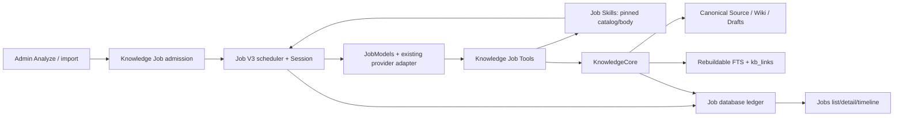

# Knowledge fixed Job — Tài liệu triển khai V3

Ngày: 2026-10-19.

Trạng thái: thiết kế triển khai từ yêu cầu đã chốt; **chưa triển khai runtime**.

Mốc code đối chiếu: `05e29830`; working tree đã có tài liệu yêu cầu và Knowledge Skill.

Nguồn yêu cầu: [fixed Job requirements](ai-ingest-fixed-job-requirements-v3.md).

Quyết định kiến trúc: [ADR 0125](../adr/0125-knowledge-job-tools-skills-and-publication.md).

Thuật ngữ: [GLOSSARY](../../GLOSSARY.md#knowledge-jobs-and-job-skills), với [CONTEXT](../../CONTEXT.md) là điểm vào domain của repo.

## 1. Kết quả cần đạt

Knowledge Job chạy một Agent Session chuyên Knowledge bằng provider riêng, dùng native ToolCall/ToolResult của Job V3. Agent đọc Source, search/read Wiki, xem liên kết, tạo/sửa draft và tự publish. Knowledge Prompt và Knowledge Skill nền được nạp sẵn; skill bổ sung được chọn từ Skill Catalog bằng `load_skill`. Job xuất hiện trong Jobs list/detail hiện có.

Admission Knowledge v2 đặt `JobRequest.output_format=markdown` (giá trị đã có trong Job contract). Kết quả dành cho người dùng nằm ở `result.markdown`; Job Detail render bằng Markdown thay cho khối plain text hiện tại. JSON result envelope tiếp tục giữ metadata execution/coverage/publications để server và UI xác định kết quả thật.

Không yêu cầu Structured Output, không thêm scheduler hoặc LLM protocol. Phiên bản đầu không có Knowledge sub-agent, shell, binary extraction, semantic search, skill upload UI, hot reload hay transaction nhiều trang. [LLM Wiki](../llm-wiki.md) là tài liệu ý tưởng; các tính năng như query-to-page, periodic maintenance và slide generation không tự trở thành phạm vi triển khai.

“Fixed” mô tả loại nhiệm vụ, không phải một Job tồn tại vĩnh viễn. Mỗi lần Analyze/auto import có một Job ID, deadline và kết quả riêng. `Staged Wiki Draft` là chưa publish, không đồng nghĩa bắt buộc chờ con người duyệt. `verified` tiếp tục chỉ trạng thái đã qua kiểm tra publication của hệ thống, không phải chứng nhận diễn giải của AI là đúng.

## 2. Module, interface và seam

| Module | Interface cho caller và test | Implementation sở hữu |
| --- | --- | --- |
| Job Skills — mới, dùng chung | `snapshot(profile) -> InstructionSnapshot`; `load(session, skill_name) -> SkillObservation` | Đọc tài nguyên, catalog theo quyền, pin nội dung/digest, chống tên/path giả, giới hạn context và loaded state |
| Knowledge Job — thay execution v2 | `analyze_source(source_id, key)`; executor `run(job_id, cancellation)` | Admission, Session chuyên Knowledge, vòng LLM/tool, budget, completion từ ledger |
| Knowledge Job Tools — adapter riêng | `definitions(contract)`; `invoke(context, call) -> ToolObservation` | Ánh xạ native tool, validate schema và dispatch vào KnowledgeCore/Job Skills; không tự ghi Markdown hoặc SQL |
| KnowledgeCore — mở rộng | `read_source/read/search/links`; `apply_job_change(context, command)`; Admin `resolve_job_draft(context, decision)` | Quyền đọc, CAS, draft ownership, Wiki Provenance, publication intent/recovery, giải quyết draft còn owner và canonical/index lifecycle |
| Job database — mở rộng interface hiện có | Session attachment theo mode/pin; reserve/settle Step; lưu instruction snapshot; read authoritative Knowledge outcomes | Transactions, uniqueness, metadata-only events, Job terminalization/deletion |
| Admin/Jobs Web — adapter | Settings/Analyze/Job list/detail interfaces hiện có | Mapping contract, nhãn Knowledge, Source/Wiki navigation và hiển thị lỗi/kết quả |

Các chữ ký là thiết kế, chưa phải hàm đã có. Command ghi nên là enum `Create / Edit / Publish`; caller không phải học thứ tự khóa, SQL và filesystem recovery. Tool adapter không chia sẻ quyền ghi với generic plugin adapter.

Seam thực là `JobModels` đã có (managed provider và execution fixtures), filesystem/SQLite persistence và interface KnowledgeCore. Không thêm trait cho từng tool hoặc wrapper chỉ chuyển tiếp. Test gọi cùng interface mà executor/Admin dùng; không mock riêng từng hàm private rồi bỏ qua CAS/publication.



## 3. Contract version và các chỗ phải sửa

Giữ `execution_mode=knowledge_ingest_v3`; thêm `execution_version` trong Knowledge snapshot: thiếu field được hiểu là **1**, admission mới dùng **2** sau khi Admin bật rõ ràng. Unknown version từ chối, không fallback. Giữ nguyên orchestrator/worker pins rỗng; `analysis_provider` là pin duy nhất. Không mượn global Orchestrator pin để vượt validation Session.

| Code hiện có | Thay đổi |
| --- | --- |
| `services/background/model.rs`, `services/knowledge/processing/mod.rs` | Versioned snapshot và instruction/tool contract identity; deserialize/serialize lịch sử không thêm field vào v1 khi không cần |
| `background/knowledge_ingest/admission.rs`, `database/jobs/knowledge.rs` | Replay trước live preflight; pin Source/provider/settings/instructions; v2 bỏ catalog tối đa 16 targets cố định và dùng search/read |
| `background/knowledge_ingest/settings.rs` | Tách readiness khỏi đọc Settings; bỏ gate `openai/chat_completions/supports_structured_outputs` cho v2 |
| `database/jobs/sessions.rs` | Attach Knowledge Session với đúng `analysis_provider`; hiện `create_root_session` chỉ chấp nhận `snapshot.orchestrator`. Giữ invariant Root/Child cũ, resolve role/pin từ saved mode/version phía server |
| `background/knowledge_ingest/execution.rs` | Dispatch v1 executor cũ hoặc v2 native tool loop; thiếu contract hợp lệ là lỗi |
| `database/jobs/providers.rs`, `eligibility.rs`, `orchestration.rs` | Authorize cùng provider pin/version tại model turn và trước ghi; Knowledge enabled độc lập Background Orchestrator toggle |
| `background/scheduler.rs`, `database/jobs/recovery.rs` | Dispatch đúng version, cancel/recover và không replay write khi chưa biết outcome |
| `background/orchestration.rs` | Nhánh settle lỗi Knowledge v2 lấy kết quả đã commit từ ledger; hiện gọi `finish_job(..., result=None)` có thể bỏ phần publish đã thành công |
| `database/jobs/deletion.rs` | Xóa metadata mới đúng FK order; chặn xóa khi còn intent/draft owner chưa giải quyết; không xóa canonical Wiki |

Snapshot v2 giữ Source ref/hash, settings revision, một provider pin, max pages, instruction snapshot identity, tool contract version và limits. Ngày/phiên bản tài liệu không được dùng thay hash nội dung.

Đối với submit có key đã tồn tại, đối chiếu Source identity và request options đã gửi với receipt đã lưu; không rebuild fingerprint từ settings/provider live rồi từ chối replay vì môi trường đổi. Key với Source/request khác trả conflict. Settings/provider hiện tại chỉ chi phối admission mới. Auto-import key không biến thành lệnh replay v2 cho Job v1 cũ; chạy lại rõ ràng tạo key mới.

## 4. Job Skills và instruction snapshots

### 4.1 Tài nguyên và profile

Tạo module `services/background/skills/` với implementation đọc catalog và load; SQL riêng ở `database/jobs/instructions.rs`. Đã có [Base Job system prompt](../../resources/job-prompts/base.md) tại `resources/job-prompts/base.md` và [Knowledge Skill](../../resources/job-skills/knowledge/SKILL.md). Cần thêm `resources/job-prompts/knowledge.md` khi triển khai. Các file hiện tại chưa được runtime nạp.

Deployment cấu hình một thư mục Job Skills và allowlist skill theo profile Knowledge/Root/Child. Mặc định chỉ bundle nền của hệ thống; không tự quét `~/.codex/skills` hay thư mục người dùng trên host. Knowledge profile yêu cầu skill `knowledge`; profile Root/Child không được tự thừa hưởng prompt/quyền Knowledge. Plugin-only Job không tạo Skill Catalog.

Khi startup, validate UTF-8, `name/description`, tên thư mục khớp, tên duy nhất và dung lượng; chỉ đọc `SKILL.md` dưới root do Admin cấu hình, từ chối symlink/path escape. V1 không chạy `scripts/` hoặc đọc references tùy ý. Skill lỗi làm profile liên quan unavailable với diagnostic rõ, không tự bỏ skill nền rồi vẫn cho Knowledge ghi. Không làm hỏng Voice/unrelated Job nếu profile Knowledge lỗi.

### 4.2 Persistence và context

Thêm instruction snapshot bất biến trong application DB, gắn Job, gồm prompt text, danh sách skill metadata và body theo digest; không nhét toàn bộ bundle vào `jobs.snapshot_json` (giới hạn hiện tại 262,144 bytes). Đây là tài nguyên đầu vào của Job, không phải ingest-run ledger hoặc Wiki store. Lưu cùng transaction admission để không có Job hợp lệ trỏ tới bundle chưa lưu.

Giới hạn khởi điểm: tối đa 32 skill/profile, 16 KiB/body skill, 4 KiB/catalog metadata và 256 KiB/instruction bundle theo bytes UTF-8 đã serialize. Knowledge Prompt + skill nền + catalog phải vừa System message và provider context budget theo contract mới ở mục 5.2, không tiếp tục áp cap message 32 KiB cũ cho contract mới. Nếu bundle hợp lệ nhưng không vừa budget Session, trả capacity error trước model call; không truncate skill.

Session prefix: Base Job prompt → Knowledge Prompt → Skill Catalog metadata → Knowledge Skill nền; sau đó task chứa Source identity, không nhét toàn Source vào System. Generic Root/Child chỉ nhận prefix theo profile của mình, còn prompt nghiệp vụ đã có được bảo toàn.

Nạp `resources/job-prompts/base.md` vào System prefix chung trước prompt của role/loại Job, pin nội dung cùng instruction snapshot. Prompt này yêu cầu narrative/summary Markdown nhưng giữ nguyên native tool arguments và các field typed của completion schema. Knowledge dùng `finish_job`; Child dùng completion mechanism của role hiện có, không bị Base prompt ép gọi tool của Root. Job lịch sử không có instruction contract mới giữ nguyên System prefix đã lưu.

`load_skill(name)` resolve duy nhất trong snapshot của Session. Runtime trả tên/digest/body ở ToolResult đúng call ID. Lần đầu commit ToolResult và metadata event cùng transaction rồi mới gọi model tiếp; lần sau trả `already_loaded` cùng identity, không lặp body. Loaded state lấy từ transcript đã commit, tránh tạo một cache nguồn chân lý thứ hai. Preloaded skill được xem là loaded từ prefix. Tool từ chối tên không có, path/URL và digest sai.

Các cap hiện tại 32 KiB/message, 64 KiB/transcript và 64 KiB/provider messages là điểm cần mở rộng đồng bộ cho contract mới theo mục 5.2. Tính theo serialized transcript trước append để không vượt giới hạn do JSON escaping; reserve chỗ cho ToolResult/error của call trước khi chạy side effect. Tool schema budget 16 KiB hiện tại là giới hạn riêng, không dùng nó để cắt tool output. Chưa thêm compaction tự động trong phiên bản đầu; khi không còn context, chuyển sang continuation/artifact khi có thể hoặc kết thúc có lỗi/báo phần đã commit, không bỏ Source/evidence rồi tiếp tục như đã đọc đầy đủ.

## 5. Knowledge tool interface

Tool schema được Rust định nghĩa một chỗ; skill không chép lại schema. Các tên dưới đây là tên logic, compiler native tool của Job chuẩn hóa tên theo provider và giữ mapping ngược về allowlist. Provider nhận tool definitions và ToolResults bình thường; không gửi Structured Output response format.

| Tool | Input contract v2 | Observation |
| --- | --- | --- |
| `load_skill` | `name` | `loaded/already_loaded`, identity và body khi load lần đầu |
| `knowledge.read_source` | `source_ref`, `cursor` (null cho lần đầu), `max_lines`, `max_bytes` tùy chọn | Source identity/hash, text, `byte_range`, `total_bytes`, phạm vi dòng thực, `has_more`, `next_cursor` |
| `knowledge.search` | `query`, `limit` | Hit ID/title/path/revision/passage/provenance; `truncated` khi còn kết quả |
| `knowledge.read` | `wiki_id`, `cursor` (null cho lần đầu), `max_lines`, `max_bytes` tùy chọn | Canonical hoặc Job-owned draft rõ trạng thái, base/draft revision, body/hash, provenance và cùng pagination contract với Source read |
| `knowledge.links` | `wiki_id`, `direction`, `limit` | Outgoing/incoming/unresolved, ID/path/revision, vị trí link, canonical/preview, `truncated` |
| `knowledge.create` | `operation_key`, title/folder/name/body, provenance | Stable ID do server cấp, path thực, Job-owned draft revision/hash |
| `knowledge.edit` | `operation_key`, ID, expected base/draft revision, replacement body/title, provenance | Draft revision/hash mới, giữ canonical ID/path |
| `knowledge.publish` | `operation_key`, ID, expected base/draft revision | Accepted revision/hash, Source refs và index health |
| `finish_job` | Summary bằng Markdown, findings/unresolved theo schema Job; không nhận accepted IDs từ LLM làm authority | Kết quả Job gồm `markdown` từ summary và ledger hoặc lý do từ chối kết thúc |

Input luôn `additionalProperties=false`; bound bytes, depth và array lengths ở Rust sau parse, không dựa vào model tuân schema. Contract mới cho phép đọc 1–2.000 dòng, mặc định yêu cầu 128 KiB text/trang và tối đa theo budget tool output ở mục 5.2; có thể yêu cầu trang nhỏ hơn. Search tối đa 50 hits theo giới hạn index hiện có, links tối đa 500 cạnh, nhưng tổng bytes vẫn phải vừa budget thực. Không dùng cap 8 KiB cũ làm giới hạn chung cho tool nặng.

### 5.1 Cursor chung cho Source và Wiki reads

- `cursor=null` bắt đầu tại byte 0 của Source text hoặc Wiki body hiện tại. Observation trả `byte_range={start,end}` theo khoảng nửa mở `[start,end)`, `total_bytes`, `text_sha256`, phạm vi dòng 1-based và `next_cursor`. Bytes/hash phải cùng biểu diễn UTF-8 được dùng cho evidence; không thay newline khi phân trang.
- Cursor là token opaque do runtime phát hành, tham chiếu continuation của một observation đã commit. Nó gắn Job/Session, resource kind/ID, Source version/hash hoặc Wiki view (canonical/draft), revision/body hash, và byte offset tiếp theo. Runtime resolve từ read observations của Session, kiểm tra quyền lại trên mỗi call; không tin offset hoặc identity do client tự dựng.
- Mỗi lần đọc trả tối đa `max_lines` dòng có giao với fragment và số bytes được yêu cầu trong budget thực, sau khi reserve metadata/JSON encoding. Điểm cắt phải ở UTF-8 character boundary. Nếu cap bytes cắt giữa dòng, `next_cursor` tiếp tục đúng `end` trong cùng dòng; không nhảy sang dòng mới. Có thể trả một dòng thành nhiều fragment.
- `has_more` bằng `end < total_bytes`; `next_cursor` khác null khi còn bytes và null tại EOF. Fragment không rỗng phải tiến offset; token sai/ngoài Session trả `invalid_cursor`, Wiki view/revision/hash đổi trả `revision_conflict`, Source đổi hash trả `source_evidence_unverified`. Không reset về trang đầu âm thầm.
- Đọc lặp một fragment hợp lệ không tăng coverage hai lần. Metadata Step giữ identity, hash, total size và byte range; không cần bản sao Source. Coverage chỉ được tính sau khi matched ToolResult đã commit thành công; Step chạy xong nhưng ToolResult chưa giao vào Session không chứng minh Agent đã đọc.

Ví dụ khi Agent yêu cầu trang nhỏ hoặc context chỉ còn khoảng 8 KiB, một dòng dài 12 KiB được chia trước cap tại UTF-8 boundary, rồi cursor tiếp tục phần còn lại trên cùng dòng tới EOF. Nếu budget đủ thì có thể trả cả dòng. Không có `next_from_line` để Agent phải đoán offset. Cursor v2 không thay interface line-based của legacy Job/Admin reads.

Source read chỉ cấp Source mới đã pin và Source trong provenance được runtime xác minh của trang đã đọc, để Agent có thể kiểm tra bằng chứng cũ khi update. Không cho một Source ID tùy ý từ LLM mở rộng tập đọc. Source import vẫn giới hạn UTF-8 Markdown v1 hiện có; bỏ giới hạn **one-turn** 40 KiB chỉ khi pagination/context checks đã hoạt động. Source hợp lệ nhưng không thể xử lý trong budget phải báo incomplete/capacity, không khẳng định đã ingest đầy đủ.

Edit replacement body tối đa 16 KiB ở V1; Wiki lớn hơn phải bị từ chối rõ trước ghi. Runtime lưu bằng chứng Session đã đọc đầy đủ revision đang edit, từ transcript observations; thay revision thì phải đọc lại. Không giả định thấy một search passage là đã đọc cả trang. Không nới giới hạn vault 512 KiB chỉ để tool nhận payload lớn hơn.

Errors có envelope chung `code`, `retryable`, `details` bounded. Phân biệt `revision_conflict`, `draft_owned_elsewhere`, `source_evidence_unverified`, `source_incomplete`, `invalid_cursor`, `index_stale`, `invalid_arguments`, `operation_key_conflict`, `unknown_outcome`, `permission_revoked`, `capacity_unavailable`. Lỗi tool xác định được ghép ToolResult để Agent sửa trong budget; database/runtime uncertainty dừng ghi phụ thuộc.

### 5.2 Output budget cho tool nặng

Mục tiêu là xử lý thoải mái Source/text dài, nhiều search hits, quan hệ Wiki và kết quả document/data tools, thay vì yêu cầu nhiều vòng chỉ vì cap byte nhỏ. Dùng cơ chế budget chung cho các Job có tool contract mới, gồm Knowledge và generic Jobs. Các giá trị dưới đây là mặc định triển khai đề xuất, chưa phải cap của runtime đang chạy; deployment có thể điều chỉnh, và từng Job pin output limits khi admission.

| Tầng | Mặc định đề xuất cho contract mới | Cách áp dụng |
| --- | --- | --- |
| Inline ToolResult | 256 KiB UTF-8 đã serialize | Gồm envelope/metadata; nội dung raw cần chừa chỗ cho JSON escaping. Read mặc định yêu cầu 128 KiB text để còn headroom |
| Một Session message | 1 MiB đã serialize | Đủ chứa ToolResult và wrapper/call metadata; kiểm tra payload cuối, không chỉ độ dài raw text |
| Private persisted transcript/Session | 8 MiB | Lưu các vòng tool lớn; không có nghĩa được gửi cả 8 MiB vào model bất kỳ |
| Tổng message content/request LLM | Tối đa 2 MiB theo deployment, đồng thời vừa context của provider/model | Bao gồm System, history, tool messages và phần encoding native adapter; chừa token budget cho tool schemas và model output |

Đây là các giới hạn cho output/transcript, không tự nâng kích thước canonical Wiki, evidence header, tool write arguments, Markdown final report hoặc metadata events. Giữ validation/ownership/deadline và giới hạn artifact hiện có. Số Job đồng thời cùng budget RAM/DB phải được tính vào cấu hình, không cấp buffer vô hạn cho mỗi tool.

Điểm cần sửa cùng lượt: `database/jobs/sessions.rs` (read/append message và history byte checks), `background/models.rs` (request size checks), native provider adapter/wire limits, tool-specific response caps và mọi SQL CHECK có liên quan. Kiểm tra Root/Child, plugin result projection và Knowledge adapter: không còn truncate về 8/16/32/64 KiB ở một tầng cũ rồi báo complete cho contract mới. Legacy contract giữ giới hạn đã hỗ trợ; không sửa snapshot cũ để hưởng cap mới ngầm.

Runtime tính effective output budget bằng min của tool/deployment cap, chỗ còn lại trong message/transcript/request và context/token budget được xác minh của provider/model. Byte limit không thay token limit. Nếu chưa xác định được model context thì dùng budget đã cấu hình/qualification cho route đó, không đoán context từ tên model; báo lý do khi route không chứa được trang được yêu cầu.

Khi dữ liệu lớn hơn inline budget:

- Source/Wiki text dùng cursor, giữ bytes/ranges/hash và quyền đọc như mục 5.1. Có thể giảm kích thước trang khi context còn ít; metadata trả `effective_max_bytes` và lý do cap.
- Generic tool có full output lớn lưu vào cơ chế immutable Job Artifacts hiện có bằng bounded copy/stream; trả preview, `truncated=true`, artifact ID, MIME, size/hash và cách đọc tiếp qua tool đã được cấp. Artifact không mở thêm quyền hoặc bỏ qua per-Job/global storage quota. Với Source/Wiki đã có canonical file, ưu tiên cursor trực tiếp, không tạo bản sao artifact không cần thiết.
- Search/links nhiều kết quả trả dấu hiệu truncated và continuation có identity phù hợp khi còn trang đọc tiếp; không gửi một danh sách khổng lồ gây tràn context. Thiếu context thực sự thì báo capacity/incomplete, không giả rằng tham chiếu artifact là nội dung đã đọc.

Full artifact và durable read observations có thể được giữ ngoài inline ToolResult, nhưng Source coverage chỉ tính các bytes thực đã giao thành công vào Knowledge Session. Artifact reference hoặc preview không đủ để `finish_job` báo success. Session persistence có thể chứa nhiều hơn provider context; phiên bản đầu không tự tóm tắt/bỏ history để nhét request vượt context. Khi lịch sử không còn vừa request, kết thúc có báo cáo phần đã xử lý thay vì tiếp tục append một trang rồi mới phát hiện model không đọc được.

Đo duration, raw/encoded bytes, inline/artifact outcome và lý do giới hạn qua metadata metrics/events; không ghi full output vào SSE/log. Test kết quả lớn hơn cap cũ và sát cap mới, JSON escaping/Unicode, nhiều tool rounds và hai Job đồng thời. Các số mặc định cần được xác nhận bằng deterministic fixtures và kiểm tra resource use trước rollout, không coi việc tăng constants là qualification đủ.

## 6. Canonical provenance và draft ownership

### 6.1 Mở rộng record có tương thích

Thêm metadata tùy chọn cho Wiki record: `provenance_version`, `source_refs`, `evidence`, `draft_owner` và `last_job_operation`. Parser/serializer và revision snapshots cùng giữ chúng. Giữ `source_ref` cũ cho record v1, không tự sửa mọi file khi startup; Memory record và Admin-authored legacy Wiki vẫn đọc được. Metadata phải vừa giới hạn header 16 KiB hiện có; validate dung lượng header đã serialize trước intent, không tăng cap hoặc cắt evidence để nhận write. Dùng encoding nhất quán với frontmatter reader hiện có; thêm roundtrip tests cho arrays/offsets/ownership thay vì giả định parser scalar hiện tại tự hiểu cấu trúc mới.

Với provenance v2, `source_ref` chỉ là primary Source để tương thích hiển thị. Verification phải kiểm tra **mọi** reference được trích, không chỉ primary. Evidence gồm Source ref/hash, source line/quote offsets/hash và body span/hash được hỗ trợ; offset là bytes UTF-8, range có quy ước rõ. Không lưu copies của quotes trong application intent metadata; nội dung chính và evidence canonical đi cùng Markdown revision.

Ví dụ: trang về LLM có phần A từ S1, Source S2 thêm phần B. Edit phải giữ evidence S1 cho A và thêm S2 cho B. Rust xác nhận Source/hash/spans và rằng body spans đúng bytes; nó không tuyên bố A/B đã được kiểm chứng ngữ nghĩa. Sửa paraphrase làm đổi body span thì Agent phải cung cấp evidence mapping mới. Vùng nội dung cũ không còn đủ evidence không được âm thầm gắn Source mới.

Trang legacy chỉ có Source-level provenance được giữ nguyên cách đọc. Khi edit v2, runtime giữ reference cũ nhưng yêu cầu mapping cho nội dung được giữ lại và thêm/sửa; Agent có thể đọc Source cũ qua read_source có quyền nêu trên. Nếu không thiết lập được mapping hoặc Source cũ hỏng, trả blocker, không nâng toàn trang thành provenance v2 bằng checksum đơn lẻ.

Phải sửa cùng lượt: Record DTO/serializer/parser, draft/publish/history, Source verification, index rebuild/Agent read/search, graph health, Admin read/edit/publish DTOs và fixture roundtrip. Admin edit không được làm rơi metadata v2 vì DTO cũ chỉ biết một `source_ref`. Không dùng DB làm nơi duy nhất giữ evidence.

### 6.2 Ownership và vòng đời

`draft_owner` chứa Job identity và operation tạo draft do Rust gán; Tool args/Admin DTO không cho forge trường này. Human draft có owner human/không có Job owner. Mỗi lần ghi kiểm tra trên canonical/draft hiện tại dưới process-wide `vault::WRITE_LOCK`, đồng thời kiểm tra legacy active proposal giữ target.

Create cấp stable ID và path trước intent. Edit canonical đã verified tạo staged draft, giữ base revision và owner; edit draft chỉ nhận đúng Job owner. Publish thành công bỏ draft owner khỏi accepted record nhưng giữ `last_job_operation` cho recovery; lịch sử giữ metadata đã commit. Human sửa một Job-owned draft phải là thao tác tiếp quản rõ ràng có CAS, không vô tình đổi ownership qua save cũ.

Job kết thúc lỗi/hủy không tự xóa draft. Draft còn lại hiển thị owner/blocker cho Admin; một Job mới không tự chiếm nó. Trước xóa Job history, yêu cầu giải quyết ownership/intent rõ ràng hoặc giữ được đủ recovery evidence; V1 chọn trả delete conflict khi còn owner/intent. Không xóa Wiki vì xóa Job.

### 6.3 Admin giải quyết Job-owned Wiki Draft

Thêm interface authenticated Admin `POST /api/admin/knowledge/pages/{id}/draft-resolution`. Body: `action` (`adopt | discard`), `owner_job_id`, `expected_draft_revision`, `expected_base_revision` (null cho trang mới), `expected_content_sha256` và `operation_key`. Handler chỉ gọi `KnowledgeCore::resolve_job_draft`; tool allowlist của LLM không có thao tác này. Đây là quyền giải quyết công việc còn lại sau Job, không phải bước approve bắt buộc của ingest.

Điều kiện chung: owner Job đã terminal, draft còn đúng owner/revision/base/content hash và mọi write intent liên quan target đã xác định kết quả. Job đang active, revision thay đổi, legacy proposal khác giữ target hoặc intent còn unknown trả 409 kèm lý do. Admin hủy Job trước và chờ settle/reconciliation nếu cần; không dùng resolution để bỏ qua unknown outcome.

| Action | Kết quả |
| --- | --- |
| `adopt` | Chuyển draft sang quyền người dùng, giữ nguyên body/provenance/base, ghi một draft revision mới với owner Job đã giải phóng. Không publish. Admin tiếp tục edit/publish bằng interface hiện có; Job mới vẫn tôn trọng human draft |
| `discard` | Lưu snapshot draft và audit trước khi bỏ draft khỏi trạng thái active. Với staged replacement, giữ nguyên Wiki accepted; với trang mới chưa từng publish, chỉ bỏ draft active, giữ history. Sau đó Job mới có thể tạo/edit lại theo admission bình thường |

Ghi resolution intent bền vững gồm Admin identity, action, key, owner, expected revisions/hash trước filesystem mutation; giữ audit và immutable draft history theo machinery hiện có. Intent/outcome là metadata giải quyết draft, không cập nhật kết quả hoặc status của terminal Job/Step. Cùng key/input trả outcome cũ, khác input cùng key trả conflict. Sau crash, reconcile đúng ownership revision hoặc archive/tombstone trước cleanup; không xóa một draft mới hơn khi replay discard. Resolution đã commit nhưng DB ACK lỗi phải đọc lại được mà không lặp takeover revision hoặc discard lần nữa.

Response trả action, Wiki ID, owner hiện tại, draft/base revision hiện tại (null khi không còn draft) và resolution identity. Jobs Detail đặt hai action này bên draft còn lại; với `discard` hiển thị rõ bản draft nào được bỏ và giữ nguyên accepted Wiki/history. Không sửa layout Explorer hoặc thêm Review workspace. Hiển thị current resolution từ audit khi đọc Detail, không viết lại `result_json` của Job terminal. Job history chỉ được xóa khi không còn owner/intent cần bảo vệ; sau adopt, human draft vẫn tồn tại độc lập với Job cũ.

## 7. Durable writes trên Job ledger

### 7.1 Lưu dữ liệu nhỏ, không thêm run ledger

Mọi Knowledge read/write/load tool call có Step identity gắn Job/AgentRun/decision/call ID để hiện Timeline; `finish_job` là control decision, không tạo một pending write Step rồi tự chặn completion. Reuse `job_steps`; không giả làm Plugin Installation hoặc gán worker instance cho in-process writes. Read/skill Steps giữ bounded metadata/result, không payload Source/Markdown trong SSE. Private transcript giữ native call/results theo retention hiện có.

Thêm bảng companion `job_step_knowledge` gắn `(job_id, step_key)` của **write Step**, với unique `(job_id, operation_key)`. Bảng chứa command kind, request fingerprint, Wiki ID, expected/committed revisions, content/provenance hashes, intent phase và bounded outcome. Đây là extension của Step evidence, không có queue, running Job state hoặc scheduler riêng. Không đưa body vào bảng này. Nếu reuse `arguments_json`, chỉ lưu refs/hash cho Knowledge Steps, giữ full tool arguments trong private transcript.

`operation_key` được LLM gửi nhưng namespace/identity owner do server gán; cùng key/input trả outcome trước đó và ghi observation cho call ID mới. Khác input với cùng key trả conflict. Cùng nội dung nhưng key khác vẫn bị target CAS/owner/no-change checks; key mới không chứng minh write cũ thất bại.

### 7.2 Thứ tự thực hiện

1. Validate toàn batch, IDs/schema, quyền, budget và khả năng ghi ToolResult trước side effect. V1 chỉ một write/batch, các read xử lý tuần tự.
2. Giữ publication authorization read guard rồi lấy vault writer; Settings/revocation dùng publication write guard theo thứ tự hiện có. Không giữ SQLite transaction khi chờ LLM hoặc scan dài. Mọi writer tuân cùng lock order, không lồng API tự lấy lại vault lock.
3. Revalidate live Job status/deadline/pin/enabled và target revision/owner/evidence. Reserve operation/Step intent trong transaction ngắn; commit trước filesystem.
4. KnowledgeCore commit draft hoặc accepted Wiki + metadata operation bằng atomic rename/fsync và immutable history hiện có.
5. Settle Step metadata/result từ record đã commit; append matched ToolResult trước model call kế tiếp. Riêng publish commit thì reconcile index; index lỗi không đổi thành failed publication.

Cancellation trước bước ghi trả cancelled; cancellation sau canonical commit vẫn ghi nhận commit, ngăn write tiếp. Không giữ canonical content trong transaction SQL để giả lập atomicity DB/filesystem.

### 7.3 Recovery matrix

| Điểm gián đoạn | Phục hồi |
| --- | --- |
| Chưa intent | Chưa có write được nhận; Job lỗi theo lifecycle hiện có |
| Intent có, không tìm thấy record/history chứng minh commit | Không replay; đánh dấu operation unresolved để kiểm tra, không kết luận rollback từ việc file không tồn tại |
| Draft commit, chưa Step ACK | Đối chiếu ID/owner/operation/revision/content/provenance hash, settle draft outcome một lần |
| Publish commit, chưa Step ACK | Đối chiếu accepted revision hoặc immutable history và operation marker, settle publication; không tạo revision mới |
| Canonical đã có revision mới hơn | Tra đúng revision history của operation; không dùng chỉ current file để kết luận write cũ thất bại |
| Hash/revision/owner không khớp | Unknown outcome, dừng ghi liên quan và báo Admin; không overwrite |
| Canonical commit, index lỗi | Giữ accepted outcome, mark index stale, rebuild riêng; graph/search từ chối stale |

Không resume LLM tự động trên transcript có unmatched write intent. Recovery giải quyết evidence trước terminalization; Job restart vẫn theo chính sách fail-stop hiện có. Không thêm cơ chế tự chạy lại cả Job. Rerun rõ ràng là admission mới và đọc trạng thái Wiki mới.

## 8. Vòng Agent, budget và completion

Tái sử dụng `JobModels::turn_traced`, reserve_model_call, model activity và provider native tools mode hiện có. Knowledge loop không gọi generic Root delegation/finish coverage vì nó yêu cầu Child artifacts. Chia sẻ helper có hành vi thực sự chung (Session turn, call IDs, batch validation), không xây framework executor nhiều tầng.

Mỗi vòng: kiểm tra cancellation/deadline → đọc transcript → reserve LLM call → model turn → validate ToolCalls → thực thi/ghép ToolResults → tiếp tục. Text/refusal/truncated/invalid batch nhận repair có giới hạn hoặc lỗi theo native Job contract; không parse prose thành JSON candidates fallback.

Giữ `max_steps`, `max_worker_rounds`, `max_total_llm_calls`, `max_plan_repairs`, deadlines và max pages. Mọi read/write/load Step mới đều dùng Step budget; replay cùng operation dùng observation của Step đã có, không reserve mutation mới. `finish_job` dùng model/decision budget nhưng không reserve write Step. Max pages là giới hạn số Wiki ID thay đổi, không phải mục tiêu phải tạo đủ; edit nhiều lần không vượt bằng đổi operation key. Không nâng budget global để làm một demo pass.

`finish_job` kiểm tra ledger, không tin danh sách published do model nói. Kết quả tối thiểu gồm `execution_version`, Source ref, source coverage (`total_bytes`, `read_bytes`, `complete` và missing ranges có giới hạn), published pages (ID/path/revision/change kind), remaining drafts, blocked/skipped reasons và index health. LLM chỉ cung cấp summary/findings/unresolved, không cấp accepted identity hoặc tự khai `source_complete`.

### 8.1 Source coverage là điều kiện bắt buộc của completion

Analyze V2 mặc định ingest **toàn bộ Source được pin**, không có partial-scope success. Runtime hợp các byte ranges đã được giao thành công qua `knowledge.read_source` của chính Knowledge Session với đúng Source ref/version/hash; hợp phải phủ `[0,total_bytes)` và có EOF observation hợp lệ mới đặt `complete=true`. Khoảng đọc trùng chỉ tính một lần; đọc Source khác từ Wiki Provenance, chỉ search passage, chỉ đọc trang cuối hoặc nhận response lỗi không bù được phần thiếu.

Cả `succeeded` có publish lẫn `succeeded/no_change` đều yêu cầu coverage đầy đủ. Nếu model gọi `finish_job` sớm, trả ToolResult `source_incomplete` với missing ranges/continuation gần nhất có giới hạn để đọc tiếp khi còn budget. Hết budget hoặc không thể đọc tiếp thì Job `failed` với `source_incomplete`, giữ các trang đã publish và coverage chưa đủ trong result. Summary/no-change reason của LLM không được bypass gate này. `complete` chỉ chứng minh bytes đã vào Session, không chứng minh AI hiểu đúng nội dung.

| Tình huống | Job terminal state |
| --- | --- |
| Source coverage đầy đủ, mọi thay đổi được nhận đã publish, không còn intent/draft/blocker | `succeeded` |
| Source coverage đầy đủ, Source không có nội dung hỗ trợ hoặc thông tin mới, không có write pending | `succeeded`, outcome `no_change` với lý do |
| Source coverage chưa đầy đủ | Từ chối completion để Agent đọc tiếp trong budget; không thể tiếp tục thì `failed/source_incomplete`, giữ publications đã commit |
| Có blocker/unfinished work, dù một số trang đã publish | `failed`, giữ published pages và phần còn lại trong result |
| User cancel | `cancelled`, giữ published pages trong result |
| Unknown outcome | `failed` với trạng thái operation unresolved; không mô tả là chưa ghi gì |

V1 không dùng `partial_success` để che phần ingest chưa hoàn thành; published pages vẫn hiển thị ở Job lỗi. Nguồn có uncertainty nhưng Wiki đã diễn đạt đúng uncertainty không tự làm Job failed. Thiếu khả năng xử lý/ghi theo nhiệm vụ mới là blocker.

### 8.2 Markdown result contract

Knowledge Prompt/Skill yêu cầu LLM viết `finish_job.summary` bằng Markdown ngắn gọn; giữ nguyên native tool schema và các giới hạn summary/findings/unresolved hiện có. Không thêm một lượt Structured Output hoặc để LLM tự tạo JSON final result. Dùng headings, bullet lists, links và fenced code khi phù hợp; không bọc toàn báo cáo trong một code fence.

Rust dựng và lưu `result.markdown` trước terminal commit: phần tóm tắt từ LLM khi có, rồi các phần kết quả thực từ ledger gồm Source, coverage, Wiki đã tạo/cập nhật (ID/path/accepted revision), remaining drafts và blockers/degraded index. Tên/trường/link chèn từ dữ liệu phải được escape theo ngữ cảnh Markdown/URL; link Wiki dùng route của ứng dụng từ ID server đã xác minh. Metadata có cấu trúc và status vẫn là authority; nội dung do LLM viết không được thay thế chúng.

Giới hạn báo cáo Markdown 16 KiB UTF-8 và tổng `result_json` trong cap 65,536 bytes hiện có. Validate kích thước đã serialize và reserve chỗ cho các phần ledger trước terminalization. Bound summary từ model theo limit hiện có; không cắt mất Wiki/revision hoặc blocker để nhét một summary dài. V1 tối đa năm Wiki ID giúp phần outcome có giới hạn; khi dữ liệu vẫn quá lớn, dùng bản tóm tắt ngắn có identity/count và giữ chi tiết tại typed outcomes/Steps.

Success, no-change, failure, cancellation và startup recovery đều tạo báo cáo từ kết quả có thật. Nếu chưa có lời tổng kết của LLM, dùng template server nêu status/lý do và publications thực; queued Job bị hủy có báo cáo chưa bắt đầu, không đòi tạo Session. Đường settle lỗi và recover_jobs phải dùng cùng result builder **trước** khi Job thành terminal, vì terminal result bất biến. Không generate lại báo cáo bằng một model call khi đọc Detail; refresh/reload đọc đúng Markdown đã lưu. Resolution adopt/discard về sau vẫn hiển thị riêng từ audit, không sửa báo cáo lịch sử.

Ví dụ phần kết quả do server tạo (heading/list không đòi thêm GFM table support):

```markdown
## Kết quả Knowledge

- Source: `src_example:1`
- Đã đọc toàn bộ Source.

### Wiki đã xuất bản

- LLM — `wiki_example`, accepted revision 3.

### Phần còn lại

- Không có draft hoặc thao tác chưa xác định kết quả.
```

## 9. Search, link và quyết định create/update

Reuse FTS hiện có; thêm path/revision/provenance và fetch limit+1 để có dấu hiệu truncated. Không lấy 16 targets bất kỳ làm catalog đầy đủ. Test cùng chủ đề → edit, cùng thông tin → no-change, chủ đề khác liên quan → create + link, nhiều target mơ hồ → đọc thêm/blocker.

`knowledge.links` gọi interface KnowledgeCore lọc quyền trước khi trả kết quả; không lấy Admin Graph đã cap rồi mới bỏ draft, vì có thể bỏ mất hàng xóm verified. SQL thêm ở `database/knowledge_index.rs`, reuse `kb_links`; resolver preview giữ trong KnowledgeCore và không ghi projection. Chỉ Wiki verified và draft thuộc Job được đọc; draft người dùng/Job khác không xuất hiện trong nodes, edges, unresolved diagnostics hoặc counts.

Link A → B tồn tại trong Markdown A. Incoming của B là view ngược, không ghi một backlink vào B. Thêm/bỏ link qua edit/publish A; graph cập nhật từ canonical Markdown. Link target mới phải publish trước; index stale thì tool báo stale, không trả empty list. Không thêm semantic relation store hay tool ghi cạnh riêng.

## 10. Settings, API, Jobs Web và migration

### 10.1 Settings/admission

Giữ routes Analyze/import/settings hiện có. Settings response phân biệt execution version, provider tool capability và runtime availability; v2 không dùng `structured_qualified`. Danh sách provider chỉ đọc catalog/runtime state đã có; preflight acquire đúng provider được chọn ở enable/admission.

Add migration tiếp theo sau application `0125` (chọn số thực khi implement): thêm contract selection/version và instruction/Step extension tables, các constraints/index/events cần thiết. Không sửa migration đã chạy. `execution_mode` không đổi nên không rebuild jobs chỉ để thêm một mode string. Events mới phải cập nhật SQL CHECK whitelist, Rust event projection và TS union cùng lượt.

Migration đặt v2 chưa enabled; không đổi một deployment đang `review_all` thành tự publish. UI yêu cầu Admin chọn/bật v2 rõ ràng bằng Settings CAS. V1 queued/running giữ saved version/provider/policy; v1 Review APIs tiếp tục dùng policy cũ. Bật/tắt chung Knowledge vẫn áp dụng theo guard live, không tạo toggle phụ để bypass revoke.

Đối với v2, đổi public label/key sang `max_pages_per_source` (1–5); có thể dùng cột DB cũ để không migrate dữ liệu vô ích. V1 giữ `max_candidates_per_source`. Không chấp nhận hai field mâu thuẫn trong cùng request. Publication policy v2 cố định tự publish, không gửi ba lựa chọn cũ như còn hiệu lực. Các thay đổi request/response được version-discriminate, test client cũ trả lỗi rõ thay vì âm thầm bật quyền mới.

### 10.2 Jobs Web

`apps/admin-web/src/pages/jobs/JobsPage.vue` tiếp tục gọi list/count/search/status/pagination hiện có; giữ mọi mode, không filter Knowledge phía client. Add label Knowledge từ mode/version phía server và goal có tên Source. `apps/admin-web/src/pages/jobs/JobDetailPage.vue` đọc typed Knowledge result từ ledger, render Source ref, Wiki links/revisions, blockers, draft owner và degraded index. Không render raw model transcript hoặc giả có Child runs.

Detail hiển thị coverage chưa đủ và action Admin adopt/discard ở mục 6.3. Sau resolution, refetch current ownership/resolution riêng; không giả sửa kết quả lịch sử của Job đã kết thúc. Khi có unknown intent thì action bị từ chối rõ thay vì thông báo đã giải phóng target.

Sửa phần Result hiện đang gọi `summary(job.result)` và render bằng `<pre>` trong `JobDetailPage.vue`: ưu tiên `result.markdown`, fallback `result.summary` dạng string cho Job lịch sử, rồi render nội dung bằng helper Markdown escaped đang dùng ở `pages/knowledge/markdown.ts`. Dùng chung helper cho Jobs/Knowledge; nếu chuyển sang shared module thì giữ import/re-export tương thích và tests hiện có. Không thêm renderer/dependency thứ hai. Chỉ gắn HTML từ renderer đã escape raw HTML và kiểm tra URL; không dùng `v-html` trực tiếp với model text. Áp dụng typography cho heading/list/link/code và bố cục đọc được, không ép toàn báo cáo vào khối monospace/pre giới hạn chiều cao cũ.

Renderer áp dụng cho mọi Job có báo cáo Markdown, không lọc execution mode. Result chỉ có structured data giữ fallback escaped JSON view hiện có; không đưa `JSON.stringify(result)` qua renderer và gọi đó là báo cáo. Giữ diagnostic của Steps/Agent Runs và Artifact Gallery; thay đổi này chỉ nâng phần Result chung. Không cần Mermaid, editor hoặc GFM table mới. Job API/types bổ sung `markdown?: string` với các Knowledge outcomes đã xác định; các fixture legacy thiếu field vẫn hợp lệ.

Skills/Knowledge tool activity đi cùng Unified Job Activity; event payload chỉ identity/code/revision/usage, không body/evidence quotes/credentials. Cancel dùng route cũ. Ẩn generic retry safe-read đối với Knowledge; nếu có Run again thì gọi admission Knowledge với key mới, không gọi generic retry. Không thêm dashboard hoặc filter loại Job riêng.

Cập nhật `api/types/agent-jobs.ts`, typed Knowledge Settings API đang inline ở page, i18n và tests. Explorer layout, Reading/Compose/Graph và dirty-editor guard được giữ; thêm navigate links bằng route đang có, không tạo editor mới.

### 10.3 Build/deploy và deletion

Bundle nền Knowledge Prompt/Skill được nhúng bằng cơ chế compile-time resource của Rust (ví dụ `include_str!`), để binary/container dùng được khi cwd khác repo. Thư mục skill Admin bổ sung được cấu hình bằng path tuyệt đối và mount read-only; startup validate rồi tạo catalog, không đòi source tree trong deployment. Tên trùng skill nền bị từ chối thay vì override ngầm. Persist application DB cùng Source/Wiki/history; instruction snapshot đã pin trong DB tồn tại độc lập với file skill hiện tại.

Xóa Job terminal đã giải quyết hết intents/owners: xóa instruction snapshot và Step companion trước Steps, rồi theo thứ tự FK hiện có. Canonical Wiki, provenance và last operation marker không bị cascade xóa. Xóa history của Job khiến replay key không còn được giữ theo retention hiện tại; không quảng cáo idempotency vĩnh viễn sau explicit deletion.

## 11. Các bước triển khai và điều kiện hoàn tất

Thực hiện tuần tự; mỗi bước là một slice có test ở interface. Đây là plan, chưa tạo implementation tickets; khi tách tickets dùng `.scratch/<feature>/issues/NN-*.md` theo quy ước repo.

| Bước | Thay đổi chính | Điều kiện hoàn tất |
| --- | --- | --- |
| P0 — Contract/data | Snapshot version, glossary/ADR adoption, migration, Session pin/role attachment, fixture lịch sử | Đọc được v1; v2 attach đúng pin; migration giữ FK/immutable terminal và mặc định không tự bật publish |
| P1 — Shared Job Skills | Resource loading, instruction persistence, profile catalogs, `load_skill`, Root/Child integration | Agent tự chọn skill; body không preload hàng loạt; pin survive restart; permission và Session isolation đúng |
| P2 — Canonical Wiki model | Provenance v2, owner/operation metadata, parser/serializer/history, Admin và verified reads/index | Roundtrip đa Source; Admin save không mất evidence; draft khác không bị overwrite |
| P3 — Knowledge tools/recovery | Cursor read/search/links, output budgets lớn và artifact fallback chung, create/edit/publish, Steps + companion intent, Admin draft-resolution, recovery/deletion | Dòng dài/output vượt cap cũ đọc đủ mà không cắt ngầm; effective context/resource limits đúng; replay operation/resolution không nhân revision; draft Job lỗi được giải quyết và history được giữ; links không lộ draft |
| P4 — Knowledge Agent | Native loop, budgets/repair/completion với Source coverage gate, Analyze/import v2, output_format Markdown và shared terminal result builder | Create/update/no-change chạy qua production interface với provider không Structured Output; thiếu Source bị chặn completion; Markdown và typed outcomes giữ đúng partial commits kể cả lỗi/hủy/restart |
| P5 — Settings/Jobs/deploy | Settings contract, Jobs list/detail/i18n, Markdown Result renderer, coverage/adopt/discard controls, resource packaging, v1 Review regression | Job visible/cancel đúng; Markdown an toàn và legacy fallback đọc được; Admin giải quyết draft tại Detail; opt-in v2 rõ ràng; release/container tìm đúng tài nguyên |
| P6 — Qualification/rollout | Regression, HTTP adapter fixtures, process-crash qualification, optional real provider smoke | Required deterministic gates pass; remote evidence và giới hạn vận hành ghi riêng |
| P7 — Dọn code không còn dùng | Kiểm tra callers/exports/config/tests sau P0–P6; xóa implementation đã được thay thế và không còn phục vụ contract đang hỗ trợ | Có danh sách đã xóa/giữ cùng lý do; không còn dead code hoặc đường chạy trùng; targeted regression và checks liên quan pass sau xóa |

Không ship write tools trước P2/P3 và không bật admission v2 trước P4/P5. Generic Jobs chỉ thấy skill loader khi versioned instruction contract của chúng được tạo, không đổi transcript của Job cũ.

## 12. Test matrix và verification

| Interface/scenario | Bằng chứng bắt buộc |
| --- | --- |
| Instructions | Thêm skill hợp lệ → Job mới thấy; duplicate/bad/path/symlink bị chặn; file đổi sau submit vẫn load body cũ; Root/Child loaded state độc lập |
| Native provider | Provider tool calling với `supports_structured_outputs=false`; Chat/Responses paths đang được Job hỗ trợ; không có Structured response_format, invalid/refusal/truncation/timeout/ID pairing |
| Session/limits | Knowledge pin không cần global Orchestrator; Source/Wiki một dòng >8 KiB, UTF-8 cắt giữa code point và CRLF đọc đủ không lặp/mất bytes; cursor giả/khác Session/revision bị chặn; đọc đủ revision trước edit; transcript/tools bounds fail rõ |
| Heavy tool output | Kết quả >8/32/64 KiB tới budget mới đi trọn pipeline; encoded size có escaping/Unicode được tính đúng; output vượt cap dùng cursor/artifact có quyền đọc; model context nhỏ hơn byte cap vẫn được tôn trọng; artifact chưa đọc không tăng Source coverage; hai Job đồng thời không vượt resource budget |
| Provenance | S1 giữ nội dung cũ + S2 bổ sung; edit paraphrase có mapping; Source hỏng/quote sai/foreign Source bị chặn; legacy Wiki và Memory roundtrip không đổi |
| Ownership/concurrency | Cancel sau create/edit → Admin adopt/discard được; Job active/unknown intent/stale CAS bị chặn; adopt giữ content/provenance/history, discard giữ accepted Wiki và cho rerun; resolution mất ACK/crash không lặp revision hoặc xóa draft mới; giải phóng đúng thì xóa Job history được |
| Operations | Lost ACK + same key trả commit cũ; key/input conflict; unknown outcome không replay; fault trước/sau draft/publish/history/ACK/index |
| Links | Create A → B, xem outgoing/backlink, edit bỏ link; missing/ambiguous/new draft target bị chặn; graph filter trước limit không lộ draft |
| Completion/termination | Không đọc Source, chỉ trang đầu, chỉ EOF hoặc ranges có lỗ đều bị chặn success/no-change; ranges lặp không tăng coverage, Source khác không bù coverage; đọc đủ mới hoàn tất; hết budget báo incomplete với publications trước đó; terminal result không bị settle ghi `None` |
| Markdown result | Success/no-change/failed/cancelled và restart đều có Markdown đúng ledger; queued cancel không cần model; bounded result không mất outcomes; reload không gọi model hoặc thay nội dung báo cáo |
| API/Web | Analyze/import tạo Job visible kể cả global Background disabled; list/count/pagination; typed result/link navigation; skill events metadata-only; generic retry bị chặn |
| Markdown UI | Heading/list/link/inline/fenced code render đúng; HTML/script và unsafe URL không thực thi; legacy summary và structured-only result vẫn đọc được; phần Steps/Artifacts không mất |
| Compatibility/deploy | Migrations từ DB hiện có, v1 queued/history/Review, generic hierarchical/plugin, Source guards, resource packaging khi cwd khác; deletion không xóa Wiki |

Tests module nằm ở file riêng; production-path fixtures qua `JobModels`/HTTP adapters và real temporary SQLite/vault, không mock canonical commit. Process kill tests là gate riêng cho write recovery, không gọi recreate in-process là crash qualification.

Mọi lệnh qua wrapper; targeted trước workspace:

```sh
scripts/agent-test.sh targeted knowledge_ingest
scripts/agent-test.sh targeted services::knowledge
scripts/agent-test.sh targeted services::background
scripts/agent-test.sh run -- uv run --no-project --with pyyaml python /home/hailp/.codex/skills/.system/skill-creator/scripts/quick_validate.py resources/job-skills/knowledge
scripts/agent-test.sh run -- python3 scripts/check-sqlx-placement.py
scripts/agent-test.sh run -- cargo fmt --all --check
scripts/agent-test.sh check
scripts/agent-test.sh web typecheck
scripts/agent-test.sh web test
scripts/agent-test.sh web build
scripts/agent-test.sh run -- cargo clippy --workspace --all-targets -- -D warnings
scripts/agent-test.sh full
```

Skill validator path trên là công cụ local đã dùng khi tạo skill; CI không phụ thuộc home directory này. Khi đưa validation skill vào CI, dùng checker được repo quản lý hoặc dependency đã khai báo của CI. Không thêm dependency production chỉ để chạy checker tài liệu.

Chưa chạy các gate code ở trên trong lần lập tài liệu này. Remote LLM smoke không thay thế deterministic checks. Rollout giữ v2 disabled cho đến khi có bằng chứng gates; không đánh dấu shipped dựa trên việc đã có SKILL.md hoặc plan.

## 13. Dọn code sau khi hoàn thành

Dọn code là một phần bắt buộc của triển khai, không kết thúc ở việc thêm đường chạy v2 song song với code cũ. Sau P0–P6, kiểm tra implementation thực tế và xóa file/hàm/nhánh không còn caller hoặc trách nhiệm cần giữ. Danh sách dưới đây là nơi phải kiểm tra, **không phải lệnh xóa toàn bộ ngay lúc này**.

### 13.1 Các file và phần code cần rà soát

Các đường dẫn Rust dưới đây tương đối với `crates/voice-agent-server/src/`.

| File/phần code hiện có | Hành động sau triển khai |
| --- | --- |
| `services/background/knowledge_ingest/execution.rs` | Giữ dispatch theo execution version và executor còn được hỗ trợ. Xóa prompt nội tuyến/vòng Structured candidates chỉ khi v1 execution đã được ngừng hỗ trợ an toàn; không để lại một executor thứ hai không thể được dispatch |
| `services/knowledge/processing/staging.rs` | Kiểm tra `stage_candidates` và các helper cũ. Xóa file nếu mọi trách nhiệm đã chuyển sang tool interface và không còn v1 caller; phần còn dùng cho lịch sử/Review phải được giữ ở module có trách nhiệm rõ |
| `services/knowledge/processing/candidates.rs` | Parser/schema JSON candidates có thể bị bỏ khi không còn v1 execution. `Candidate/Claim` hiện còn phục vụ assessment/evidence/Review, nên chỉ xóa hoặc chuyển các type sau khi đã kiểm tra tất cả callers; không xóa cả file chỉ vì v2 không trả candidates |
| `services/knowledge/processing/policy.rs` | Rà `ingest_targets` và gate chỉ phục vụ one-turn/auto-excerpt cũ. Xóa phần không còn gọi; giữ validation/evidence/link assessment mà legacy Review hoặc publication vẫn cần |
| `services/background/knowledge_ingest/settings.rs` | Bỏ gate/field/provider preflight Structured Output khỏi v2. Chỉ bỏ phần v1 khi v1 Settings interface đã được retire; không giữ helper acquire toàn catalog nếu không còn contract nào cần |
| `services/background/tests/knowledge_structured.rs` và fixtures trong `tests/knowledge_ingest/` | Thay fixtures cho v2 bằng native tools; xóa test chỉ dành cho executor đã retire. Giữ regression v1 còn được hỗ trợ và qualification Structured Output dùng ở module khác |
| `apps/admin-web/src/pages/jobs/JobDetailPage.vue` | Xóa formatter/nhánh `<pre>` dành riêng cho báo cáo đã được thay bằng Markdown. Giữ fallback structured-only results, Step diagnostics và legacy summary theo contract đã chốt |
| Markdown helpers được dùng chung cho Jobs/Knowledge | Sau khi chuyển helper, xóa implementation trùng không còn caller; chỉ giữ re-export tương thích nếu vẫn có import cần nó. Không có hai parser/renderer cùng trách nhiệm cho flow mới |
| `mod.rs`, exports, DTOs, API types, i18n và config liên quan | Xóa import/export, field, translation key, config hoặc dependency chỉ phục vụ code đã bỏ; giữ field deserialization/migration còn cần đọc dữ liệu cũ |

Không bỏ `knowledge_ingest/review.rs`, `processing/review.rs`, `proposals.rs`, `publication.rs`, `recovery.rs`, evidence helpers hoặc `database/knowledge_processing.rs` chỉ vì v2 không có Review Queue. Các phần này hiện còn phục vụ proposal/decision/recovery lịch sử; có thể thu gọn khi callers thực tế cho phép. Không xóa migration đã áp dụng, canonical Source/Wiki/history, Skill/Prompt đang được pin hoặc test bảo vệ khả năng đọc dữ liệu cũ.

### 13.2 Điều kiện bỏ executor v1

V2 hoàn thành không tự làm executor v1 thành dead code. Chỉ xóa implementation thực thi v1 khi đồng thời:

1. Không còn interface/config cho phép nhận Job v1 mới; client v1 nhận thông báo không hỗ trợ rõ ràng, không tự chuyển sang quyền auto-publish v2.
2. Không còn Job v1 queued/planning/running/cancelling cần executor đó. Job đang chờ được xử lý hoặc hủy qua lifecycle hiện có, không sửa snapshot/mode để ép chạy v2.
3. Replay receipt, đọc Job terminal và các quyết định/reconciliation Review còn tồn tại hoạt động bằng code tương thích được giữ lại.
4. Test với database/snapshots lịch sử chứng minh bỏ executor không làm mất metadata, phá deserialize, publish lại hoặc vô tình xuất bản draft đang chờ Review.

Nếu chưa đạt các điều kiện này, giữ phần compatibility cần thiết và ghi rõ caller/contract đang sử dụng; không gọi nó là code thừa và không cam kết xóa ở P7. Việc retire toàn bộ v1 cần migration/rollout riêng khi thay đổi phạm vi hỗ trợ, không lén làm trong cleanup.

### 13.3 Cách kiểm tra và nghiệm thu cleanup

- Trước khi xóa, tìm mọi caller, module declaration, re-export, schema consumer, fixture, config và asset packaging liên quan. Kiểm tra cả code dùng chung bởi Admin, generic Jobs, Memory và legacy Review.
- Xóa code cùng callers/tests/fixtures không còn đúng contract; chuyển regression còn giá trị sang interface mới. Không sửa test chỉ để bỏ qua lỗi hoặc thêm `allow(dead_code)` để giữ implementation không dùng.
- Không lưu bản sao code cũ trong thư mục `legacy/`, file `.bak`, khối comment hoặc feature flag không có người dùng. Git history giữ implementation đã loại bỏ; compatibility đang dùng vẫn có module/trách nhiệm rõ.
- Chạy targeted tests cho module bị ảnh hưởng qua `scripts/agent-test.sh`, rồi formatting/typecheck/build và regression rộng phù hợp ở mục 12. Kiểm tra lại sau lần xóa cuối; không dùng kết quả test trước cleanup làm bằng chứng cho diff đã đổi.
- Trong báo cáo hoàn tất, liệt kê file/phần code đã xóa và phần compatibility còn giữ kèm lý do. P7 đạt khi không còn đường chạy v2 trùng, helper không caller hoặc cấu hình không có tác dụng trong phạm vi thay đổi; không yêu cầu xóa những contract lịch sử vẫn được hỗ trợ.
