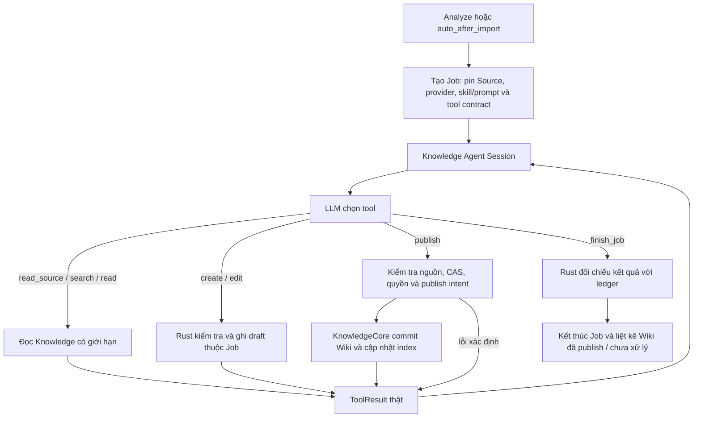

# Knowledge AI Ingest — Phân tích yêu cầu Job chuyên dụng

Ngày: 2026-10-19.

Trạng thái: yêu cầu và thiết kế đề xuất; **chưa triển khai**.

Phạm vi lần này: tài liệu phân tích yêu cầu, không thay đổi code thực thi.

Tài liệu triển khai: [module/interface, data, recovery và các bước thực hiện](ai-ingest-fixed-job-implementation-v3.md). Quyết định kiến trúc đề xuất được ghi tại [ADR 0125](../adr/0125-knowledge-job-tools-skills-and-publication.md); runtime vẫn chưa triển khai.

## 1. Yêu cầu đã xác nhận

Người dùng muốn thay Knowledge AI Ingest hiện tại bằng một Job cố định cho Knowledge, có skill và prompt riêng. LLM giao tiếp với Knowledge bằng các tool như search, read, create và edit để xây dựng Wiki. **Job tự publish**, không cần người dùng duyệt từng trang.

Provider **không cần hỗ trợ Structured Output**. Knowledge sử dụng cơ chế giao tiếp LLM/tool hiện có của Agent Job V3. Mỗi lần chạy Knowledge phải xuất hiện trong **trang Jobs hiện có**, cùng các Job khác, và mở được Job Detail/Timeline.

**Kết quả trình bày của Job dùng Markdown.** Knowledge Job trả báo cáo Markdown về nội dung đã xử lý, Wiki đã tạo/cập nhật và phần chưa hoàn tất. Phần Result của Job Detail phải render Markdown thành nội dung đọc được, gồm heading, danh sách, liên kết và code block, thay vì hiển thị nguyên văn bằng `<pre>`.

**Mở rộng giới hạn kết quả tool trả về để các tool nặng có đủ dung lượng hoạt động.** Áp dụng cho các Job dùng tool contract mới, gồm Knowledge và generic Job; không chỉ nới một tool rồi để Session/provider cắt kết quả ở cap nhỏ hơn. Cho phép cấu hình budget đầu ra theo deployment; ưu tiên trả đủ nội dung khi context cho phép, phân trang hoặc trả artifact có quyền đọc khi dữ liệu vượt inline budget. Không coi preview hay artifact chưa đọc là toàn bộ nội dung đã được Agent xử lý.

Định hướng bổ sung: **Job có thể sử dụng các skill được thêm vào và LLM tự chọn skill phù hợp với nhiệm vụ**. Cơ chế catalog/load skill dùng chung cho các Job có LLM; Knowledge là một loại Job sử dụng cơ chế đó.

Trong tài liệu này, “Job cố định” được hiểu là **một loại Job có nhiệm vụ, skill, prompt và quyền tool do hệ thống định nghĩa sẵn**. Mỗi lần xử lý Source tạo một lần chạy riêng trong Agent Job V3; không phải một Job chạy vô hạn hoặc một scheduler mới. Đây là cách hiểu đề xuất để triển khai, chưa phải xác nhận riêng của người dùng về lịch chạy.

Các quyết định còn lại dưới đây là đề xuất kỹ thuật. Mục tiêu là cho LLM chủ động biên soạn Wiki, trong khi Rust vẫn sở hữu quyền ghi và kiểm tra dữ liệu.

## 2. Hiện trạng và khoảng cách

Đối chiếu code tại thời điểm lập tài liệu:

| Phần | Hiện tại | Yêu cầu mới |
| --- | --- | --- |
| Thực thi | `knowledge_ingest_v3`, một lượt Structured Output và tối đa một lần sửa output | Một Agent Session chuyên Knowledge, có nhiều vòng gọi tool trong budget |
| Ngữ cảnh | Source tối đa 40 KiB và tối đa 16 Wiki targets đưa sẵn vào prompt | Đọc Source theo phạm vi và chủ động tìm/đọc Wiki liên quan bằng tool |
| Prompt | Chuỗi nội tuyến trong `knowledge_ingest/execution.rs` | Prompt hệ thống và skill Knowledge là tài nguyên riêng, có phiên bản |
| Đầu ra LLM | JSON `candidates` | Native ToolCalls và ToolResults; kết thúc bằng `finish_job` |
| Tạo/sửa | Rust stage candidates sau khi LLM hoàn tất | LLM gọi create/edit qua interface KnowledgeCore, nhận ID/revision thực |
| Publish | Policy `review_all / auto_publish / draft_only`; auto chỉ chấp nhận trang mới trích nguyên văn | Job tự publish cả trang mới và cập nhật hợp lệ; lỗi trả về Job để xử lý |
| Review | Proposal queue và approve/reject | Không có bước duyệt bắt buộc trong flow mới; lịch sử cũ vẫn đọc được |
| Provider | Gate riêng cho OpenAI Chat + Structured Output | Dùng provider/adapter và giao tiếp native tools hiện có của Job V3; không yêu cầu Structured Output hoặc gate riêng theo adapter OpenAI Chat |
| Trang Jobs | Dùng danh sách và trang chi tiết Job hiện có | Hiển thị lần chạy Knowledge với nhãn Knowledge, Source, trạng thái và kết quả publish; mở cùng Job Detail/Timeline |

Code liên quan:

- `crates/voice-agent-server/src/services/background/knowledge_ingest/`: admission, settings, execution và Review hiện tại.
- `crates/voice-agent-server/src/services/background/agent_loop/`: vòng tool, budget, transcript và kết thúc Job V3.
- `crates/voice-agent-server/src/database/jobs/sessions.rs`: lưu Agent Session và cặp ToolCall/ToolResult.
- `crates/voice-agent-server/src/services/knowledge/processing/`: evidence, policy, proposals và publish recovery hiện tại.
- `crates/voice-agent-server/src/services/knowledge/wiki.rs`: draft, CAS, publication và index reconciliation.
- `crates/voice-agent-server/src/tools/core/`: adapter `knowledge.search/read` đang chỉ có quyền đọc.
- `apps/admin-web/src/pages/knowledge/KnowledgeSettingsPage.vue`: nơi cấu hình Knowledge hiện có.
- `apps/admin-web/src/pages/jobs/JobsPage.vue`, Job Detail và API/types Job: danh sách, nhận diện loại Job, trạng thái, timeline và kết quả Knowledge.

## 3. Flow đích



Luồng làm việc của Agent:

1. Đọc Source được giao, xác định chủ đề, các thông tin có thể dùng và phần còn thiếu.
2. Search Wiki để tìm trang phù hợp và tránh tạo trang trùng.
3. Read các trang liên quan trước khi edit. Giữ các thông tin cũ còn đúng và nguồn dẫn tương ứng.
4. Create trang mới hoặc edit draft thuộc Job, với evidence cho các nội dung thêm/sửa.
5. Đọc/kiểm tra kết quả, gọi publish và xử lý ToolResult. Khi gặp xung đột revision, đọc lại trước khi quyết định sửa tiếp.
6. Gọi finish_job khi không còn thay đổi cần thực hiện hoặc có blocker không thể giải quyết trong quyền/budget.

Không có Root phân công Child trong phiên bản đầu. Một Agent chuyên Knowledge thực hiện toàn bộ vòng này bằng một provider pin.

Giao tiếp dùng cùng `LlmRequest`, native tool definitions, `BackgroundTurn::ToolCalls` và cặp AssistantToolCalls/ToolResult của Job V3, qua adapter provider hiện có. Không yêu cầu LLM trả JSON `candidates`, không dùng `BackgroundMode::Structured` và không kiểm tra `supports_structured_outputs` để cấp quyền chạy Knowledge. Rust vẫn validate schema **đối số tool**; validation này không yêu cầu tính năng Structured Output của provider. Provider cần đáp ứng năng lực tool calling mà Job V3 đang sử dụng, không cần một giao thức LLM mới dành riêng cho Knowledge.

## 4. Knowledge Prompt và cơ chế Skill chung cho Job

Skill ở đây là **tài nguyên hướng dẫn cho Agent trong ứng dụng**, không phải skill cài vào Codex trên máy phát triển. Đây là mở rộng phạm vi so với đề xuất ban đầu chỉ đóng gói một skill trong module Knowledge.

### 4.1 Phân biệt prompt và skill

| Thành phần | Nội dung |
| --- | --- |
| Base Job system prompt | Quy tắc thực thi Job/tool, chọn/load skill, báo cáo Markdown và điều kiện hoàn tất; tài nguyên tại `resources/job-prompts/base.md` |
| Knowledge Prompt | Vai trò Knowledge editor, mục tiêu xử lý Source và tự publish; luôn nạp khi tạo Knowledge Session |
| Knowledge Skill | Quy trình biên soạn Wiki: read → search → read existing → create/edit → kiểm tra → publish; dẫn nguồn và xử lý mâu thuẫn |
| Skill catalog | Chỉ metadata `name`, `description`, digest của các skill được phép dùng; LLM chọn theo nhiệm vụ |
| Skill bổ sung | Nội dung chỉ nạp khi LLM gọi `load_skill`; ví dụ hướng dẫn biên soạn tài liệu kỹ thuật hoặc chuẩn hóa thuật ngữ |
| User/task context | Source ref/version/hash, mục tiêu ingest, budget và yêu cầu đầu ra do server tạo |
| Tool definitions | Schema thực tế do Rust cung cấp; không chép lại toàn bộ schema trong skill |

Prompt mô tả nhiệm vụ của loại Job; skill mô tả cách làm một công việc có thể tái sử dụng. Tool cung cấp khả năng thực thi thật. Load skill không cài plugin, không chạy code và không cấp thêm tool/quyền ghi.

### 4.2 Lưu và thêm skill

Đề xuất phiên bản đầu dùng thư mục tài nguyên do người quản trị triển khai, ví dụ:

```text
resources/job-prompts/base.md
resources/job-prompts/knowledge.md
resources/job-skills/knowledge/SKILL.md
resources/job-skills/technical-writing/SKILL.md
resources/job-skills/terminology/SKILL.md
```

Đã tạo [Base Job system prompt](../../resources/job-prompts/base.md) yêu cầu báo cáo Markdown và [Knowledge Skill nền](../../resources/job-skills/knowledge/SKILL.md). Knowledge Prompt và các skill bổ sung còn là đề xuất, chưa được tạo. Loader/catalog runtime chưa triển khai; việc có file prompt/skill chưa làm Job tự nạp chúng. Mỗi `SKILL.md` có frontmatter tối thiểu `name`, `description`, rồi phần hướng dẫn Markdown. Description phải nói rõ khi nào dùng skill để LLM tự chọn được. Server tính digest từ nội dung, kiểm tra tên duy nhất, định dạng và giới hạn dung lượng.

Người quản trị thêm/cập nhật skill vào thư mục được cấu hình; server nạp và kiểm tra khi khởi động. V1 chưa cần upload UI, hot reload hoặc skill marketplace. Skill mới khả dụng cho Job mới sau lần nạp cấu hình; Job đang chạy giữ catalog đã pin.

Runtime chỉ đưa vào catalog những skill được cấu hình cho phép ở loại Job/Session đó. Knowledge có thể dùng các skill chung phù hợp, nhưng thêm skill không mở rộng allowlist tool của Knowledge. Skill yêu cầu công cụ không được cấp phải trả blocker hoặc bỏ qua với lý do, không tự cài công cụ.

### 4.3 Nạp vào Session và tự chọn skill

1. Khi nhận Job, runtime pin Knowledge Prompt (nếu là Knowledge Job), catalog được phép dùng và nội dung bundle skill theo digest. Giữ được bản nội dung bất biến để load sau này; không chỉ lưu hash trỏ tới file có thể bị thay đổi.
2. Khi tạo Session, runtime đưa Base Job prompt, prompt của loại Job và metadata catalog vào System context, rồi thêm nhiệm vụ vào User context. Nội dung Source/Wiki luôn là dữ liệu, không được đăng ký skill hoặc thay System prompt.
3. Đề xuất Knowledge Skill là skill nền bắt buộc của Knowledge Job: runtime nạp sẵn nội dung vào System context. Các skill bổ sung vẫn do LLM tự chọn. Generic Job không mặc định nạp Knowledge Prompt/Skill.
4. LLM đọc mô tả catalog, chọn skill liên quan và gọi `load_skill({"name":"technical-writing"})` trước khi áp dụng. Có thể chọn nhiều skill; không bắt buộc load skill bổ sung khi nhiệm vụ không cần.
5. Runtime resolve tên trong catalog đã pin, kiểm tra quyền, đọc đúng nội dung đã pin và trả ToolResult gồm tên, digest và hướng dẫn. Không nhận đường dẫn/URL từ LLM. ToolResult đã lưu được giữ trong transcript cho các vòng tiếp theo.
6. Gọi lại cùng skill trả trạng thái đã load và identity, không chép toàn bộ nội dung vào context lần nữa. Skill quá lớn hoặc tổng context vượt budget trả lỗi rõ ràng; không âm thầm cắt mất hướng dẫn.

```text
System: Base Job prompt + Knowledge Prompt + catalog metadata + Knowledge Skill
User:   Xử lý Source được giao
LLM:    load_skill(name="technical-writing")
Tool:   Skill technical-writing, digest=..., nội dung hướng dẫn
LLM:    knowledge.read_source / search / read / create / edit / publish
LLM:    finish_job
```

Với generic Root/Child Jobs, catalog và trạng thái loaded thuộc từng Session. Child nhận catalog được cấp cho Child và tự chọn skill cho nhiệm vụ được giao; không tự sao chép transcript/skill của Root hoặc sibling. Plugin-only Job không có LLM thì không tham gia cơ chế tự chọn skill.

Runtime xác thực nguồn gốc skill trong ToolResult; nội dung skill vẫn phải tuân theo System prompt và quyền tool. Nếu các skill mâu thuẫn mà System/task không giải quyết được, Agent báo blocker, không dùng skill để bỏ qua validation.

### 4.4 Nội dung Knowledge Skill

Nội dung hướng dẫn nền nằm tại [`Knowledge SKILL.md`](../../resources/job-skills/knowledge/SKILL.md): đọc nguồn và tìm trang, biên soạn có provenance, create/edit draft thuộc Job, tự publish và kết thúc dựa trên kết quả thực. Skill dùng tên tool logic của contract ở mục 5; schema do runtime cấp là nguồn xác định đối số, không chép schema vào skill.

Mỗi Job phải giữ được phiên bản và nội dung skill/prompt đã dùng, cùng phiên bản tool contract. Deploy prompt/skill mới không được đổi chỉ dẫn giữa chừng của Job cũ. Tái sử dụng snapshot/Session hiện có cho pinning và transcript; thêm module catalog/load skill chung, chưa cần UI quản lý skill.

## 5. Tool contract đề xuất

Tên dưới đây là tên logic; adapter có thể chuẩn hóa tên native theo provider. Knowledge Job được cấp tool chung `load_skill` cùng allowlist Knowledge dưới đây; các tool Knowledge không tự xuất hiện trong generic Job khi load Knowledge Skill.

| Tool | Input chính | Kết quả và ràng buộc |
| --- | --- | --- |
| `load_skill` | Tên skill trong catalog của Session | Trả nội dung và digest đã pin; dùng chung cho các Job có LLM, không cấp thêm quyền/tool |
| `knowledge.read_source` | Source ref, cursor opaque (null khi bắt đầu), giới hạn dòng/bytes | Đọc Source được pin cho Job hoặc Source thuộc provenance hợp lệ của Wiki mà Job đã đọc, do runtime xác minh quyền; trả hash, byte range/total bytes, phạm vi dòng và next cursor. Không mở rộng quyền bằng Source ID tùy ý từ LLM |
| `knowledge.search` | Query, limit | Search Wiki verified; trả ID, title, revision, đường dẫn và passage có nguồn. Index stale trả lỗi rõ ràng |
| `knowledge.read` | Wiki ID, cursor opaque (null khi bắt đầu), giới hạn dòng/bytes | Đọc Wiki verified hoặc draft thuộc chính Job; trả revision, đường dẫn, trạng thái, provenance và cùng byte-range/next-cursor contract với Source read |
| `knowledge.links` | Wiki ID, direction (`incoming / outgoing / both`), limit | Xem trang nào đang trỏ tới Wiki này, Wiki này trỏ tới đâu và link unresolved của trang đang xem. Trả ID/path/revision, vị trí link, trạng thái resolution và chỉ báo giới hạn; dùng projection/resolver hiện có, chỉ trả nội dung thuộc quyền đọc |
| `knowledge.create` | Title, folder/name hợp lệ, Markdown, evidence, operation key | Rust cấp Wiki ID và tạo draft thuộc Job; trả ID, draft revision và đường dẫn thực. Không nhận status/accepted revision từ LLM |
| `knowledge.edit` | Wiki ID, expected canonical/draft revision, nội dung thay thế, evidence, operation key | Chỉ ghi khi revision khớp; giữ ID/path; trả draft revision mới. Không ghi đè draft của người dùng hoặc Job khác |
| `knowledge.publish` | Wiki ID, expected draft/base revision, operation key | Chỉ publish draft thuộc Job sau validation; trả accepted revision và index health. Đây là hành động tự động, không chờ Admin approve |
| `finish_job` | Summary viết bằng Markdown, findings và unresolved theo schema Job | Rust kiểm tra coverage toàn Source từ read observations đã giao vào Session, cùng draft/intent và publications trong ledger; tạo báo cáo `result.markdown`, không chấp nhận success/no-change khi Source còn thiếu |

Các tool đọc cần bounded output và báo `has_more/next_cursor`; không âm thầm cắt nội dung rồi coi là đầy đủ. Cursor gắn Session, resource identity, version/revision/hash và byte offset; cap cắt giữa dòng phải tiếp tục đúng byte tại UTF-8 boundary, không nhảy dòng hoặc lặp đầu dòng. Cursor của revision khác bị từ chối. Contract chi tiết ở mục 5.1 của [tài liệu triển khai](ai-ingest-fixed-job-implementation-v3.md#51-cursor-chung-cho-source-và-wiki-reads). Với edit dùng nội dung thay thế toàn trang ở phiên bản đầu: Agent phải đọc đầy đủ bản gốc và runtime từ chối nếu trang vượt giới hạn được hỗ trợ. Chưa cần thêm patch language.

Tool đọc hỗ trợ yêu cầu kích thước trang bằng `max_bytes` trong output budget đã cấp. Mặc định/tool output caps được mở rộng ở mục 5.2 của tài liệu triển khai; kích thước thực vẫn phải vừa message, Session và context/token budget của provider. Tool nặng có thể lưu full output qua cơ chế artifact hiện có, trả preview + artifact identity/checksum/size và cách đọc tiếp. Kết quả bị giới hạn phải báo rõ `truncated/has_more` và continuation, không im lặng bỏ phần còn lại.

Create/edit chỉ tạo draft nội bộ; publish là tool riêng để Agent kiểm tra trước khi commit. **Không cần con người duyệt**. Một lượt gọi chỉ có một tool ghi; không chạy song song các ghi cùng trang. Validate toàn bộ batch trước khi bắt đầu side effect.

Không cấp shell, ghi file tùy ý, xóa Wiki, move/rename, sửa Source hay ghi Memory. Quyền ghi chuyên dụng không được tự động xuất hiện trong tool của Voice, generic Job hoặc adapter `core.knowledge` chỉ đọc đang có.

### 5.1 Quyết định create, update hay giữ nguyên

Job phải search trước, rồi read toàn bộ trang phù hợp trước khi thay thế nội dung. Kết quả search cần có ID, title, revision, path, passage có nguồn và dấu hiệu còn kết quả; không chỉ trả tên trang. `knowledge.links` giúp xem bối cảnh các trang liên quan, nhưng cạnh graph không tự chứng minh hai chủ đề là một.

| Trường hợp sau search/read | Quyết định |
| --- | --- |
| Đúng thực thể/chủ đề và Source có thông tin bổ sung hoặc sửa đổi có nguồn | Edit trang hiện có, giữ ID/path và nội dung cũ còn hợp lệ |
| Nội dung đã có, không có thay đổi hữu ích | Giữ nguyên, không tạo trang hoặc revision thừa |
| Chủ đề riêng biệt nhưng có quan hệ rõ với trang đã có | Create trang mới, thêm Wikilink có ý nghĩa tới trang liên quan |
| Không tìm được trang phù hợp sau các query tên/chủ đề liên quan | Create trang mới có phạm vi rõ ràng |
| Có nhiều trang gần giống, chưa xác định được trang đích hoặc search/index lỗi | Đọc thêm hoặc báo blocker; không coi lỗi là không có trang và không tự merge/xóa |

Search V1 vẫn là lexical FTS hiện có, không bảo đảm tìm ra mọi trang đồng nghĩa. Skill yêu cầu thử tên thay thế có ý nghĩa; liên kết và nội dung trang giúp đánh giá, không được mô tả đây là semantic dedup hoàn chỉnh.

### 5.2 Xem và tạo liên kết giữa Wiki

- `knowledge.links` là tool đọc chuyên dụng để trả outgoing, incoming/backlinks và unresolved links. Giới hạn kết quả phải hiển thị rõ; kết quả bị giới hạn không chứng minh rằng không còn liên kết khác.
- Reuse projection `kb_links` và Wiki resolver hiện có. Admin Graph có thể thấy draft; adapter cho Job phải lọc theo quyền và trạng thái verified, không lấy nguyên graph Admin làm authority. Link của draft thuộc Job có thể được xem như preview qua cùng resolver, phải ghi rõ chưa publish, không thay thế canonical graph.
- Tạo/sửa/xóa một Wikilink bằng cách sửa Markdown của **trang nguồn** qua `knowledge.edit`, rồi `knowledge.publish`. Khi create trang mới, body có thể chứa link tới trang đã verified. Không cần tool `create_link` hoặc một nơi lưu relation riêng.
- Ví dụ A chứa `[[AI/LLM]]`: outgoing của A có cạnh A → LLM; incoming của LLM có A. Không tự thêm link ngược LLM → A, trừ khi nội dung trang LLM cần liên kết đó và được edit/publish riêng.
- Chỉ thêm liên kết có ích cho nội dung đang biên soạn, dùng path thật từ tool. Quan hệ graph thể hiện một link Markdown, không phải bằng chứng về quan hệ ngữ nghĩa hay độ đúng của claim.
- Sau publish, index reconciliation cập nhật graph. Index stale trả lỗi rõ ràng; không trả danh sách rỗng gây hiểu nhầm là không có liên kết. Canonical commit vẫn được giữ nếu index update thất bại.

## 6. Quy tắc publish tự động

### 6.1 Phân biệt nội dung và quyền ghi

LLM quyết định cách biên soạn và lúc yêu cầu publish. Rust quyết định yêu cầu đó có hợp lệ về quyền, nguồn, revision và cấu trúc hay không.

Gate “body phải bằng nguyên văn quotes” và “mọi update đều vào Review” của flow hiện tại không phù hợp yêu cầu mới. Cần thay chúng bằng validation cho nội dung được biên soạn và cập nhật tự động. Các kiểm tra path, Source hash, evidence span, CAS và ownership vẫn bắt buộc.

Trích dẫn khớp Source chứng minh có đoạn nguồn, **không chứng minh mọi diễn giải đều đúng**. V1 không có kiểm định ngữ nghĩa độc lập. Skill yêu cầu bảo toàn ý nghĩa và uncertainty; sản phẩm cần diễn đạt rõ Wiki do AI biên soạn, có provenance, không coi trạng thái `verified` hiện tại là bảo đảm sự thật.

### 6.2 Nguồn dẫn khi cập nhật

Một Job xử lý một Source bất biến, nhưng có thể cập nhật trang đã dựa trên Source khác. Trang sau cập nhật phải giữ provenance của nội dung cũ và thêm evidence cho phần mới.

Hiện `Record.source_ref` và proposal ingest chủ yếu biểu diễn một Source. **Không được chỉ thay `source_ref` cũ bằng Source mới rồi coi toàn trang đã có đủ nguồn.** Trước khi triển khai edit đa nguồn, cần bổ sung biểu diễn provenance theo revision/nội dung trong canonical Markdown; index chỉ là projection. Đây là thay đổi cần thiết nếu cho phép giữ kiến thức từ nhiều Source trong cùng trang.

Evidence do tool nhận phải tham chiếu Source được Job cho phép hoặc provenance hợp lệ được giữ lại từ revision gốc. LLM không được tự thêm Source ID chưa được server xác minh. Nội dung tổng hợp phải chỉ ra các đoạn nguồn liên quan; phần không đủ nguồn không được publish như khẳng định đã xác nhận.

### 6.3 Điều kiện kỹ thuật

Publish chỉ được bắt đầu khi:

1. Knowledge đang enabled; Job còn quyền thực thi, chưa hết deadline và chưa bị hủy tại điểm bắt đầu ghi.
2. Draft thuộc Job, ID/path hợp lệ, title/body trong giới hạn và revision/base revision còn khớp.
3. Các Source cần thiết còn nguyên vẹn; evidence tham chiếu đúng phạm vi và checksum.
4. Đã kiểm tra trùng trang và các Wikilinks bằng resolver hiện có; index cần thiết cho quyết định đang healthy.
5. Không có draft của người dùng hoặc intent chưa rõ kết quả đang bị thay thế.
6. Publish intent được lưu trước canonical commit, gắn operation key, Wiki ID, base/draft revision và content hash.

V1 chỉ publish liên kết tới Wiki đã verified. Khi tạo nhiều trang liên quan, Agent publish trang đích trước rồi thêm liên kết bằng một edit tiếp theo; chưa hỗ trợ transaction cho cả cụm trang hoặc vòng liên kết trong cùng commit.

Nếu validation thất bại, tool trả lỗi có thể xử lý cho Agent; không âm thầm đưa sang Review. Hết budget hoặc blocker chưa giải quyết thì Job báo chưa hoàn tất, giữ rõ các kết quả đã commit.

## 7. Job, lưu trữ và phục hồi

- Agent Job V3 tiếp tục là scheduler và ledger duy nhất. Tái sử dụng admission, queue, semaphore, provider pin, LLM budget, deadline, cancellation, Session và timeline.
- Knowledge Job dùng một execution contract có phiên bản. Job cũ không được chạy lại bằng prompt/tool mới chỉ vì deploy code mới; snapshot thiếu phiên bản mới vẫn được hiểu theo contract cũ.
- Mỗi tool ghi có operation identity duy nhất trong Job. Cùng identity và cùng input trả lại kết quả cũ; cùng identity nhưng khác input trả conflict. Không dùng ToolCall ID mới làm lý do lặp lại một publish đã commit.
- ToolCall/ToolResult phải ghép đúng ID, lưu kết quả thực; từ chối tool không được cấp hoặc args ngoài schema trước side effect.
- Session có thể chứa Source/Wiki; áp dụng cơ chế lưu trữ riêng tư và xóa lịch sử hiện có. Không đưa raw transcript, quotes hay credentials vào SSE/log metadata.
- Sau crash, đối chiếu intent với canonical ID/revision/hash/provenance. Commit khớp thì ghi nhận đã publish; trạng thái không xác định thì fail-stop và yêu cầu sửa trạng thái, không tự replay ghi.
- Hủy Job không rollback Wiki đã publish. Khi commit đang diễn ra, hoàn tất xác định kết quả và lưu ledger; ngăn tool ghi tiếp theo.
- Job lỗi/hủy giữ draft thuộc Job; Admin có thao tác riêng `adopt` để tiếp quản hoặc `discard` để bỏ draft active nhưng giữ history/accepted Wiki. Chỉ cho phép khi owner Job terminal, CAS owner/revision/hash khớp và intents đã xác định kết quả. Thao tác có idempotency/recovery, không cấp cho LLM và không làm ingest phải chờ người duyệt. Interface và UI tại mục 6.3 của [tài liệu triển khai](ai-ingest-fixed-job-implementation-v3.md#63-admin-giải-quyết-job-owned-wiki-draft).
- Publish thành công nhưng index lỗi vẫn giữ canonical commit, trả accepted revision cùng index health degraded. Chặn search/graph stale, phục hồi index mà không tạo revision mới.
- Nhiều trang trong Job không phải một transaction. Nếu publish được hai trang rồi lỗi trang thứ ba, kết quả phải liệt kê chính xác hai trang đã publish và phần còn lại. Không báo thành công toàn bộ hoặc báo chưa ghi gì.
- Analyze xử lý toàn Source được pin. `finish_job` chỉ chấp nhận success/no-change khi các read observations đúng Source/hash đã commit ToolResults trong Knowledge Session phủ toàn bộ bytes và có EOF; đọc trang cuối riêng lẻ, các ranges có lỗ hoặc Source khác không đủ điều kiện. Hết budget khi chưa đọc đủ trả failed/source_incomplete và giữ publications đã commit. Coverage xác nhận dữ liệu đã vào Session, không chứng minh hiểu đúng ngữ nghĩa.
- Re-run là một Job mới, phải search/read trạng thái hiện tại. Không replay transcript có ghi chưa rõ kết quả. Submit lặp cùng idempotency key phải đọc được receipt đã lưu kể cả khi provider cũ đã unavailable.

Tái sử dụng main application DB cho execution/intent metadata và các canonical Markdown vault hiện có. Không thêm DB, scheduler hay bản sao nội dung Wiki trong proposal queue mới.

## 8. Settings, trigger và tương thích

| Nội dung | Đề xuất |
| --- | --- |
| Bật/tắt | Giữ cờ Knowledge riêng, mặc định disabled khi rollout; tắt chặn intake và tool ghi mới |
| Provider | Giữ lựa chọn provider riêng cho Knowledge; freeze một pin cho mỗi Job; không fallback sang global Job/Voice provider |
| Năng lực provider | Dùng điều kiện năng lực và adapter native tools hiện có của Job V3; không yêu cầu Structured Output, `supports_structured_outputs=true` hoặc gate OpenAI Chat riêng. Kiểm tra tích hợp Knowledge bằng fixtures trên giao thức Job hiện có |
| Đọc Settings | Chỉ đọc catalog/trạng thái đã có; không acquire tuần tự mọi model khi mở trang |
| Trigger | Giữ manual Analyze và auto_after_import; Raw save không tự trở thành immutable Source import |
| Publication policy | Flow mới luôn Job tự publish; không hiển thị ba policy cũ như còn điều khiển Job mới. Bản ghi cũ giữ policy snapshot của nó |
| Giới hạn | Tái sử dụng budget LLM/tool/deadline và giới hạn số trang; mở rộng đồng bộ tool output/message/transcript/request budgets cho tool nặng, có cấu hình deployment và provider context check; chuyển `max_candidates_per_source` sang giới hạn số trang với tương thích rõ ràng |
| UI | Dùng Knowledge Settings, danh sách Jobs và Job Detail/Timeline hiện có; thêm nhận diện/kết quả Knowledge trong các trang Jobs. Không yêu cầu đổi layout Explorer, tạo Review workspace hoặc UI chỉnh skill |

Auto-after-import hiện có khoảng trống giữa commit Source và enqueue Job. V1 có thể giữ giới hạn này nếu trả `analysis_error` và cho retry rõ ràng; không quảng cáo bảo đảm mọi import đều được xử lý sau crash. Bảo đảm enqueue bền vững theo import là một yêu cầu bổ sung nếu sản phẩm cần.

Proposal/Review cũ vẫn đọc và quyết định được theo contract cũ. Không xóa pending drafts hoặc tự publish backlog Review khi chuyển sang flow mới. Việc bật flow mới phải là lựa chọn rollout rõ ràng; không suy ra quyền tự publish từ cấu hình `review_all` cũ.

### 8.1 Hiển thị Knowledge trong trang Jobs

- Mọi lần chạy Knowledge được nhận vào ledger, dù từ manual Analyze hay auto_after_import, phải có mặt trong danh sách Jobs mặc định; không phụ thuộc toggle bật generic Job Orchestrator.
- Giữ layout danh sách hiện có, thêm nhãn **Knowledge** từ execution contract do server trả về. Goal hiển thị Source dễ nhận biết; Job Detail có Source ref và liên kết về Source nếu giao diện hiện có hỗ trợ.
- Dùng cùng status, tìm kiếm, lọc trạng thái và phân trang hiện có. Tổng số Job và kết quả phân trang phải tính cả Knowledge, không lọc riêng phía client làm mất bản ghi.
- Bấm một Job Knowledge mở Job Detail/Timeline hiện có. Hiển thị vòng gọi LLM, tool đã thực thi, lỗi và kết quả thực từ ledger; không hiển thị raw transcript hoặc Source trong SSE metadata.
- Timeline ghi nhận skill đã load bằng tên/digest và Session; không phát toàn bộ nội dung skill vào SSE metadata.
- Kết quả ghi rõ từng Wiki đã tạo/cập nhật, accepted revision, liên kết mở Wiki và phần chưa xử lý. Job lỗi/hủy sau một số lần publish vẫn phải hiển thị những commit đã hoàn tất.
- Báo cáo nằm trong `result.markdown`; metadata Source/coverage/publications vẫn là dữ liệu có cấu trúc do server xác định từ ledger. Markdown là nội dung trình bày, không tự cấp trạng thái success hoặc accepted revision. Khi lỗi/hủy trước khi LLM viết báo cáo, server vẫn tạo Markdown từ kết quả thực đã có.
- Job Detail dùng Markdown renderer an toàn hiện có, hỗ trợ heading/list/link/inline code/code block. UI dùng được cho mọi Job có `result.markdown`, không hardcode riêng mode Knowledge. Job cũ có `summary` dạng text dùng fallback phù hợp; result chỉ có dữ liệu cấu trúc vẫn giữ khả năng xem, không stringify JSON rồi giả là báo cáo Markdown.
- Detail hiển thị Source coverage và draft còn owner, có action Admin adopt/discard với CAS và lý do từ chối rõ khi Job còn active hoặc intent unknown. Đọc current resolution qua audit, không sửa kết quả lịch sử của terminal Job.
- Nút hủy áp dụng cùng contract cancellation. Không cho nút retry generic chuyển Knowledge thành hierarchical Job; nếu hỗ trợ chạy lại, phải tạo lần chạy Knowledge mới qua admission chuyên dụng.
- Không thêm trang quản lý Knowledge Jobs riêng hoặc bộ lọc loại Job mới trong phạm vi này.

## 9. Phần cần thay đổi khi triển khai

| Vị trí | Thay đổi cần thiết |
| --- | --- |
| Knowledge ingest admission/snapshot | Versioned execution contract, skill/prompt identity, tool contract và điều kiện provider native tools chung của Job V3; bỏ yêu cầu Structured Output |
| Knowledge ingest execution | Thay Structured candidates loop bằng Knowledge Agent tool loop; tái sử dụng các cơ chế Job V3 |
| Shared Job skill module / Session | Catalog từ thư mục quản trị, immutable bundle/digest, metadata trong prompt và tool `load_skill`; pin/loaded state theo Session, dùng chung cho generic Job và Knowledge |
| Knowledge tool module | Allowlist riêng, validation, draft ownership, operation idempotency và ToolResults; thêm `knowledge.links` từ graph/resolver hiện có với quyền đọc của Job |
| KnowledgeCore / canonical Markdown | Interface create/edit/publish cho Job, cursor reads, bảo toàn revision/provenance đa nguồn; Admin draft-resolution adopt/discard có CAS/history/recovery |
| Application DB | Migration nhỏ cho metadata cần thiết; tiếp tục dùng ledger hiện có, không đưa SQL vào executor |
| Processing policy/recovery | Gate cho tự publish nội dung biên soạn; phục hồi intent theo contract; giữ Review cũ |
| Provider/tests | Tái sử dụng giao tiếp/adapter Job V3, thêm test tích hợp tool Knowledge và thay fixture candidates ở contract mới; không thêm giao thức provider riêng |
| Settings/API/Web | Bỏ điều kiện Structured Output khỏi lựa chọn provider; thể hiện tự publish và giới hạn số trang, version/CAS; giữ tương thích lịch sử |
| Jobs list/detail/API/types | Bao gồm Job Knowledge trong list/count/pagination, nhãn Knowledge, Source và kết quả Wiki; dùng cùng route Detail/Timeline và cancellation |
| Docs/ADRs | Cập nhật ADR 0123 và phạm vi write của ADR 0117 sau khi chốt thiết kế; đồng bộ flow và verification |

Thiết kế mới **khác ADR 0123** ở execution một lượt Structured Output và policy bắt buộc Review cho update. Nó cũng mở rộng quyền ghi ngoài adapter read-only của **ADR 0117**. Cần ghi quyết định thay thế/mở rộng trước khi ship; tài liệu yêu cầu này chưa tự thay đổi trạng thái các ADR đó. Quyền canonical writer, revision/provenance của ADR 0118 và graph projection của ADR 0124 tiếp tục giữ nguyên.

## 10. Tiêu chí nghiệm thu

1. Knowledge Job chạy với prompt/skill nền riêng, một provider pin, tool chung `load_skill` và allowlist tool Knowledge; không có generic delegation hay arbitrary filesystem tool.
2. Source mới chưa có trang: Agent read_source → search → create → publish → finish; Wiki xuất hiện trong verified read/search sau index reconciliation, không cần Admin approve.
3. Source cập nhật trang cũ: Agent search → read → edit → publish; giữ Wiki ID/path, tăng canonical revision đúng một lần và giữ provenance cũ lẫn mới.
4. Source không có thông tin mới: Agent kết thúc no-change có lý do; không tạo trang rỗng/trùng hoặc revision thừa.
5. Hai Job hoặc người dùng cùng sửa: một writer thắng CAS; bên còn lại nhận conflict. Không mất nội dung hoặc ghi đè human draft.
6. Source/hash/evidence/path không hợp lệ và tool ngoài allowlist bị từ chối trước ghi; prompt injection trong Source không cấp thêm quyền.
7. Source dài hoặc Wiki dài: Agent nhận pagination/giới hạn rõ; không publish bản thay thế dựa trên phần nội dung bị cắt mà không biết.
8. Cùng operation key lặp lại sau mất ACK không tạo thêm trang/revision; đổi input với cùng key trả conflict. Submit replay vẫn trả receipt nếu provider cũ bị tắt.
9. Test các điểm crash trước intent, sau draft, sau canonical commit và trước ToolResult: recovery không mất commit và không lặp publish.
10. Disable, revoke provider, cancel và deadline ngăn ghi mới; kết quả vẫn liệt kê các trang đã commit trước đó.
11. Lỗi index giữ published revision, search/graph fail closed; rebuild không publish lại.
12. Job chỉ thành công khi Source coverage đầy đủ và ledger chứng minh mọi thay đổi được chấp nhận đã publish hoặc có quyết định bỏ qua được ghi rõ. Chỉ đọc một phần hoặc ghi dở dang không được LLM biến thành success/no-change bằng summary.
13. Provider chạy được tool calling qua adapter Job V3 với `supports_structured_outputs=false` vẫn chạy Knowledge thành công. Không gửi yêu cầu Structured Output/JSON schema response format; local HTTP fixtures xác nhận giao tiếp Job hiện có, schema đối số tool, refusal, invalid IDs, truncation và timeout.
14. Generic hierarchical Jobs được dùng catalog/load skill theo quyền Session nhưng không tự có quyền ghi Knowledge. Plugin-only Jobs, adapter `core.knowledge` read-only, Memory và Review lịch sử không đổi quyền ngoài migration đã công bố.
15. Manual Analyze và auto_after_import đều tạo Job có mặt trong trang Jobs mặc định với nhãn Knowledge; search/status filter/count/pagination tính đúng và mở được Job Detail/Timeline.
16. Job Detail hiển thị các tool và Wiki/revision thực đã commit, kể cả khi Job thất bại hoặc bị hủy sau publish một phần. Cancel giữ contract cũ; generic retry không chạy nhầm mode.
17. Thêm một skill hợp lệ vào thư mục quản trị và khởi động lại làm nó xuất hiện trong catalog được cấp cho Job mới. Agent có thể tự chọn/load skill qua native tool; catalog ban đầu không chứa toàn bộ body các skill bổ sung.
18. Skill không tồn tại/ngoài catalog, tên giả làm đường dẫn và bundle không khớp digest bị từ chối. Load skill không cấp thêm tool; skill yêu cầu quyền không có không dẫn tới side effect trái phép.
19. Prompt/skill bị sửa sau submit không đổi nội dung Job đã pin. Load lại không nhân bản body; restart dùng đúng bundle cũ hoặc báo lỗi nếu không thể khôi phục, không lấy bản mới thay thế.
20. Root và Child giữ loaded state độc lập; Knowledge Skill nền luôn có trong Knowledge Session. Timeline ghi tên/digest skill đã load mà không lộ body.
21. Job search/read phân biệt được cùng chủ đề cần update, nội dung trùng cần giữ nguyên và chủ đề riêng cần create; ambiguous matches/index lỗi không gây create trùng tự động.
22. Trang A chứa link tới B: `knowledge.links` trả A → B ở outgoing của A và incoming của B; không tự ghi link ngược. Edit/publish bỏ link thì graph được cập nhật tương ứng.
23. Links tool không lộ draft của người dùng/Job khác; preview draft thuộc Job được phân biệt với canonical. Link unresolved, kết quả giới hạn và index stale có trạng thái rõ, không bị hiểu là danh sách rỗng hoàn chỉnh.
24. Source chưa đọc, chỉ đọc trang đầu hoặc chỉ trang cuối đều bị từ chối success/no-change; ranges lặp hoặc đọc Source cũ không bù phần thiếu. Coverage đầy đủ mới cho kết thúc thành công; hết budget trả source_incomplete và vẫn hiện Wiki đã publish.
25. Cancel sau tạo/sửa draft: Admin adopt/discard bằng CAS và key lặp không mất content/history, không thay accepted Wiki và không sửa terminal Job result. Job active/unknown intent/stale revision bị chặn; sau giải phóng đúng, thao tác rerun hoặc xóa Job history không còn mắc ownership cũ.
26. Source/Wiki một dòng dài hơn cap bytes, có Unicode và CRLF: ghép các fragment cursor khôi phục đúng toàn bộ text, không lặp/mất bytes; cursor giả/khác Session/revision bị từ chối.
27. Knowledge Job lưu `output_format=markdown` và có `result.markdown` ở các trạng thái terminal, gồm success/no-change/failed/cancelled. Wiki IDs/revisions, coverage và lỗi trong báo cáo khớp ledger; không yêu cầu provider hỗ trợ Structured Output.
28. Job Detail render heading/list/link/code block đúng, escape HTML và chặn URL không an toàn; legacy summary/structured result vẫn đọc được. Refresh hoặc reload giữ nguyên Markdown đã lưu và phản ánh đúng partial publications khi Job lỗi/hủy.
29. Tool trả output lớn hơn cap cũ 8/32/64 KiB vẫn được giữ và đưa vào Session/provider request khi trong budget mới. Kiểm tra cả JSON escaping, Unicode và số Job chạy đồng thời; không có một tầng trung gian cắt kết quả theo cap cũ.
30. Output vượt inline/context budget được phân trang hoặc lưu artifact có ownership/hash/size rõ, đọc lại đủ bằng interface được cấp. Agent không nhận success/full coverage chỉ từ preview/artifact reference; hết budget báo rõ phần chưa đọc. Cấu hình dung lượng lớn không bỏ authentication, CAS, provider deadline hoặc giới hạn tài nguyên.

Mọi test/check khi triển khai chạy qua `scripts/agent-test.sh`, targeted trước workspace-wide. Remote LLM smoke và production-process crash là bằng chứng riêng; không suy ra từ unit tests.

## 11. Giới hạn và thứ tự triển khai đề xuất

Không thêm scheduler, sub-agent cho Knowledge, MCP storage, shell, semantic vector search, binary extraction, giao diện quản lý skill hay transaction nhiều trang trong phiên bản đầu. Catalog/load skill chung cho Job nằm trong phạm vi mới; chưa thêm hot reload, skill marketplace hoặc thực thi script đi kèm skill.

Thứ tự đề xuất:

1. Chốt versioned contract, quyền tool, catalog/load skill dùng chung và cách lưu provenance đa nguồn; ghi ADR thay thế phần policy/execution cũ.
2. Xây interface tool và idempotent publication trong KnowledgeCore, kèm test CAS/ownership/crash.
3. Gắn Knowledge Prompt/Skill nền và cơ chế tự chọn skill bổ sung vào tool loop/giao tiếp provider hiện có của Job V3; kiểm tra end-to-end create/update tự publish bằng provider không hỗ trợ Structured Output.
4. Đồng bộ Settings/API và hiển thị Knowledge trong Jobs list/detail, giữ lịch sử contract cũ; rollout disabled trước, bật thử nghiệm có kiểm soát sau nghiệm thu.

Rủi ro chính: AI có thể diễn giải sai dù quote hợp lệ; auto-edit có thể làm giảm chất lượng kiến thức; một Job có thể đã publish một phần trước khi thất bại. Nguồn dẫn, revision history và kết quả ledger phải đủ để Admin phát hiện và sửa bằng các thao tác Knowledge hiện có.
