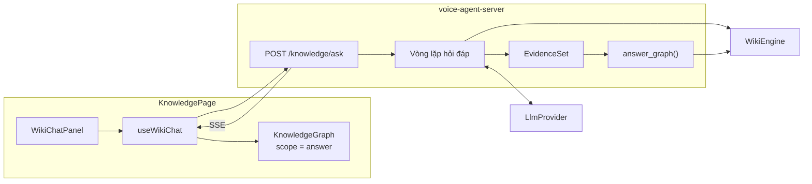

# Thiết kế: Hỏi wiki và Graph theo câu trả lời

Trạng thái: đề xuất, chưa có code. Cập nhật 2026-11-02.
Việc cần làm theo thứ tự nằm ở [tài liệu triển khai](wiki-chat-graph-implementation.md).

## Bài toán

Tab Graph của trang Knowledge hiện chỉ hiện toàn bộ wiki (Global) hoặc láng giềng của trang đang mở (Local). Người dùng không thể hỏi "trading liên hệ với nhau thế nào" rồi nhìn thấy đúng phần đó.

Tính năng này thêm một khung chat ngay trong tab Graph. Khi agent trả lời, Graph chuyển sang chỉ hiện các trang liên quan tới câu trả lời và quan hệ thật giữa chúng.

## Mục tiêu

- Hỏi bằng ngôn ngữ tự nhiên, câu trả lời có trích dẫn tới trang wiki.
- Graph lớn dần theo những gì agent tìm và đọc, không phải đợi trả lời xong.
- Mọi node và cạnh trên Graph đều có thật trong wiki.
- Agent chỉ đọc, không thể sửa wiki.

## Ngoài phạm vi

- Lưu lịch sử chat qua lần tải lại trang.
- Lưu câu trả lời thành trang synthesis.
- Link do AI suy luận, đúng như phần Deferred của [ADR 0124](../adr/0124-wiki-wikilinks-graph-projection.md).
- Hỏi bằng giọng nói. Assistant voice vẫn dùng `server_wiki_search` như hiện tại.

## Hiện trạng đã kiểm tra

| Thành phần | Có sẵn | Giới hạn liên quan |
| --- | --- | --- |
| `WikiEngine::query` | Đường dẫn, điểm, đoạn trích, link đi, backlink | Luôn trả kết quả yếu nếu không đặt `min_score` |
| `WikiEngine::get_graph` | Toàn bộ node và cạnh, có `category` | Không có API đồ thị con |
| `GET /api/admin/knowledge/graph` | Global, Local 1–2 bước | Cắt 500 node trước khi lọc ở web |
| `KnowledgeGraph.vue` | Cytoscape, layout, làm mờ, inspector | Bấm node là rời tab Graph |
| `KnowledgeMcp::call_tool` | Quyền `ReadOnly`, deadline, hủy | `bound_result_chars` xóa `metadata.results` khi quá dài |
| `LlmProvider::stream` | `TextDelta`, `ToolCall`, `Finished` | Chưa có vòng lặp tool ngoài voice và Task |
| SSE admin | Jobs, Notifications dùng `fetch` + `getReader` | Parser `consumeSse` đang riêng của `job-updates.ts` |

Đo trên vault hiện tại (37 tài liệu, 149 cạnh) với các file chứa "trading", mở rộng 1 bước:

| Cách lọc | Node | Cạnh |
| --- | --- | --- |
| Giữ `wiki/index.md`, `wiki/log.md` | 37 | 149 |
| Bỏ hai trang hệ thống | 10 | 38 |

Số liệu này lấy bằng `grep` và bảng `graph_links`, chưa qua `wiki_query`. Kết luận rút ra: **không loại trang hệ thống thì Graph theo câu trả lời vô nghĩa.**

## Các phương án đã cân nhắc

| Phương án | Kết luận |
| --- | --- |
| Dùng lại Assistant WebSocket | Loại. Tool voice chỉ tìm từ khóa, tối đa 5 kết quả, 5 giây mỗi lần gọi; sự kiện `tool` không gửi kết quả về web |
| Tạo Task qua `orchestrator-flow` | Loại. Mỗi câu hỏi thành một job lưu bền, hiện trong danh sách Jobs, quá nặng cho hỏi đáp |
| Endpoint SSE riêng cho Knowledge | **Chọn.** Vòng lặp ngắn, chỉ đọc, không lưu trạng thái ở server |

## Kiến trúc



Có hai module sâu ở server:

- **`answer_graph(engine, evidence, limits)`**: hàm thuần nhận bằng chứng, trả đồ thị con. Không biết gì về LLM hay HTTP, nên test được bằng vault nhỏ.
- **`run_ask(...)`**: vòng lặp agent. Nhận `LlmProvider` và engine, phát sự kiện qua một channel. Test được bằng provider giả.

Handler HTTP chỉ xác thực, chọn provider và nối channel vào SSE.

## Quyết định thiết kế

### Server dựng đồ thị, LLM không khai node

Server ghi lại đường dẫn từ kết quả tool, rồi tự tính đồ thị con từ `get_graph`. LLM không có cách nào thêm node hay cạnh giả. Điều này cũng giữ đúng [ADR 0124](../adr/0124-wiki-wikilinks-graph-projection.md): Graph chỉ phản chiếu Wikilink có thật.

### Bốn mức node

| Mức | Nguồn | Hiển thị |
| --- | --- | --- |
| `cited` | Được trích dẫn trong câu trả lời và có trong bằng chứng | Đậm, có viền, luôn hiện nhãn |
| `read` | Agent đã đọc bằng `wiki_get` hoặc `wiki_multi_get` | Đậm, luôn hiện nhãn |
| `retrieved` | Chỉ xuất hiện trong kết quả `wiki_query` | Vừa, hiện nhãn khi rê chuột |
| `context` | Láng giềng 1 bước, không phải bằng chứng | Nhỏ, nhạt |

Màu node vẫn theo loại (Concept, Entity, Synthesis, Source). Mức chỉ đổi kích thước, viền và độ đậm, để hai ý nghĩa không dùng chung một kênh hình ảnh.

### Quy tắc dựng đồ thị con

1. Hạt giống là các trang `cited`, `read`, rồi `retrieved` theo điểm giảm dần.
2. Bỏ trang có `category = system`, và `wiki/index.md`, `wiki/log.md` phòng khi thiếu category.
3. Mở rộng 1 bước, ưu tiên láng giềng nối với nhiều hạt giống nhất.
4. Giới hạn 60 node. Không bao giờ cắt hạt giống trước `context`. Vượt giới hạn thì đặt `truncated = true`.
5. Giữ mọi cạnh có cả hai đầu nằm trong tập node. Gộp cạnh như `graph.rs`.

### Lấy bằng chứng trước khi cắt kết quả

`bound_result_chars` xóa `metadata.results` khi kết quả quá dài, nên kết quả dài nhất lại mất bằng chứng. Vì vậy vòng lặp gọi `engine.execute_llm_tool_with_budget` trực tiếp, đọc đường dẫn từ kết quả đầy đủ, rồi mới cắt bớt phần gửi cho LLM.

Không đi qua `KnowledgeMcp::call_tool` còn có lợi thứ hai: tắt MCP trong System không làm hỏng trang Knowledge. Hai bước còn dùng lại là `normalize_wiki_tool_arguments` và `bound_result_chars`.

### Chỉ đọc bằng allowlist

Agent chỉ có `wiki_query`, `wiki_get`, `wiki_multi_get`. Không cấp `wiki_graph_neighbors`, vì flow hiện tại ghi Job tools không duyệt đồ thị và việc mở rộng đã do server làm. Tên tool ngoài allowlist bị từ chối ngay cả khi LLM tự gọi.

### Server không giữ phiên

Web gửi kèm lịch sử trong mỗi yêu cầu, có giới hạn. Không có bảng mới, không có migration. Đóng kết nối là hủy lượt chạy.

### Provider

Thêm một setting chọn provider chat từ catalog có sẵn, không phụ thuộc Agent của voice. Chưa đặt thì endpoint trả `503 wiki_chat_not_configured`, web hiện hướng dẫn thay vì âm thầm chọn một model.

## API

### `GET /api/admin/knowledge/graph?scope=query&q=...`

Mở rộng API sẵn có, không cần LLM. Trả cùng khung với Graph hiện tại, thêm hai trường cho node:

```json
{
  "nodes": [{ "id": "wiki/concepts/trading/fair-value-gap.md", "tier": "retrieved", "score": 0.82 }],
  "edges": [],
  "unresolved": [],
  "truncated": false
}
```

### `POST /api/admin/knowledge/ask`

```json
{
  "messages": [
    { "role": "user", "content": "FVG liên hệ thế nào với Sharp Turn Entry?" }
  ]
}
```

Trả `text/event-stream`:

| Sự kiện | Dữ liệu | Khi nào |
| --- | --- | --- |
| `tool` | `{ call_id, name, state, query? }` | Agent bắt đầu hoặc xong một tool |
| `graph` | Cùng khung như trên, kèm `revision` | Sau mỗi tool làm đổi bằng chứng, và một lần cuối |
| `delta` | `{ text }` | Từng đoạn câu trả lời |
| `done` | `{ citations, stop_reason }` | Kết thúc bình thường |
| `error` | `{ code }` | Lỗi, không kèm thông điệp của engine vì có thể chứa đường dẫn vault |

Sự kiện `graph` luôn là ảnh chụp đầy đủ, không phải phần chênh lệch. Web chỉ cần thay thế, không phải gộp, và mất một sự kiện cũng không sai lệch.

Mã lỗi: `wiki_chat_not_configured`, `wiki_chat_busy` (429), `knowledge_unavailable`, `invalid_input`, `provider_failed`, `step_limit`, `timeout`.

## Giới hạn

| Giới hạn | Giá trị đầu | Lý do |
| --- | --- | --- |
| Số vòng tool mỗi lượt | 6 | Chặn vòng lặp vô hạn |
| Thời gian mỗi lượt | 90 giây | Hỏi đáp có người đợi |
| Thời gian mỗi tool | 15 giây | Có vector search và rerank nên rộng hơn voice |
| Kết quả tool gửi LLM | 12.000 ký tự | Giữ context nhỏ |
| Lịch sử gửi lên | 12 tin, 16 KB | Server không giữ phiên |
| Node đồ thị con | 60 | Layout hiện tại là O(n²) |
| Lượt chạy đồng thời | 2 | `WikiEngine` dùng chung một khóa SQLite |

## An toàn

- **Prompt injection:** nội dung wiki và source có thể chứa chỉ dẫn. Kết quả tool được gắn `untrusted_data`, system prompt dặn chỉ xem là dữ liệu. Thiệt hại bị chặn bởi allowlist chỉ đọc.
- **Trích dẫn giả:** `[[đường dẫn]]` trong câu trả lời chỉ thành `cited` nếu nằm trong bằng chứng. Link ngoài bằng chứng hiện như văn bản thường.
- **XSS:** câu trả lời đi qua `renderMarkdown` như nội dung wiki.
- **Log:** không ghi câu hỏi hay nội dung trang, giống `session/actor/tools/wiki.rs`. Chỉ ghi tên tool, số vòng và mã kết quả.
- **Quyền:** route nằm trong nhóm admin đã xác thực, chung với các route Knowledge.

## UI

Khung chat nằm trong tab Graph. Không thêm tab hay trang mới.

### Bố cục

Ở tab Graph, cột phải `Outline & links` nhường chỗ cho khung chat, vì outline chỉ có ý nghĩa khi đọc một trang. Nút thu gọn cột phải sẵn có giờ dùng để thu gọn chat.

```text
┌──────────┬─────────────────────────────────────────┬──────────────────┐
│ Explorer │ [Trang đang mở] [Graph]             ◧ ◨ │ Hỏi wiki      ⟲  │
│          ├─────────────────────────────────────────┤                  │
│ ▸ wiki   │ Toàn bộ · Cục bộ · [Câu trả lời]  10 node│  Bạn             │
│ ▸ sources│                                         │  Trading có gì?  │
│          │      ○ Order flow                       │                  │
│          │        \                                │  ✓ wiki_query    │
│          │   ◉ FVG ─── ◉ Sharp turn entry          │  ✓ Đọc 2 trang   │
│          │     │  \        │                       │                  │
│          │     ●   ○ Gap   ◉ Synthesis             │  Wiki có hai cụm │
│          │                                         │  chính: FVG [1]… │
│          │  ◉ Trích dẫn  ● Đã đọc  ○ Tìm thấy      │  Nguồn: [1] [2]  │
│          │                                         ├──────────────────┤
│          │                                         │ Hỏi về wiki…   ➤ │
└──────────┴─────────────────────────────────────────┴──────────────────┘
```

Cột chat rộng 380px và chiếm phần của Graph. `ResizeObserver` có sẵn trong `KnowledgeGraph.vue` sẽ tự gọi `cy.resize()`.

Dưới 950px, cột phải đang bị ẩn nên chat trở thành ngăn kéo từ dưới lên, cao 55%, mở bằng một nút nổi trên Graph.

### Luồng tương tác

| Hành động | Kết quả |
| --- | --- |
| Gửi câu hỏi | Graph chuyển sang scope `Câu trả lời`, bắt đầu từ trống và lớn dần theo sự kiện `graph` |
| Agent gọi tool | Một dòng trạng thái trong tin nhắn; xong thì thành một dòng tóm tắt |
| Rê chuột lên trích dẫn `[1]` | Node tương ứng sáng lên, phần còn lại mờ đi |
| Bấm trích dẫn | Chọn node và căn giữa Graph |
| Bấm node ở scope `Câu trả lời` | Mở inspector tại chỗ, không rời tab Graph |
| Bấm `Mở trang` trong inspector | Sang tab đọc; quay lại Graph vẫn còn nguyên chat và đồ thị |
| Bấm `Xem trên Graph` ở tin cũ | Graph quay về đồ thị của câu trả lời đó |
| Bấm `Toàn bộ` hoặc `Cục bộ` | Về Graph thường, chat giữ nguyên |
| Bấm `Dừng` | Hủy lượt, giữ phần đã nhận và đánh dấu đã dừng |
| Bấm `⟲` | Xóa hội thoại, về Graph Toàn bộ |

Bấm node ở Global và Local vẫn mở trang như cũ, để không đổi hành vi hiện tại.

### Trạng thái

| Trạng thái | Hiển thị |
| --- | --- |
| Chưa hỏi | Ba gợi ý câu hỏi, lấy từ các thư mục cấp 1 của wiki |
| Đang tìm, chưa có node | Graph hiện nhãn "Đang tìm trong wiki…" |
| Không có kết quả | Agent nói không tìm thấy; Graph giữ nguyên, không xóa trắng |
| Có `truncated` | Nhãn "Đang hiện 60 trang liên quan nhất", dùng cùng kiểu với `kg-truncated` |
| Chưa cấu hình provider | Hướng dẫn tới Settings, ô nhập bị thay bằng lời nhắc |
| Mất kết nối | Giữ phần đã nhận, thêm `Thử lại` |

### Trợ năng

Danh sách tin nhắn dùng `aria-live="polite"`, chỉ đọc khi một tin hoàn tất để trình đọc màn hình không đọc từng đoạn. `Esc` trong ô nhập không xóa nội dung. `prefers-reduced-motion` tắt hiệu ứng căn giữa Graph.

## Rủi ro và điểm chưa kiểm chứng

| Điểm | Mức | Xử lý |
| --- | --- | --- |
| Dựng `LlmProvider` từ handler admin theo key | Cao | Đã thấy đường qua `ProviderCatalog::llm` và `provider_diagnostics`, nhưng runtime managed có thể khác. Là việc đầu của P2 |
| Câu hỏi tiếng Việt không khớp từ khóa tiếng Anh | Trung bình | Có 77/77 vector nhưng chưa rõ embedder có chạy khi truy vấn. Đo ở P1; prompt yêu cầu tìm nhiều biến thể |
| Ngưỡng `min_score` | Trung bình | Đo trên vault thật ở P1 |
| `metadata.results` của `wiki_query` | Thấp | Đọc code thấy `json!({count, results})`, cần test xác nhận đúng đường dẫn trong `LlmToolOutcome` |
| Provider không hỗ trợ tool | Thấp | Kiểm tra `supports_tools()` khi lưu setting |
| Graph lớn khi wiki tăng | Thấp | `get_graph` đọc toàn bộ mỗi sự kiện; thêm cache theo lượt, tối ưu tiếp khi có số đo |

## Tác động tới tài liệu khác

- Thêm ADR ngắn ghi nhận chat chỉ đọc cho admin và việc server mở rộng đồ thị, để không lệch với [ADR 0124](../adr/0124-wiki-wikilinks-graph-projection.md).
- Cập nhật [flow Knowledge Graph](../flows/14-knowledge-graph-v3.md) khi xong.
