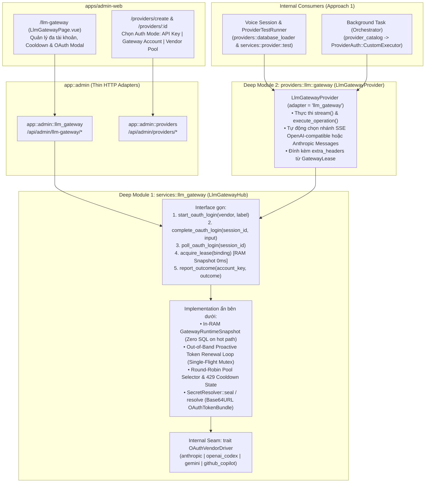

# Tài Liệu Triển Khai: LLM Gateway Nội Bộ (OAuth 4 Nhà Cung Cấp, Quản Lý Web `/llm-gateway` & Mapping `Provider Instance`)

> **Repository:** `AI_Agent_Voice_rust` (`crates/voice-agent-server` + `apps/admin-web`) & `orchestrator_agent_rs`
> **Kỷ luật thiết kế:** Áp dụng bộ từ vựng **Deep Module** từ `.agents/skills/codebase-design/SKILL.md` & `DEEPENING.md`, đồng bộ với từ vựng chuẩn trong `GLOSSARY.md` và `CONTEXT.md`.
> **Mục tiêu:** Xây dựng tính năng **Internal LLM Gateway** lấy cảm hứng từ `9router` theo **Phương án 1 (Internal Gateway)** — không mở cổng proxy `/v1` công khai ra internet, nhưng cung cấp đầy đủ:
> 1. **4 Nhà cung cấp OAuth cốt lõi**:
>    - `anthropic` (**Claude / Anthropic** — OAuth 2.0 Authorization Code + PKCE)
>    - `openai_codex` (**OpenAI Codex / ChatGPT** — OAuth 2.0 Authorization Code + PKCE)
>    - `gemini` (**Google Gemini** — OAuth 2.0 Authorization Code + PKCE)
>    - `github_copilot` (**GitHub Copilot** — OAuth 2.0 Device Authorization Grant RFC 8628)
> 2. **Trang quản lý tài khoản OAuth chuyên biệt trên Web (`/llm-gateway`)**: Cho phép đăng nhập nhiều tài khoản trên trình duyệt (hỗ trợ cả luồng tự động bắt callback qua popup, luồng dán Callback URL khi chạy remote/Docker, và luồng nhập Device Code), theo dõi hạn token, trạng thái `429 Cooldown`, làm mới token hoặc xoá tài khoản.
> 3. **Mapping linh hoạt vào `Provider Instance` (`/providers/create` & `/providers/:id`)**: Cho phép chọn **1 tài khoản OAuth cụ thể** (`account:<key>`) hoặc **Pool xoay vòng tự động theo hãng** (`pool:<vendor>`) thay cho `api_key` tĩnh, phục vụ đồng nhất cho cả **Voice Session**, **Provider Diagnostic**, và **Background Task** (`Orchestrator`).

---

## Bảng quyết định thiết kế (Shallow Trap vs. Deepened Decision)

| Khía cạnh | Shallow Trap (Bẫy thiết kế nông cần tránh) | Deepened Decision (Quyết định thiết kế sâu được chốt) |
| :--- | :--- | :--- |
| **1. Lưu trữ & Phân giải OAuth Token (`ADR-0083` & `CONTEXT.md`)** | Nhét `access_token` vào `providers.credential_json` hoặc truy vấn SQLite + giải mã `SecretResolver::resolve` trên từng lượt gọi `LlmProvider::stream()` (vi phạm `CONTEXT.md:456` cấm *"per-request secret resolution"* và `ADR-0083:17` cấm truy cập SQL lúc runtime). | Tách bảng độc lập `llm_gateway_accounts` (`0138_llm_gateway_accounts.sql`) với cột `credential_json TEXT NOT NULL` được niêm phong qua `SecretResolver::seal(&value, "gateway_account:<key>")`. Lúc khởi động và sau mỗi thao tác cập nhật/làm mới ngầm, `LlmGatewayHub` giải mã sẵn các tài khoản active vào một **In-RAM Snapshot (`RwLock<GatewayRuntimeSnapshot>`)**. Đường nóng `acquire_lease()` chỉ đọc từ RAM (`0ms`, không chạm SQL hay `SecretResolver`). |
| **2. Đóng gói `OAuthTokenBundle` với `SecretValue` (`credentials.rs:30`)** | Truyền chuỗi JSON có khoảng trắng vào `SecretResolver::seal` (sẽ bị từ chối bởi `credentials::valid_input` tại `database/security/credentials.rs:30` vốn yêu cầu `bytes.len() <= 4096 && bytes.iter().all(u8::is_ascii_graphic)`). | Serialize `OAuthTokenBundle` sang JSON rồi mã hoá **Base64 URL-safe không padding (`URL_SAFE_NO_PAD`)** trước khi bọc vào `SecretValue::new(...)` và gọi `secret_resolver.seal(&secret_val, &scope)`. Khi đọc lúc nạp Snapshot, dùng `credentials::reference(&scope, Some(&row.credential_json), None)` và `secret_resolver.resolve(&secret_ref)`. |
| **3. Luồng OAuth trên trình duyệt (Local vs. Remote/Docker)** | Chỉ hỗ trợ redirect cứng về `http://localhost:<port>/callback`, khiến Admin mở trình duyệt từ máy khác truy cập vào server chạy trên VPS/Docker bị lỗi kết nối ở bước cuối. | **Hybrid OAuth Flow**: Hỗ trợ đồng thời: <br>1. **PKCE + Hybrid Callback** (`anthropic`, `openai_codex`, `gemini`): Hỗ trợ cả callback tự động qua popup (`postMessage`) lẫn ô **"Paste Callback URL / Code"** khi redirect về `localhost` của CLI hãng.<br>2. **RFC 8628 Device Code Flow** (`github_copilot`): Hiển thị mã `user_code` 8 ký tự kèm nút mở `https://github.com/login/device`, Web tự động poll trạng thái. |
| **4. Kiểu hoá `GatewayBinding` & Tính bất biến của `config_json` (`ADR-0062`)** | Dùng `Option<String>` thô (**Primitive Obsession**) hoặc đặt tên trường trong `config_json` là `oauth_token` / `credential_ref` (bị hàm `protected(&value)` trong `database/providers/config.rs:95-125` từ chối). | Định nghĩa kiểu miền mạnh `GatewayBinding` (`Account(String)` \| `Pool(GatewayVendor)`) cài đặt `Serialize`/`Deserialize` qua chuỗi chuẩn `"account:<key>"` hoặc `"pool:<vendor>"` dưới trường `gateway_binding`. Tên khoá `gateway_binding` đi qua `protected(&value)` hợp lệ theo `ADR-0062`. |
| **5. Gom toàn bộ giao thức OAuth LLM vào một Adapter sâu (`LlmGatewayProvider`)** | Nhồi logic ghi đè `base_url`, `extra_headers` và chuyển đổi SSE vào `ConfiguredOpenAiLlm` (vốn dùng `llm::builder::LLMBuilder` không hỗ trợ chèn custom headers như `Editor-Version`, `Copilot-Integration-Id`, `anthropic-beta`) gây **Shotgun Surgery** và **Duplicated Code**. | Tạo một **Deep Module** duy nhất `providers::llm::gateway` (`LlmGatewayProvider`, `adapter = "llm_gateway"`) thực thi cả hai nhánh giao thức SSE (`OpenAI Chat/Responses` cho Codex/Gemini/Copilot và `Anthropic Messages` cho Claude) bằng `reqwest` với `extra_headers` động. Nếu người dùng cấu hình `gateway_binding` trên `openai`, `OpenAiLlmFactory::build` uỷ quyền thẳng sang `LlmGatewayProvider` — không nhân bản logic ở bất kỳ đâu. |
| **6. Xoay vòng Pool & Tuân thủ tuyệt đối `ADR-0023` (Zero Provider Retries)** | Đặt vòng lặp `for attempt in 1..=3` tự động thử lại bên trong `LlmProvider::stream()` khi gặp `429`/`503` (vi phạm trực tiếp `ADR-0023` và `CONTEXT.md:622` cấm automatic provider retry). | **Single-Attempt Selection + Stateful Cooldown Eviction**: Mỗi lệnh gọi `LlmProvider::stream()` hoặc `execute_operation()` chỉ thực hiện **đúng 1 lần gọi upstream** (`0 retry`, tuân thủ 100% `ADR-0023`). Trước khi gọi, `LlmGatewayHub::acquire_lease()` chọn từ RAM một tài khoản đang khoẻ (bỏ qua các tài khoản đang trong `Cooldown`). Nếu lần gọi đó trả về `429`/`401`, `report_outcome()` lập tức đánh dấu `cooldown_until` trong RAM cho tài khoản đó để **lượt gọi kế tiếp** tự động xoay sang tài khoản tiếp theo trong Pool. |
| **7. Tương thích `COMPILED_PROVIDER_REGISTRY` & Đồng bộ `Orchestrator`** | Sửa chữ ký `LlmFactory::build(&self, config: &LlmInstanceConfig)` hoặc chỉ lấy token một lần trong `resolve_llm_provider_catalog(state)` (khiến token hết hạn sau 30–60 phút và mất `extra_headers` khi chạy `Background Task`). | • Với `LlmFactory::build`: Dùng `SharedGatewayHub::global()` (mẫu thiết kế giống hệt `SharedMusePool::get_or_init` trong `providers/llm/muse/provider.rs:23`) kèm `LlmGatewayProvider::with_hub` cho kiểm thử.<br>• Với `Orchestrator`: Mở rộng `ProviderAuth::CustomExecutor(Arc<dyn CustomModelExecutor>)` trong `orchestrator_agent_rs` để mỗi turn của `Root Orchestrator` / `Sub-Agent` gọi trực tiếp qua `LlmGatewayProvider`, luôn lấy lease mới nhất từ RAM và đính kèm đầy đủ `extra_headers`. |

---

## 1. Từ vựng Domain (`GLOSSARY.md` & `CONTEXT.md`) & Ghi chú Ranh giới ADR

### 1.1. Bổ sung Từ vựng Chuẩn (`GLOSSARY.md`)

| Thuật ngữ mới | Định nghĩa chuẩn (Bổ sung vào `GLOSSARY.md`) | Quan hệ với thuật ngữ hiện hữu |
| :--- | :--- | :--- |
| **Gateway Account** | Một tài khoản nhà cung cấp AI đã xác thực qua OAuth 2.0 (Claude, OpenAI Codex, Gemini, GitHub Copilot), lưu trữ `OAuthTokenBundle` đã niêm phong trong cột `credential_json` của bảng `llm_gateway_accounts` và được nạp sẵn vào **Gateway Runtime Snapshot** trong RAM. | Được tham chiếu bởi một hoặc nhiều **Provider Instance** thông qua **Gateway Binding**. |
| **Gateway Account Pool** | Tập hợp các **Gateway Account** đang hoạt động (`enabled = true`, không nằm trong `Cooldown`) thuộc cùng một `vendor` (`anthropic`, `openai_codex`, `gemini`, `github_copilot`), cho phép chọn luân phiên (Round-Robin) từ RAM trước mỗi yêu cầu. | Được chọn khi cấu hình **Provider Instance** với giá trị `gateway_binding = "pool:<vendor>"`. |
| **Gateway Binding** | Kiểu dữ liệu định danh phi bí mật (`GatewayBinding::Account` hoặc `GatewayBinding::Pool`) nằm trong `config_json.gateway_binding` của một `DesiredProvider`, liên kết **Provider Instance** với `LlmGatewayHub` thay vì dùng `api_key` tĩnh. | Thay thế nhu cầu phải có `credential_json` tĩnh trên bảng `providers` khi tạo hoặc chỉnh sửa **Provider Instance**. |
| **OAuth Login Session** | Phiên đăng nhập OAuth tạm thời trong bộ nhớ RAM (TTL 10 phút), giữ `state`, `code_verifier` (PKCE) hoặc `device_code` (RFC 8628) trong lúc chờ Admin hoàn tất xác thực trên trình duyệt. | Tạo ra hoặc cập nhật một **Gateway Account** và làm mới **Gateway Runtime Snapshot** ngay khi đổi mã thành công. |

### 1.2. Ghi chú Tương thích & Cờ Xung đột ADR (`docs/agents/domain.md`)

Theo quy tắc tại `docs/agents/domain.md` (dòng 48–51), dưới đây là phân tích đối chiếu với các ADR hiện hữu và các điểm cần lưu ý:

1. **`ADR-0023` (Zero Provider Retries) & `CONTEXT.md:622` — Không retry ẩn bên trong Provider**:
   - **Quy tắc**: `ADR-0023` nghiêm cấm việc tự động thử lại (automatic provider retry) bên trong một thao tác `LlmProvider::stream` hoặc `execute_operation`.
   - **Thiết kế tuân thủ**: `LlmGatewayProvider` **không bao giờ thực hiện vòng lặp retry bên trong một lời gọi**. Khi dùng `pool:<vendor>`, việc chọn tài khoản diễn ra hoàn toàn trong RAM trước khi mở kết nối HTTP (`0ms`). Nếu tài khoản được chọn trả về `429` hoặc `401`, lời gọi hiện tại trả lỗi ngay theo đúng `ADR-0023`, đồng thời cập nhật trạng thái `cooldown_until` trong RAM để các lượt gọi tiếp theo không chọn lại tài khoản đang bị giới hạn tốc độ.
2. **`ADR-0083` (Admin-Managed Resource Credentials) & `CONTEXT.md:446-456` — Không phân giải Secret hay truy vấn SQL trên đường nóng**:
   - **Quy tắc**: `ADR-0083` và `CONTEXT.md:456` yêu cầu không truy vấn SQLite và không gọi giải mã secret trên từng request runtime (*"Avoid: per-request secret resolution, silent credential replacement, runtime failure refresh"*).
   - **Ghi chú kiến trúc (Flagged Evolution cho OAuth Token có thời hạn ngắn)**: Khác với `api_key` tĩnh không bao giờ hết hạn của `ADR-0083`, `access_token` của OAuth (Claude, Codex, Gemini, Copilot) có thời hạn 30–60 phút. Để vừa hỗ trợ OAuth tự động làm mới token vừa không vi phạm đường nóng của `ADR-0083`:
     - Mọi thao tác đọc SQLite và gọi `SecretResolver::resolve` / `SecretResolver::seal` chỉ diễn ra **ngoài đường nóng** (lúc khởi động server, khi Admin thêm/sửa/làm mới tài khoản, hoặc trong tiến trình nền `Proactive Token Renewal Loop` chạy định kỳ trước khi token hết hạn 5 phút).
     - Tiến trình nền sau khi làm mới và niêm phong lại `credential_json` vào SQLite sẽ hoán đổi nguyên tử **Gateway Runtime Snapshot** trong RAM. Đường nóng `acquire_lease()` chỉ đọc `GatewayLease` đã giải mã sẵn từ RAM.
3. **`ADR-0062` (Credential-free Provider Config)**:
   - Trường `gateway_binding` chỉ chứa định danh `"account:<key>"` hoặc `"pool:<vendor>"`, đi qua hàm `protected(&value)` trong `database/providers/config.rs` hợp lệ và được kiểm tra kiểu tĩnh qua `GatewayBinding`.
4. **`ADR-0099` (Agent Job Responses Provider Routing)**:
   - Thực hiện tích hợp qua `ProviderAuth::CustomExecutor` trong `orchestrator_agent_rs` để mọi lượt gọi của `Background Task` đều đi qua `LlmGatewayProvider` với lease tươi từ RAM.

---

## 2. Kiến trúc tổng thể & Kỷ luật Seam (`DEEPENING.md`)

### 2.1. Phân loại phụ thuộc theo `DEEPENING.md`

| Phụ thuộc | Phân loại (`DEEPENING.md`) | Chiến lược trong thiết kế & kiểm thử |
| :--- | :--- | :--- |
| **SQLite (`llm_gateway_accounts`) & `CredentialCipher` (`SecretResolver`)** | **In-process / Local-substitutable** | Kiểm thử trực tiếp với SQLite thật và `CredentialCipher::new(1, &test_key)` thật qua trait `SecretResolver`, không dùng mock. |
| **Gateway Runtime Snapshot, Round-Robin Selector & Cooldown Tracker** | **In-process** | Kiểm thử trực tiếp qua **Interface** của `LlmGatewayHub` với trạng thái thật trong bộ nhớ. |
| **Máy chủ OAuth của 4 hãng (Anthropic, OpenAI, Google, GitHub)** | **True external** | Đặt một **Internal Seam** duy nhất (`trait OAuthVendorDriver`) bên trong `services::llm_gateway::vendors` để đóng gói đặc tả HTTP OAuth của 4 hãng. Trong kiểm thử tích hợp của `LlmGatewayHub`, nạp `FakeOAuthVendorDriver` trả về token tất định mà không gọi ra internet. |

### 2.2. Sơ đồ Kiến trúc Deep Module



---

## 3. Thiết kế Cơ sở dữ liệu & Bảo mật (`SecretResolver`)

### 3.1. Migration `crates/voice-agent-server/migrations/0138_llm_gateway_accounts.sql`

Đồng bộ hoàn toàn với cách lưu `credential_json TEXT` của bảng `providers` (`crates/voice-agent-server/src/database/providers/mod.rs:28`), bảng `llm_gateway_accounts` sử dụng một cột `credential_json TEXT NOT NULL` duy nhất chứa chuỗi JSON `EncryptedCredential` do `SecretResolver::seal` sinh ra:

```sql
-- 0138_llm_gateway_accounts.sql
-- Quản lý các Gateway Account xác thực qua OAuth 2.0 (Anthropic, OpenAI Codex, Gemini, GitHub Copilot)
-- phục vụ Internal LLM Gateway.

CREATE TABLE IF NOT EXISTS llm_gateway_accounts (
    id INTEGER PRIMARY KEY AUTOINCREMENT,
    account_key TEXT NOT NULL UNIQUE,
    vendor TEXT NOT NULL CHECK (
        vendor IN ('anthropic', 'openai_codex', 'gemini', 'github_copilot')
    ),
    label TEXT NOT NULL,
    account_email TEXT,
    -- Chuỗi JSON EncryptedCredential được tạo bởi SecretResolver::seal(&value, "gateway_account:<account_key>")
    credential_json TEXT NOT NULL,
    -- Thời점 hết hạn access_token hiện tại (unix epoch seconds) để Proactive Renewal Loop chủ động làm mới
    expires_at INTEGER,
    enabled INTEGER NOT NULL DEFAULT 1 CHECK (enabled IN (0, 1)),
    priority INTEGER NOT NULL DEFAULT 100,
    status TEXT NOT NULL DEFAULT 'active' CHECK (
        status IN ('active', 'expired', 'reauth_required', 'disabled')
    ),
    last_error TEXT,
    last_refreshed_at INTEGER,
    last_used_at INTEGER,
    created_at INTEGER NOT NULL DEFAULT (unixepoch()),
    updated_at INTEGER NOT NULL DEFAULT (unixepoch())
);

CREATE INDEX IF NOT EXISTS idx_llm_gateway_accounts_vendor_enabled
    ON llm_gateway_accounts (vendor, enabled, priority ASC, id ASC);
```

### 3.2. Quy cách đóng gói `OAuthTokenBundle` với `SecretResolver` & `SecretValue`

Trong `crates/voice-agent-server/src/database/security/credentials.rs` (dòng 30–41, 268–279):
- `pub fn valid_input(value: &SecretValue) -> bool` kiểm tra `!bytes.is_empty() && bytes.len() <= 4096 && bytes.iter().all(u8::is_ascii_graphic)`.
- `SecretResolver::seal(&self, value: &SecretValue, scope: &str) -> Result<String, SecretResolveError>` mã hoá `SecretValue` bằng khoá `VOICE_CREDENTIAL_KEY_<current_version>` (`AES-256-GCM`, AAD `("admin", scope, &id)`) và trả về chuỗi JSON `EncryptedCredential`.
- `credentials::reference(scope, record, fallback)` tạo chuỗi `"sealed:<base64(scope)>:<base64(record)>"` để truyền vào `SecretResolver::resolve(&SecretRef)`.

Do đó, `LlmGatewayHub` đóng gói `OAuthTokenBundle` theo đúng hợp đồng của `credentials.rs`:

```rust
#[derive(Debug, Clone, Serialize, Deserialize)]
pub struct OAuthTokenBundle {
    pub access_token: String,
    pub refresh_token: Option<String>,
    /// Dành cho GitHub Copilot: github_oauth_token gốc dùng để đổi lấy copilot bearer token ngắn hạn
    pub upstream_oauth_token: Option<String>,
    /// Dành cho OpenAI Codex / Gemini: chatgpt_account_id hoặc project_id trích từ token
    pub account_context_id: Option<String>,
}
```

1. **Niêm phong khi lưu vào SQLite (`seal_token_bundle`)**:
   ```rust
   let scope = format!("gateway_account:{account_key}");
   let json_bytes = serde_json::to_vec(&bundle).map_err(|_| GatewayError::InvalidTokenBundle)?;
   let compact_b64 = base64::engine::general_purpose::URL_SAFE_NO_PAD.encode(&json_bytes);
   let secret_value = SecretValue::new(compact_b64);
   // compact_b64 chỉ gồm [A-Za-z0-9_-], thoả mãn valid_input() (is_ascii_graphic && <= 4096 bytes)
   let credential_json = secret_resolver
       .seal(&secret_value, &scope)
       .map_err(|_| GatewayError::CredentialStorageUnavailable)?;
   ```
2. **Giải mã khi nạp vào `GatewayRuntimeSnapshot` (`open_token_bundle`)**:
   ```rust
   let scope = format!("gateway_account:{account_key}");
   let raw_ref = crate::database::credentials::reference(&scope, Some(&row.credential_json), None)
       .ok_or(GatewayError::CredentialInvalid)?;
   let secret_ref = SecretRef::parse(raw_ref).map_err(|_| GatewayError::CredentialInvalid)?;
   let resolved = secret_resolver
       .resolve(&secret_ref)
       .map_err(|_| GatewayError::CredentialInvalid)?;
   let json_bytes = base64::engine::general_purpose::URL_SAFE_NO_PAD
       .decode(resolved.expose().as_bytes())
       .map_err(|_| GatewayError::CredentialInvalid)?;
   let bundle: OAuthTokenBundle =
       serde_json::from_slice(&json_bytes).map_err(|_| GatewayError::CredentialInvalid)?;
   ```
3. **Hiển thị thông tin đã che (`masked_key` / `key_version`) trên Admin Web**:
   - Gọi trực tiếp hàm sẵn có `crate::database::credentials::metadata(Some(&row.credential_json))` (`credentials.rs:43-62`).

---

## 4. Deep Module 1: `services::llm_gateway` (`LlmGatewayHub`)

Tạo module mới tại `crates/voice-agent-server/src/services/llm_gateway/` (tuân thủ quy ước tách riêng file kiểm thử `tests.rs` theo `CONTEXT.md:28`):

```text
crates/voice-agent-server/src/services/llm_gateway/
├── mod.rs          # Public Interface của LlmGatewayHub, SharedGatewayHub, GatewayBinding, GatewayLease
├── types.rs        # GatewayVendor, GatewayAccountView, OAuthLoginChallenge, OAuthPollStatus
├── hub.rs          # Implementation: In-RAM GatewayRuntimeSnapshot, Proactive Renewal Loop, Cooldown Tracker
├── oauth_flow.rs   # Quản lý OAuthLoginSession (PKCE S256 verifier, Device Code polling, URL parser)
├── tests.rs        # Bộ kiểm thử tích hợp qua Public Interface của LlmGatewayHub
└── vendors/
    ├── mod.rs      # Internal Seam: trait OAuthVendorDriver + FakeOAuthVendorDriver (cho test)
    ├── anthropic.rs
    ├── openai_codex.rs
    ├── gemini.rs
    └── github_copilot.rs
```

### 4.1. Public Interface của `LlmGatewayHub` & Kiểu `GatewayBinding`

```rust
#[derive(Debug, Clone, Copy, PartialEq, Eq, PartialOrd, Ord, Hash, Serialize, Deserialize)]
#[serde(rename_all = "snake_case")]
pub enum GatewayVendor {
    Anthropic,
    OpenaiCodex,
    Gemini,
    GithubCopilot,
}

impl GatewayVendor {
    pub const fn default_base_url(self) -> &'static str {
        match self {
            Self::Anthropic => "https://api.anthropic.com/v1",
            Self::OpenaiCodex => "https://api.openai.com/v1",
            Self::Gemini => "https://daily-cloudcode-pa.googleapis.com/v1internal",
            Self::GithubCopilot => "https://api.githubcopilot.com",
        }
    }
}

/// Kiểu miền mạnh thay thế chuỗi thô trong config_json ("account:<key>" hoặc "pool:<vendor>").
#[derive(Debug, Clone, PartialEq, Eq, Hash, Serialize, Deserialize)]
#[serde(try_from = "String", into = "String")]
pub enum GatewayBinding {
    Account(String),
    Pool(GatewayVendor),
}

#[derive(Debug, Clone)]
pub struct GatewayLease {
    pub account_key: String,
    pub vendor: GatewayVendor,
    pub access_token: crate::config::SecretString,
    pub base_url: String,
    pub extra_headers: Vec<(String, String)>,
}

#[derive(Debug, Clone, Copy)]
pub enum GatewayCallOutcome {
    Success,
    RateLimited { retry_after_secs: Option<u64> },
    Unauthorized,
}
```

Các phương thức trên **Interface** của `LlmGatewayHub`:
1. `pub async fn reload_snapshot(&self) -> Result<(), GatewayError>` — Đọc bảng `llm_gateway_accounts`, giải mã `OAuthTokenBundle` qua `SecretResolver` và cập nhật `GatewayRuntimeSnapshot` trong RAM.
2. `pub fn acquire_lease(&self, binding: &GatewayBinding) -> Result<GatewayLease, GatewayError>` — **Đồng bộ, `0ms`, chỉ đọc từ `GatewayRuntimeSnapshot` trong RAM**, không truy vấn SQL hay giải mã lại secret.
3. `pub fn report_outcome(&self, account_key: &str, outcome: GatewayCallOutcome)` — Cập nhật ngay lập tức trạng thái `cooldown_until` hoặc đánh dấu cần làm mới trong RAM.
4. `pub async fn list_accounts(&self, vendor: Option<GatewayVendor>) -> Result<Vec<GatewayAccountView>, GatewayError>`
5. `pub async fn start_oauth_login(&self, req: StartOAuthLoginRequest) -> Result<OAuthLoginChallenge, GatewayError>`
6. `pub async fn complete_oauth_login(&self, session_id: &str, submission: OAuthCallbackSubmission) -> Result<GatewayAccountView, GatewayError>`
7. `pub async fn poll_oauth_login(&self, session_id: &str) -> Result<OAuthPollStatus, GatewayError>`
8. `pub async fn refresh_account_now(&self, account_key: &str) -> Result<GatewayAccountView, GatewayError>`
9. `pub async fn clear_cooldown(&self, account_key: &str) -> Result<GatewayAccountView, GatewayError>`
10. `pub async fn update_account(&self, account_key: &str, patch: UpdateGatewayAccountPatch) -> Result<GatewayAccountView, GatewayError>`
11. `pub async fn delete_account(&self, account_key: &str) -> Result<(), GatewayError>`

### 4.2. Đặc tả 4 Nhà cung cấp OAuth (`vendors/`)

| Vendor (`GatewayVendor`) | Cơ chế OAuth 2.0 | Endpoint Xác thực & Đổi Token | Upstream LLM Endpoint & Header Đính kèm |
| :--- | :--- | :--- | :--- |
| **`anthropic`**<br>(Claude Pro/Max OAuth) | **Authorization Code + PKCE (`S256`)** | • Authorize: `https://claude.ai/oauth/authorize`<br>• Token: `https://console.anthropic.com/v1/oauth/token`<br>• Scopes: `user:inference user:profile` | • Base URL: `https://api.anthropic.com/v1`<br>• Header: `Authorization: Bearer <access_token>`<br>• Header: `anthropic-version: 2023-06-01`<br>• Header: `anthropic-beta: oauth-2025-04-20` |
| **`openai_codex`**<br>(ChatGPT Plus/Pro Codex OAuth) | **Authorization Code + PKCE (`S256`)** | • Authorize: `https://auth.openai.com/oauth/authorize`<br>• Token: `https://auth.openai.com/oauth/token`<br>• Scopes: `openid profile email offline_access` | • Base URL: `https://api.openai.com/v1`<br>• Header: `Authorization: Bearer <access_token>`<br>• Nếu `account_context_id` có giá trị: đính kèm header `ChatGPT-Account-Id`. |
| **`gemini`**<br>(Google Gemini / Antigravity OAuth) | **Authorization Code + PKCE (`S256`)** | • Authorize: `https://accounts.google.com/o/oauth2/v2/auth` (`access_type=offline&prompt=consent`)<br>• Token: `https://oauth2.googleapis.com/token`<br>• Scopes: `cloud-platform`, `userinfo.email`, `userinfo.profile`, `cclog`, `experimentsandconfigs`<br>• Project discovery: `v1internal:loadCodeAssist` + fallback `v1internal:onboardUser` | • Base URL Cloud Code Assist: `https://daily-cloudcode-pa.googleapis.com/v1internal` (fallback `https://cloudcode-pa.googleapis.com/v1internal`)<br>• Wire: `:streamGenerateContent?alt=sse` / `:generateContent`<br>• Header: `Authorization: Bearer <access_token>`, `User-Agent: antigravity/hub/2.24.0 darwin/arm64` |
| **`github_copilot`**<br>(GitHub Copilot) | **Device Authorization Grant (RFC 8628)** + **Token Exchange** | • Bước 1 (Device Code): `POST https://github.com/login/device/code` (`scope: read:user`)<br>• Bước 2 (Poll OAuth Token): `POST https://github.com/login/oauth/access_token`<br>• Bước 3 (Đổi sang Copilot Bearer Token ngắn hạn ~30 phút): `GET https://api.github.com/copilot_internal/v2/token` với `Authorization: token <github_oauth_token>` | • Base URL: `https://api.githubcopilot.com`<br>• Header: `Authorization: Bearer <copilot_bearer_token>`<br>• Header: `Editor-Version: vscode/1.96.0`<br>• Header: `Copilot-Integration-Id: vscode-chat` |

### 4.3. Proactive Out-of-Band Token Renewal & Pool Cooldown (`hub.rs`)

Để thoả mãn đồng thời `ADR-0083` (không chạm SQLite trên đường nóng) và giữ token luôn tươi:
- **In-RAM `GatewayRuntimeSnapshot`**:
  - Giữ danh sách các `LoadedGatewayAccount` đã giải mã sẵn `OAuthTokenBundle` trong RAM, cùng với `cooldown_until: Option<Instant>` và con trỏ xoay vòng `AtomicUsize` cho mỗi `GatewayVendor`.
  - Khi `acquire_lease(binding)` được gọi:
    - Nếu là `GatewayBinding::Account(key)`: tra cứu trực tiếp `key` trong Snapshot; nếu tài khoản đang bị `cooldown_until > Instant::now()`, trả về `Err(GatewayError::AccountCoolingDown)`.
    - Nếu là `GatewayBinding::Pool(vendor)`: lọc các tài khoản thuộc `vendor` có `enabled == true`, `status == Active`, và không bị Cooldown; chọn tài khoản theo chỉ số `cursor.fetch_add(1, Ordering::Relaxed) % ready.len()`.
- **Proactive Out-of-Band Renewal Loop (`spawn_proactive_refresh_loop`)**:
  - Một background task chạy mỗi `60 giây` kiểm tra các tài khoản active trong Snapshot có `expires_at <= now + 300s` (sắp hết hạn trong 5 phút tới).
  - Với mỗi tài khoản sắp hết hạn, khoá `Mutex` Single-Flight của `account_key` đó, gọi `vendor_driver.refresh_token(&bundle).await`, niêm phong lại `credential_json` qua `SecretResolver::seal`, cập nhật dòng tương ứng trong `llm_gateway_accounts`, và cập nhật nguyên tử `GatewayRuntimeSnapshot` trong RAM.

---

## 5. Deep Module 2: `providers::llm::gateway` (`LlmGatewayProvider`) & Đồng bộ Hệ thống

### 5.1. Tạo Adapter chuyên biệt `providers::llm::gateway` (`adapter = "llm_gateway"`)

Thay vì sửa `ConfiguredOpenAiLlm` (vốn bị giới hạn bởi `llm::builder::LLMBuilder` không cho phép chèn `extra_headers` tuỳ ý) và gây nhân bản code giữa nhiều adapter, ta tạo một **Deep Module** duy nhất tại `crates/voice-agent-server/src/providers/llm/gateway/`:

```text
crates/voice-agent-server/src/providers/llm/gateway/
├── mod.rs          # Xuất LlmGatewayConfig, LlmGatewayProvider, LlmGatewayFactory
├── config.rs       # LlmGatewayConfig (gateway_binding: GatewayBinding, model, base_url, timeout_ms, ...)
├── descriptor.rs   # CompiledProviderDescriptor cho adapter "llm_gateway"
├── provider.rs     # Cài đặt LlmProvider (stream, execute_operation)
├── wire_openai.rs  # Thực thi SSE OpenAI Chat Completions via reqwest + extra_headers (Codex, Gemini, Copilot)
├── wire_anthropic.rs # Thực thi SSE Anthropic Messages (/v1/messages) via reqwest + extra_headers (Claude)
└── tests.rs        # Kiểm thử đơn vị & tích hợp của LlmGatewayProvider (theo CONTEXT.md:28)
```

1. **Cấu hình `LlmGatewayConfig` (`config.rs`)**:
   ```rust
   #[derive(Clone, Debug, Deserialize, Serialize)]
   #[serde(deny_unknown_fields)]
   pub struct LlmGatewayConfig {
       pub gateway_binding: GatewayBinding,
       pub model: String,
       #[serde(default, skip_serializing_if = "Option::is_none")]
       pub base_url: Option<Url>,
       #[serde(default = "default_timeout_ms")]
       pub timeout_ms: u64,
       #[serde(default, skip_serializing_if = "Option::is_none")]
       pub max_tokens: Option<u32>,
       #[serde(default, skip_serializing_if = "Option::is_none")]
       pub context_limit_tokens: Option<u32>,
       #[serde(default, skip_serializing_if = "Option::is_none")]
       pub reasoning_effort: Option<String>,
       #[serde(default, skip_serializing_if = "Option::is_none")]
       pub temperature_percent: Option<u16>,
       #[serde(default, skip_serializing_if = "Option::is_none")]
       pub tags: Option<Vec<String>>,
   }
   ```
2. **Tuân thủ chữ ký `COMPILED_PROVIDER_REGISTRY` (`providers/factory_registry.rs:63-66`)**:
   - Giống hệt cách `MuseLlmProvider::from_config` dùng `SharedMusePool` (`providers/llm/muse/provider.rs:22-41`), `LlmGatewayFactory::build(&self, config: &LlmInstanceConfig)` khởi tạo `LlmGatewayProvider::from_config(cfg)` thông qua `SharedGatewayHub::global()`.
   - Đối với kiểm thử cô lập, cung cấp `LlmGatewayProvider::with_hub(cfg, hub: Arc<LlmGatewayHub>)`.
   - Đồng thời, trên `OpenAiConfig` (`crates/voice-agent-server/src/providers/llm/openai/config.rs` & `descriptor.rs`), bổ sung trường tuỳ chọn `pub gateway_binding: Option<GatewayBinding>`. Khi `OpenAiLlmFactory::build` thấy `config.gateway_binding.is_some()`, nó uỷ quyền thẳng sang `LlmGatewayProvider::from_openai_config(config)` — nhờ vậy người dùng có thể chọn adapter `"llm_gateway"` mới hoặc gắn `gateway_binding` ngay trên provider `"openai"` hiện hữu mà không có bất kỳ dòng logic trùng lặp nào!

### 5.2. Cài đặt `LlmProvider` trên `LlmGatewayProvider` (Tuân thủ 100% `ADR-0023`)

```rust
#[async_trait::async_trait]
impl LlmProvider for LlmGatewayProvider {
    fn supports_tools(&self) -> bool {
        true
    }

    fn adapter(&self) -> &'static str {
        "llm_gateway"
    }

    fn capability_tags(&self) -> &[LlmCapabilityTag] {
        &self.tags
    }

    async fn stream(&self, request: LlmRequest) -> Result<LlmEventStream, LlmError> {
        self.ensure_tag(LlmCapabilityTag::Chat)?;
        // 1. Lấy lease từ RAM Snapshot (0ms, không truy vấn SQL, chọn sẵn tài khoản không bị Cooldown)
        let lease = self.hub.acquire_lease(&self.binding).map_err(|_| LlmError::Failed)?;
        let endpoint = self
            .base_url_override
            .as_ref()
            .map(Url::as_str)
            .unwrap_or(&lease.base_url);

        // 2. Thực hiện ĐÚNG 1 LẦN GỌI UPSTREAM (Zero Provider Retries theo ADR-0023)
        let response = match lease.vendor {
            GatewayVendor::Anthropic => {
                wire_anthropic::open_sse_stream(&self.http, endpoint, &lease, &self.config, &request).await
            }
            GatewayVendor::OpenaiCodex | GatewayVendor::Gemini | GatewayVendor::GithubCopilot => {
                wire_openai::open_sse_stream(&self.http, endpoint, &lease, &self.config, &request).await
            }
        };

        match response {
            Ok(event_stream) => {
                self.hub.report_outcome(&lease.account_key, GatewayCallOutcome::Success);
                Ok(event_stream)
            }
            Err(WireError::RateLimited { retry_after_secs }) => {
                // Đánh dấu Cooldown trong RAM để lượt gọi kế tiếp tự động chọn tài khoản khác trong Pool
                self.hub.report_outcome(
                    &lease.account_key,
                    GatewayCallOutcome::RateLimited { retry_after_secs },
                );
                Err(LlmError::Failed)
            }
            Err(WireError::Unauthorized) => {
                self.hub.report_outcome(&lease.account_key, GatewayCallOutcome::Unauthorized);
                Err(LlmError::Failed)
            }
            Err(_) => Err(LlmError::Failed),
        }
    }

    async fn execute_operation(&self, op: LlmOperation) -> Result<LlmOutput, LlmError> {
        match op {
            LlmOperation::Chat { request, .. } => {
                let stream = self.stream(request).await?;
                collect_chat_stream(stream).await
            }
            LlmOperation::Vision { prompt, image_bytes, mime_type } => {
                self.ensure_tag(LlmCapabilityTag::Vision)?;
                self.run_vision(&prompt, &image_bytes, &mime_type).await
            }
            _ => Err(LlmError::UnsupportedCapability(op.required_tag().as_str())),
        }
    }
}
```

### 5.3. Cập nhật Validation, Loader, Diagnostics & Admin Providers

1. **`crates/voice-agent-server/src/database/providers/config.rs`**:
   - Trong `validate_raw()` (dòng 30–65), thêm nhánh `"llm_gateway" => canonical::<crate::config::LlmGatewayConfig, _>(&value, crate::config::LlmGatewayConfig::valid)`.
   - Trong struct `OpenAi` (dòng 131–160), thêm `#[serde(default, skip_serializing_if = "Option::is_none")] gateway_binding: Option<GatewayBinding>`.
2. **`crates/voice-agent-server/src/providers/database_loader.rs`**:
   - Trong nhánh `"llm"` (dòng 412–445), `typed_instance` cho phép `secret` là `None` khi `row.adapter == "llm_gateway"` hoặc khi `value` có `gateway_binding`.
3. **`crates/voice-agent-server/src/services/provider/test.rs` (`ProviderTestRunner`)**:
   - Tại dòng 95–103 (`ProviderTestRunner::credential`), cho phép `credential` là `None` khi `draft.adapter == "llm_gateway"` hoặc khi `draft.config_json` có `gateway_binding`. Nhờ `LlmGatewayProvider` lấy lease qua `SharedGatewayHub::global()`, `ProviderTestRunner::run` (dòng 105–175) thực thi kiểm thử kết nối trực tiếp với tài khoản OAuth hoặc Pool đang chọn.
4. **`crates/voice-agent-server/src/app/admin/providers.rs` (`create_provider` & `patch_provider`)**:
   - Khi tạo hoặc sửa provider (`patch_provider` tại dòng 452–474):
     - Nếu `adapter == "llm_gateway"` hoặc `config_value.get("gateway_binding").is_some()`, không yêu cầu `api_key` và đặt `credential = None` (xoá `old_credential` nếu người dùng chuyển một provider `"openai"` từ Static API Key sang `gateway_binding`).

### 5.4. Đồng bộ sang `services::task_flow` & `orchestrator_agent_rs` (`Background Task`)

Để giải quyết triệt để việc `resolve_llm_provider_catalog(state)` chỉ chạy lúc khởi động/cập nhật cấu hình trong khi `Background Task` cần lấy `GatewayLease` tươi và truyền `extra_headers` trên **từng turn**:

1. **Mở rộng nhẹ `ProviderAuth` trong `../orchestrator_agent_rs/src/config.rs` & `gateway/client.rs`**:
   - Bổ sung một **Seam** gọn trên `ProviderAuth`:
     ```rust
     #[async_trait::async_trait]
     pub trait CustomModelExecutor: Send + Sync + std::fmt::Debug {
         fn routing_fingerprint(&self) -> String;
         async fn complete(
             &self,
             request: &ModelRequest,
             cancel: &CancellationToken,
             sink: StreamSink<'_>,
         ) -> Result<ModelResponse, GatewayError>;
     }

     #[derive(Debug, Clone)]
     pub enum ProviderAuth {
         None,
         ApiKey(SecretString),
         CustomExecutor(Arc<dyn CustomModelExecutor>),
     }
     ```
   - Trong `ClientGateway::complete` (`../orchestrator_agent_rs/src/gateway/client.rs:161-210`), nếu `cfg.auth` là `ProviderAuth::CustomExecutor(executor)`, uỷ quyền thẳng `executor.complete(request, cancel, sink).await` (kèm timeout & ước lượng `ModelUsage`), giữ nguyên cơ chế `Orchestrator::reconfigure(providers, defs)` hiện hữu!
2. **Cập nhật `crates/voice-agent-server/src/services/task_flow/agent_settings/provider_catalog.rs`**:
   - Bổ sung `pub gateway_binding: Option<GatewayBinding>` vào `ResolvedLlmProvider`.
   - Trong `resolve_llm_provider_catalog(state)` (dòng 237–460), đọc các provider có `adapter == "llm_gateway"` hoặc `openai` có `gateway_binding`.
   - Trong `ResolvedLlmProvider::to_orchestrator_provider(&self)` (dòng 188–202): khi `self.gateway_binding.is_some()`, trả về `LlmProviderConfig` với `auth: ProviderAuth::CustomExecutor(Arc::new(GatewayOrchestratorExecutor::from_resolved(self)))`. Mỗi lượt gọi của `Root Orchestrator` hoặc `Sub-Agent` sẽ đi qua `LlmGatewayProvider`, tự động lấy lease mới nhất từ RAM Snapshot và gửi đúng `extra_headers` cho cả 4 nhà cung cấp (`anthropic`, `openai_codex`, `gemini`, `github_copilot`).

---

## 6. Seam Admin HTTP (`app::admin::llm_gateway`)

Tạo file mới `crates/voice-agent-server/src/app/admin/llm_gateway.rs` và đăng ký router vào `crates/voice-agent-server/src/app/admin/mod.rs` dưới tiền tố `/api/admin/llm-gateway`.

### 6.1. Bảng Route Admin HTTP

| Method & Path | Chức năng | Request Body / Query | Response JSON (`200 OK`) |
| :--- | :--- | :--- | :--- |
| `GET /api/admin/llm-gateway/vendors` | Lấy danh sách 4 nhà cung cấp OAuth kèm metadata (tên, chế độ `pkce` hay `device_code`, số tài khoản active/cooldown). | — | `{ "vendors": [GatewayVendorInfo, ...] }` |
| `GET /api/admin/llm-gateway/accounts` | Danh sách toàn bộ `Gateway Account` đã đăng nhập (kèm `cooldown_remaining_secs`, `expires_at`, `credential_metadata` từ `credentials::metadata`, không bao giờ trả về secret). | `?vendor=anthropic` (tuỳ chọn) | `{ "accounts": [GatewayAccountView, ...] }` |
| `POST /api/admin/llm-gateway/oauth/start` | Khởi tạo một `OAuthLoginSession` mới (sinh PKCE URL hoặc gọi GitHub Device Code). | `{ "vendor": "anthropic", "label": "Claude Team #1" }` | `OAuthLoginChallenge` (`session_id`, `mode`: `"pkce"` \| `"device_code"`, `authorize_url`, `verification_uri`, `user_code`, `expires_in_secs`) |
| `GET /api/admin/llm-gateway/oauth/callback` | Endpoint nhận redirect tự động từ trình duyệt (nếu dùng callback nội bộ) và gửi `postMessage` về cửa sổ mở nó. | `?code=...&state=...` | Trang HTML mỏng tự động báo hoàn tất cho Modal và đóng popup |
| `POST /api/admin/llm-gateway/oauth/sessions/:session_id/complete` | Hoàn tất luồng PKCE bằng cách truyền `callback_url_or_code` (người dùng dán toàn bộ URL redirect hoặc mã code). | `{ "callback_url_or_code": "http://localhost:...?code=...&state=..." }` | `{ "account": GatewayAccountView }` |
| `POST /api/admin/llm-gateway/oauth/sessions/:session_id/poll` | Poll trạng thái phiên đăng nhập (dùng cho cả `github_copilot` Device Code và kiểm tra xem popup PKCE đã hoàn tất chưa). | — | `{ "status": "pending" \| "completed" \| "failed", "account": GatewayAccountView?, "error": String? }` |
| `POST /api/admin/llm-gateway/accounts/:account_key/refresh` | Chủ động ép làm mới `access_token` ngay lập tức và cập nhật `GatewayRuntimeSnapshot`. | — | `{ "account": GatewayAccountView }` |
| `POST /api/admin/llm-gateway/accounts/:account_key/clear-cooldown` | Xoá trạng thái `429 Cooldown` trong RAM cho tài khoản. | — | `{ "account": GatewayAccountView }` |
| `PATCH /api/admin/llm-gateway/accounts/:account_key` | Cập nhật `label`, `enabled`, hoặc `priority` của tài khoản trong Pool. | `{ "label": "...", "enabled": true, "priority": 10 }` | `{ "account": GatewayAccountView }` |
| `DELETE /api/admin/llm-gateway/accounts/:account_key` | Xoá tài khoản OAuth (kiểm tra trước xem có `providers` nào đang gắn cứng `account:<account_key>` không; nếu có thì trả về `409 Conflict` kèm danh sách provider đang dùng). | — | `{ "deleted": true }` |

---

## 7. Thiết kế Web UI (`apps/admin-web`)

### 7.1. Cấu trúc File Mới & Cập nhật trên `apps/admin-web`

```text
apps/admin-web/src/
├── api/
│   ├── types/llm-gateway.ts              # (Mới) Định nghĩa kiểu TypeScript cho GatewayVendor, GatewayAccountView, OAuthLoginChallenge
│   └── llm-gateway.ts                    # (Mới) Các hàm HTTP client gọi /api/admin/llm-gateway/*
├── pages/
│   ├── gateway/
│   │   ├── LlmGatewayPage.vue            # (Mới) Trang quản lý /llm-gateway
│   │   └── OAuthLoginModal.vue           # (Mới) Modal đăng nhập OAuth trình duyệt (PKCE Popup + Paste URL + Device Code)
│   └── providers/
│       ├── ProviderCreatePage.vue        # (Cập nhật) Hỗ trợ adapter 'llm_gateway' & bộ chọn Gateway Binding
│       └── ProviderDetailPage.vue        # (Cập nhật) Hiển thị & chỉnh sửa Gateway Binding
├── config/navigation.ts                  # (Cập nhật) Thêm mục 'nav.llmGateway' -> '/llm-gateway' vào nhóm Infrastructure
├── router/index.ts                       # (Cập nhật) Thêm route '/llm-gateway'
└── i18n/messages.ts                      # (Cập nhật) Thêm chuỗi dịch Anh/Việt cho LLM Gateway
```

### 7.2. Thiết kế Trang `/llm-gateway` (`LlmGatewayPage.vue`)

1. **Thanh Thẻ Tổng quan 4 Nhà cung cấp (Vendor Pool Cards)**:
   - Hiển thị 4 thẻ cho **Anthropic (Claude)**, **OpenAI Codex (ChatGPT)**, **Google Gemini**, và **GitHub Copilot**.
   - Mỗi thẻ hiển thị số tài khoản `Active / Total`, số tài khoản đang `Cooldown`, mã Pool Binding (`pool:anthropic`, `pool:openai_codex`, `pool:gemini`, `pool:github_copilot`), và nút **"+ Connect Account"** mở thẳng `OAuthLoginModal.vue`.
2. **Bảng Quản lý Tài khoản (`Gateway Accounts Table`)**:
   - Hiển thị `label`, `account_email`, `account_key`, badge `vendor`, trạng thái `Active` / `Cooldown (đếm ngược)` / `Reauth Required`, hạn `expires_at`, danh sách `bound_providers` (bấm vào mở `/providers/:id`), và các nút **Refresh Token**, **Reset Cooldown**, bật/tắt `enabled`, **Delete**.

### 7.3. Thiết kế Modal Đăng nhập OAuth Trình duyệt (`OAuthLoginModal.vue`)

- **Bước 1**: Chọn 1 trong 4 nhà cung cấp (`anthropic`, `openai_codex`, `gemini`, `github_copilot`) và nhập `Label` $\rightarrow$ bấm **"Start Browser Login"**.
- **Bước 2A (PKCE — Anthropic, OpenAI Codex, Gemini)**:
  - Mở cửa sổ Popup tới `authorize_url` và lắng nghe `postMessage` / poll trạng thái.
  - Cung cấp ô **"Paste Callback URL or Authorization Code"** để nếu trình duyệt chuyển hướng về `http://localhost:.../?code=...&state=...` trên máy cá nhân khi quản trị server từ xa, Admin chỉ cần copy URL dán vào và bấm **"Complete Login"**.
- **Bước 2B (Device Code — GitHub Copilot)**:
  - Hiển thị mã `user_code` chữ lớn kèm nút **"Copy Code & Open GitHub"** (`https://github.com/login/device`) và tự động poll cho đến khi hoàn tất.

### 7.4. Tích hợp Mapping vào Trang Tạo & Chi tiết Provider (`ProviderCreatePage.vue` & `ProviderDetailPage.vue`)

Khi tạo hoặc chỉnh sửa LLM Provider (`llm_gateway` hoặc `openai`):
- Cung cấp bộ chọn **Authentication Source**:
  1. **Static API Key** (nhập `api_key` như cũ).
  2. **OAuth Gateway Account (1-1)**: Chọn từ danh sách tài khoản đã đăng nhập (`"account:<account_key>"`), tự động điền `base_url` mặc định của hãng nếu người dùng chưa nhập.
  3. **OAuth Gateway Vendor Pool (Round-Robin)**: Chọn 1 trong 4 Pool (`"pool:anthropic"`, `"pool:openai_codex"`, `"pool:gemini"`, `"pool:github_copilot"`).
- Khi chuyển một provider từ **Static API Key** sang **OAuth Gateway**, gửi `api_key: null` trong payload `PATCH /api/admin/providers/:id` để server xoá `credential_json` cũ.

---

## 8. Danh sách File Thay đổi Dự kiến

### 8.1. Phía Server (`crates/voice-agent-server` & `orchestrator_agent_rs`)

| File | Loại thay đổi | Trạng thái | Mô tả chi tiết |
| :--- | :--- | :--- | :--- |
| `crates/voice-agent-server/migrations/0138_llm_gateway_accounts.sql` | **Mới** | ✅ Đã xong (Bước 1) | Tạo bảng `llm_gateway_accounts` với cột `credential_json TEXT NOT NULL`, `status IN ('active', 'reauth_required', 'disabled')` và index `(vendor, enabled, priority, id)`. |
| `crates/voice-agent-server/src/services/llm_gateway/{mod,types,hub,oauth_flow,tests}.rs` | **Mới** | ✅ Đã xong (Bước 1) | Cài đặt `LlmGatewayHub`, `SharedGatewayHub`, `GatewayBinding`, In-RAM `GatewayRuntimeSnapshot`, Proactive Renewal Loop, và bộ kiểm thử `tests.rs`. |
| `crates/voice-agent-server/src/services/llm_gateway/vendors/{mod,anthropic,openai_codex,gemini,github_copilot}.rs` | **Mới** | ✅ Đã xong (Bước 1) | Định nghĩa **Internal Seam** `trait OAuthVendorDriver`, `FakeOAuthVendorDriver`, và 4 driver OAuth. |
| `crates/voice-agent-server/src/providers/llm/gateway/{mod,config,descriptor,provider,wire_openai,wire_anthropic,tests}.rs` | **Mới** | ✅ Đã xong (Bước 2) | Cài đặt `LlmGatewayProvider` (`adapter = "llm_gateway"` hoặc `"openai"` khi uỷ quyền) thực thi SSE OpenAI & Anthropic với `extra_headers` động, 0 retry theo `ADR-0023`. |
| `crates/voice-agent-server/src/config/{providers,validation}.rs` | **Cập nhật** | ✅ Đã xong (Bước 2) | Thêm biến thể `LlmInstanceConfig::LlmGateway(LlmGatewayConfig)` và cho phép `OpenAiConfig` hợp lệ khi có `gateway_binding`. |
| `crates/voice-agent-server/src/database/providers/{config,mod}.rs` & `src/database/security/secrets.rs` | **Cập nhật** | ✅ Đã xong (Bước 2) | Thêm `"llm_gateway"` vào `validate_raw()`, `gateway_binding: Option<GatewayBinding>` và `#[serde(default)]` trên `OpenAi::base_url`; thêm `provider_secret_env_for_config()` bỏ qua fallback biến môi trường khi `gateway_binding` được bật. |
| `crates/voice-agent-server/src/providers/llm/openai/{config,descriptor,tests}.rs` | **Cập nhật** | ✅ Đã xong (Bước 2) | Thêm `gateway_binding: Option<GatewayBinding>` vào `OpenAiConfig` & `DESCRIPTOR`; uỷ quyền sang `LlmGatewayProvider::from_openai_config` khi `gateway_binding.is_some()`. |
| `crates/voice-agent-server/src/providers/{registry,factory_registry,database_loader}.rs` | **Cập nhật** | ✅ Đã xong (Bước 2) | Đăng ký `LlmGatewayFactory` & `llm::gateway::REGISTRATION`; cho phép nạp provider `"llm_gateway"` và `"openai"` có `gateway_binding` không cần `secret_ref` tĩnh. |
| `crates/voice-agent-server/src/services/provider/{test,diagnostic}.rs` | **Cập nhật** | ✅ Đã xong (Bước 2) | Cập nhật `ProviderTestRunner::credential` và `diagnostic.rs` để hỗ trợ chạy Diagnostic trên `"llm_gateway"` và provider `"openai"` có `gateway_binding`. |
| `crates/voice-agent-server/src/services/task_flow/agent_settings/provider_catalog.rs` | **Cập nhật** | ✅ Đã xong (Bước 2) | Ánh xạ provider `"llm_gateway"` và `"openai"` có `gateway_binding` (từ cả `config.toml` và bảng `providers`) sang `ResolvedLlmProvider`, `to_llm_provider()` và `to_orchestrator_provider()`. |
| `crates/voice-agent-server/src/app/admin/providers.rs` | **Cập nhật** | ✅ Đã xong (Bước 4) | Hỗ trợ tạo/sửa `"llm_gateway"` và xoá `old_credential` khi chuyển sang `gateway_binding`, dùng `provider_secret_env_for_config()`. |
| `../orchestrator_agent_rs/src/{config.rs,gateway/client.rs}` | **Cập nhật** | ✅ Đã xong (Bước 3) | Bổ sung `ProviderAuth::CustomExecutor(Arc<dyn CustomModelExecutor>)` để gọi qua `LlmGatewayProvider` trên từng turn của `Orchestrator`. |
| `crates/voice-agent-server/src/app/admin/llm_gateway.rs` | **Mới** | ✅ Đã xong (Bước 4) | Các HTTP handler cho 10 routes `/api/admin/llm-gateway/*` và bộ kiểm thử tích hợp `admin_llm_gateway_routes_and_provider_binding_lifecycle`. |
| `crates/voice-agent-server/src/app/{state.rs,mod.rs,admin/mod.rs}` | **Cập nhật** | ✅ Đã xong (Bước 4) | Khởi tạo `LlmGatewayHub`, đăng ký `SharedGatewayHub::set_global`, nạp `reload_snapshot()` lúc khởi động, bật `spawn_proactive_refresh_loop` và mount routes `/api/admin/llm-gateway/*`. |

### 8.2. Phía Web (`apps/admin-web`)

| File | Loại thay đổi | Trạng thái | Mô tả chi tiết |
| :--- | :--- | :--- | :--- |
| `src/api/types/llm-gateway.ts` | **Mới** | ✅ Đã xong (Bước 5) | Định nghĩa kiểu TypeScript cho `GatewayVendor`, `GatewayAccountView`, `OAuthLoginChallenge`, `OAuthPollStatus`. |
| `src/api/llm-gateway.ts` | **Mới** | ✅ Đã xong (Bước 5) | Các hàm HTTP client gọi `/api/admin/llm-gateway/*`. |
| `src/pages/gateway/LlmGatewayPage.vue` | **Mới** | ✅ Đã xong (Bước 5) | Trang quản lý tài khoản OAuth `/llm-gateway` (Vendor Pool Cards + Accounts Table + Cooldown/Refresh/Edit/Delete). |
| `src/pages/gateway/OAuthLoginModal.vue` | **Mới** | ✅ Đã xong (Bước 5) | Modal đăng nhập trình duyệt (PKCE Popup + Paste Callback URL + GitHub Device Code). |
| `src/pages/providers/ProviderCreatePage.vue` | **Cập nhật** | ✅ Đã xong (Bước 5) | Thêm adapter `llm_gateway` và bộ chọn `Authentication Source` (`Static API Key` / `OAuth Gateway Account` / `OAuth Gateway Pool`). |
| `src/pages/providers/ProviderDetailPage.vue` & `src/components/admin/ProviderFormModal.vue` | **Cập nhật** | ✅ Đã xong (Bước 5) | Hiển thị và cho phép đổi `gateway_binding`, tự động gửi `api_key: null` khi chuyển sang OAuth Gateway. |
| `src/config/navigation.ts` & `src/router/index.ts` | **Cập nhật** | ✅ Đã xong (Bước 5) | Thêm mục điều hướng `nav.llmGateway` và route `/llm-gateway`. |
| `src/i18n/messages.ts` | **Cập nhật** | ✅ Đã xong (Bước 5) | Bổ sung từ điển đa ngôn ngữ cho trang `/llm-gateway`. |

### 8.3. Tài liệu Domain (`GLOSSARY.md`, `CONTEXT.md` & `docs/adr/`)

| File | Loại thay đổi | Trạng thái | Mô tả chi tiết |
| :--- | :--- | :--- | :--- |
| `GLOSSARY.md` | **Cập nhật** | ✅ Đã xong | Bổ sung 4 thuật ngữ chuẩn: **Gateway Account**, **Gateway Account Pool**, **Gateway Binding**, **OAuth Login Session**. |
| `CONTEXT.md` | **Cập nhật** | ✅ Đã xong | Ghi nhận module `services::llm_gateway` và `providers::llm::gateway` trong bản đồ kiến trúc hệ thống. |
| `docs/adr/0130-internal-llm-gateway-oauth-account-pools.md` | **Mới** | ✅ Đã xong | ADR quy định thiết kế Internal LLM Gateway, mã hoá `SecretResolver`, In-RAM `GatewayRuntimeSnapshot`, Single-Flight renewal và zero-retry `429` cooldown. |
| `docs/adr/0083-admin-managed-resource-credentials.md` | **Cập nhật** | ✅ Đã xong | Liên kết sang `ADR 0130` cho tập tài nguyên `llm_gateway_accounts`. |

---

## 9. Chiến lược Kiểm thử qua Seam & Thứ tự Triển khai

> [!IMPORTANT]
> **Quy tắc Thực thi Kiểm thử (`AGENTS.md`)**:
> - Luôn sử dụng `./scripts/agent-test.sh` cho mọi lệnh kiểm tra và test.
> - Chạy kiểm thử có mục tiêu (targeted tests) trước khi chạy kiểm thử toàn workspace.
> - Tuyệt đối không gọi `cargo test` trực tiếp.

### 9.1. Các Kịch bản Kiểm thử Tích hợp (`services/llm_gateway/tests.rs` & `providers/llm/gateway/tests.rs`)

1. **`llm_gateway_pkce_login_and_secret_resolver_roundtrip`**:
   - Khởi tạo `LlmGatewayHub` với SQLite thật + `CredentialCipher::new(1, &[0x42; 32])` (`SecretResolver`) thật và `FakeOAuthVendorDriver`.
   - Gọi `start_oauth_login(Anthropic)` $\rightarrow$ kiểm tra `authorize_url` chứa `code_challenge` (`S256`) và `state`.
   - Gọi `complete_oauth_login` bằng URL redirect `http://localhost:54545/callback?code=test_code&state=...` $\rightarrow$ xác minh bản ghi được niêm phong vào `llm_gateway_accounts.credential_json`, `credentials::metadata()` trả về `masked_key` hợp lệ, và `acquire_lease(&GatewayBinding::Account(...))` lấy được `GatewayLease` từ RAM Snapshot trong `0ms`.
2. **`llm_gateway_device_code_flow_github_copilot`**:
   - Gọi `start_oauth_login(GithubCopilot)` $\rightarrow$ nhận `user_code` và `verification_uri`.
   - Gọi `poll_oauth_login` lần 1 trả về `Pending`; lần 2 trả về `Completed` kèm `copilot_bearer_token` và `extra_headers` (`Editor-Version`, `Copilot-Integration-Id`).
3. **`llm_gateway_proactive_refresh_and_zero_retry_cooldown_rotation`**:
   - Tạo 2 tài khoản `anthropic` trong Pool (`acc_1`, `acc_2`).
   - Đặt `acc_1` sắp hết hạn $\rightarrow$ kích hoạt tick làm mới của `LlmGatewayHub` $\rightarrow$ xác minh `FakeOAuthVendorDriver::refresh_token` chỉ được gọi **đúng 1 lần** nhờ khoá Single-Flight và cập nhật lại `GatewayRuntimeSnapshot`.
   - Khi `LlmGatewayProvider::stream` gặp HTTP `429` ở `acc_1`: xác minh lời gọi trả về `Err(LlmError::Failed)` ngay lập tức (**0 retry** đúng `ADR-0023`), và lời gọi `stream()` kế tiếp tự động chọn `acc_2` từ Pool.
4. **`llm_gateway_provider_diagnostic_and_orchestrator_custom_executor`**:
   - Tạo `DesiredProvider` với `adapter = "llm_gateway"`, `config_json = { "gateway_binding": "pool:openai_codex", "model": "gpt-5-codex" }`.
   - Xác minh cả `ProviderTestRunner::run` (`services/provider/test.rs`) và `ResolvedLlmProvider::to_orchestrator_provider()` (`ProviderAuth::CustomExecutor`) đều thực thi thành công với `extra_headers` đầy đủ.

### 9.2. Lệnh Kiểm thử Chuẩn

```bash
# 1. Kiểm tra biên dịch nhanh trong quá trình phát triển module
./scripts/agent-test.sh check voice-agent-server

# 2. Chạy unit test cho module services::llm_gateway và providers::llm::gateway
./scripts/agent-test.sh run -- cargo test --quiet -p voice-agent-server --lib gateway

# 3. Chạy targeted test cho provider_registry và provider_materializer
./scripts/agent-test.sh targeted provider_registry voice-agent-server
./scripts/agent-test.sh targeted provider_materializer voice-agent-server

# 4. Kiểm tra type-check & build cho apps/admin-web
./scripts/agent-test.sh web build
```

### 9.3. Thứ tự & Tiến độ Triển khai (6 Bước)

- [x] **Bước 1 (Database & Deep Module `services::llm_gateway` — ĐÃ HOÀN THÀNH)**: Thêm migration `0138_llm_gateway_accounts.sql`, cài đặt `LlmGatewayHub` với `SecretResolver::seal`/`resolve`, In-RAM `GatewayRuntimeSnapshot`, `oauth_flow.rs`, 4 vendor drivers (`anthropic`, `openai_codex`, `gemini`, `github_copilot`) và `services/llm_gateway/tests.rs` (3/3 PASS).
- [x] **Bước 2 (Deep Module `providers::llm::gateway` & OpenAI Gateway Binding — ĐÃ HOÀN THÀNH)**: Cài đặt `LlmGatewayProvider` (`wire_openai.rs` + `wire_anthropic.rs`), đăng ký vào `config/providers.rs`, `config/validation.rs`, `database/providers/{config,mod}.rs`, `database/security/secrets.rs`, `providers/{registry,factory_registry,database_loader}.rs`, `services/provider/{test,diagnostic}.rs`, `services/task_flow/agent_settings/provider_catalog.rs` và `providers/llm/gateway/tests.rs` (2/2 PASS, `provider_registry` 8/8 PASS, `provider_materializer` 18/18 PASS).
- [x] **Bước 3 (Orchestrator Dynamic Executor Bridge — ĐÃ HOÀN THÀNH)**: Bổ sung `CustomModelExecutor` & `ProviderAuth::CustomExecutor` trong `orchestrator_agent_rs`, cài đặt `GatewayOrchestratorExecutor` trong `services/task_flow/agent_settings/provider_catalog.rs`, và kiểm thử `llm_gateway_provider_diagnostic_and_orchestrator_custom_executor` (`providers/llm/gateway/tests.rs` 3/3 PASS, `orchestrator_agent_rs` 65/65 PASS).
- [x] **Bước 4 (Admin HTTP Adapters & Startup Wiring — ĐÃ HOÀN THÀNH)**: Tạo `app/admin/llm_gateway.rs` với đầy đủ 10 routes `/api/admin/llm-gateway/*`, cập nhật `app/admin/providers.rs` (hỗ trợ xoá `old_credential` khi chuyển sang `gateway_binding`, dùng `provider_secret_env_for_config`), khởi tạo `LlmGatewayHub` trong `app/state.rs`, nạp `reload_snapshot()` và `spawn_proactive_refresh_loop` trong `app/mod.rs`, mount vào `app/admin/mod.rs` (`admin_llm_gateway_routes_and_provider_binding_lifecycle` PASS).
- [x] **Bước 5 (Web UI `/llm-gateway` & Mapping `/providers` — ĐÃ HOÀN THÀNH)**: Xây dựng `src/api/types/llm-gateway.ts`, `src/api/llm-gateway.ts`, `LlmGatewayPage.vue`, `OAuthLoginModal.vue`, tích hợp bộ chọn `Authentication Source` / `Gateway Binding` vào `ProviderCreatePage.vue`, `ProviderDetailPage.vue` & `ProviderFormModal.vue`, cập nhật `navigation.ts`, `router/index.ts`, `i18n/messages.ts` (`web build` PASS, `web test` 373/373 PASS).
- [x] **Bước 6 (Domain Docs & ADR — ĐÃ HOÀN THÀNH)**: Cập nhật `GLOSSARY.md`, `CONTEXT.md`, `docs/adr/0083-admin-managed-resource-credentials.md` và tạo mới `docs/adr/0130-internal-llm-gateway-oauth-account-pools.md`.
