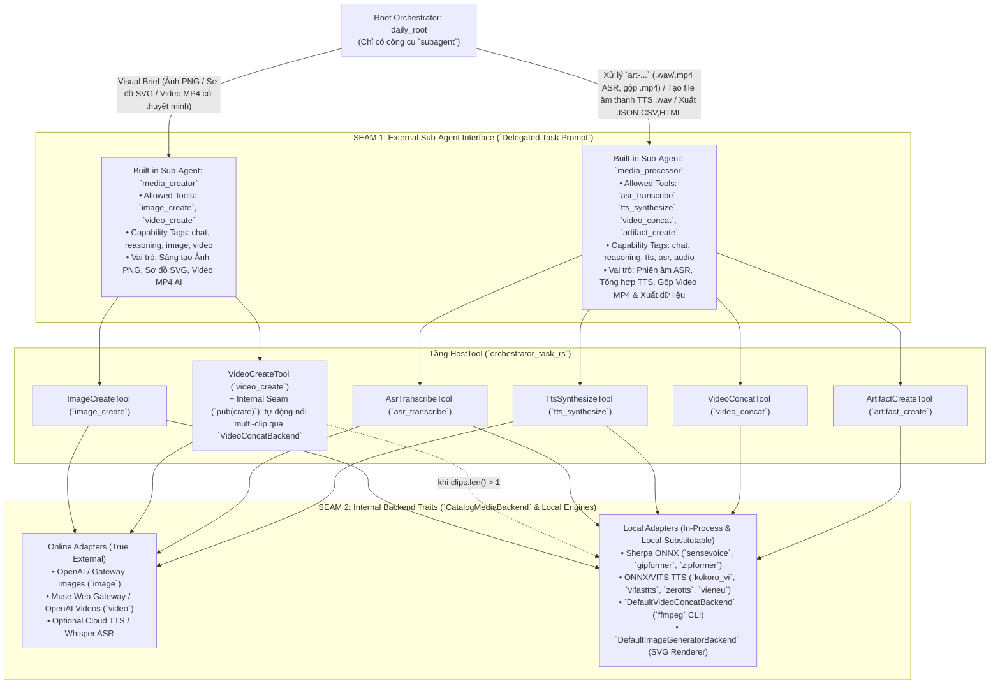

# Tách Sub-Agent `media_creator` & `media_processor` và Làm sâu `VideoCreateTool` — Hướng dẫn Triển khai (Phương án 2)

- **Repositories**:
  - `orchestrator_task_rs` (`src/tools/media_artifacts.rs`, `src/tools/media_video.rs`, `src/tools/media_artifacts_tests.rs`, `src/prompts.rs`, `src/lib.rs`, `examples/shared/prompts.rs`, `examples/shared/runtime.rs`, `tests/integration_tests.rs`)
  - `AI_Agent_Voice_rust` (`GLOSSARY.md`, `crates/voice-agent-server`, `apps/admin-web`)
- **Kỷ luật Thiết kế**: [`/codebase-design`](file:///Users/lamphuchai/Desktop/project_rust/.agents/skills/codebase-design/SKILL.md) (**Module**, **Interface**, **Implementation**, **Depth**, **Seam**, **Adapter**, **Leverage**, **Locality**), [`DEEPENING.md`](file:///Users/lamphuchai/Desktop/project_rust/.agents/skills/codebase-design/DEEPENING.md) & Từ vựng Miền ([`AI_Agent_Voice_rust/GLOSSARY.md`](file:///Users/lamphuchai/Desktop/project_rust/AI_Agent_Voice_rust/GLOSSARY.md), [`AI_Agent_Voice_rust/CONTEXT.md`](file:///Users/lamphuchai/Desktop/project_rust/AI_Agent_Voice_rust/CONTEXT.md))
- **Mục tiêu cốt lõi (Phương án 2)**:
  1. **Làm sâu (Deepen) `VideoCreateTool` (`video_create`)**: Đưa `Arc<dyn VideoConcatBackend>` vào làm **Internal Seam** (`pub(crate)`) bên trong `VideoCreateTool`. Khi `VideoGeneratorBackend` sinh ra nhiều clip phân cảnh (`clips.len() > 1`), `VideoCreateTool` tự động ghép nối (auto-concat) thành 1 `Job Artifact` MP4 `ArtifactRole::Primary` hoàn chỉnh ngay trong cùng một lượt thực thi tool (`requires_concat: false`), đồng thời vẫn lưu các clip phân cảnh ở vai trò `ArtifactRole::Intermediate` để truy vết. Nhờ vậy, `media_creator` không cần quyền gọi `video_concat`.
  2. **Tách Sub-Agent đa phương tiện thành 2 Built-in Sub-Agent chuyên biệt thuộc Flow 1 (`daily_root`)**:
     - **`media_creator` (Visual Generation Sub-Agent)**: Chuyên sáng tạo nội dung thị giác (`image_create`, `video_create`). Không có `tts_synthesize` trong tập công cụ $\rightarrow$ **triệt tiêu 100%** lỗi LLM gọi thừa TTS khi tạo video có thuyết minh.
     - **`media_processor` (Audio, Speech & Media Post-Processing Sub-Agent)**: Chuyên xử lý âm thanh, phiên âm, hậu kỳ gộp video và xuất dữ liệu có cấu trúc (`asr_transcribe`, `tts_synthesize`, `video_concat`, `artifact_create`). Tập trung các công cụ thiên về **Local Adapters** (Sherpa ONNX ASR, Kokoro/ViFastTTS ONNX TTS, FFmpeg CLI concat).
  3. **Tổng quát hóa định tuyến Adapter tại `CatalogMediaBackend` (`resolve_media_tool_provider`)**: Loại bỏ việc đọc cứng key `"media_creator"` trong [`media_backend.rs`](file:///Users/lamphuchai/Desktop/project_rust/AI_Agent_Voice_rust/crates/voice-agent-server/src/services/task_flow/agent_settings/media_backend.rs#L382-L404); tự động xác định đúng Sub-Agent sở hữu công cụ qua `AGENT_SPECS` (`find_tool_owner_spec(tool_name)`), kết hợp migrate một lần khi nạp `agent_settings.json` trong `persistence.rs`.

---

## 0. Quyết định Thiết kế Cốt lõi (`/codebase-design` & `DEEPENING.md`)

| # | Bẫy Thiết kế Nông (Shallow Trap) | Quyết định Làm sâu Module (Deepened Decision) |
| :--- | :--- | :--- |
| **1** | **Đặt Seam giữa 2 Sub-Agent theo tên hạ tầng ("Local Agent" vs "Online Agent")**: Nếu đặt tên/chia ranh giới ở tầng `Root Orchestrator` (`daily_root`) theo việc tool chạy Local hay Online, ranh giới sẽ bị gãy ngay khi Admin đổi `tts_synthesize` từ `kokoro_vi_onnx` (Local) sang `openai` (Online) hoặc khi `image_create` vẽ sơ đồ `svg` (Local) thay vì `png` (Online). | **Seam 1 (Sub-Agent Interface) chia theo Ý định Nghiệp vụ; Seam 2 (`CatalogMediaBackend`) ẩn hoàn toàn Local vs. Online**: `daily_root` điều phối giữa `media_creator` (*Tạo hình ảnh/sơ đồ & video mới*) và `media_processor` (*Phiên âm ASR, đọc TTS độc lập, gộp file video & xuất dữ liệu*). Việc từng tool chạy qua Local Adapter (`ServerMediaRuntimeBridge` / `DefaultVideoConcatBackend`) hay Online Adapter (`LlmProvider`) được ẩn kín sau Seam 2. |
| **2** | **Để lộ `requires_concat: true` ra ngoài `video_create` hoặc lộ `pub concat_backend` trên `VideoCreateTool`**: Nếu `video_create` trả về 3 clip chưa nối mà `video_concat` nằm ở `media_processor`, `media_creator` không thể hoàn tất video dài trong 1 Agent Run. Ngược lại, nếu mở `pub concat_backend` trên `VideoCreateTool` thì vi phạm quy tắc *"Don't expose internal seams through the interface just because tests use them"* (`DEEPENING.md`). | **Deepen `VideoCreateTool` với Internal Seam `pub(crate) concat_backend`**: Giữ `concat_backend` và `pub(crate) fn with_concat_backend` ở phạm vi nội bộ crate để kiểm thử. Khi provider trả về `clips.len() > 1`, `VideoCreateTool::execute` lưu các clip thành phần làm `Intermediate` rồi tự động nối thành `Job Artifact` MP4 `Primary` (`requires_concat: false`). Đồng thời tách logic video (`VideoCreateTool` + `VideoConcatTool`) sang submodule `src/tools/media_video.rs` (re-export tại `media_artifacts.rs`) để tuân thủ quy tắc tách file lớn trong `CONTEXT.md`. |
| **3** | **Trộn `video_create` và `tts_synthesize` trong cùng một Sub-Agent**: Dù prompt đã cảnh báo nhiều lần, LLM vẫn dễ gọi cả `video_create` lẫn `tts_synthesize` khi người dùng yêu cầu *"tạo video có thuyết minh"*. | **Thực thi bất biến bằng tập công cụ (`allowed_tools`) thay vì lời dặn trong Prompt**: `media_creator` chỉ có `["image_create", "video_create"]`; `tts_synthesize` nằm bên `media_processor`. Về mặt cấu trúc, `media_creator` không thể gọi `tts_synthesize`. |
| **4** | **Hardcode `.get("media_creator")` trong `resolve_media_tool_provider` hoặc dùng `.or_default()` trên `AgentConfigOverride` khi migrate**: Trong `persistence.rs`, `#[derive(Default)]` trên `AgentConfigOverride` gán `enabled: false` (`bool::default()`), nên `.or_default()` sẽ vô tình tắt ngầm `media_processor`. | **Tra cứu chủ sở hữu công cụ động qua `find_tool_owner_spec(tool_name)` + Chuẩn hóa `Default` của `AgentConfigOverride` (`enabled: true`)**: Migrate một lần duy nhất trong `load_persisted_settings` (`persistence.rs`) với `enabled: true`, còn `resolve_media_tool_provider` chỉ tra cứu đúng `owner_id` của từng tool (không fallback chéo `provider_ref` giữa 2 Sub-Agent). |

---

## 1. Kiến trúc Tổng thể, Các Đường nối (Seams) & Phân loại Adapter



### Bảng Phân bổ Công cụ & Bản chất Local / Online

| Sub-Agent | Công cụ (`HostTool`) | Tag (`tool_capability_tags`) | Adapter Mặc định / Chủ đạo | Adapter Thay thế (Qua `tool_providers`) |
| :--- | :--- | :--- | :--- | :--- |
| **`media_creator`** | `image_create` | `Some("image")` | **Online** (`LlmOperation::ImageGeneration` cho `.png`) + **Local** (`builtin_svg_renderer` cho `.svg`) | OpenAI Images, Muse, Gateway, hoặc fallback `builtin_png_renderer` (Local) |
| **`media_creator`** | `video_create` | `Some("video")` | **Online** (`LlmOperation::VideoGeneration` qua `pool:muse` / OpenAI) + **Local Internal Seam** (`DefaultVideoConcatBackend` tự nối khi >1 clip) | Fallback `builtin_mp4_renderer` (Local in-process test) |
| **`media_processor`** | `asr_transcribe` | `Some("asr")` | **Local** (`ffmpeg` tách `.mp4` $\rightarrow$ WAV 16kHz + `AsrWorkerRuntime` Sherpa ONNX: `sensevoice` / `gipformer` / `zipformer`) | **Online** (`LlmOperation::AudioTranscription` OpenAI Whisper) hoặc `DefaultAsrTranscriberBackend` |
| **`media_processor`** | `tts_synthesize` | `Some("tts")` | **Local** (`TtsWorkerRuntime` ONNX: `kokoro_vi_onnx`, `vifasttts_onnx`, `zerotts_onnx`, `vieneu`) | **Online** (`edge_tts`, `chillaudio_ws`, `LlmOperation::AudioSpeech`) hoặc `DefaultTtsSynthesizerBackend` |
| **`media_processor`** | `video_concat` | `None` *(100% Local)* | **100% Local** (`DefaultVideoConcatBackend`: `ffmpeg` stream copy / `libx264+aac` re-encode + ISO BMFF in-process muxer) | Không tốn LLM/API; chạy trực tiếp trên host |
| **`media_processor`** | `artifact_create` | `None` *(100% Local)* | **100% Local** (Ghi trực tiếp UTF-8 / Hex bytes vào `ArtifactStore` cho JSON/CSV/HTML/XML/TXT) | Không tốn LLM/API; chạy in-process |

---

## 2. Chi tiết Triển khai tại `orchestrator_task_rs`

### 2.1. Tách Submodule `media_video.rs` & Làm sâu `VideoCreateTool`

- **Files**:
  - [`orchestrator_task_rs/src/tools/media_video.rs`](file:///Users/lamphuchai/Desktop/project_rust/orchestrator_task_rs/src/tools/media_video.rs) *(tách từ `media_artifacts.rs` để giảm kích thước file 2.423 dòng theo chuẩn `CONTEXT.md`)*
  - [`orchestrator_task_rs/src/tools/media_artifacts.rs`](file:///Users/lamphuchai/Desktop/project_rust/orchestrator_task_rs/src/tools/media_artifacts.rs) *(giữ public re-exports `pub use crate::tools::media_video::*;` để không thay đổi đường dẫn import của caller)*
  - [`orchestrator_task_rs/src/tools/mod.rs`](file:///Users/lamphuchai/Desktop/project_rust/orchestrator_task_rs/src/tools/mod.rs)

#### A. Giữ `concat_backend` làm Internal Seam (`pub(crate)`) trên `VideoCreateTool`

Tuân thủ **Seam Discipline** trong [`DEEPENING.md`](file:///Users/lamphuchai/Desktop/project_rust/.agents/skills/codebase-design/DEEPENING.md#L30), trường `concat_backend` và builder `with_concat_backend` chỉ mở ở mức `pub(crate)` (phục vụ kiểm thử nội bộ với mock/failing backend), không phơi bày ra public interface của crate:

```rust
/// Công cụ `video_create`: tạo video minh họa (`video/mp4`) từ prompt
/// và lưu trữ vào `ArtifactStore` của Task. Nếu backend sinh ra nhiều phân cảnh (`clips.len() > 1`),
/// tự động nối thành một file MP4 `primary` hoàn chỉnh qua internal seam `concat_backend`.
pub struct VideoCreateTool {
    pub backend: Arc<dyn VideoGeneratorBackend>,
    pub(crate) concat_backend: Arc<dyn VideoConcatBackend>,
    pub output_dir: Option<PathBuf>,
}

impl VideoCreateTool {
    pub fn new(backend: Arc<dyn VideoGeneratorBackend>) -> Self {
        Self {
            backend,
            concat_backend: Arc::new(DefaultVideoConcatBackend),
            output_dir: None,
        }
    }

    pub(crate) fn with_concat_backend(mut self, concat_backend: Arc<dyn VideoConcatBackend>) -> Self {
        self.concat_backend = concat_backend;
        self
    }

    pub fn with_output_dir(mut self, dir: impl Into<PathBuf>) -> Self {
        self.output_dir = Some(dir.into());
        self
    }

    pub fn into_host_tool(self) -> Arc<dyn HostTool> {
        Arc::new(self)
    }
}
```

#### B. Tự động nối multi-clip và dùng chung bộ dựng kết quả trong `VideoCreateTool::execute`

Trong vòng lặp lưu từng `clip` ([`media_artifacts.rs:841-897`](file:///Users/lamphuchai/Desktop/project_rust/orchestrator_task_rs/src/tools/media_artifacts.rs#L841-L897)), khởi tạo `concat_inputs` trước khi move `clip.bytes` vào `ArtifactInput::from_bytes(...)`, sau đó tự động nối khi `is_multi_clip == true` và dùng chung một nhánh dựng `host_tool_outcome` duy nhất (tránh lặp code `msg_suffix` và JSON):

```rust
        let mut artifact_ids = Vec::with_capacity(clips.len());
        let mut clip_entries = Vec::with_capacity(clips.len());
        let mut concat_inputs = Vec::with_capacity(if is_multi_clip { clips.len() } else { 0 });
        let mut total_duration_secs: u32 = 0;
        let mut first_artifact = None;
        let mut first_mirrored_path = None;

        for (idx, clip) in clips.into_iter().enumerate() {
            let clip_filename = if is_multi_clip {
                format!("{safe_stem}-part-{}.mp4", idx + 1)
            } else if clip.filename.trim().is_empty() {
                format!("{safe_stem}.mp4")
            } else {
                clip.filename
            };
            let clip_role = if is_multi_clip {
                ArtifactRole::Intermediate
            } else {
                requested_role
            };
            let clip_duration =
                inspect_mp4_duration_secs(&clip.bytes).unwrap_or_else(|| clip.duration_secs.max(1));
            total_duration_secs = total_duration_secs.saturating_add(clip_duration);

            let mirrored_path =
                mirror_artifact_to_dir(self.output_dir.as_ref(), &clip_filename, &clip.bytes);
            if idx == 0 {
                first_mirrored_path = mirrored_path.clone();
            }

            let bytes_for_concat = if is_multi_clip {
                Some(clip.bytes.clone())
            } else {
                None
            };

            let artifact = ctx
                .artifacts()
                .put(ArtifactInput::from_bytes(
                    &clip_filename,
                    &clip.mime_type,
                    clip_role,
                    clip.bytes,
                ))
                .await?;

            if let Some(bytes) = bytes_for_concat {
                concat_inputs.push(VideoConcatInputClip {
                    artifact_id: artifact.id.clone(),
                    filename: artifact.name.clone(),
                    bytes,
                    duration_secs: clip_duration,
                });
            }

            artifact_ids.push(artifact.id.clone());
            clip_entries.push(json!({
                "index": idx + 1,
                "artifact_id": artifact.id,
                "filename": artifact.name,
                "mime_type": artifact.mime_type,
                "size_bytes": artifact.size_bytes,
                "sha256": artifact.sha256,
                "width": clip.width,
                "height": clip.height,
                "duration_secs": clip_duration,
                "role": if clip_role == ArtifactRole::Intermediate { "intermediate" } else { "primary" },
                "path": mirrored_path,
            }));
            if idx == 0 {
                first_artifact = Some(artifact);
            }
        }

        let mut primary = first_artifact
            .ok_or_else(|| host_tool_err("VIDEO_GENERATION_FAILED", "No video clips returned"))?;
        let mut primary_path = first_mirrored_path;
        let mut requires_concat = false;
        let mut intermediate_ids = Vec::new();

        if is_multi_clip {
            let concat_req = VideoConcatRequest {
                filename: format!("{safe_stem}.mp4"),
                title: req.title.clone(),
                clips: concat_inputs,
            };
            match self.concat_backend.concat_videos(&concat_req).await {
                Ok(merged) => {
                    primary_path = mirror_artifact_to_dir(
                        self.output_dir.as_ref(),
                        &merged.filename,
                        &merged.bytes,
                    );
                    primary = ctx
                        .artifacts()
                        .put(ArtifactInput::from_bytes(
                            &merged.filename,
                            &merged.mime_type,
                            requested_role,
                            merged.bytes,
                        ))
                        .await?;
                    total_duration_secs = merged.duration_secs.max(total_duration_secs);
                    intermediate_ids = std::mem::replace(&mut artifact_ids, vec![primary.id.clone()]);
                }
                Err(_) => {
                    requires_concat = true;
                }
            }
        }

        let msg_suffix = generated
            .provider_message
            .as_deref()
            .filter(|s| !s.trim().is_empty())
            .map(|m| format!("\nProvider message:\n{m}"))
            .unwrap_or_default();
        let summary = if requires_concat {
            format!(
                "Created {} intermediate video clip artifacts ({}s total, requested {}s): {:?}.{msg_suffix}",
                clip_entries.len(),
                total_duration_secs,
                duration_secs,
                artifact_ids
            )
        } else {
            format!(
                "Created video artifact '{}' (id={}, mime={}, duration_secs={}, clips={}, bytes={}){msg_suffix}",
                primary.name,
                primary.id,
                primary.mime_type,
                total_duration_secs,
                clip_entries.len(),
                primary.size_bytes
            )
        };

        Ok(host_tool_outcome(
            &ctx,
            summary,
            json!({
                "artifact_id": primary.id,
                "artifact_ids": artifact_ids,
                "intermediate_artifact_ids": intermediate_ids,
                "artifact_kind": "video",
                "filename": primary.name,
                "mime_type": primary.mime_type,
                "size_bytes": primary.size_bytes,
                "sha256": primary.sha256,
                "width": generated.width,
                "height": generated.height,
                "duration_secs": total_duration_secs,
                "total_duration_secs": total_duration_secs,
                "requested_duration_secs": duration_secs,
                "clip_count": clip_entries.len(),
                "clips": clip_entries,
                "requires_concat": requires_concat,
                "provider_message": generated.provider_message,
                "provider": generated.provider,
                "path": primary_path
            }),
        ))
```

#### C. Cập nhật `VideoCreateTool::descriptor()` và `VideoConcatTool::descriptor()`

1. Trong `VideoCreateTool::descriptor()` ([`media_artifacts.rs:768-771`](file:///Users/lamphuchai/Desktop/project_rust/orchestrator_task_rs/src/tools/media_artifacts.rs#L768-L771)):
   - Cập nhật mô tả trường `"role"`: `"Artifact visibility role (default: 'primary'; multi-clip parts are automatically merged into a single primary MP4 video artifact)."`
2. Trong `VideoConcatTool::descriptor()` ([`media_artifacts.rs:1212-1214`](file:///Users/lamphuchai/Desktop/project_rust/orchestrator_task_rs/src/tools/media_artifacts.rs#L1212-L1214)):
   - Cập nhật `description`:
     `"Concatenate 2 or more existing MP4 video artifacts (video_artifact_ids) in order into a single continuous primary MP4 video artifact. Use video_concat when the user attaches or specifies multiple .mp4 artifacts to merge."`

---

### 2.2. Tách System Prompts trong `orchestrator_task_rs/src/prompts.rs` & Cập nhật Examples

- **Files**:
  - [`orchestrator_task_rs/src/prompts.rs`](file:///Users/lamphuchai/Desktop/project_rust/orchestrator_task_rs/src/prompts.rs)
  - [`orchestrator_task_rs/src/lib.rs`](file:///Users/lamphuchai/Desktop/project_rust/orchestrator_task_rs/src/lib.rs#L62-L66)
  - [`orchestrator_task_rs/examples/shared/prompts.rs`](file:///Users/lamphuchai/Desktop/project_rust/orchestrator_task_rs/examples/shared/prompts.rs)
  - [`orchestrator_task_rs/examples/shared/runtime.rs`](file:///Users/lamphuchai/Desktop/project_rust/orchestrator_task_rs/examples/shared/runtime.rs)

#### A. Cập nhật `DAILY_ROOT_PROMPT` ([`prompts.rs:34-77`](file:///Users/lamphuchai/Desktop/project_rust/orchestrator_task_rs/src/prompts.rs#L34-L77))

Cập nhật danh sách Sub-Agent của `daily_root` gồm 6 Sub-Agent chuyên biệt:
1. `source_collector`: Thu thập/đọc nguồn bên ngoài (YouTube, PDF, Web) và chỉ gọi `add_to_sources` khi người dùng yêu cầu lưu vào Wiki.
2. `wiki_researcher`: Tra cứu chỉ đọc trên kho LLM Wiki và Web.
3. `report_stager`: Xuất báo cáo Markdown độc lập (`markdown_create`) hoặc lưu tổng hợp vào `sources/` (`add_to_sources`).
4. `media_creator`: Chuyên tạo hình ảnh minh họa PNG, sơ đồ vector SVG (`image_create`) và dựng video MP4 AI có sẵn thuyết minh & phụ đề (`video_create`, tự động ghép nối khi tạo video dài nhiều phân cảnh).
5. `media_processor`: Chuyên xử lý âm thanh, phiên âm và hậu kỳ tệp media (`asr_transcribe` để bóc băng `.wav`/`.mp4` từ `artifact_id`, `tts_synthesize` để tạo file âm thanh giọng đọc `.wav` độc lập khi không tạo video, `video_concat` để nối các file `.mp4` đính kèm theo `video_artifact_ids`, và `artifact_create` để xuất dữ liệu có cấu trúc JSON/CSV/HTML).
6. `reminder_planner`: Quản lý lời nhắc và lịch biểu (`reminder_*`).

Cập nhật `Routing Rules` trong `DAILY_ROOT_PROMPT`:
- Khi yêu cầu **vẽ ảnh minh họa PNG, vẽ sơ đồ kiến trúc/infographic SVG, hoặc tạo video MP4 mới (có hoặc không có thuyết minh/phụ đề)**: ủy quyền cho **`media_creator`** (sau khi đã hoàn tất bước thu thập/phân tích nếu có).
- Khi yêu cầu **phiên âm/bóc băng (`.wav` / `.mp4` `artifact_id`)**, **gộp các file video `.mp4` đính kèm (`video_artifact_ids`)**, **tổng hợp giọng đọc TTS `.wav` độc lập (không kèm tạo video)**, hoặc **xuất file dữ liệu có cấu trúc (`.json`, `.csv`, `.html`)**: ủy quyền cho **`media_processor`** (truyền nguyên vẹn các mã `art-...` vào prompt ủy quyền).

#### B. Rút gọn `MEDIA_CREATOR_PROMPT` & Thêm `MEDIA_PROCESSOR_PROMPT` ([`prompts.rs:116-152`](file:///Users/lamphuchai/Desktop/project_rust/orchestrator_task_rs/src/prompts.rs#L116-L152))

- `MEDIA_CREATOR_PROMPT` chỉ hướng dẫn `image_create` (SVG & PNG) và `video_create` (MP4 có sẵn thuyết minh & phụ đề, tự động nối phân cảnh).
- `MEDIA_PROCESSOR_PROMPT` hướng dẫn `asr_transcribe`, `tts_synthesize`, `video_concat`, và `artifact_create`.
- Re-export `MEDIA_PROCESSOR_PROMPT` tại [`orchestrator_task_rs/src/lib.rs`](file:///Users/lamphuchai/Desktop/project_rust/orchestrator_task_rs/src/lib.rs#L62-L66).

#### C. Đồng bộ `orchestrator_task_rs/examples/shared/`

1. [`examples/shared/prompts.rs:7-26`](file:///Users/lamphuchai/Desktop/project_rust/orchestrator_task_rs/examples/shared/prompts.rs#L7-L26):
   - Import và re-export `MEDIA_PROCESSOR_PROMPT`, đồng thời ghi `std::fs::write(prompts.join("media_processor.md"), MEDIA_PROCESSOR_PROMPT)?;`.
2. [`examples/shared/runtime.rs:161-167, 235-250`](file:///Users/lamphuchai/Desktop/project_rust/orchestrator_task_rs/examples/shared/runtime.rs#L161-L250):
   - Thêm `"media_processor"` vào `with_allowed_subagents` của `daily_root`.
   - Giới hạn `media_creator` ở `with_allowed_tools(["image_create", "video_create"])`.
   - Thêm `AgentDefinition::new("media_processor", "live", &model)` với `with_allowed_tools(["asr_transcribe", "tts_synthesize", "video_concat", "artifact_create"])`.

---

## 3. Chi tiết Triển khai tại `AI_Agent_Voice_rust`

### 3.1. Cập nhật Từ vựng Miền trong `GLOSSARY.md`

- **File**: [`AI_Agent_Voice_rust/GLOSSARY.md`](file:///Users/lamphuchai/Desktop/project_rust/AI_Agent_Voice_rust/GLOSSARY.md#L85-L99)
- Cập nhật mục **`Agent Configuration`** (dòng 86) để liệt kê đầy đủ 8 Built-in Sub-Agent:
  `source_collector`, `wiki_researcher`, `report_stager`, `media_creator`, `media_processor`, `reminder_planner`, `wiki_ingestor`, `wiki_curator`.

---

### 3.2. Cập nhật `AGENT_SPECS` & Helper Tra cứu Chủ sở hữu Tool (`specs.rs`)

- **File**: [`AI_Agent_Voice_rust/crates/voice-agent-server/src/services/task_flow/agent_settings/specs.rs`](file:///Users/lamphuchai/Desktop/project_rust/AI_Agent_Voice_rust/crates/voice-agent-server/src/services/task_flow/agent_settings/specs.rs)

#### A. Cập nhật `allowed_capability_tags`, `tool_capability_tags` & `find_tool_owner_spec` ([`specs.rs:38-65`](file:///Users/lamphuchai/Desktop/project_rust/AI_Agent_Voice_rust/crates/voice-agent-server/src/services/task_flow/agent_settings/specs.rs#L38-L65))

```rust
impl AgentSpec {
    pub const fn allowed_capability_tags(&self) -> &'static [&'static str] {
        match self.id.as_bytes() {
            b"media_creator" => &["chat", "reasoning", "image", "video"],
            b"media_processor" => &["chat", "reasoning", "tts", "asr", "audio"],
            _ => &["chat", "reasoning"],
        }
    }

    /// Maps media/specialized tools on this agent to their required provider capability tag
    /// (e.g. `"image_create"` -> `"image"`, `"video_create"` -> `"video"` on `media_creator`;
    /// `"tts_synthesize"` -> `"tts"`, `"asr_transcribe"` -> `"asr"` on `media_processor`).
    pub const fn tool_capability_tags(&self) -> &'static [(&'static str, &'static str)] {
        match self.id.as_bytes() {
            b"media_creator" => &[
                ("image_create", "image"),
                ("video_create", "video"),
            ],
            b"media_processor" => &[
                ("tts_synthesize", "tts"),
                ("asr_transcribe", "asr"),
            ],
            _ => &[],
        }
    }

    pub fn tool_required_tag(&self, tool_name: &str) -> Option<&'static str> {
        self.tool_capability_tags()
            .iter()
            .find(|(tool, _)| *tool == tool_name)
            .map(|(_, tag)| *tag)
    }
}

/// Tìm `AgentSpec` sở hữu `tool_name` trong `tool_capability_tags`
/// (`"image_create"` / `"video_create"` -> `media_creator`, `"tts_synthesize"` / `"asr_transcribe"` -> `media_processor`).
pub fn find_tool_owner_spec(tool_name: &str) -> Option<&'static AgentSpec> {
    AGENT_SPECS
        .iter()
        .find(|spec| spec.tool_required_tag(tool_name).is_some())
}
```

#### B. Cập nhật `daily_root`, `media_creator` và thêm `media_processor` trong `AGENT_SPECS` ([`specs.rs:150-255`](file:///Users/lamphuchai/Desktop/project_rust/AI_Agent_Voice_rust/crates/voice-agent-server/src/services/task_flow/agent_settings/specs.rs#L150-L255))

Sử dụng đúng thuật ngữ **`Job Artifacts`** theo [`GLOSSARY.md`](file:///Users/lamphuchai/Desktop/project_rust/AI_Agent_Voice_rust/GLOSSARY.md#L125-L127):

```rust
    AgentSpec {
        id: "daily_root",
        flow_id: "daily",
        parent_id: None,
        mode: AgentMode::Primary,
        user_routable: true,
        default_description: "Interactive & background multi-functional assistant: inspects and summarizes external sources (YouTube videos/playlists, PDFs, Web pages), researches the Wiki/Web, creates reports, generates images/diagrams/videos via media_creator, processes ASR/TTS/video concatenation via media_processor, manages reminders, and ONLY saves files into sources/ when explicitly requested by the user.",
        default_prompt: DAILY_ROOT_PROMPT,
        default_steps: 20,
        default_allowed_tools: &["subagent"],
        available_tools: &["subagent"],
        default_allowed_skills: &[],
        suggested_skills: &[],
        default_subagents: &[
            "source_collector",
            "wiki_researcher",
            "report_stager",
            "media_creator",
            "media_processor",
            "reminder_planner",
        ],
    },
    // ...
    AgentSpec {
        id: "media_creator",
        flow_id: "daily",
        parent_id: Some("daily_root"),
        mode: AgentMode::Subagent,
        user_routable: false,
        default_description: "Generates PNG illustrations and SVG vector diagrams/infographics via image_create (with agent-selected or default dimensions) and MP4 videos with built-in voiceover audio and burned-in subtitles via video_create.",
        default_prompt: MEDIA_CREATOR_PROMPT,
        default_steps: 12,
        default_allowed_tools: &[
            "image_create",
            "video_create",
        ],
        available_tools: &[
            "skill",
            "image_create",
            "video_create",
        ],
        default_allowed_skills: &[],
        suggested_skills: &["daily-synthesis-staging"],
        default_subagents: &[],
    },
    AgentSpec {
        id: "media_processor",
        flow_id: "daily",
        parent_id: Some("daily_root"),
        mode: AgentMode::Subagent,
        user_routable: false,
        default_description: "Transcribes WAV audio and MP4 video Job Artifacts into text and SRT subtitles via asr_transcribe, synthesizes standalone spoken TTS WAV audio via tts_synthesize, concatenates multiple MP4 video Job Artifacts into a single primary video via video_concat, and exports structured Job Artifacts (JSON/CSV/HTML) via artifact_create.",
        default_prompt: MEDIA_PROCESSOR_PROMPT,
        default_steps: 10,
        default_allowed_tools: &[
            "asr_transcribe",
            "tts_synthesize",
            "video_concat",
            "artifact_create",
        ],
        available_tools: &[
            "skill",
            "asr_transcribe",
            "tts_synthesize",
            "video_concat",
            "artifact_create",
        ],
        default_allowed_skills: &[],
        suggested_skills: &["daily-synthesis-staging"],
        default_subagents: &[],
    },
```

---

### 3.3. Cập nhật `resolution.rs` và `provider_catalog/resolved.rs`

1. **File [`resolution.rs:329-346`](file:///Users/lamphuchai/Desktop/project_rust/AI_Agent_Voice_rust/crates/voice-agent-server/src/services/task_flow/agent_settings/resolution.rs#L329-L346)**:
   - Sửa đoạn nối mô tả `video_create` cho `media_creator` để không còn nhắc tới `video_concat`:
     ```rust
     description = format!(
         "{description} [Active video_create provider: {}; max {}s/clip, up to {} clip(s) = {}s per call (multi-clip outputs are auto-merged into a single primary MP4)]",
         vc.provider_label,
         vc.max_clip_duration_secs,
         vc.max_clips_per_call,
         vc.max_total_duration_secs
     );
     ```
2. **File [`provider_catalog/resolved.rs:82-105`](file:///Users/lamphuchai/Desktop/project_rust/AI_Agent_Voice_rust/crates/voice-agent-server/src/services/task_flow/agent_settings/provider_catalog/resolved.rs#L82-L105)**:
   - Cập nhật `provider_guidance` trong `ResolvedLlmProvider::video_constraints(&self)`:
     - Với **Muse**:
       `"Generates MP4 video with built-in voiceover/narration audio and burned-in subtitles directly from prompt (do NOT call tts_synthesize for video requests, and do NOT split prompt into 10-second sub-prompts). Pass a single unified video prompt and the target duration_secs (up to 60s); multi-clip segments are automatically concatenated into a single primary MP4 video artifact."`
     - Với **OpenAI**:
       `"Generates 1 video clip (max 10 seconds) per video_create call with built-in audio and subtitles (do NOT call tts_synthesize)."`

---

### 3.4. Tổng quát hóa `resolve_media_tool_provider` (`media_backend.rs`) & Migrate An toàn (`persistence.rs`)

- **Files**:
  - [`AI_Agent_Voice_rust/crates/voice-agent-server/src/services/task_flow/agent_settings/media_backend.rs`](file:///Users/lamphuchai/Desktop/project_rust/AI_Agent_Voice_rust/crates/voice-agent-server/src/services/task_flow/agent_settings/media_backend.rs#L368-L423)
  - [`AI_Agent_Voice_rust/crates/voice-agent-server/src/services/task_flow/agent_settings/persistence.rs`](file:///Users/lamphuchai/Desktop/project_rust/AI_Agent_Voice_rust/crates/voice-agent-server/src/services/task_flow/agent_settings/persistence.rs#L40-L61)

#### A. Sửa `impl Default for AgentConfigOverride` & Migrate trong `load_persisted_settings` (`persistence.rs`)

1. Thay `#[derive(Default)]` trên `AgentConfigOverride` bằng `impl Default` tường minh với `enabled: true` (khớp với `#[serde(default = "default_true")]`) để tránh lỗi tắt ngầm Sub-Agent khi khởi tạo mặc định trong Rust:

```rust
impl Default for AgentConfigOverride {
    fn default() -> Self {
        Self {
            enabled: true,
            flow_id: None,
            provider_ref: None,
            tool_providers: None,
            steps: None,
            allowed_tools: None,
            allowed_skills: None,
            description: None,
            system_prompt: None,
        }
    }
}
```

2. Trong `load_persisted_settings` ([`persistence.rs:154-194`](file:///Users/lamphuchai/Desktop/project_rust/AI_Agent_Voice_rust/crates/voice-agent-server/src/services/task_flow/agent_settings/persistence.rs#L154-L194)), trước vòng lặp `settings.agents.retain(...)`, chuyển các khóa `"tts_synthesize"` và `"asr_transcribe"` từ `media_creator.tool_providers` (nếu có trong file `agent_settings.json` cũ) sang `media_processor.tool_providers`:

```rust
    let migrated_tools: Vec<(String, String)> = settings
        .agents
        .get("media_creator")
        .and_then(|ovr| ovr.tool_providers.as_ref())
        .map(|map| {
            ["tts_synthesize", "asr_transcribe"]
                .iter()
                .filter_map(|&k| {
                    map.get(k)
                        .map(|v| v.trim())
                        .filter(|v| !v.is_empty())
                        .map(|v| (k.to_owned(), v.to_owned()))
                })
                .collect()
        })
        .unwrap_or_default();
    if !migrated_tools.is_empty() {
        let proc_entry = settings
            .agents
            .entry("media_processor".to_owned())
            .or_default();
        let proc_map = proc_entry.tool_providers.get_or_insert_with(BTreeMap::new);
        for (k, v) in migrated_tools {
            proc_map.entry(k).or_insert(v);
        }
    }
```

#### B. Cập nhật `resolve_media_tool_provider` trong `media_backend.rs` (Không lặp logic fallback chéo)

Tra cứu trực tiếp trên `owner_id` của `tool_name` từ `find_tool_owner_spec(tool_name)`:

```rust
pub(crate) fn resolve_media_tool_provider(
    catalog: &[ResolvedLlmProvider],
    settings: Option<&PersistedBackgroundSettings>,
    tool_name: &str,
    required_tag: &str,
    require_api_key: bool,
) -> Option<ResolvedLlmProvider> {
    let is_usable = |p: &ResolvedLlmProvider| -> bool {
        p.supports_tag(required_tag)
            && (!require_api_key || !p.requires_api_key() || p.api_key.is_some())
    };
    let matches_prov =
        |p: &ResolvedLlmProvider, pref: &str| -> bool { p.provider_ref == pref && is_usable(p) };
    if let Some(settings) = settings {
        let owner_id = super::specs::find_tool_owner_spec(tool_name)
            .map(|s| s.id)
            .unwrap_or("media_creator");

        if let Some(tool_ref) = settings
            .agents
            .get(owner_id)
            .and_then(|o| o.tool_providers.as_ref())
            .and_then(|m| m.get(tool_name))
            .map(String::as_str)
            .map(str::trim)
            .filter(|s| !s.is_empty())
            && let Some(found) = catalog.iter().find(|p| matches_prov(p, tool_ref))
        {
            return Some(found.clone());
        }
        if matches!(required_tag, "image" | "video" | "tts" | "asr" | "audio")
            && let Some(explicit_ref) = settings
                .agents
                .get(owner_id)
                .and_then(|o| o.provider_ref.as_deref())
                .map(str::trim)
                .filter(|s| !s.is_empty())
            && let Some(found) = catalog.iter().find(|p| matches_prov(p, explicit_ref))
        {
            return Some(found.clone());
        }
        let worker_ref = settings.worker_llm_provider.trim();
        if !worker_ref.is_empty()
            && let Some(found) = catalog.iter().find(|p| matches_prov(p, worker_ref))
        {
            return Some(found.clone());
        }
    }
    if required_tag.eq_ignore_ascii_case("tts")
        && let Some(tts_prov) = catalog.iter().find(|p| p.is_tts_adapter() && is_usable(p))
    {
        return Some(tts_prov.clone());
    }
    if required_tag.eq_ignore_ascii_case("asr")
        && let Some(asr_prov) = catalog.iter().find(|p| p.is_asr_adapter() && is_usable(p))
    {
        return Some(asr_prov.clone());
    }
    catalog.iter().find(|p| is_usable(p)).cloned()
}
```

---

### 3.5. Cập nhật `workspace_seed.rs`

- **File**: [`AI_Agent_Voice_rust/crates/voice-agent-server/src/services/task_flow/workspace_seed.rs`](file:///Users/lamphuchai/Desktop/project_rust/AI_Agent_Voice_rust/crates/voice-agent-server/src/services/task_flow/workspace_seed.rs)
- Re-export thêm `MEDIA_PROCESSOR_PROMPT` từ `orchestrator_flow_rs` và thêm `("media_processor.md", MEDIA_PROCESSOR_PROMPT)` vào danh sách seed trong `ensure_prompts_and_skills`.

---

## 4. Chi tiết Triển khai tại `apps/admin-web`

### 4.1. Cập nhật Fallback Helpers trong `backgroundAgentUtils.ts`

- **File**: [`AI_Agent_Voice_rust/apps/admin-web/src/pages/background/backgroundAgentUtils.ts`](file:///Users/lamphuchai/Desktop/project_rust/AI_Agent_Voice_rust/apps/admin-web/src/pages/background/backgroundAgentUtils.ts#L33-L68)

Gom bảng ánh xạ fallback của Built-in Agent về một hằng số duy nhất để tránh `Repeated Switches`:

```typescript
const BUILTIN_CAPABILITY_FALLBACKS: Record<
  string,
  { allowedTags: string[]; toolTags: Array<[string, string]> }
> = {
  media_creator: {
    allowedTags: ['chat', 'reasoning', 'image', 'video'],
    toolTags: [
      ['image_create', 'image'],
      ['video_create', 'video'],
    ],
  },
  media_processor: {
    allowedTags: ['chat', 'reasoning', 'tts', 'asr', 'audio'],
    toolTags: [
      ['tts_synthesize', 'tts'],
      ['asr_transcribe', 'asr'],
    ],
  },
}

export function allowedCapabilityTagsForAgent(agent: BackgroundAgentConfig | null): string[] {
  if (!agent) return ['chat', 'reasoning']
  if (agent.allowed_capability_tags && agent.allowed_capability_tags.length > 0) {
    return agent.allowed_capability_tags
  }
  return BUILTIN_CAPABILITY_FALLBACKS[agent.id]?.allowedTags ?? ['chat', 'reasoning']
}

export function toolCapabilityEntries(
  agent: BackgroundAgentConfig | null,
): Array<[string, string]> {
  if (!agent) return []
  if (agent.tool_capability_tags && Object.keys(agent.tool_capability_tags).length > 0) {
    return Object.entries(agent.tool_capability_tags)
  }
  return BUILTIN_CAPABILITY_FALLBACKS[agent.id]?.toolTags ?? []
}
```

### 4.2. Cập nhật Danh sách ID Bảo lưu trong `SubagentCreateModal.vue`

- **File**: [`AI_Agent_Voice_rust/apps/admin-web/src/pages/background/SubagentCreateModal.vue`](file:///Users/lamphuchai/Desktop/project_rust/AI_Agent_Voice_rust/apps/admin-web/src/pages/background/SubagentCreateModal.vue#L66-L82)
- Thêm `'media_processor'` vào `RESERVED_IDS` để ngăn người dùng đặt tên Custom Sub-Agent trùng với Built-in Sub-Agent `media_processor`.

---

## 5. Kế hoạch Kiểm thử & Xác minh (Testing Strategy — Replace, Don't Layer)

Tuân thủ nguyên tắc **"Replace, don't layer"** và **"The interface is the test surface"** trong [`DEEPENING.md`](file:///Users/lamphuchai/Desktop/project_rust/.agents/skills/codebase-design/DEEPENING.md#L32-L37):

1. **`orchestrator_task_rs` Unit & Integration Tests**:
   - [`src/tools/media_artifacts_tests.rs`](file:///Users/lamphuchai/Desktop/project_rust/orchestrator_task_rs/src/tools/media_artifacts_tests.rs):
     - **Thay thế (Replace)** các assertion cũ kiểm tra hành vi nông (`requires_concat == true` khi `VideoGeneratorBackend` trả về nhiều clip) bằng kiểm thử trên interface đã làm sâu: khi `VideoGeneratorBackend` trả về 3 clip phân cảnh (`clips.len() == 3`), `VideoCreateTool::execute` tự động nối và trả về `requires_concat == false`, `artifact_id` là MP4 `Primary` đã nối (`duration_secs` bằng tổng 3 clip), và `intermediate_artifact_ids` chứa 3 ID của 3 phân cảnh `Intermediate`.
     - Thêm 1 test nội bộ sử dụng `VideoCreateTool::new(...).with_concat_backend(...)` với mock lỗi để xác minh nhánh fallback an toàn (`requires_concat == true` khi `concat_backend` thất bại).
   - [`tests/integration_tests.rs`](file:///Users/lamphuchai/Desktop/project_rust/orchestrator_task_rs/tests/integration_tests.rs):
     - Cập nhật các kịch bản tích hợp để `daily_root` ủy quyền tác vụ tạo ảnh/video cho `media_creator` và tác vụ `asr_transcribe` / `tts_synthesize` / `video_concat` / `artifact_create` cho `media_processor`.

2. **`AI_Agent_Voice_rust` Server & Admin HTTP Tests**:
   - [`crates/voice-agent-server/src/services/task_flow/tests.rs`](file:///Users/lamphuchai/Desktop/project_rust/AI_Agent_Voice_rust/crates/voice-agent-server/src/services/task_flow/tests.rs):
     - Thay thế các test cũ giả định `media_creator` chứa 6 tool bằng test xác minh:
       - `daily_root.default_subagents` gồm 6 Sub-Agent (`source_collector`, `wiki_researcher`, `report_stager`, `media_creator`, `media_processor`, `reminder_planner`).
       - `media_creator` chỉ có `["image_create", "video_create"]` (`tool_capability_tags`: `image_create -> image`, `video_create -> video`).
       - `media_processor` có `["asr_transcribe", "tts_synthesize", "video_concat", "artifact_create"]` (`tool_capability_tags`: `tts_synthesize -> tts`, `asr_transcribe -> asr`).
       - `load_persisted_settings` tự động migrate `tts_synthesize` / `asr_transcribe` từ `media_creator` trong `agent_settings.json` cũ sang `media_processor` mà vẫn giữ `media_processor.enabled == true`.
   - [`crates/voice-agent-server/tests/background_http.rs`](file:///Users/lamphuchai/Desktop/project_rust/AI_Agent_Voice_rust/crates/voice-agent-server/tests/background_http.rs):
     - Cập nhật test `PUT /api/admin/background/settings` để kiểm tra cấu hình `tool_providers` của `tts_synthesize` trên `media_processor` và `image_create` / `video_create` trên `media_creator`.

3. **Admin Web UI Tests (`apps/admin-web`)**:
   - [`apps/admin-web/src/pages/background/BackgroundPage.test.ts`](file:///Users/lamphuchai/Desktop/project_rust/AI_Agent_Voice_rust/apps/admin-web/src/pages/background/BackgroundPage.test.ts):
     - Cập nhật fixture và test trên `BackgroundAgentDetailPage.vue` cho cả `media_creator` và `media_processor`.
