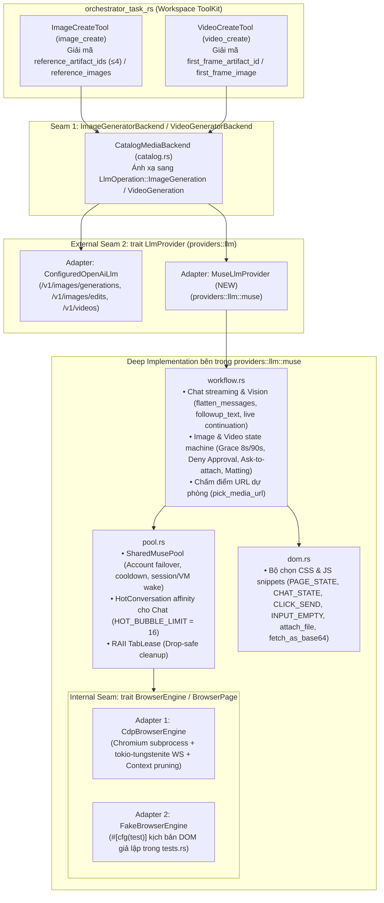

# Muse LLM Provider & Reference Image Pipeline — Hướng dẫn Triển khai

> **Repository:** `AI_Agent_Voice_rust` (`voice-agent-server`) & `orchestrator_task_rs` (`orchestrator-flow`)  
> **Kỷ luật thiết kế:** [`/codebase-design`](file:///Users/lamphuchai/Desktop/project_rust/.agents/skills/codebase-design/SKILL.md) (**Module**, **Interface**, **Implementation**, **Depth**, **Seam**, **Adapter**, **Leverage**, **Locality**), [`DEEPENING.md`](file:///Users/lamphuchai/Desktop/project_rust/.agents/skills/codebase-design/DEEPENING.md), [`CONTEXT.md`](file:///Users/lamphuchai/Desktop/project_rust/AI_Agent_Voice_rust/CONTEXT.md) & [`GLOSSARY.md`](file:///Users/lamphuchai/Desktop/project_rust/AI_Agent_Voice_rust/GLOSSARY.md)  
> **Mục tiêu:** Triển khai adapter **`muse`** (`MuseLlmProvider`) dưới dạng một **Deep Module** nội bộ trong `voice-agent-server` (Phương án 1) hỗ trợ đầy đủ 4 năng lực (`chat`, `vision`, `image`, `video`) thông qua Headless Chromium + CDP, đồng thời mở rộng đường ống truyền **Ảnh tham chiếu (`ReferenceImage`, tối đa 4 ảnh cho Image và 1 ảnh First-frame cho Video)** xuyên suốt từ công cụ của Sub-Agent (`image_create`, `video_create`) qua **External Seam** [`LlmProvider`](file:///Users/lamphuchai/Desktop/project_rust/AI_Agent_Voice_rust/crates/voice-agent-server/src/providers/llm/mod.rs#L413-L459).

**Bảng quyết định thiết kế (sau đánh giá `/codebase-design` & `/code-review`):**

| # | Bẫy thiết kế nông (Shallow Trap) | Quyết định làm sâu (Deepened Decision) |
| :--- | :--- | :--- |
| 1 | Giữ nguyên 4 tầng rời rạc của `muse2api` Python (`Gateway` → `AccountPool` → `BrowserDriver` → `CDPSession`), làm trạng thái tab (`_tabs`, `hot_page`) và trạng thái tài khoản (`cooldown`, `cookies`) bị xé lẻ ở nhiều nơi | **Hợp nhất Account + BrowserContext + TabPool vào một mô hình trạng thái duy nhất (`SharedMusePool`)** bên trong `providers::llm::muse::pool`. Không tạo hypothetical seam giữa Pool và Driver |
| 2 | Gọi `self.checkin(tab).await` ở cuối hàm async như Python → khi `Future` bị `tokio::time::timeout` hoặc `CancellationToken` drop giữa chừng, lệnh trả tab không bao giờ chạy, gây rò rỉ tab (`busy = true` vĩnh viễn) | **RAII `TabLease` có `Drop` đồng bộ:** Nếu thao tác chưa được đánh dấu `finish_clean()`, `Drop::drop` tự động gửi lệnh `DisposeAborted` qua `mpsc::unbounded_channel` để đóng ngay tab đang chạy dở trên `muse.ai` |
| 3 | Khởi tạo tiến trình Chromium mới mỗi khi `ResolvedLlmProvider::to_llm_provider()` được gọi trong [`CatalogMediaBackend`](file:///Users/lamphuchai/Desktop/project_rust/AI_Agent_Voice_rust/crates/voice-agent-server/src/services/task_flow/agent_settings/catalog.rs#L1204-L1245), hoặc dùng chung trình duyệt mà không cô lập theo `Secret Rotation Snapshot` | **Process-wide Shared Pool khóa theo `(cdp_port, headless, account_concurrency, secret_fingerprint)`:** Tuân thủ bất biến **Secret Rotation Snapshot** trong [`CONTEXT.md`](file:///Users/lamphuchai/Desktop/project_rust/AI_Agent_Voice_rust/CONTEXT.md); mỗi snapshot thông tin xác thực sở hữu các `BrowserContext` cô lập và giải phóng ngay khi snapshot cũ bị thay thế |
| 4 | Đặt trường riêng `cookies_json` trong `config_json` của DB provider hoặc thiếu `#[serde(skip_serializing)]` trên `SecretString` → lỗi biên dịch `Serialize` hoặc vi phạm **Credential-free Provider Config** | **Tái sử dụng `#[serde(default, skip_serializing)] pub api_key: SecretString`** trong `MuseConfig`: vừa tuân thủ **Credential-free Provider Config**, vừa cho phép dùng trực tiếp `MuseConfig::valid` trong [`database/providers/config.rs`](file:///Users/lamphuchai/Desktop/project_rust/AI_Agent_Voice_rust/crates/voice-agent-server/src/database/providers/config.rs#L33) mà không cần tạo `MuseDbConfig` trùng lặp |
| 5 | Để `CatalogMediaBackend` hoặc `LlmProvider` tự đi đọc `ArtifactStore` hoặc tải URL khi cần ảnh tham chiếu → làm phình **Interface** của `LlmProvider` và phá vỡ **Locality** | **Chuẩn hóa sớm tại ranh giới Tool:** `ImageCreateTool` / `VideoCreateTool` chịu trách nhiệm đọc `ArtifactStore` (đã kiểm tra quyền & SHA-256) hoặc giải mã Data URL thành struct thuần dữ liệu `ReferenceImage { bytes, mime_type }` trước khi đi qua seam |
| 6 | Phải bật Chromium thật mới chạy được unit test cho luồng chờ ảnh/video (`wait_and_download_media`, bấm Deny Approval Card, tự động nhắc đính kèm file, multi-turn chat) | Đặt đúng **1 Internal Seam** `pub(super) trait BrowserEngine` / `BrowserPage` bên trong `providers::llm::muse` với 2 adapter: `CdpBrowserEngine` (production) và `FakeBrowserEngine` (`#[cfg(test)]` trong `tests.rs`) |

---

## 1. Kiến trúc tổng thể & Kỷ luật Seam (`DEEPENING.md`)



### Phân loại Dependency theo [`DEEPENING.md`](file:///Users/lamphuchai/Desktop/project_rust/.agents/skills/codebase-design/DEEPENING.md)

1. **Logic điều phối tài khoản, chọn tab, ghép prompt, tính tỉ lệ khung hình, tách nền alpha và state machine chờ text/media (`workflow.rs`, `pool.rs`, `dom.rs`):**
   - Thuộc nhóm **In-process** (thuần tính toán và trạng thái bộ nhớ).
   - **Quyết định:** Gộp chung bên trong module `providers::llm::muse`, không tách trait trung gian giữa `Pool` và `Workflow`.
2. **Giao tiếp trình duyệt qua Chrome DevTools Protocol (`cdp.rs`) & HTTP Session/VM Wake:**
   - Thuộc nhóm **True external / Local-substitutable**.
   - **Quyết định:** Đặt một **Internal Seam** (`pub(super) trait BrowserEngine` và `pub(super) trait BrowserPage`) ẩn hoàn toàn bên trong `providers::llm::muse`. Mọi bài test của module `muse` đều gọi qua **External Seam** [`LlmProvider::stream`](file:///Users/lamphuchai/Desktop/project_rust/AI_Agent_Voice_rust/crates/voice-agent-server/src/providers/llm/mod.rs#L439-L446) và [`LlmProvider::invoke`](file:///Users/lamphuchai/Desktop/project_rust/AI_Agent_Voice_rust/crates/voice-agent-server/src/providers/llm/mod.rs#L448-L451) với `FakeBrowserEngine` được tiêm vào lúc khởi tạo test.

---

## 2. Mở rộng Seam cho Ảnh tham chiếu (`ReferenceImage`)

Để hỗ trợ tạo ảnh từ tối đa **4 ảnh tham chiếu** và tạo video từ **1 ảnh khung hình đầu (first frame)** mà vẫn giữ **Interface** nhỏ gọn, ta truyền dữ liệu đã chuẩn hóa (`bytes` + `mime_type`) qua 2 seam hiện có.

### 2.1. Tại `providers::llm` (`crates/voice-agent-server/src/providers/llm/mod.rs`)

Mở rộng [`providers/llm/mod.rs`](file:///Users/lamphuchai/Desktop/project_rust/AI_Agent_Voice_rust/crates/voice-agent-server/src/providers/llm/mod.rs#L242-L345):

```rust
/// Số lượng ảnh tham chiếu tối đa được đính kèm trong một yêu cầu sinh ảnh.
pub const MAX_REFERENCE_IMAGES: usize = 4;

/// Ảnh đầu vào đã được xác thực MIME và giải mã thành byte nguyên bản.
#[derive(Clone, Debug, PartialEq, Eq, serde::Serialize, serde::Deserialize)]
pub struct ReferenceImage {
    pub bytes: Vec<u8>,
    pub mime_type: String,
}

impl ReferenceImage {
    /// Chuẩn hóa MIME từ magic bytes (`image/png`, `image/jpeg`, `image/webp`, `image/gif`).
    pub fn from_bytes(bytes: Vec<u8>, fallback_mime: &str) -> Result<Self, LlmError> {
        if bytes.is_empty() {
            return Err(LlmError::Rejected);
        }
        let mime = sniff_media_mime_type(&bytes, fallback_mime);
        if !mime.starts_with("image/") {
            return Err(LlmError::Rejected);
        }
        Ok(Self {
            bytes,
            mime_type: mime.to_owned(),
        })
    }
}
```

Cập nhật 2 biến thể trong [`LlmOperation`](file:///Users/lamphuchai/Desktop/project_rust/AI_Agent_Voice_rust/crates/voice-agent-server/src/providers/llm/mod.rs#L244-L265):

```rust
pub enum LlmOperation {
    // ... giữ nguyên Chat, Vision ...
    ImageGeneration {
        prompt: String,
        width: u32,
        height: u32,
        /// Từ 0 đến `MAX_REFERENCE_IMAGES` (4) ảnh tham chiếu.
        reference_images: Vec<ReferenceImage>,
        /// Yêu cầu nền trong suốt (`true` khi `background == "transparent"` hoặc format yêu cầu tách nền).
        transparent_background: bool,
    },
    VideoGeneration {
        prompt: String,
        width: u32,
        height: u32,
        duration_secs: u32,
        /// Ảnh khung hình đầu tiên (Image-to-Video) nếu có.
        first_frame: Option<ReferenceImage>,
    },
    // ... giữ nguyên AudioSpeech, AudioTranscription, Embedding ...
}
```

> [!NOTE]
> Trong [`LlmOperation::diagnostic_for`](file:///Users/lamphuchai/Desktop/project_rust/AI_Agent_Voice_rust/crates/voice-agent-server/src/providers/llm/mod.rs#L296-L336), `LlmCapabilityTag::Image` khởi tạo `reference_images: Vec::new(), transparent_background: false` và `LlmCapabilityTag::Video` khởi tạo `first_frame: None`.

### 2.2. Tại `orchestrator_task_rs` (`src/tools/media_artifacts.rs`)

Mở rộng [`media_artifacts.rs`](file:///Users/lamphuchai/Desktop/project_rust/orchestrator_task_rs/src/tools/media_artifacts.rs#L32-L217) để Sub-Agent (`media_creator`) có thể truyền ảnh tham chiếu theo **ID của Job Artifact có sẵn trong cùng Task** (an toàn, không tốn context token của LLM) hoặc theo **Data URL / Base64**:

```rust
/// Số lượng ảnh tham chiếu tối đa cho một lệnh `image_create`.
pub const MAX_IMAGE_REFERENCES: usize = 4;
/// Giới hạn kích thước mỗi ảnh tham chiếu (10 MiB).
pub const MAX_REFERENCE_IMAGE_BYTES: u64 = 10 * 1024 * 1024;

/// Ảnh tham chiếu đã được xác minh toàn vẹn để chuyển xuống Backend.
#[derive(Debug, Clone, PartialEq, Eq, Serialize, Deserialize)]
pub struct ReferenceImageInput {
    pub bytes: Vec<u8>,
    pub mime_type: String,
}
```

1. **Mở rộng `ImageGenerationRequest` và `VideoGenerationRequest`:**
   ```rust
   #[derive(Debug, Clone, Serialize, Deserialize)]
   pub struct ImageGenerationRequest {
       pub prompt: String,
       pub title: Option<String>,
       pub filename: String,
       pub format: String,
       pub width: u32,
       pub height: u32,
       pub svg_content: Option<String>,
       #[serde(default)]
       pub reference_images: Vec<ReferenceImageInput>,
       #[serde(default)]
       pub transparent_background: bool,
   }

   #[derive(Debug, Clone, Serialize, Deserialize)]
   pub struct VideoGenerationRequest {
       pub prompt: String,
       pub title: Option<String>,
       pub filename: String,
       pub width: u32,
       pub height: u32,
       pub duration_secs: u32,
       #[serde(default)]
       pub first_frame: Option<ReferenceImageInput>,
   }
   ```
2. **Bổ sung thuộc tính JSON Schema trong `ImageCreateTool::descriptor` và `VideoCreateTool::descriptor`:**
   - Trong `image_create`:
     - `reference_artifact_ids`: `{"type": "array", "items": {"type": "string"}, "maxItems": 4, "description": "Optional list of up to 4 image Artifact IDs in the current task to use as visual references."}`
     - `reference_images`: `{"type": "array", "items": {"type": "string"}, "maxItems": 4, "description": "Optional list of up to 4 reference images as data:image/...;base64,... strings."}`
     - `transparent_background`: `{"type": "boolean", "description": "Optional flag to request an isolated subject with a transparent PNG background."}`
   - Trong `video_create`:
     - `first_frame_artifact_id`: `{"type": "string", "description": "Optional image Artifact ID in the current task to use as the starting frame of the video."}`
     - `first_frame_image`: `{"type": "string", "description": "Optional starting frame image as a data:image/...;base64,... string."}`
3. **Hàm giải mã và xác minh quyền đọc Artifact trong `media_artifacts.rs`:**
   - Khi Sub-Agent truyền `reference_artifact_ids` (hoặc `first_frame_artifact_id`), vì ID này nằm ngay trong `arguments_json` của lệnh gọi tool nên [`ArtifactStore::open_for_tool`](file:///Users/lamphuchai/Desktop/project_rust/orchestrator_agent_rs/src/artifact/access.rs#L104-L135) (`ctx.artifacts().open(id).await`) sẽ tự động cho phép nếu và chỉ nếu artifact thuộc đúng `(owner_id, workspace_id, root_session_id)` của Task hiện tại!
   - Kiểm tra `reader.metadata().mime_type` là ảnh raster (`image/png`, `image/jpeg`, `image/webp`, `image/gif`), kích thước `<= MAX_REFERENCE_IMAGE_BYTES`, và gọi `reader.read_all().await` (tự động kiểm tra SHA-256).
   - Tổng số ảnh sau khi gộp `reference_artifact_ids` và `reference_images` nếu vượt quá `MAX_IMAGE_REFERENCES` (4) sẽ trả lỗi `ToolError` với mã `"TOO_MANY_REFERENCE_IMAGES"`.

### 2.3. Tại `CatalogMediaBackend` & `ConfiguredOpenAiLlm`

1. Trong [`catalog.rs`](file:///Users/lamphuchai/Desktop/project_rust/AI_Agent_Voice_rust/crates/voice-agent-server/src/services/task_flow/agent_settings/catalog.rs#L1192-L1276):
   ```rust
   let reference_images = req
       .reference_images
       .iter()
       .map(|img| crate::providers::llm::ReferenceImage {
           bytes: img.bytes.clone(),
           mime_type: img.mime_type.clone(),
       })
       .collect();
   let output = provider
       .invoke(crate::providers::LlmOperation::ImageGeneration {
           prompt: req.prompt.clone(),
           width,
           height,
           reference_images,
           transparent_background: req.transparent_background,
       })
       .await
       .map_err(|e| e.to_string())?;
   ```
   Tương tự cho `CatalogMediaBackend::generate_video` với `first_frame`.
2. Phân tách độc lập với `openai`:
   - `muse` (`providers::llm::muse`) là provider độc lập hoàn toàn (`adapter = "muse"`), trực tiếp xử lý `reference_images`, `transparent_background`, và `first_frame` thông qua browser pool (`MuseLlmProvider`).
   - [`providers/llm/openai/provider.rs`](file:///Users/lamphuchai/Desktop/project_rust/AI_Agent_Voice_rust/crates/voice-agent-server/src/providers/llm/openai/provider.rs#L160-L176) giữ nguyên hành vi hiện tại và chỉ bỏ qua (`..`) các trường mới trong pattern matching của `LlmOperation::ImageGeneration` / `LlmOperation::VideoGeneration`, không sửa đổi `openai/media.rs`.

---

## 3. Thiết kế Deep Module `providers::llm::muse`

Tuân thủ quy ước tách file của [`CONTEXT.md`](file:///Users/lamphuchai/Desktop/project_rust/AI_Agent_Voice_rust/CONTEXT.md) (`## Source code structure conventions`) tương đồng với [`providers/llm/openai/`](file:///Users/lamphuchai/Desktop/project_rust/AI_Agent_Voice_rust/crates/voice-agent-server/src/providers/llm/openai/mod.rs):

```
crates/voice-agent-server/src/providers/llm/muse/
├── mod.rs         # Re-exports (MuseConfig, MuseLlmProvider, DESCRIPTOR, REGISTRATION, MuseFactory)
├── config.rs      # MuseConfig, MuseAccountCredential, parse_accounts(), constants
├── descriptor.rs  # DESCRIPTOR, REGISTRATION, MuseFactory (cài đặt LlmFactory)
├── provider.rs    # MuseLlmProvider & cài đặt trait LlmProvider (stream, invoke)
├── cdp.rs         # Internal Seam (BrowserEngine/BrowserPage), CdpBrowserEngine, CdpSession
├── dom.rs         # Bộ chọn CSS & biểu thức JS tự chứa (PAGE_STATE, CHAT_STATE, CLICK_SEND, INPUT_EMPTY, ...)
├── pool.rs        # SharedMusePool, Session/VM Wake, HotConversation, PooledTab, RAII TabLease
├── workflow.rs    # Luồng thực thi Chat streaming, Vision, ImageGeneration, VideoGeneration & Alpha Matting
└── tests.rs       # FakeBrowserEngine & kiểm thử qua External Seam LlmProvider
```

### 3.1. `config.rs`, `descriptor.rs` & `provider.rs`

```rust
pub const ADAPTER_NAME: &str = "muse";
pub const SITE_URL: &str = "https://muse.ai";
pub const COOKIE_DOMAIN: &str = ".muse.ai";
pub const NEW_THREAD_URL: &str = "https://muse.ai/thread/new";
pub const SESSION_API_URL: &str = "https://muse.ai/api/session";
pub const VM_WAKE_API_URL: &str = "https://muse.ai/api/hatch/vm/wake";

pub const REQUIRED_COOKIES: &[&str] = &[
    "hatch_sess",
    "hatch_gw",
    "hatch_vml",
    "hatch_native_auth_device",
];

pub const MUSE_MODELS: &[&str] = &["muse-chat", "muse-image", "muse-video"];
```

#### Cấu trúc `MuseConfig` & Tuân thủ `Credential-free Provider Config`
Sử dụng `#[serde(default, skip_serializing)] pub api_key: SecretString` để:
1. Không bao giờ serialize thông tin xác thực ra deployment snapshot hay log (tuân thủ bất biến **Credential-free Provider Config** trong [`CONTEXT.md`](file:///Users/lamphuchai/Desktop/project_rust/AI_Agent_Voice_rust/CONTEXT.md) và [`deployment_snapshot.rs`](file:///Users/lamphuchai/Desktop/project_rust/AI_Agent_Voice_rust/crates/voice-agent-server/src/providers/deployment_snapshot.rs#L37-L68)).
2. Dùng chung một kiểu `MuseConfig` cho cả [`database/providers/config.rs`](file:///Users/lamphuchai/Desktop/project_rust/AI_Agent_Voice_rust/crates/voice-agent-server/src/database/providers/config.rs#L33) (giống `CampPlusConfig`), [`database_loader.rs`](file:///Users/lamphuchai/Desktop/project_rust/AI_Agent_Voice_rust/crates/voice-agent-server/src/providers/database_loader.rs#L540-L547) và [`catalog.rs`](file:///Users/lamphuchai/Desktop/project_rust/AI_Agent_Voice_rust/crates/voice-agent-server/src/services/task_flow/agent_settings/catalog.rs#L295-L326) mà không cần tạo `MuseDbConfig` trùng lặp:

```rust
#[derive(Clone, Debug, Deserialize, Serialize)]
#[serde(deny_unknown_fields)]
pub struct MuseConfig {
    /// Chuỗi cookie phiên đăng nhập muse.ai được nạp qua cơ chế SecretRef chuẩn.
    /// Chấp nhận định dạng JSON chuẩn `MuseAccountCredential` (1 hoặc mảng nhiều tài khoản)
    /// hoặc chuỗi header Cookie `"hatch_sess=...; hatch_gw=...; hatch_vml=...; hatch_native_auth_device=..."`.
    #[serde(default, skip_serializing)]
    pub api_key: SecretString,
    #[serde(default = "default_model")]
    pub model: String,
    #[serde(default = "default_timeout_ms")]
    pub timeout_ms: u64,
    #[serde(default, skip_serializing_if = "Option::is_none")]
    pub max_tokens: Option<u32>,
    #[serde(default, skip_serializing_if = "Option::is_none")]
    pub context_limit_tokens: Option<u32>,
    #[serde(default, skip_serializing_if = "Option::is_none")]
    pub reasoning_effort: Option<String>,
    #[serde(default, skip_serializing_if = "Option::is_none")]
    pub temperature_percent: Option<u16>,
    #[serde(default, skip_serializing_if = "Option::is_none")]
    pub tags: Option<Vec<String>>,
    /// Số tab tối đa mở đồng thời trên mỗi tài khoản (1..=8, mặc định: 2).
    #[serde(default = "default_account_concurrency")]
    pub account_concurrency: usize,
    /// Cổng CDP cục bộ của Chromium (1024..=65535, mặc định: 19222).
    #[serde(default = "default_cdp_port")]
    pub cdp_port: u16,
    /// Chạy Chromium ở chế độ ẩn (`--headless=new`, mặc định: true).
    #[serde(default = "default_headless")]
    pub headless: bool,
}

/// Kiểu dữ liệu có cấu trúc cho mỗi tài khoản Muse sau khi parse từ `api_key`.
#[derive(Clone, Debug, PartialEq, Eq, Deserialize, Serialize)]
pub struct MuseAccountCredential {
    pub label: String,
    pub cookies: BTreeMap<String, String>,
    #[serde(default)]
    pub cookie_expires: Option<u64>,
    #[serde(default)]
    pub vm_id: Option<String>,
}
```

Hàm `MuseConfig::valid(&self) -> bool`:
- Kiểm tra `!self.model.trim().is_empty() && self.model.len() <= 256` (chấp nhận cả các định danh chuẩn trong `MUSE_MODELS` lẫn model tuỳ chỉnh).
- Kiểm tra `(1_000..=600_000).contains(&self.timeout_ms)`.
- Kiểm tra `(1..=8).contains(&self.account_concurrency)` và `self.cdp_port >= 1024`.
- Kiểm tra `valid_generation_bounds(...)` và `valid_llm_tags(self.tags.as_deref())`.
- Khi `self.api_key.expose()` khác rỗng (lúc nạp từ file cấu hình tĩnh hoặc sau khi `database_loader::typed_instance` tiêm secret), `parse_accounts(self.api_key.expose())` phải trích xuất được ít nhất 1 `MuseAccountCredential` có đủ 4 khóa trong `REQUIRED_COOKIES`.

---

### 3.2. `cdp.rs` — Internal Seam `BrowserEngine` & Thực thi CDP cô lập

Để tránh mùi **Divergent Change / Feature Envy**, `cdp.rs` chỉ phụ trách giao thức CDP, vòng đời tiến trình Chromium và WebSocket multiplexing; mọi hằng số domain (`.muse.ai`) hoặc cấu hình hạn cookie đều được truyền từ tầng gọi xuống qua `CookieParam`:

```rust
#[derive(Debug, Clone, PartialEq, Eq)]
pub(super) struct CookieParam {
    pub name: String,
    pub value: String,
    pub domain: String,
    pub path: String,
    pub secure: bool,
    pub expires: f64,
}

#[derive(Debug, Clone, PartialEq, Eq, thiserror::Error)]
pub(super) enum CdpError {
    #[error("browser process unavailable: {0}")]
    BrowserUnavailable(String),
    #[error("cdp protocol error: {0}")]
    Protocol(String),
    #[error("javascript evaluation error: {0}")]
    JsException(String),
    #[error("cdp operation timed out")]
    Timeout,
}

#[async_trait::async_trait]
pub(super) trait BrowserPage: Send + Sync {
    async fn navigate(&self, url: &str) -> Result<(), CdpError>;
    async fn current_url(&self) -> Result<String, CdpError>;
    async fn evaluate_json(
        &self,
        expression: &str,
        await_promise: bool,
        timeout: Duration,
    ) -> Result<Value, CdpError>;
    async fn press_enter(&self) -> Result<(), CdpError>;
    async fn close(&self);
}

#[async_trait::async_trait]
pub(super) trait BrowserEngine: Send + Sync {
    /// Mở một tab mới trong `BrowserContext` cô lập của `context_key` và nạp danh sách cookie.
    async fn open_page(
        &self,
        context_key: &str,
        cookies: &[CookieParam],
    ) -> Result<Arc<dyn BrowserPage>, CdpError>;

    /// Giải phóng `BrowserContext` của một `context_key` (`Target.disposeBrowserContext`).
    async fn dispose_context(&self, context_key: &str);
}
```

#### Cài đặt Production Adapter `CdpBrowserEngine`
1. **Tìm kiếm, Khởi chạy & Tự động Phục hồi Kết nối Chromium (`ensure_connected`)**:
   - Trước mỗi lệnh `open_page`, kiểm tra xem `browser_ws` hiện tại còn sống hay không (`!browser_ws.is_closed()`).
   - Nếu mất kết nối hoặc chưa khởi tạo:
     - Thử `GET http://127.0.0.1:{cdp_port}/json/version` (với `reqwest::Client::builder().no_proxy()`).
     - Nếu chưa có Chromium trên cổng đó, xoá các file khoá mồ côi (`SingletonLock`, `SingletonSocket`, `SingletonCookie`) trong thư mục `profile_dir` được truyền vào và khởi chạy `tokio::process::Command` với các cờ `--remote-debugging-port={cdp_port}`, `--remote-allow-origins=*`, `--user-data-dir={profile_dir}`, `--no-first-run`, `--no-default-browser-check`, `--disable-dev-shm-usage`, `--disable-background-networking`, `--autoplay-policy=no-user-gesture-required`, `--window-size=1440,2200`, và `--headless=new --disable-gpu` (nếu `headless == true`).
   - **Dọn dẹp `BrowserContext` mồ côi (`prune_dead_contexts`)**:
     - Ngay sau khi kết nối lại vào Browser WebSocket, gọi `Target.getBrowserContexts` để đối chiếu danh sách `browserContextIds` đang tồn tại trên trình duyệt; loại bỏ khỏi bảng ánh xạ cục bộ các context đã chết và giải phóng các context mồ côi không thuộc phiên hiện tại (tương đương `driver.py:L130–156`).
2. **Multiplexer `CdpSession` trên `tokio_tungstenite`**:
   - Duy trì `AtomicU64` sinh `id` tăng dần và `Mutex<HashMap<u64, oneshot::Sender<Result<Value, CdpError>>>>`.
   - Khi mở tab mới cho `context_key`:
     - Lấy hoặc tạo `browserContextId` qua `Target.createBrowserContext` (`{"disposeOnDetach": false}`).
     - Gọi `Target.createTarget` với `{"url": "about:blank", "browserContextId": ctx_id, "newWindow": true}` (mỗi tab một cửa sổ riêng để Chromium không throttle các tab chạy song song).
     - Mở kết nối WebSocket tới `ws://127.0.0.1:{cdp_port}/devtools/page/{target_id}`.
     - Bật `Page.enable`, `Runtime.enable`, `Network.enable`, `Emulation.setFocusEmulationEnabled(true)`, `Page.setWebLifecycleState("active")`.
     - Nạp từng `CookieParam` qua `Network.setCookie`.

---

### 3.3. `dom.rs` — Các biểu thức JS & Nhận diện trạng thái trang

Chuyển toàn bộ các hằng số bộ chọn và hàm sinh JS từ [`drivers/browser/dom.py`](file:///Users/lamphuchai/.gemini/antigravity/brain/a54b9941-fe3a-4e53-bcd5-700dfa637cea/scratch/muse2api/src/muse2api/drivers/browser/dom.py) sang Rust. Mọi tham số chuỗi nhúng vào JS đều đi qua `serde_json::to_string(val)`:

- **Các hằng số kiểm tra trạng thái:**
  - `LOGIN_HINTS`: `["log in", "sign in", "create an account", "use another account"]`
  - `QUOTA_HINTS`: `["out of credits", "usage limit", "limit reached", "token limit"]`
  - `STALL_HINTS`: `["Still sending", "Connecting..."]`
  - `GLITCH_HINTS`: `["ran into a problem while responding"]`
  - ` is_glitch_reply(text: &str) -> bool`: trả về `true` khi `text.len() < 300` và chứa bất kỳ cụm từ nào trong `GLITCH_HINTS` (khớp `dom.py:L28–31`).
- **Các script đánh giá DOM (trả về JSON tĩnh qua `evaluate_json`):**
  1. `PAGE_STATE_JS`: Kiểm tra `document.readyState === 'complete'`, có thẻ `textarea`, thuộc tính `data-hatch-shell-hydration-state === 'hydrated'`, và không chứa chữ `"Connecting..."`.
  2. `CHAT_STATE_JS`: Cuộn mọi khung cuộn xuống đáy, đọc số lượng bong bóng agent (`div[class*="hatch-agent-bubble-bg"]`), văn bản của bong bóng cuối (`lastText`), trạng thái nút Stop (`button[aria-label*="Stop" i]`), trạng thái thẻ xin phê duyệt (`[data-testid="hatch-inline-approval-card"]`), và danh sách toàn bộ các phần tử đính kèm (`[data-testid^="hatch-chat-attachment-presentation-"]`) gồm `{ tid, kind: "video" | "image" | "unknown", src, w, h }`.
  3. `DENY_APPROVALS_JS`: Tự động tìm các nút `Deny / Decline / Reject / Don't allow` bên trong mọi thẻ `[data-testid="hatch-inline-approval-card"]` và click để từ chối việc tạo link công khai.
  4. `LAST_BUBBLE_MEDIA_JS`: Quét bong bóng trả lời cuối cùng để trích xuất mọi URL từ `<video>`, `<source>`, `<a href>`, `` và regex `https?://...` làm phương án dự phòng khi Agent trả link trực tiếp trong văn bản.
  5. `fill_input_js(text: &str) -> String`: Focus vào `<textarea>`, gán giá trị thông qua `Object.getOwnPropertyDescriptor(HTMLTextAreaElement.prototype, 'value').set` và bắn sự kiện `new Event('input', { bubbles: true })`.
  6. `CLICK_SEND_JS`: Tìm nút gửi tin nhắn (`button[aria-label*="Send" i]` hoặc nút kế bên `textarea` không bị `disabled`) và gọi `.click()`, trả về `true` nếu click thành công (`dom.py:L129–136`).
  7. `INPUT_EMPTY_JS`: Kiểm tra `(() => { const el = document.querySelector('textarea'); return !el || !el.value.trim(); })()` để xác nhận tin nhắn đã thực sự được đẩy đi sau khi nhấn `Enter` (`dom.py:L138–139`).
  8. `attach_file_js(b64: &str, mime: &str, filename: &str) -> String`: Giải mã `atob(b64)` thành `Uint8Array`, gói vào `new File([bytes], filename, { type: mime })`, đưa vào `DataTransfer` và gán cho `input[type="file"].files` kèm sự kiện `change`.
  9. `fetch_as_base64_js(url: &str) -> String`: Chạy hàm async `fetch(url)` ngay trong ngữ cảnh trang (hỗ trợ cả `blob:https://muse.ai/...`), đọc `Blob` → `ArrayBuffer` → mã hóa `btoa` theo từng khối `0x8000` byte, trả về `{ ok: true, mime, b64 }`.

---

### 3.4. `pool.rs` — Hợp nhất AccountPool, TabPool, Cô lập Snapshot & RAII `TabLease`

#### 1. Cô lập theo `Secret Rotation Snapshot` (`CONTEXT.md`)
Để tuân thủ bất biến **Secret Rotation Snapshot** trong [`CONTEXT.md`](file:///Users/lamphuchai/Desktop/project_rust/AI_Agent_Voice_rust/CONTEXT.md):
- Khóa của `SharedMusePool` trong bảng toàn cục là:
  ```rust
  #[derive(Clone, Debug, PartialEq, Eq, Hash)]
  pub(super) struct MusePoolKey {
      pub cdp_port: u16,
      pub headless: bool,
      pub account_concurrency: usize,
      /// SHA-256 digest của `api_key.expose()` — đảm bảo khi xoay secret sẽ tạo pool/context mới,
      /// không bao giờ dùng lẫn BrowserContext mang cookie của desired version cũ.
      pub credential_fingerprint: [u8; 32],
  }
  ```
- Mỗi tài khoản `MuseAccountState` tạo một `context_key = format!("{}:{}:{}", hex::encode(&credential_fingerprint[..8]), account.label, generation)` riêng biệt trên `BrowserEngine`. Khi `SharedMusePool` của một snapshot cũ không còn `MuseLlmProvider` nào tham chiếu (`Arc::strong_count == 1`), các `BrowserContext` của snapshot đó được giải phóng qua `engine.dispose_context(&context_key).await`.

#### 2. Khởi tạo Phiên (`verify_session`) & Đánh thức Máy ảo (`wake_vm`)
Chuyển đầy đủ logic từ [`upstream/muse.py`](file:///Users/lamphuchai/.gemini/antigravity/brain/a54b9941-fe3a-4e53-bcd5-700dfa637cea/scratch/muse2api/src/muse2api/upstream/muse.py#L39-L82) và [`driver.py`](file:///Users/lamphuchai/.gemini/antigravity/brain/a54b9941-fe3a-4e53-bcd5-700dfa637cea/scratch/muse2api/src/muse2api/drivers/browser/driver.py#L288-L301):
- **Tính hạn sử dụng cookie (`cookie_expires`)**:
  ```rust
  let now = SystemTime::now().duration_since(UNIX_EPOCH).unwrap_or_default().as_secs_f64();
  let floor = now + 3600.0;
  let expires = match account.cookie_expires.map(|e| e as f64) {
      Some(exp) if exp > floor => exp,
      _ => now + 7.0 * 86400.0,
  };
  ```
- **Kiểm tra phiên & Đánh thức Hatch VM (`ensure_account_warm`)**:
  - Trước lần mở tab đầu tiên của một tài khoản (hoặc khi tab gặp trạng thái `"Connecting..."` kéo dài), gửi `GET https://muse.ai/api/session` kèm header `Cookie` của snapshot hiện tại:
    - Nếu trả về `401/403` hoặc thiếu `user`: đánh dấu tài khoản `AccountHealth::Invalid`.
    - Nếu trả về `Set-Cookie` mới trong cùng phiên làm việc của tài khoản đó: cập nhật `in_memory_cookies` và `cookie_expires` của `MuseAccountState`, đồng thời đánh dấu `stale = true` trên mọi `PooledTab` đang rảnh của tài khoản đó (để lần checkout tới đóng tab cũ và mở tab mới với cookie mới, khớp `driver.py:L766–777`, không ghi đè ngược vào DB `config_json`).
  - Nếu tài khoản có `vm_id` (từ cấu hình hoặc phản hồi `/api/session`), gửi `POST https://muse.ai/api/hatch/vm/wake` với body `{"vm_id": vm_id, "retry_count": 0, "connect_attempt_id": Uuid::new_v4().to_string()}` để đánh thức máy ảo Hatch trước khi điều hướng trình duyệt.

#### 3. Cấu trúc `HotConversation` và RAII `TabLease`
Tránh mùi **Primitive Obsession** bằng cách định nghĩa kiểu `ConversationTurn` rõ ràng thay vì tuple `(String, String)`:

```rust
pub const HOT_BUBBLE_LIMIT: usize = 16;

#[derive(Debug, Clone, PartialEq, Eq)]
pub(super) struct ConversationTurn {
    pub user: String,
    pub assistant: String,
}

#[derive(Debug, Clone, PartialEq, Eq)]
pub(super) struct HotConversation {
    pub hint: String,
    pub turns: Vec<ConversationTurn>,
    pub image_count: usize,
    pub thread_url: String,
}

pub(super) struct PooledTab {
    pub page: Arc<dyn BrowserPage>,
    pub hot: Option<HotConversation>,
    pub stale: bool,
}
```

Khi một tác vụ mượn tab qua `pool.checkout(checkout_mode).await`:
- Nhận về `TabLease` giữ `account_id`, `Option<PooledTab>`, cờ `clean_return: bool` và `return_tx: mpsc::UnboundedSender<PoolReturnCmd>`.
- Nếu hoàn tất thành công: gọi `lease.finish_clean(updated_hot_conversation)` → đánh dấu `clean_return = true`.
- Nếu gặp lỗi từ phía `muse.ai`: gọi `lease.fail_account(UpstreamFailureKind)` (`AuthInvalid` → `Invalid`; `QuotaExceeded` → `Cooldown(60m)`; `Transient` → `Cooldown(30s)`).
- Trong `impl Drop for TabLease`:
  - Nếu `clean_return == true` và `!tab.stale`: gửi `PoolReturnCmd::ReturnIdle { account_id, tab }` để tái sử dụng tab.
  - Nếu `clean_return == false` (do `Future` bị drop giữa chừng vì timeout/cancellation, hoặc do lỗi CDP): gửi `PoolReturnCmd::DisposeAborted { account_id, page }` cho background worker gọi `page.close().await` và trả lại slot concurrency ngay lập tức.

---

### 3.5. `workflow.rs` — Chi tiết State Machine cho Chat, Vision, Image và Video

#### 1. Luồng `Chat` Streaming, `Vision`, `flatten_messages` & Hot-Page Continuation
Chuyển đầy đủ logic từ [`core/prompt.py`](file:///Users/lamphuchai/.gemini/antigravity/brain/a54b9941-fe3a-4e53-bcd5-700dfa637cea/scratch/muse2api/src/muse2api/core/prompt.py#L61-L105) và [`driver.py`](file:///Users/lamphuchai/.gemini/antigravity/brain/a54b9941-fe3a-4e53-bcd5-700dfa637cea/scratch/muse2api/src/muse2api/drivers/browser/driver.py#L349-L370):

1. **Làm phẳng lịch sử hội thoại (`flatten_messages`)**:
   - Nếu chỉ có duy nhất 1 tin nhắn `User` và không có `System` prompt: giữ nguyên nội dung gốc.
   - Nếu có `System` prompt hoặc nhiều lượt hội thoại: định dạng từng khối theo cấu trúc:
     ```text
     [System]
     {system_text}

     [User]
     {user_text}

     [Assistant]
     {assistant_text}

     [Instruction]
     Respond to the last user message above, staying consistent with the conversation context.
     ```
2. **Tiếp nối luồng hội thoại nóng (`_live_continuation` & `followup_text`)**:
   - Trích xuất danh sách `prior_turns: Vec<ConversationTurn>` từ lịch sử tin nhắn trước lượt `User` cuối cùng.
   - Tìm trong `SharedMusePool` một tab đang rảnh có `hot: Some(hot_conv)` thỏa mãn:
     - `hot_conv.turns` là tiền tố (prefix) của `prior_turns`.
     - `hot_conv.image_count == incoming_image_count`.
     - Tổng số bong bóng dự kiến `(prior_turns.len() * 2 + 2) <= HOT_BUBBLE_LIMIT` (`16`).
   - Nếu tìm thấy (`on_thread == true`):
     - Kiểm tra `page.current_url()` vẫn bắt đầu bằng `https://muse.ai/thread/` và `PAGE_STATE_JS` sẵn sàng.
     - Không điều hướng lại trang; chỉ gửi phần văn bản chênh lệch `followup_text(&prior_turns[hot_conv.turns.len()..], &last_user_text)`.
   - Nếu không tìm thấy (`on_thread == false`):
     - Mở/điều hướng tab tới `https://muse.ai/thread/new`, đính kèm ảnh (nếu là `LlmOperation::Vision`), và gửi toàn bộ văn bản từ `flatten_messages`.
3. **Gửi tin nhắn có xác nhận (`send_prompt_verified`)**:
   - Chạy `fill_input_js(&prompt)`.
   - Thử click nút Send qua `CLICK_SEND_JS` trong tối đa `5s` (`250ms`/lần).
   - Nếu `CLICK_SEND_JS` trả về `false` (nút Send bị ẩn/chưa kích hoạt): gọi `page.press_enter().await?`, chờ `500ms`, sau đó chạy `INPUT_EMPTY_JS` (`driver.py:L409–417`). Nếu ô nhập vẫn chưa trống, trả về lỗi `UpstreamFailureKind::Transient` để failover thay vì treo chờ vô ích.
4. **Vòng lặp đọc Stream (`POLL_INTERVAL = 150ms`, `STABLE_POLLS_DONE = 4`, `STABLE_POLLS_FORCE = 12`)**:
   - Mỗi `150ms`, gọi `CHAT_STATE_JS`:
     - Nếu `state.approval == true`: gọi `DENY_APPROVALS_JS` để từ chối thẻ xin quyền.
     - Khi `state.agent_count > base_agent_count` và `!state.last_text.is_empty()`:
       - Kiểm tra `QUOTA_HINTS` → nếu khớp, báo `QuotaExceeded` và failover (nếu chưa phát chunk nào).
       - Kiểm tra `is_glitch_reply(&state.last_text)` (`len < 300` và chứa `GLITCH_HINTS`) → nếu khớp, báo `Transient` và failover.
       - Tính phần hậu tố mới tăng thêm so với `emitted_text` và đẩy ngay `LlmEvent::TextDelta(delta)` vào stream!
       - Nếu `state.last_text` không đổi qua các lần poll: tăng `stable_polls`. Kết thúc stream khi `(!state.generating && stable_polls >= STABLE_POLLS_DONE)` (4 lần = `600ms`) hoặc `stable_polls >= STABLE_POLLS_FORCE` (12 lần = `1.8s`).
   - Khi hoàn tất: đọc `page.current_url()`. Nếu URL bắt đầu bằng `https://muse.ai/thread/` và khác `NEW_THREAD_URL`, lưu lại `HotConversation { hint, turns, image_count, thread_url }` qua `lease.finish_clean(Some(hot))` để lượt chat tiếp theo tái sử dụng ngay tab nóng đó.

#### 2. Quy đổi kích thước `(width, height)` & Xử lý Nền trong suốt (`_CUTOUT_HINT` / Alpha Matting)
1. **Ánh xạ Aspect Ratio (`aspect_ratio_hint`)**:
   - `|w/h - 16/9| < 0.15` → `"16:9"`
   - `|w/h - 9/16| < 0.15` → `"9:16"`
   - `|w/h - 4/3| < 0.12` → `"4:3"`
   - `|w/h - 3/4| < 0.12` → `"3:4"`
   - `|w/h - 21/9| < 0.15` → `"21:9"`
   - Còn lại → `"1:1"`
2. **Hằng số gợi ý tách nền (`CUTOUT_HINT`)**:
   - Khi `transparent_background == true` trong `LlmOperation::ImageGeneration`, nối thêm hậu tố `CUTOUT_HINT = " Isolated subject on a plain, uncluttered studio background."` vào prompt (`api/routes/images.py:L30, L106–114`).
   - Sau khi tải byte ảnh về, chạy hàm `remove_background_to_rgba_png(&bytes)` (ước lượng màu nền từ 4 góc + flood-fill tách nền phẳng + làm mượt biên alpha theo gradient Sobel tương đương [`core/matting.py`](file:///Users/lamphuchai/.gemini/antigravity/brain/a54b9941-fe3a-4e53-bcd5-700dfa637cea/scratch/muse2api/src/muse2api/core/matting.py)).

#### 3. Chuẩn bị trang và Đính kèm Ảnh tham chiếu (`prepare_media_turn`)
1. Mượn một `TabLease` từ `SharedMusePool` ở chế độ `CheckoutMode::Stateless`.
2. Đảm bảo tài khoản đã được đánh thức (`ensure_account_warm`), điều hướng tới `https://muse.ai/thread/new` và poll `PAGE_STATE_JS` mỗi `250ms` (tối đa `30s`) cho tới khi `ready == true`. Nếu quá hạn mà `head` chứa `LOGIN_HINTS`, báo `UpstreamFailureKind::AuthInvalid`.
3. Đọc trạng thái ban đầu `base_state = poll_chat_state(&page).await?` (`base_attachments = base_state.attachments.len()`, `base_agent_count = base_state.agent_count`).
4. **Nếu có ảnh đính kèm** (`reference_images` với Image, `first_frame` với Video):
   - Với từng ảnh `idx`, mã hóa Base64 (`STANDARD.encode(&img.bytes)`), xác định đuôi file từ `img.mime_type` (`png`, `jpg`, `webp`, `gif`), và gọi `page.evaluate_json(&attach_file_js(&b64, &img.mime_type, &format!("input_{idx}.{ext}")), false, Duration::from_secs(15)).await?`.
   - Chờ `tokio::time::sleep(Duration::from_millis(1000)).await` để giao diện React của `muse.ai` hoàn tất tạo bản xem trước đính kèm.
5. Gửi prompt qua `send_prompt_verified(&page, &prompt).await?` (có kiểm tra `CLICK_SEND_JS` và fallback `press_enter()` + xác minh `INPUT_EMPTY_JS` sau `500ms`).

#### 4. Vòng lặp `wait_and_download_media` (Trái tim của Flow Image & Video)
Tham số thời gian theo loại media:
- **Image (`MediaKind::Image`):** `grace = Duration::from_secs(8)`, `stall_after = Duration::from_secs(120)`, `overrun_factor = 2.5`.
- **Video (`MediaKind::Video`):** `grace = Duration::from_secs(90)`, `stall_after = Duration::from_secs(240)`, `overrun_factor = 2.5`.

Vòng lặp kiểm tra mỗi `600ms` (khớp chính xác thứ tự của [`driver.py:L588–685`](file:///Users/lamphuchai/.gemini/antigravity/brain/a54b9941-fe3a-4e53-bcd5-700dfa637cea/scratch/muse2api/src/muse2api/drivers/browser/driver.py#L588-L685)):
1. **Kiểm tra hạn thời gian mềm (Soft Timeout):**
   - Cho phép chạy lố qua `timeout` (tối đa tới `timeout * 2.5`) **nếu và chỉ nếu** Agent vẫn đang bận (`generating == true` hoặc đã xuất hiện thẻ attachment của loại media đó nhưng `src` đang nạp) **và** giao diện chưa bị đứng im quá `stall_after`.
2. **Tự động từ chối Approval Card:**
   - Nếu `state.approval == true`: chạy `DENY_APPROVALS_JS`, bật cờ `denied_approval = true`, đặt lại `text_done_at = None` và tiếp tục vòng lặp.
3. **Phát hiện Attachment mới:**
   - Xét lát cắt `new_atts = &state.attachments[base_attachments..]`.
   - Nếu có phần tử `att` nào thỏa `att.kind == kind && !att.src.is_empty()`:
     - Gọi `fetch_as_base64_js(&att.src)` với `await_promise = true`, `timeout = Duration::from_secs(120)`.
     - Giải mã Base64 thành `bytes`, áp dụng `remove_background_to_rgba_png` nếu `transparent_background == true`, xác định MIME thực tế qua `sniff_media_mime_type`, đánh dấu `lease.finish_clean(None)` và trả về `Ok(LlmOutput::Media { bytes, mime_type })`!
4. **Xử lý khi Agent trả lời xong bằng chữ mà chưa có Attachment (`Grace Period` → `Glitch Check` → `Ask-to-attach`):**
   - Nếu có phần tử trong `new_atts` có `tid.contains(kind)` nhưng `src` còn rỗng (`loading == true`): đặt `text_done_at = None` và tiếp tục chờ `blob:` nạp xong.
   - Ngược lại, nếu `state.agent_count > base_agent_count && !state.last_text.is_empty() && !state.generating`:
     - Kiểm tra ngay `QUOTA_HINTS` trong `state.last_text` → nếu khớp, báo `QuotaExceeded` để cooldown tài khoản và failover.
     - Khởi tạo mốc `text_done_at.get_or_insert_with(Instant::now)`.
     - Khi `text_done_at.elapsed() >= grace` (đợi hết thời gian ân hạn `8s`/`90s` trước khi kết luận thiếu media, khớp [`driver.py:L662–668`](file:///Users/lamphuchai/.gemini/antigravity/brain/a54b9941-fe3a-4e53-bcd5-700dfa637cea/scratch/muse2api/src/muse2api/drivers/browser/driver.py#L662-L668)):
       - **Kiểm tra `GLITCH_HINTS`:** Nếu `state.last_text` chứa `GLITCH_HINTS`, báo `UpstreamFailureKind::Transient` để failover sang tài khoản/tab khác.
       - **Lần 1 (`!asked_to_attach`):** Tự động gửi tin nhắn nhắc Agent đính kèm file qua `send_prompt_verified`:
         - Nếu `denied_approval`: `"Please attach the final image/video file here in the chat instead of uploading it."`
         - Ngược lại: `"Please attach the final image/video file here in the chat, as a single attachment."`
         - Đặt `asked_to_attach = true`, `text_done_at = None`, `base_agent_count = state.agent_count` và tiếp tục chờ.
       - **Lần 2 (`asked_to_attach == true`):** Chạy `LAST_BUBBLE_MEDIA_JS` và chấm điểm các URL tìm được qua `pick_media_url(links, kind)` (ưu tiên `blob:`, đuôi `.mp4`/`.png`/`.webp`, hoặc các domain CDN `videodelivery.net`, `cloudflarestream.com`, `musecdn`). Nếu tìm được URL hợp lệ thì tải qua `fetch_as_base64_js`; nếu không thì trả về `Err(LlmError::Rejected)`.

---

## 4. Các điểm chạm tích hợp trong `voice-agent-server`

Ngoài thư mục mới `crates/voice-agent-server/src/providers/llm/muse/`, cần cập nhật 7 điểm chạm sau:

1. **[`crates/voice-agent-server/src/providers/llm/mod.rs`](file:///Users/lamphuchai/Desktop/project_rust/AI_Agent_Voice_rust/crates/voice-agent-server/src/providers/llm/mod.rs):**
   - Khai báo `pub(crate) mod muse;`.
   - Thêm struct `ReferenceImage`, hằng số `MAX_REFERENCE_IMAGES = 4`, và mở rộng `LlmOperation::ImageGeneration` (`reference_images`, `transparent_background`) + `LlmOperation::VideoGeneration` (`first_frame`).
2. **[`crates/voice-agent-server/src/config/providers.rs`](file:///Users/lamphuchai/Desktop/project_rust/AI_Agent_Voice_rust/crates/voice-agent-server/src/config/providers.rs#L118-L157):**
   - Thêm biến thể `Muse(MuseConfig)` vào enum `LlmInstanceConfig`.
   - Trong `LlmInstanceConfig::adapter(&self)`: trả `"muse"` cho `Self::Muse(_)`.
   - Trong `LlmInstanceConfig::openai(&self)`: thêm nhánh `Self::Muse(_) => None` để đảm bảo exhaustive match.
   - Bổ sung phương thức `pub fn timeout_ms(&self) -> u64` trên `LlmInstanceConfig` để gom logic lấy `timeout_ms` về một chỗ duy nhất (loại bỏ mùi **Repeated Switches**).
3. **[`crates/voice-agent-server/src/config/validation.rs`](file:///Users/lamphuchai/Desktop/project_rust/AI_Agent_Voice_rust/crates/voice-agent-server/src/config/validation.rs#L698-L706):**
   - Thêm nhánh kiểm tra `LlmInstanceConfig::Muse(options) if !options.valid() => ...`.
4. **[`crates/voice-agent-server/src/database/providers/config.rs`](file:///Users/lamphuchai/Desktop/project_rust/AI_Agent_Voice_rust/crates/voice-agent-server/src/database/providers/config.rs#L30-L61):**
   - Nhờ `#[serde(default, skip_serializing)]` trên `MuseConfig::api_key`, thêm trực tiếp `"muse" => canonical::<MuseConfig, _>(&value, MuseConfig::valid)` (giống hệt mẫu `CampPlusConfig` tại dòng 33, không cần tạo struct `MuseDbConfig` trùng lặp).
5. **[`crates/voice-agent-server/src/providers/registry.rs`](file:///Users/lamphuchai/Desktop/project_rust/AI_Agent_Voice_rust/crates/voice-agent-server/src/providers/registry.rs#L90-L110) & [`factory_registry.rs`](file:///Users/lamphuchai/Desktop/project_rust/AI_Agent_Voice_rust/crates/voice-agent-server/src/providers/factory_registry.rs#L347-L366):**
   - Đăng ký `super::llm::muse::REGISTRATION` vào `REGISTRATIONS`.
   - Đăng ký `&super::llm::muse::MuseFactory` vào `LLM_FACTORIES`.
6. **[`crates/voice-agent-server/src/providers/loader.rs`](file:///Users/lamphuchai/Desktop/project_rust/AI_Agent_Voice_rust/crates/voice-agent-server/src/providers/loader.rs#L48-L54) & [`database_loader.rs`](file:///Users/lamphuchai/Desktop/project_rust/AI_Agent_Voice_rust/crates/voice-agent-server/src/providers/database_loader.rs#L112-L118):**
   - Gọi `config.timeout_ms()` từ `LlmInstanceConfig::timeout_ms(&self)`.
7. **[`crates/voice-agent-server/src/services/task_flow/agent_settings/catalog.rs`](file:///Users/lamphuchai/Desktop/project_rust/AI_Agent_Voice_rust/crates/voice-agent-server/src/services/task_flow/agent_settings/catalog.rs#L21-L156):**
   - **Bảo toàn cấu hình trình duyệt của `MuseConfig`:** Thêm trường `pub muse_options: Option<MuseCatalogOptions>` (`account_concurrency`, `cdp_port`, `headless`) vào `ResolvedLlmProvider`, trích xuất từ `config_json` trong `resolve_llm_provider_catalog()` và truyền nguyên vẹn vào `MuseConfig` trong `ResolvedLlmProvider::to_llm_provider()`.
   - **Bảo vệ luồng Orchestrator Agent (`to_orchestrator_provider`):** Vì `orchestrator-agent` sử dụng `LlmBackend::OpenAiCompatible` (gọi trực tiếp HTTP `/v1/chat/completions` kèm JSON tool schema), trong `catalog.rs` hàm `supported_capabilities_for_provider("muse", ...)` chỉ công bố `["image", "video"]` cho Task Flow (`CatalogMediaBackend` gọi qua `to_llm_provider().invoke(...)`), trong khi `LlmProvider::stream` / `LlmProvider::invoke` của `MuseLlmProvider` vẫn phục vụ đầy đủ `Chat`, `Vision`, `Image`, `Video` cho các worker nội bộ của `voice-agent-server`.

---

## 5. Chiến lược Kiểm thử ("Replace, Don't Layer" — `DEEPENING.md`)

Toàn bộ kiểm thử của module `muse` được đặt trong `crates/voice-agent-server/src/providers/llm/muse/tests.rs` (cùng `FakeBrowserEngine` dưới `#[cfg(test)]`) và đi qua **External Seam** (`LlmProvider` và `ImageCreateTool` / `VideoCreateTool`), không phụ thuộc mạng hay trình duyệt thật:

1. **Test 1 — `image_generation_with_reference_images_attaches_files_and_fetches_blob`:**
   - Gọi `provider.invoke(LlmOperation::ImageGeneration { prompt: "Add a red scarf", width: 1920, height: 1080, reference_images: vec![ref_img_1, ref_img_2], transparent_background: false })`.
   - Xác minh `FakeBrowserEngine` nhận đúng 2 lệnh `attach_file_js`, nhận prompt `"Generate an image (aspect ratio 16:9): Add a red scarf"`, xác minh `INPUT_EMPTY_JS`, và trả về đúng `LlmOutput::Media { bytes, mime_type: "image/png" }`.
2. **Test 2 — `video_generation_denies_approval_card_and_prompts_for_missing_attachment`:**
   - Giả lập kịch bản thực tế phức tạp nhất của `muse.ai`:
     - Poll 1: `approval: true` → Driver tự động chạy `DENY_APPROVALS_JS`.
     - Poll 2..N: Agent kết thúc trả lời bằng chữ (`generating: false`, `lastText: "Done!"`) nhưng `attachments: []`.
     - Sau khi hết `grace` (`90s`), Driver kiểm tra không có `GLITCH_HINTS` rồi tự động gửi tin nhắn `"Please attach the final video file here in the chat instead of uploading it."`.
     - Poll tiếp theo: xuất hiện attachment `kind: "video", src: "blob:https://muse.ai/123"` → Driver tải về thành công `LlmOutput::Media { mime_type: "video/mp4", .. }`.
3. **Test 3 — `chat_streaming_reuses_hot_tab_and_emits_incremental_deltas`:**
   - Gửi lượt chat 1 qua `provider.stream(LlmOperation::Chat(req1))`, xác minh các `LlmEvent::TextDelta` được phát ra tuần tự khi `lastText` dài thêm và tab được lưu vào `HotConversation` với `thread_url = "https://muse.ai/thread/abc"`.
   - Gửi lượt chat 2 nối tiếp lịch sử của lượt 1, xác minh `FakeBrowserEngine` tái sử dụng đúng tab nóng đó (`navigate` không bị gọi lại) và chỉ gửi `followup_text`.
4. **Test 4 — `quota_exhaustion_cools_down_first_account_and_fails_over_to_second_account`:**
   - Cấu hình 2 tài khoản trong `api_key` JSON. Tài khoản 1 trả về bong bóng chữ `"You are out of credits"`.
   - Xác minh `MuseLlmProvider` tự động đánh dấu cooldown tài khoản 1 và hoàn tất yêu cầu trên tài khoản 2.
5. **Test 5 — `cancelled_future_disposes_dirty_tab_via_raii_lease`:**
   - Bắt đầu một lệnh `VideoGeneration`, sau `50ms` hủy `Future` bằng `tokio::time::timeout`.
   - Xác minh `TabLease::drop` gửi lệnh đóng tab (`close_count == 1` trên `FakeBrowserPage`) và trả lại slot concurrency cho tài khoản để request tiếp theo không bị treo.
6. **Test 6 — `image_create_and_video_create_tools_resolve_artifact_references_end_to_end`:**
   - Trong `orchestrator_task_rs`, lưu một artifact ảnh vào `ArtifactStore`, sau đó gọi tool `image_create` với `reference_artifact_ids: [artifact.id]` và `video_create` với `first_frame_artifact_id: artifact.id`.
   - Xác minh `ImageGeneratorBackend` và `VideoGeneratorBackend` nhận được đúng mảng byte đã kiểm chứng SHA-256 của artifact đó.
