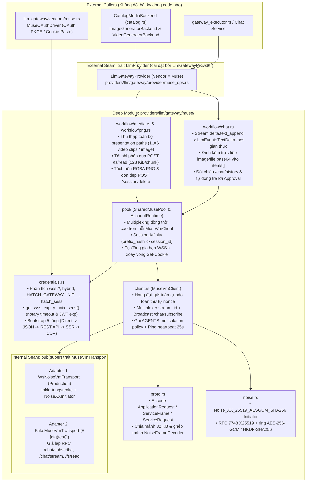
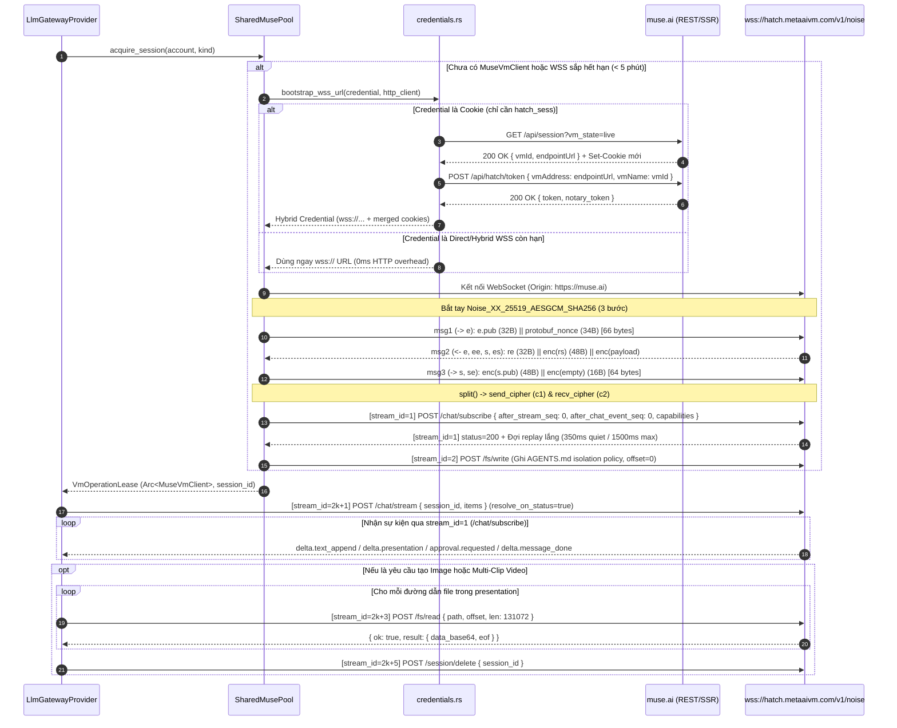

# Muse Provider Update: Direct Noise WebSocket + Protobuf RPC — Hướng dẫn Triển khai

> **Repository:** `AI_Agent_Voice_rust` (`crates/voice-agent-server`)  
> **Nguồn tham chiếu giao thức:** [`muse-api-server-main`](file:///Users/lamphuchai/Desktop/project_rust/muse-api-server-main/src/core/client.js) (`client.js`, `crypto.js`, `proto.js`, `credentials.js`, `browser.js`, `pool.js`)  
> **Kỷ luật thiết kế:** [`/codebase-design`](file:///Users/lamphuchai/Desktop/project_rust/.agents/skills/codebase-design/SKILL.md) (**Module**, **Interface**, **Implementation**, **Depth**, **Seam**, **Adapter**, **Leverage**, **Locality**), [`DEEPENING.md`](file:///Users/lamphuchai/Desktop/project_rust/.agents/skills/codebase-design/DEEPENING.md), [`CONTEXT.md`](file:///Users/lamphuchai/Desktop/project_rust/AI_Agent_Voice_rust/CONTEXT.md) & [`GLOSSARY.md`](file:///Users/lamphuchai/Desktop/project_rust/AI_Agent_Voice_rust/GLOSSARY.md)  
> **Tài liệu tiền nhiệm:**
> - [`docs/muse-llm-provider-implementation-guide.md`](file:///Users/lamphuchai/Desktop/project_rust/AI_Agent_Voice_rust/docs/muse-llm-provider-implementation-guide.md)
> - [`docs/muse-video-multi-clip-and-concat-implementation-guide.md`](file:///Users/lamphuchai/Desktop/project_rust/AI_Agent_Voice_rust/docs/muse-video-multi-clip-and-concat-implementation-guide.md)
>
> **Mục tiêu:** Nâng cấp toàn diện phần thực thi nội bộ (**Implementation**) của nhánh Muse trong [`LlmGatewayProvider`](file:///Users/lamphuchai/Desktop/project_rust/AI_Agent_Voice_rust/crates/voice-agent-server/src/providers/llm/gateway/provider/muse_ops.rs#L69-L218) (`providers/llm/gateway/muse/`) và [`MuseOAuthDriver`](file:///Users/lamphuchai/Desktop/project_rust/AI_Agent_Voice_rust/crates/voice-agent-server/src/services/llm_gateway/vendors/muse.rs#L34-L397) từ cơ chế **điều khiển DOM qua Headless Chromium (CDP)** sang cơ chế **kết nối trực tiếp WebSocket mã hóa `Noise_XX_25519_AESGCM_SHA256` + Protobuf RPC tới máy ảo Meta Hatch VM (`wss://hatch.metaaivm.com/v1/noise`)**, đồng thời giữ nguyên 100% các **External Seams** (`trait LlmProvider`, `ImageGeneratorBackend`, `VideoGeneratorBackend`) và các tính năng nâng cao của server Rust (video multi-clip `1..=6` × 10s, tách nền ảnh RGBA PNG, kiểm tra thời lượng MP4 `mvhd`, và OAuth PKCE).

---

## 0. Bảng Quyết định Thiết kế Cốt lõi (`/codebase-design` & `DEEPENING.md`)

| # | Bẫy Thiết kế Nông (Shallow Trap) | Quyết định Làm sâu Module (Deepened Decision) |
| :--- | :--- | :--- |
| **1** | **Giữ Chromium mở xuyên suốt và cào DOM mỗi 300–600ms (`CHAT_STATE_JS`)**: Tiêu tốn hàng trăm MB RAM mỗi tab, dễ vỡ khi giao diện React của `muse.ai` đổi tên class CSS, và làm tăng độ trễ token đầu tiên (TTFT). | **Direct `Noise_XX_25519_AESGCM_SHA256` + Protobuf RPC (`noise.rs`, `proto.rs`, `client.rs`)**: Giao tiếp trực tiếp với máy ảo Hatch VM tại `wss://hatch.metaaivm.com/v1/noise`. Mọi luồng `chat`, `vision`, `image`, `video` chạy thuần qua Rust async WebSocket (`tokio-tungstenite`); Chromium chỉ còn là **tầng fallback cuối cùng** khi lấy token lần đầu hoặc khi người dùng bấm đăng nhập tương tác trên UI. |
| **2** | **Mỗi request chiếm độc quyền 1 Browser Tab (`TabLease`, tối đa 8 tab) & tải media qua `fetch(blob:...)` trong trang**: Giới hạn cứng khả năng xử lý đồng thời và dễ gặp lỗi giải phóng bộ nhớ `blob:` URL sớm khi tải nhiều clip video. | **Multiplexing Đa luồng (`stream_id`) trên 1 `MuseVmClient` duy nhất / tài khoản**: Một kết nối WebSocket Noise duy nhất xử lý đồng thời nhiều RPC bằng `stream_id` tăng dần. File ảnh/video gốc được đọc nhị phân trực tiếp từ ổ đĩa máy ảo qua RPC `POST /fs/read` (`128 KiB/chunk`), không qua trình duyệt hay `blob:` URL. |
| **3** | **Bắt buộc đủ 4 cookies (`hatch_sess`, `hatch_gw`, `hatch_vml`, `hatch_native_auth_device`)**: Người dùng chỉ copy `hatch_sess` hoặc chuỗi `wss://` sẽ bị từ chối ngay ở [`config::parse_accounts`](file:///Users/lamphuchai/Desktop/project_rust/AI_Agent_Voice_rust/crates/voice-agent-server/src/providers/llm/gateway/muse/config.rs#L165-L236) và [`MuseOAuthDriver`](file:///Users/lamphuchai/Desktop/project_rust/AI_Agent_Voice_rust/crates/voice-agent-server/src/services/llm_gateway/vendors/muse.rs#L268-L273). | **Chuẩn hóa `ParsedMuseCredential` & Bootstrap 5 tầng (`credentials.rs`)**: Chấp nhận (1) Direct `wss://`, (2) Hybrid `wss://...\n<cookies>`, (3) JSON `__HATCH_GATEWAY_INIT__`, hoặc (4) Cookie đơn lẻ (chỉ cần `hatch_sess`). Tự động giải mã hạn token (`get_wss_expiry_unix_secs`) và tự động gia hạn ngầm qua REST API (`GET /api/session?vm_state=live` → `POST /api/hatch/token`) kèm hợp nhất `Set-Cookie` xoay vòng (`merge_set_cookies`). |
| **4** | **Dùng lại DOM tab cho multi-turn chat (`HOT_BUBBLE_LIMIT = 16`) hoặc để rác hàng trăm session trên sidebar Muse**: Dễ lẫn ngữ cảnh giữa các người dùng khác nhau trên cùng tài khoản và làm chậm máy ảo. | **Quản lý `session_id` (`Uuid`) cấp giao thức + Cô lập `AGENTS.md` + Tự động dọn session**: (1) Ghi chính sách `ISOLATION_POLICY` vào `AGENTS.md` trên VM qua `POST /fs/write`; (2) Ánh xạ `conversation_prefix_hash -> session_id` để nối tiếp hội thoại nhiều lượt chỉ bằng tin nhắn mới nhất; (3) Tự động gọi `POST /session/delete` cho mọi phiên tạo ảnh/video hoặc chat đơn lẻ ngay khi hoàn tất. |
| **5** | **Đánh mất tính năng Multi-Clip Video (`1..=6` clips) và tách nền PNG của server Rust khi bê nguyên code JS sang**: `muse-api-server-main` chỉ lấy `videoPaths[videoPaths.length - 1]` (1 clip cuối) và không có bước tách nền RGBA PNG. | **Bảo toàn 100% External Seam & Hợp nhất Media Harvester (`workflow/media.rs`)**: Chờ phiên hoàn tất toàn bộ tool task (`!has_active_tool_task`) trên `/chat/subscribe` + đối chiếu `/chat/history?session_id=<uuid>`, giữ hậu tố `MEDIA_DONE_MARKER` (`[ALL_MEDIA_ATTACHED]`) và `select_effective_ready_attachments`, thu thập **toàn bộ** đường dẫn `sandbox://` / `/home/...` của lượt trả lời để tải đủ `1..=N` video clips (cùng `assistant_message` kịch bản) hoặc chạy `remove_background_to_rgba_png` cho ảnh. |
| **6** | **Thêm crate mật mã mới hoặc dùng `ring::agreement::EphemeralPrivateKey` cho `Noise_XX`**: `ring::agreement::EphemeralPrivateKey` tiêu hủy khóa ngay sau 1 lần `agree_ephemeral`, trong khi `Noise_XX` bắt buộc dùng `e.priv` **2 lần** (`ee` và `es`). | **Zero-Dependency `noise.rs` + Internal Seam `MuseVmTransport`**: Kết hợp `ring::aead::AES_256_GCM`, `ring::hmac::HMAC_SHA256`, `ring::digest::SHA256` sẵn có với hàm RFC 7748 `x25519` thuần Rust (~75 dòng, có kiểm tra `LOW_ORDER_POINTS`). Đặt đúng **1 Internal Seam** `pub(super) trait MuseVmTransport` để test toàn bộ luồng qua `FakeMuseVmTransport` trong vài mili-giây. |

---

## 1. Kiến trúc Tổng thể & Cấu trúc Module

### 1.1. Sơ đồ Kiến trúc & Ranh giới Seam



### 1.2. Sơ đồ Tuần tự: Bootstrap, Bắt tay `Noise_XX` & Multiplexed RPC



### 1.3. Ánh xạ Cấu trúc File trong `crates/voice-agent-server/src/providers/llm/gateway/muse/`

| File | Trạng thái | Trách nhiệm sau khi nâng cấp |
| :--- | :--- | :--- |
| [`muse/mod.rs`](file:///Users/lamphuchai/Desktop/project_rust/AI_Agent_Voice_rust/crates/voice-agent-server/src/providers/llm/gateway/muse/mod.rs) | **Cập nhật** | Khai báo các submodule (`config`, `credentials`, `noise`, `proto`, `client`, `cdp`, `pool`, `workflow`, `tests`); giữ nguyên nhánh thực thi Muse trên [`LlmGatewayProvider`](file:///Users/lamphuchai/Desktop/project_rust/AI_Agent_Voice_rust/crates/voice-agent-server/src/providers/llm/gateway/provider/muse_ops.rs#L69-L218). |
| `muse/noise.rs` | **Tạo mới** | Triển khai giao thức mật mã `Noise_XX_25519_AESGCM_SHA256` (`x25519`, `CipherState`, `SymmetricState`, `NoiseXXInitiator`) tương đương [`src/core/crypto.js`](file:///Users/lamphuchai/Desktop/project_rust/muse-api-server-main/src/core/crypto.js). |
| `muse/proto.rs` | **Tạo mới** | Mã hóa và giải mã Protobuf wire format (`ApplicationRequest`, `ServiceFrame`, `ServiceRequest`, `NoiseTransportFrame`, `NoiseFrameDecoder`) tương đương [`src/core/proto.js`](file:///Users/lamphuchai/Desktop/project_rust/muse-api-server-main/src/core/proto.js). |
| `muse/credentials.rs` | **Tạo mới** | Phân tích đa định dạng credential (`wss://`, `hybrid`, `__HATCH_GATEWAY_INIT__`, cookies), kiểm tra hạn `get_wss_expiry_unix_secs`, hợp nhất `Set-Cookie`, và chuỗi Bootstrap 5 tầng tương đương [`src/core/credentials.js`](file:///Users/lamphuchai/Desktop/project_rust/muse-api-server-main/src/core/credentials.js) + `fetchWssFromCookie` trong [`src/core/client.js`](file:///Users/lamphuchai/Desktop/project_rust/muse-api-server-main/src/core/client.js#L1809-L1920). |
| `muse/client.rs` | **Tạo mới** | Định nghĩa **Internal Seam** `pub(super) trait MuseVmTransport` / `MuseVmConnection`, kiểu lỗi có cấu trúc `VmError`, sự kiện có kiểu `VmStreamEvent`, và struct `MuseVmClient` quản lý multiplexing `stream_id`, `/chat/subscribe`, `/fs/read`, `/fs/write`, `/approvals/<id>/decide`, `/session/delete`. |
| [`muse/config.rs`](file:///Users/lamphuchai/Desktop/project_rust/AI_Agent_Voice_rust/crates/voice-agent-server/src/providers/llm/gateway/muse/config.rs) | **Cập nhật** | Mở rộng [`MuseAccountCredential`](file:///Users/lamphuchai/Desktop/project_rust/AI_Agent_Voice_rust/crates/voice-agent-server/src/providers/llm/gateway/muse/config.rs#L20-L39) (bổ sung `wss_url: Option<String>`, `wss_expires: Option<u64>`, redact trong `fmt::Debug`); nới lỏng `has_required_cookies` (chỉ cần `hatch_sess` hoặc `wss_url` hợp lệ). |
| [`muse/cdp.rs`](file:///Users/lamphuchai/Desktop/project_rust/AI_Agent_Voice_rust/crates/voice-agent-server/src/providers/llm/gateway/muse/cdp.rs) | **Thu gọn** | Chuyển vai trò từ runtime chính sang tiện ích hỗ trợ đăng nhập OAuth PKCE tương tác và fallback tầng 5 (`extract_wss_via_chromium` bắt sự kiện CDP `Network.webSocketCreated` & `/api/hatch/token` như [`src/core/browser.js`](file:///Users/lamphuchai/Desktop/project_rust/muse-api-server-main/src/core/browser.js)). |
| [`muse/dom.rs`](file:///Users/lamphuchai/Desktop/project_rust/AI_Agent_Voice_rust/crates/voice-agent-server/src/providers/llm/gateway/muse/dom.rs) | **Xóa** | Không còn bất kỳ thao tác cào CSS selector hay tiêm JS DOM nào trong luồng thực thi; chuyển `QUOTA_HINTS` và `GLITCH_HINTS` sang `muse/workflow/mod.rs`. |
| [`muse/pool/`](file:///Users/lamphuchai/Desktop/project_rust/AI_Agent_Voice_rust/crates/voice-agent-server/src/providers/llm/gateway/muse/pool/mod.rs) | **Cập nhật** | Thay `PooledTab` / `TabLease` bằng `AccountRuntime` giữ `Arc<MuseVmClient>` dùng chung, điều phối semaphore đồng thời cao, ánh xạ `session_id` cho hội thoại nhiều lượt, và tự động gia hạn WSS khi hết hạn. |
| [`muse/workflow/`](file:///Users/lamphuchai/Desktop/project_rust/AI_Agent_Voice_rust/crates/voice-agent-server/src/providers/llm/gateway/muse/workflow/mod.rs) | **Cập nhật** | Xóa `workflow/page.rs`; viết lại `workflow/chat.rs` và `workflow/media.rs` chạy trên `MuseVmClient` (`/chat/stream`, `/chat/subscribe`, `/chat/history`, `/fs/read`); giữ nguyên `workflow/prompt.rs` và `workflow/png.rs`. |
| [`vendors/muse.rs`](file:///Users/lamphuchai/Desktop/project_rust/AI_Agent_Voice_rust/crates/voice-agent-server/src/services/llm_gateway/vendors/muse.rs) | **Cập nhật** | Cho phép dán trực tiếp `wss://`, `hybrid`, JSON `__HATCH_GATEWAY_INIT__`, hoặc cookie chỉ chứa `hatch_sess` trong `exchange_pkce_code`; ngay khi đăng nhập/dán thành công hoặc khi chạy `refresh_token`, nâng cấp thành Hybrid Credential (`MuseAccountCredential` chứa cả `wss_url` và `cookies`) để lưu vào **Gateway Account** trong **Gateway Account Pool**. |

---

## 2. Đặc tả Mật mã `Noise_XX_25519_AESGCM_SHA256` (`muse/noise.rs`)

Giao thức của Meta Hatch VM yêu cầu chính xác biến thể **`Noise_XX_25519_AESGCM_SHA256`** (xem [`muse-api-server-main/src/core/crypto.js`](file:///Users/lamphuchai/Desktop/project_rust/muse-api-server-main/src/core/crypto.js#L1-L246)):
- **DH**: X25519 (RFC 7748), có kiểm tra từ chối các điểm bậc thấp (`LOW_ORDER_POINTS`) và đầu ra toàn bit 0.
- **Cipher**: `AES-256-GCM` với nonce 12 byte: 4 byte đầu bằng `0`, 8 byte sau là bộ đếm 64-bit theo thứ tự **Big-Endian** (`[0, 0, 0, 0, (n >> 32) as u32 BE, (n & 0xffff_ffff) as u32 BE]`).
- **Hash & KDF**: `SHA-256` và `HKDF-SHA256` 2 đầu ra (`hkdf2`).
- **Lưu ý kỹ thuật quan trọng trong Rust**: Trong `Cargo.toml` của workspace đã có sẵn `ring = "0.17.14"`. Tuy nhiên `ring::agreement::EphemeralPrivateKey` tiêu hủy khóa bí mật ngay sau 1 lần gọi `agree_ephemeral`, trong khi bước `read_message_2` của `Noise_XX` bắt buộc dùng khóa `e.priv` của client **2 lần liên tiếp** (`ee = DH(e.priv, re)` và `es = DH(e.priv, rs)`). Do đó, ta dùng `ring::aead`, `ring::hmac`, `ring::digest`, `ring::rand` kết hợp với hàm `x25519` RFC 7748 thuần Rust ngay trong `noise.rs` (**không cần thêm bất kỳ dependency nào vào `Cargo.toml`**).

### Mã nguồn đầy đủ `crates/voice-agent-server/src/providers/llm/gateway/muse/noise.rs`

```rust
use ring::aead::{Aad, LessSafeKey, Nonce, UnboundKey, AES_256_GCM};
use ring::digest::{digest, SHA256};
use ring::hmac;
use ring::rand::{SecureRandom, SystemRandom};

const PROTOCOL_NAME: &[u8] = b"Noise_XX_25519_AESGCM_SHA256";
const MAX_NONCE: u64 = u64::MAX - 1;

/// Danh sách các điểm bậc thấp (low-order points) trên đường cong Curve25519 theo RFC 7748.
const LOW_ORDER_POINTS: [[u8; 32]; 7] = [
    [0u8; 32],
    [
        1, 0, 0, 0, 0, 0, 0, 0, 0, 0, 0, 0, 0, 0, 0, 0, 0, 0, 0, 0, 0, 0, 0, 0, 0, 0, 0, 0, 0, 0,
        0, 0,
    ],
    [
        0xe0, 0xeb, 0x7a, 0x7c, 0x3b, 0x41, 0xb8, 0xae, 0x16, 0x56, 0xe3, 0xfa, 0xf1, 0x9f, 0xc4,
        0x6a, 0xda, 0x09, 0x8d, 0xeb, 0x9c, 0x32, 0xb1, 0xfd, 0x86, 0x62, 0x05, 0x16, 0x5f, 0x49,
        0xb8, 0x00,
    ],
    [
        0x5f, 0x9c, 0x95, 0xbc, 0xa3, 0x50, 0x8c, 0x24, 0xb1, 0xd0, 0xb1, 0x55, 0x9c, 0x83, 0xef,
        0x5b, 0x04, 0x44, 0x5c, 0xc4, 0x58, 0x1c, 0x8e, 0x86, 0xd8, 0x22, 0x4e, 0xdd, 0xd0, 0x9f,
        0x11, 0x57,
    ],
    [
        0xec, 0xff, 0xff, 0xff, 0xff, 0xff, 0xff, 0xff, 0xff, 0xff, 0xff, 0xff, 0xff, 0xff, 0xff,
        0xff, 0xff, 0xff, 0xff, 0xff, 0xff, 0xff, 0xff, 0xff, 0xff, 0xff, 0xff, 0xff, 0xff, 0xff,
        0xff, 0x7f,
    ],
    [
        0xed, 0xff, 0xff, 0xff, 0xff, 0xff, 0xff, 0xff, 0xff, 0xff, 0xff, 0xff, 0xff, 0xff, 0xff,
        0xff, 0xff, 0xff, 0xff, 0xff, 0xff, 0xff, 0xff, 0xff, 0xff, 0xff, 0xff, 0xff, 0xff, 0xff,
        0xff, 0x7f,
    ],
    [
        0xee, 0xff, 0xff, 0xff, 0xff, 0xff, 0xff, 0xff, 0xff, 0xff, 0xff, 0xff, 0xff, 0xff, 0xff,
        0xff, 0xff, 0xff, 0xff, 0xff, 0xff, 0xff, 0xff, 0xff, 0xff, 0xff, 0xff, 0xff, 0xff, 0xff,
        0xff, 0x7f,
    ],
];

#[derive(Clone)]
pub(super) struct X25519KeyPair {
    pub private_key: [u8; 32],
    pub public_key: [u8; 32],
}

impl X25519KeyPair {
    pub fn generate() -> Result<Self, String> {
        let rng = SystemRandom::new();
        let mut secret = [0u8; 32];
        rng.fill(&mut secret)
            .map_err(|_| "failed to generate X25519 random bytes".to_string())?;
        Self::from_secret(secret)
    }

    pub fn from_secret(mut secret: [u8; 32]) -> Result<Self, String> {
        secret[0] &= 248;
        secret[31] &= 127;
        secret[31] |= 64;
        let mut basepoint = [0u8; 32];
        basepoint[0] = 9;
        let public_key = x25519_raw(&secret, &basepoint);
        Ok(Self {
            private_key: secret,
            public_key,
        })
    }
}

pub(super) fn x25519_dh(private_key: &[u8; 32], peer_public: &[u8; 32]) -> Result<[u8; 32], String> {
    if LOW_ORDER_POINTS.iter().any(|p| p == peer_public) {
        return Err("Noise_XX: rejected low-order X25519 public key".to_string());
    }
    let shared = x25519_raw(private_key, peer_public);
    if shared.iter().all(|&b| b == 0) {
        return Err("Noise_XX: X25519 DH produced all-zero shared secret".to_string());
    }
    Ok(shared)
}

/// Phép nhân vô hướng Montgomery ladder trên trường GF(2^255 - 19) theo RFC 7748.
fn x25519_raw(scalar: &[u8; 32], u_bytes: &[u8; 32]) -> [u8; 32] {
    type Fe = [i64; 16];

    fn fe_from_bytes(b: &[u8; 32]) -> Fe {
        let mut out = [0i64; 16];
        for i in 0..16 {
            out[i] = (b[2 * i] as i64) | ((b[2 * i + 1] as i64) << 8);
        }
        out[15] &= 0x7fff;
        out
    }

    fn fe_carry(o: &mut Fe) {
        for i in 0..16 {
            let carry = o[i] >> 16;
            o[i] -= carry << 16;
            if i < 15 {
                o[i + 1] += carry;
            } else {
                o[0] += 38 * carry;
            }
        }
    }

    fn fe_add(a: &Fe, b: &Fe) -> Fe {
        let mut out = [0i64; 16];
        for i in 0..16 {
            out[i] = a[i] + b[i];
        }
        out
    }

    fn fe_sub(a: &Fe, b: &Fe) -> Fe {
        let mut out = [0i64; 16];
        for i in 0..16 {
            out[i] = a[i] - b[i];
        }
        out
    }

    fn fe_mul(a: &Fe, b: &Fe) -> Fe {
        let mut t = [0i64; 31];
        for i in 0..16 {
            for j in 0..16 {
                t[i + j] += a[i] * b[j];
            }
        }
        for i in 0..15 {
            t[i] += 38 * t[i + 16];
        }
        let mut out = [0i64; 16];
        out.copy_from_slice(&t[..16]);
        fe_carry(&mut out);
        fe_carry(&mut out);
        out
    }

    fn fe_sq(a: &Fe) -> Fe {
        fe_mul(a, a)
    }

    fn fe_inv(inp: &Fe) -> Fe {
        let mut c = *inp;
        for i in (0..=253).rev() {
            c = fe_sq(&c);
            if i != 2 && i != 4 {
                c = fe_mul(&c, inp);
            }
        }
        c
    }

    fn cswap(p: &mut Fe, q: &mut Fe, b: i64) {
        let mask = !(b - 1);
        for i in 0..16 {
            let t = mask & (p[i] ^ q[i]);
            p[i] ^= t;
            q[i] ^= t;
        }
    }

    fn fe_to_bytes(inp: &Fe) -> [u8; 32] {
        let mut t = *inp;
        fe_carry(&mut t);
        fe_carry(&mut t);
        fe_carry(&mut t);
        for _ in 0..2 {
            let mut m = [0i64; 16];
            m[0] = t[0] - 0xffed;
            for i in 1..15 {
                m[i] = t[i] - 0xffff - ((m[i - 1] >> 16) & 1);
                m[i - 1] &= 0xffff;
            }
            m[15] = t[15] - 0x7fff - ((m[14] >> 16) & 1);
            let b = (m[15] >> 16) & 1;
            m[14] &= 0xffff;
            cswap(&mut t, &mut m, 1 - b);
        }
        let mut out = [0u8; 32];
        for i in 0..16 {
            out[2 * i] = (t[i] & 0xff) as u8;
            out[2 * i + 1] = ((t[i] >> 8) & 0xff) as u8;
        }
        out
    }

    let mut k = *scalar;
    k[0] &= 248;
    k[31] &= 127;
    k[31] |= 64;

    let x_1 = fe_from_bytes(u_bytes);
    let mut x_2 = [0i64; 16];
    x_2[0] = 1;
    let mut z_2 = [0i64; 16];
    let mut x_3 = x_1;
    let mut z_3 = [0i64; 16];
    z_3[0] = 1;
    let mut a24 = [0i64; 16];
    a24[0] = 0xdb41;
    a24[1] = 1;

    let mut swap = 0i64;
    for pos in (0..=254).rev() {
        let b = ((k[pos / 8] >> (pos & 7)) & 1) as i64;
        swap ^= b;
        cswap(&mut x_2, &mut x_3, swap);
        cswap(&mut z_2, &mut z_3, swap);
        swap = b;

        let a = fe_add(&x_2, &z_2);
        let aa = fe_sq(&a);
        let b_fe = fe_sub(&x_2, &z_2);
        let bb = fe_sq(&b_fe);
        let e = fe_sub(&aa, &bb);
        let c = fe_add(&x_3, &z_3);
        let d = fe_sub(&x_3, &z_3);
        let da = fe_mul(&d, &a);
        let cb = fe_mul(&c, &b_fe);
        x_3 = fe_sq(&fe_add(&da, &cb));
        z_3 = fe_mul(&x_1, &fe_sq(&fe_sub(&da, &cb)));
        x_2 = fe_mul(&aa, &bb);
        z_2 = fe_mul(&e, &fe_add(&aa, &fe_mul(&a24, &e)));
    }
    cswap(&mut x_2, &mut x_3, swap);
    cswap(&mut z_2, &mut z_3, swap);

    let z_inv = fe_inv(&z_2);
    fe_to_bytes(&fe_mul(&x_2, &z_inv))
}

fn sha256(data: &[u8]) -> [u8; 32] {
    let d = digest(&SHA256, data);
    let mut out = [0u8; 32];
    out.copy_from_slice(d.as_ref());
    out
}

fn hmac_sha256(key: &[u8], data: &[u8]) -> [u8; 32] {
    let k = hmac::Key::new(hmac::HMAC_SHA256, key);
    let tag = hmac::sign(&k, data);
    let mut out = [0u8; 32];
    out.copy_from_slice(tag.as_ref());
    out
}

fn hkdf2(chaining_key: &[u8; 32], input_key_material: &[u8]) -> ([u8; 32], [u8; 32]) {
    let temp_key = hmac_sha256(chaining_key, input_key_material);
    let out1 = hmac_sha256(&temp_key, &[1u8]);
    let mut in2 = [0u8; 33];
    in2[..32].copy_from_slice(&out1);
    in2[32] = 2u8;
    let out2 = hmac_sha256(&temp_key, &in2);
    (out1, out2)
}

fn make_nonce(n: u64) -> [u8; 12] {
    let mut nonce = [0u8; 12];
    nonce[4..12].copy_from_slice(&n.to_be_bytes());
    nonce
}

pub(super) struct CipherState {
    key: Option<LessSafeKey>,
    n: u64,
}

impl CipherState {
    pub fn new(key_bytes: Option<[u8; 32]>) -> Result<Self, String> {
        let key = match key_bytes {
            Some(kb) => {
                let unbound = UnboundKey::new(&AES_256_GCM, &kb)
                    .map_err(|_| "invalid AES-256-GCM key".to_string())?;
                Some(LessSafeKey::new(unbound))
            }
            None => None,
        };
        Ok(Self { key, n: 0 })
    }

    pub fn has_key(&self) -> bool {
        self.key.is_some()
    }

    pub fn encrypt_with_ad(&mut self, ad: &[u8], plaintext: &[u8]) -> Result<Vec<u8>, String> {
        let Some(ref key) = self.key else {
            return Ok(plaintext.to_vec());
        };
        if self.n >= MAX_NONCE {
            return Err("Noise_XX: cipher nonce exhausted; reconnect required".to_string());
        }
        let nonce = Nonce::assume_unique_for_key(make_nonce(self.n));
        self.n += 1;
        let mut in_out = Vec::with_capacity(plaintext.len() + 16);
        in_out.extend_from_slice(plaintext);
        key.seal_in_place_append_tag(nonce, Aad::from(ad), &mut in_out)
            .map_err(|_| "Noise_XX: AES-GCM seal failed".to_string())?;
        Ok(in_out)
    }

    pub fn decrypt_with_ad(&mut self, ad: &[u8], ciphertext: &[u8]) -> Result<Vec<u8>, String> {
        let Some(ref key) = self.key else {
            return Ok(ciphertext.to_vec());
        };
        if ciphertext.len() < 16 {
            return Err("Noise_XX: ciphertext too short for GCM tag".to_string());
        }
        if self.n >= MAX_NONCE {
            return Err("Noise_XX: cipher nonce exhausted; reconnect required".to_string());
        }
        let nonce = Nonce::assume_unique_for_key(make_nonce(self.n));
        self.n += 1;
        let mut in_out = ciphertext.to_vec();
        let plaintext = key
            .open_in_place(nonce, Aad::from(ad), &mut in_out)
            .map_err(|_| "Noise_XX: AES-GCM authentication failed".to_string())?;
        Ok(plaintext.to_vec())
    }
}

struct SymmetricState {
    ck: [u8; 32],
    h: [u8; 32],
    cipher: CipherState,
}

impl SymmetricState {
    fn new(protocol_name: &[u8]) -> Result<Self, String> {
        let h = if protocol_name.len() <= 32 {
            let mut buf = [0u8; 32];
            buf[..protocol_name.len()].copy_from_slice(protocol_name);
            buf
        } else {
            sha256(protocol_name)
        };
        Ok(Self {
            ck: h,
            h,
            cipher: CipherState::new(None)?,
        })
    }

    fn mix_key(&mut self, input_key_material: &[u8]) -> Result<(), String> {
        let (ck, temp_k) = hkdf2(&self.ck, input_key_material);
        self.ck = ck;
        self.cipher = CipherState::new(Some(temp_k))?;
        Ok(())
    }

    fn mix_hash(&mut self, data: &[u8]) {
        let mut combined = Vec::with_capacity(32 + data.len());
        combined.extend_from_slice(&self.h);
        combined.extend_from_slice(data);
        self.h = sha256(&combined);
    }

    fn encrypt_and_hash(&mut self, plaintext: &[u8]) -> Result<Vec<u8>, String> {
        let ct = self.cipher.encrypt_with_ad(&self.h, plaintext)?;
        self.mix_hash(&ct);
        Ok(ct)
    }

    fn decrypt_and_hash(&mut self, ciphertext: &[u8]) -> Result<Vec<u8>, String> {
        let pt = self.cipher.decrypt_with_ad(&self.h, ciphertext)?;
        self.mix_hash(ciphertext);
        Ok(pt)
    }

    fn split(&self) -> Result<(CipherState, CipherState), String> {
        let (k1, k2) = hkdf2(&self.ck, &[]);
        Ok((CipherState::new(Some(k1))?, CipherState::new(Some(k2))?))
    }
}

/// Bộ khởi tạo bắt tay 3 bước `Noise_XX_25519_AESGCM_SHA256`.
pub(super) struct NoiseXXInitiator {
    ss: SymmetricState,
    s: X25519KeyPair,
    e: Option<X25519KeyPair>,
    re: Option<[u8; 32]>,
    rs: Option<[u8; 32]>,
}

impl NoiseXXInitiator {
    pub fn new(static_keypair: Option<X25519KeyPair>) -> Result<Self, String> {
        let mut ss = SymmetricState::new(PROTOCOL_NAME)?;
        ss.mix_hash(&[]);
        let s = match static_keypair {
            Some(kp) => kp,
            None => X25519KeyPair::generate()?,
        };
        Ok(Self {
            ss,
            s,
            e: None,
            re: None,
            rs: None,
        })
    }

    /// Bước 1 (`-> e`): Sinh khóa tạm thời `e` và đính kèm protobuf client nonce (34 bytes).
    /// Tổng kích thước bản tin gửi đi là 66 bytes (`32B e.pub || 2B proto header [10, 32] || 32B nonce`).
    pub fn write_message_1(&mut self) -> Result<Vec<u8>, String> {
        let e = X25519KeyPair::generate()?;
        self.ss.mix_hash(&e.public_key);

        let rng = SystemRandom::new();
        let mut nonce = [0u8; 32];
        rng.fill(&mut nonce)
            .map_err(|_| "failed to generate Noise msg1 nonce".to_string())?;
        let mut payload = Vec::with_capacity(34);
        payload.extend_from_slice(&[10u8, 32u8]);
        payload.extend_from_slice(&nonce);

        let ct = self.ss.encrypt_and_hash(&payload)?;
        let mut out = Vec::with_capacity(32 + ct.len());
        out.extend_from_slice(&e.public_key);
        out.extend_from_slice(&ct);
        self.e = Some(e);
        Ok(out)
    }

    /// Bước 2 (`<- e, ee, s, es`): Giải mã khóa tạm thời `re`, khóa tĩnh `rs` và payload của máy ảo.
    pub fn read_message_2(&mut self, msg: &[u8]) -> Result<Vec<u8>, String> {
        if msg.len() < 96 {
            return Err(format!(
                "Noise_XX msg2 too short: {} bytes (minimum 96)",
                msg.len()
            ));
        }
        let e = self
            .e
            .as_ref()
            .ok_or_else(|| "Noise_XX: write_message_1 must be called before read_message_2".to_string())?;

        let mut re = [0u8; 32];
        re.copy_from_slice(&msg[..32]);
        self.ss.mix_hash(&re);

        let ee = x25519_dh(&e.private_key, &re)?;
        self.ss.mix_key(&ee)?;

        let rs_bytes = self.ss.decrypt_and_hash(&msg[32..80])?;
        if rs_bytes.len() != 32 {
            return Err("Noise_XX: decrypted server static key is not 32 bytes".to_string());
        }
        let mut rs = [0u8; 32];
        rs.copy_from_slice(&rs_bytes);

        let es = x25519_dh(&e.private_key, &rs)?;
        self.ss.mix_key(&es)?;

        let payload = self.ss.decrypt_and_hash(&msg[80..])?;
        self.re = Some(re);
        self.rs = Some(rs);
        Ok(payload)
    }

    /// Bước 3 (`-> s, se`): Gửi khóa tĩnh `s.pub` đã mã hóa (48B) + tag rỗng (16B) = 64 bytes,
    /// sau đó tách kênh đối xứng thành `(send_cipher, recv_cipher)`.
    pub fn write_message_3(&mut self) -> Result<(Vec<u8>, CipherState, CipherState), String> {
        let re = self
            .re
            .ok_or_else(|| "Noise_XX: read_message_2 must be called before write_message_3".to_string())?;

        let s_enc = self.ss.encrypt_and_hash(&self.s.public_key)?;
        let se = x25519_dh(&self.s.private_key, &re)?;
        self.ss.mix_key(&se)?;
        let ct = self.ss.encrypt_and_hash(&[])?;

        let mut msg3 = Vec::with_capacity(s_enc.len() + ct.len());
        msg3.extend_from_slice(&s_enc);
        msg3.extend_from_slice(&ct);

        let (send_cipher, recv_cipher) = self.ss.split()?;
        Ok((msg3, send_cipher, recv_cipher))
    }
}
```

---

## 3. Đặc tả Protobuf Framing & Chunk Reassembly (`muse/proto.rs`)

Mọi gói tin đi qua kênh `Noise_XX` đều tuân theo 4 lớp đóng gói Protobuf (xem [`muse-api-server-main/src/core/proto.js`](file:///Users/lamphuchai/Desktop/project_rust/muse-api-server-main/src/core/proto.js#L1-L157)):

1. **`ApplicationRequest` (Outbound)**:
   - Field `1` (string): `verb` (`"GET"`, `"POST"`)
   - Field `2` (string): `path` (`"/chat/subscribe"`, `"/chat/stream"`, `"/fs/read"`, v.v.)
   - Field `3` (bytes / embedded message, repeated): `Header { 1: key, 2: value }`
   - Field `4` (bytes): `body`
   - Field `5` (varint): `end_body` (`1`)
2. **`ServiceFrame` (Outbound & Inbound)**:
   - Field `1` (varint): `stream_id`
   - Field `2` (bytes): `request` (`ApplicationRequest`) — chiều gửi
   - Field `3` (bytes): `response` (`ApplicationResponse { 1: status, 3: body, 4: end_body }`) — chiều nhận
   - Field `4` (bytes): `body_chunk` (`BodyChunk { 1: data, 2: end_body }`) — chiều nhận streaming
3. **`ServiceRequest` / `ServiceResponse`**:
   - Outbound `ServiceRequest`: Field `1` (varint): `service_type` (`0 = SERVICE_DAEMON`, `1 = SERVICE_SENTINEL` cho `/approvals/<id>/decide`), Field `2` (bytes): `frame` (`ServiceFrame`).
   - Inbound `ServiceResponse`: Field `1` (bytes): `frame` (`ServiceFrame`).
4. **`NoiseTransportFrame` (Phân mảnh 32 KB ở cả 2 chiều)**:
   - Field `1` (varint): `chunk_id`
   - Field `2` (varint): `chunk_index` (`0..total_chunks`)
   - Field `3` (varint): `total_chunks`
   - Field `4` (bytes): `payload` (tối đa `32_000` bytes mỗi mảnh khi gửi).

### Mã nguồn đầy đủ `crates/voice-agent-server/src/providers/llm/gateway/muse/proto.rs`

```rust
use std::collections::HashMap;
use std::time::{Duration, Instant};

pub(super) const OUTBOUND_CHUNK_SIZE: usize = 32_000;
pub(super) const SERVICE_DAEMON: u64 = 0;
pub(super) const SERVICE_SENTINEL: u64 = 1;

const MAX_PENDING_FRAMES: usize = 256;
const FRAME_TTL: Duration = Duration::from_secs(60);

pub(super) fn encode_varint(mut value: u64) -> Vec<u8> {
    let mut out = Vec::with_capacity(10);
    while value > 0x7f {
        out.push(((value as u8) & 0x7f) | 0x80);
        value >>= 7;
    }
    out.push(value as u8);
    out
}

pub(super) fn decode_varint(buf: &[u8], offset: usize) -> Result<(u64, usize), String> {
    let mut result = 0u64;
    let mut shift = 0u32;
    let mut pos = offset;
    while pos < buf.len() {
        let b = buf[pos];
        pos += 1;
        result |= ((b & 0x7f) as u64) << shift;
        if (b & 0x80) == 0 {
            return Ok((result, pos));
        }
        shift += 7;
        if shift > 63 {
            return Err("protobuf varint overflow".to_string());
        }
    }
    Err("unexpected EOF while decoding protobuf varint".to_string())
}

pub(super) fn encode_varint_field(field_no: u32, value: u64) -> Vec<u8> {
    let mut out = encode_varint(((field_no as u64) << 3) | 0);
    out.extend_from_slice(&encode_varint(value));
    out
}

pub(super) fn encode_bytes_field(field_no: u32, data: &[u8]) -> Vec<u8> {
    let mut out = encode_varint(((field_no as u64) << 3) | 2);
    out.extend_from_slice(&encode_varint(data.len() as u64));
    out.extend_from_slice(data);
    out
}

pub(super) fn encode_string_field(field_no: u32, text: &str) -> Vec<u8> {
    encode_bytes_field(field_no, text.as_bytes())
}

pub(super) fn encode_header(key: &str, value: &str) -> Vec<u8> {
    let mut out = encode_string_field(1, key);
    out.extend_from_slice(&encode_string_field(2, value));
    out
}

pub(super) fn encode_application_request(
    verb: &str,
    path: &str,
    headers: &[(&str, &str)],
    body: Option<&[u8]>,
    end_body: bool,
) -> Vec<u8> {
    let mut out = encode_string_field(1, verb);
    out.extend_from_slice(&encode_string_field(2, path));
    for (k, v) in headers {
        let hdr = encode_header(k, v);
        out.extend_from_slice(&encode_bytes_field(3, &hdr));
    }
    if let Some(b) = body {
        if !b.is_empty() {
            out.extend_from_slice(&encode_bytes_field(4, b));
        }
    }
    if end_body {
        out.extend_from_slice(&encode_varint_field(5, 1));
    }
    out
}

pub(super) fn encode_service_frame(stream_id: u64, request_bytes: &[u8]) -> Vec<u8> {
    let mut out = encode_varint_field(1, stream_id);
    out.extend_from_slice(&encode_bytes_field(2, request_bytes));
    out
}

pub(super) fn encode_service_request(service_type: u64, frame_bytes: &[u8]) -> Vec<u8> {
    let mut out = Vec::new();
    if service_type != 0 {
        out.extend_from_slice(&encode_varint_field(1, service_type));
    }
    out.extend_from_slice(&encode_bytes_field(2, frame_bytes));
    out
}

pub(super) fn encode_noise_transport_frame(
    chunk_id: u64,
    chunk_index: u64,
    total_chunks: u64,
    payload: &[u8],
) -> Vec<u8> {
    let mut out = encode_varint_field(1, chunk_id);
    if chunk_index != 0 {
        out.extend_from_slice(&encode_varint_field(2, chunk_index));
    }
    out.extend_from_slice(&encode_varint_field(3, total_chunks));
    if !payload.is_empty() {
        out.extend_from_slice(&encode_bytes_field(4, payload));
    }
    out
}

/// Cắt một `ServiceRequest` thành một hoặc nhiều `NoiseTransportFrame` có kích thước tối đa 32 KB.
pub(super) fn split_into_transport_frames(chunk_id: u64, service_req: &[u8]) -> Vec<Vec<u8>> {
    let total_chunks = ((service_req.len().max(1) + OUTBOUND_CHUNK_SIZE - 1) / OUTBOUND_CHUNK_SIZE) as u64;
    let mut frames = Vec::with_capacity(total_chunks as usize);
    for idx in 0..total_chunks {
        let start = (idx as usize) * OUTBOUND_CHUNK_SIZE;
        let end = ((start + OUTBOUND_CHUNK_SIZE).min(service_req.len())).max(start);
        let slice = if service_req.is_empty() {
            &[][..]
        } else {
            &service_req[start..end]
        };
        frames.push(encode_noise_transport_frame(chunk_id, idx, total_chunks, slice));
    }
    frames
}

#[derive(Debug, Clone, PartialEq, Eq)]
pub(super) enum ProtoValue {
    Varint(u64),
    Fixed64(u64),
    Bytes(Vec<u8>),
    Fixed32(u32),
}

#[derive(Debug, Default, Clone)]
pub(super) struct ProtoFieldMap {
    fields: HashMap<u32, Vec<ProtoValue>>,
}

impl ProtoFieldMap {
    pub fn first_varint(&self, field_no: u32) -> Option<u64> {
        self.fields.get(&field_no)?.iter().find_map(|v| match v {
            ProtoValue::Varint(n) => Some(*n),
            _ => None,
        })
    }

    pub fn first_bytes(&self, field_no: u32) -> Option<&[u8]> {
        self.fields.get(&field_no)?.iter().find_map(|v| match v {
            ProtoValue::Bytes(b) => Some(b.as_slice()),
            _ => None,
        })
    }
}

pub(super) fn decode_proto_fields(buf: &[u8]) -> Result<ProtoFieldMap, String> {
    let mut pos = 0usize;
    let mut map = ProtoFieldMap::default();
    while pos < buf.len() {
        let (tag, next_pos) = decode_varint(buf, pos)?;
        pos = next_pos;
        let field_no = (tag >> 3) as u32;
        let wire_type = (tag & 0x07) as u8;
        let value = match wire_type {
            0 => {
                let (v, np) = decode_varint(buf, pos)?;
                pos = np;
                ProtoValue::Varint(v)
            }
            1 => {
                if pos + 8 > buf.len() {
                    return Err("protobuf fixed64 truncated".to_string());
                }
                let mut arr = [0u8; 8];
                arr.copy_from_slice(&buf[pos..pos + 8]);
                pos += 8;
                ProtoValue::Fixed64(u64::from_le_bytes(arr))
            }
            2 => {
                let (len, np) = decode_varint(buf, pos)?;
                let len = len as usize;
                if np + len > buf.len() {
                    return Err("protobuf length-delimited field truncated".to_string());
                }
                let data = buf[np..np + len].to_vec();
                pos = np + len;
                ProtoValue::Bytes(data)
            }
            5 => {
                if pos + 4 > buf.len() {
                    return Err("protobuf fixed32 truncated".to_string());
                }
                let mut arr = [0u8; 4];
                arr.copy_from_slice(&buf[pos..pos + 4]);
                pos += 4;
                ProtoValue::Fixed32(u32::from_le_bytes(arr))
            }
            other => return Err(format!("unsupported protobuf wire type: {other}")),
        };
        map.fields.entry(field_no).or_default().push(value);
    }
    Ok(map)
}

struct PendingMultiChunk {
    total: usize,
    received: usize,
    parts: Vec<Option<Vec<u8>>>,
    created_at: Instant,
}

/// Bộ ghép mảnh `NoiseTransportFrame` chiều nhận với giới hạn dung lượng và TTL 60 giây.
#[derive(Default)]
pub(super) struct NoiseFrameDecoder {
    pending: HashMap<u64, PendingMultiChunk>,
}

impl NoiseFrameDecoder {
    pub fn push(&mut self, raw: &[u8]) -> Result<Option<Vec<u8>>, String> {
        let fields = decode_proto_fields(raw)?;
        let chunk_id = fields.first_varint(1).unwrap_or(0);
        let chunk_index = fields.first_varint(2).unwrap_or(0) as usize;
        let total_chunks = fields.first_varint(3).unwrap_or(1) as usize;
        let payload = fields.first_bytes(4).unwrap_or(&[]);

        if total_chunks <= 1 {
            return Ok(Some(payload.to_vec()));
        }
        if chunk_index >= total_chunks || total_chunks > 4096 {
            return Err(format!(
                "invalid NoiseTransportFrame chunk header: index={chunk_index}, total={total_chunks}"
            ));
        }

        self.evict_stale();
        let entry = self.pending.entry(chunk_id).or_insert_with(|| PendingMultiChunk {
            total: total_chunks,
            received: 0,
            parts: vec![None; total_chunks],
            created_at: Instant::now(),
        });

        if entry.parts.get(chunk_index).and_then(|p| p.as_ref()).is_none() {
            entry.parts[chunk_index] = Some(payload.to_vec());
            entry.received += 1;
        }

        if entry.received < entry.total {
            return Ok(None);
        }

        let completed = self.pending.remove(&chunk_id).expect("entry exists");
        let total_len: usize = completed
            .parts
            .iter()
            .map(|p| p.as_ref().map_or(0, Vec::len))
            .sum();
        let mut merged = Vec::with_capacity(total_len);
        for part in completed.parts.into_iter().flatten() {
            merged.extend_from_slice(&part);
        }
        Ok(Some(merged))
    }

    fn evict_stale(&mut self) {
        let now = Instant::now();
        self.pending
            .retain(|_, v| now.duration_since(v.created_at) < FRAME_TTL);
        if self.pending.len() >= MAX_PENDING_FRAMES {
            if let Some((&oldest_key, _)) = self
                .pending
                .iter()
                .min_by_key(|(_, v)| v.created_at)
            {
                self.pending.remove(&oldest_key);
            }
        }
    }
}

#[derive(Debug, Clone)]
pub(super) struct DecodedApplicationResponse {
    pub status: u32,
    pub body: Vec<u8>,
    pub end_body: bool,
}

#[derive(Debug, Clone)]
pub(super) struct DecodedBodyChunk {
    pub data: Vec<u8>,
    pub end_body: bool,
}

#[derive(Debug, Clone)]
pub(super) struct DecodedServiceFrame {
    pub stream_id: u64,
    pub response: Option<DecodedApplicationResponse>,
    pub body_chunk: Option<DecodedBodyChunk>,
}

/// Giải mã payload đã ghép mảnh từ `NoiseFrameDecoder` thành `DecodedServiceFrame`.
pub(super) fn decode_service_response_frame(assembled: &[u8]) -> Result<Option<DecodedServiceFrame>, String> {
    let svc_resp = decode_proto_fields(assembled)?;
    let Some(frame_bytes) = svc_resp.first_bytes(1) else {
        return Ok(None);
    };
    let sf = decode_proto_fields(frame_bytes)?;
    let Some(stream_id) = sf.first_varint(1) else {
        return Ok(None);
    };

    let response = if let Some(resp_bytes) = sf.first_bytes(3) {
        let rf = decode_proto_fields(resp_bytes)?;
        Some(DecodedApplicationResponse {
            status: rf.first_varint(1).unwrap_or(200) as u32,
            body: rf.first_bytes(3).unwrap_or(&[]).to_vec(),
            end_body: rf.first_varint(4).unwrap_or(0) != 0,
        })
    } else {
        None
    };

    let body_chunk = if let Some(chunk_bytes) = sf.first_bytes(4) {
        let cf = decode_proto_fields(chunk_bytes)?;
        Some(DecodedBodyChunk {
            data: cf.first_bytes(1).unwrap_or(&[]).to_vec(),
            end_body: cf.first_varint(2).unwrap_or(0) != 0,
        })
    } else {
        None
    };

    Ok(Some(DecodedServiceFrame {
        stream_id,
        response,
        body_chunk,
    }))
}
```

---

## 4. Chuẩn hóa Credential, Bootstrap 5 Tầng & Tự động Gia hạn (`muse/credentials.rs` & `muse/config.rs`)

Trong [`muse-api-server-main/src/core/credentials.js`](file:///Users/lamphuchai/Desktop/project_rust/muse-api-server-main/src/core/credentials.js) và [`src/core/client.js`](file:///Users/lamphuchai/Desktop/project_rust/muse-api-server-main/src/core/client.js#L1809-L1920), hệ thống chấp nhận 4 định dạng thông tin xác thực và tự động nâng cấp cookie thành **Hybrid Credential** (`wss://...\n<cookie_header>` hoặc `MuseAccountCredential` chứa cả `wss_url` và `cookies`). Điều này mang lại 2 lợi ích cực lớn:
1. **Chống chặn IP Datacenter của `muse.ai`**: Khi đã có URL `wss://hatch.metaaivm.com/v1/noise?...` còn hạn, server kết nối thẳng tới máy ảo mà không cần gửi bất kỳ HTTP request nào tới `https://muse.ai`.
2. **Chỉ cần duy nhất cookie `hatch_sess`**: API `GET https://muse.ai/api/session?vm_state=live` và `POST https://muse.ai/api/hatch/token` chỉ kiểm tra `hatch_sess`, không đòi hỏi đủ 4 cookies như code cũ.

### 4.1. Đặc tả `muse/credentials.rs`

- **Tuân thủ `CONTEXT.md` (Secret Value Redaction)**: `ParsedMuseCredential` tự cài đặt `std::fmt::Debug` để in `"[REDACTED]"` cho `wss_url`, `cookie_header`, và `gateway_init_json` (tương tự [`MuseAccountCredential`](file:///Users/lamphuchai/Desktop/project_rust/AI_Agent_Voice_rust/crates/voice-agent-server/src/providers/llm/gateway/muse/config.rs#L30-L39)).
- **Tái sử dụng [`parse_cookie_header`](file:///Users/lamphuchai/Desktop/project_rust/AI_Agent_Voice_rust/crates/voice-agent-server/src/providers/llm/gateway/muse/config.rs#L238-L257) và `format_cookie_header`**: Tránh trùng lặp logic tách/ghép `k=v` với `muse/config.rs`.
- **Không dùng crate ngoài**: Xây dựng query string của `wss://` bằng `url::Url::parse` + `.query_pairs_mut().append_pair(...)` sẵn có trong workspace.

```rust
use super::config::{format_cookie_header, parse_cookie_header};
use super::pool::UpstreamFailureKind;
use base64::Engine as _;
use reqwest::header::{HeaderMap, CONTENT_TYPE, COOKIE, ORIGIN, REFERER, SET_COOKIE, USER_AGENT};
use serde_json::{json, Value};
use std::collections::BTreeMap;
use std::fmt;
use std::time::{SystemTime, UNIX_EPOCH};
use uuid::Uuid;

pub(crate) const DEFAULT_USER_AGENT: &str =
    "Mozilla/5.0 (Macintosh; Intel Mac OS X 10_15_7) AppleWebKit/537.36 (KHTML, like Gecko) Chrome/134.0.0.0 Safari/537.36";

/// Thời gian đệm tối thiểu trước khi coi WSS URL là sắp hết hạn (5 phút).
pub(crate) const WSS_EXPIRY_BUFFER_SECS: u64 = 300;

#[derive(Clone, PartialEq, Eq)]
pub(crate) struct ParsedMuseCredential {
    pub wss_url: Option<String>,
    pub cookie_header: Option<String>,
    pub gateway_init_json: Option<String>,
}

impl fmt::Debug for ParsedMuseCredential {
    fn fmt(&self, f: &mut fmt::Formatter<'_>) -> fmt::Result {
        f.debug_struct("ParsedMuseCredential")
            .field("wss_url", &self.wss_url.as_ref().map(|_| "[REDACTED]"))
            .field(
                "cookie_header",
                &self.cookie_header.as_ref().map(|_| "[REDACTED]"),
            )
            .field(
                "gateway_init_json",
                &self.gateway_init_json.as_ref().map(|_| "[REDACTED]"),
            )
            .finish()
    }
}

#[derive(Debug, Clone)]
pub(crate) struct BootstrappedMuseSession {
    pub wss_url: String,
    pub cookie_header: String,
    pub vm_id: Option<String>,
    pub discovered_email: Option<String>,
}

impl ParsedMuseCredential {
    pub fn parse(raw: &str) -> Result<Self, String> {
        let trimmed = raw.trim();
        if trimmed.is_empty() {
            return Err("Muse credential cannot be empty".to_string());
        }

        // 1. JSON __HATCH_GATEWAY_INIT__ trực tiếp: {"vmName":"...","authToken":"...","noiseNotaryToken":"..."}
        if trimmed.starts_with('{') {
            if let Ok(val) = serde_json::from_str::<Value>(trimmed) {
                if (val.get("authToken").is_some() || val.get("token").is_some())
                    && (val.get("vmName").is_some()
                        || val.get("vmId").is_some()
                        || val.get("vm_id").is_some())
                {
                    let wss = build_wss_url_from_init_json(&val)?;
                    return Ok(Self {
                        wss_url: Some(wss),
                        cookie_header: None,
                        gateway_init_json: Some(trimmed.to_string()),
                    });
                }
            }
        }

        // 2. Hybrid ("wss://...\n<cookies>") hoặc Direct WSS hoặc Cookie header/JSON array
        let mut wss_url = None;
        let mut cookie_lines = Vec::new();
        for line in trimmed.lines() {
            let l = line.trim();
            if l.is_empty() {
                continue;
            }
            if wss_url.is_none() && (l.starts_with("wss://") || l.starts_with("ws://")) {
                wss_url = Some(l.to_string());
            } else {
                cookie_lines.push(l);
            }
        }

        let cookie_raw = cookie_lines.join("\n");
        let cookie_header = if cookie_raw.is_empty() {
            None
        } else {
            Some(normalize_cookie_header(&cookie_raw)?)
        };

        if wss_url.is_none() && cookie_header.is_none() {
            return Err(
                "Invalid Muse credential: expected wss:// URL, __HATCH_GATEWAY_INIT__ JSON, or cookie containing hatch_sess"
                    .to_string(),
            );
        }

        Ok(Self {
            wss_url,
            cookie_header,
            gateway_init_json: None,
        })
    }

    pub fn to_hybrid_string(&self) -> String {
        match (&self.wss_url, &self.cookie_header) {
            (Some(w), Some(c)) => format!("{w}\n{c}"),
            (Some(w), None) => w.clone(),
            (None, Some(c)) => c.clone(),
            (None, None) => String::new(),
        }
    }
}

pub(crate) fn build_wss_url(vm_id: &str, auth_token: &str, notary_token: &str) -> String {
    let req_id = Uuid::new_v4().to_string();
    let mut url = url::Url::parse("wss://hatch.metaaivm.com/v1/noise")
        .expect("static wss://hatch.metaaivm.com/v1/noise URL is valid");
    url.query_pairs_mut()
        .append_pair("vm_id", vm_id)
        .append_pair("auth_token", auth_token)
        .append_pair("app_id", "hatch-web")
        .append_pair("request_id", &req_id)
        .append_pair("notary_token", notary_token);
    url.into()
}

pub(crate) fn build_wss_url_from_init_json(val: &Value) -> Result<String, String> {
    let vm_id = val
        .get("vmName")
        .or_else(|| val.get("vmId"))
        .or_else(|| val.get("vm_id"))
        .and_then(Value::as_str)
        .ok_or_else(|| "missing vmName/vmId in gateway init JSON".to_string())?;
    let auth_token = val
        .get("authToken")
        .or_else(|| val.get("token"))
        .and_then(Value::as_str)
        .ok_or_else(|| "missing authToken in gateway init JSON".to_string())?;
    let notary_token = val
        .get("noiseNotaryToken")
        .or_else(|| val.get("notaryToken"))
        .or_else(|| val.get("notary_token"))
        .and_then(Value::as_str)
        .unwrap_or("");
    Ok(build_wss_url(vm_id, auth_token, notary_token))
}

/// Chuẩn hóa chuỗi Cookie (hỗ trợ cả JSON Cookie-Editor array, object map, hoặc header `k=v; k2=v2`).
/// Tái sử dụng `parse_cookie_header` và `format_cookie_header` từ `muse/config.rs`, chỉ yêu cầu tối thiểu `hatch_sess`.
pub(crate) fn normalize_cookie_header(raw: &str) -> Result<String, String> {
    let trimmed = raw.trim();
    let mut map = BTreeMap::new();

    if trimmed.starts_with('[') {
        let items: Vec<Value> =
            serde_json::from_str(trimmed).map_err(|e| format!("invalid cookie JSON array: {e}"))?;
        for item in items {
            if let (Some(name), Some(val)) = (
                item.get("name").and_then(Value::as_str),
                item.get("value").and_then(Value::as_str),
            ) {
                if !name.trim().is_empty() && !val.trim().is_empty() {
                    map.insert(name.trim().to_string(), val.trim().to_string());
                }
            }
        }
    } else if trimmed.starts_with('{') {
        let obj: Value =
            serde_json::from_str(trimmed).map_err(|e| format!("invalid cookie JSON object: {e}"))?;
        let target = obj.get("cookies").unwrap_or(&obj);
        if let Some(m) = target.as_object() {
            for (k, v) in m {
                if let Some(s) = v.as_str() {
                    if !k.trim().is_empty() && !s.trim().is_empty() {
                        map.insert(k.trim().to_string(), s.trim().to_string());
                    }
                }
            }
        }
    } else {
        map = parse_cookie_header(trimmed);
    }

    if !map.contains_key("hatch_sess") {
        return Err("Muse cookie must contain at least `hatch_sess`".to_string());
    }

    Ok(format_cookie_header(&map))
}

/// Hợp nhất các header `Set-Cookie` mới trả về từ `muse.ai` vào chuỗi cookie hiện hữu.
/// Bỏ qua các cookie xóa (`Max-Age=0` hoặc giá trị rỗng) theo đúng `src/core/client.js`.
pub(crate) fn merge_set_cookies(existing_cookie_header: &str, headers: &HeaderMap) -> String {
    let mut map = parse_cookie_header(existing_cookie_header);
    for val in headers.get_all(SET_COOKIE) {
        if let Ok(s) = val.to_str() {
            let lower = s.to_ascii_lowercase();
            if lower.contains("max-age=0") {
                continue;
            }
            if let Some(first_pair) = s.split(';').next() {
                if let Some((k, v)) = first_pair.trim().split_once('=') {
                    let k = k.trim();
                    let v = v.trim();
                    if !k.is_empty() && !v.is_empty() {
                        map.insert(k.to_string(), v.to_string());
                    }
                }
            }
        }
    }
    format_cookie_header(&map)
}

fn extract_timeout_unix_secs(text: &str) -> Option<u64> {
    let lower = text.to_ascii_lowercase();
    let idx = lower.find("timeout:")?;
    let digits: String = text[idx + 8..]
        .chars()
        .take_while(|c| c.is_ascii_digit())
        .collect();
    if (9..=11).contains(&digits.len()) {
        digits.parse::<u64>().ok()
    } else {
        None
    }
}

fn strip_hatch_jwt_prefix(raw: &str) -> &str {
    if let Some(rest) = raw.strip_prefix('s') {
        if let Some((digits, jwt)) = rest.split_once(':') {
            if !digits.is_empty() && digits.chars().all(|c| c.is_ascii_digit()) {
                return jwt;
            }
        }
    }
    raw
}

/// Giải mã thời điểm hết hạn (Unix timestamp tính bằng giây) của WSS URL từ `notary_token` và `auth_token`.
pub(crate) fn get_wss_expiry_unix_secs(wss_url: &str) -> Option<u64> {
    let parsed = url::Url::parse(wss_url).ok()?;
    let mut min_exp: Option<u64> = None;

    for (k, v) in parsed.query_pairs() {
        if k == "notary_token" {
            // 1. Kiểm tra trực tiếp chuỗi `timeout:<unix>` trên notary_token thô trước khi giải mã base64
            if let Some(ts) = extract_timeout_unix_secs(&v) {
                min_exp = Some(min_exp.map_or(ts, |m| m.min(ts)));
            } else {
                for seg in v.split('.') {
                    if let Ok(bytes) = base64::engine::general_purpose::URL_SAFE_NO_PAD
                        .decode(seg)
                        .or_else(|_| base64::engine::general_purpose::STANDARD.decode(seg))
                    {
                        let text = String::from_utf8_lossy(&bytes);
                        if let Some(ts) = extract_timeout_unix_secs(&text) {
                            min_exp = Some(min_exp.map_or(ts, |m| m.min(ts)));
                        }
                    }
                }
            }
        } else if k == "auth_token" {
            // Cắt tiền tố phiên bản `s0:` (hoặc `s<digits>:`) trước khi tách JWT
            let clean_jwt = strip_hatch_jwt_prefix(&v);
            let parts: Vec<&str> = clean_jwt.split('.').collect();
            if parts.len() == 3 {
                if let Ok(bytes) = base64::engine::general_purpose::URL_SAFE_NO_PAD
                    .decode(parts[1])
                    .or_else(|_| base64::engine::general_purpose::STANDARD.decode(parts[1]))
                {
                    if let Ok(payload) = serde_json::from_slice::<Value>(&bytes) {
                        if let Some(exp) = payload.get("exp").and_then(Value::as_u64) {
                            min_exp = Some(min_exp.map_or(exp, |m| m.min(exp)));
                        } else if let Some(iat) = payload.get("iat").and_then(Value::as_u64) {
                            let exp = iat + 72_000; // 20h mặc định của Meta Hatch JWT
                            min_exp = Some(min_exp.map_or(exp, |m| m.min(exp)));
                        }
                    }
                }
            }
        }
    }
    min_exp
}

pub(crate) fn is_wss_valid(wss_url: &str, buffer_secs: u64) -> bool {
    let now = SystemTime::now()
        .duration_since(UNIX_EPOCH)
        .unwrap_or_default()
        .as_secs();
    match get_wss_expiry_unix_secs(wss_url) {
        Some(exp) => exp > now.saturating_add(buffer_secs),
        None => true,
    }
}

/// Bootstrap lấy WSS URL mới từ Cookie theo chuỗi ưu tiên (tương đương `fetchWssFromCookie` trong `src/core/client.js:313-345`):
/// 1. REST API: `GET /api/session?vm_state=live` -> trích xuất `{ vmId, endpointUrl }` -> `POST /api/hatch/token` với body `{"vmAddress": endpointUrl, "vmName": vmId}`
/// 2. SSR / RSC HTML stream: `GET https://muse.ai/`
pub(crate) async fn fetch_wss_from_cookie_http(
    http: &reqwest::Client,
    cookie_header: &str,
    base_url: &str,
) -> Result<BootstrappedMuseSession, (UpstreamFailureKind, String)> {
    let base = base_url.trim_end_matches('/');
    let mut current_cookie = cookie_header.to_string();

    // Tầng 1: REST API (/api/session?vm_state=live -> /api/hatch/token)
    let session_resp = http
        .get(format!("{base}/api/session?vm_state=live"))
        .header(COOKIE, &current_cookie)
        .header(USER_AGENT, DEFAULT_USER_AGENT)
        .header(REFERER, format!("{base}/"))
        .send()
        .await;

    if let Ok(resp) = session_resp {
        let status = resp.status().as_u16();
        current_cookie = merge_set_cookies(&current_cookie, resp.headers());
        if status == 401 || status == 403 {
            return Err((
                UpstreamFailureKind::AuthInvalid,
                format!("Muse session unauthorized (HTTP {status})"),
            ));
        }
        if resp.status().is_success() {
            if let Ok(sess_data) = resp.json::<Value>().await {
                let vm_id = sess_data
                    .get("vmId")
                    .or_else(|| sess_data.get("vm_id"))
                    .and_then(Value::as_str)
                    .map(str::trim)
                    .filter(|s| !s.is_empty())
                    .map(ToOwned::to_owned);
                let endpoint_url = sess_data
                    .get("endpointUrl")
                    .or_else(|| sess_data.get("endpoint_url"))
                    .and_then(Value::as_str)
                    .map(str::trim)
                    .filter(|s| !s.is_empty())
                    .map(ToOwned::to_owned);
                let discovered_email = sess_data
                    .get("email")
                    .and_then(Value::as_str)
                    .or_else(|| {
                        sess_data
                            .get("user")
                            .and_then(|u| u.get("email"))
                            .and_then(Value::as_str)
                    })
                    .map(str::trim)
                    .filter(|s| !s.is_empty())
                    .map(ToOwned::to_owned);

                if let (Some(vm_id), Some(endpoint_url)) = (vm_id.clone(), endpoint_url) {
                    let token_resp = http
                        .post(format!("{base}/api/hatch/token"))
                        .header(COOKIE, &current_cookie)
                        .header(USER_AGENT, DEFAULT_USER_AGENT)
                        .header(ORIGIN, base)
                        .header(REFERER, format!("{base}/"))
                        .header(CONTENT_TYPE, "application/json")
                        .json(&json!({
                            "vmAddress": endpoint_url,
                            "vmName": vm_id,
                        }))
                        .send()
                        .await;

                    if let Ok(t_resp) = token_resp {
                        current_cookie = merge_set_cookies(&current_cookie, t_resp.headers());
                        if t_resp.status().is_success() {
                            if let Ok(token_data) = t_resp.json::<Value>().await {
                                if let Some(auth_token) = token_data
                                    .get("token")
                                    .or_else(|| token_data.get("authToken"))
                                    .and_then(Value::as_str)
                                    .filter(|s| !s.is_empty())
                                {
                                    let notary_token = token_data
                                        .get("notary_token")
                                        .or_else(|| token_data.get("noiseNotaryToken"))
                                        .or_else(|| token_data.get("notaryToken"))
                                        .and_then(Value::as_str)
                                        .unwrap_or("");
                                    let wss_url = build_wss_url(&vm_id, auth_token, notary_token);
                                    return Ok(BootstrappedMuseSession {
                                        wss_url,
                                        cookie_header: current_cookie,
                                        vm_id: Some(vm_id),
                                        discovered_email,
                                    });
                                }
                            }
                        }
                    }
                }
            }
        }
    }

    // Tầng 2: SSR HTML / Next.js RSC Flight Stream
    let page_resp = http
        .get(format!("{base}/"))
        .header(COOKIE, &current_cookie)
        .header(USER_AGENT, DEFAULT_USER_AGENT)
        .send()
        .await
        .map_err(|e| (UpstreamFailureKind::Transient, format!("GET {base}/ failed: {e}")))?;

    let page_status = page_resp.status().as_u16();
    current_cookie = merge_set_cookies(&current_cookie, page_resp.headers());
    if page_status == 401 || page_status == 403 {
        return Err((
            UpstreamFailureKind::AuthInvalid,
            format!("GET {base}/ unauthorized (HTTP {page_status})"),
        ));
    }
    let html = page_resp
        .text()
        .await
        .map_err(|e| (UpstreamFailureKind::Transient, format!("failed reading {base}/ body: {e}")))?;

    if let Some((wss_url, vm_id)) = extract_wss_from_ssr_html(&html) {
        return Ok(BootstrappedMuseSession {
            wss_url,
            cookie_header: current_cookie,
            vm_id: Some(vm_id),
            discovered_email: None,
        });
    }

    Err((
        UpstreamFailureKind::Transient,
        "Failed to bootstrap Muse WSS URL from cookie via REST API or SSR HTML".to_string(),
    ))
}

fn extract_wss_from_ssr_html(html: &str) -> Option<(String, String)> {
    let unescaped = html.replace("\\\"", "\"");
    let vm_id = extract_json_str_field(&unescaped, "vmName")
        .or_else(|| extract_json_str_field(&unescaped, "vmId"))
        .or_else(|| extract_json_str_field(&unescaped, "vm_id"))?;
    let auth_token = extract_json_str_field(&unescaped, "authToken")?;
    let notary_token = extract_json_str_field(&unescaped, "noiseNotaryToken").unwrap_or_default();
    Some((build_wss_url(&vm_id, &auth_token, &notary_token), vm_id))
}

fn extract_json_str_field(text: &str, key: &str) -> Option<String> {
    let pattern = format!("\"{key}\":\"");
    let start = text.find(&pattern)? + pattern.len();
    let rest = &text[start..];
    let end = rest.find('"')?;
    let val = &rest[..end];
    if val.is_empty() {
        None
    } else {
        Some(val.to_string())
    }
}
```

### 4.2. Mở rộng `MuseAccountCredential` trong [`muse/config.rs`](file:///Users/lamphuchai/Desktop/project_rust/AI_Agent_Voice_rust/crates/voice-agent-server/src/providers/llm/gateway/muse/config.rs#L20-L63)

Để đồng bộ hoàn toàn với **Gateway Account** (`OAuthTokenBundle.access_token` lưu JSON của `MuseAccountCredential`) và `SharedMusePool::for_gateway_lease`:
- Bổ sung `#[serde(default)] pub wss_url: Option<String>` và `#[serde(default)] pub wss_expires: Option<u64>` vào `MuseAccountCredential`, đồng thời redact `"wss_url"` là `"[REDACTED]"` trong `impl fmt::Debug for MuseAccountCredential`.
- Nới lỏng `has_required_cookies(&cookies)` thành `has_valid_muse_credential(cred: &MuseAccountCredential) -> bool`: chỉ cần `cred.cookies.get("hatch_sess").is_some_and(|v| !v.trim().is_empty())` **hoặc** `cred.wss_url.as_deref().is_some_and(|u| u.starts_with("wss://") || u.starts_with("ws://"))`.
- Bổ sung `pub fn format_cookie_header(cookies: &BTreeMap<String, String>) -> String` ngay trong `muse/config.rs` để cả `credentials.rs`, `pool/`, và `vendors/muse.rs` dùng chung một hàm duy nhất.

---

## 5. Internal Seam `MuseVmTransport` & Multiplexed RPC Client (`muse/client.rs`)

Theo kỷ luật [`DEEPENING.md`](file:///Users/lamphuchai/Desktop/project_rust/.agents/skills/codebase-design/DEEPENING.md), kết nối mạng ra máy ảo `wss://hatch.metaaivm.com/v1/noise` là một **True External Dependency**. Ta đặt **1 Internal Seam** duy nhất (`pub(super) trait MuseVmTransport` & `pub(super) trait MuseVmConnection`) bên trong module `muse` để:
1. Ở **Production**: `WsNoiseVmTransport` mở kết nối `tokio-tungstenite` với `Origin: https://muse.ai`, thực hiện bắt tay 3 bước `NoiseXXInitiator`, và trả về kênh gửi/nhận các khung Protobuf đã giải mã.
2. Ở **Unit Test (`#[cfg(test)]`)**: `FakeMuseVmTransport` mô phỏng tức thì `/chat/subscribe`, `/chat/stream`, `/chat/history`, `/fs/read`, `/fs/write`, `/session/delete` trong bộ nhớ mà không cần mở socket hay trình duyệt.

### 5.1. Kiến trúc `MuseVmClient`, `VmError` & `VmStreamEvent` (`muse/client.rs`)

`MuseVmClient` đóng gói toàn bộ cơ chế giao tiếp của [`MuseClient` trong `src/core/client.js`](file:///Users/lamphuchai/Desktop/project_rust/muse-api-server-main/src/core/client.js#L130-L920):
- **Kiểu lỗi có cấu trúc `VmError`**: Phân biệt rõ `AuthInvalid(String)` (HTTP 401/403 hoặc bắt tay từ chối token), `QuotaExceeded(String)`, `Timeout(String)`, và `Transport(String)` để chuyển đổi trực tiếp sang `WorkflowFailure` / `UpstreamFailureKind` cho [`report_muse_failure_to_hub`](file:///Users/lamphuchai/Desktop/project_rust/AI_Agent_Voice_rust/crates/voice-agent-server/src/providers/llm/gateway/provider/muse_ops.rs#L39-L67).
- **Tuần tự hóa chiều gửi (`send_lock: tokio::sync::Mutex<Box<dyn MuseVmConnection>>`)**: Vì `CipherState` tăng bộ đếm nonce `n` sau mỗi lần `encrypt_with_ad`, việc cắt một request lớn thành nhiều mảnh 32 KB (`split_into_transport_frames`) và mã hóa phải nằm trong cùng một critical section để các mảnh và nonce không bao giờ bị xen kẽ giữa các task đồng thời.
- **Định tuyến chiều nhận theo `stream_id` & Replay Settle Window**:
  - Mỗi RPC thường (`send_request`) cấp phát một `stream_id` tăng dần (`AtomicU64`), đăng ký `oneshot::Sender<Result<RpcResponse, VmError>>` vào `pending_streams`.
  - Riêng RPC `POST /chat/subscribe` gửi body:
    ```json
    {
      "after_stream_seq": 0,
      "after_chat_event_seq": 0,
      "capabilities": [
        "chat_cancel",
        "delta_stream",
        "custom_reactions",
        "custom_reactions_facebook_thumbs_up_v1"
      ]
    }
    ```
    với `resolve_on_status = true`: ngay khi nhận `ApplicationResponse { status: 200 }`, `subscribe()` chờ thêm cửa sổ lắng replay (`350ms` không có sự kiện replay mới, tối đa `1500ms`, giống [`client.js`#L580-L597](file:///Users/lamphuchai/Desktop/project_rust/muse-api-server-main/src/core/client.js#L580-L597) và [`#L674-L685`](file:///Users/lamphuchai/Desktop/project_rust/muse-api-server-main/src/core/client.js#L674-L685)) để xả hết các sự kiện cũ của máy ảo trước khi phát sự kiện mới qua `tokio::sync::broadcast::Sender<VmStreamEvent>`.
- **Chính sách cô lập Multi-Tenant (`AGENTS.md`)**: Ngay sau khi kết nối và `subscribe()` thành công, `MuseVmClient` ghi nội dung `ISOLATION_POLICY_MARKDOWN` vào `AGENTS.md` qua `POST /fs/write` (giống [`pool.js`#L17-L37](file:///Users/lamphuchai/Desktop/project_rust/muse-api-server-main/src/services/pool.js#L17-L37)) để ngăn AI đọc nhầm lịch sử/file của phiên khác trên cùng máy ảo.

```rust
use super::noise::{CipherState, NoiseXXInitiator};
use super::pool::UpstreamFailureKind;
use super::proto::{
    decode_service_response_frame, encode_application_request, encode_service_frame,
    encode_service_request, split_into_transport_frames, DecodedServiceFrame, NoiseFrameDecoder,
    SERVICE_DAEMON, SERVICE_SENTINEL,
};
use super::workflow::WorkflowFailure;
use async_trait::async_trait;
use base64::Engine as _;
use futures_util::{SinkExt, StreamExt};
use serde_json::{json, Value};
use std::collections::HashMap;
use std::sync::atomic::{AtomicBool, AtomicU64, Ordering};
use std::sync::{Arc, Mutex};
use std::time::Duration;
use tokio::sync::{broadcast, oneshot, Mutex as AsyncMutex};
use tokio_tungstenite::tungstenite::client::IntoClientRequest;
use tokio_tungstenite::tungstenite::http::HeaderValue;
use tokio_tungstenite::tungstenite::Message;

const READ_CHUNK_SIZE: usize = 131_072; // 128 KiB mỗi lần gọi /fs/read
const WRITE_CHUNK_SIZE: usize = 262_144; // 256 KiB mỗi lần gọi /fs/write
const PING_INTERVAL: Duration = Duration::from_secs(25);
const REPLAY_QUIET_WINDOW: Duration = Duration::from_millis(350);
const REPLAY_MAX_SETTLE: Duration = Duration::from_millis(1500);

pub(super) const ISOLATION_POLICY_MARKDOWN: &str = "\
# Session Isolation Policy (MANDATORY)\n\n\
This environment serves multiple independent API users concurrently. Each chat session belongs to a separate user.\n\n\
## Rules\n\
1. **Never reference other sessions**: Do not read, mention, or use information from any session other than the current one.\n\
2. **Ignore shared workspace artifacts from other tasks**: Only access files explicitly created or referenced within the current conversation turn.\n\
3. **Treat each session as a clean slate**: Only use the conversation history within the current session.\n";

#[derive(Debug, Clone)]
pub(crate) enum VmError {
    AuthInvalid(String),
    QuotaExceeded(String),
    Timeout(String),
    Transport(String),
}

impl From<VmError> for WorkflowFailure {
    fn from(err: VmError) -> Self {
        match err {
            VmError::AuthInvalid(msg) => WorkflowFailure::Upstream(UpstreamFailureKind::AuthInvalid, msg),
            VmError::QuotaExceeded(msg) => WorkflowFailure::Upstream(UpstreamFailureKind::QuotaExceeded, msg),
            VmError::Timeout(msg) => WorkflowFailure::Timeout(msg),
            VmError::Transport(msg) => WorkflowFailure::Upstream(UpstreamFailureKind::Transient, msg),
        }
    }
}

/// Sự kiện thời gian thực từ kênh `/chat/subscribe` kèm các helper truy xuất schema chính xác của Hatch VM.
#[derive(Debug, Clone)]
pub(super) struct VmStreamEvent {
    pub raw: Value,
}

impl VmStreamEvent {
    pub fn event_name(&self) -> &str {
        self.raw
            .get("event_name")
            .or_else(|| self.raw.get("type"))
            .or_else(|| self.raw.get("event"))
            .and_then(Value::as_str)
            .unwrap_or("")
    }

    pub fn payload(&self) -> &Value {
        self.raw.get("payload").unwrap_or(&self.raw)
    }

    pub fn session_id(&self) -> Option<&str> {
        let p = self.payload();
        p.get("session_id")
            .or_else(|| self.raw.get("session_id"))
            .or_else(|| p.get("session").and_then(|s| s.get("id").or_else(|| s.get("session_id"))))
            .and_then(Value::as_str)
    }

    /// Kiểm tra `agent.status` (`payload.activity_code`) theo `src/core/client.js:1264-1276`.
    pub fn agent_activity_state(&self) -> Option<bool> {
        if self.event_name() != "agent.status" {
            return None;
        }
        let code = self.payload().get("activity_code").and_then(Value::as_str)?;
        match code {
            "working" | "making_something" | "responding" | "thinking" | "running" => Some(true),
            "online" | "idle" => Some(false),
            _ => None,
        }
    }

    /// Kiểm tra `sessions.updated` (`payload.change != "created"` && `payload.session.status == "completed"`) theo `src/core/client.js:1281-1290`.
    pub fn is_session_completed_for(&self, target_session_id: &str) -> bool {
        if self.event_name() != "sessions.updated" {
            return false;
        }
        let p = self.payload();
        if p.get("change").and_then(Value::as_str) == Some("created") {
            return false;
        }
        let Some(sess) = p.get("session") else {
            return false;
        };
        let id_matches = sess
            .get("id")
            .or_else(|| sess.get("session_id"))
            .and_then(Value::as_str)
            == Some(target_session_id);
        let status_completed = sess.get("status").and_then(Value::as_str) == Some("completed");
        id_matches && status_completed
    }
}

#[derive(Debug, Clone)]
pub(super) struct RpcResponse {
    pub status: u32,
    pub body: Vec<u8>,
}

impl RpcResponse {
    pub fn text(&self) -> String {
        String::from_utf8_lossy(&self.body).into_owned()
    }

    pub fn json(&self) -> Result<Value, VmError> {
        serde_json::from_slice(&self.body)
            .map_err(|e| VmError::Transport(format!("invalid RPC JSON: {e}")))
    }
}

/// Internal Seam cho phép thay thế kết nối WebSocket Noise thật bằng `FakeMuseVmTransport` khi chạy test.
#[async_trait]
pub(super) trait MuseVmTransport: Send + Sync {
    async fn connect(&self, wss_url: &str) -> Result<Box<dyn MuseVmConnection>, VmError>;
}

#[async_trait]
pub(super) trait MuseVmConnection: Send {
    /// Mã hóa và gửi tuần tự danh sách `NoiseTransportFrame` đã phân mảnh.
    async fn send_frames(&mut self, plaintext_frames: Vec<Vec<u8>>) -> Result<(), VmError>;
    /// Nhận một `DecodedServiceFrame` đã được giải mã và ghép mảnh hoàn chỉnh.
    async fn recv_frame(&mut self) -> Result<Option<DecodedServiceFrame>, VmError>;
    async fn close(&mut self);
}
```

### 5.2. Các phương thức RPC cấp cao trên `MuseVmClient`

Bên trong `MuseVmClient` (`muse/client.rs`), cài đặt đầy đủ các hàm nghiệp vụ cốt lõi:

1. **`send_request(&self, verb, path, body, service_type, timeout, resolve_on_status) -> Result<RpcResponse, VmError>`**:
   - Tạo `stream_id = self.next_stream_id.fetch_add(1, Ordering::SeqCst)`.
   - Mã hóa `ApplicationRequest` → `ServiceFrame` → `ServiceRequest` → `split_into_transport_frames(chunk_id, &svc_req)`.
   - Giữ khóa `self.writer.lock().await` để gửi toàn bộ các mảnh của `chunk_id` theo đúng thứ tự nonce.
   - Chờ `oneshot::Receiver` với `tokio::time::timeout(timeout, rx)`. Nếu `status == 401 || status == 403` thì trả về `Err(VmError::AuthInvalid(...))`.

2. **`subscribe(&self) -> Result<(), VmError>`**:
   - Gửi `POST /chat/subscribe` với `resolve_on_status = true` và payload:
     ```rust
     let payload = json!({
         "after_stream_seq": 0,
         "after_chat_event_seq": 0,
         "capabilities": [
             "chat_cancel",
             "delta_stream",
             "custom_reactions",
             "custom_reactions_facebook_thumbs_up_v1"
         ]
     });
     self.send_request(
         "POST",
         "/chat/subscribe",
         Some(payload.to_string().as_bytes()),
         SERVICE_DAEMON,
         Duration::from_secs(15),
         true,
     )
     .await?;
     ```
   - Chờ cửa sổ lắng replay (`REPLAY_QUIET_WINDOW = 350ms` kể từ sự kiện cuối, tối đa `REPLAY_MAX_SETTLE = 1500ms`) trước khi cho phép gửi `/chat/stream`.

3. **`read_file(&self, path: &str, max_bytes: usize) -> Result<Vec<u8>, VmError>`**:
   - Chuẩn hóa đường dẫn: xóa tiền tố `sandbox://` nếu có; nếu đường dẫn tương đối thì ghép vào `/home/user/<path>`.
   - Vòng lặp đọc từng khối `131_072` bytes qua `POST /fs/read`:
     ```rust
     let payload = json!({
         "path": normalized_path,
         "offset": offset,
         "len": READ_CHUNK_SIZE,
     });
     let resp = self
         .send_request(
             "POST",
             "/fs/read",
             Some(payload.to_string().as_bytes()),
             SERVICE_DAEMON,
             Duration::from_secs(30),
             false,
         )
         .await?;
     ```
   - Giải mã trường `result.data_base64` (hoặc `data_base64`) bằng `base64::engine::general_purpose::STANDARD.decode(...)`, cộng dồn vào `Vec<u8>` cho đến khi `result.eof == true` hoặc `chunk.len() < READ_CHUNK_SIZE`.

4. **`write_file(&self, path: &str, data: &[u8]) -> Result<(), VmError>`**:
   - Chia `data` thành từng khối `262_144` bytes, mã hóa base64 và gọi `POST /fs/write` với `offset` là số nguyên (`0` ở mảnh đầu tiên, khớp [`src/core/client.js`#L1081](file:///Users/lamphuchai/Desktop/project_rust/muse-api-server-main/src/core/client.js#L1081)):
     ```rust
     let payload = json!({
         "path": path,
         "data_base64": b64,
         "offset": offset,
         "overwrite": idx == 0,
         "append": idx > 0,
         "create_parent": true,
     });
     ```

5. **`decide_approval(&self, approval_id: &str, allow: bool) -> Result<(), VmError>`**:
   - Gửi `POST /approvals/{approval_id}/decide` với body `{"decision": if allow { "allow_once" } else { "deny" }}` tới `SERVICE_SENTINEL` (`1`), nếu lỗi thì fallback sang `SERVICE_DAEMON` (`0`).

6. **`delete_session(&self, session_id: &str) -> Result<(), VmError>`**:
   - Gửi `POST /session/delete` với body `{"method": "/api/session/delete", "session_id": session_id}` để dọn sạch session tạm thời ngay sau khi tạo ảnh/video hoặc chat 1 lượt.

---

## 6. Nâng cấp Account Pool, Concurrency & Session Affinity (`muse/pool/`)

Trong kiến trúc cũ (`pool/mod.rs`, `pool/account.rs`, `pool/lease.rs`), mỗi tài khoản quản lý một `BrowserContext` với tối đa 8 tab (`PooledTab`), mỗi request khóa cứng 1 tab. Khi chuyển sang `MuseVmClient`:

### 6.1. Mô hình `AccountRuntime` mới (`muse/pool/account.rs`)

- **Multiplexing trên 1 kết nối `Arc<MuseVmClient>`**:
  - Mỗi tài khoản giữ:
    - `credential: MuseAccountCredential` (chứa `cookies`, `wss_url`, `wss_expires`, `vm_id`, được cập nhật động khi xoay vòng `Set-Cookie` hoặc lấy WSS mới).
    - `vm_client: Option<Arc<MuseVmClient>>`.
    - `chat_permits: Arc<tokio::sync::Semaphore>` (mặc định `6` luồng chat/vision đồng thời trên mỗi tài khoản).
    - `media_permits: Arc<tokio::sync::Semaphore>` (mặc định `2` luồng tạo ảnh/video đồng thời trên mỗi tài khoản).
    - `session_map: LruMap<u64, SessionEntry>` (ánh xạ `conversation_prefix_hash -> { session_id: String, turn_count: usize, updated_at: Instant }`).
- **Tự động gia hạn WSS (`ensure_connected_client`)**:
  - Trước khi cấp phát `MuseVmClient`, kiểm tra:
    1. `vm_client` đã tồn tại và `vm_client.is_connected()`?
    2. `credential.wss_url` còn hạn tối thiểu `WSS_EXPIRY_BUFFER_SECS` (`300s`)?
  - Nếu chưa có hoặc sắp hết hạn:
    - Nếu `!credential.cookies.is_empty()` → gọi `fetch_wss_from_cookie_http` (hoặc fallback `extract_wss_via_chromium` nếu HTTP bị chặn), cập nhật `credential.wss_url`, `credential.wss_expires`, `credential.vm_id`, và `credential.cookies` mới.
    - Khởi tạo `MuseVmClient::connect(transport, wss_url)`, gọi `client.subscribe().await?` và chạy `client.ensure_isolation_policy().await`.

### 6.2. RAII `VmOperationLease` (`muse/pool/lease.rs`)

Thay thế `TabLease` bằng `VmOperationLease`:
```rust
pub(crate) struct VmOperationLease {
    pub account_idx: usize,
    pub client: Arc<MuseVmClient>,
    pub session_id: String,
    pub is_continuation: bool,
    ephemeral_session: bool,
    cleaned_up: bool,
    _permit: tokio::sync::OwnedSemaphorePermit,
    cleanup_tx: tokio::sync::mpsc::UnboundedSender<(Arc<MuseVmClient>, String)>,
}
```
- Với các yêu cầu **Image Generation**, **Video Generation**, hoặc **Chat 1 lượt không cần giữ lịch sử**: `ephemeral_session = true`. Khi `VmOperationLease` kết thúc (hoặc bị `Drop` do timeout/cancel), `Drop::drop` gửi `(Arc::clone(&self.client), self.session_id.clone())` qua `cleanup_tx` để background worker gọi `client.delete_session(&session_id)` dọn rác tự động trên máy ảo.
- Với **Multi-turn Chat**:
  - Tái sử dụng `extract_prior_turns_and_last_user` từ [`workflow/prompt.rs`](file:///Users/lamphuchai/Desktop/project_rust/AI_Agent_Voice_rust/crates/voice-agent-server/src/providers/llm/gateway/muse/workflow/mod.rs#L25) để băm chuỗi hội thoại trước lượt cuối (`prior_hash`) và toàn bộ chuỗi hội thoại sau lượt này (`next_hash`).
  - Nếu tìm thấy `prior_hash` trong `session_map` của một tài khoản đang khỏe mạnh → tái sử dụng đúng `session_id` đó (`is_continuation = true`), và chỉ gửi tin nhắn user mới nhất (`followup_text`) vào `POST /chat/stream`.

---

## 7. Nâng cấp Workflow Chat, Vision, Image & Multi-Clip Video (`muse/workflow/`)

### 7.1. Luồng Chat & Vision (`muse/workflow/chat.rs`)

Thay vì gõ văn bản vào `<textarea>` và poll DOM `CHAT_STATE_JS` mỗi 300ms, [`run_chat_turn_once`](file:///Users/lamphuchai/Desktop/project_rust/AI_Agent_Voice_rust/crates/voice-agent-server/src/providers/llm/gateway/provider/muse_ops.rs#L115-L119) trong `workflow/chat.rs` thực hiện trực tiếp qua `MuseVmClient`:

1. **Chuẩn bị mảng `items` cho `POST /chat/stream`**:
   - Nếu là lượt nối tiếp (`lease.is_continuation == true`): lấy văn bản mới nhất qua `followup_text(&req.messages)`.
   - Nếu là phiên mới: lấy văn bản qua `flatten_messages(&req.messages)`.
   - Nếu có ảnh đính kèm trong `ChatMessage` (Vision) hoặc `reference_images`: đẩy trực tiếp vào mảng `items` dưới dạng:
     ```rust
     json!({
         "type": "image",
         "data_base64": base64::engine::general_purpose::STANDARD.encode(&img.bytes),
         "mime_type": img.mime_type,
     })
     ```
   - Cuối cùng đẩy phần tử văn bản `json!({ "type": "text", "text": prompt_text })`.

2. **Đăng ký lắng nghe sự kiện trước khi bắn `POST /chat/stream`**:
   - Gọi `let mut event_rx = lease.client.subscribe_events();` **trước** khi gọi `POST /chat/stream` để không bỏ lỡ bất kỳ delta đầu tiên nào.
   - Gửi `POST /chat/stream` với `resolve_on_status = true` (theo [`src/core/client.js`#L1613](file:///Users/lamphuchai/Desktop/project_rust/muse-api-server-main/src/core/client.js#L1613)) và cập nhật `lease.session_id` nếu phản hồi ban đầu trả về `session_id` mới:
     ```rust
     let body = json!({
         "items": items,
         "node_id": "root",
         "session_id": lease.session_id,
         "capabilities": ["chat_cancel", "delta_stream"],
     });
     let init_resp = lease
         .client
         .send_request(
             "POST",
             "/chat/stream",
             Some(body.to_string().as_bytes()),
             SERVICE_DAEMON,
             Duration::from_secs(30),
             true,
         )
         .await?;
     if let Ok(init_json) = init_resp.json() {
         if let Some(assigned_id) = init_json
             .get("session_id")
             .or_else(|| init_json.get("result").and_then(|r| r.get("session_id")))
             .and_then(Value::as_str)
             .filter(|s| !s.is_empty())
         {
             lease.session_id = assigned_id.to_string();
         }
     }
     ```

3. **Vòng lặp xử lý sự kiện thời gian thực (`event_rx`)**:
   - Lọc các sự kiện thuộc `lease.session_id` (hoặc sự kiện toàn cục như `sessions.updated`, `agent.status`):
     - `delta.text_append`: trích xuất `payload.text` và gọi callback `on_delta(text)` để [`spawn_muse_chat_stream`](file:///Users/lamphuchai/Desktop/project_rust/AI_Agent_Voice_rust/crates/voice-agent-server/src/providers/llm/gateway/provider/muse_ops.rs#L115-L118) đẩy ngay `LlmEvent::TextDelta(delta)` tới caller (độ trễ ~0ms).
     - `approval.requested`: trích xuất `approval_id` và tự động gọi `lease.client.decide_approval(&approval_id, false).await`.
     - `delta.message_done`: trích xuất `payload.transcript.messages` và đánh dấu lượt trả lời đã có kết quả chốt.
     - `agent.status` (`ev.agent_activity_state() == Some(false)`) hoặc `sessions.updated` (`ev.is_session_completed_for(&lease.session_id)`): kiểm tra `/chat/history?session_id={lease.session_id}` xem còn tool task nào đang chạy không (`!has_active_tool_task(&chat_events)`); nếu không còn thì hoàn tất lượt sinh.
   - **Đối chiếu cuối lượt (`GET /chat/history?session_id=...`) & Phân loại lỗi Upstream**:
     - Đọc mảng `result.chat_events` (hoặc `chat_events`), chỉ xét các phần tử nằm **sau** sự kiện user cuối cùng (`role == "user"` hoặc `event_name == "message.user"`).
     - Nếu tổng văn bản stream được bị rỗng hoặc thiếu đuôi so với văn bản assistant cuối cùng trong `chat_events`, phát bù phần văn bản còn thiếu qua `on_delta` (`LlmEvent::TextDelta`).
     - Kiểm tra `QUOTA_HINTS` và `GLITCH_HINTS` trên văn bản trả về để trả `WorkflowFailure::Upstream(UpstreamFailureKind::QuotaExceeded | Transient, ...)` cho [`report_muse_failure_to_hub`](file:///Users/lamphuchai/Desktop/project_rust/AI_Agent_Voice_rust/crates/voice-agent-server/src/providers/llm/gateway/provider/muse_ops.rs#L39-L67).

### 7.2. Luồng Image & Multi-Clip Video (`muse/workflow/media.rs`)

Đây là nơi kết hợp sức mạnh giao thức `/fs/read` của `muse-api-server-main` với tính năng **Multi-Clip Video (`1..=6` clips)** và **Tách nền RGBA PNG** của `AI_Agent_Voice_rust`:

1. **Đính kèm `ReferenceImage` trực tiếp qua giao thức (Không qua DOM)**:
   - Với `MediaKind::Image`: hỗ trợ tối đa `4` ảnh trong `images: &[ReferenceImage]`.
   - Với `MediaKind::Video`: hỗ trợ `1` ảnh khung hình đầu (`first_frame`) trong `images: &[ReferenceImage]`.
   - Toàn bộ ảnh tham chiếu được mã hóa base64 và đặt trực tiếp vào mảng `items` của `POST /chat/stream` cùng với `formatted_prompt` được tạo bởi [`format_image_prompt` / `format_video_prompt`](file:///Users/lamphuchai/Desktop/project_rust/AI_Agent_Voice_rust/crates/voice-agent-server/src/providers/llm/gateway/muse/workflow/mod.rs#L26).

2. **Thu thập Media Paths, Kiểm tra `has_active_tool_task` & Kịch bản (`collect_turn_media_and_messages`)**:
   - Trong khi chờ phiên `lease.session_id` hoàn tất:
     - Ghi nhận mọi đối tượng `presentation` xuất hiện trong sự kiện `delta.presentation` và `delta.message_done` (bỏ qua các presentation đang ở trạng thái tạm `status == "loading" | "generating" | "pending"`).
     - Tự động xử lý `approval.requested`: phê duyệt (`allow_once`) nếu là tool tạo media nội bộ và từ chối (`deny`) nếu là lệnh bash/upload ngoài luồng.
   - Khi nhận tín hiệu `delta.message_done`, `agent.status` (`activity_code == "idle" | "online"`), hoặc `sessions.updated` (`session.status == "completed"`):
     - Gọi `GET /chat/history?session_id={lease.session_id}` và lấy lát cắt `chat_events` sau tin nhắn user cuối cùng.
     - Kiểm tra `has_active_tool_task(turn_events)` (theo [`src/core/client.js`#L1416-L1455](file:///Users/lamphuchai/Desktop/project_rust/muse-api-server-main/src/core/client.js#L1416-L1455)): nếu vẫn còn mục `tool_group` hoặc `task_progress` có `status` thuộc `["running", "in_progress", "pending", "queued"]`, tiếp tục chờ trên `event_rx` (tránh cắt sớm khi Muse đang sinh clip thứ 2..6).
     - Đối với `MediaKind::Video`, giữ nguyên logic ổn định đa clip: nếu văn bản assistant đã có hậu tố `MEDIA_DONE_MARKER` (`[ALL_MEDIA_ATTACHED]`) thì chốt ngay sau cửa sổ ổn định ngắn; nếu chưa có `MEDIA_DONE_MARKER` mà chưa có media nào được đính kèm sau `grace_duration`, gửi tối đa 1 lời nhắc nối tiếp yêu cầu đính kèm file và kết thúc bằng `[ALL_MEDIA_ATTACHED]`.
     - Trích xuất **toàn bộ** đường dẫn file theo thứ tự xuất hiện kèm chỉ số nhóm (`group`) từ cả `delta.presentation` lẫn `turn_events` trong `/chat/history`:
       - Với **`MediaKind::Image`**:
         - `p.image_path`
         - `p.data.images[*].path` / `p.data.images[*].image_path`
         - Đường dẫn `sandbox://...` có đuôi `.png`, `.jpg`, `.jpeg`, `.webp` trong `p.fallback_text` hoặc nội dung tin nhắn.
       - Với **`MediaKind::Video`**:
         - `p.video_path`
         - `p.data.videos[*].path` / `p.data.videos[*].video_path`
         - `p.image_path` nếu kết thúc bằng `.mp4` / `.webm` / `.mov`
         - Đường dẫn `sandbox://...` có đuôi `.mp4`, `.webm`, `.mov` trong `p.fallback_text` hoặc nội dung tin nhắn.
     - Áp dụng [`select_effective_ready_attachments`](file:///Users/lamphuchai/Desktop/project_rust/AI_Agent_Voice_rust/crates/voice-agent-server/src/providers/llm/gateway/muse/workflow/media.rs#L78-L96) để khử trùng lặp đường dẫn và chọn đúng tập clip cuối cùng (`0..N`).
     - Gom các đoạn văn bản trả lời của assistant qua [`format_clean_assistant_bubbles`](file:///Users/lamphuchai/Desktop/project_rust/AI_Agent_Voice_rust/crates/voice-agent-server/src/providers/llm/gateway/muse/workflow/media.rs#L69-L76) (tự động xóa hậu tố `MEDIA_DONE_MARKER` `[ALL_MEDIA_ATTACHED]`) thành `assistant_message: Option<String>`.

3. **Tải File Nhị phân trực tiếp qua `POST /fs/read` & Trả về [`LlmOutput`](file:///Users/lamphuchai/Desktop/project_rust/AI_Agent_Voice_rust/crates/voice-agent-server/src/providers/llm/mod.rs#L430-L475)**:
   - **Đối với Image (`MediaKind::Image`)**:
     - Lấy đường dẫn ảnh cuối cùng (bản hoàn thiện nhất), gọi `let raw_bytes = lease.client.read_file(&image_path, 50 * 1024 * 1024).await?;`.
     - Nếu `transparent_background == true`: chạy [`remove_background_to_rgba_png(&raw_bytes)`](file:///Users/lamphuchai/Desktop/project_rust/AI_Agent_Voice_rust/crates/voice-agent-server/src/providers/llm/gateway/muse/workflow/png.rs) để tách nền alpha.
     - Ngược lại: xác định MIME bằng [`sniff_media_mime_type(&raw_bytes, "", MediaKind::Image)`](file:///Users/lamphuchai/Desktop/project_rust/AI_Agent_Voice_rust/crates/voice-agent-server/src/providers/llm/gateway/muse/workflow/media.rs#L441-L468).
     - Đóng gói `MediaPart { bytes, mime_type }` và trả về `LlmOutput::from_media_parts(vec![part], assistant_message)`.
   - **Đối với Video (`MediaKind::Video` — Hỗ trợ `1..=6` clips)**:
     - Duyệt tuần tự qua **tất cả** `selected_video_paths` (`0..N`) thu thập được trong lượt sinh:
       ```rust
       let mut parts = Vec::with_capacity(selected_video_paths.len());
       for path in &selected_video_paths {
           let raw_bytes = lease.client.read_file(path, 150 * 1024 * 1024).await?;
           let mime_type = sniff_media_mime_type(&raw_bytes, "video/mp4", MediaKind::Video);
           parts.push(MediaPart {
               bytes: raw_bytes,
               mime_type,
           });
       }
       let output = LlmOutput::from_media_parts(parts, assistant_message).ok_or_else(|| {
           WorkflowFailure::Upstream(
               UpstreamFailureKind::Transient,
               "no video parts downloaded".to_string(),
           )
       })?;
       ```
     - Trả về `LlmOutput::Media` chứa toàn bộ danh sách `MediaPart` (`1..=N`) và `assistant_message` kịch bản để [`CatalogMediaBackend`](file:///Users/lamphuchai/Desktop/project_rust/AI_Agent_Voice_rust/crates/voice-agent-server/src/services/task_flow/agent_settings/catalog.rs) đo thời lượng MP4 `mvhd` và lưu thành chuỗi **Job Artifact** cho `video_concat`.

---

## 8. Cập nhật `MuseOAuthDriver` & Fallback Chromium (`vendors/muse.rs` & `cdp.rs`)

### 8.1. Nâng cấp `MuseOAuthDriver` ([`services/llm_gateway/vendors/muse.rs`](file:///Users/lamphuchai/Desktop/project_rust/AI_Agent_Voice_rust/crates/voice-agent-server/src/services/llm_gateway/vendors/muse.rs))

1. **Mở rộng [`exchange_pkce_code`](file:///Users/lamphuchai/Desktop/project_rust/AI_Agent_Voice_rust/crates/voice-agent-server/src/services/llm_gateway/vendors/muse.rs#L253-L277) (Khi người dùng dán thông tin xác thực trên UI)**:
   - Thay vì chỉ chấp nhận chuỗi có đủ 4 cookies `REQUIRED_COOKIES`, `parse_accounts` (kết hợp `ParsedMuseCredential::parse`) chấp nhận:
     - Chỉ riêng cookie `hatch_sess=...` (hoặc JSON export từ Cookie-Editor).
     - URL `wss://hatch.metaaivm.com/v1/noise?...` lấy từ DevTools.
     - Chuỗi Hybrid `wss://...\n<cookies>`.
     - JSON `__HATCH_GATEWAY_INIT__`.
   - Trong `verify_and_renew_session`, nếu credential có cookie `hatch_sess`, driver gọi `fetch_wss_from_cookie_http`:
     - Nếu lấy được `BootstrappedMuseSession`: lưu cả `wss_url`, `wss_expires` (từ `get_wss_expiry_unix_secs`), `vm_id`, và `cookies` đã hợp nhất `Set-Cookie` vào `MuseAccountCredential`, tuần tự hóa thành JSON trong `OAuthTokenBundle.access_token` của **Gateway Account** (`ExchangedOAuthAccount`).
     - Nếu mạng hiện tại bị chặn bởi Cloudflare nhưng cookie hợp lệ (`strict_network == false`): vẫn lưu `MuseAccountCredential` đã chuẩn hóa để runtime tự động bootstrap/fallback khi cần.

2. **Nâng cấp [`poll_pkce_session`](file:///Users/lamphuchai/Desktop/project_rust/AI_Agent_Voice_rust/crates/voice-agent-server/src/services/llm_gateway/vendors/muse.rs#L279-L346) & [`refresh_token`](file:///Users/lamphuchai/Desktop/project_rust/AI_Agent_Voice_rust/crates/voice-agent-server/src/services/llm_gateway/vendors/muse.rs#L348-L362)**:
   - Trong `poll_pkce_session`: khi cửa sổ Chromium đang mở trang `https://muse.ai`, ngay khi có cookie `hatch_sess` (và đọc `window.__HATCH_GATEWAY_INIT__` nếu đã khởi tạo xong VM), đóng trình duyệt ngay lập tức, chạy `verify_and_renew_session` để nâng cấp lên Hybrid `MuseAccountCredential`, và trả về `ExchangedOAuthAccount` để lưu vào **Gateway Account Pool**.
   - Trong `refresh_token`: gọi `verify_and_renew_session(cred, true)` để làm mới cả `wss_url` (qua `/api/session?vm_state=live` → `/api/hatch/token`) lẫn các cookie xoay vòng, cập nhật `expires_at` theo mốc nhỏ hơn giữa `wss_expires` và `cookie_expires`, đảm bảo `LlmGatewayHub` luôn giữ bản chụp (`GatewayRuntimeSnapshot`) có `wss_url` tươi mới.

---

## 9. Kế hoạch Kiểm thử (`muse/tests.rs`) & Lộ trình Triển khai

### 9.1. Danh mục Unit & Integration Tests (`crates/voice-agent-server/src/providers/llm/gateway/muse/tests.rs`)

Toàn bộ bài test chạy hoàn toàn trong bộ nhớ (`#[tokio::test]`, không cần kết nối mạng hay mở Chromium):

1. **Test Mật mã (`noise.rs`)**:
   - `noise_xx_handshake_and_transport_roundtrip`: Kiểm tra bắt tay 3 bước giữa `NoiseXXInitiator` và bộ phản hồi giả lập trong test, xác minh `send_cipher` / `recv_cipher` mã hóa và giải mã chính xác qua nhiều frame liên tiếp.
   - `noise_xx_rejects_low_order_public_keys`: Xác minh `x25519_dh` từ chối mọi điểm trong `LOW_ORDER_POINTS`.
2. **Test Protobuf & Phân mảnh (`proto.rs`)**:
   - `protobuf_request_and_multi_chunk_reassembly_roundtrip`: Tạo một payload lớn `100_000` bytes (> `3 × 32_000` bytes), cắt bằng `split_into_transport_frames`, đẩy từng mảnh vào `NoiseFrameDecoder` (kể cả đảo thứ tự mảnh) và xác minh ghép lại khớp 100% byte-for-byte.
3. **Test Credential & Hạn Token (`credentials.rs`)**:
   - `credential_parser_accepts_single_hatch_sess_wss_hybrid_and_init_json`: Kiểm tra cả 4 định dạng đầu vào và xác minh `Debug` redact toàn bộ chuỗi nhạy cảm thành `"[REDACTED]"`.
   - `wss_expiry_extracts_notary_timeout_and_s0_prefixed_jwt_exp`: Tạo URL `wss://` với `notary_token` chứa `timeout:1893456000` (cả dạng raw lẫn base64) và JWT `auth_token` có tiền tố `s0:`, kiểm tra `get_wss_expiry_unix_secs` trả về đúng mốc nhỏ nhất.
4. **Test End-to-End qua External Seam `LlmProvider` với `FakeMuseVmTransport`**:
   - `chat_stream_emits_realtime_deltas_and_reuses_session_id_on_followup`: Kiểm tra luồng `/chat/subscribe` → `/chat/stream` phát `LlmEvent::TextDelta` ngay khi có `delta.text_append`, và lượt chat thứ 2 dùng lại đúng `session_id` mà chỉ gửi tin nhắn mới nhất.
   - `image_generation_attaches_reference_images_reads_fs_and_removes_background`: Kiểm tra đính kèm 2 `ReferenceImage` vào `items[]`, nhận `delta.presentation`, tải file qua `POST /fs/read`, tách nền RGBA PNG, và gọi `POST /session/delete`.
   - `video_generation_harvests_all_multi_clip_paths_via_fs_read_and_assistant_message`: Giả lập Muse sinh 3 clip 10s (`clip1.mp4`, `clip2.mp4`, `clip3.mp4`) kèm `tool_group` chuyển từ `running` sang `completed` và hậu tố `[ALL_MEDIA_ATTACHED]`, xác minh `run_media_turn_once` tải đủ cả 3 `MediaPart` qua `/fs/read` theo đúng thứ tự và gom đầy đủ kịch bản `assistant_message`.

### 9.2. Lộ trình Triển khai Từng bước (Step-by-Step Implementation Checklist)

- [ ] **Bước 1 — Tầng Nền tảng Giao thức (`noise.rs` & `proto.rs`)**:
  - Tạo `crates/voice-agent-server/src/providers/llm/gateway/muse/noise.rs` và `proto.rs`.
  - Viết unit test xác minh mật mã `Noise_XX_25519_AESGCM_SHA256` và đóng gói/ghép mảnh Protobuf 32 KB.
- [ ] **Bước 2 — Tầng Xác thực & Bootstrap (`credentials.rs` & `config.rs`)**:
  - Tạo `crates/voice-agent-server/src/providers/llm/gateway/muse/credentials.rs`.
  - Cập nhật [`muse/config.rs`](file:///Users/lamphuchai/Desktop/project_rust/AI_Agent_Voice_rust/crates/voice-agent-server/src/providers/llm/gateway/muse/config.rs) để mở rộng `MuseAccountCredential` (`wss_url`, `wss_expires`) và dùng `ParsedMuseCredential::parse` trong `parse_accounts`.
- [ ] **Bước 3 — Tầng Multiplexed Client & Internal Seam (`client.rs` & `cdp.rs`)**:
  - Tạo `crates/voice-agent-server/src/providers/llm/gateway/muse/client.rs` với `trait MuseVmTransport`, `WsNoiseVmTransport`, `VmError`, `VmStreamEvent`, và `MuseVmClient`.
  - Bổ sung hàm `extract_wss_via_chromium` vào [`muse/cdp.rs`](file:///Users/lamphuchai/Desktop/project_rust/AI_Agent_Voice_rust/crates/voice-agent-server/src/providers/llm/gateway/muse/cdp.rs) làm fallback tầng cuối và phục vụ đăng nhập OAuth PKCE.
- [ ] **Bước 4 — Tầng Quản lý Pool & Phiên (`muse/pool/`)**:
  - Cập nhật `pool/account.rs`, `pool/lease.rs`, `pool/mod.rs` để quản lý `Arc<MuseVmClient>`, semaphore đồng thời, ánh xạ `session_id` nhiều lượt, tự động gia hạn WSS, và tự động xóa session tạm qua `POST /session/delete`.
- [ ] **Bước 5 — Tầng Workflow Nghiệp vụ (`muse/workflow/` & `vendors/muse.rs`)**:
  - Viết lại `workflow/chat.rs` và `workflow/media.rs` sử dụng `MuseVmClient`; xóa `dom.rs` và `workflow/page.rs`.
  - Cập nhật [`services/llm_gateway/vendors/muse.rs`](file:///Users/lamphuchai/Desktop/project_rust/AI_Agent_Voice_rust/crates/voice-agent-server/src/services/llm_gateway/vendors/muse.rs) (`exchange_pkce_code`, `poll_pkce_session`, `refresh_token`) để hỗ trợ dán `hatch_sess` đơn lẻ / `wss://` / `hybrid` và tự động nâng cấp lên Hybrid `MuseAccountCredential`.
- [ ] **Bước 6 — Kiểm thử & Xác minh (`muse/tests.rs`)**:
  - Cập nhật `muse/tests.rs` sang `FakeMuseVmTransport` và chạy `cargo test -p voice-agent-server` đảm bảo toàn bộ test suite xanh 100%.
