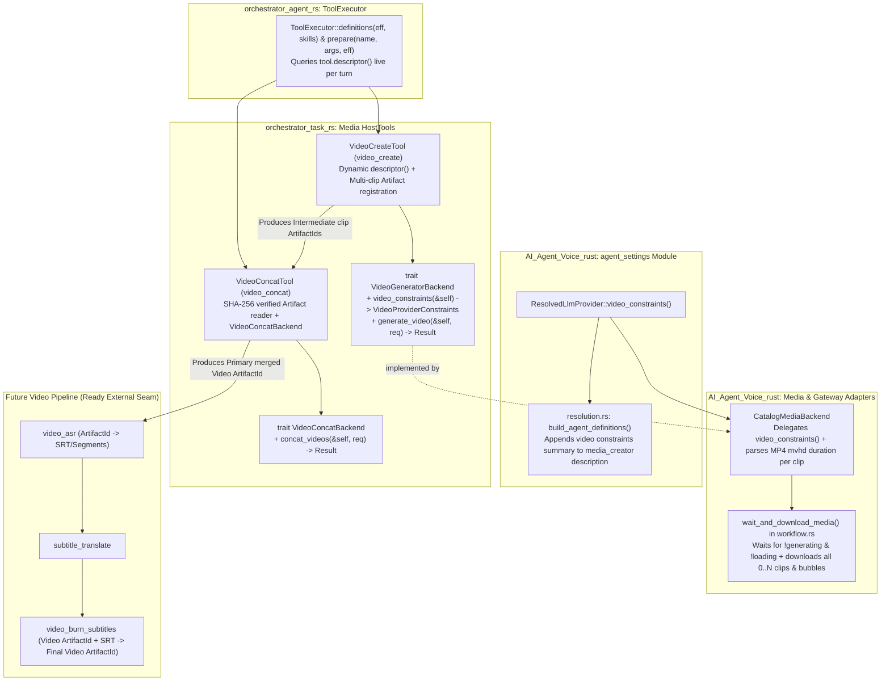
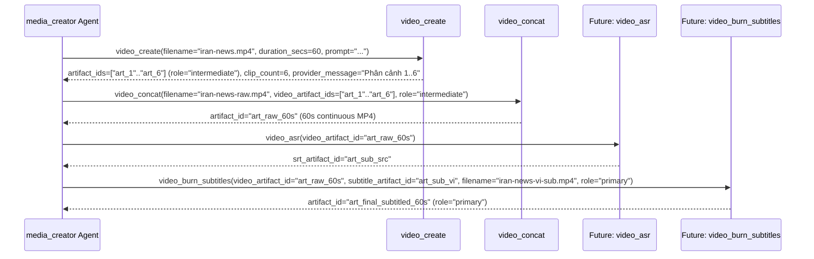

# Muse Video Multi-Clip, Provider Constraints & `video_concat` — Implementation Guide

- **Repositories**:
  - `AI_Agent_Voice_rust` (`crates/voice-agent-server`)
  - `orchestrator_task_rs` (`src/tools`, `src/prompts.rs`)
  - `orchestrator_agent_rs` (`src/executor`)
- **Design Discipline**: `/codebase-design` ([SKILL.md](file:///Users/lamphuchai/Desktop/project_rust/.agents/skills/codebase-design/SKILL.md), [DEEPENING.md](file:///Users/lamphuchai/Desktop/project_rust/.agents/skills/codebase-design/DEEPENING.md)) & Domain Vocabulary ([orchestrator_task_rs/GLOSSARY.md](file:///Users/lamphuchai/Desktop/project_rust/orchestrator_task_rs/GLOSSARY.md), [AI_Agent_Voice_rust/GLOSSARY.md](file:///Users/lamphuchai/Desktop/project_rust/AI_Agent_Voice_rust/GLOSSARY.md))
- **Reference Case**: Background Task `9e02925e-638f-4992-91d0-864b89bad1cd` (`https://muse.ai/thread/2b0e7f88-655b-48fc-818c-d32f0ccb08b9`)
- **Objective**:
  1. **Dynamic Provider Constraints in Tool Schema**: Khi chọn provider cho `video_create`, tự động phản ánh giới hạn thời lượng video (`max_clip_duration_secs`, `max_clips_per_call`, `max_total_duration_secs`) và hướng dẫn điều phối ngay trong `ToolDescriptor` của `video_create` (cũng như mô tả subagent `media_creator` cho `daily_root`), mà không để rò rỉ khái niệm vendor vào core crate.
  2. **Multi-Clip & Provider Message Collection**: Sửa lỗi race condition khi poll DOM `muse.ai` trong `wait_and_download_media`, thu thập **toàn bộ** video clips (`1..=N`) cùng **toàn bộ** các bong bóng tin nhắn kịch bản/phân cảnh (`provider_message`) từ provider, đo thời lượng thực tế (`duration_secs`) từ MP4 `moov -> mvhd` box, và lưu từng clip thành `Task Artifact` hợp lệ (`ArtifactRole::Intermediate` khi $N > 1$, `ArtifactRole::Primary` khi $N == 1$).
  3. **Deep Module `VideoConcatTool` (`video_concat`)**: Xây dựng công cụ ghép nhiều `Task Artifact` video thành một file MP4 hoàn chỉnh (`ArtifactRole::Primary`) thông qua internal seam `VideoConcatBackend`, đặt nền móng (External Seam) chuẩn xác cho chuỗi xử lý hậu kỳ sắp tới (`video gốc -> asr -> dịch -> add sub video`).

---

## 0. Quyết định Thiết kế Cốt lõi (`/codebase-design` & `DEEPENING.md`)

| Vấn đề / Bẫy Thiết kế Nông (Shallow Trap) | Quyết định Làm sâu Module (Deepened Decision) |
|---|---|
| **Trap 1 — Hardcode giới hạn Muse trong prompt tĩnh (`prompts.rs`)**: Nếu ghi cứng *"Muse tối đa 10s/clip"* trong system prompt của `orchestrator_task_rs`, prompt sẽ sai khi người dùng đổi provider sang OpenAI Video (`1 clip × 10s`) hoặc Builtin Synthesizer (`1 clip × 60s`), đồng thời làm rò rỉ khái niệm vendor của `AI_Agent_Voice_rust` vào `orchestrator_task_rs`. | **Dynamic `VideoProviderConstraints` qua Seam `VideoGeneratorBackend`**: Mở rộng `trait VideoGeneratorBackend` với `fn video_constraints(&self) -> VideoProviderConstraints`. Tại `AI_Agent_Voice_rust`, phương thức `ResolvedLlmProvider::video_constraints(&self)` tập trung toàn bộ logic suy diễn giới hạn tại một nơi duy nhất; `CatalogMediaBackend` ủy quyền qua đó và `VideoCreateTool::descriptor()` tự động nhúng giới hạn vào `description` cùng `input_schema.properties.duration_secs` (giữ nguyên toàn bộ trường schema hiện hữu). |
| **Trap 2 — Cache tĩnh `ToolDescriptor` trong `ToolExecutor::new`**: `ToolExecutor` (`orchestrator_agent_rs/src/executor/mod.rs`) hiện chụp `t.descriptor()` một lần duy nhất khi khởi tạo `Orchestrator` vào `HashMap<String, ToolDescriptor>`. Nếu người dùng đổi provider video trên UI giữa các Background Task, LLM vẫn nhìn thấy schema cũ. | **Live `ToolDescriptor` Lookup**: Sửa `ToolExecutor::definitions(&self, eff, skills)` và `ToolExecutor::prepare(&self, name, args, eff)` gọi trực tiếp `tool.descriptor()` từ `self.tools` ở mỗi lượt gọi (trong khi vẫn validate descriptor lúc `ToolExecutor::new`). Đảm bảo **Locality** và tính thời gian thực 100% khi đổi provider trên UI. |
| **Trap 3 — Early-Exit khi thấy 1 video (`workflow.rs`)**: `wait_and_download_media` thoát ngay ở vòng poll `600ms` đầu tiên khi thấy bất kỳ phần tử `<video src="blob:...">` nào khớp, dẫn đến việc khi Muse tạo 6 clip 10s tuần tự, hệ thống chỉ lấy được 1 clip (clip số 3 trong Background Task `9e02925e-...`) và bỏ sót 5 clip còn lại cùng toàn bộ tin nhắn kịch bản. | **Multi-Attachment & Full-Bubble Stabilization**: Chờ đồng thời: (1) có ít nhất 1 attachment khớp `kind` đã có `src`, (2) `!state.generating`, (3) không còn attachment nào đang tải (`(a.kind == kind.as_str() \|\| a.tid.contains(kind.as_str())) && a.src.is_empty()`), và (4) chữ ký trạng thái (`last_sig`) ổn định qua `STABLE_POLLS_DONE` (`4` lần poll = `2.4s`). Sau đó tải **tất cả** attachments theo đúng thứ tự `0..N` và gom toàn bộ `bubbles[base_agent_count..]` thành `assistant_message`. |
| **Trap 4 — Tin tưởng mù quáng `req.duration_secs` (`media_backend.rs`)**: `CatalogMediaBackend::generate_video` gán thẳng `duration_secs` yêu cầu (`60s`) vào `GeneratedVideoPayload` dù file thực tế chỉ dài `10s`, làm cả Agent lẫn Web UI hiểu nhầm đã tạo xong video 60s. | **Unified ISO BMFF `mvhd` Duration Parser**: Nâng cấp `encode_minimal_mp4` sinh thêm box `moov -> mvhd` chuẩn ISO BMFF và viết hàm `inspect_mp4_duration_secs(&[u8]) -> Option<u32>` đọc trực tiếp `timescale` & `duration` từ `moov -> mvhd` (hỗ trợ cả version 0 32-bit, version 1 64-bit, và fallback quét `mdat` cho test cũ). |
| **Trap 5 — Tự ghép ngầm trong `CatalogMediaBackend` hoặc gọi cứng `ffmpeg` trong `VideoConcatTool`**: Ghép ngầm trong `generate_video` làm Agent mất quyền kiểm soát từng phân cảnh; còn gọi cứng `Command::new("ffmpeg")` trong `VideoConcatTool::execute` vi phạm nguyên tắc *"Accept dependencies, don't create them"* (`SKILL.md`). | **Explicit Multi-Artifact + `VideoConcatTool` với Seam `VideoConcatBackend`**: `video_create` lưu từng clip lẻ thành `Task Artifact` (`ArtifactRole::Intermediate` khi có >1 clip, `ArtifactRole::Primary` khi chỉ có 1 clip). `VideoConcatTool` nhận `Arc<dyn VideoConcatBackend>` (`DefaultVideoConcatBackend` dùng `ffmpeg` cho stream H.264/AAC thực tế và muxer ISO BMFF in-process cho container `encode_minimal_mp4`) để xuất ra `Task Artifact` hoàn chỉnh (`ArtifactRole::Primary`). |

---

## 1. Kiến trúc Tổng thể & Các Đường nối (Seams)



---

## 2. Chi tiết Triển khai Hạng mục 1: Giới hạn Thời lượng Động theo Provider (`VideoProviderConstraints`)

### 2.1. Mở rộng `VideoGeneratorBackend` & `VideoCreateTool` trong `orchestrator_task_rs`

- **File**: [media_artifacts.rs](file:///Users/lamphuchai/Desktop/project_rust/orchestrator_task_rs/src/tools/media_artifacts.rs)

#### A. Định nghĩa `VideoProviderConstraints`

Thêm struct mô tả giới hạn của provider video hiện hành (hoàn toàn độc lập với tên vendor cụ thể ở tầng core):

```rust
#[derive(Debug, Clone, PartialEq, Eq, Serialize, Deserialize)]
pub struct VideoProviderConstraints {
    /// Nhãn hiển thị của provider/adapter đang kích hoạt (ví dụ: "Muse Web Gateway (model: muse-video)").
    pub provider_label: String,
    /// Thời lượng tối đa (giây) của MỘT video clip đơn lẻ do provider tạo ra.
    pub max_clip_duration_secs: u32,
    /// Số lượng video clip tối đa mà provider có thể sinh ra trong MỘT lần gọi `video_create`.
    pub max_clips_per_call: u32,
    /// Tổng thời lượng tối đa (giây) có thể yêu cầu trong một lần gọi `video_create`.
    pub max_total_duration_secs: u32,
    /// Hướng dẫn điều phối cụ thể cho Agent khi dùng provider này.
    pub provider_guidance: String,
}

impl Default for VideoProviderConstraints {
    fn default() -> Self {
        Self {
            provider_label: "builtin-mp4-synthesizer".to_owned(),
            max_clip_duration_secs: 60,
            max_clips_per_call: 1,
            max_total_duration_secs: 60,
            provider_guidance: "Creates a single MP4 clip up to 60 seconds per call.".to_owned(),
        }
    }
}
```

#### B. Thêm method `video_constraints(&self)` vào `trait VideoGeneratorBackend`

Giữ nguyên chữ ký `generate_video(&self, req: &VideoGenerationRequest) -> Result<GeneratedVideoPayload, String>` tại [media_artifacts.rs:250-255](file:///Users/lamphuchai/Desktop/project_rust/orchestrator_task_rs/src/tools/media_artifacts.rs#L250-L255) và bổ sung `video_constraints(&self)` với default implementation:

```rust
#[async_trait::async_trait]
pub trait VideoGeneratorBackend: Send + Sync {
    fn video_constraints(&self) -> VideoProviderConstraints {
        VideoProviderConstraints::default()
    }

    async fn generate_video(
        &self,
        req: &VideoGenerationRequest,
    ) -> Result<GeneratedVideoPayload, String>;
}
```

#### C. Cập nhật `VideoCreateTool::descriptor(&self)` và `execute(&self)` (Bảo toàn 100% Schema Hiện hữu)

Trong `VideoCreateTool::descriptor(&self)` ([media_artifacts.rs:609-660](file:///Users/lamphuchai/Desktop/project_rust/orchestrator_task_rs/src/tools/media_artifacts.rs#L609-L660)), giữ nguyên toàn bộ thuộc tính hiện có (`filename`, `prompt`, `title`, `width`, `height`, `duration_secs`, `first_frame_artifact_id`, `first_frame_image`, `role`, `"additionalProperties": false`, và `effect: ToolEffect::Mutating`), chỉ làm giàu `description` và `duration_secs` từ `self.backend.video_constraints()`:

```rust
impl HostTool for VideoCreateTool {
    fn descriptor(&self) -> ToolDescriptor {
        let c = self.backend.video_constraints();
        let max_total = c.max_total_duration_secs.max(1);
        let max_clip = c.max_clip_duration_secs.max(1);
        let max_clips = c.max_clips_per_call.max(1);

        ToolDescriptor {
            name: VIDEO_CREATE_TOOL.to_owned(),
            description: format!(
                "Generate an MP4 video (`video/mp4`) from a text prompt (and optional starting frame image) \
                 and store it in the Task's ArtifactStore. \
                 [Active provider: {label} | max_clip_duration_secs={max_clip}s | max_clips_per_call={max_clips} | max_total_duration_secs={max_total}s. {guidance}]",
                label = c.provider_label,
                guidance = c.provider_guidance,
            ),
            input_schema: json!({
                "type": "object",
                "required": ["filename", "prompt"],
                "properties": {
                    "filename": {
                        "type": "string",
                        "description": "Output video filename (e.g. 'architecture-overview.mp4')."
                    },
                    "prompt": {
                        "type": "string",
                        "description": "Detailed visual prompt describing the scenes and motion of the video to generate."
                    },
                    "title": {
                        "type": "string",
                        "description": "Optional video title or caption."
                    },
                    "width": {
                        "type": "integer",
                        "description": "Optional video width in pixels (16..=2048, default: 640)."
                    },
                    "height": {
                        "type": "integer",
                        "description": "Optional video height in pixels (16..=2048, default: 360)."
                    },
                    "duration_secs": {
                        "type": "integer",
                        "minimum": 1,
                        "maximum": max_total,
                        "description": format!(
                            "Video duration in seconds (1 to {max_total}, default: 4; active provider '{}' generates up to {max_clip}s per single clip and up to {max_clips} clip(s) per call).",
                            c.provider_label
                        )
                    },
                    "first_frame_artifact_id": {
                        "type": "string",
                        "description": "Optional image Artifact ID in the current task to use as the starting frame of the video."
                    },
                    "first_frame_image": {
                        "type": "string",
                        "description": "Optional starting frame image as a data:image/...;base64,... string."
                    },
                    "role": {
                        "type": "string",
                        "enum": ["primary", "intermediate"],
                        "description": "Artifact visibility role (default: 'primary' for single-clip output; multi-clip parts are stored as 'intermediate' until merged with `video_concat`)."
                    }
                },
                "additionalProperties": false
            }),
            effect: ToolEffect::Mutating,
        }
    }
    // ...
}
```

Trong `VideoCreateTool::execute` ([media_artifacts.rs:687-692](file:///Users/lamphuchai/Desktop/project_rust/orchestrator_task_rs/src/tools/media_artifacts.rs#L687-L692)), clamp `duration_secs` theo giới hạn thực tế của provider:
```rust
let constraints = self.backend.video_constraints();
let duration_secs = args
    .get("duration_secs")
    .and_then(Value::as_u64)
    .and_then(|v| u32::try_from(v).ok())
    .unwrap_or(4)
    .clamp(1, constraints.max_total_duration_secs.max(1));
```

---

### 2.2. Truy vấn Động `tool.descriptor()` trong `orchestrator_agent_rs`

- **Files**:
  - [executor/mod.rs](file:///Users/lamphuchai/Desktop/project_rust/orchestrator_agent_rs/src/executor/mod.rs#L103-L141)
  - [executor/prepare.rs](file:///Users/lamphuchai/Desktop/project_rust/orchestrator_agent_rs/src/executor/prepare.rs#L17-L130)

Hiện tại `ToolExecutor` giữ trường `descriptors: HashMap<String, ToolDescriptor>` chụp tĩnh một lần lúc `ToolExecutor::new(tools)`.

**Thay đổi (giữ nguyên 100% chữ ký hàm của `ToolExecutor`)**:
1. Trong [executor/mod.rs](file:///Users/lamphuchai/Desktop/project_rust/orchestrator_agent_rs/src/executor/mod.rs#L103-L141):
   - Lúc `ToolExecutor::new(tools)`, vẫn gọi `let d = t.descriptor(); validate_descriptor(&d)?;` để bắt lỗi cấu hình tool ngay khi khởi tạo, nhưng chỉ lưu `tools: HashMap<String, Arc<dyn HostTool>>` (bỏ trường `descriptors: HashMap<String, ToolDescriptor>`).
2. Trong `ToolExecutor::definitions(&self, eff: &Effective, skills: &SkillManager) -> Vec<ModelTool>` ([executor/prepare.rs:17-38](file:///Users/lamphuchai/Desktop/project_rust/orchestrator_agent_rs/src/executor/prepare.rs#L17-L38)):
   ```rust
   pub(crate) fn definitions(&self, eff: &Effective, skills: &SkillManager) -> Vec<ModelTool> {
       let mut out: Vec<ModelTool> = self
           .tools
           .values()
           .map(|t| t.descriptor())
           .filter(|d| eff.tools.contains(&d.name))
           .map(|d| ModelTool {
               name: d.name,
               description: d.description,
               input_schema: d.input_schema,
           })
           .collect();
       out.sort_by(|a, b| a.name.cmp(&b.name));
       if eff.tools.contains(SKILL_TOOL) && !skills.available(&eff.skills).is_empty() {
           out.push(skill_tool());
       }
       if eff.tools.contains(ARTIFACT_READ_TOOL) {
           out.push(artifact_read_tool());
       }
       if self.subagent_offered(eff) {
           out.push(self.tasks.tool_definition(eff.subagents.as_ref()));
       }
       out
   }
   ```
3. Trong `ToolExecutor::prepare(&self, name: &str, args: Value, eff: &Effective) -> Prepared` ([executor/prepare.rs:113-129](file:///Users/lamphuchai/Desktop/project_rust/orchestrator_agent_rs/src/executor/prepare.rs#L113-L129)):
   ```rust
   let Some(tool) = self.tools.get(name) else {
       let code = if RESERVED_TOOL_NAMES.contains(&name) {
           CODE_UNAVAILABLE
       } else {
           CODE_NOT_ALLOWED
       };
       return reject(code, format!("tool '{shown}' is not available"));
   };
   let desc = tool.descriptor();
   match validate_args(&desc.input_schema, &args) {
       Ok(()) => Prepared::Run(Runnable::Host {
           tool: Arc::clone(tool),
           effect: desc.effect,
           args,
       }),
       Err(e) => reject(CODE_INVALID_ARGS, format!("invalid arguments: {e}")),
   }
   ```

---

### 2.3. Tập trung `video_constraints(&self)` trên `ResolvedLlmProvider` (`AI_Agent_Voice_rust`)

- **Files**:
  - [provider_catalog.rs](file:///Users/lamphuchai/Desktop/project_rust/AI_Agent_Voice_rust/crates/voice-agent-server/src/services/task_flow/agent_settings/provider_catalog.rs#L53-L90)
  - [media_backend.rs](file:///Users/lamphuchai/Desktop/project_rust/AI_Agent_Voice_rust/crates/voice-agent-server/src/services/task_flow/agent_settings/media_backend.rs#L407-L454)
  - [resolution.rs](file:///Users/lamphuchai/Desktop/project_rust/AI_Agent_Voice_rust/crates/voice-agent-server/src/services/task_flow/agent_settings/resolution.rs#L325-L357)

Để tránh mùi **Feature Envy** và **Repeated Switches**, đặt method `pub fn video_constraints(&self) -> orchestrator_flow_rs::VideoProviderConstraints` trực tiếp trên [`ResolvedLlmProvider`](file:///Users/lamphuchai/Desktop/project_rust/AI_Agent_Voice_rust/crates/voice-agent-server/src/services/task_flow/agent_settings/provider_catalog.rs#L34-L51):

```rust
impl ResolvedLlmProvider {
    pub fn is_muse_provider(&self) -> bool {
        self.muse_options.is_some()
            || self.provider_ref.eq_ignore_ascii_case("pool:muse")
            || self.adapter.eq_ignore_ascii_case("muse")
            || self.model.to_ascii_lowercase().starts_with("muse")
            || matches!(
                self.gateway_binding,
                Some(crate::services::llm_gateway::GatewayBinding::Pool(
                    crate::providers::llm::gateway::GatewayVendor::Muse
                ))
            )
    }

    pub fn video_constraints(&self) -> orchestrator_flow_rs::VideoProviderConstraints {
        let label = format!("{} (model: {})", self.name, self.model);
        if self.is_muse_provider() {
            orchestrator_flow_rs::VideoProviderConstraints {
                provider_label: label,
                max_clip_duration_secs: 10,
                max_clips_per_call: 6,
                max_total_duration_secs: 60,
                provider_guidance: "Each individual video clip from this provider is strictly capped at 10 seconds. \
                    If duration_secs <= 10, it creates 1 primary clip (up to 10s). \
                    If duration_secs > 10 (up to 60s), the provider splits the video into up to 6 sequential 10-second intermediate clips in a single call and returns all clip artifact_ids plus the scene breakdown in `provider_message`; \
                    you MUST then call `video_concat` with those `artifact_ids` in order to produce the final continuous primary MP4 artifact."
                    .to_owned(),
            }
        } else if self.adapter.eq_ignore_ascii_case("openai") {
            orchestrator_flow_rs::VideoProviderConstraints {
                provider_label: label,
                max_clip_duration_secs: 10,
                max_clips_per_call: 1,
                max_total_duration_secs: 10,
                provider_guidance: "Generates 1 video clip (max 10 seconds) per `video_create` call. \
                    For videos longer than 10 seconds, call `video_create` multiple times with `role: \"intermediate\"` for each sequential scene and merge them using `video_concat`."
                    .to_owned(),
            }
        } else {
            orchestrator_flow_rs::VideoProviderConstraints {
                provider_label: label,
                max_clip_duration_secs: 60,
                max_clips_per_call: 1,
                max_total_duration_secs: 60,
                provider_guidance: "Generates a single MP4 clip up to 60 seconds per call.".to_owned(),
            }
        }
    }
}
```

Tại `CatalogMediaBackend` ([media_backend.rs:408](file:///Users/lamphuchai/Desktop/project_rust/AI_Agent_Voice_rust/crates/voice-agent-server/src/services/task_flow/agent_settings/media_backend.rs#L408)):
```rust
#[async_trait::async_trait]
impl orchestrator_flow_rs::VideoGeneratorBackend for CatalogMediaBackend {
    fn video_constraints(&self) -> orchestrator_flow_rs::VideoProviderConstraints {
        match self.select_provider("video_create", "video") {
            Some(resolved) => resolved.video_constraints(),
            None => self.default_video.video_constraints(),
        }
    }
    // ...
}
```

Tại `build_agent_definitions` ([resolution.rs:325-357](file:///Users/lamphuchai/Desktop/project_rust/AI_Agent_Voice_rust/crates/voice-agent-server/src/services/task_flow/agent_settings/resolution.rs#L325-L357)):
- Khi dựng `AgentDefinition` cho subagent có `"video_create"` trong `allowed_tools` (như `media_creator`), gọi `resolve_media_tool_provider(&catalog, Some(&settings), "video_create", "video", true)` và đính kèm tóm tắt `video_constraints()` vào cuối `description` của `AgentDefinition` để `daily_root` nắm rõ giới hạn trước khi gọi `subagent(agent_id="media_creator", ...)`.

---

## 3. Chi tiết Triển khai Hạng mục 2: Thu thập Đầy đủ Multi-Clip & `provider_message` từ Muse

### 3.1. Mở rộng `CHAT_STATE_JS` (`dom.rs`) và `ChatState` (`workflow.rs`)

- **Files**:
  - [dom.rs](file:///Users/lamphuchai/Desktop/project_rust/AI_Agent_Voice_rust/crates/voice-agent-server/src/providers/llm/gateway/muse/dom.rs#L49-L77)
  - [workflow.rs](file:///Users/lamphuchai/Desktop/project_rust/AI_Agent_Voice_rust/crates/voice-agent-server/src/providers/llm/gateway/muse/workflow.rs#L86-L100)

1. Trong `CHAT_STATE_JS` ([dom.rs:49-77](file:///Users/lamphuchai/Desktop/project_rust/AI_Agent_Voice_rust/crates/voice-agent-server/src/providers/llm/gateway/muse/dom.rs#L49-L77)), bổ sung trường `bubbles` chứa nội dung text của từng bong bóng tin nhắn agent:
   ```javascript
   const bubbleTexts = bubbles.map(b => (b.innerText || '').trim());
   ```
   và đưa `bubbles: bubbleTexts` vào object trả về cùng với `agentCount`, `lastText`, `generating`, `approval`, `attachments`, `tail`.
2. Trong `struct ChatState` ([workflow.rs:86-100](file:///Users/lamphuchai/Desktop/project_rust/AI_Agent_Voice_rust/crates/voice-agent-server/src/providers/llm/gateway/muse/workflow.rs#L86-L100)), thêm:
   ```rust
   #[serde(default)]
   pub bubbles: Vec<String>,
   ```

---

### 3.2. Sửa Điều kiện Hoàn tất & Tải Toàn bộ Clips trong `wait_and_download_media` (`workflow.rs`)

- **File**: [workflow.rs](file:///Users/lamphuchai/Desktop/project_rust/AI_Agent_Voice_rust/crates/voice-agent-server/src/providers/llm/gateway/muse/workflow.rs#L279-L295) & [workflow.rs:668-775](file:///Users/lamphuchai/Desktop/project_rust/AI_Agent_Voice_rust/crates/voice-agent-server/src/providers/llm/gateway/muse/workflow.rs#L668-L775)

1. **Timeout cho Video trong `MuseBrowserManager::generate_media` ([workflow.rs:287](file:///Users/lamphuchai/Desktop/project_rust/AI_Agent_Voice_rust/crates/voice-agent-server/src/providers/llm/gateway/muse/workflow.rs#L287))**:
   Video nhiều phân cảnh trên `muse.ai` cần thời gian render lâu hơn text thông thường. Tính `let media_timeout = if kind == MediaKind::Video { self.config.response_timeout.max(Duration::from_secs(300)) } else { self.config.response_timeout };` và truyền vào `wait_and_download_media`.
2. **Điều kiện Chờ Ổn định trong `wait_and_download_media` ([workflow.rs:716-746](file:///Users/lamphuchai/Desktop/project_rust/AI_Agent_Voice_rust/crates/voice-agent-server/src/providers/llm/gateway/muse/workflow.rs#L716-L746))**:
   - Xác định danh sách attachment mới kể từ `base_attachments`:
     ```rust
     let slice_start = base_attachments.min(state.attachments.len());
     let new_atts = &state.attachments[slice_start..];
     let ready_atts: Vec<&AttachmentNode> = new_atts
         .iter()
         .filter(|a| a.kind == kind.as_str() && !a.src.is_empty())
         .collect();
     // Lưu ý: khi Muse vừa tạo khung attachment nhưng thẻ <video>/ chưa mount,
     // `a.kind` là "unknown" trong khi `a.tid` đã chứa "video"/"image".
     let any_matching_loading = new_atts.iter().any(|a| {
         (a.kind == kind.as_str() || a.tid.contains(kind.as_str())) && a.src.is_empty()
     });
     let new_bubbles: Vec<&str> = state
         .bubbles
         .iter()
         .skip(base_agent_count)
         .map(String::as_str)
         .map(str::trim)
         .filter(|s| !s.is_empty())
         .collect();
     ```
   - Tính chữ ký trạng thái `sig`:
     ```rust
     let sig = (
         state.agent_count,
         new_bubbles.iter().map(|s| s.len()).collect::<Vec<_>>(),
         new_atts
             .iter()
             .map(|a| format!("{}:{}:{}", a.tid, a.kind, a.src))
             .collect::<Vec<_>>(),
         state.generating,
     );
     if last_sig.as_ref() != Some(&sig) {
         last_sig = Some(sig);
         stable_polls = 0;
         changed_at = Instant::now();
     } else {
         stable_polls += 1;
     }
     ```
   - **Chỉ khi** `!ready_atts.is_empty() && !state.generating && !any_matching_loading && stable_polls >= required_stable_polls` (với `required_stable_polls = match kind { MediaKind::Video => STABLE_POLLS_DONE, MediaKind::Image => 0 }`):
     - Duyệt theo **thứ tự thuận** `for att in &ready_atts` (từ `0..N`, tuyệt đối không dùng `.rev().find()`), gọi `download_media_from_src(page, &att.src, kind, transparent_background).await?` để thu thập toàn bộ `Vec<MediaPart>`.
     - Ghép `let assistant_message = (!new_bubbles.is_empty()).then(|| new_bubbles.join("\n\n"));`.
     - Gọi `lease.finish_clean(None);` và trả về `LlmOutput::from_media_parts(parts, assistant_message)`.

---

### 3.3. Mở rộng `LlmOutput::Media` & Các Điểm Pattern-Match trong `AI_Agent_Voice_rust`

- **Files**:
  - [providers/llm/mod.rs](file:///Users/lamphuchai/Desktop/project_rust/AI_Agent_Voice_rust/crates/voice-agent-server/src/providers/llm/mod.rs#L423-L466)
  - [providers/llm/openai/audio.rs](file:///Users/lamphuchai/Desktop/project_rust/AI_Agent_Voice_rust/crates/voice-agent-server/src/providers/llm/openai/audio.rs#L56)
  - [providers/llm/openai/media.rs](file:///Users/lamphuchai/Desktop/project_rust/AI_Agent_Voice_rust/crates/voice-agent-server/src/providers/llm/openai/media.rs#L30-L134)
  - [services/task_flow/agent_settings/media_backend.rs](file:///Users/lamphuchai/Desktop/project_rust/AI_Agent_Voice_rust/crates/voice-agent-server/src/services/task_flow/agent_settings/media_backend.rs#L386-L505)

Để tránh mùi **Data Clumps** và giữ cho các nơi chỉ sinh/nhận 1 media (như OpenAI Image/TTS) gọn nhẹ, định nghĩa `MediaPart` cùng các constructor/accessor trên [`LlmOutput`](file:///Users/lamphuchai/Desktop/project_rust/AI_Agent_Voice_rust/crates/voice-agent-server/src/providers/llm/mod.rs#L423-L436):

```rust
#[derive(Debug, Clone, PartialEq, Eq)]
pub struct MediaPart {
    pub bytes: Vec<u8>,
    pub mime_type: String,
}

#[derive(Debug, Clone)]
pub enum LlmOutput {
    Text(String),
    Embeddings(Vec<Vec<f32>>),
    Media {
        bytes: Vec<u8>,
        mime_type: String,
        extra_parts: Vec<MediaPart>,
        assistant_message: Option<String>,
    },
}

impl LlmOutput {
    pub fn single_media(bytes: Vec<u8>, mime_type: impl Into<String>) -> Self {
        Self::Media {
            bytes,
            mime_type: mime_type.into(),
            extra_parts: Vec::new(),
            assistant_message: None,
        }
    }

    pub fn from_media_parts(
        mut parts: Vec<MediaPart>,
        assistant_message: Option<String>,
    ) -> Option<Self> {
        if parts.is_empty() {
            return None;
        }
        let first = parts.remove(0);
        Some(Self::Media {
            bytes: first.bytes,
            mime_type: first.mime_type,
            extra_parts: parts,
            assistant_message,
        })
    }

    /// Chuẩn hóa toàn bộ media parts (`1..=N`) thành một Vec duy nhất kèm `assistant_message`.
    pub fn into_media_parts(self) -> Option<(Vec<MediaPart>, Option<String>)> {
        match self {
            Self::Media {
                bytes,
                mime_type,
                extra_parts,
                assistant_message,
            } => {
                let mut all = Vec::with_capacity(1 + extra_parts.len());
                all.push(MediaPart { bytes, mime_type });
                all.extend(extra_parts);
                Some((all, assistant_message))
            }
            _ => None,
        }
    }
}
```

Cập nhật các điểm khởi tạo/pattern-match `LlmOutput::Media`:
- `openai/audio.rs:56` và `openai/media.rs:30, 64, 83, 99, 134`: đổi sang `LlmOutput::single_media(bytes, mime_type)`.
- `providers/llm/mod.rs:446, 464` và `media_backend.rs:386, 503`: dùng `LlmOutput::Media { bytes, mime_type, .. }`.
- `media_backend.rs:433` (`CatalogMediaBackend::generate_video`): gọi `output.into_media_parts()` để lấy danh sách `parts` và `assistant_message`, đo thời lượng thực tế từng clip qua `orchestrator_flow_rs::inspect_mp4_duration_secs(&part.bytes)` và điền vào `GeneratedVideoPayload`.

---

### 3.4. Chuẩn hóa Container MP4 (`encode_minimal_mp4`), Parser `inspect_mp4_duration_secs`, & Multi-Artifact Registration

- **File**: [media_artifacts.rs](file:///Users/lamphuchai/Desktop/project_rust/orchestrator_task_rs/src/tools/media_artifacts.rs)

#### A. Nâng cấp `encode_minimal_mp4` sinh thêm `moov -> mvhd` chuẩn ISO BMFF

Trong [media_artifacts.rs:1697-1716](file:///Users/lamphuchai/Desktop/project_rust/orchestrator_task_rs/src/tools/media_artifacts.rs#L1697-L1716), bổ sung box `moov` chứa `mvhd` (version 0, `timescale = 1000`, `duration = duration_secs * 1000`) ngay giữa `ftyp` và `mdat`. Nhờ vậy container test nội bộ cũng là một file ISO BMFF có `moov -> mvhd` hợp lệ 100%, giúp `inspect_mp4_duration_secs` dùng chung một thuật toán duy nhất cho cả production lẫn test!

#### B. Hàm `pub fn inspect_mp4_duration_secs(bytes: &[u8]) -> Option<u32>`

```rust
pub fn inspect_mp4_duration_secs(bytes: &[u8]) -> Option<u32> {
    fn find_box<'a>(mut data: &'a [u8], target: &[u8; 4]) -> Option<&'a [u8]> {
        while data.len() >= 8 {
            let size32 = u32::from_be_bytes([data[0], data[1], data[2], data[3]]) as usize;
            let kind = &data[4..8];
            let (box_len, header_len) = if size32 == 1 {
                if data.len() < 16 {
                    return None;
                }
                let size64 = u64::from_be_bytes(data[8..16].try_into().ok()?) as usize;
                (size64, 16usize)
            } else if size32 == 0 {
                (data.len(), 8usize)
            } else {
                (size32, 8usize)
            };
            if box_len < header_len || box_len > data.len() {
                return None;
            }
            if kind == target {
                return Some(&data[header_len..box_len]);
            }
            data = &data[box_len..];
        }
        None
    }

    // 1. Chuẩn ISO BMFF: đọc `moov -> mvhd`
    if let Some(moov) = find_box(bytes, b"moov") {
        if let Some(mvhd) = find_box(moov, b"mvhd") {
            if !mvhd.is_empty() {
                let version = mvhd[0];
                let (timescale, duration) = if version == 1 && mvhd.len() >= 28 {
                    let ts = u32::from_be_bytes(mvhd[16..20].try_into().ok()?) as u64;
                    let dur = u64::from_be_bytes(mvhd[20..28].try_into().ok()?);
                    (ts, dur)
                } else if version == 0 && mvhd.len() >= 20 {
                    let ts = u32::from_be_bytes(mvhd[12..16].try_into().ok()?) as u64;
                    let dur = u32::from_be_bytes(mvhd[16..20].try_into().ok()?) as u64;
                    (ts, dur)
                } else {
                    (0, 0)
                };
                if timescale > 0 {
                    return Some(((duration + (timescale / 2)) / timescale).max(1) as u32);
                }
            }
        }
    }

    // 2. Fallback cho synthetic `mdat` cũ ("MP4_STREAM|...|dur=10s|...")
    if let Some(mdat) = find_box(bytes, b"mdat") {
        if let Ok(text) = std::str::from_utf8(mdat) {
            if let Some(pos) = text.find("dur=") {
                let rest = &text[pos + "dur=".len()..];
                let digits: String = rest.chars().take_while(|c| c.is_ascii_digit()).collect();
                if let Ok(secs) = digits.parse::<u32>() {
                    if secs > 0 {
                        return Some(secs);
                    }
                }
            }
        }
    }
    None
}
```

#### C. Mở rộng `GeneratedVideoPayload` và Lưu Multi-Artifact trong `VideoCreateTool::execute`

1. Giữ nguyên tất cả trường hiện có của `GeneratedVideoPayload` ([media_artifacts.rs:238-246](file:///Users/lamphuchai/Desktop/project_rust/orchestrator_task_rs/src/tools/media_artifacts.rs#L238-L246)) và bổ sung `clips` + `provider_message` cùng helper `effective_clips(&self)`:
   ```rust
   #[derive(Debug, Clone)]
   pub struct GeneratedVideoClip {
       pub filename: String,
       pub mime_type: String,
       pub bytes: Vec<u8>,
       pub width: u32,
       pub height: u32,
       pub duration_secs: u32,
   }

   #[derive(Debug, Clone)]
   pub struct GeneratedVideoPayload {
       pub filename: String,
       pub mime_type: String,
       pub bytes: Vec<u8>,
       pub width: u32,
       pub height: u32,
       pub duration_secs: u32,
       pub provider: String,
       pub clips: Vec<GeneratedVideoClip>,
       pub provider_message: Option<String>,
   }

   impl GeneratedVideoPayload {
       pub fn effective_clips(&self) -> Vec<GeneratedVideoClip> {
           if !self.clips.is_empty() {
               return self.clips.clone();
           }
           vec![GeneratedVideoClip {
               filename: self.filename.clone(),
               mime_type: self.mime_type.clone(),
               bytes: self.bytes.clone(),
               width: self.width,
               height: self.height,
               duration_secs: inspect_mp4_duration_secs(&self.bytes)
                   .unwrap_or(self.duration_secs.max(1)),
           }]
       }
   }
   ```
2. Trong `VideoCreateTool::execute` ([media_artifacts.rs:709-760](file:///Users/lamphuchai/Desktop/project_rust/orchestrator_task_rs/src/tools/media_artifacts.rs#L709-L760)):
   - Lấy `let clips = generated.effective_clips();`.
   - Nếu `clips.len() == 1`:
     - Lưu 1 `Task Artifact` qua `ctx.artifacts().put(ArtifactInput::from_bytes(&clip.filename, &clip.mime_type, role, clip.bytes)).await?` (với `role` do caller truyền hoặc mặc định `ArtifactRole::Primary`).
   - Nếu `clips.len() > 1`:
     - Lưu từng clip với `ArtifactRole::Intermediate` (`"intermediate"`) và tên `<stem>-part-1.mp4` .. `<stem>-part-N.mp4`.
     - Mỗi lần gọi `ctx.artifacts().put(...)` tự động ghi nhận `artifact.id` vào `session_artifacts` của `ToolContext`, nên bước `video_concat` tiếp theo được phép `ctx.artifacts().open(&id)` ngay lập tức.
     - Trả về `host_tool_outcome(&ctx, summary_text, metadata_json)` với:
       - `artifact_id`: ID của clip đầu tiên,
       - `artifact_ids`: mảng toàn bộ `ArtifactId` theo đúng thứ tự `1..=N`,
       - `clip_count`: số lượng clip,
       - `clips`: mảng chi tiết từng clip (`index`, `artifact_id`, `filename`, `duration_secs`, `size_bytes`, `sha256`, `path`),
       - `duration_secs` & `total_duration_secs`: tổng thời lượng thực tế của tất cả các clip,
       - `requested_duration_secs`: thời lượng đã yêu cầu,
       - `requires_concat`: `clips.len() > 1`,
       - `provider_message`: toàn bộ tin nhắn phân cảnh từ provider (nếu có).

---

## 4. Chi tiết Triển khai Hạng mục 3: Deep Module `VideoConcatTool` (`video_concat`)

### 4.1. Seam Nội bộ `VideoConcatBackend` ("Accept dependencies, don't create them")

- **File**: [media_artifacts.rs](file:///Users/lamphuchai/Desktop/project_rust/orchestrator_task_rs/src/tools/media_artifacts.rs)

Thay vì gọi cứng `tokio::process::Command::new("ffmpeg")` trực tiếp trong `VideoConcatTool::execute`, định nghĩa một internal seam rõ ràng giống hệt mô hình của `VideoGeneratorBackend`:

```rust
#[derive(Debug, Clone)]
pub struct VideoConcatInputClip {
    pub artifact_id: String,
    pub filename: String,
    pub bytes: Vec<u8>,
    pub duration_secs: u32,
}

#[derive(Debug, Clone)]
pub struct VideoConcatRequest {
    pub filename: String,
    pub title: Option<String>,
    pub clips: Vec<VideoConcatInputClip>,
}

#[derive(Debug, Clone)]
pub struct ConcatenatedVideoPayload {
    pub filename: String,
    pub mime_type: String,
    pub bytes: Vec<u8>,
    pub duration_secs: u32,
}

#[async_trait::async_trait]
pub trait VideoConcatBackend: Send + Sync {
    async fn concat_videos(
        &self,
        req: &VideoConcatRequest,
    ) -> Result<ConcatenatedVideoPayload, String>;
}
```

#### Thực thi `DefaultVideoConcatBackend`

1. **Khi các clip đầu vào là container của `DefaultVideoGeneratorBackend` (`mdat` bắt đầu bằng `MP4_STREAM|`)**:
   - Ghép in-process bằng cách cộng tổng `duration_secs` và nối danh sách prompt phân cảnh, rồi đóng gói lại qua `encode_minimal_mp4` (có đầy đủ `ftyp` + `moov -> mvhd` + `mdat`).
2. **Khi các clip đầu vào là video MP4 thực tế (từ Muse / OpenAI / FFmpeg)**:
   - Tạo thư mục tạm cô lập trong `std::env::temp_dir()` với RAII guard tự xóa khi drop.
   - Ghi từng clip ra `clip_000.mp4`, `clip_001.mp4`, ... và file `concat.txt`.
   - Chạy Fast Path (stream copy không giảm chất lượng):
     `ffmpeg -y -f concat -safe 0 -i concat.txt -c copy -movflags +faststart merged.mp4`
   - Nếu stream copy trả về lỗi do khác thông số stream giữa các clip, tự động fallback sang filter concat chuẩn hóa (`1280x720@30fps`, `libx264` + `aac`).
   - Đo lại thời lượng thực của `merged.mp4` bằng `inspect_mp4_duration_secs(&merged_bytes)` (fallback về tổng `duration_secs` của các clip con).

---

### 4.2. Giao diện & Thực thi của `VideoConcatTool`

- **Tool Name**: `pub const VIDEO_CONCAT_TOOL: &str = "video_concat";`
- **Struct**:
  ```rust
  pub struct VideoConcatTool {
      pub backend: Arc<dyn VideoConcatBackend>,
      pub output_dir: Option<PathBuf>,
  }
  ```
- **Input Schema**:
  ```json
  {
    "type": "object",
    "required": ["filename", "video_artifact_ids"],
    "properties": {
      "filename": {
        "type": "string",
        "description": "Output merged MP4 filename (e.g. 'final-video.mp4')."
      },
      "video_artifact_ids": {
        "type": "array",
        "minItems": 2,
        "maxItems": 24,
        "items": { "type": "string" },
        "description": "Ordered list of at least 2 MP4 video Artifact IDs in the current task to concatenate into a single continuous MP4 video."
      },
      "title": {
        "type": "string",
        "description": "Optional video title or caption for the merged video."
      },
      "role": {
        "type": "string",
        "enum": ["primary", "intermediate"],
        "description": "Artifact visibility role (default: 'primary')."
      }
    },
    "additionalProperties": false
  }
  ```
- **Luồng thực thi trong `VideoConcatTool::execute(&self, ctx: ToolContext, args: Value)`**:
  1. Parse `filename`, `video_artifact_ids` (`2..=24` IDs), `title`, và `let role = parse_role(args.get("role").and_then(Value::as_str));` (mặc định `ArtifactRole::Primary`).
  2. Với mỗi `artifact_id` (`&str`) trong `video_artifact_ids`:
     - Gọi `let mut reader = ctx.artifacts().open(artifact_id).await?;` (tự động được `ArtifactStore::authorize_tool_access` tại [access.rs:65-90](file:///Users/lamphuchai/Desktop/project_rust/orchestrator_agent_rs/src/artifact/access.rs#L65-L90) cấp quyền vì ID nằm trong `arguments` JSON).
     - Kiểm tra `reader.metadata().mime_type` là `"video/mp4"` (hoặc bắt đầu bằng `"video/"`).
     - Gọi `let bytes = reader.read_all().await?;` (xác thực toàn vẹn SHA-256).
     - Tính `let clip_dur = inspect_mp4_duration_secs(&bytes).unwrap_or(5);`.
  3. Gọi `let merged = self.backend.concat_videos(&req).await.map_err(|e| host_tool_err("VIDEO_CONCAT_FAILED", e))?;`.
  4. Mirror file ra `self.output_dir` (nếu được cấu hình, giống `VideoCreateTool`).
  5. Lưu artifact mới qua `ctx.artifacts().put(ArtifactInput::from_bytes(&merged.filename, &merged.mime_type, role, merged.bytes)).await?`.
  6. Trả về `host_tool_outcome(&ctx, content, metadata_json)` chứa `artifact_id`, `artifact_ids: [artifact.id]`, `filename`, `duration_secs: merged.duration_secs`, `source_artifact_ids`, `clip_count`, `size_bytes`, `sha256`, `path`.

---

### 4.3. Đăng ký `video_concat` vào Hệ thống Tool, Prompt & Subagent Catalog

1. **[orchestrator_task_rs/src/tools/media_artifacts.rs](file:///Users/lamphuchai/Desktop/project_rust/orchestrator_task_rs/src/tools/media_artifacts.rs#L1185-L1200)** & **[orchestrator_task_rs/src/lib.rs](file:///Users/lamphuchai/Desktop/project_rust/orchestrator_task_rs/src/lib.rs)**:
   - Export `VIDEO_CONCAT_TOOL`, `VideoConcatTool`, `VideoConcatBackend`, `DefaultVideoConcatBackend`, `VideoProviderConstraints`, `GeneratedVideoClip`, `inspect_mp4_duration_secs`.
   - Đăng ký `Arc::new(VideoConcatTool::with_default_backend())` (và `.with_output_dir(...)` khi có `videos_dir`) trong `media_host_tools_with_video` / `media_host_tools_in_dirs_with_video`.
2. **[orchestrator_task_rs/src/prompts.rs](file:///Users/lamphuchai/Desktop/project_rust/orchestrator_task_rs/src/prompts.rs)**:
   - Cập nhật cả `DAILY_ROOT_PROMPT` và `MEDIA_CREATOR_SYSTEM_PROMPT`:
     - Nhắc Agent kiểm tra giới hạn thời lượng của provider hiển thị trong mô tả `video_create`.
     - Khi `video_create` sinh nhiều clip (`clip_count > 1` / `requires_concat: true`) hoặc khi cần ghép nhiều phân cảnh liên tiếp, bắt buộc gọi `video_concat` với `video_artifact_ids` theo đúng thứ tự để tạo ra `Task Artifact` video hoàn chỉnh (`role: "primary"`).
     - Báo cáo rõ `provider_message` (kịch bản phân cảnh) và `total_duration_secs` thực tế.
3. **[AI_Agent_Voice_rust/crates/voice-agent-server/src/services/task_flow/agent_settings/specs.rs](file:///Users/lamphuchai/Desktop/project_rust/AI_Agent_Voice_rust/crates/voice-agent-server/src/services/task_flow/agent_settings/specs.rs#L76-L99)** (và `default_description` tại dòng `226`):
   - Thêm `"video_concat"` vào `default_allowed_tools` và `available_tools` của `media_creator`, đồng thời cập nhật `default_description` của `media_creator` nhắc tới `video_concat`.

---

### 4.4. Sẵn sàng cho Flow Tương lai: `video gốc -> asr -> dịch -> add sub video`

Toàn bộ chuỗi hậu kỳ tiếp theo nối tiếp trực tiếp qua `ArtifactId` (`mime_type: "video/mp4"`) mà không cần sửa lại `video_create` hay `video_concat`:



---

## 5. Chiến lược Kiểm thử ("Replace, Don't Layer" — `DEEPENING.md`)

Kiểm thử đặt tại **External Seams** (`HostTool::execute`, `VideoGeneratorBackend::video_constraints`, `inspect_mp4_duration_secs`, `ToolExecutor::definitions`):

1. **Unit & Integration Tests trong `orchestrator_task_rs` ([media_artifacts_tests.rs](file:///Users/lamphuchai/Desktop/project_rust/orchestrator_task_rs/src/tools/media_artifacts_tests.rs))**:
   - `video_create_descriptor_reflects_dynamic_provider_constraints`: Xác nhận khi backend thay đổi `VideoProviderConstraints` (Muse `10s/clip × 6 = 60s` vs OpenAI `10s/clip × 1 = 10s`), `VideoCreateTool::descriptor()` cập nhật tức thì `description` và `input_schema.properties.duration_secs.maximum` mà vẫn bảo toàn đầy đủ các trường `width`, `height`, `first_frame_artifact_id`, `first_frame_image`, `role`.
   - `video_create_registers_multiple_clips_as_intermediate_and_returns_provider_message`: Giả lập backend trả về 6 clips (mỗi clip 10s) và `provider_message` gồm 6 phân cảnh; xác nhận `ArtifactStore` lưu đủ 6 file (`*-part-1.mp4` .. `*-part-6.mp4` với `ArtifactRole::Intermediate`), `total_duration_secs == 60`, `requires_concat == true`, và trả đầy đủ `provider_message`.
   - `video_concat_merges_multiple_video_artifacts_into_primary_mp4`: Tạo các clip qua `video_create`, sau đó gọi `video_concat` với danh sách `artifact_ids`; xác nhận file MP4 đầu ra được lưu vào `ArtifactStore` với `ArtifactRole::Primary` và `inspect_mp4_duration_secs` đọc đúng tổng thời lượng (`60s`) từ box `moov -> mvhd`.
2. **Unit Test trong `orchestrator_agent_rs` ([executor/mod.rs](file:///Users/lamphuchai/Desktop/project_rust/orchestrator_agent_rs/src/executor/mod.rs))**:
   - `tool_executor_definitions_and_prepare_reflect_live_descriptor_changes`: Xác nhận khi `HostTool::descriptor()` thay đổi động theo trạng thái runtime, `ToolExecutor::definitions(&eff, &skills)` và `ToolExecutor::prepare(name, args, &eff)` phản ánh ngay schema mới.
3. **Unit Tests trong `AI_Agent_Voice_rust` ([media_backend.rs](file:///Users/lamphuchai/Desktop/project_rust/AI_Agent_Voice_rust/crates/voice-agent-server/src/services/task_flow/agent_settings/media_backend.rs) & [workflow.rs](file:///Users/lamphuchai/Desktop/project_rust/AI_Agent_Voice_rust/crates/voice-agent-server/src/providers/llm/gateway/muse/workflow.rs))**:
   - Kiểm tra `ResolvedLlmProvider::video_constraints()` trả về đúng cấu hình giới hạn cho `pool:muse`, OpenAI provider, và builtin fallback.
   - Kiểm tra `CatalogMediaBackend::generate_video` chuyển đổi `LlmOutput::Media` nhiều phần (`extra_parts` + `assistant_message`) sang `GeneratedVideoPayload` với thời lượng thực đo từ `inspect_mp4_duration_secs`.

---

## 6. Danh sách File Dự kiến Thay đổi Khi Triển khai

1. [orchestrator_agent_rs/src/executor/mod.rs](file:///Users/lamphuchai/Desktop/project_rust/orchestrator_agent_rs/src/executor/mod.rs) — Bỏ cache tĩnh `self.descriptors`, vẫn validate descriptor lúc khởi tạo `ToolExecutor::new`.
2. [orchestrator_agent_rs/src/executor/prepare.rs](file:///Users/lamphuchai/Desktop/project_rust/orchestrator_agent_rs/src/executor/prepare.rs) — Đọc `tool.descriptor()` trực tiếp từ `self.tools` trong `definitions()` và `prepare()`.
3. [orchestrator_task_rs/src/tools/media_artifacts.rs](file:///Users/lamphuchai/Desktop/project_rust/orchestrator_task_rs/src/tools/media_artifacts.rs) & [media_artifacts_tests.rs](file:///Users/lamphuchai/Desktop/project_rust/orchestrator_task_rs/src/tools/media_artifacts_tests.rs) — Thêm `VideoProviderConstraints`, `GeneratedVideoClip`, `inspect_mp4_duration_secs`, `moov -> mvhd` trong `encode_minimal_mp4`, cập nhật `VideoCreateTool`, và thêm `VideoConcatBackend` + `VideoConcatTool` (`video_concat`).
4. [orchestrator_task_rs/src/prompts.rs](file:///Users/lamphuchai/Desktop/project_rust/orchestrator_task_rs/src/prompts.rs) — Cập nhật `DAILY_ROOT_PROMPT` và `MEDIA_CREATOR_SYSTEM_PROMPT` cho luồng multi-clip + `video_concat`.
5. [AI_Agent_Voice_rust/crates/voice-agent-server/src/providers/llm/gateway/muse/dom.rs](file:///Users/lamphuchai/Desktop/project_rust/AI_Agent_Voice_rust/crates/voice-agent-server/src/providers/llm/gateway/muse/dom.rs) — Thu thập toàn bộ mảng `bubbles` trong `CHAT_STATE_JS`.
6. [AI_Agent_Voice_rust/crates/voice-agent-server/src/providers/llm/gateway/muse/workflow.rs](file:///Users/lamphuchai/Desktop/project_rust/AI_Agent_Voice_rust/crates/voice-agent-server/src/providers/llm/gateway/muse/workflow.rs) — Thêm `bubbles` vào `ChatState`, nâng timeout video tối thiểu `300s`, sửa điều kiện ổn định trong `wait_and_download_media`, tải toàn bộ `0..N` clips và gom toàn bộ `bubbles[base_agent_count..]`.
7. [AI_Agent_Voice_rust/crates/voice-agent-server/src/providers/llm/mod.rs](file:///Users/lamphuchai/Desktop/project_rust/AI_Agent_Voice_rust/crates/voice-agent-server/src/providers/llm/mod.rs), [openai/audio.rs](file:///Users/lamphuchai/Desktop/project_rust/AI_Agent_Voice_rust/crates/voice-agent-server/src/providers/llm/openai/audio.rs), & [openai/media.rs](file:///Users/lamphuchai/Desktop/project_rust/AI_Agent_Voice_rust/crates/voice-agent-server/src/providers/llm/openai/media.rs) — Mở rộng `LlmOutput::Media` với `MediaPart`, `single_media()`, `from_media_parts()`, `into_media_parts()`.
8. [AI_Agent_Voice_rust/crates/voice-agent-server/src/services/task_flow/agent_settings/provider_catalog.rs](file:///Users/lamphuchai/Desktop/project_rust/AI_Agent_Voice_rust/crates/voice-agent-server/src/services/task_flow/agent_settings/provider_catalog.rs) & [media_backend.rs](file:///Users/lamphuchai/Desktop/project_rust/AI_Agent_Voice_rust/crates/voice-agent-server/src/services/task_flow/agent_settings/media_backend.rs) — Triển khai `ResolvedLlmProvider::video_constraints(&self)`, kết nối với `CatalogMediaBackend::video_constraints(&self)` và map multi-clip + `provider_message` sang `GeneratedVideoPayload`.
9. [AI_Agent_Voice_rust/crates/voice-agent-server/src/services/task_flow/agent_settings/specs.rs](file:///Users/lamphuchai/Desktop/project_rust/AI_Agent_Voice_rust/crates/voice-agent-server/src/services/task_flow/agent_settings/specs.rs) & [resolution.rs](file:///Users/lamphuchai/Desktop/project_rust/AI_Agent_Voice_rust/crates/voice-agent-server/src/services/task_flow/agent_settings/resolution.rs) — Cấp quyền tool `"video_concat"` cho `media_creator`, cập nhật `default_description`, và đính kèm tóm tắt giới hạn provider vào mô tả subagent cho `daily_root`.
