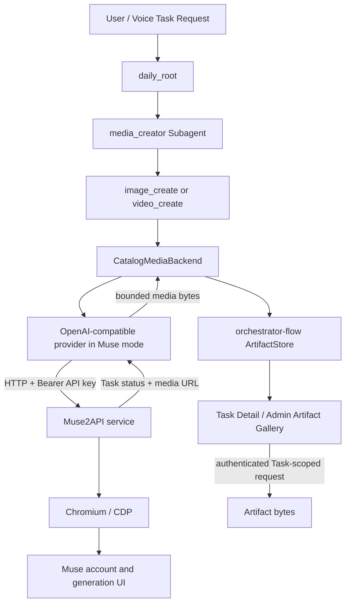

# Muse2API Image/Video Provider — Implementation Specification

**Status:** Design ready for implementation; not implemented by this document.  
**Repository:** `hailp-vn38/ai-agent-voice`  
**Base:** `main` at `8cf385b0852737eaf20f75315c70232eb366b3c6`  
**Working branch:** `docs/muse-image-video-provider`  
**Scope:** Generate image and video artifacts through a separately deployed `muse2api` service, routed from the existing `orchestrator-flow` media tools.

## 1. Goal and decisions

Enable the existing TaskFlow `media_creator` subagent to generate images and videos through Muse, and make the resulting bytes available through the existing Task Artifact Store and Admin Task Detail UI.

Decisions:

1. **Run Muse2API as a separate service.** It owns Chromium/CDP, Muse session cookies, account rotation, upstream quotas and the long-running browser interaction. The Rust server calls its HTTP API; it does not launch Chromium or implement Muse DOM automation.
2. **Reuse the current provider and media-tool architecture.** The existing system already has `LlmOperation::ImageGeneration` / `VideoGeneration`, capability tags `image` / `video`, `CatalogMediaBackend`, and the `image_create` / `video_create` tools. Do not create a new provider type, Task runtime, Core Plugin group, or Artifact Store.
3. **Add an explicit media API dialect to the existing OpenAI-compatible adapter.** Add `media_protocol = "openai_compatible" | "muse2api"` to the typed OpenAI provider configuration. Default it to `openai_compatible` so existing providers preserve their current behavior. Muse mode handles Muse task responses and media URLs without changing ordinary OpenAI-compatible providers.
4. **Use separate provider instances for image and video.** Configure the image instance with model `muse-image` and tag `image`; configure the video instance with model `muse-video` and tag `video`. The current media backend already supports per-tool provider bindings. Separate instances avoid passing an image model ID to the video endpoint or vice versa.
5. **Keep artifacts local to TaskFlow.** Download the completed media bytes from Muse2API and publish them through the existing `ArtifactStore`. Do not expose Muse media URLs as the final Task artifact URL; Muse's own media retention must not determine the lifetime of a completed Task artifact.
6. **V1 is text-to-image and text-to-video.** Reference-image editing and image-to-video first-frame input are explicitly deferred until the Rust-side `ImageGenerationRequest` / `VideoGenerationRequest` tool contracts can carry image bytes or references. Muse2API supports those upstream features, but the current server media-tool request path does not pass reference images.

## 2. Verified current architecture

The following seams exist on the base branch:

| Existing seam | Current behavior | Implementation consequence |
| --- | --- | --- |
| `providers/llm/mod.rs` | Defines capability tags including `image` and `video`, plus `LlmOperation::ImageGeneration` and `VideoGeneration`. | No new operation enum variants are needed for text-only generation. |
| `providers/llm/openai/media.rs` | Sends image requests to `images/generations` and video requests to `videos`; decodes direct media and polls generic video tasks. | Extend the media adapter with a Muse-specific branch. |
| `config/providers.rs` and `providers/llm/openai/config.rs` | OpenAI provider config is typed and rejects unknown fields. | Add the dialect field to the typed config and its validator together. |
| `providers/llm/openai/descriptor.rs` | Exposes schema-driven provider fields to Admin Web. | Expose `media_protocol` through the adapter descriptor. |
| `database/providers/config.rs` | Validates and canonicalizes persisted provider JSON before use. | Explicitly validate the new field and its capability-tag requirements. |
| `services/task_flow/agent_settings/catalog.rs` | `CatalogMediaBackend` resolves `image_create` / `video_create` providers by capability tag and invokes the existing `LlmProvider` media operations. | Preserve the current per-tool binding path; propagate the new dialect into the provider constructed for media work. |
| `services/task_flow/agent_settings/specs.rs` | `media_creator` already allows `image_create`, `video_create`, `tts_synthesize`, and `artifact_create`. | Do not add a second media subagent or alter Root/Subagent routing. |
| `docs/flows/16-task-flow-multi-kind-artifacts.md` | Documents TaskFlow's multi-kind Task Artifact publication and authenticated download. | Reuse this publication and UI path unchanged. |

### Current Muse incompatibility

The existing generic decoder is not sufficient for Muse2API video tasks:

- Muse2API `POST /v1/videos` returns a task object. On success, the result URL is nested under `result.url`.
- The current generic decoder looks for a root-level `url` or `data[0].url`. If it only sees a completed task ID, it tries `GET /videos/{id}/content`.
- Muse2API documents `GET /v1/videos/{id}` for task status and returns the downloadable URL in `result.url`; it does not document the generic `/videos/{id}/content` route.

Muse image generation has a similar asynchronous option: `POST /v1/images/generations` with `"async": true` returns a task, and `GET /v1/images/generations/{id}` returns its state/result. The existing image decoder does not poll image tasks.

References:
- [Muse2API README and endpoint contracts](https://github.com/www222fff/muse2api)
- [Muse2API image request schema](https://github.com/www222fff/muse2api/blob/main/src/muse2api/api/schemas.py)
- [Muse2API image routes](https://github.com/www222fff/muse2api/blob/main/src/muse2api/api/routes/images.py)
- [Muse2API video routes](https://github.com/www222fff/muse2api/blob/main/src/muse2api/api/routes/videos.py)
- [Current Rust media adapter](https://github.com/hailp-vn38/ai-agent-voice/blob/main/crates/voice-agent-server/src/providers/llm/openai/media.rs)
- [Current TaskFlow media backend](https://github.com/hailp-vn38/ai-agent-voice/blob/main/crates/voice-agent-server/src/services/task_flow/agent_settings/catalog.rs)

The Muse2API project documents its browser/CDP driver as needing live verification against real Muse accounts. Mock-driver tests do not prove that a real account can generate media. Live qualification is a release gate.

## 3. Target architecture



Ownership boundaries:

- **Rust server:** provider configuration, capability routing, timeout/cancellation boundary, bounded media download, Task orchestration, artifact publication, Task ownership and Admin read access.
- **Muse2API:** browser process and CDP, account cookie storage, account pool and upstream generation. Account cookies must never be copied into Rust provider JSON or Task arguments.
- **Artifact Store:** immutable final media bytes, SHA-256, Task ownership and published artifact metadata. A generated media URL is only an intermediate transport detail.

## 4. Provider configuration and Admin workflow

### 4.1 Provider records

Use the existing Admin Provider create flow. The adapter remains `openai`; the new `media_protocol` field selects Muse-specific media handling.

Recommended image provider:

```json
{
  "type": "llm",
  "adapter": "openai",
  "config_json": {
    "base_url": "http://muse2api:18610/v1",
    "model": "muse-image",
    "timeout_ms": 240000,
    "tags": ["image"],
    "media_protocol": "muse2api"
  }
}
```

Recommended video provider:

```json
{
  "type": "llm",
  "adapter": "openai",
  "config_json": {
    "base_url": "http://muse2api:18610/v1",
    "model": "muse-video",
    "timeout_ms": 600000,
    "tags": ["video"],
    "media_protocol": "muse2api"
  }
}
```

These are illustrative request/config fragments, not complete Admin API bodies. Create each resource through the existing provider API and send the Muse2API API key through the existing write-only `api_key` field. Do not place credentials inside `config_json`.

The exact model identifiers must match the deployed Muse2API model catalog. The current Muse2API source defines `muse-image` and `muse-video`; verify `GET /v1/models` on the deployed version before saving the provider.

The example uses `muse2api:18610` as an internal service hostname. For local development, use the actual address reachable from the Rust process, for example `http://127.0.0.1:18610/v1`. Do not configure a container with `localhost` when Muse2API runs in a different container.

### 4.2 Capability binding

The existing `CatalogMediaBackend` resolves providers in this order:

1. `settings.agents.media_creator.tool_providers.image_create` or `video_create`, if explicitly configured and compatible with the required tag.
2. `media_creator.provider_ref`, if compatible with the required tag.
3. The configured worker provider, if it has the required tag.
4. The first compatible catalog provider.

For deterministic routing, explicitly bind both tool providers:

- `image_create` → the provider tagged `image`.
- `video_create` → the provider tagged `video`.

Keep the media provider's tags narrow. A provider tagged only `image` should not be eligible for video generation. The existing `media_creator` agent must continue using a chat-capable provider for its own tool-calling loop; its media tool provider may be a media-only provider. The current catalog logic already separates the agent's execution provider from its media provider.

### 4.3 Muse2API deployment

Run Muse2API as a separate service/container on a private application network.

Required operational configuration:

- Select the browser driver and configure Chromium according to the deployed Muse2API version.
- Import Muse account cookies into Muse2API through its own Admin API/dashboard.
- Set `MUSE2API_API_KEY` (or create a dedicated API key) and store only that gateway key in the Rust Provider credential field.
- Set `MUSE2API_PUBLIC_BASE` to a URL reachable from the Rust server when necessary. In Docker, prefer the internal service URL so the returned `/v1/media/...` link is fetchable from the Rust container.
- Keep the Muse2API Admin API and Chromium CDP port private. Only the generation API should be reachable from the Rust server.
- Persist Muse2API's account store and media/task data as required by its deployment instructions. Rust copies completed media into its own Task Artifact Store before returning success.

The provider API key and Muse account cookies have different purposes. Never use Muse account cookies as the Rust provider API key, and never return either secret in diagnostics, Task events or logs.

## 5. Implementation changes

### 5.1 Typed configuration and provider schema

Modify these existing files; do not add a new provider type or adapter registration.

| File | Required change |
| --- | --- |
| `crates/voice-agent-server/src/providers/llm/openai/config.rs` | Add a typed `MediaProtocol` enum with `OpenAiCompatible` as the default and `Muse2Api` as the opt-in value. Add it to `OpenAiConfig`. |
| `crates/voice-agent-server/src/providers/llm/openai/descriptor.rs` | Add a schema-driven select field for `media_protocol`, with values `openai_compatible` and `muse2api`. Keep existing provider fields and defaults intact. |
| `crates/voice-agent-server/src/database/providers/config.rs` | Add the field to the strict `OpenAi` validator shape, default/canonicalization and semantic validation. Reject unknown dialect values. In Muse mode, require an explicit `image` and/or `video` capability tag; do not silently infer a media capability. |
| `crates/voice-agent-server/src/providers/llm/openai/provider.rs` | Preserve the selected dialect when building the runtime provider. Keep `stream()` and chat/vision/audio behavior unchanged for `openai_compatible`. |
| `crates/voice-agent-server/src/providers/llm/openai/media.rs` | Branch on `media_protocol`. Keep the existing code path for `openai_compatible`; add Muse image/video request and response handling described in section 6. |
| `crates/voice-agent-server/src/services/task_flow/agent_settings/catalog.rs` | Add the dialect to the resolved provider projection and pass it through `ResolvedLlmProvider::to_llm_provider()`. Read the field from the validated provider config rather than losing it while projecting to the common media catalog. |
| `apps/admin-web/src/api/types/providers.ts` and provider create tests, only if needed | Confirm the schema-driven select accepts the enum values and that saved/read config round-trips the field. Avoid hardcoding a second form for Muse. |

The existing `OpenAiFactory` and compile-time provider registry remain in use. Since this is a mode of the existing `openai` adapter, there is no new `LlmFactory`, no new provider registry entry, no new SQL provider type and no database migration. Existing `config_json` rows that omit `media_protocol` canonicalize to the default dialect.

The deployment-config type and the database provider validator must agree on the field and default. Do not add the field only to the Admin validator: runtime materialization also deserializes the typed config.

### 5.2 Do not create a parallel media subsystem

Do not introduce:

- A separate `media` ProviderType or a new providers table.
- A new Task/Job runner, new Subagent protocol or direct HTTP media endpoint on the Rust server.
- A second Artifact Store or direct browser link to Muse-generated files.
- A new `image_create` / `video_create` tool contract for text-only generation.
- A direct Chromium/CDP implementation in Rust.
- A retry loop that silently creates a second image/video after an ambiguous timeout.

## 6. Muse media protocol behavior

### 6.1 Text-to-image

In Muse mode:

1. Validate non-empty prompt, dimensions and the existing operation timeout before sending a request.
2. POST to `/images/generations` with `model`, `prompt`, `n: 1`, `size` and `async: true`. Muse2API supports the `async` task mode to avoid long synchronous requests being cut off by reverse proxies.
3. If the response is an immediate image result, decode `data[0].b64_json` or fetch `data[0].url`.
4. If the response contains a task ID, poll `GET /images/generations/{task_id}` until a terminal state or the operation deadline.
5. On success, parse the task's nested `result.data[0].url` or `result.data[0].b64_json`. A task that reports failure/cancellation/interruption must return a bounded provider error, not an empty image.
6. Download and validate the bytes before returning `LlmOutput::Media { mime_type, bytes }`.

Muse2API's image endpoint accepts an image-reference field, but V1 must not invent reference-image support in the Rust tool schema. It will be added only when the current upstream tool request can supply the reference bytes safely.

### 6.2 Text-to-video

In Muse mode:

1. POST to `/videos` with `model`, `prompt`, `size` and `seconds`. Use the existing bounded duration (the current media backend clamps the request to 1–60 seconds).
2. Expect a task ID and a state such as `queued` or `running`; poll `GET /videos/{task_id}` with bounded exponential backoff.
3. Treat `succeeded` as success only when `result.url` is present and valid. Treat `failed`, `cancelled` and interrupted tasks as terminal errors.
4. Fetch the media from `result.url`. Do not call `/videos/{id}/content` for Muse mode.
5. Validate the downloaded file, then return the verified bytes and actual MIME type. Do not label arbitrary bytes as `video/mp4` just because that was the default.

### 6.3 Task status, deadlines and cancellation

- Use the provider's configured `timeout_ms` as the absolute deadline for create + polling + media download, not a fresh timeout for every poll.
- Poll at a bounded interval (start around 500 ms and back off to no more than 2 seconds); do not busy-loop.
- Bound the response body and media download. Reject empty results, malformed task objects, unknown terminal states, failed tasks, non-success HTTP status and invalid JSON.
- Stop polling when the deadline expires. Do not automatically submit a replacement generation after an ambiguous timeout: the first generation may still consume Muse credits.
- A dropped caller future must not leave an unbounded polling loop running. Ensure the polling/download future is cancelled when its owning Task is cancelled, within the current TaskFlow cancellation contract.
- Keep user-facing errors coarse and safe (for example `media_provider_timeout`, `media_provider_rejected`, `media_provider_invalid_response`). Never include API keys, account cookies or full upstream error bodies in Task output.

### 6.4 Media URL and download safety

The URL returned by a provider is untrusted input even though it came from a configured upstream.

- Resolve relative URLs against the configured Muse2API base URL.
- Accept only HTTP(S), and in Muse mode require the URL origin to match the configured Muse2API origin. If a deployment intentionally uses a separate media origin, it must be explicitly configured and allowlisted; do not allow arbitrary hosts from a JSON response.
- Reject credentials embedded in URLs, unexpected ports, unsupported paths and redirects to a different origin. If redirects are needed, validate every redirect target before following it.
- Enforce a streaming byte limit before buffering the full body. Initial recommended limits: 20 MiB per image and 256 MiB per video; make these constants/config limits explicit and test their boundaries. The current `LlmOutput::Media` contract buffers bytes in memory, so also bound concurrent media operations.
- Validate content type and file signature (PNG/JPEG/WebP for images; MP4/other explicitly supported video MIME types for video). Reject mismatched or empty payloads.
- The Muse media URL is an intermediate fetch location only. Publish the bytes to the existing Task Artifact Store and return the artifact metadata through the current Task result path.

For a Docker deployment, configure Muse2API to return media URLs on the internal origin reachable by the Rust service. Do not solve an unreachable media URL by disabling origin checks.

## 7. Artifact publication and UI

The successful path must remain:

`media_creator` tool call → `CatalogMediaBackend` → Muse2API generation → bounded media download → `GeneratedImagePayload` / `GeneratedVideoPayload` → existing `orchestrator-flow` `ArtifactStore` publication → Task detail projection → authenticated Admin Task Artifact endpoint.

Requirements:

- Use the existing Rust/orchestrator-generated artifact ID; never trust an ID or filesystem path from Muse2API.
- Preserve MIME type, size, SHA-256, display filename, producer tool and Task ownership using the existing artifact schema.
- A failed generation or failed download must publish no artifact. A successful generation must not be reported before the artifact has been committed.
- The Admin UI should use the existing artifact gallery and authenticated Task-scoped download path. No public Muse media URL should be shown as the canonical artifact URL.
- Do not modify the existing TaskFlow Root/Subagent prompts or the Wiki autoflow. Media generation is initiated through the existing user-routable `daily_root` and its `media_creator` child.

## 8. Tests and qualification

### 8.1 Rust unit and HTTP-fixture tests

Add deterministic tests that do not contact Muse:

1. Missing `media_protocol` defaults to `openai_compatible`; existing OpenAI provider tests remain unchanged.
2. Unknown dialect is rejected by typed config validation.
3. Muse mode without `image` or `video` tag is rejected; separate image/video provider configurations are accepted.
4. Image direct response with `data[0].url` and `b64_json` is decoded.
5. Image task transitions through `queued` / `running` / `succeeded`, including nested `result.data`.
6. Video task transitions through `queued` / `running` / `succeeded`, and reads `result.url` rather than calling `/videos/{id}/content`.
7. Failed, cancelled, interrupted, unknown and malformed task responses produce bounded errors.
8. Timeout applies to the whole operation, including polling and media download.
9. Empty payload, oversized payload, bad content type, invalid signature, unexpected URL origin, credentials in URL and cross-origin redirect are rejected.
10. API key and provider credential are never present in errors, tracing fields, Task event payloads or serialized provider responses.
11. The `openai_compatible` branch preserves its existing image/video request and response behavior.

Use a local mock HTTP server or the existing Rust test harness. Do not call the real Muse site in CI.

### 8.2 TaskFlow end-to-end tests

Using a fake Muse endpoint and deterministic media fixtures, verify:

- A Task can route through `daily_root` to `media_creator` and invoke `image_create` or `video_create`.
- Each operation resolves the provider bound to its own capability tag.
- The result appears in Task detail with the expected artifact kind, MIME type, size and SHA-256.
- The authenticated artifact endpoint returns the exact committed bytes.
- Cancelling a Task stops polling/download and does not publish a partial artifact.
- Existing Markdown, audio, image and other Task artifact behavior remains intact.
- A Muse failure does not break unrelated TaskFlow or Wiki autoflow.

### 8.3 Live deployment smoke

A real-account smoke test is required before declaring the browser integration qualified:

1. Start the deployed Muse2API version with the browser driver and private CDP access.
2. Import an account through Muse2API's Admin interface and confirm its status/quota.
3. Generate one image through the Rust TaskFlow path; verify the image bytes and Admin artifact preview/download.
4. Generate one short video; verify the task reaches success, the returned media URL is reachable from Rust, and the artifact plays from the Admin UI.
5. Verify the configured timeouts, media-size limits, cancellation behavior and Muse account cooldown/failover.
6. Restart both services and confirm completed Task artifacts remain readable independently of Muse2API media retention.
7. Record the exact Muse2API commit/version and whether the browser driver was tested with a real account. Mock-driver success alone is not a live integration pass.

Run repository-mandated checks through `scripts/agent-test.sh`; inspect `AGENTS.md` for the current required commands. Do not claim CI or live smoke success until the actual results are available.

## 9. Acceptance criteria

The implementation is complete only when all of the following are true:

- Existing OpenAI-compatible providers behave exactly as before when `media_protocol` is omitted.
- Admin can configure Muse2API as a regular OpenAI-compatible Provider with the new explicit dialect and write-only gateway credential.
- `image_create` uses the image-tagged provider; `video_create` uses the video-tagged provider.
- Image and video asynchronous tasks are polled using the correct Muse2API endpoints and response shape.
- Returned media is fetched under origin and byte-size constraints, validated, and published through the existing Task Artifact Store.
- Task detail and the Admin artifact gallery display/download the committed media without relying on the Muse2API media URL after publication.
- Reference-image editing and first-frame video are clearly reported as unsupported in V1 rather than silently ignored.
- Unit tests, TaskFlow tests and the real-browser qualification status are documented separately.

## 10. Deferred work

Do not include these in the first implementation unless scope is explicitly expanded:

- Image edits using reference image(s), multipart `/v1/images/edits`, or `image` references in image generation.
- Image-to-video using `image` / `input_reference` as a first frame.
- Transparent-background matting.
- A Rust-native Chromium/CDP driver.
- Automatic Muse cookie renewal logic implemented inside the Rust server.
- Provider/account quota dashboards beyond the existing Muse2API dashboard.
- A new public media API or public artifact URL.

Reference-image support needs a follow-up contract change through the current `orchestrator-flow` tool request, `LlmOperation`, provider operation and size-bounded input handling. Do not base64-encode an unbounded image into a prompt as a workaround.
