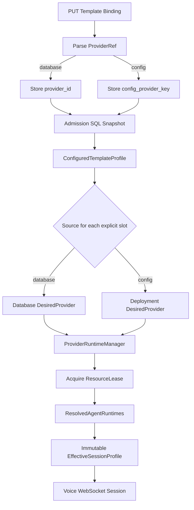

# Implementation Guide: Unified Provider Sources for Template Bindings

> Repository: [`hailp-vn38/ai-agent-voice`](https://github.com/hailp-vn38/ai-agent-voice)  
> Reference branch: `main` (reviewed 2026-10-11)  
> Status: **Implementation specification — no code changes applied**  
> Scope: **Rust server API, provider resolution, database migration, runtime flow**. Only adjust Web API/store *data flow* if proven necessary. **Do not redesign or edit any Web page, Vue component, template, layout, CSS or visual interaction.**

## 1. Mục tiêu và quyết định đã chốt

Hiện tại Admin quản lý các Provider được lưu trong SQLite, trong khi server đồng thời có Provider được khai báo trong `config.toml`. Template chỉ có thể bind Provider từ database vì `template_provider_bindings.provider_id` bắt buộc tham chiếu bảng `providers`.

Cần đạt được:

1. `GET /api/admin/providers` trả về danh sách hợp nhất **database + config**, và mỗi bản ghi có `source: "database" | "config"`.
2. Web Template hiện tại tự nhận thêm Provider từ config qua dữ liệu API, không thay đổi giao diện hay cấu trúc lựa chọn.
3. `PUT /api/admin/templates/{template_key}/providers/{provider_type}` giữ nguyên request `{ "provider_key": "..." }`, chấp nhận cả hai nguồn.
4. Các thao tác đọc Template / Agent / Provider thể hiện đúng binding nguồn config.
5. Khi thiết bị kết nối WebSocket hoặc chuyển Template, runtime tải đúng Provider đã bind, không nhầm nguồn, không tự fallback khi explicit binding bị lỗi.
6. Provider từ config là **read-only**: không tạo, sửa, xóa bản ghi Provider trong SQLite để đại diện cho config.
7. Không làm thay đổi các hành vi hiện có của database Provider, template revision/optimistic locking, prewarm, resource lease, device admission, audit hoặc security.

**Không triển khai**: một page mới, badge mới, giao diện Provider Detail mới, endpoint `/provider-catalog` mới, sửa `config.toml` qua Admin, hoặc thay đổi cơ chế lưu credentials.

## 2. Codebase hiện tại và những điểm phải xử lý

| Vị trí | Hiện trạng | Cần thay đổi |
|---|---|---|
| `crates/voice-agent-server/src/app/admin/providers.rs` | `list_providers` chỉ gọi `database.list_providers`; trả `items/page/page_size/total/total_pages/facets`; detail chỉ tìm DB | Hợp nhất catalog read model; phân trang/filter/sort nhất quán; detail config read-only |
| `crates/voice-agent-server/src/app/admin/templates.rs` | `ProviderBinding { provider_key }`; handler gọi DB binder; chỉ cho phép `vad/asr/llm/tts` | Parse source-qualified key; validate loại; giữ nguyên request và `If-Match` |
| `crates/voice-agent-server/src/database/templates/mod.rs` | `bind_template_provider` tìm `providers.key`, kiểm tra `enabled`, insert `provider_id` | Lưu binding DB hoặc config trong một transaction, revision + audit giữ nguyên |
| `crates/voice-agent-server/src/database/templates/relationships.rs` | Đọc bằng INNER JOIN `providers` | Đọc cả hai loại binding |
| `crates/voice-agent-server/src/app/admin/templates/relationships.rs` | Trả `{bindings: { llm: {provider_key, enabled} }}` | Giữ shape; config trả qualified key |
| `crates/voice-agent-server/src/database/admission.rs` | Snapshot Device → Agent → Template → DB Provider trước WS upgrade | Mang source-qualified binding, không query DB trong realtime actor |
| `crates/voice-agent-server/src/database/load_plan.rs` | Kế hoạch required/optional/unbound dành cho DB | Giữ nguyên phân loại DB; không nhầm config key với DB key; xử lý config reachability riêng |
| `crates/voice-agent-server/src/session/runtime_profile.rs` | Explicit binding yêu cầu `snapshot.id > 0` (DB); config snapshots chỉ dùng để fallback các slot thiếu | Hỗ trợ explicit deployment snapshots; merge đúng runtime catalogs, gồm `speaker` |
| `crates/voice-agent-server/src/providers/deployment_snapshot.rs` | Đã resolve config `vad/asr/llm/tts/speaker` thành `DesiredProvider` (`id=0`), không hỗ trợ `vision` | Tái sử dụng; tách public metadata khỏi private runtime config |
| `crates/voice-agent-server/src/services/provider_runtime/identity.rs` | Đã có `ProviderIdentity::Database(id)` và `Deployment { kind, key }` | **Tái sử dụng**, không tạo runtime manager mới |
| `crates/voice-agent-server/migrations/0007_speaker_provider.sql` | `provider_id INTEGER NOT NULL REFERENCES providers(id)` | Tạo migration **mới**; không sửa migration cũ |
| `apps/admin-web/src/components/templates/TemplateFormDialog.vue` | Lọc provider theo `type`, dùng `provider.id` (được map từ `provider.key`) | **Không sửa file** |
| `apps/admin-web/src/stores/admin.ts` | `toProvider` dùng `provider.key` làm ID; `loadAll` chỉ lấy **một trang, 100 items**, sort `name` | Chỉ sửa data-flow khi cần bảo đảm lấy đủ catalog và `speaker`; không sửa giao diện |

**Điểm quan trọng**: Server hiện có chế độ runtime manager (`provider_runtime` được bật) và luồng legacy không dùng manager. Không được giả định mọi config Provider đều được materialize ở startup: nhóm `deployment_snapshots` hiện có có thể chỉ gồm defaults/preload. Danh sách hiển thị trong API và tập Provider đang loaded là hai khái niệm độc lập.

## 3. Thiết kế Module và Seam

### 3.1. Một Module catalog sâu, không tạo các lớp truyền tiếp

Xây dựng một **Module** nội bộ quản lý provider reference, danh sách public và resolution metadata. **Interface** đề xuất:

```rust
#[derive(Clone, Copy, Debug, PartialEq, Eq)]
pub(crate) enum ProviderOrigin {
    Database,
    Config,
}

#[derive(Clone, Debug, PartialEq, Eq)]
pub(crate) struct ProviderRef {
    pub origin: ProviderOrigin,
    pub kind: String,
    pub key: String, // raw key: không có tiền tố config:
}

impl ProviderRef {
    pub fn parse(input: &str, expected_kind: Option<&str>) -> Result<Self, ProviderRefError>;
    pub fn public_key(&self) -> String;
}
```

**Public representation**:

- Database Provider: `llm_a1b2c3` (giữ nguyên key cũ).
- Config Provider: `config:llm:openai_primary`.
- `ProviderRef::key` nội bộ cho config là `openai_primary`; runtime deployment identity là `{kind:"llm",key:"openai_primary"}`.
- Một Provider DB tên `openai_primary` và Provider config `openai_primary` không va chạm vì **identity có nguồn**.
- Prefix `config:` là reserved. Định nghĩa parser chính xác (3 thành phần), validate `kind`, độ dài/charset raw key theo quy tắc cấu hình server, loại bỏ input sai; không bao giờ tin `type` chỉ từ chuỗi request.
- Nếu input **không có** prefix, chỉ tìm trong DB để giữ compatibility. Không tự đoán nguồn từ key trùng.

**Seam**: Admin/read model và template admission cùng sử dụng `ProviderRef`/catalog resolver. Database Adapter chịu trách nhiệm SQL; deployment Adapter chịu trách nhiệm lookup `AppConfig` và tạo deployment snapshot. Các caller không biết chi tiết từng provider config enum.

Không dùng `ProviderIdentity::Database(0)` làm định danh config. Không tạo một `ProviderRuntimeManager` thứ hai. Tránh nhầm với enum `ProviderSource` private hiện có trong `providers/database_loader.rs`; tên mới gợi ý là `ProviderOrigin`.

### 3.2. Interface runtime (tái sử dụng)

`ProviderRuntimeManager` đã có `acquire_until` và `acquire_deployment_until`, trả `ResourceLease`. Đây là external seam của runtime; module catalog chỉ resolve đúng snapshot/identity, không quyết định thuật toán tải tài nguyên. Snapshot từ config phải gắn `ProviderIdentity::Deployment { kind, key }`; từ DB dùng `ProviderIdentity::Database(id)`.

## 4. HTTP API contract — không đổi endpoint

### 4.1. `GET /api/admin/providers`

Response **giữ nguyên** shape phân trang hiện tại. Bổ sung `source` cho từng item, và item config chỉ dùng metadata không chứa secrets:

```json
{
  "items": [
    {
      "id": 17,
      "key": "llm_123abc",
      "name": "Primary database LLM",
      "type": "llm",
      "adapter": "openai",
      "source": "database",
      "config_json": "{}",
      "enabled": 1,
      "revision": 3,
      "created_at": 1700000000,
      "updated_at": 1700000000,
      "credential_env": null,
      "runtime_status": "loaded",
      "runtime_matches_desired": true,
      "requires_restart": false
    },
    {
      "id": 0,
      "key": "config:llm:openai_primary",
      "name": "openai_primary",
      "type": "llm",
      "adapter": "openai",
      "source": "config",
      "config_json": "{}",
      "enabled": 1,
      "revision": 1,
      "created_at": 0,
      "updated_at": 0,
      "credential_env": null,
      "runtime_status": "not_loaded",
      "runtime_matches_desired": false,
      "requires_restart": false
    }
  ],
  "page": 1,
  "page_size": 100,
  "max_page_size": 100,
  "total": 2,
  "total_pages": 1,
  "facets": { "llm": 2 }
}
```

> **Illustrative response only**: DB values, counts and exact `facets` keys depend on the existing contract. Preserve the real current representation and facet meaning rather than hard-code the sample. `id=0` is a **read-only synthetic sentinel for config**, never a database ID; identity is the qualified `key`. Check usages of `id` before finalizing this convention. If `id=0` violates an existing consumer, use a safe explicit synthetic ID strategy; do not leak internal IDs or change existing DB IDs.

**Filtering/pagination invariants**:

1. Merge DB + config **before** applying `q`, `type`, `enabled`, `sort`, `page`, `page_size` logically.
2. `total` and `total_pages` count the filtered union; `facets` preserve existing semantics over the intended union.
3. Stable ordering for equal `name`/`key` (tie-break `source` + `kind` + `raw key`); handle negative sort variants.
4. `page` 1/2 must be disjoint; no duplicates, omissions, phantom counts. Never append config items to an already paginated DB page.
5. DB create/update/delete/list behavior remains unchanged for DB items.
6. **Config `enabled=1` means declared and selectable**, not resident/loaded. `runtime_status` must come from manager inspection when available; otherwise `not_loaded` (not giả mạo loaded).
7. `config_json` of config item must be a **safe, serialized JSON object string**, preferably `"{}"` unless allowlist có kiểm thử. **Không** gửi full `AppConfig`, bearer token, API key, secret, authorization header, env value hay file path nhạy cảm qua Admin.
8. Config catalog includes only kinds the server can safely expose. `vision` may appear in listing if contract supports it; it is **not a Template binding slot**. Bindable kinds: `vad`, `asr`, `llm`, `tts`, optionally `speaker` once runtime path and handler support are consistent.
9. Một bản ghi config thiếu asset/không chuẩn bị được không được đánh dấu `loaded`; quyết định danh sách hiển thị và khả năng bind phải được xác định tường minh.

**Giới hạn Web hiện tại cần ghi nhận:** `apps/admin-web/src/stores/admin.ts::loadAll()` gọi một trang `pageSize:100`, `sort:'name'`. Vì thế chỉ mở rộng server endpoint **không thể bảo đảm** tất cả Provider được chọn khi catalog có >100 items. Nếu bắt buộc đáp ứng catalog lớn, chỉ được cập nhật việc **fetch các trang** trong `apps/admin-web/src/api/providers.ts`/`stores/admin.ts`; không sửa Vue template, styling, layout. Không được âm thầm phá pagination chuẩn để nhồi tất cả items vào một page.

### 4.2. `GET /api/admin/providers/{provider_key}`

- DB key: hành vi hiện tại.
- `config:<type>:<key>`: trả public metadata cùng shape, `source="config"`, không chứa secrets.
- Config item là read-only. Nếu UI hiện tại hiển thị nút edit/delete thì server vẫn phải từ chối thao tác; **không chỉnh UI** trong scope này.
- `GET /api/admin/providers/{provider_key}/templates`: nên trả danh sách Template bind config provider để màn hình detail hiện tại không lỗi; query theo `(provider_source, provider_type, config_provider_key)`.
- Runtime/capabilities/prepare/test endpoints: rà soát từng route có lấy provider bằng DB key. Với config ref, **hoặc** hỗ trợ cùng semantics dựa trên config resolver + manager, **hoặc** trả một lỗi có mã chuẩn (`config_provider_operation_unsupported`); không trả 500 và không truy vấn sai DB. Ưu tiên hỗ trợ `prepare` nếu runtime manager đã có đường chuẩn bị deployment provider.

### 4.3. `POST/PATCH/DELETE /api/admin/providers`

- `POST`: chỉ tạo DB Provider như hiện tại.
- `PATCH/DELETE` với config ref: `409 Conflict` + error code `config_provider_readonly`; không write DB, không sửa file config, không thay đổi revision.
- Trả lỗi có thể đọc được; không biến lỗi read-only thành `not_found` mơ hồ.
- Giữ nguyên optimistic locking cho DB.

### 4.4. `PUT /api/admin/templates/{template_key}/providers/{type}`

**Giữ nguyên request**:

```json
{ "provider_key": "config:llm:openai_primary" }
```

DB request cũ vẫn hợp lệ:

```json
{ "provider_key": "llm_123abc" }
```

**Validation**:

- Validate `type` khớp chính xác `ProviderRef.kind` hoặc `providers.type` tại DB.
- Config raw key phải hiện diện ở đúng `config.providers.<type>.instances` và instance hợp lệ/được phép bind.
- Database key phải tồn tại, đúng kind và enabled (như hiện tại).
- Nhận `If-Match`/expected revision; mutation + template revision + audit transaction như cũ.
- Không tạo hàng giả trong `providers` để biểu diễn config.
- Lỗi input/source mismatch trả 400/422 `invalid_provider`; record/config không tồn tại trả lỗi nhất quán (`invalid_provider` hoặc `provider_unavailable` theo existing error mapper). 409 khi revision conflict.
- Bind lại cùng slot cập nhật cả source và foreign key theo cách nguyên tử; không giữ sót cột nguồn cũ.
- Trigger `prewarm.template(template_id)` nếu được bật; prewarm phải resolve cả nguồn config.

### 4.5. `GET /api/admin/templates/{key}/providers`

Giữ nguyên cấu trúc response để Web cũ hoạt động:

```json
{
  "template_key": "assistant_vi",
  "revision": 4,
  "bindings": {
    "vad": { "provider_key": "vad_db123", "enabled": true },
    "llm": { "provider_key": "config:llm:openai_primary", "enabled": true }
  }
}
```

Có thể bổ sung field `source` trong binding (additive) để chẩn đoán, nhưng Web cũ chỉ cần `provider_key` có cùng format với `GET /providers`. Với config bị xóa khỏi config server: **giữ nguyên binding được lưu**, expose `enabled=false` hoặc trạng thái unavailable theo semantics đã chốt và giữ qualified key; không ẩn mất record bằng INNER JOIN.

`DELETE /api/admin/templates/{key}/providers/{type}` phải xóa được cả hai loại và cập nhật revision/audit như cũ.

## 5. SQLite migration

**Tạo migration tiếp theo theo thứ tự hiện có trong repo** (ví dụ `<next>_template_config_provider_bindings.sql`); không sửa `0007_speaker_provider.sql` hay bất cứ migration đã phát hành nào.

Schema mục tiêu (DDL định hướng, cần chuyển thành migration an toàn cho SQLite thực tế):

```sql
CREATE TABLE template_provider_bindings_new (
    id INTEGER PRIMARY KEY AUTOINCREMENT,
    template_id INTEGER NOT NULL
        REFERENCES agent_templates(id) ON DELETE CASCADE,
    provider_type TEXT NOT NULL
        CHECK (provider_type IN ('vad','asr','llm','tts','speaker')),
    provider_source TEXT NOT NULL DEFAULT 'database'
        CHECK (provider_source IN ('database','config')),
    provider_id INTEGER
        REFERENCES providers(id) ON DELETE RESTRICT,
    config_provider_key TEXT,
    created_at INTEGER NOT NULL,
    updated_at INTEGER NOT NULL,
    UNIQUE(template_id, provider_type),
    CHECK (
      (provider_source='database' AND provider_id IS NOT NULL AND config_provider_key IS NULL)
      OR
      (provider_source='config' AND provider_id IS NULL AND config_provider_key IS NOT NULL
         AND length(config_provider_key) > 0)
    )
);
```

Bảo toàn records cũ khi rebuild:

```sql
INSERT INTO template_provider_bindings_new (
    id, template_id, provider_type, provider_source,
    provider_id, config_provider_key, created_at, updated_at
)
SELECT id, template_id, provider_type, 'database',
       provider_id, NULL, created_at, updated_at
FROM template_provider_bindings;
```

Checklist migration: chạy nguyên tử; áp dụng chiến lược `DROP/RENAME` hợp lệ với foreign keys SQLite; dựng lại index/trigger nếu có; giữ ID binding và `sqlite_sequence` high-water mark (theo precedent `0007`); chạy `PRAGMA foreign_key_check`; test migration trên DB có dữ liệu trước và sau; test delete RESTRICT của DB Provider còn bind; test uniqueness `(template_id,provider_type)` và CHECK loại nguồn.

**Không thêm foreign key từ config binding sang providers.** Config instance tồn tại trong deployment, có thể bị xóa/đổi tên sau restart; đây là tình huống invalid runtime, không phải một record DB phải cascade-delete.

## 6. Database transactions / read model

### Bind

1. Handler parse `ProviderRef` và verify deployment metadata cho config (không phụ thuộc DB).
2. Database Module nhận struct `ResolvedBinding { kind, origin, database_provider_id: Option<i64>, config_provider_key: Option<String> }` sau validation; tránh truyền lại JSON/ngoại lệ config vào repository.
3. Trong một SQL transaction: kiểm tra template revision CAS, upsert binding với đúng nguồn, update template revision, audit, commit; không partial state khi bất kỳ bước nào thất bại.
4. Đối với DB provider, kiểm tra `enabled/type/id` sát transaction để tránh TOCTOU. Đối với config, xác nhận snapshot thuộc cùng AppConfig hiện hành; runtime resolver kiểm tra lại trước prepare.
5. Sau commit, invalidate cache/session admission đúng semantics hiện tại; prewarm đọc lại binding mới.

### Read

`database/templates/relationships.rs::template_providers` cần query dạng `LEFT JOIN providers p ON b.provider_source='database' AND p.id=b.provider_id`, rồi map `config` sang qualified public key. Không để `JOIN providers` làm mất config rows.

`database/providers` usage query cho Provider config phải lọc `provider_source='config' AND provider_type=? AND config_provider_key=?`. Mọi query cũ có `JOIN template_provider_bindings b ON b.provider_id=p.id` nên thêm điều kiện nguồn thích hợp, đặc biệt report/statistics/usage/count.

### Invalid config key

Không cascade-delete binding config khi file config bị sửa hoặc deployment đổi. Khi request bind mới: từ chối. Khi đọc binding cũ: giữ key và báo không available. Khi mở voice session: fail closed, không chọn provider default để che giấu lỗi explicit binding.

## 7. WebSocket admission → runtime preparation



### 7.1. Admission graph

- Mở rộng `AdmittedProviderBinding` bằng origin và public/raw ref phù hợp.
- Database query chỉ có trách nhiệm chụp **facts**: template assignment, provider source, DB snapshot nếu nguồn DB, raw config key nếu nguồn config.
- Config metadata resolve trong application/profile layer từ **immutable `AppConfig` snapshot**; không làm `database/admission.rs` phụ thuộc vào `AppConfig` mới nếu không cần.
- Bảo tồn giới hạn admission hiện tại: số lượng assignments/bindings, max serialized snapshot bytes, elapsed time và safe telemetry.
- Không đưa database connection hoặc `AppConfig` mutable vào `SessionActor`.

### 7.2. Resolve explicit config Provider

`ConfiguredTemplateProfile::from_assignment_internal` hiện dùng `snapshot.id > 0` cho **tất cả** explicit bindings. Phải đổi sang source-aware validation:

- `database`: snapshot ID dương, revision dương, key/kind khớp.
- `config`: lookup `(kind, raw_key)` trong deployment snapshot index; dùng deployment identity, không yêu cầu DB ID.
- Slot không bind: tiếp tục fallback `provider_defaults` như cũ.
- Slot bind cụ thể nhưng thiếu/disabled/invalid: **ProfileUnavailable**, không fallback.
- Một slot có tối đa một effective provider. Nếu DB và config có cùng raw key, vẫn chọn đúng binding nguồn đã chỉ định.
- Không thay đổi prompt/language/template source và semantics frozen snapshot.

### 7.3. Deployment snapshot index

Ở startup, cần có **index immutable metadata/snapshot** cho **tất cả** config instances có thể bind (không chỉ defaults hay `preload=true`). Dùng lookup `(kind,key) -> DesiredProvider` trong application state, có thể sử dụng `deployment_provider_snapshot(config,kind,key)`.

**Index snapshot không đồng nghĩa với load runtime/model**. Không được gọi adapter constructor/ONNX/model loading cho toàn bộ config provider chỉ vì API cần liệt kê. Asset preparation ở startup vẫn đi theo chính sách hiện tại; runtime acquisition giữ on-demand theo manager budget.

Do not serialize private deployment config into Admin response: public DTO tách khỏi `DesiredProvider.config_json`. Với `vision`, chỉ catalog nếu cần, vì `deployment_provider_snapshot` hiện không hỗ trợ vision như Template slot.

### 7.4. Acquire và merge catalog

`ConfiguredTemplateProfile::provider_versions()` trả `ProviderVersion::database` cho DB, `ProviderIdentity::Deployment{kind,key}` cho config.

Trong `.prepare()`:

- DB: `manager.acquire_until(snapshot, deadline)`.
- Config: `manager.acquire_deployment_until(snapshot, deadline)`.
- Merge `vad`, `asr`, `llm`, `tts`, **`speaker`** từ cả hai nhánh; hiện nhánh deployment chưa merge `speaker`.
- Dùng deadline chung, giữ leases cho đến khi session release; nếu một provider fail thì release các leases đã lấy, không partial switch.
- Per-session profile immutable; Template revision/switch được resolve lại bằng cơ chế đã có.
- Prewarm và cold candidate preparation phải dùng cùng resolver; không materialize mọi candidate ngay ở startup.

### 7.5. Managed vs. legacy runtime

**Managed mode (`provider_runtime` configured)** là đường chính và phải hỗ trợ mọi config Provider hợp lệ theo on-demand acquisition.

**Legacy mode** hiện preload local set theo startup. Không được trả `success` cho config binding mà session thực tế không thể resolve. Agent triển khai phải chọn và test chính xác một trong hai chính sách:

- **Ưu tiên nếu bắt buộc hỗ trợ cả legacy**: mở rộng load planning để các config instances reachable từ active Templates được materialize có chọn lọc theo chính sách required/optional, không tải tất cả; đồng thời xác định hành vi khi Template được bind sau startup (reload/restart-required hoặc một cơ chế prepare tương thích).
- **Nếu phạm vi hệ thống thực tế chỉ dùng managed mode**: reject **sớm** config binding không thể chạy trong legacy bằng mã `config_provider_requires_managed_runtime`; document giới hạn này, không âm thầm fallback. Không khẳng định hỗ trợ đầy đủ legacy khi chưa implement.

Cần kiểm tra `bootstrap_with_providers_and_secret_resolver` và các test routers, không chỉ `managed_startup`, để không làm hỏng smoke/integration tests.

## 8. An toàn và bảo mật

1. **Không lộ secrets:** DTO config phải được dựng từ allowlist metadata (`key`, `type`, `adapter`, `source`, runtime status...). Không serialize thẳng `AppConfig`, config enum hoặc `DesiredProvider` ra Admin API. Test bằng canary `SECRET_SENTINEL_SHOULD_NOT_APPEAR`.
2. **Readonly enforcement ở server:** mọi write endpoint đối với `config:*` chặn trước khi vào DB.
3. **Key validation:** không dùng qualified key làm path filesystem, env name, external request target hay SQL nối chuỗi. Parse, validate và bind SQL parameters.
4. **No silent fallback:** khi explicit config binding không tồn tại/không load được, trả lỗi có thể quan sát và không dùng một LLM/TTS khác.
5. **No extra startup fan-out:** chỉ index metadata, giữ hiện trạng resource budget, lease, deadline và backpressure.
6. **Redacted observability:** log `source/kind/key/revision/state/elapsed_ms`, không log config_json, prompt, credentials hoặc authorization header.
7. **Stable identity:** config version là deployment-scoped; thay đổi config khi restart không được làm nhầm runtime cũ; manager mới/immutable snapshots đảm bảo consistency.

## 9. Không đổi giao diện Web — kiểm thử compatibility

Không được sửa:

- `apps/admin-web/src/components/templates/TemplateFormDialog.vue`
- `apps/admin-web/src/components/providers/**`
- `apps/admin-web/src/pages/**` / router layout
- CSS/Tailwind/theme/icons/copy của màn hình

Data-only exception nếu kiểm thử bắt buộc:

- `apps/admin-web/src/api/providers.ts`: fetch nhiều trang nếu cần catalog đầy đủ; không thay đổi request payload ngoài contract đã chốt.
- `apps/admin-web/src/api/types/providers.ts`: `source?: 'database' | 'config'` nếu cần typed metadata.
- `apps/admin-web/src/stores/admin.ts`: logic data-only, không đổi computed outputs cho component; nếu hỗ trợ speaker binding, sửa `apiProviderTypes` (hiện 4 loại) để không bị bỏ qua; lưu qualified key nguyên dạng.

**Nguồn config có `source` tag trong response, nhưng Web sẽ không tự hiển thị một badge mới** nếu không thay đổi component — đây là giới hạn được chấp nhận theo yêu cầu. Việc giữ nguyên `name` không phụ thuộc vào tag và tránh biến display name thành định danh.

`GET /providers` config items đi vào cùng cache nên Provider list/detail UI có thể vẫn hiển thị action edit/delete hiện có. API trả `config_provider_readonly` là kết quả có chủ ý; muốn ẩn các nút này sẽ cần thay đổi UI và nằm **ngoài scope**.

## 10. Kế hoạch triển khai theo thứ tự an toàn

### P0 — identity và persistence

- [ ] Kiểm tra toàn bộ queries tham chiếu `template_provider_bindings`, endpoint Providers/Template và admission startup.
- [ ] Tạo `ProviderRef` + `ProviderOrigin` parser/formatter, tests cho collisions, loại sai và malformed key.
- [ ] Viết migration mới, preservation test + FK integrity.
- [ ] Đổi bind/unlink/relationship queries thành source-aware; giữ `If-Match`, revision CAS, audit.

### P1 — catalog API & compatible reads

- [ ] Add config metadata index/read model từ `AppConfig`.
- [ ] `GET /api/admin/providers`: merged pagination/filter/sort/facets; thêm `source`, giữ shape.
- [ ] `GET /api/admin/providers/{key}` và usage templates hiểu config key.
- [ ] PATCH/DELETE config trả readonly, các test/prepare/capabilities endpoint không báo 500 với config ref.
- [ ] Bind/GET Template relationship round-trip qualified key, không break DB bindings.

### P2 — admission và runtime

- [ ] Mở rộng admission graph, cap snapshot sizes và log redaction.
- [ ] Resolve explicit config trong `ConfiguredTemplateProfile`, fallback chỉ cho slot **không bind**.
- [ ] `provider_versions` và `prepare` xử lý identity/source, merge speaker catalog.
- [ ] Update prewarm/load planning theo managed/legacy startup; không eagerly load tất cả config.
- [ ] Verify WebSocket device admission và switch Template giữ lease/frozen profile.

### P3 — integration và regression

- [ ] Chạy formatter/linter/test Rust và build Web hiện tại.
- [ ] Với catalog <=100, Web Template form hiện tại thấy cả hai nguồn, chọn config rồi save/edit được.
- [ ] Kiểm tra >100 items: nếu yêu cầu select bất kỳ item thì chỉ bổ sung data-only fetching; không chỉnh UI.
- [ ] Kiểm tra speaker binding nếu hiện có UI lựa chọn speaker.
- [ ] Update OpenAPI/Postman (`docs/api/00-all-apis.postman_collection.json`) và docs API contract.

## 11. Test matrix — các trường hợp bắt buộc

| # | Test | Expected |
|---|---|---|
| 1 | GET providers: 2 DB + 2 config | 4 items, đúng `source`, unique public keys |
| 2 | DB và config trùng raw key | Không conflict; bind theo qualified key đúng nguồn |
| 3 | GET providers filters `type/q/enabled` | Kết quả/count/facets nhất quán |
| 4 | Pagination name sort, đủ >1 page | Không trùng/thiếu items; tổng đúng |
| 5 | GET config detail, usage | 200, safe DTO, relationship đúng |
| 6 | PATCH/DELETE config | `409 config_provider_readonly`, không DB write |
| 7 | DB template binding cũ | PUT/GET/DELETE không regression |
| 8 | PUT config binding + GET relationship | Round-trip qualified ref không biến dạng |
| 9 | PUT binding sai kind / key không tồn tại | Reject rõ ràng, revision không tăng |
| 10 | Replace DB binding bằng config và ngược lại | Một binding duy nhất/slot, cả FK lẫn config column sạch |
| 11 | Migrate database có bindings | Giữ ID, revision, audit, FK, RESTRICT |
| 12 | WebSocket + config LLM, DB ASR/TTS | Resolve và acquire đúng runtime |
| 13 | Config provider cold/not default | Bind và prepare được trong managed mode, không eager preload |
| 14 | Explicit binding xóa khỏi config sau restart | Session mới unavailable; không fallback |
| 15 | Slot không bind | Sử dụng default như trước |
| 16 | Template switch giữa hai nguồn | Exact ProviderVersion, leases đúng, không dùng resident sai |
| 17 | Config speaker binding (nếu hỗ trợ) | Runtime catalog có speaker và Web data flow không bỏ qua |
| 18 | API with secret canary | Không tìm thấy canary ở JSON response, logs |
| 19 | Manager resource quota/deadline failure | Graceful unavailable; không rò lease, không partial switch |
| 20 | Runtime legacy + config binding | Hoặc hỗ trợ thật, hoặc reject sớm với code rõ ràng |
| 21 | Existing Admin Provider create/patch/test/prepare | Không thay đổi hành vi DB |
| 22 | Admin Web build/screenshot smoke | Không thay đổi DOM/layout/styles của các trang |

## 12. Definition of Done

Chỉ coi hoàn thành khi:

- [ ] Catalog hợp nhất qua **endpoint cũ**, với `source` rõ ràng, response backward compatible và không lộ secrets.
- [ ] Template create/edit có thể tham chiếu config Provider trong **cùng select UI hiện tại**, không thay đổi Vue component.
- [ ] Binding config lưu độc lập với bảng DB Provider, có migration non-destructive.
- [ ] DB binding cũ hoạt động bình thường.
- [ ] WebSocket admission + managed provider acquisition dùng **đúng nguồn và đúng revision**, không silent fallback; `speaker` không bị bỏ qua nếu nằm trong scope.
- [ ] Runtime không load toàn bộ config Provider chỉ vì admin listing.
- [ ] Tất cả API routes nhận qualified key đều có phản hồi được định nghĩa (thành công hoặc lỗi có code), không panic/500.
- [ ] Không có thay đổi giao diện Web, và chỉ có thay đổi nhỏ tại data flow nếu thật sự cần.
- [ ] Automated tests/migrations/test Web pass; tài liệu API/Postman cập nhật tương ứng.

---

### Ghi chú cho coding agent

Thực hiện theo thứ tự **reference → migration/read/write → API catalog → admission/profile → runtime → regression**. Không thêm module một dòng chỉ để wrapper quanh DB/config; giữ một catalog Module đủ sâu để logic source identity, validation, public metadata và resolution không bị copy giữa Admin handlers và session runtime. Trước khi sửa Web, thử gọi API mới với Web hiện tại. Mọi thay đổi API/store data-only nếu có phải được ghi rõ lý do và **không sửa bất kỳ file Vue component, page, style hoặc layout nào**.
