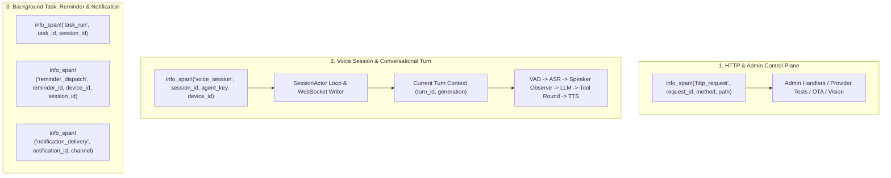

# Structured Logging & Real-Time Web Log Stream — Hướng dẫn Triển khai Chi tiết

> **Repository:** `voice-agent-server`  
> **Đối chiếu code:** nhánh hiện tại (`main` — `SessionActor`, `Inference Worker Runtime`, `NotificationHub`, `orchestrator-flow`, `llm-wiki-rs`, `voice-agent.db`)  
> **Kỷ luật thiết kế:** `/codebase-design` (**Module**, **Interface**, **Implementation**, **Depth**, **Seam**, **Adapter**, **Leverage**, **Locality**) & `/domain-modeling`  
> **Mục tiêu:** Thiết kế một **Deep Module** duy nhất (`SystemLogHub`) kết hợp hệ thống **Span phân cấp** (`tracing`) để chuẩn hóa toàn bộ log trên server theo cấu trúc định danh (`session_id`, `turn_id`, `request_id`, `subsystem`, `event`), lưu trữ có giới hạn trong bộ nhớ (bounded ring buffer) và phát thời gian thực (SSE) kèm bộ lọc phía server lên giao diện **Admin Web UI**.

---

## 1. Phạm vi, Từ vựng Domain & Quyết định Thiết kế

### 1.1. Từ vựng Domain chuẩn hóa (`## System Observability & Structured Logs`)

Để tách biệt rõ ràng với [`Persistent Transcript`](file:///Users/lamphuchai/Desktop/project_rust/AI_Agent_Voice_rust/crates/voice-agent-server/src/database/history/mod.rs) (lưu nội dung hội thoại của người dùng/trợ lý), [`Job Event`](file:///Users/lamphuchai/Desktop/project_rust/AI_Agent_Voice_rust/GLOSSARY.md#L125-L128) (dấu mốc tiến trình bền vững của một Background Task), [`Notification`](file:///Users/lamphuchai/Desktop/project_rust/AI_Agent_Voice_rust/GLOSSARY.md#L217-L220) (thông báo sự kiện cần Admin chú ý), và [`Admin Audit Event`](file:///Users/lamphuchai/Desktop/project_rust/AI_Agent_Voice_rust/crates/voice-agent-server/src/database/mutations/audit.rs) (bản ghi kiểm toán bất biến khi thay đổi cấu hình), tài liệu này định nghĩa bộ thuật ngữ chuẩn cho [`GLOSSARY.md`](file:///Users/lamphuchai/Desktop/project_rust/AI_Agent_Voice_rust/GLOSSARY.md) và [`CONTEXT.md`](file:///Users/lamphuchai/Desktop/project_rust/AI_Agent_Voice_rust/CONTEXT.md):

- **Structured Log Entry**: Một bản ghi quan sát vận hành tại một thời điểm của tiến trình server, mang mức độ nghiêm trọng (`level`), phân hệ (`subsystem`), tên sự kiện chuẩn hóa (`event`), định danh ngữ cảnh (`session_id`, `turn_id`, `request_id`, `agent_key`) và tập trường dữ liệu đã qua kiểm duyệt bảo mật (redacted); chỉ tồn tại trong bộ nhớ đệm vòng (ring buffer) của tiến trình, không phải bản ghi kiểm toán hay lịch sử hội thoại.
  - _Avoid_: `Admin Audit Event`, `Persistent Transcript`, `Job Event`, `Notification`
- **Correlation Context**: Tập các định danh truy vết (`request_id`, `session_id`, `turn_id`, `generation`, `agent_key`, `device_id`, `task_id`) được gắn vào một đơn vị thực thi (Span) và tự động kế thừa xuống mọi `Structured Log Entry` phát sinh bên trong đơn vị đó.
  - _Avoid_: `Session Profile`, `Turn System Prompt`, `Scenario State`
- **Log Ring Buffer**: Bộ đệm vòng có sức chứa cố định trong RAM của tiến trình server, giữ lại các `Structured Log Entry` gần nhất kèm số thứ tự tăng đơn điệu (`seq`) để phục vụ truy vấn tức thời và bù dữ liệu khi kết nối mạng bị gián đoạn.
  - _Avoid_: `History Archive`, `Notification Inbox`, `SQLite log table`
- **Live Log Stream**: Luồng đẩy thời gian thực một chiều từ server tới trình duyệt của Admin đã xác thực, áp dụng bộ lọc ngay tại server trước khi phát từng `Structured Log Entry`.
  - _Avoid_: `Job Change Signal`, `Voice Session WebSocket`, `unauthenticated tail`

### 1.2. Phạm vi thực hiện

**Có làm:**
- **Chuẩn hóa Subscriber & Layer (`main.rs` & `services/system/logs/`)**:
  - Chuyển từ `tracing_subscriber::fmt().init()` đơn lẻ sang `tracing_subscriber::registry()` kết hợp `EnvFilter`, `fmt::Layer` (hỗ trợ format `compact`/`pretty`/`json`) và `LogHubLayer` (Adapter thu thập log vào `SystemLogHub`).
- **Thiết lập Correlation Context bằng Span phân cấp (`tracing::info_span!`)**:
  - **HTTP & Admin**: Nâng span tại [`app/mod.rs`](file:///Users/lamphuchai/Desktop/project_rust/AI_Agent_Voice_rust/crates/voice-agent-server/src/app/mod.rs#L199-L205) từ `debug_span!` lên `info_span!("http_request", request_id, method, path)` và ghi nhận sự kiện hoàn tất request (`status`, `duration_ms`).
  - **Voice Session**: Bọc `SessionActor::run` và `WebSocket Writer` tại [`app/transport/websocket.rs`](file:///Users/lamphuchai/Desktop/project_rust/AI_Agent_Voice_rust/crates/voice-agent-server/src/app/transport/websocket.rs#L1000-L1020) bằng `.instrument(info_span!("voice_session", session_id, agent_key, device_id))`.
  - **Conversational Turn & Workers**: Bổ sung ngữ cảnh `turn_id`, `generation`, `provider_key`, `adapter` và lấp đầy các điểm mù log tại [`workers/llm/mod.rs`](file:///Users/lamphuchai/Desktop/project_rust/AI_Agent_Voice_rust/crates/voice-agent-server/src/workers/llm/mod.rs), [`workers/asr/pool.rs`](file:///Users/lamphuchai/Desktop/project_rust/AI_Agent_Voice_rust/crates/voice-agent-server/src/workers/asr/pool.rs), [`workers/vad/pool.rs`](file:///Users/lamphuchai/Desktop/project_rust/AI_Agent_Voice_rust/crates/voice-agent-server/src/workers/vad/pool.rs), [`services/notification_hub/dispatcher.rs`](file:///Users/lamphuchai/Desktop/project_rust/AI_Agent_Voice_rust/crates/voice-agent-server/src/services/notification_hub/dispatcher.rs).
- **Xây dựng Deep Module `SystemLogHub`**:
  - Giữ **Log Ring Buffer** cố định (`2_000` bản ghi, giới hạn độ dài chuỗi và số trường) + `tokio::sync::broadcast` (`512` slots).
  - Cổng kiểm duyệt tự động (Redaction & Noise Gate): Tự động che mọi trường nhạy cảm (`token`, `secret`, `api_key`, `authorization`, `password`, `credential`) và loại bỏ log phát sinh từ chính các route polling/stream quan sát (`/health`, `/ready`, `/api/admin/system/resources`, `/api/admin/system/logs*`).
- **Mở rộng Admin HTTP & SSE Surface**:
  - `GET /api/admin/system/logs`: Truy vấn lịch sử từ Ring Buffer (hỗ trợ `after_seq`, `limit`, `min_level`, `subsystem`, `session_id`, `turn_id`, `request_id`, `agent_key`, `q`).
  - `GET /api/admin/system/logs/stream`: Luồng SSE thời gian thực với bộ lọc phía server và cơ chế phát hiện trễ (`event: lagged`) để trình duyệt tự động gọi REST bù dữ liệu (`after_seq`).
  - `GET /api/admin/system/audit-logs`: Truy vấn phân trang bảng `admin_audit_events` sẵn có trong SQLite ([`audit.rs`](file:///Users/lamphuchai/Desktop/project_rust/AI_Agent_Voice_rust/crates/voice-agent-server/src/database/mutations/audit.rs)).
- **Mở rộng Giao diện Admin Web (`apps/admin-web`)**:
  - Trang chuyên biệt `/system/logs` (`SystemLogsPage.vue`) gồm 2 tab: **Live Server Logs** (`LogStreamConsole.vue`) và **Admin Audit Trail** (`AdminAuditTable.vue`), cùng thẻ truy cập nhanh trên [`SystemView.vue`](file:///Users/lamphuchai/Desktop/project_rust/AI_Agent_Voice_rust/apps/admin-web/src/views/SystemView.vue).
  - Hỗ trợ lọc đa chiều, **One-Click Trace Correlation** (bấm vào `session_id` / `turn_id` / `request_id` để cô lập toàn bộ luồng xử lý của 1 phiên thoại), Pause/Resume có đệm, Inspector xem chi tiết JSON fields, xuất file `.jsonl`, và **Stateful Demo Fallback** khi chạy độc lập.

**Không làm:**
- **Không ghi `Structured Log Entry` vào SQLite**: Ghi hàng nghìn dòng log mỗi phút của VAD/ASR/LLM/TTS vào `voice-agent.db` sẽ gây tranh chấp khóa ghi (`SQLITE_BUSY`) với các giao dịch quan trọng của Voice Session, Reminder và Background Task.
- **Không log dữ liệu nhạy cảm hoặc nội dung thô**: Tuyệt đối không đưa raw PCM/Opus audio, base64 image, secret/token, hoặc toàn bộ nội dung prompt/transcript của người dùng vào `SystemLogHub`.
- **Không dùng query-string token trên `EventSource`**: Giữ vững chuẩn bảo mật hiện hành của repo là đọc SSE qua `fetch()` streaming với header `Authorization: Bearer <admin-token>`.

---

## 2. Thiết kế Deep Module theo `/codebase-design`

### 2.1. Tại sao gom vào một Deep Module duy nhất (`SystemLogHub`)?

Nếu để từng handler HTTP, từng worker hay từng module tự định dạng JSON log, tự lọc từ khóa nhạy cảm và tự đẩy vào kênh SSE riêng, hệ thống sẽ bị phân mảnh thành nhiều **shallow modules** với chi phí bảo trì cao.

Thiết kế **`SystemLogHub`** tại `crates/voice-agent-server/src/services/system/logs/` đạt **Depth** tối đa:
- **Small Interface**:
  - Đối với tầng thu thập (`LogHubLayer`): chỉ có **1 phương thức** `hub.record(RawLogRecord)`.
  - Đối với tầng quan sát (`app/admin/system.rs` & `tools/system_mcp`): chỉ có **2 phương thức** `hub.query(&LogFilter)` và `hub.subscribe(LogFilter)`.
- **Deep Implementation**: Ẩn hoàn toàn bên trong module 6 cơ chế phức tạp:
  1. **Span Context Inheritance**: Duyệt ngược chuỗi Span cha (`ScopeFromRoot`) trong `tracing_subscriber::registry::LookupSpan` để kế thừa `session_id`, `turn_id`, `generation`, `request_id`, `agent_key`, `device_id`, `task_id` mà câu log con không cần khai báo lại.
  2. **Target-to-Subsystem Inference**: Tự động ánh xạ `metadata.target()` (kể cả từ các crate liên kết như `orchestrator_agent_rs`, `orchestrator_task_rs`, `llm_wiki`) về tập phân hệ chuẩn (`Subsystem`) nếu câu log không truyền tường minh trường `subsystem`.
  3. **Canonical Field Normalization**: Chuẩn hóa các bí danh lịch sử (`elapsed_ms` $\rightarrow$ `duration_ms`, `reason` / `code` $\rightarrow$ `error_code`) để giao diện Web luôn đọc một schema thống nhất.
  4. **Redaction & Bound Gate**: Cắt ngắn chuỗi quá `512` bytes, giới hạn tối đa `24` trường mở rộng mỗi bản ghi, và thay thế giá trị của mọi khóa nhạy cảm bằng `"[REDACTED]"`.
  5. **Self-Observation Noise Suppression**: Tự động chặn các span/event phát sinh từ chính các truy vấn `/api/admin/system/logs*`, `/api/admin/system/resources`, `/health`, `/ready` để không gây bão log lặp vô hạn khi Admin đang mở màn hình Live Stream.
  6. **Gapless Sequence & Filtered Broadcast**: Cấp số thứ tự nguyên tử `seq: u64`, lưu vào `VecDeque` giới hạn `2_000` phần tử, và lọc khớp `LogFilter` ngay trong bộ phát stream.
- **Leverage & Locality**:
  - **Leverage**: Hàng trăm điểm gọi `tracing::info!` / `warn!` / `error!` có sẵn trong toàn bộ workspace và các crate `orchestrator-*`, `llm-wiki-rs` tự động trở thành dữ liệu có cấu trúc trên Web UI mà không cần viết lại từng lời gọi sang một hệ thống riêng.
  - **Locality**: Mọi quy tắc bảo mật che dấu token, giới hạn bộ nhớ, ánh xạ phân hệ và định dạng SSE tập trung tại đúng một module duy nhất.

### 2.2. Phân loại Dependency & Đặt Seam (`DEEPENING.md`)

```text
┌────────────────────────────────────────────────────────────────────────────┐
│                      tracing_subscriber::Registry                          │
└───────────────┬───────────────────────────────────────────┬────────────────┘
                │ Seam: tracing_subscriber::Layer<S>        │
     ┌──────────▼──────────┐                     ┌──────────▼──────────┐
     │  fmt::Layer (Stdio) │                     │     LogHubLayer     │
     │ (Console / Docker)  │                     │ (Span & Event Hook) │
     └─────────────────────┘                     └──────────┬──────────┘
                                                            │
┌───────────────────────────────────────────────────────────▼────────────────┐
│                        SystemLogHub (Deep Module)                          │
│                                                                            │
│  External Seam (Public Interface):                                         │
│    • record(RawLogRecord) -> Option<u64>                                   │
│    • query(&LogFilter) -> SystemLogPage                                    │
│    • subscribe(LogFilter) -> FilteredLogSubscription                       │
│    • summary_counts() -> LogLevelSummary                                   │
├────────────────────────────────────────────────────────────────────────────┤
│  Implementation (Category 1: In-process state & computation):              │
│    • SpanExtensionExtractor (session_id, turn_id, request_id, agent_key)   │
│    • SubsystemClassifier & FieldNormalizer (elapsed_ms -> duration_ms)     │
│    • RedactionGate (sensitive key & Bearer token scrubber + byte bounds)   │
│    • NoiseFilter (suppresses self-polling / logs stream feedback loop)     │
│    • RingBufferStore (RwLock<VecDeque<StructuredLogEntry>>, cap = 2000)    │
│    • BroadcastBus (broadcast::Sender<Arc<StructuredLogEntry>>, cap = 512)  │
└───────────────────────────────┬───────────────────────────┬────────────────┘
                                │                           │
                     ┌──────────▼──────────┐     ┌──────────▼──────────┐
                     │ GET /system/logs    │     │ GET /system/logs/   │
                     │ (Backfill & Search) │     │       stream (SSE)  │
                     └─────────────────────┘     └─────────────────────┘
```

Theo phân loại của [`DEEPENING.md`](file:///Users/lamphuchai/Desktop/project_rust/AI_Agent_Voice_rust/.agents/skills/codebase-design/DEEPENING.md):
1. **`SystemLogHub` (`Category 1: In-process`)**:
   - Toàn bộ logic chuẩn hóa trường, che dữ liệu nhạy cảm, quản lý bộ đệm vòng `VecDeque`, cấp số thứ tự `seq` và lọc `LogFilter` đều là tính toán và trạng thái trong bộ nhớ (không có I/O mạng hay ổ cứng).
   - Do đó, **không tạo trait trung gian giả tạo** cho bộ đệm; các bài test kiểm thử trực tiếp thông qua **External Seam** (tức **Interface** của `SystemLogHub` và `LogHubLayer`).
2. **`tracing_subscriber::Layer<S>` (`Real Seam với 2+ Adapters`)**:
   - Tại điểm nối với `tracing`, có 2 **Adapters** thực tế cùng hoạt động: `tracing_subscriber::fmt::Layer` (xuất ra stdout cho Docker/systemd) và `LogHubLayer` (đẩy vào `SystemLogHub` cho Admin Web và bài test).
3. **`Admin Audit Trail` (`Category 2: Local-substitutable`)**:
   - Truy vấn đọc bảng `admin_audit_events` sử dụng trực tiếp SQLite (`Database`) và được kiểm thử với SQLite thực trong bộ test tích hợp.

---

## 3. Thiết kế Hệ thống Span & Chuẩn hóa Schema Log trên Server

### 3.1. Kiến trúc Span Phân cấp (Hierarchical Correlation Spans)

Mọi tác vụ bất đồng bộ trên server được bọc trong 5 loại Span chuẩn dưới đây. `LogHubLayer` sẽ lưu trữ một struct gọn nhẹ `SpanCorrelation` trong `span.extensions_mut()` khi `on_new_span` / `on_record` chạy, giúp thao tác đọc ngữ cảnh khi `on_event` xảy ra chỉ tốn $O(\text{depth})$ bộ nhớ trong mà không cần cấp phát lại:



#### Điểm gắn Span cụ thể trong Codebase:

1. **HTTP & Admin Middleware** ([`crates/voice-agent-server/src/app/mod.rs`](file:///Users/lamphuchai/Desktop/project_rust/AI_Agent_Voice_rust/crates/voice-agent-server/src/app/mod.rs#L198-L205) & [`crates/voice-agent-server/src/app/admin/mod.rs`](file:///Users/lamphuchai/Desktop/project_rust/AI_Agent_Voice_rust/crates/voice-agent-server/src/app/admin/mod.rs#L488-L497)):
   - Trong `app/mod.rs`, cấu hình `TraceLayer` tạo span `http_request` để gắn `request_id` cho các lỗi nội bộ mà **không** phát log chi tiết cho từng HTTP API request/response:
     ```rust
     TraceLayer::new_for_http()
         .on_request(())
         .on_response(())
         .make_span_with(|request: &Request<_>| {
             tracing::debug_span!(
                 "http_request",
                 request_id = tracing::field::Empty,
                 method = %request.method(),
                 path = %request.uri().path(),
             )
         })
     ```
   - Trong `app/admin/mod.rs` (`fn request_id`), ghi ngay `request_id` vào Span hiện hành:
     ```rust
     tracing::Span::current().record("request_id", id.as_str());
     ```

2. **WebSocket Voice Session & Writer** ([`crates/voice-agent-server/src/app/transport/websocket.rs`](file:///Users/lamphuchai/Desktop/project_rust/AI_Agent_Voice_rust/crates/voice-agent-server/src/app/transport/websocket.rs#L910-L1020)):
   - Ngay tại đầu `handle_socket` (tuân thủ `CONTEXT.md` **Trace Session ID** — không ghi `device_id` vào telemetry phiên thoại):
     ```rust
     let session_span = tracing::info_span!(
         "voice_session",
         session_id = %runtimes.session_id,
         agent_key = %runtimes.profile.agent_key,
     );
     ```
   - Bọc cả `writer` task, `session` (`actor.run(ingress_rx)`) và `reminder_worker` bằng `.instrument(session_span.clone())` (từ `tracing::Instrument`).
   - Nhờ đó, **mọi** câu log phát ra từ `SessionActor` (`listening.rs`, `ingress.rs`, `delivery.rs`, `lifecycle.rs`, `mcp.rs`, `observe.rs`, `speech_output/*`) tự động có `session_id` và `agent_key`.

3. **Conversational Turn & Worker Operations** ([`crates/voice-agent-server/src/session/actor/`](file:///Users/lamphuchai/Desktop/project_rust/AI_Agent_Voice_rust/crates/voice-agent-server/src/session/actor/mod.rs) & [`crates/voice-agent-server/src/workers/`](file:///Users/lamphuchai/Desktop/project_rust/AI_Agent_Voice_rust/crates/voice-agent-server/src/workers/mod.rs)):
   - Khi `WorkerIdentity` được truyền vào `LlmRuntime::start`, `AsrWorkerRuntime`, `TtsWorkerRuntime`, `VadWorkerRuntime`: `WorkerIdentity` đã mang sẵn `session_id`, `turn_id` (`operation_id`) và `generation`.
   - Tại các worker task bất đồng bộ (như `LlmRuntime` spawn stream trong [`workers/llm/mod.rs`](file:///Users/lamphuchai/Desktop/project_rust/AI_Agent_Voice_rust/crates/voice-agent-server/src/workers/llm/mod.rs#L170-L260) hoặc `observe_utterance_boundary` trong [`session/actor/observe.rs`](file:///Users/lamphuchai/Desktop/project_rust/AI_Agent_Voice_rust/crates/voice-agent-server/src/session/actor/observe.rs#L95)), bọc `tokio::spawn` bằng `.instrument(tracing::info_span!("voice_turn", session_id = %identity.session(), turn_id = identity.turn_id(), generation = identity.generation()))`.

### 3.2. Phân loại Phân hệ Chuẩn (`Subsystem` Taxonomy)

`SystemLogHub` phân loại mọi bản ghi vào đúng **1 trong 12 giá trị `Subsystem`** dưới đây (ưu tiên trường `subsystem` tường minh tại call-site; nếu không có sẽ tự động suy dẫn từ `metadata.target()`):

| Mã `subsystem` | Quy tắc suy dẫn từ `target` (Module Path) | Các sự kiện tiêu biểu (`event`) |
| :--- | :--- | :--- |
| `voice.ws` | `::app::transport::websocket`, `::app::enrollment` | `ws_auth`, `ws_connected`, `ws_closed`, `client_abort` |
| `voice.vad` | `::workers::vad`, `::providers::vad`, `::audio::vad_segmenter`, `::session::actor::listening` | `vad_cycle_started`, `vad_capture_rearmed`, `vad_integrity_failed` |
| `voice.asr` | `::workers::asr`, `::providers::asr` | `asr_stream_opened`, `asr_final_recognized`, `asr_failed` |
| `voice.speaker` | `::workers::speaker`, `::providers::speaker`, `::session::actor::observe`, `::session::speaker` | `speaker_observe_completed`, `speaker_timeout` |
| `voice.llm` | `::workers::llm`, `::providers::llm`, `::session::actor::delivery` | `llm_operation_started`, `llm_first_token`, `llm_operation_completed`, `llm_operation_failed` |
| `voice.tts` | `::workers::tts`, `::providers::tts`, `::session::speech_output` | `tts_segment_submitted`, `tts_synthesis_completed`, `tts_delivery_drained`, `tts_timeout` |
| `mcp.device` | `::tools::device_mcp`, `::session::actor::mcp`, `::app::transport::vision` | `mcp_tools_discovered`, `mcp_tool_call_sent`, `vision_request_completed` |
| `mcp.external` | `::tools::external_mcp`, `::telemetry`, `::tools::system_mcp` | `external_mcp_resolve`, `external_mcp_call`, `system_mcp_proposal_created` |
| `task_flow` | `::services::task_flow`, `orchestrator_agent`, `orchestrator_flow`, `llm_wiki` | `task_created`, `task_run_completed`, `autoflow_spawned`, `wiki_rebuild_completed` |
| `notification` | `::services::notification_hub`, `::services::notifications` | `reminder_claimed`, `reminder_snapshot_sent`, `notification_channel_delivered`, `notification_channel_failed` |
| `admin.api` | `::app::admin`, `tower_http` | `http_request_completed`, `provider_test_completed`, `admin_mutation_conflict` |
| `system` | `voice_agent_server` (root), `::lifecycle`, `::providers::loader`, `::services::system`, `::database` | `server_listening`, `provider_runtime_loaded`, `readiness_degraded`, `voice_session_drain_completed` |

### 3.3. Lấp đầy các "Điểm mù" Log quan trọng (Blind-Spot Instrumentation)

1. **`crates/voice-agent-server/src/workers/llm/mod.rs`**:
   - Ghi nhận thời điểm bắt đầu stream (`Instant::now()`), thời điểm nhận token đầu tiên (`ttft_ms`), số lượng `tool_calls` và tổng thời gian `duration_ms` khi kết thúc:
     - Thành công: `tracing::info!(subsystem = "voice.llm", event = "llm_stream_completed", ttft_ms, duration_ms, tool_calls = tool_call_count, outcome = "success", "LLM stream finished")`
     - Thất bại / Timeout: `tracing::warn!(subsystem = "voice.llm", event = "llm_stream_failed", reason = ?reason, duration_ms, outcome = "failure", "LLM stream failed")`
2. **`crates/voice-agent-server/src/services/notification_hub/dispatcher.rs`**:
   - Khi gửi thông báo qua `TelegramBotAdapter` / `ZaloBotAdapter`:
     - Thành công: `tracing::info!(subsystem = "notification", event = "notification_channel_delivered", notification_id = %job.notification_id, channel = job.channel_kind.as_str(), attempts = attempt_no, duration_ms, outcome = "success", "External notification delivered")`
     - Thất bại: `tracing::warn!(subsystem = "notification", event = "notification_channel_failed", notification_id = %job.notification_id, channel = job.channel_kind.as_str(), attempts = attempt_no, error_code = err.code(), retryable = err.is_retryable(), duration_ms, outcome = "failure", "External notification delivery attempt failed")`
3. **`crates/voice-agent-server/src/session/actor/listening.rs` & `delivery.rs`**:
   - Khi nhận kết quả ASR cuối cùng (`on_asr_final`): `tracing::info!(subsystem = "voice.asr", event = "asr_final_recognized", turn_id = turn_id.get(), text_chars = text.chars().count(), outcome = "success", "ASR final utterance accepted")` (chỉ log độ dài ký tự `text_chars`, **không** log nội dung văn bản của người dùng để bảo vệ quyền riêng tư).

---

## 4. Chi tiết Thiết kế Module Rust (`crates/voice-agent-server/src/services/system/logs/`)

### 4.1. Cấu trúc File

Tuân thủ quy tắc tách file trong [`CONTEXT.md`](file:///Users/lamphuchai/Desktop/project_rust/AI_Agent_Voice_rust/CONTEXT.md#L25-L29) (code thực thi và test nằm ở file riêng):

```text
crates/voice-agent-server/src/services/system/
├── mod.rs              # Re-export metrics, status, và logs
├── metrics.rs          # SystemMetrics hiện hữu (giữ nguyên)
├── status.rs           # SystemStatus hiện hữu (giữ nguyên)
└── logs/
    ├── mod.rs          # SystemLogHub (Public Interface, RingBuffer, Broadcast)
    ├── types.rs        # StructuredLogEntry, LogLevel, Subsystem, LogFilter, SystemLogPage
    ├── layer.rs        # LogHubLayer (tracing_subscriber::Layer implementation + SpanCorrelation)
    ├── sanitize.rs     # RedactionGate, FieldNormalizer, NoiseFilter, SubsystemClassifier
    └── tests.rs        # Unit & integration tests qua Interface của SystemLogHub + LogHubLayer
```

### 4.2. Đặc tả Types & Interface (`logs/types.rs` & `logs/mod.rs`)

```rust
use serde::{Deserialize, Serialize};
use serde_json::Value;
use std::collections::BTreeMap;

/// Mức độ nghiêm trọng chuẩn hóa, có thứ tự để so sánh `level >= min_level`.
#[derive(Debug, Clone, Copy, PartialEq, Eq, PartialOrd, Ord, Hash, Serialize, Deserialize)]
#[serde(rename_all = "UPPERCASE")]
pub enum LogLevel {
    Trace = 1,
    Debug = 2,
    Info = 3,
    Warn = 4,
    Error = 5,
}

impl LogLevel {
    pub fn as_str(self) -> &'static str {
        match self {
            Self::Trace => "TRACE",
            Self::Debug => "DEBUG",
            Self::Info => "INFO",
            Self::Warn => "WARN",
            Self::Error => "ERROR",
        }
    }

    pub fn parse_Lossy(raw: &str) -> Option<Self> {
        match raw.trim().to_ascii_uppercase().as_str() {
            "TRACE" => Some(Self::Trace),
            "DEBUG" => Some(Self::Debug),
            "INFO" => Some(Self::Info),
            "WARN" | "WARNING" => Some(Self::Warn),
            "ERROR" | "ERR" => Some(Self::Error),
            _ => None,
        }
    }
}

/// Ngữ cảnh định danh được kế thừa tự động từ chuỗi Span cha hoặc gắn trực tiếp trên Event.
#[derive(Debug, Clone, Default, PartialEq, Eq, Serialize, Deserialize)]
pub struct CorrelationContext {
    #[serde(skip_serializing_if = "Option::is_none")]
    pub session_id: Option<String>,
    #[serde(skip_serializing_if = "Option::is_none")]
    pub turn_id: Option<u64>,
    #[serde(skip_serializing_if = "Option::is_none")]
    pub generation: Option<u64>,
    #[serde(skip_serializing_if = "Option::is_none")]
    pub request_id: Option<String>,
    #[serde(skip_serializing_if = "Option::is_none")]
    pub agent_key: Option<String>,
    #[serde(skip_serializing_if = "Option::is_none")]
    pub device_id: Option<i64>,
    #[serde(skip_serializing_if = "Option::is_none")]
    pub task_id: Option<String>,
}

/// Một bản ghi log đã được chuẩn hóa, cắt giới hạn và che thông tin nhạy cảm.
#[derive(Debug, Clone, PartialEq, Serialize, Deserialize)]
pub struct StructuredLogEntry {
    pub seq: u64,
    pub timestamp_ms: i64,
    pub level: LogLevel,
    pub subsystem: String,
    pub target: String,
    #[serde(skip_serializing_if = "Option::is_none")]
    pub event: Option<String>,
    pub message: String,
    #[serde(skip_serializing_if = "Option::is_none")]
    pub outcome: Option<String>,
    #[serde(skip_serializing_if = "Option::is_none")]
    pub duration_ms: Option<u64>,
    #[serde(skip_serializing_if = "Option::is_none")]
    pub error_code: Option<String>,
    #[serde(flatten)]
    pub correlation: CorrelationContext,
    pub fields: BTreeMap<String, Value>,
}

/// Bộ lọc dùng chung cho cả truy vấn REST (`GET /system/logs`) và luồng SSE (`GET /system/logs/stream`).
#[derive(Debug, Clone, Default, Deserialize)]
#[serde(deny_unknown_fields)]
pub struct LogFilter {
    /// Chỉ lấy các bản ghi có `seq > after_seq`.
    pub after_seq: Option<u64>,
    /// Mức log tối thiểu (`error`, `warn`, `info`, `debug`, `trace`).
    pub min_level: Option<String>,
    /// Danh sách phân hệ phân tách bằng dấu phẩy (vd: `voice.llm,voice.tts,mcp.external`).
    pub subsystem: Option<String>,
    pub session_id: Option<String>,
    pub turn_id: Option<u64>,
    pub request_id: Option<String>,
    pub agent_key: Option<String>,
    pub task_id: Option<String>,
    pub outcome: Option<String>,
    /// Chuỗi tìm kiếm không phân biệt hoa thường trên `message`, `event`, `target`, `error_code`.
    pub q: Option<String>,
    /// Số lượng bản ghi tối đa trả về khi truy vấn REST (`1..=500`, mặc định `200`).
    pub limit: Option<usize>,
}

#[derive(Debug, Clone, Default, Serialize, Deserialize)]
pub struct LogLevelCounts {
    pub error: u64,
    pub warn: u64,
    pub info: u64,
    pub debug: u64,
    pub trace: u64,
}

#[derive(Debug, Clone, Serialize, Deserialize)]
pub struct SystemLogPage {
    pub items: Vec<StructuredLogEntry>,
    pub oldest_seq: Option<u64>,
    pub latest_seq: u64,
    pub buffered_count: usize,
    pub capacity: usize,
    pub dropped_evicted: u64,
    pub counts: LogLevelSummary,
}
```

### 4.3. Hằng số Giới hạn & Quy tắc Kiểm duyệt (`logs/sanitize.rs`)

Để đảm bảo `SystemLogHub` không bao giờ làm rò rỉ bí mật hoặc tiêu tốn quá 2 MiB RAM:

- **`RING_BUFFER_CAPACITY: usize = 2_000`**: Khi đầy, bản ghi cũ nhất ở đầu `VecDeque` bị đẩy ra và tăng bộ đếm `dropped_evicted`.
- **`BROADCAST_CAPACITY: usize = 512`**: Dung lượng kênh `tokio::sync::broadcast`.
- **`MAX_MESSAGE_BYTES: usize = 1_024`**: Chuỗi `message` dài hơn bị cắt an toàn tại ranh giới UTF-8 kèm hậu tố `"…[truncated]"`.
- **`MAX_FIELD_STRING_BYTES: usize = 512`** & **`MAX_FIELDS_PER_ENTRY: usize = 24`**: Giới hạn số trường mở rộng.
- **Quy tắc Redaction (`is_sensitive_key` & `scrub_sensitive_value`)**:
  - Mọi tên trường (chuyển về chữ thường) chứa bất kỳ chuỗi con nào trong: `"token"`, `"secret"`, `"password"`, `"passwd"`, `"api_key"`, `"apikey"`, `"authorization"`, `"credential"`, `"private_key"`, `"cookie"`, `"cipher"` đều bị thay giá trị thành `Value::String("[REDACTED]".into())`.
  - Mọi giá trị chuỗi có tiền tố `"Bearer "` hoặc `"sealed:"` đều bị thay thành `"[REDACTED]"`.
- **Quy tắc Chặn Vòng lặp Tự quan sát (`is_self_observation_noise`)**:
  - Bỏ qua các span/event có `path` bắt đầu bằng `"/api/admin/system/logs"`, `"/api/admin/system/resources"`, `"/health"`, `"/ready"` (trừ khi `level >= LogLevel::Warn`), tránh việc mở màn hình Live Log lại tự sinh thêm log mới.

### 4.4. Khởi tạo Subscriber Hợp nhất tại `main.rs`

Cập nhật [`Cargo.toml`](file:///Users/lamphuchai/Desktop/project_rust/AI_Agent_Voice_rust/Cargo.toml#L50) để bật `registry` và `json` cho `tracing-subscriber`:
```toml
tracing-subscriber = { version = "0.3", features = ["env-filter", "registry", "json"] }
```

Trong [`crates/voice-agent-server/src/lib.rs`](file:///Users/lamphuchai/Desktop/project_rust/AI_Agent_Voice_rust/crates/voice-agent-server/src/lib.rs) và [`crates/voice-agent-server/src/main.rs`](file:///Users/lamphuchai/Desktop/project_rust/AI_Agent_Voice_rust/crates/voice-agent-server/src/main.rs#L15-L20):
- Tạo một `Arc<SystemLogHub>` toàn cục thông qua `SystemLogHub::global()` (sử dụng `OnceLock<Arc<SystemLogHub>>`) để:
  1. `main.rs` có thể gắn `LogHubLayer::new(SystemLogHub::global())` vào `tracing_subscriber::registry()` ngay từ dòng đầu tiên của hàm `main()` trước cả khi `AppConfig::load` và `startup` chạy — nhờ đó **toàn bộ log khởi động (startup, nạp model ONNX, migration SQLite, nạp Provider Load Plan)** đều được thu giữ đầy đủ vào Ring Buffer!
  2. `AppState` giữ `pub system_logs: Arc<SystemLogHub>` (mặc định trỏ tới `SystemLogHub::global()`, hoặc một instance độc lập `Arc::new(SystemLogHub::new())` trong các unit test muốn cô lập hoàn toàn).

```rust
// Trong crates/voice-agent-server/src/main.rs
let log_hub = voice_agent_server::services::system_logs::SystemLogHub::global();
voice_agent_server::services::system_logs::init_tracing_subscriber(log_hub);
```

Hỗ trợ biến môi trường `VOICE_AGENT_LOG_FORMAT=json|compact|pretty` (mặc định `compact`) cho lớp `fmt::Layer` xuất ra console, trong khi `LogHubLayer` luôn thu thập dữ liệu có cấu trúc độc lập với định dạng console.

---

## 5. Đặc tả Hợp đồng Admin HTTP, SSE & DTO (`Wire Contract`)

Tất cả các endpoint dưới đây được mount trong [`crates/voice-agent-server/src/app/admin/mod.rs`](file:///Users/lamphuchai/Desktop/project_rust/AI_Agent_Voice_rust/crates/voice-agent-server/src/app/admin/mod.rs) và được bảo vệ bởi middleware `authenticate` (`Authorization: Bearer <admin-token>`).

### 5.1. `GET /api/admin/system/logs` — Truy vấn Snapshot & Backfill

```http
GET /api/admin/system/logs?after_seq=100&min_level=info&subsystem=voice.llm,voice.tts&session_id=9f8e...&limit=200
Authorization: Bearer <admin-token>
```

- **Hành vi lọc & phân trang**:
  - Nếu **không truyền `after_seq`**: trả về tối đa `limit` (mặc định `200`, tối đa `500`) bản ghi **mới nhất** khớp bộ lọc, được sắp xếp theo thứ tự `seq` tăng dần (cũ trước, mới sau) để UI hiển thị nối tiếp tự nhiên.
  - Nếu **có truyền `after_seq`**: trả về tối đa `limit` bản ghi có `seq > after_seq` khớp bộ lọc theo thứ tự `seq` tăng dần (dùng để bù dữ liệu sau khi reconnect hoặc `lagged`).
- **Response `200 OK`** (`Cache-Control: no-store`):
  ```json
  {
    "items": [
      {
        "seq": 1042,
        "timestamp_ms": 1793001200450,
        "level": "INFO",
        "subsystem": "voice.llm",
        "target": "voice_agent_server::session::actor::delivery",
        "event": "llm_operation_started",
        "message": "LLM operation started",
        "outcome": null,
        "duration_ms": null,
        "error_code": null,
        "session_id": "6c8b2c4e-9a10-4f12-b831-02948172a111",
        "turn_id": 3,
        "generation": 1,
        "agent_key": "default_assistant",
        "device_id": 12,
        "fields": {
          "profile_source": "agent_default",
          "system_prompt_bytes": 1420,
          "tool_count": 9
        }
      }
    ],
    "oldest_seq": 1,
    "latest_seq": 1042,
    "buffered_count": 412,
    "capacity": 2000,
    "dropped_evicted": 0,
    "counts": {
      "error": 1,
      "warn": 8,
      "info": 380,
      "debug": 23,
      "trace": 0
    }
  }
  ```

### 5.2. `GET /api/admin/system/logs/stream` — Real-time Filtered SSE Stream

```http
GET /api/admin/system/logs/stream?min_level=info&subsystem=voice.llm&session_id=6c8b2c4e...
Authorization: Bearer <admin-token>
Accept: text/event-stream
```

- **Quy trình bắt tay & truyền phát**:
  1. Kiểm tra tính hợp lệ của `LogFilter` (nếu `min_level` không hợp lệ trả `400 Bad Request` với mã `"invalid_query"`).
  2. Đăng ký `broadcast::Receiver` trước khi gửi frame `ready` để không bỏ lỡ bất kỳ bản ghi nào phát sinh giữa lúc bắt tay.
  3. Gửi sự kiện mở đầu `event: ready`:
     ```text
     event: ready
     data: {"latest_seq":1042,"capacity":2000}
     ```
  4. Khi có bản ghi mới khớp `LogFilter` (được kiểm tra ngay trên server), phát sự kiện `event: log_entry`:
     ```text
     event: log_entry
     data: {"seq":1043,"timestamp_ms":1793001201120,"level":"INFO","subsystem":"voice.llm","event":"llm_stream_completed","message":"LLM stream finished","outcome":"success","duration_ms":670,"session_id":"6c8b2c4e-9a10-4f12-b831-02948172a111","turn_id":3,"fields":{"ttft_ms":210,"tool_calls":0}}
     ```
  5. Nếu trình duyệt đọc chậm khiến `broadcast::Receiver` trả về `RecvError::Lagged(missed)`, phát sự kiện `event: lagged` (client sẽ tự gọi `GET /api/admin/system/logs?after_seq=<lastSeenSeq>` để lấy bù):
     ```text
     event: lagged
     data: {"missed":64,"latest_seq":1120}
     ```
  6. Keep-alive mỗi `15 giây` và gắn header `Cache-Control: no-store`.

### 5.3. `GET /api/admin/system/audit-logs` — Truy vấn Lịch sử Kiểm toán Cấu hình (`admin_audit_events`)

Đọc bảng `admin_audit_events` sẵn có trong SQLite ([`audit.rs`](file:///Users/lamphuchai/Desktop/project_rust/AI_Agent_Voice_rust/crates/voice-agent-server/src/database/mutations/audit.rs)):

```http
GET /api/admin/system/audit-logs?page=1&page_size=50&resource_type=agent&outcome=success
Authorization: Bearer <admin-token>
```

- **Response `200 OK`**:
  ```json
  {
    "items": [
      {
        "id": 42,
        "created_at": 1793001000,
        "request_id": "a18c9e02-...",
        "resource_type": "agent",
        "resource_id": 1,
        "action": "update",
        "prior_revision": 3,
        "new_revision": 4,
        "outcome": "success",
        "error_kind": null,
        "affected_rows": 1
      }
    ],
    "total": 42,
    "page": 1,
    "page_size": 50
  }
  ```

### 5.4. Mở rộng công cụ `system_get_logs` cho System MCP (`tools/system_mcp`)

Khi `grants.system_read == true` ([`tools/system_mcp/catalog.rs`](file:///Users/lamphuchai/Desktop/project_rust/AI_Agent_Voice_rust/crates/voice-agent-server/src/tools/system_mcp/catalog.rs#L9-L17)), bổ sung công cụ read-only `system_get_logs` (cho phép lọc `min_level`, `subsystem`, `session_id`, `limit` tối đa `50`) để **Studio Assistant** có thể trả lời trực tiếp câu hỏi của Admin như *"Tại sao phiên thoại vừa rồi bị ngắt?"* hoặc *"Kiểm tra các lỗi WARN/ERROR gần nhất trên server"*.

---

## 6. Thiết kế Giao diện Admin Web (`apps/admin-web`)

### 6.1. Hợp đồng TypeScript (`apps/admin-web/src/api/types/system-logs.ts`)

```typescript
export type LogLevel = 'TRACE' | 'DEBUG' | 'INFO' | 'WARN' | 'ERROR'

export type LogSubsystem =
  | 'voice.ws'
  | 'voice.vad'
  | 'voice.asr'
  | 'voice.speaker'
  | 'voice.llm'
  | 'voice.tts'
  | 'mcp.device'
  | 'mcp.external'
  | 'task_flow'
  | 'notification'
  | 'admin.api'
  | 'system'

export interface StructuredLogEntry {
  seq: number
  timestamp_ms: number
  level: LogLevel
  subsystem: LogSubsystem | (string & {})
  target: string
  event?: string | null
  message: string
  outcome?: string | null
  duration_ms?: number | null
  error_code?: string | null
  session_id?: string | null
  turn_id?: number | null
  generation?: number | null
  request_id?: string | null
  agent_key?: string | null
  device_id?: number | null
  task_id?: string | null
  fields: Record<string, unknown>
}

export interface LogQueryFilter {
  after_seq?: number
  min_level?: Lowercase<LogLevel>
  subsystem?: string
  session_id?: string
  turn_id?: number
  request_id?: string
  agent_key?: string
  task_id?: string
  outcome?: string
  q?: string
  limit?: number
}

export interface SystemLogPage {
  items: StructuredLogEntry[]
  oldest_seq: number | null
  latest_seq: number
  buffered_count: number
  capacity: number
  dropped_evicted: number
  counts: {
    error: number
    warn: number
    info: number
    debug: number
    trace: number
  }
  demo_mode?: boolean
}

export interface AdminAuditEventItem {
  id: number
  created_at: number
  request_id: string
  resource_type: string
  resource_id: number | null
  action: string
  prior_revision: number | null
  new_revision: number | null
  outcome: 'success' | 'conflict'
  error_kind: string | null
  affected_rows: number
}

export interface AdminAuditLogPage {
  items: AdminAuditEventItem[]
  total: number
  page: number
  page_size: number
  demo_mode?: boolean
}
```

### 6.2. Client REST + Gapless SSE Stream (`apps/admin-web/src/api/system-logs.ts`)

Tái sử dụng chuẩn `fetch()` SSE streaming với `Authorization: Bearer` từ [`job-updates.ts`](file:///Users/lamphuchai/Desktop/project_rust/AI_Agent_Voice_rust/apps/admin-web/src/api/job-updates.ts):
1. **Xử lý split UTF-8, CRLF & giới hạn khung 16 KiB**: Chống tràn bộ nhớ trình duyệt nếu có frame bất thường.
2. **Cơ chế Gapless Reconciliation**:
   - Khi mở trang, gọi `systemLogsApi.list(filter)` để nạp `200` bản ghi gần nhất và ghi nhớ `lastSeenSeq = page.latest_seq`.
   - Mở `listenSystemLogStream(filter, callbacks, signal)`:
     - Khi nhận `event: ready` hoặc `event: lagged`: nếu `payload.latest_seq > lastSeenSeq`, tự động gọi `systemLogsApi.list({ ...filter, after_seq: lastSeenSeq })` để điền đầy các dòng bị thiếu trước khi nối tiếp các sự kiện `event: log_entry`.
     - Khi bộ lọc (`min_level`, `subsystem`, `session_id`) trên UI thay đổi: hủy `AbortController` của kết nối SSE cũ và mở lại kết nối mới với query string tương ứng để giảm tải băng thông từ server.
3. **Stateful Demo Store Fallback**:
   - Tương tự [`notifications.ts`](file:///Users/lamphuchai/Desktop/project_rust/AI_Agent_Voice_rust/apps/admin-web/src/api/notifications.ts#L272-L277), nếu backend trả `404`/`501` hoặc đang offline, cung cấp bộ dữ liệu mẫu chân thực mô phỏng đầy đủ 1 phiên thoại (`ws_connected` $\rightarrow$ `vad_cycle_started` $\rightarrow$ `asr_final_recognized` $\rightarrow$ `speaker_observe_completed` $\rightarrow$ `llm_operation_started` $\rightarrow$ `external_mcp_call` $\rightarrow$ `tts_synthesis_completed`) và nút **"Mô phỏng luồng hội thoại (Simulate Turn Logs)"** để kiểm thử giao diện trực quan.

### 6.3. Thiết kế Giao diện `SystemLogsPage.vue` (`/system/logs`) & `LogStreamConsole.vue`

Đặt route `/system/logs` (alias `/logs`) trong [`router/index.ts`](file:///Users/lamphuchai/Desktop/project_rust/AI_Agent_Voice_rust/apps/admin-web/src/router/index.ts), có thẻ mở nhanh từ [`SystemView.vue`](file:///Users/lamphuchai/Desktop/project_rust/AI_Agent_Voice_rust/apps/admin-web/src/views/SystemView.vue):

```text
┌──────────────────────────────────────────────────────────────────────────────────────────┐
│ HỆ THỐNG / NHẬT KÝ & TRUY VẾT                                                            │
│ System Logs & Live Stream                [● Live Stream] [⏸ Tạm dừng] [⬇ JSONL] [🗑 Xóa] │
├──────────────────────────────────────────────────────────────────────────────────────────┤
│ [Tab: Nhật ký Runtime (Live) (412)]   [Tab: Lịch sử Kiểm toán Admin (Audit) (42)]        │
├──────────────────────────────────────────────────────────────────────────────────────────┤
│ Tổng quan Buffer: 412 / 2000 dòng  │  ERROR: 1  │  WARN: 8  │  INFO: 380  │  DEBUG: 23   │
│                                                                                          │
│ Bộ lọc: [Mức: INFO+ ▾] [Phân hệ: Tất cả ▾] [🔍 Tìm kiếm event, message, lỗi...        ] │
│ Chips nhanh: [Tất cả] [Voice WS] [VAD/ASR] [LLM] [TTS] [Speaker] [MCP] [TaskFlow] [Admin]│
│ Đang lọc theo ngữ cảnh: [session_id: 6c8b2c4e… ✕] [turn_id: #3 ✕]    [Xóa bộ lọc ngữ cảnh]│
├──────────────────────────────────────────────────────────────────────────────────────────┤
│ THỜI GIAN     MỨC    PHÂN HỆ       NGỮ CẢNH              SỰ KIỆN & CHI TIẾT              │
│ 13:05:01.120  INFO   voice.ws      sess:6c8b…            ws_connected  ServerHello sent  │
│                                                          duration_ms=18  outcome=success │
│ 13:05:02.400  INFO   voice.asr     sess:6c8b…  turn:#3   asr_final_recognized            │
│                                                          text_chars=42   outcome=success │
│ 13:05:02.415  INFO   voice.speaker sess:6c8b…  turn:#3   speaker_observe_completed       │
│                                                          speaker_key=hai_lp  score=0.78  │
│ 13:05:02.420  INFO   voice.llm     sess:6c8b…  turn:#3   llm_operation_started           │
│                                                          tools=9  prompt_bytes=1420      │
│ ▾ 13:05:03.090 WARN  mcp.external  sess:6c8b…  turn:#3   external_mcp_call               │
│   ┌────────────────────────────────────────────────────────────────────────────────────┐ │
│   │ Event: external_mcp_call  |  Target: voice_agent_server::telemetry                 │ │
│   │ Correlation: session_id = 6c8b2c4e-9a10-4f12-b831-02948172a111  |  turn_id = 3     │ │
│   │              [🔍 Lọc riêng Session này]   [🔍 Lọc riêng Turn #3]                   │ │
│   │ Fields JSON: { "server_key": "weather", "outcome": "timeout", "duration_ms": 3000 }│ │
│   └────────────────────────────────────────────────────────────────────────────────────┘ │
└──────────────────────────────────────────────────────────────────────────────────────────┘
```

**Các tính năng UX trọng tâm trên `LogStreamConsole.vue`:**
1. **One-Click Trace Correlation**: Bấm vào chip `sess:6c8b…`, `turn:#3`, `req:a18c…`, hoặc `task:job-01` trên bất kỳ dòng log nào sẽ lập tức gắn bộ lọc `session_id` / `turn_id` / `request_id` / `task_id` để hiển thị trọn vẹn luồng xử lý từ đầu đến cuối của đúng phiên/lượt đó.
2. **Pause Buffer thông minh**: Khi Admin bấm **Tạm dừng (Pause)** hoặc cuộn ngược lên trên để đọc chi tiết một dòng log lỗi, luồng SSE vẫn tiếp tục nhận ngầm vào mảng đệm `pausedQueue` (tối đa `500` dòng) và hiển thị nút nổi **"⬇ Có 24 dòng log mới — Bấm để tiếp tục cuộn"**, không làm giật khung nhìn của người dùng.
3. **Giới hạn DOM (`MAX_VISIBLE_ROWS = 1000`)**: Tự động cắt bớt các dòng cũ nhất trên DOM khi vượt quá `1000` dòng để trình duyệt luôn mượt ở 60fps.
4. **Export `.jsonl`**: Tải xuống toàn bộ các dòng log đang lọc dưới định dạng chuẩn JSON Lines (`system-logs-<timestamp>.jsonl`) để gửi đính kèm khi báo lỗi hoặc phân tích ngoại tuyến.

---

## 7. Danh sách File Thay đổi & Tạo mới Khi Triển khai

### 7.1. Backend (`crates/voice-agent-server`)

| File | Hành động |
| :--- | :--- |
| [`Cargo.toml`](file:///Users/lamphuchai/Desktop/project_rust/AI_Agent_Voice_rust/Cargo.toml) | Cập nhật `tracing-subscriber` features thêm `"registry"` và `"json"`. |
| `crates/voice-agent-server/src/services/system/logs/mod.rs` | **NEW**: Định nghĩa `SystemLogHub`, `init_tracing_subscriber`, ring buffer, broadcast và lọc `LogFilter`. |
| `crates/voice-agent-server/src/services/system/logs/types.rs` | **NEW**: Định nghĩa `StructuredLogEntry`, `LogLevel`, `CorrelationContext`, `LogFilter`, `SystemLogPage`, `AdminAuditLogPage`. |
| `crates/voice-agent-server/src/services/system/logs/layer.rs` | **NEW**: Cài đặt `LogHubLayer` (`tracing_subscriber::Layer`) thu thập Span context (`SpanCorrelation`) và Event fields. |
| `crates/voice-agent-server/src/services/system/logs/sanitize.rs` | **NEW**: Cài đặt `RedactionGate`, `SubsystemClassifier`, `FieldNormalizer` (`elapsed_ms` $\rightarrow$ `duration_ms`), và `NoiseFilter`. |
| `crates/voice-agent-server/src/services/system/logs/tests.rs` | **NEW**: Unit & integration tests cho `SystemLogHub`, `LogHubLayer`, span inheritance, redaction, SSE stream và REST backfill. |
| [`crates/voice-agent-server/src/services/system/mod.rs`](file:///Users/lamphuchai/Desktop/project_rust/AI_Agent_Voice_rust/crates/voice-agent-server/src/services/system/mod.rs) & [`services/mod.rs`](file:///Users/lamphuchai/Desktop/project_rust/AI_Agent_Voice_rust/crates/voice-agent-server/src/services/mod.rs) | Export module `logs` (`pub use system::logs as system_logs;`). |
| [`crates/voice-agent-server/src/main.rs`](file:///Users/lamphuchai/Desktop/project_rust/AI_Agent_Voice_rust/crates/voice-agent-server/src/main.rs#L15-L20) | Thay `tracing_subscriber::fmt().init()` bằng `init_tracing_subscriber(SystemLogHub::global())`. |
| [`crates/voice-agent-server/src/app/state.rs`](file:///Users/lamphuchai/Desktop/project_rust/AI_Agent_Voice_rust/crates/voice-agent-server/src/app/state.rs#L90) | Thêm `pub system_logs: Arc<SystemLogHub>` vào `AppState`. |
| [`crates/voice-agent-server/src/database/mutations/audit.rs`](file:///Users/lamphuchai/Desktop/project_rust/AI_Agent_Voice_rust/crates/voice-agent-server/src/database/mutations/audit.rs) | Thêm hàm truy vấn phân trang `list_audit_events(pool, filter)` cho bảng `admin_audit_events`. |
| [`crates/voice-agent-server/src/app/admin/system.rs`](file:///Users/lamphuchai/Desktop/project_rust/AI_Agent_Voice_rust/crates/voice-agent-server/src/app/admin/system.rs) | Thêm handlers `get_logs`, `stream_logs` (SSE) và `get_audit_logs`. |
| [`crates/voice-agent-server/src/app/admin/mod.rs`](file:///Users/lamphuchai/Desktop/project_rust/AI_Agent_Voice_rust/crates/voice-agent-server/src/app/admin/mod.rs#L226-L230) | Mount `/system/logs`, `/system/logs/stream`, `/system/audit-logs` và gắn `request_id` vào `tracing::Span::current()`. |
| [`crates/voice-agent-server/src/app/mod.rs`](file:///Users/lamphuchai/Desktop/project_rust/AI_Agent_Voice_rust/crates/voice-agent-server/src/app/mod.rs#L198-L205) | Nâng `http_request` lên `info_span!` và bổ sung `on_response` structured log. |
| [`crates/voice-agent-server/src/app/transport/websocket.rs`](file:///Users/lamphuchai/Desktop/project_rust/AI_Agent_Voice_rust/crates/voice-agent-server/src/app/transport/websocket.rs#L910-L1020) | Bọc `actor.run`, `writer` và `reminder_worker` trong `.instrument(info_span!("voice_session", ...))`. |
| [`crates/voice-agent-server/src/workers/llm/mod.rs`](file:///Users/lamphuchai/Desktop/project_rust/AI_Agent_Voice_rust/crates/voice-agent-server/src/workers/llm/mod.rs) & [`services/notification_hub/dispatcher.rs`](file:///Users/lamphuchai/Desktop/project_rust/AI_Agent_Voice_rust/crates/voice-agent-server/src/services/notification_hub/dispatcher.rs) | Bổ sung structured logs (`llm_stream_completed`, `llm_stream_failed`, `notification_channel_delivered`, `notification_channel_failed`) kèm `.instrument(turn_span)`. |
| [`crates/voice-agent-server/src/tools/system_mcp/`](file:///Users/lamphuchai/Desktop/project_rust/AI_Agent_Voice_rust/crates/voice-agent-server/src/tools/system_mcp/mod.rs) | Thêm công cụ read-only `system_get_logs` khi `grants.system_read == true`. |

### 7.2. Frontend (`apps/admin-web`)

| File | Hành động |
| :--- | :--- |
| `apps/admin-web/src/api/types/system-logs.ts` | **NEW**: TypeScript interfaces cho `StructuredLogEntry`, `LogQueryFilter`, `SystemLogPage`, `AdminAuditLogPage`. |
| `apps/admin-web/src/api/system-logs.ts` | **NEW**: REST client (`list`, `auditLogs`) + SSE stream consumer (`listenSystemLogStream`) + Stateful Demo Fallback. |
| `apps/admin-web/src/api/system-logs.test.ts` | **NEW**: Unit tests cho bộ lọc query, SSE parser (split UTF-8/CRLF, `ready`, `log_entry`, `lagged` backfill, `401` stop) và Demo Store. |
| `apps/admin-web/src/components/system/LogStreamConsole.vue` | **NEW**: Bảng điều khiển Live Log Stream, bộ lọc Level/Subsystem/Correlation chips, Pause queue, JSON Inspector, Export `.jsonl`. |
| `apps/admin-web/src/components/system/AdminAuditTable.vue` | **NEW**: Bảng tra cứu lịch sử `admin_audit_events` có lọc theo `resource_type` và `outcome`. |
| `apps/admin-web/src/pages/system/SystemLogsPage.vue` | **NEW**: Trang `/system/logs` tích hợp `LogStreamConsole` và `AdminAuditTable`. |
| `apps/admin-web/src/pages/system/SystemLogsPage.test.ts` | **NEW**: Component tests cho lọc theo phân hệ, One-Click Session/Turn correlation, Pause/Resume và chuyển tab Audit. |
| [`apps/admin-web/src/views/SystemView.vue`](file:///Users/lamphuchai/Desktop/project_rust/AI_Agent_Voice_rust/apps/admin-web/src/views/SystemView.vue) | Thêm thẻ **Nhật ký Hệ thống & Live Stream (System Logs)** dẫn tới `/system/logs`. |
| [`apps/admin-web/src/router/index.ts`](file:///Users/lamphuchai/Desktop/project_rust/AI_Agent_Voice_rust/apps/admin-web/src/router/index.ts) | Thêm route `/system/logs` (alias `/logs`). |
| [`apps/admin-web/src/i18n/messages.ts`](file:///Users/lamphuchai/Desktop/project_rust/AI_Agent_Voice_rust/apps/admin-web/src/i18n/messages.ts) | Bổ sung từ khóa đa ngôn ngữ (`vi` / `en`) cho System Logs & Audit Trail. |

### 7.3. Tài liệu Domain (`GLOSSARY.md` & `CONTEXT.md`)

1. Bổ sung mục `## System Observability & Structured Logs` vào [`GLOSSARY.md`](file:///Users/lamphuchai/Desktop/project_rust/AI_Agent_Voice_rust/GLOSSARY.md) với 4 thuật ngữ chuẩn tại mục **§1.1**.
2. Bổ sung mục tương ứng vào [`CONTEXT.md`](file:///Users/lamphuchai/Desktop/project_rust/AI_Agent_Voice_rust/CONTEXT.md) theo quy ước tại [`docs/agents/domain.md`](file:///Users/lamphuchai/Desktop/project_rust/AI_Agent_Voice_rust/docs/agents/domain.md).

---

## 8. Kế hoạch Kiểm thử & Xác minh (Verification Policy)

Tuân thủ nghiêm ngặt quy định tại [`AGENTS.md`](file:///Users/lamphuchai/Desktop/project_rust/AI_Agent_Voice_rust/AGENTS.md): **luôn sử dụng `scripts/agent-test.sh`**, chạy targeted tests trước khi chạy toàn bộ workspace, không gọi `cargo test` trực tiếp.

### 8.1. Các kịch bản kiểm thử bắt buộc tại Interface của `SystemLogHub`

1. **Span Correlation Inheritance**:
   - Tạo `info_span!("voice_session", session_id = "sess-123", agent_key = "assistant_a")` $\rightarrow$ bên trong tạo `info_span!("voice_turn", turn_id = 7)` $\rightarrow$ phát `tracing::info!(event = "tts_started", "TTS started")` mà không truyền `session_id` hay `turn_id` tại call-site.
   - Kiểm tra `hub.query(...)` nhận được bản ghi có đầy đủ `session_id == Some("sess-123")`, `agent_key == Some("assistant_a")`, `turn_id == Some(7)` và `subsystem == "voice.tts"`.
2. **Redaction & Field Bounding Gate**:
   - Phát log chứa `api_key = "sk-12345"`, `authorization = "Bearer secret-jwt"`, `bot_token = "999:ABC"` và một trường chuỗi dài `2_000` bytes.
   - Kiểm tra bản ghi trong `hub.query(...)` đã thay toàn bộ 3 trường nhạy cảm thành `"[REDACTED]"` (không xuất hiện chuỗi gốc ở bất kỳ đâu trong JSON serialize) và chuỗi dài bị cắt đúng giới hạn `512` bytes.
3. **Ring Buffer Eviction & Monotonic Sequence**:
   - Khởi tạo `SystemLogHub::with_capacity(10, 16)` và đẩy `15` bản ghi.
   - Kiểm tra `buffered_count == 10`, `oldest_seq == Some(6)`, `latest_seq == 15`, `dropped_evicted == 5`; truy vấn `after_seq = Some(12)` trả về đúng các bản ghi có `seq` là `[13, 14, 15]`.
4. **Server-Side Filtered SSE & Lagged Recovery**:
   - Mở `GET /api/admin/system/logs/stream?min_level=warn&subsystem=voice.llm` với Bearer token hợp lệ (kiểm tra không có token trả về `401`).
   - Phát 1 log `INFO` (`voice.llm`), 1 log `WARN` (`voice.tts`), và 1 log `ERROR` (`voice.llm`).
   - Kiểm tra stream chỉ nhận frame `ready` và đúng 1 frame `log_entry` của `ERROR` (`voice.llm`).
5. **Self-Observation Noise Suppression**:
   - Gọi liên tiếp `GET /api/admin/system/logs` và `GET /api/admin/system/resources` $\rightarrow$ kiểm tra `latest_seq` của `SystemLogHub` không bị tăng bởi các request quan sát thành công (`200 OK`) đó.

### 8.2. Lệnh chạy kiểm thử chuẩn

```bash
# 1. Chạy targeted tests cho module system_logs trên backend
./scripts/agent-test.sh targeted system_logs voice-agent-server

# 2. Kiểm tra kiểu và biên dịch toàn crate voice-agent-server
./scripts/agent-test.sh check voice-agent-server

# 3. Kiểm tra Frontend (TypeScript + Vitest + Build)
./scripts/agent-test.sh web typecheck
./scripts/agent-test.sh web test
./scripts/agent-test.sh web build
```
