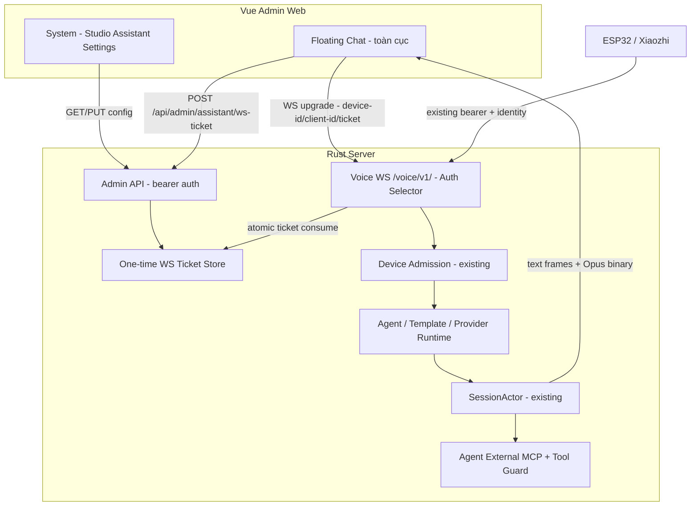
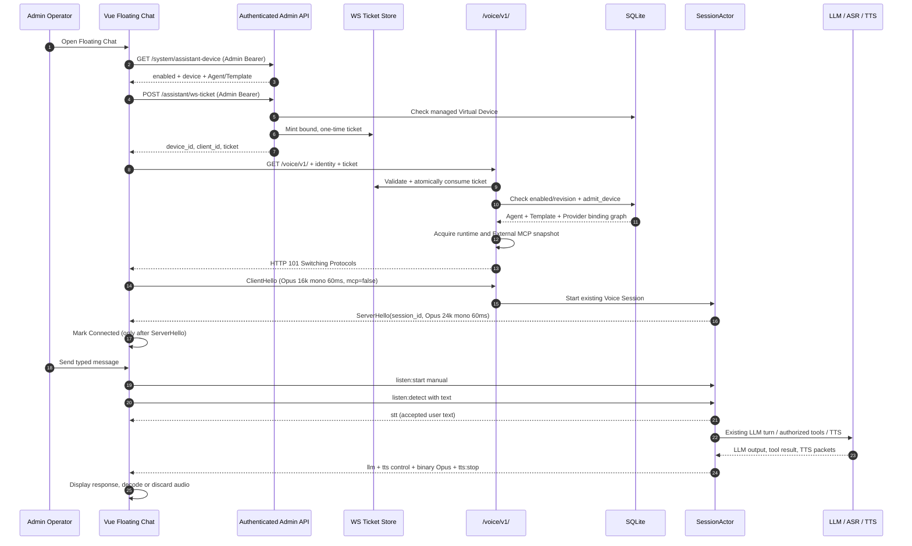

# Studio Assistant — Floating Chat, Virtual Device & Shared Voice WebSocket

> **Repository:** [hailp-vn38/ai-agent-voice](https://github.com/hailp-vn38/ai-agent-voice)
> **Tham chiếu:** [xinnan-tech/xiaozhi-esp32-server](https://github.com/xinnan-tech/xiaozhi-esp32-server)
> **Ngày:** 2026-10-11
> **Trạng thái:** Tài liệu thiết kế đã tối giản theo Ponytail Review; **đã triển khai**; kết quả QA ghi trong [validation](../.scratch/studio-assistant/validation.md).
> **Nguồn chuẩn:** Đây là tài liệu triển khai duy nhất. Tài liệu tên cũ chỉ còn liên kết chuyển hướng.
> **Phạm vi được chốt:** (1) Floating Chat toàn cục trong Admin Web; (2) cấu hình Virtual Device trong **System**; (3) cấp quyền kết nối từ Admin API; (4) **dùng lại** `/voice/v1/`, Device Admission, Agent/Template/Providers, SessionActor, ASR/LLM/TTS, External MCP hiện tại. **Không** tối ưu `text-only`.

## 0. Quyết định kiến trúc (bắt buộc)

1. **Một Widget toàn cục** gắn một lần trong `AdminShell.vue`, không thêm `/playground`, không thay layout hiện hành của Agents/Providers/Devices/System ngoài một mục cấu hình tại System.
2. **Một Virtual Device server-managed**, lưu thành **Device thực sự trong bảng `devices` hiện tại** và được gắn Agent + optional Template override bằng các quan hệ đang dùng. Chỉ có **một bản ghi loại `web_assistant` cho deployment**. Không tạo Device mới khi mở tab/browser.
3. **Chung Voice WebSocket `/voice/v1/`**. Sau khi xác thực, Virtual Device đi qua **Device Admission → Effective Session Profile → Provider Runtime → SessionActor → MCP Tool Round** giống thiết bị vật lý. Không tạo `AssistantRuntime`, `Assistant WS`, `SSE chat`, `Agent resolver` hoặc `Provider catalog` thứ hai.
4. **Virtual Device không cần enrollment code**. Admin cấu hình và tạo/kích hoạt Virtual Device trong System. Browser mở WS bằng **one-time ticket** lấy từ Admin API; **không nhận và không dùng** server-wide `auth.token` của ESP32.
5. **Không cấp quyền bằng `device_id`/`client_id`**: đây chỉ là identity. Mọi Web Assistant WS đều phải có ticket, và mọi Device vật lý phải tiếp tục đi theo transport bearer/admission hiện có. Hai đường xác thực **không fallback sang nhau**.
6. **Provider lấy qua Agent → Template** hiện có. Không lưu LLM/API key trong System Assistant settings. `listen:detect` là đường nhập text hiện có; `listen:start`/Opus/ASR phục vụ microphone; TTS vẫn chạy theo pipeline hiện tại kể cả lượt nhập text.
7. **MCP hiện có:** External MCP từ Agent binding và tool allowlist. Browser **không** quảng cáo Device MCP: `features.mcp=false`. Các Admin MCP tools (như `update_provider`) **không tồn tại sẵn** và **không thuộc phạm vi triển khai này**; không được hiển thị thành kết quả giả.
8. **Không mở rộng quyền:** Virtual Device không mặc nhiên được gọi Admin API hoặc công cụ quản trị nhạy cảm. Tiếp tục áp dụng Agent External MCP default-deny, fingerprint/revision guard, chính sách sensitive tool/Independent Confirmation hiện hành.

### 0.1. Mục tiêu nghiệm thu

- Quản trị viên cấu hình Agent/Template cho Floating Chat tại **System → Studio Assistant**; không nhập mã enrollment.
- Người đã nhập Admin token mở nút chat ở mọi page, widget tự xin ticket rồi kết nối thành công tới **`/voice/v1/`** bằng browser WebSocket.
- Có đủ hai thao tác: gõ text → `listen:start manual` → `listen:detect` → nhận `stt`, `llm`, `tts`; và bấm mic → Opus uplink → ASR/LLM/TTS.
- Audio downlink Opus chạy đúng hoặc được tiêu thụ/bỏ qua có kiểm soát khi tắt loa; không làm kẹt queue/turn.
- Hội thoại giữ xuyên route; UI hiển thị đúng Connecting/Connected/Listening/Thinking/Speaking/Error; close/reopen không tạo session lặp và không dựng Tool/Approval Card chưa có giao thức hỗ trợ.
- ESP32/unknown Device/enrollment/OTA tiếp tục hoạt động không đổi.

## 1. Hiện trạng đã đối chiếu từ codebase

| Nguồn | Hiện trạng xác minh | Tác động |
| --- | --- | --- |
| `apps/admin-web/src/App.vue` | `RouterView` chỉ render khi `auth.adminToken` tồn tại. | Widget phải gated bởi auth; chỉ presence token chưa chứng minh token hợp lệ, endpoint ticket sẽ xác minh thật. |
| `apps/admin-web/src/layouts/AdminShell.vue` | Bao toàn bộ trang, có Sidebar/Teleport drawer. | Mount Widget một lần, Teleport body. |
| `apps/admin-web/src/router/index.ts` | Có routes Overview/Agents/Templates/Providers/Devices/Speakers/MCP/System. | Ánh xạ context với route hiện có; không thêm route chat. |
| `apps/admin-web/src/stores/auth.ts`, `src/api/client.ts` | Admin token từ `sessionStorage`/env, `request()` gắn `Authorization: Bearer`. | Dùng authenticated HTTP để xin WS ticket; không truyền Admin token qua WS. |
| `crates/voice-agent-server/src/app/mod.rs` | `/voice/v1/` là WebSocket route; `/api/admin/*` được mount riêng khi enabled. | Dùng cùng đường WS; thêm ticket issuance trong admin router. |
| `crates/voice-agent-server/src/app/websocket.rs` | Kiểm `protocol-version`, `device-id`, `client-id`, Voice bearer, `enrollment::route()`, admission và upgrade. | Bổ sung **tách loại xác thực trước bearer check**, không phá đường cũ. Browser chỉ truyền WS query vì JS không đặt arbitrary upgrade header. |
| `crates/voice-agent-server/src/app/enrollment/mod.rs` | Unknown Device khi enrollment WS enabled → pending code; registered → voice; blocked → reject. | Virtual Device được provision vào `devices` trước khi WS; không vào pending enrollment. |
| `crates/voice-agent-server/src/database/identity/devices.rs` | Device gắn `agent_key`, optional `template_key`, enabled/revision; Admin API tạo Device trực tiếp. | Tái sử dụng quan hệ và CAS/audit; bổ sung **loại Device do server quản lý** không dựa `metadata_json`. |
| `crates/voice-agent-server/src/database/identity/admission.rs` | `admit_device(device_id)` chụp Device→Agent→Template→Provider graph từ DB. | Giữ nguyên resolver; WS ticket gate kiểm loại Device trước admission. |
| `crates/voice-agent-server/src/protocol/client.rs` | Hello v1 Opus 16 kHz mono 60 ms; `listen:start` (manual/auto/realtime), `listen:stop`, `listen:detect`, `abort`, `mcp`. | Text đã có đường hợp lệ, không cần thêm message `chat`. |
| `crates/voice-agent-server/src/session/actor/listening.rs` | `listen:detect` nhận text **khi Listening** (manual/auto), vào LLM pipeline; lệnh manual start trước đó mở ASR. | Browser phải chờ hello, gửi `listen:start manual`, rồi `listen:detect`. Không gửi detect trực tiếp từ Ready. |
| `crates/voice-agent-server/src/session/actor/delivery.rs` | Accepted user text phát `stt`; LLM input lấy từ dialog và profile prompt. | User text hiển thị qua `stt` echo; UI không tự nhân đôi. |
| `docs/flows/05-tts.md`, `protocol/server.rs` | Uplink Opus 16 kHz/60 ms, downlink Opus 24 kHz/60 ms, `tts:start`, `tts:sentence_start`, `tts:stop`. | Web dùng codec phù hợp; `decodeAudioData` không trực tiếp giải mã raw Opus WS packet. |
| `session/actor/tools/catalog.rs`, `docs/api/tool-allowlist.md` | Tool catalog gồm built-in + Device MCP (nếu client quảng cáo) + Agent-scoped External MCP, sensitive default block. | Không cho web giả lập Device MCP; External MCP được resolve bởi flow hiện có. |
| `docs/adr/0074-websocket-enrollment-session.md` | Pending enrollment không promote trực tiếp lên Voice Session; phải reconnect. | Không dùng pending enrollment cho widget. |

**Phân biệt:** đường Auth ticket/System API/Device `kind` và UI Floating Chat trong tài liệu này là **thiết kế mới**. Các `listen`/audio/Agent admission/MCP flow trên là **hành vi có sẵn**.

## 2. Kiến trúc đích



## 3. Database và System Settings

### 3.1. Virtual Device là Device do server quản lý

**Không** chỉ đánh dấu `metadata_json.client_type=web`: metadata có thể sửa từ Admin API, không phải trust source. Đề xuất **migration** bổ sung vào `devices`:

```sql
-- DDL minh họa; coding agent đánh số migration theo hiện trạng repo.
ALTER TABLE devices
ADD COLUMN kind TEXT NOT NULL DEFAULT 'physical'
CHECK (kind IN ('physical', 'web_assistant'));

CREATE UNIQUE INDEX ux_devices_single_web_assistant
ON devices(kind) WHERE kind = 'web_assistant';
```

`kind` bất biến, server-owned; các Device vật lý trước migration mặc định là `physical`. System route nội bộ **upsert duy nhất một** `web_assistant`, với các cột hiện có: `device_id`, `agent_id`, `template_id`, `name`, `enabled`, `revision`. **Không thêm bảng Assistant Profile, không nhân bản Agent/Template/Provider binding.**

- `device_id`: server tạo một lần theo quy tắc `valid_device_identity` hiện có; lưu vĩnh viễn, read-only ở UI; không dùng per-tab UUID làm Device ID.
- `client_id`: cấp **riêng cho từng ticket/WS connection**, không lưu trong Device row.
- `agent_id`: Agent đang enabled.
- `template_id`: optional override của **Template đã link, enabled**; `NULL` dùng default assignment của Agent.
- `enabled=0`: chặn ticket mới, WS mới và đóng session Virtual Device còn sống.
- Với Device bình thường, POST/PATCH/DELETE giữ flow cũ nhưng **không chấp nhận đặt `kind=web_assistant`**; các mutation với bản ghi virtual qua `/api/admin/devices/{id}` phải trả conflict rõ ràng (`managed_device_use_system_settings`). Việc đổi loại Device không hợp lệ trong mọi API.
- Device list/detail có thể hiển thị badge `Web Assistant · Managed`, chỉ quản lý từ System; không cần redesign trang Devices.
- Không dùng `device_id` có thể đoán được làm credential; kể cả biết ID thì không thể mở WS nếu thiếu ticket.

**Ràng buộc dữ liệu:** cập nhật Agent/Template/Enabled trong **cùng transaction** với revision/CAS/audit; uniqueness bảo đảm hai request khởi tạo đồng thời không tạo hai Virtual Device. Khởi tạo lần đầu có thể dùng idempotent create; nếu DB unavailable không tự phục hồi bằng Device giả trong RAM.

### 3.2. Admin API đề xuất (mới)

| Route | Auth | Mục đích |
| --- | --- | --- |
| `GET /api/admin/system/assistant-device` | Admin bearer | Đọc trạng thái/settings của Virtual Device. |
| `PUT /api/admin/system/assistant-device` | Admin bearer + `If-Match` khi update | Tạo một lần hoặc sửa Agent, Template, Enabled. CAS/audit và giới hạn chỉnh sửa. |
| `POST /api/admin/assistant/ws-ticket` | Admin bearer | Xin ticket dùng một lần, ràng buộc Virtual Device và instance kết nối. |

Không thêm endpoint chat/message HTTP riêng. Nếu Admin API bị disable thì Floating Chat không khả dụng.

**GET khi chưa cấu hình** (200, trạng thái rõ ràng):

```json
{
  "configured": false,
  "enabled": false,
  "device_id": null,
  "agent_key": null,
  "template_key": null,
  "revision": null,
  "active_connections": 0
}
```

**PUT lần đầu** (server tạo ID, trả 201 hoặc 200 nhất quán):

```http
PUT /api/admin/system/assistant-device
Authorization: Bearer <ADMIN_TOKEN>
Content-Type: application/json

{"enabled":true,"agent_key":"studio_assistant","template_key":"admin_assistant_vi"}
```

**PUT khi đã có**: bắt buộc `If-Match: "<revision>"` như Admin API hiện tại. `template_key:null` nghĩa là dùng Template mặc định của Agent. Khi server trả 409 `revision_conflict`, web tải lại state để người dùng quyết định; không tự ghi đè.

**Response ví dụ:**

```json
{
  "configured": true,
  "enabled": true,
  "device_id": "web_assistant_8f3c2d1a",
  "kind": "web_assistant",
  "agent_key": "studio_assistant",
  "template_key": "admin_assistant_vi",
  "revision": 3,
  "active_connections": 1
}
```

**Validation server:** `enabled=true` chỉ chấp nhận Agent enabled và Template hợp lệ đã link Agent; cả lúc đổi Agent/Template phải kiểm tra toàn bộ graph. Dùng nullable Template theo quy tắc admission hiện có. Lỗi typed: `assistant_not_configured`, `assistant_disabled`, `invalid_agent`, `invalid_template_override`, `revision_conflict`, `database_unavailable`.

### 3.3. UI System → Studio Assistant

Thêm card/section trong trang System hiện tại (`apps/admin-web/src/views/SystemView.vue` hoặc module con), **không** thêm sidebar item.

```text
System / Studio Assistant
+-----------------------------------------------------------------+
| Studio Assistant                                      [Enabled]  |
| Floating Chat dùng chung Voice WebSocket của server             |
|                                                                 |
| Assistant Agent           [ Studio Assistant            v ]       |
| Active Template           [ Admin Assistant VI          v ]       |
|                            hoặc Use Agent Default              |
|                                                                 |
| Managed Virtual Device   web_assistant_8f3c2d1a  [copy]         |
| Connection               Online: 1  ·  Server: Ready             |
| WS                       /voice/v1/ (shared)                     |
|                                                                 |
| [Open Floating Chat]                        [Save Changes]     |
+-----------------------------------------------------------------+
```

- Dropdown chỉ hiển thị Agents enabled và Templates thuộc Agent đã chọn; đổi Agent khiến selection Template không hợp lệ bị xóa/chọn lại.
- Device ID read-only. Không có form nhập enrollment code, Voice bearer, WebSocket URL tùy ý hay Provider credential.
- Tóm tắt Provider **read-only** theo Template (VAD/ASR/LLM/TTS) nếu dữ liệu đã có; bấm vào link tới trang Detail hiện tại. **Không** thêm Provider select độc lập tại System.
- CTA `Open Floating Chat` mở widget toàn cục, sử dụng kết nối thật; **không** tạo phiên WebSocket test riêng. Nếu settings chưa lưu, yêu cầu Save trước khi mở.
- Hiển thị trường lỗi rõ ràng: chưa cấu hình / disabled / Agent-Template invalid / provider unavailable / WS auth denied / WebSocket connection failed.
- Disable hiển thị xác nhận vì các phiên Web Assistant hiện tại sẽ bị đóng. Không xóa Device row mặc định; giữ ID/revision cho re-enable.
- i18n Việt/Anh, dark/light, loading/skeleton/error/retry và accessibility như phần còn lại của System.

## 4. Xác thực trình duyệt bằng Admin-issued WS ticket

### 4.1. Tại sao cần ticket

- Browser `new WebSocket(url)` **không cho tự set** `Authorization`, `device-id` hay `client-id` upgrade headers. `/voice/v1/` hiện có query fallback; tuy nhiên **không đưa** `api.admin_token` hoặc `auth.token` vào query.
- Device/Client ID không phải credential; đăng ký Device từ Admin không chứng minh người đang nối WS đã đăng nhập Admin.
- Ticket scope đúng **Virtual Device + một kết nối**, không cung cấp Admin API/MCP mutation rights.

### 4.2. Interface cấp ticket

```http
POST /api/admin/assistant/ws-ticket
Authorization: Bearer <ADMIN_TOKEN>
Content-Type: application/json

{}
```

Phản hồi **200 OK**, `Cache-Control: no-store`:

```json
{
  "device_id": "web_assistant_8f3c2d1a",
  "client_id": "web_6ae02f97ab3d",
  "ticket": "opaque-random-secret",
  "expires_in_seconds": 30
}
```

- `device_id` lấy từ Virtual Device DB row đã provision/enable; `client_id` sinh server-side per-ticket, tương thích `valid_device_identity`.
- Ticket random CSPRNG **tối thiểu 256 bit**, opaque, TTL 30 giây, one-time; lưu **hash** ticket, expiry và minimal binding trong process memory qua bounded ticket store (không DB persistent, không log plaintext).
- Scope: `purpose=web_assistant_voice`, Device DB primary key + `device_id` + `revision`, `client_id` và origin được allowlist. Ticket ở RAM của đúng process; server restart làm ticket cũ vô hiệu. **Không tin Origin là xác thực**.
- Giới hạn issue rate/burst và ticket pending/concurrent WS; endpoint không tự tạo Device khi chưa config; token sai `401`, disabled/not-configured `409`, overloaded `429`/`503` với typed errors.
- Ticket store có giới hạn memory và atomic consume; kiểm expiry bằng monotonic clock, **lazy eviction** khi issue/consume, không tạo cleanup worker. Server restart mất ticket cũ (expected), frontend xin lại.
- Không trả prompt/Provider credentials/MCP secret trong response.

### 4.3. Browser WebSocket upgrade (cùng `/voice/v1/`)

```js
// Pseudocode: WSS trên HTTPS; tránh log full URL/ticket.
const url = new URL('/voice/v1/', window.location.origin)
url.protocol = window.location.protocol === 'https:' ? 'wss:' : 'ws:'
url.searchParams.set('protocol-version', '1')
url.searchParams.set('device-id', ticket.device_id)
url.searchParams.set('client-id', ticket.client_id)
url.searchParams.set('ticket', ticket.ticket)
const ws = new WebSocket(url.toString())
ws.binaryType = 'arraybuffer'
```

Trong triển khai thực tế cần dùng `VITE_API_BASE_URL` và reverse-proxy/base URL logic từ `src/api/client.ts`, không cố định `window.location.origin` khi API khác origin. Chỉ cho `ws://` trên localhost/trusted development; production buộc `wss://` và cùng-origin/trusted Origin. Proxy phải hỗ trợ HTTP Upgrade và không ghi query string.

**Không gửi** `authorization` query/header cùng ticket để tránh auth ambiguity. Ticket chỉ tồn tại trong JS memory đủ lâu để mở WebSocket; xóa tham chiếu khi socket open/fail. Không lưu vào localStorage, sessionStorage, Pinia persist hay URL history.

### 4.4. Thay đổi bắt buộc trong `websocket.rs`: auth selector fail-closed

Trình tự **trước HTTP upgrade**:

1. Kiểm Application Admission Gate và validate `protocol-version`, `device-id`, `client-id`, giá trị trùng lặp/độ dài/charset; bổ sung query field `ticket`, từ chối duplicate ticket hoặc field auth nhập nhằng.
2. Phân loại Device từ dữ liệu **server-owned** (`devices.kind`) hoặc từ ticket binding nội bộ, **không** dùng `metadata_json`, prefix ID, `client_id`, User-Agent, hay query `type=web`.
3. Nếu là `web_assistant`: **chỉ** chấp nhận ticket đã cấp qua Admin API; kiểm Origin, scope, TTL, device ID, client ID, DB row ID, revision và trạng thái enabled. **Không được fallback** sang shared Voice bearer dù bearer hợp lệ. Không có ticket/sai ticket → 401/403.
4. Nếu là Device `physical`/unknown: **giữ nguyên** transport bearer hiện hành rồi enrollment/Voice admission; **không** chấp nhận ticket như bearer hợp lệ. Unknown Device chỉ đi vào enrollment **sau khi thỏa existing bearer**.
5. Với Virtual Device hợp lệ: **atomic consume ticket** một lần, tiếp tục `enrollment::route` (registered, do đã provision), `admit_device` và toàn bộ Provider/External MCP resolution hiện có. Session được pin vào đúng DB graph như physical Device.
6. Nếu config thay đổi khi ticket đang chờ, revision mismatch → reject, browser xin lại. Nếu WS upgrade/prepare thất bại sau consume, ticket không được replay; xin ticket mới.
7. Gắn registry/cancellation handle của Virtual Device để disable/reconfigure/auth-revoke/server shutdown **đóng phiên WS** và ngăn tool call mới. Không dựa vào việc đợi browser reconnect để thu hồi quyền.

**Chú ý:** nhánh `web_assistant` phải kiểm tra ngay cả khi server Voice bearer đang disabled. Không chỉ thêm `if ticket.is_some()` trước bearer check rồi cho request không có ticket đi tiếp: đó là đường bypass. Định danh thực và nguồn authority phải được verify độc lập.

**Không thay đổi:** các kết quả auth/enrollment của Device vật lý và existing OTA flow; giữ nguyên `session_id` do server cấp và các metrics hiện hành. Tuyệt đối không ghi raw ticket/query vào log/trace/structured error; hiện TraceLayer của server đã sử dụng `uri.path()` — kiểm tra cả reverse proxy, CDN, error reporter.

### 4.5. Các invariants bảo mật

- Virtual Device chỉ tạo/sửa qua System Admin Settings authenticated. Generic CRUD không thể đổi `kind`, tạo kind ảo, xóa/sửa Device ảo, hoặc chuyển physical sang virtual.
- Token của ESP32 không truy cập Virtual Device. Ticket Web Assistant không truy cập Device vật lý, Admin API hay MCP admin tools.
- Ticket use-once, device-bound, client-bound, short TTL, one WS. **Logout phía browser** đóng socket và xóa ticket local; shared Admin token hiện không có phiên người dùng riêng để thu hồi từ xa theo từng browser. **Rotation token server-side** được áp dụng cùng server restart/reconfigure, làm RAM ticket store mất hiệu lực. Audit dùng principal `admin_token`/`web_assistant`, không bịa `user_id`.
- Thu hồi Agent binding, tool allowlist, MCP fingerprint vẫn áp dụng với Virtual Device như mọi Voice Session. Nếu bị revoke, block dispatch và close session theo policy hiện tại.
- Origin check là kiểm soát bổ sung cho browser; không thay thế ticket. Config CORS của HTTP **không bảo vệ WebSocket upgrade** nên validate Origin riêng.
- Không tự động reconnect và phát lại user message/tool call sau mạng gián đoạn: side effect có thể đã diễn ra nhưng client chưa nhận kết quả.

## 5. Flow kết nối WebSocket từ Floating Chat (end-to-end)

### 5.1. Sequence thành công



### 5.2. Tiền điều kiện trước khi bấm nút Chat

- Admin token đang có ở frontend. Ticket endpoint sẽ kiểm tra token thật (presence token không đủ).
- `api.enabled=true` và System Assistant đã provision+enabled, linked Agent/Template hợp lệ.
- Provider profile **đủ VAD/ASR/LLM/TTS** theo admission hiện tại, không miễn trừ runtime nào. MCP outage có thể fail-soft theo flow cũ.
- Server/proxy expose `/voice/v1/` WS upgrade; browser chạy secure context cho microphone (HTTPS hoặc localhost cho dev).
- Cấu hình system có thể lưu trước khi đủ runtime; ticket/WS connect phải báo lỗi `503` chuẩn nếu profile unavailable, không giả Connected.

### 5.3. Client Hello và Server Hello có sẵn

**Client sau khi event `onopen`** (là WebSocket open, *chưa* phải Voice Session ready):

```json
{
  "type": "hello",
  "version": 1,
  "transport": "websocket",
  "audio_params": {
    "format": "opus",
    "sample_rate": 16000,
    "channels": 1,
    "frame_duration": 60
  },
  "features": {
    "pipeline_status": false,
    "speaker_status": false,
    "aec": false,
    "mcp": false
  }
}
```

**Server trả** (schema hiện có trong `protocol/server.rs`):

```json
{
  "type": "hello",
  "transport": "websocket",
  "session_id": "<server-generated-session-id>",
  "audio_params": {
    "format": "opus",
    "sample_rate": 24000,
    "channels": 1,
    "frame_duration": 60
  }
}
```

- Validate hello đúng `type`, `transport`, `session_id` nonempty, downlink audio canonical trước khi đánh dấu Connected.
- `onopen` chỉ là `handshaking`; frontend chưa được gửi text, mic hoặc MCP lúc này.
- Các command sau hello có thể gắn `session_id` hiện hành để chặn nhầm phiên; khi reconnect xóa session ID cũ, không tái sử dụng.
- `features.mcp=false` là chính xác: browser không có `tools/list`/`tools/call` kiểu Device MCP; **Agent External MCP độc lập** và vẫn được server resolve.
- Không giả định ServerHello có `version` field: type hiện có không serialize field đó.

### 5.4. Nhập text: sử dụng `listen:detect` hiện có, không tạo chat event mới

**Điều kiện:** Session `Ready` sau ServerHello, không có turn đang xử lý/phát TTS. Với mỗi text turn:

```json
{"type":"listen","session_id":"<session-id>","state":"start","mode":"manual"}
```

Tiếp đó **sau khi server đã xử lý start**:

```json
{
  "type": "listen",
  "session_id": "<session-id>",
  "state": "detect",
  "text": "Kiểm tra Agent hiện tại"
}
```

**Cảnh báo race:** protocol V1 chưa có `listening.ready` ACK riêng. Gửi hai WS frames tuần tự giữ thứ tự transport nhưng **không tự chứng minh** `SessionActor` đã mở ASR/entered Listening nếu work bị từ chối. Không dùng delay ngẫu nhiên để khắc phục. Với phiên triển khai cơ bản, gửi tuần tự trên cùng WS rồi xác nhận accept bằng `stt` echo; timeout chuyển sang `delivery_unknown`/error, không auto replay. Để đảm bảo trạng thái chính xác, bổ sung **opt-in status acknowledgement** cho Virtual Device (xem §5.8), không sửa semantics của client ESP32.

Actor hiện tại `accept_detect()` chỉ chấp nhận khi phase `Listening` (manual) hoặc auto rearm tương ứng. **Không** gửi `detect` từ phase `Ready`, không gửi `listen:stop` cho text turn. `listen:stop` chỉ dùng sau microphone capture manual.

**Echo và trả lời:**

- Khi `detect` được chấp nhận, server emit `{"type":"stt","session_id":"...","text":"..."}` ngay cả với typed text, do `commit_user_text`.
- Frontend hiển thị message user ngay khi nhấn Send nhưng cập nhật trạng thái `accepted` khi nhận `stt` echo; **không thêm một bubble user thứ hai**.
- Text trả lời từ các frame `type:"llm"` được nối **theo thứ tự segment/frame**, không gọi mỗi frame là một response mới. `llm` hiện là speech segment delivery, **không cam kết streaming token-by-token**.
- Server vẫn sinh TTS theo profile; audio binary phải được tiêu thụ bằng WS message handler dù UI đang tắt loa. Nếu tắt audio, discard packet có giới hạn thay vì lưu một queue vô hạn.
- `tts:stop` đánh dấu kết thúc playback lifecycle khi TTS đã `start`; các failure path có thể không tạo `tts:start/stop`, vì vậy cần terminal indication/timeout/cancel UX (xem §5.8).

### 5.5. Microphone: không thay đổi Voice protocol

- User bấm mic -> request `getUserMedia({audio:true})` **chỉ từ user gesture**, không auto bật mic khi mở chat.
- `AudioWorklet` xử lý microphone PCM, downmix mono, resample canonical 16 kHz, gom 60 ms = 960 samples, Opus encode bằng browser-capable encoder (WebCodecs **nếu thực sự hỗ trợ profile** hoặc JS/WASM Opus encoder có kiểm thử). Gửi **raw Opus packet bytes** qua `ws.send(ArrayBuffer)`; không đóng gói WAV/OGG/WebM, không dùng MediaRecorder `audio/webm` làm packet WS.
- `listen:start manual` -> `turn_status:listening_ready` -> binary frames -> `listen:stop`; server ASR final -> `stt` -> LLM/TTS.
- Stop mic hoặc mất quyền microphone phải giải phóng MediaStream tracks, Worklet, encoder, pending buffers; không để mic thu nền khi panel thu gọn nếu user đã stop.
- Uplink data bound: giới hạn queue, kiểm `ws.bufferedAmount`, không gửi packet muộn sau `listen:stop`/`abort`.
- Downlink trả raw Opus **24 kHz mono 60 ms**, khác uplink; implement Opus decoder chuyên dụng, jitter/playback queue có bound, thứ tự đúng và cleanup theo `tts:start`/`tts:stop`/`abort`. `AudioContext.decodeAudioData` không dùng trực tiếp để decode raw Opus packet.
- Khi phát tiếng ra loa, hiển thị waveform/audio indicator, tắt/mở playback. Không khai báo `aec=true` nếu chưa có WebRTC echo cancellation được kiểm chứng theo contract server. Phase đầu set false, tránh kích hoạt barge-in sai.

### 5.6. WebSocket inbound router (minimum)

| WS frame | Kết quả web | Ghi chú |
| --- | --- | --- |
| `type:"hello"` | Ready, lưu `session_id`, validate audio params | `onopen` chưa đủ. |
| `type:"stt"` | Xác nhận typed text hoặc hiển thị ASR final | Không có partial STT WS hiện tại. |
| `type:"llm"` | Append segment text vào assistant bubble đang chạy | Không giả token-level streaming. |
| `type:"tts", state:"start"` | Chuyển `speaking`; khởi tạo bộ phát/decoder nếu cần | Server có thể gửi nhiều segment `sentence_start`. |
| `type:"tts", state:"sentence_start"` | Caption tương ứng segment; không duplicate `llm` | Không hiển thị mỗi segment thành bubble. |
| Binary frame | Opus decode/play hoặc discard an toàn khi muted | Raw Opus 24k mono 60ms. |
| `type:"tts", state:"stop"` | Drain/finish playback, reset audio turn | Handle abort/stale generation. |
| `type:"pipeline_status"` hoặc speaker status | Optional diagnostics khi opt-in | Không phụ thuộc shape chưa verify. |
| Unknown JSON frame | Ignore có kiểm soát, log mã loại không chứa payload | Tương thích firmware/new events. |
| WS close/error | Reconnecting/Disconnected; stop mic/audio và mark turn uncertain | Không tự replay message/tool action. |

**Không có sẵn:** event tiến trình MCP tool hoặc xác nhận hành động theo từng tool. UI chỉ hiển thị tiến trình lượt chat chung và nội dung `llm` thực nhận, không giả lập tool đã chạy.

### 5.7. `abort`, đóng/mở, reconnect và điều hướng

- Bấm Stop/Interrupt khi turn đang chạy: gửi `{"type":"abort","session_id":"..."}`, reset audio UI, không giả nhận completion trước khi server terminalize; giữ history hiển thị nhưng annotate cancelled.
- Thu gọn widget: **không đóng WS** và không hủy đang nói/stream; input/mic button phản ánh trạng thái thực. Chuyển route giữ nguyên WS/store; page unmount không làm mất session.
- Đóng hoàn toàn phiên chat (nút New Chat/Disconnect), Admin token bị clear/sai, app teardown: close WS, stop microphone, decoder, timers, listener, xóa ticket/session_id/dialogue in-memory theo policy.
- WS network error: dùng exponential backoff có giới hạn, trước mỗi kết nối **xin ticket mới**; không dùng lại ticket/`session_id`; không tự động resend `detect`, microphone PCM hay MCP operation. UI thông báo lượt trước có thể đã chạy thành công nhưng kết quả bị mất.
- Server restart/rollover: ticket bị hủy; lấy mới. Settings disable/revision update: hiện `Configuration changed`, reconnect sau khi người dùng chấp nhận; không âm thầm đổi Agent/Template trong active session.
- Per WS một active turn. Button Send bị disable trong `connecting`, `handshaking`, `listening`, `processing`, `speaking`, `aborting`, `unknown_outcome`; có thể hỗ trợ Abort để bắt đầu turn mới.

### 5.8. Status ACK / terminal event: đề xuất tối thiểu cho UX tin cậy

Flow Voice V1 hiện tập trung vào audio và **không có general-purpose `chat.turn_completed`**. Đối với chat text/mic, nếu `start` không được admit hoặc LLM/TTS thất bại trước `tts:start`, chỉ dựa vào `tts:stop` sẽ làm UI kẹt. Để đạt UX ổn định mà **không tạo protocol mới**, bổ sung opt-in capability riêng cho managed Web Assistant:

```json
{"type":"hello","version":1,"transport":"websocket","audio_params":{"format":"opus","sample_rate":16000,"channels":1,"frame_duration":60},"features":{"pipeline_status":false,"speaker_status":false,"aec":false,"mcp":false,"turn_status":true}}
```

`turn_status` là **extension mới cần triển khai**, không phải flag đang hoạt động. Server hiện bỏ qua unknown feature key; phải implement rõ ràng phía parser và SessionActor trước khi frontend phụ thuộc. Chỉ emit với authenticated Web Assistant đã opt-in:

```json
{"type":"turn_status","session_id":"...","state":"listening_ready"}
{"type":"turn_status","session_id":"...","state":"completed","turn_id":1,"outcome":"normal"}
```

- Trạng thái `listening_ready` chỉ emit sau khi worker manual listen được mở/phase Listening thật; frontend **đợi ACK** rồi mới gửi `detect` hoặc Opus. Nếu không thể cấp ASR lease, emit `rejected` có reason code không lộ dữ liệu.
- `stt` echo đã là bằng chứng `detect` được accept, **không** tạo `turn_status:accepted` riêng. `completed`/`failed`/`cancelled` bám **lifecycle turn terminal thực**, không false-positive; kiểm tra writer semantics trước khi map.
- Extension **không** thay đổi các JSON event hiện có, không đổi binary Opus format, không ảnh hưởng ESP32 nếu không opt-in.
- **Scope này yêu cầu** extension `listening_ready` và terminal status để tránh race và UI kẹt. Không thay bằng timeout giả `listening_ready`; timeout chỉ báo lỗi/unknown outcome.

## 6. Floating Chat — UI/UX từ tài liệu cũ

### 6.1. Vị trí, layout và tương tác

- Floating launcher **56 × 56 px**, `position:fixed`, góc dưới phải `right/bottom:24px`, tính `safe-area-inset-bottom`; icon `Bot`/`MessageCircle`/`Sparkles`, accent hiện có.
- Desktop panel rộng `min(420px, 100vw - 32px)`, cao `min(650px, 100dvh - 100px)`, anchored trên nút chat. Hiệu ứng scale/fade 150–200 ms, tôn trọng `prefers-reduced-motion`.
- Mobile: full-height overlay/sheet, header cố định, message list scroll riêng và input né virtual keyboard. Không che modal xác nhận khác; dùng z-index token hợp lý.
- `Teleport to="body"` và Widget mount **một lần** tại `AdminShell`, nhưng chỉ render khi user đang có Admin auth state. Khi đổi route không mất WS session, mic state hoặc messages.
- Keyboard: Enter gửi, Shift+Enter xuống dòng, Escape thu gọn, focus trap chỉ với mobile modal sheet, focus return về launcher, labels/readable contrast/dark-light.

### 6.2. Bố cục panel

```text
+------------------------------------------------+
| [AI] Studio Assistant        [Connected] [-] [x]|
| Agent: Studio Assistant · Template: Admin VI    |
+------------------------------------------------+
| Context: Agent / home_assistant            [x]   |
+------------------------------------------------+
| User: Kiểm tra Agent này                        |
|                                                |
| Assistant: Tôi đang kiểm tra...                 |
|                                                |
| Assistant: Kết quả...                          |
|                                                |
+------------------------------------------------+
| Suggestions: [System Status] [Agent Providers]  |
| [Hỏi Studio Assistant...                  ] [>] |
| [mic] [speaker toggle] [interrupt / disconnect] |
+------------------------------------------------+
```

### 6.3. Các trạng thái bắt buộc

| State | UI |
| --- | --- |
| `disabled` | Nút chat disabled/tooltip hoặc panel dẫn tới System → Studio Assistant; không xin ticket. |
| `unconfigured` | Empty state + CTA “Mở System Settings”; không tự tạo Agent/Device khi click widget. |
| `auth_error` | Admin token không hợp lệ; nhắc xác thực lại, không hiển thị bí mật. |
| `connecting` | Xin ticket, connect WebSocket; spinner. |
| `handshaking` | Đợi ServerHello; không cho Send. |
| `ready` | Input text, suggestions, mic có điều kiện quyền browser. |
| `listening` | Mic waveform và Stop Recording; listening-ready ACK hoặc trạng thái được server xác nhận. |
| `processing` | Assistant đang xử lý, Disable Send, Stop/Abort. |
| `speaking` | Audio indicator, toggle speaker, interruption nếu hỗ trợ. |
| `reconnecting` | Offline, retry với ticket mới, không replay turn. |
| `uncertain` | Kết quả turn trước chưa biết, không tự gửi lại lệnh. |
| `error` | Reason code an toàn + Retry Connect/Settings link. |

### 6.4. Nội dung hội thoại

- Các message UI chỉ cần `user`, `assistant`, `system_notice`. Typed user bubble xuất hiện khi Send, ở trạng thái `pending` cho tới khi `stt` echo xác nhận; mic ASR final tạo bubble từ `stt`.
- `llm` segments append vào **một** assistant bubble cho active turn. Chỉ hiển thị trạng thái chung “Đang xử lý” khi MCP/LLM chưa kết thúc; không tự suy diễn tên/kết quả tool từ LLM text.
- Chat markdown phải sanitize, escape LLM output; không render HTML tùy ý hoặc `javascript:` links. Không hiển thị raw prompt/secret.
- Dùng memory Pinia, refresh có thể reset UI session. Nếu server bật Voice transcript capture theo profile, UI phải thông báo retention thực tế; không cam kết chat tuyệt đối không được lưu server.

### 6.5. Context-aware nhưng không vượt qua authority

Trong `AssistantWidget.vue`, dùng `useRoute()` và một `computed` map route thành context chip/suggestions (chưa cần composable riêng):

| Route | Context trong UI |
| --- | --- |
| `/overview`, `/system` | `overview` / `system` |
| `/agents/:agentId` | `{page:'agent-detail',resourceKey:agentId}` |
| `/templates/:templateId` | `{page:'template-detail',resourceKey:templateId}` |
| `/providers/:key` | `{page:'provider-detail',resourceKey:key}` |
| `/devices/:deviceId` | `{page:'device-detail',resourceKey:deviceId}` |
| `/speakers/:speakerKey` | `{page:'speaker-detail',resourceKey:speakerKey}` |
| `/mcp/:key` | `{page:'mcp-detail',resourceKey:key}` |

- Đổi route cập nhật chip và suggestions; **không** tự đổi Agent/Template/Device của WS giữa phiên.
- Khi user hỏi “Agent này”, web có thể hiển thị chip và **chèn thông tin tham chiếu ngữ cảnh trong text người dùng nhìn thấy/xác nhận trước khi Send** (ví dụ `Đối với agent home_assistant: ...`). Không có hidden system prompt từ client và không thêm `context` field vào `listen` khi chưa có protocol/server support.
- Nếu về sau cần context tự động không hiển thị, thiết kế riêng typed event/bounded resolver; không coi nội dung route là tool authority. Không gửi Pinia state, token, provider config, secrets.

### 6.6. UX kết nối và quyền micro

- Mặc định **lazy-connect khi mở widget** sau khi config ready; không mở WS ngay trên mỗi page load. Thu gọn chỉ ẩn panel và **giữ WS**, không thêm idle-disconnect timer.
- Trên tab ẩn/background, không tự ghi mic. Nếu đang thu và tab mất visibility, dừng capture an toàn, báo cho user.
- Speaker muted chỉ tắt playback, **không** tắt việc tiêu thụ binary WS frames hoặc TTS processing của server.
- Hai trình duyệt/tab có thể mở cùng một Virtual Device, nhưng session IDs khác và giữ hội thoại riêng; backend cần per-device concurrency cap, không dùng global conversation state giữa các tabs.

## 7. Frontend implementation — Vue 3 / Pinia / TypeScript

### 7.1. Đề xuất thư mục

```text
apps/admin-web/src/
├── App.vue
├── layouts/
│   └── AdminShell.vue                     # mount global widget đúng một lần
├── components/assistant/
│   ├── AssistantWidget.vue                # launcher + Teleport + auth gating
│   ├── AssistantPanel.vue                 # desktop/mobile panel
│   ├── AssistantMessages.vue              # bubble list + scrolling
│   └── AssistantInput.vue                 # text + mic + abort + mute
├── components/system/
│   └── AssistantDeviceSettings.vue        # System settings section
├── modules/assistant/
│   ├── voiceClient.ts                     # connect/hello/listen/abort/close interface
│   ├── protocol.ts                        # typed parser & encoder for v1 WS events
│   └── audio.ts                           # browser Opus capture/playback lifecycle
├── stores/
│   └── assistant.ts                       # cross-route state, one client instance
├── api/
│   ├── assistant.ts                       # GET/PUT settings + POST ticket via request()
│   └── types/assistant.ts
└── i18n/messages.ts                       # vi/en text
```

**Không thêm** route `/playground`, sidebar assistant, per-page overlay, `assistant-sse.ts`, `assistantRuntime.ts` hay browser Device MCP implementation.

### 7.2. Interface nhỏ, implementation sâu

```ts
interface WebAssistantClient {
  connect(): Promise<void>             // GET config -> POST ticket -> WS -> hello
  sendText(text: string): Promise<void> // manual start -> ready -> detect
  startMicrophone(): Promise<void>      // manual start -> ready -> Opus uplink
  stopMicrophone(): Promise<void>       // listen:stop
  interrupt(): void                    // abort current turn
  disconnect(): void                   // cleanup mic/audio/WS
}
```

- Store UI chỉ biết state/message/events từ module, **không** tự thêm query params, parse raw Opus hoặc chia sẻ `WebSocket` khắp các component.
- `voiceClient.ts` sở hữu one-socket-per-widget, ticket lifetime, reconnect, frame router, `session_id`, turn sequencing và cleanup. Mock `fetch`/`WebSocket` ở test seam hiện có; không tạo ba adapter interface giả định.
- `protocol.ts` là seam kiểm soát parsing: validate JSON type, size, session_id; reject frames sai shape có kiểm soát; binary payload xử lý riêng; không mang ticket vào state log.
- `audio.ts` là module bao microphone, encoder/decoder, AudioWorklet, playback queue. Không import trực tiếp ở từng UI component.
- Store/Widget chỉ hiển thị hành vi thực: Connected **sau ServerHello**; typed user message **accepted sau STT**; completion **sau turn terminal**.

### 7.3. State model và transitions

```text
unconfigured / disabled / auth_error
       |
       | open + enabled + authenticated
       v
requesting_ticket -> opening_socket -> handshaking -> ready
                                                 |
                                 +---------------+---------------+
                                 |                               |
                                 v                               v
                           manual_listen                    mic_listen
                                 |                               |
                          listening_ready               listening_ready
                                 |                               |
                          send detect                     send Opus frames
                                 |                               |
                                 v                               v
                              processing <----------------- listen:stop
                                 |
                                 v
                            speaking (TTS)
                                 |
                        terminal / tts:stop
                                 |
                                 v
                                ready

error/close -> disconnected -> request NEW ticket -> ...
```

- State là single source of truth. Nhận WS event từ socket cũ sau reconnect phải bị bỏ theo connection generation/session_id.
- `sendText` không chạy đồng thời `startMicrophone`. Enter nhanh hai lần không sinh hai turn.
- `interrupt` chỉ hợp lệ khi active turn, không dùng để đóng toàn bộ WS.
- Widget thu gọn **không** unmount module/client; chỉ thay panel visibility.
- Hủy kết nối cần cleanup theo đúng thứ tự: invalidate generation -> stop mic -> cancel audio decoder/playback -> detach WS listeners -> close -> clear ephemeral ticket/session info.

### 7.4. Logic kết nối minh họa (pseudocode, không phải code copy-run)

```ts
async function connectAssistant() {
  const config = await assistantApi.getSystemDevice()
  if (!config.configured || !config.enabled) throw new Error('assistant_disabled')

  // authenticated HTTP; Admin token only travels in Authorization header
  const lease = await assistantApi.issueWsTicket()
  const socketUrl = apiWsUrl('/voice/v1/')
  socketUrl.searchParams.set('protocol-version', '1')
  socketUrl.searchParams.set('device-id', lease.device_id)
  socketUrl.searchParams.set('client-id', lease.client_id)
  socketUrl.searchParams.set('ticket', lease.ticket)

  const socket = new WebSocket(socketUrl)
  socket.binaryType = 'arraybuffer'

  // On open: send ClientHello. Resolve connect() only on VALID ServerHello.
  // On error/close/timeout: reject, cleanup, and never replay ticket.
  return await completeVoiceHelloHandshake(socket)
}
```

Yêu cầu về `apiWsUrl()`: dùng đúng API origin từ config/reverse proxy, convert `http → ws`, `https → wss`; giữ path `/voice/v1/` (có trailing slash theo router hiện tại). Không hardcode domain, không log `.toString()` sau khi gắn ticket.

### 7.5. API client + System page

- `src/api/assistant.ts` gọi các endpoint qua `requestJson()` đã có Admin bearer. `requestJson()` phải trả lỗi typed cho `401/409/429/503` để UI hiển thị đúng.
- `AssistantDeviceSettings.vue` load Agent/Template qua store hiện tại; Save dùng conditional revision, chỉ refresh System cards liên quan. `Open Floating Chat` mở chính widget thực tế, không tạo socket kiểm thử độc lập.
- Khi System thay Agent/Template: update Virtual Device `revision`, invalidate các ticket pending; các WS Virtual Device đang sống phải được server đóng theo policy. Widget thấy close, yêu cầu reconnect, sau đó đọc lại settings và hello với profile mới.
- Không cho Widget tự gọi PUT config khi user click: chỉ admin chủ động Save trong System, và chỉ từ Admin HTTP.

## 8. Rust implementation — chỉ những seam cần sửa

### 8.1. Module/file đề nghị

```text
crates/voice-agent-server/src/
├── app/
│   ├── mod.rs                             # giữ /voice/v1/; không thêm /assistant/ws
│   ├── websocket.rs                       # identity + auth selector trước admission
│   ├── state.rs                           # ticket store + lifecycle registry nếu cần
│   ├── admin/
│   │   ├── mod.rs                         # mount Admin config + ticket routes
│   │   └── assistant_device.rs            # System settings + ticket issuance
│   └── web_assistant_auth.rs              # scoped one-time WS ticket operations
├── database/
│   └── identity/
│       ├── devices.rs                     # kind guards cho generic CRUD
│       └── assistant_device.rs            # managed singleton create/update/read
├── session/
│   └── actor/
│       └── ...                            # turn_status opt-in (required)
└── migrations/
    └── <next>_managed_web_assistant.sql
```

**Tái sử dụng nguyên tắc:** existing admission logic, effective profile, provider versions/resource leases, SessionActor, ASR/VAD/LLM/TTS workers và External MCP Tool Guard. Không tạo implementation tương đương trong module web assistant.

### 8.2. Deep module: Web Assistant Admission

Interface đề xuất ở seam **HTTP pre-upgrade**:

```rust
// Conceptual interface, chốt types theo codebase hiện tại.
pub(crate) async fn authorize_web_assistant_upgrade(
    state: &AppState,
    ticket: &str,
    device_id: &str,
    client_id: &str,
    origin: Option<&str>,
) -> Result<AuthorizedWebAssistant, WebAssistantAuthError>;
```

Implementation ẩn ticket hashing/TTL/atomic consume, device kind+revision validation và cancellation scope. Return chỉ là verified authorization context; WebSocket handler dùng kết quả đó để gọi **existing** `admit_device`/profile resolver. Không để SessionActor đọc Admin token, ticket, SQLite hay device kind.

**Tránh TOCTOU:** Device kind/status/revision được kiểm tra tại thời điểm consume và chụp cùng với admission graph/authorization. Nếu cần hai lần đọc, phải recheck cho đúng revision dưới transaction/guard tương ứng trước khi upgrade. Không có khoảng trống cho admin disable/rebind giữa ticket validation và session publication.

### 8.3. Web Assistant cancellation/lifecycle

- Ticket issuer/consumer phải kiểm `state.admission_gate()` và shutdown.
- Concurrent active Web Assistant WS có giới hạn **2 kết nối** cố định ở phiên bản đầu; không mở thêm server config. Không tạo Agent/Device mới cho mỗi connection.
- Per-instance reconnect liên tục có rate limit; WS attempts thất bại không làm bão hòa worker acquisition cho thiết bị vật lý.
- **Disable**: invalidate tickets + gắn cancellation cho mọi Virtual Device WS admitted; close các sessions, không chỉ set enabled=0 trong DB. Audit config update.
- **Rebinding Agent/Template**: immutable profile của existing sessions không tự đổi; chủ động close affected Virtual Device WS, frontend yêu cầu reconnect. Cách này nhất quán thay vì mutate mid-turn.
- **Admin logout:** browser chủ động đóng WS, xóa state/ticket local; với shared Admin token, server không thể suy luận và thu hồi riêng tab khác từ hành động logout cục bộ. **Rotation server-side** áp dụng qua restart/reconfigure (hủy toàn bộ ticket RAM và đóng WS khi drain). Không thêm `auth epoch` trong scope này.

### 8.4. Giới hạn flow MCP trong scope

- Nhờ Agent/Template profile và existing External MCP discovery, Virtual Device có thể gọi **External MCP đã được Agent phê duyệt** giống thiết bị vật lý. Không cần Browser Device MCP.
- `features.mcp=false` nghĩa là không phục vụ `tools/list` từ Browser. Nó **không** có nghĩa tắt External MCP của Agent.
- Không add Admin API write tools in-process chỉ để demo UI. Mọi tool chạy phải thực sự được server công bố/authorized theo existing catalog.
- Sensitive MCP vẫn blocked khi Independent Confirmation chưa được triển khai; không có toggle nào trong System Assistant Settings để bỏ hạn chế.

## 9. Kế hoạch triển khai theo thứ tự phụ thuộc

### Bước A — DB + System API

- [x] Xem migration số mới nhất; thêm `devices.kind` server-owned + unique partial index `web_assistant`.
- [x] Thêm read/upsert managed device transaction, validate Agent/Template assignment, CAS, audit, revision, enable/disable semantics.
- [x] Khóa generic Admin CRUD không cho thao tác trên Virtual Device hoặc tạo/sửa kind qua public API.
- [x] `GET/PUT /api/admin/system/assistant-device` với typed errors và tests.

**Done khi:** System API tạo đúng một Virtual Device không cần enrollment, lưu Agent/Template, generic CRUD không thể đổi loại hay bypass quản lý.

### Bước B — WS Ticket + auth selector

- [x] Ticket store one-time random/hash TTL 30s, bounded lazy eviction, issue rate và active session cap cố định; lifecycle/shutdown.
- [x] `POST /api/admin/assistant/ws-ticket` qua Admin router middleware hiện có.
- [x] `/voice/v1/` accept `ticket` query **chỉ cho kind web_assistant**, preserve physical bearer/enrollment path, atomic consume, Origin check, anti-replay.
- [x] Ticket bind `device_id/client_id/revision`, active-session cancellation/disable/reconfigure.
- [x] Tests cho WS attack/bypass và physical regression trước UI.

**Done khi:** browser authenticated có thể 101/hello qua `/voice/v1/` và unknown ESP32 vẫn cần bearer/enrollment như cũ.

### Bước C — System UI

- [x] `AssistantDeviceSettings.vue` trong System, select Agent/linked Template, preview Providers từ Template, enable/disable, managed Device ID, Save CAS, Open Floating Chat.
- [x] i18n, loading/error/disabled states, dark/light và accessibility.

**Done khi:** operator cấu hình được Studio Assistant hoàn toàn trên System, có nút mở widget thực tế, không nhập code hoặc Voice token.

### Bước D — Status ACK trong shared WS

- [x] Bổ sung opt-in `turn_status` (`listening_ready`, `rejected`, terminal) theo §5.8, chỉ phát cho Virtual Device đã xác thực và opt-in.
- [x] `listening_ready` phát sau khi manual listen được admit; terminal bám writer/actor lifecycle, không suy diễn từ thời gian.
- [x] Test timing: `start` → ready ACK → `detect`, ASR capacity fail, TTS failure trước `tts:start`, abort. Clients ESP32 không opt-in giữ nguyên.

**Done khi:** web có cơ chế biết lúc nào được gửi `detect`/Opus và khi nào turn kết thúc, không cần timer giả.

### Bước E — Floating Widget + Text WS + Microphone

- [x] Mount một lần trong AdminShell, auth gating, launcher/panel/responsive.
- [x] `api/assistant.ts`, `voiceClient.ts`, parser Hello/turn status, `session_id`, WS close/reconnect ticket mới, Pinia cross-route **in memory**.
- [x] Text path `listen:start manual` → `listening_ready` → `listen:detect` → `stt` echo → `llm` segments → TTS controls/binary + terminal.
- [x] Mic AudioWorklet + Opus encoder uplink 16 kHz 60ms, playback/decoder downlink 24 kHz 60ms; bounded discard khi muted, cleanup/cancellation.
- [x] Context chip/suggestions dùng `useRoute()` trong widget; QA TTS multi-segment, ASR final, abort, mic permission và reconnection.

**Done khi:** text và mic hoạt động trong cùng widget, thu gọn/chuyển trang không làm rớt phiên và không làm giảm ổn định WS thiết bị thật.

### Bước F — Docs/QA

- [x] Update `docs/flows/01-websocket.md`, `docs/adr/0074-websocket-enrollment-session.md` (nếu contract mở rộng liên quan), `docs/api/*`, Postman collection, architecture và Web docs.
- [x] Nêu explicit `web_assistant` auth branch + ticket/query log policy + new `turn_status` event nếu implement.
- [x] Chạy backend tests, admin-web unit/typecheck/build, Chromium E2E với mocked Admin/WS và microphone giả; cập nhật tài liệu theo mã thực tế. Hardware ESP32/live Provider E2E chưa chạy; xem validation.

## 10. Ma trận kiểm thử / Acceptance

| Nhóm | Kịch bản | Kết quả bắt buộc |
| --- | --- | --- |
| System | Chưa cấu hình | Widget dẫn về System; không sinh Device/WS ngầm. |
| System | Tạo Virtual Device hai request đồng thời | Một row `kind=web_assistant` duy nhất, không bypass unique. |
| System | Chọn Template không link Agent | 4xx validation; không ghi DB. |
| System | PUT sai revision | 409 CAS; không overwrite. |
| System | Physical Device Generic CRUD | Flow cũ không đổi. |
| System | Generic Device API sửa/xóa virtual / đổi kind | 409 hoặc 403, không mutate. |
| Ticket | Không Admin token / token sai | 401; không cấp ticket. |
| Ticket | Web Assistant disabled/missing | 409; không cấp ticket. |
| Ticket | Dùng lại ticket / hết 30s / random ticket | WS denied; không 101. |
| Ticket | Ticket Device A + query Device B / client ID sai | Denied; không 101. |
| Auth isolation | `auth.token` hợp lệ + Virtual Device ID nhưng thiếu ticket | Denied, không bao giờ vào Voice Session. |
| Auth isolation | Web ticket dùng với physical Device/unknown Device | Denied; không nhập enrollment pending. |
| Auth isolation | Unknown ESP32 đúng Voice bearer | Enrollment behavior không đổi. |
| Auth isolation | HTTP Origin không trusted | Reject web WS; ticket không thay thế Origin protection. |
| Auth isolation | Ticket URL/proxy log | Không xuất ticket/raw query trong app/proxy telemetry. |
| WS | WS `onopen` nhưng chưa ServerHello | UI vẫn `handshaking`, không nhận Send. |
| WS | Hello sai canonical audio/session | Connection closed/rejected, không mark Connected. |
| Text | Start manual chưa accept / ASR worker capacity full | UI không gửi detect sớm (theo ACK); báo typed failure. |
| Text | `detect` đúng sau start | Chính xác một `stt` echo, một user bubble; một LLM turn. |
| Text | `llm` nhiều segments | Một assistant bubble đúng thứ tự/tiếng Việt Unicode. |
| Text + TTS | User mute speaker | Binary Opus được drain/discard bounded; turn vẫn hoàn thành. |
| Audio | Mic 16k/60ms Opus uplink | ASR final valid; downlink Opus 24k/60ms phát đúng thứ tự. |
| Audio | Permission denied/revoke, tab hidden | Stop tracks, đóng encoder sạch, UI error. |
| Lifecycle | Thu gọn widget / đổi route | WS/conversation không bị unmount; mic vẫn theo user action. |
| Lifecycle | Đổi Agent/Template trong System | Invalidate ticket+close old virtual sessions, re-connect lấy profile mới. |
| Lifecycle | Disable Virtual Device khi connected | WS bị đóng, tool dispatch mới bị chặn. |
| Lifecycle | Disconnect trong lúc MCP side effect đang chạy | Không replay khi reconnect; trạng thái outcome có thể unknown. |
| Lifecycle | Hai tabs cùng Virtual Device | `client_id`/`session_id` khác nhau, không trộn messages. |
| MCP | `features.mcp=false`, Agent có External MCP allowlist | External tools vẫn dùng qua Agent snapshot, không discover Device MCP browser. |
| MCP | Sensitive tool chưa Independent Confirmation | Không thể thực thi dù prompt yêu cầu. |
| Security | `metadata_json` giả `client_type=web` | Không đổi quyền/nhánh auth của physical Device. |
| Provider | LLM/VAD/ASR/TTS thiếu ở profile | WS admission fail 503 như hiện tại; không auto text-only fallback. |
| Compatibility | ESP32 OTA/WS manual/auto/realtime | Không hồi quy trong handshake, audio, enrollment. |
| UI | Desktop/mobile/dark-light/keyboard | Widget không che các dialog chính, hỗ trợ focus/reduced motion. |

**Lệnh kiểm tra (theo thực tế repo, không coi như đã chạy):**

```bash
# Rust workspace / integration tests
cargo test -p voice-agent-server

# Admin Web
cd apps/admin-web
npm test
npm run typecheck
npm run build
```

Nếu script `npm test`/`typecheck` tên khác trong `package.json` branch hiện tại, dùng tên thực tế; không tự khẳng định pass. Nên có integration tests Axum WebSocket/Ticket và Vitest mocked VoiceClient, browser E2E cho mic/audio vì jsdom không mô phỏng Opus/worklet đúng.

## 11. Bàn giao cho coding agent

1. Đối chiếu lại migration mới nhất, auth middleware và `valid_device_identity` trên branch triển khai trước khi thay đổi.
2. Thực hiện theo thứ tự **A → B → C → D → E → F**; security + compatibility test của WS ticket phải chạy trước UI.
3. Kiểm chứng các thông điệp mới `turn_status` bằng integration test, chỉ phát cho Virtual Device có opt-in; giữ nguyên ESP32 Voice/OTA/Enrollment.
4. Cập nhật `docs/flows/01-websocket.md`, các API docs và Postman collection sau khi code hoàn tất; báo kết quả test, các bước chưa làm và screenshot desktop/mobile.

**Tóm tắt:** System cấu hình đúng một Virtual Device gắn Agent/Template → Admin Web xin ticket dùng một lần → browser kết nối `/voice/v1/` → Device Admission và SessionActor có sẵn → text `listen:start manual`/`listening_ready`/`listen:detect` hoặc mic Opus → nhận `stt`/`llm`/`tts` + trạng thái terminal. Không tạo runtime/WS/text-only mode mới.
