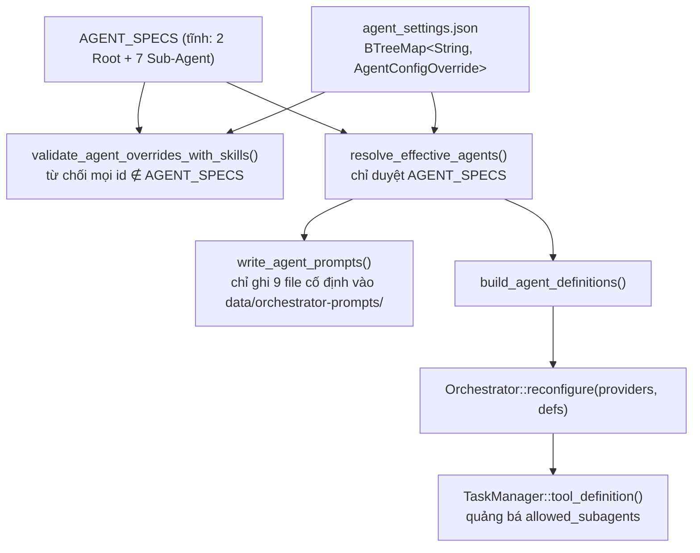
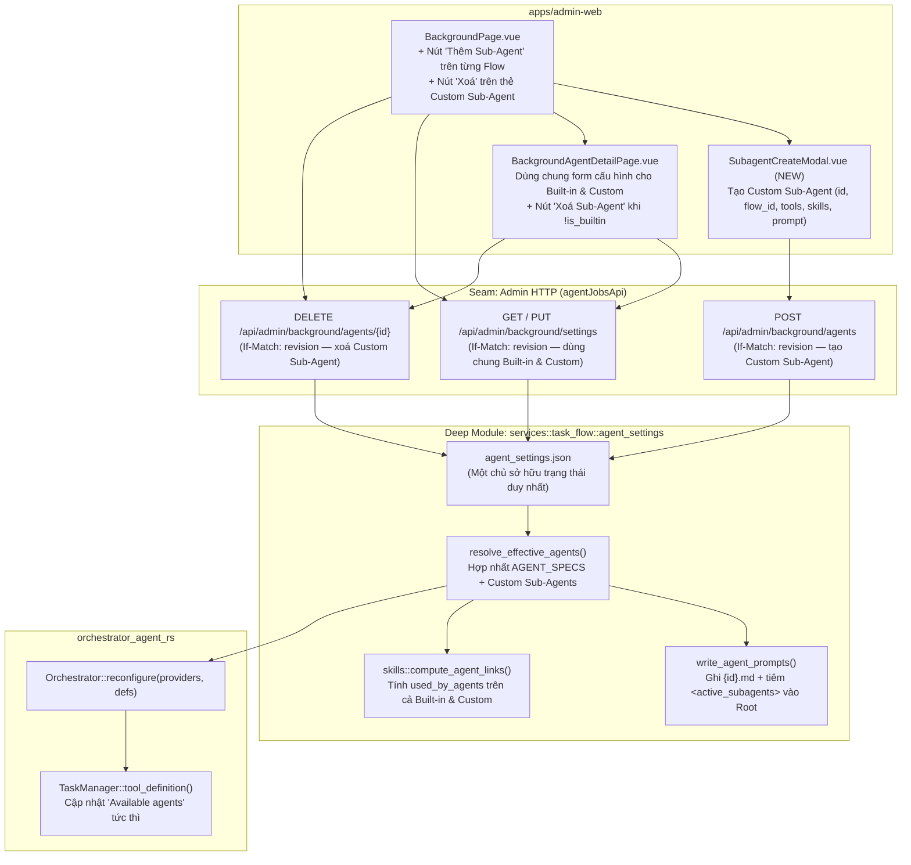

# Sub-Agent Catalog & Web Management — Hướng dẫn Triển khai

> **Repository:** `AI_Agent_Voice_rust` (`voice-agent-server`, `apps/admin-web`) & `orchestrator_agent_rs`  
> **Kỷ luật thiết kế:** [`/codebase-design`](file:///Users/lamphuchai/Desktop/project_rust/.agents/skills/codebase-design/SKILL.md) (**Module**, **Interface**, **Implementation**, **Depth**, **Seam**, **Adapter**, **Leverage**, **Locality**), [`DEEPENING.md`](file:///Users/lamphuchai/Desktop/project_rust/.agents/skills/codebase-design/DEEPENING.md) & [`GLOSSARY.md`](file:///Users/lamphuchai/Desktop/project_rust/AI_Agent_Voice_rust/GLOSSARY.md)  
> **Mục tiêu:** Admin có thể **thêm mới**, **cấu hình** (`Provider`, `Steps`, `Allowed Tools`, `Allowed Skills`, `Description`, `System Prompt` 3 chế độ `Edit / Preview / Split`), **bật/tắt** và **xoá** **Custom Sub-Agent** trực tiếp trên Web UI cho từng Flow (`daily_root` / `wiki_root`), có hiệu lực ngay cho các Agent Run tiếp theo qua `Orchestrator::reconfigure` mà không cần khởi động lại server.

**Bảng quyết định thiết kế (sau đánh giá `/codebase-design`):**

| # | Bẫy thiết kế nông (Shallow Trap) | Quyết định làm sâu (Deepened Decision) |
| :--- | :--- | :--- |
| 1 | Tách Custom Sub-Agent ra hệ thống file `agents/<id>/AGENT.md` riêng → sinh ra 2 nguồn trạng thái song song với `agent_settings.json` và 2 đường lưu khác nhau trên Web UI | **Một chủ sở hữu trạng thái duy nhất:** `PersistedBackgroundSettings` (`agent_settings.json`) dưới cùng `revision`. File `data/orchestrator-prompts/<id>.md` chỉ là tệp phái sinh nội bộ |
| 2 | Chỉ dùng `PUT /background/settings` (vốn merge-insert) → không xoá được key và dễ làm trôi bản nháp (`draft`) chưa lưu trên `BackgroundPage.vue` | Thêm 2 điểm vào nguyên tử `POST /api/admin/background/agents` (Tạo) và `DELETE /api/admin/background/agents/{id}` (Xoá) dùng chung `If-Match: <revision>`; mọi thao tác Sửa vẫn đi qua `PUT /api/admin/background/settings` |
| 3 | `ResolvedAgentSettings` giữ `spec: &'static AgentSpec` → buộc mọi hàm phía sau phải rẽ nhánh `if is_builtin` | Chuẩn hoá cả `AGENT_SPECS` (Built-in) và Custom Sub-Agent về cùng một struct `ResolvedAgentSettings` có `is_builtin: bool` bên trong `resolve_effective_agents()` |
| 4 | `DAILY_ROOT_PROMPT` / `WIKI_ROOT_PROMPT` chỉ liệt kê cứng các Sub-Agent mặc định → Root Orchestrator không biết sự tồn tại của Custom Sub-Agent trong System Prompt | `write_agent_prompts()` tự động nối khối `<active_subagents>` (gồm mọi Sub-Agent đang `enabled` của flow đó kèm `description`) vào cuối file `daily_root.md` / `wiki_root.md` trên đĩa, giữ nguyên `system_prompt` sạch trên UI |
| 5 | Phơi bày `tool_providers` lên Custom Sub-Agent trong khi `CatalogMediaBackend` đọc cứng `"media_creator"` | Không phơi bày `tool_providers` giả cho Custom Sub-Agent; các công cụ media (`image_create`, `video_create`, `tts_synthesize`) vẫn thuộc `media_creator` hoặc dùng cấu hình media chung của hệ thống |
| 6 | Cho phép xoá cả 7 Built-in Sub-Agent → làm gãy `WikiAutoFlowBinding` (`wiki_ingestor`, `wiki_curator`) và pipeline chuẩn của `daily_root` | **Chỉ xoá Custom Sub-Agent** (`is_builtin: false`). Built-in Sub-Agent được bật/tắt (`enabled`), chỉnh sửa và khôi phục mặc định |

---

## 1. Từ vựng Domain

Sử dụng các thuật ngữ chuẩn tại [`GLOSSARY.md`](file:///Users/lamphuchai/Desktop/project_rust/AI_Agent_Voice_rust/GLOSSARY.md#L81-L108): **Background Settings**, **Agent Configuration**, **Root Orchestrator**, **Sub-Agent**, **Workspace ToolKit**, **Job Skill**. Bổ sung 2 thuật ngữ dưới mục **Sub-Agent**:

- **Built-in Sub-Agent**: Một trong 7 Sub-Agent chuyên biệt chuẩn do server cung cấp sẵn (`source_collector`, `wiki_researcher`, `report_stager`, `media_creator`, `reminder_planner` thuộc Flow 1 `daily`; `wiki_ingestor`, `wiki_curator` thuộc Flow 2 `wiki`). Có bản cấu hình và System Prompt mặc định nhúng trong binary; Admin có thể bật/tắt, tùy chỉnh hoặc khôi phục mặc định nhưng không thể xoá bỏ.
  _Avoid_: system worker, hardcoded subagent, locked agent
- **Custom Sub-Agent**: Sub-Agent do Admin tạo thêm trên Web UI gắn với một Flow xác định (`daily` hoặc `wiki`), được cấp quyền công cụ lấy từ tập công cụ hợp lệ của Flow đó và tập Job Skill hiện hành; có thể chỉnh sửa, bật/tắt hoặc xoá vĩnh viễn.
  _Avoid_: user plugin, custom root agent, dynamic script

---

## 2. Flow hiện tại (tóm tắt)



Các điểm chạm hiện tại:
- [`specs.rs`](file:///Users/lamphuchai/Desktop/project_rust/AI_Agent_Voice_rust/crates/voice-agent-server/src/services/task_flow/agent_settings/specs.rs#L18-L300): Định nghĩa `AgentSpec` và mảng tĩnh `AGENT_SPECS`.
- [`agent_settings/mod.rs`](file:///Users/lamphuchai/Desktop/project_rust/AI_Agent_Voice_rust/crates/voice-agent-server/src/services/task_flow/agent_settings/mod.rs#L30-L277): `AgentConfigOverride`, `PersistedBackgroundSettings`, `load_persisted_settings`, `write_agent_prompts`, `validate_agent_overrides_with_skills`, `sync_orchestrator_from_state`.
- [`catalog.rs`](file:///Users/lamphuchai/Desktop/project_rust/AI_Agent_Voice_rust/crates/voice-agent-server/src/services/task_flow/agent_settings/catalog.rs#L325-L538): `ResolvedAgentSettings`, `resolve_effective_agents`, `build_agent_definitions`, `project_agents_json`.
- [`background.rs`](file:///Users/lamphuchai/Desktop/project_rust/AI_Agent_Voice_rust/crates/voice-agent-server/src/app/admin/background.rs#L57-L215): `settings`, `save_settings`.
- [`BackgroundPage.vue`](file:///Users/lamphuchai/Desktop/project_rust/AI_Agent_Voice_rust/apps/admin-web/src/pages/background/BackgroundPage.vue) & [`BackgroundAgentDetailPage.vue`](file:///Users/lamphuchai/Desktop/project_rust/AI_Agent_Voice_rust/apps/admin-web/src/pages/background/BackgroundAgentDetailPage.vue).

---

## 3. Kiến trúc mục tiêu



### 3.1. Phân loại Dependency & Kỷ luật Seam (`DEEPENING.md`)

1. **`agent_settings.json` + `prompts_dir` + `Orchestrator` là Local-substitutable:**
   - Trong toàn bộ test của `voice-agent-server`, module `agent_settings` được kiểm thử trực tiếp với `TempDir` và instance `Orchestrator` thật.
   - **Không** tạo `trait AgentCatalogRepository` hay `trait PromptFileWriter`: chỉ có một adapter nên việc chèn trait ở đây là *hypothetical seam* (chỉ làm tăng indirection).
2. **Seam thật nằm ở Admin HTTP (`app/admin/background.rs` ↔ `agentJobsApi`):**
   - Có 2 adapter thực tế: HTTP client chạy production và mock adapter trong Vitest của `apps/admin-web`.
3. **Một chủ sở hữu cho mỗi state (Locality):**
   - Danh mục & cấu hình Sub-Agent (Built-in overrides + Custom definitions) → chỉ `PersistedBackgroundSettings` trong `agent_settings.json` sở hữu, bảo vệ bằng `background_revision` trong `admin_task_control`.
   - File `data/orchestrator-prompts/<id>.md` → là bộ nhớ đệm trên đĩa do `write_agent_prompts` độc quyền sinh ra và dọn dẹp trước mỗi lần `Orchestrator::reconfigure`.

---

## 4. Deep Module `services::task_flow::agent_settings` (`voice-agent-server`)

### 4.1. Tập công cụ theo Flow & Quy tắc định danh (`specs.rs`)

Mở rộng [`specs.rs`](file:///Users/lamphuchai/Desktop/project_rust/AI_Agent_Voice_rust/crates/voice-agent-server/src/services/task_flow/agent_settings/specs.rs) để định nghĩa ranh giới công cụ hợp lệ cho Custom Sub-Agent của từng Flow:

```rust
/// Các công cụ domain hợp lệ mà một Custom Sub-Agent trong Flow 1 (`daily`) được phép chọn.
/// Không bao gồm các công cụ tạo media (`image_create`, `video_create`, `tts_synthesize`) vốn gắn
/// chặt với `CatalogMediaBackend` của `media_creator`.
pub const CUSTOM_DAILY_SUBAGENT_TOOLS: &[&str] = &[
    "skill",
    "anydoc_inspect_pdf",
    "yt_list_playlist",
    "yt_fetch_transcript",
    "fetch_html",
    "html_extract_metadata",
    "html_extract_article",
    "html_extract_feed",
    "html_extract_links",
    "html_select_elements",
    "add_to_sources",
    "wiki_tree",
    "wiki_query",
    "wiki_get",
    "wiki_multi_get",
    "wiki_metadata",
    "wiki_status",
    "wiki_graph_neighbors",
    "markdown_create",
    "markdown_read",
    "artifact_create",
    "reminder_create",
    "reminder_list",
    "reminder_complete",
    "reminder_delete",
];

/// Các công cụ domain hợp lệ mà một Custom Sub-Agent trong Flow 2 (`wiki`) được phép chọn.
/// Giữ nghiêm ngặt bất biến của Flow 2: chỉ đọc/biên soạn trên `sources/` và `wiki/`, không có
/// công cụ thu thập ngoại vi (`yt_*`, `fetch_html`, `anydoc_*`).
pub const CUSTOM_WIKI_SUBAGENT_TOOLS: &[&str] = &[
    "skill",
    "wiki_tree",
    "wiki_get",
    "wiki_multi_get",
    "wiki_query",
    "wiki_metadata",
    "wiki_status",
    "wiki_graph_neighbors",
    "wiki_ingest_source",
    "wiki_file_synthesis",
    "wiki_write_file",
    "wiki_patch_file",
    "wiki_delete_file",
    "wiki_lint",
    "wiki_schema",
];

/// Trả về `(parent_root_id, available_tools)` cho một `flow_id` hợp lệ (`"daily"` hoặc `"wiki"`).
pub fn custom_subagent_flow_policy(
    flow_id: &str,
) -> Option<(&'static str, &'static [&'static str])> {
    match flow_id.trim() {
        "daily" => Some((DEFAULT_USER_ROOT_AGENT_ID, CUSTOM_DAILY_SUBAGENT_TOOLS)),
        "wiki" => Some((WIKI_AUTOFLOW_ROOT_AGENT_ID, CUSTOM_WIKI_SUBAGENT_TOOLS)),
        _ => None,
    }
}

/// Kiểm tra định danh hợp lệ cho một Custom Sub-Agent:
/// - `1..=64` ký tự, bắt đầu bằng `[a-z0-9]`, chỉ gồm `[a-z0-9_-]`
/// - Không trùng với tên công cụ dự trữ (`subagent`, `skill`)
/// - Không trùng với bất kỳ Built-in Agent nào trong `AGENT_SPECS`
pub fn valid_custom_subagent_id(id: &str) -> bool {
    let bytes = id.as_bytes();
    if bytes.is_empty() || bytes.len() > 64 {
        return false;
    }
    if !bytes[0].is_ascii_lowercase() && !bytes[0].is_ascii_digit() {
        return false;
    }
    if !bytes
        .iter()
        .all(|b| b.is_ascii_lowercase() || b.is_ascii_digit() || *b == b'_' || *b == b'-')
    {
        return false;
    }
    if matches!(id, "subagent" | "skill" | "default" | "all") {
        return false;
    }
    find_agent_spec(id).is_none()
}
```

### 4.2. Cấu trúc lưu trữ & Hợp nhất `ResolvedAgentSettings` (`mod.rs` & `catalog.rs`)

1. **Mở rộng [`AgentConfigOverride`](file:///Users/lamphuchai/Desktop/project_rust/AI_Agent_Voice_rust/crates/voice-agent-server/src/services/task_flow/agent_settings/mod.rs#L31-L48)**:
   ```rust
   #[derive(Clone, Debug, Default, Deserialize, Serialize)]
   pub struct AgentConfigOverride {
       #[serde(default = "default_true")]
       pub enabled: bool,
       /// Chỉ dùng cho Custom Sub-Agent (`"daily"` hoặc `"wiki"`).
       /// Với Built-in Agent, trường này là `None` (luôn lấy từ `AGENT_SPECS`).
       #[serde(default, skip_serializing_if = "Option::is_none")]
       pub flow_id: Option<String>,
       #[serde(default, skip_serializing_if = "Option::is_none")]
       pub provider_ref: Option<String>,
       #[serde(default, skip_serializing_if = "Option::is_none")]
       pub tool_providers: Option<BTreeMap<String, String>>,
       #[serde(default, skip_serializing_if = "Option::is_none")]
       pub steps: Option<u32>,
       #[serde(default, skip_serializing_if = "Option::is_none")]
       pub allowed_tools: Option<Vec<String>>,
       #[serde(default, skip_serializing_if = "Option::is_none")]
       pub allowed_skills: Option<Vec<String>>,
       #[serde(default, skip_serializing_if = "Option::is_none")]
       pub description: Option<String>,
       #[serde(default, skip_serializing_if = "Option::is_none")]
       pub system_prompt: Option<String>,
   }
   ```
   - **Tương thích ngược 100%**: Các file `agent_settings.json` hiện có không chứa `flow_id` sẽ đọc lên với `flow_id: None` cho 9 Built-in Agent.
   - Một entry `(id, ovr)` trong `settings.agents` là:
     - **Built-in Agent** nếu `find_agent_spec(id).is_some()`.
     - **Custom Sub-Agent** nếu `valid_custom_subagent_id(id)` và `ovr.flow_id` thuộc `{"daily", "wiki"}`, đồng thời có `description` và `system_prompt` khác rỗng.

2. **Chuẩn hoá `ResolvedAgentSettings` trong [`catalog.rs`](file:///Users/lamphuchai/Desktop/project_rust/AI_Agent_Voice_rust/crates/voice-agent-server/src/services/task_flow/agent_settings/catalog.rs#L325-L338)**:
   Thay vì giữ `spec: &'static AgentSpec`, `ResolvedAgentSettings` giữ các trường đã chuẩn hoá:
   ```rust
   struct ResolvedAgentSettings {
       id: String,
       flow_id: &'static str,
       parent_id: Option<&'static str>,
       mode: AgentMode,
       is_builtin: bool,
       enabled: bool,
       explicit_ref: Option<String>,
       resolved_provider: ResolvedLlmProvider,
       execution_provider: ResolvedLlmProvider,
       steps: u32,
       default_steps: u32,
       allowed_tools: Vec<String>,
       default_allowed_tools: Vec<String>,
       available_tools: &'static [&'static str],
       allowed_skills: Vec<String>,
       default_allowed_skills: Vec<String>,
       available_skills: Vec<String>,
       allowed_subagents: Vec<String>,
       allowed_capability_tags: &'static [&'static str],
       tool_capability_tags: &'static [(&'static str, &'static str)],
       description: String,
       default_description: String,
       system_prompt: String,
       default_system_prompt: String,
   }
   ```
   - Trong `resolve_effective_agents`:
     1. Duyệt `AGENT_SPECS` trước (giữ nguyên thứ tự hiển thị chuẩn), sau đó duyệt các Custom Sub-Agent trong `settings.agents` (sắp xếp theo `id`).
     2. Khi tính `allowed_subagents` cho một Root Orchestrator (`spec.mode == AgentMode::Primary`):
        - Lấy toàn bộ Built-in Sub-Agent trong `spec.default_subagents` đang `enabled`.
        - Cộng thêm toàn bộ Custom Sub-Agent có cùng `flow_id` đang `enabled`.
   - Trong `project_agents_json`: thêm trường `"is_builtin": eff.is_builtin` vào mỗi phần tử JSON.

### 4.3. Tự động đồng bộ `<active_subagents>` vào Prompt của Root Orchestrator (`mod.rs`)

Để Root Orchestrator (`daily_root` và `wiki_root`) luôn biết chính xác danh sách Sub-Agent hiện có (kể cả khi Admin vừa thêm Custom Sub-Agent mới hoặc vừa tắt một Built-in Sub-Agent) mà không buộc Admin phải sửa tay prompt của Root:

```rust
fn render_root_prompt_with_active_subagents(
    flow_id: &str,
    base_root_prompt: &str,
    settings: &PersistedBackgroundSettings,
) -> String {
    let mut active_entries: Vec<(String, String)> = Vec::new();

    for spec in AGENT_SPECS {
        if spec.flow_id == flow_id && spec.mode != AgentMode::Primary {
            let ovr = settings.agents.get(spec.id);
            if ovr.is_none_or(|o| o.enabled) {
                let desc = ovr
                    .and_then(|o| o.description.as_deref())
                    .map(str::trim)
                    .filter(|s| !s.is_empty())
                    .unwrap_or(spec.default_description);
                active_entries.push((spec.id.to_owned(), desc.to_owned()));
            }
        }
    }

    for (id, ovr) in &settings.agents {
        if find_agent_spec(id).is_none()
            && valid_custom_subagent_id(id)
            && ovr.enabled
            && ovr.flow_id.as_deref().map(str::trim) == Some(flow_id)
        {
            if let Some(desc) = ovr
                .description
                .as_deref()
                .map(str::trim)
                .filter(|s| !s.is_empty())
            {
                active_entries.push((id.clone(), desc.to_owned()));
            }
        }
    }

    let mut out = base_root_prompt.trim_end().to_owned();
    out.push_str("\n\n<active_subagents>\n");
    out.push_str("Danh sách các Sub-Agent đang hoạt động mà bạn được phép ủy quyền qua tool `subagent` trong phiên này:\n");
    for (sub_id, desc) in active_entries {
        out.push_str(&format!("- `{sub_id}`: {desc}\n"));
    }
    out.push_str("</active_subagents>\n");
    out
}
```

Trong [`write_agent_prompts(prompts_dir, settings)`](file:///Users/lamphuchai/Desktop/project_rust/AI_Agent_Voice_rust/crates/voice-agent-server/src/services/task_flow/agent_settings/mod.rs#L124-L140):
1. Với mỗi Built-in Agent trong `AGENT_SPECS`:
   - Nếu `spec.mode == AgentMode::Primary`, ghi `render_root_prompt_with_active_subagents(spec.flow_id, prompt, settings)` vào `<prompts_dir>/<id>.md`.
   - Nếu `spec.mode != AgentMode::Primary`, ghi `prompt` vào `<prompts_dir>/<id>.md`.
2. Với mỗi Custom Sub-Agent hợp lệ trong `settings.agents`:
   - Ghi `ovr.system_prompt` vào `<prompts_dir>/<id>.md`.
3. **Dọn file mồ côi**: Quét `prompts_dir`, xoá mọi file `<stem>.md` mà `<stem>` không thuộc `AGENT_SPECS` và cũng không còn trong `settings.agents`.

### 4.4. Interface Tạo & Xoá Custom Sub-Agent

Thêm vào [`services::task_flow::agent_settings`](file:///Users/lamphuchai/Desktop/project_rust/AI_Agent_Voice_rust/crates/voice-agent-server/src/services/task_flow/agent_settings/mod.rs):

```rust
#[derive(Clone, Debug, Deserialize)]
pub struct CreateCustomSubagentInput {
    pub id: String,
    pub flow_id: String,
    #[serde(default = "default_true")]
    pub enabled: bool,
    #[serde(default)]
    pub provider_ref: Option<String>,
    #[serde(default)]
    pub steps: Option<u32>,
    #[serde(default)]
    pub allowed_tools: Option<Vec<String>>,
    #[serde(default)]
    pub allowed_skills: Option<Vec<String>>,
    pub description: String,
    pub system_prompt: String,
}

#[derive(Debug, PartialEq, Eq)]
pub enum SubagentMutationError {
    InvalidId,
    AlreadyExists,
    NotFound,
    BuiltinCannotBeDeleted,
    RevisionConflict,
    Validation(&'static str),
}
```

**Bất biến ẩn sau Interface:**
1. **`create_custom_subagent(state, expected_rev, input)`**:
   - Kiểm tra `valid_custom_subagent_id(input.id.trim())` → nếu sai trả `InvalidId`.
   - Kiểm tra `custom_subagent_flow_policy(&input.flow_id)` → nếu khác `"daily"` / `"wiki"` trả `Validation("invalid_arguments")`.
   - Kiểm tra `expected_rev == guard.background_revision` → nếu lệch trả `RevisionConflict`.
   - Nếu `settings.agents.contains_key(&id)` → trả `AlreadyExists`.
   - Tạo `AgentConfigOverride` với `flow_id: Some(flow_id)`, mặc định `steps = 15` (nếu không truyền), mặc định `allowed_tools = vec!["skill"]` (hoặc danh sách truyền vào đã validate thuộc `available_tools` của Flow).
   - Gọi `validate_agent_overrides_with_skills(...)` trên bản sao `next_agents`.
   - Tăng `background_revision`, lưu `agent_settings.json`, gọi `sync_orchestrator_from_state(state)` (tự động ghi `<id>.md`, cập nhật `<active_subagents>` của Root, và gọi `Orchestrator::reconfigure`).
2. **`delete_custom_subagent(state, expected_rev, id)`**:
   - Nếu `find_agent_spec(id).is_some()` → trả `BuiltinCannotBeDeleted`.
   - Nếu `!valid_custom_subagent_id(id)` → trả `InvalidId`.
   - Kiểm tra `expected_rev == guard.background_revision` → nếu lệch trả `RevisionConflict`.
   - Nếu `settings.agents.remove(id).is_none()` → trả `NotFound`.
   - Tăng `background_revision`, lưu `agent_settings.json`, gọi `sync_orchestrator_from_state(state)` (tự động xoá `<id>.md` trên đĩa và gọi `Orchestrator::reconfigure`).
3. **Cập nhật [`skills::compute_agent_links`](file:///Users/lamphuchai/Desktop/project_rust/AI_Agent_Voice_rust/crates/voice-agent-server/src/services/task_flow/skills/mod.rs#L111-L137)**:
   - Ngoài vòng lặp `for spec in AGENT_SPECS`, duyệt thêm các Custom Sub-Agent trong `settings.agents`: nếu `ovr.allowed_skills` chứa `skill_id`, thêm `id` vào `used_by_agents`.

---

## 5. Seam Admin HTTP — `app/admin/background.rs`

| Method & Path | Header bắt buộc | Kết quả |
| :--- | :--- | :--- |
| `GET /api/admin/background/settings` | — | `200 OK` + `BackgroundSettings` (mỗi phần tử trong `agents` có thêm `"is_builtin": true \| false`) |
| `PUT /api/admin/background/settings` | `If-Match: "<revision>"` | `200 OK` + `BackgroundSettings` (cập nhật cả Built-in lẫn Custom Sub-Agent hiện có) |
| `POST /api/admin/background/agents` | `If-Match: "<revision>"` | `201 Created` + `BackgroundSettings` (sau khi tạo Custom Sub-Agent và tăng `revision`) |
| `DELETE /api/admin/background/agents/{id}` | `If-Match: "<revision>"` | `200 OK` + `BackgroundSettings` (sau khi xoá Custom Sub-Agent và tăng `revision`) |

Đăng ký route tại [`app/admin/mod.rs`](file:///Users/lamphuchai/Desktop/project_rust/AI_Agent_Voice_rust/crates/voice-agent-server/src/app/admin/mod.rs#L123-L132):

```rust
.route(
    "/background/settings",
    get(background::settings).put(background::save_settings),
)
.route(
    "/background/agents",
    axum::routing::post(background::create_agent),
)
.route(
    "/background/agents/{id}",
    axum::routing::delete(background::delete_agent),
)
```

**Bảng ánh xạ mã lỗi HTTP:**

| `SubagentMutationError` | HTTP Status | `error.code` |
| :--- | :--- | :--- |
| `InvalidId` | `400 Bad Request` | `invalid_agent_id` |
| `BuiltinCannotBeDeleted` | `400 Bad Request` | `builtin_agent_cannot_be_deleted` |
| `Validation(code)` | `400 Bad Request` | `code` (`invalid_arguments`, `invalid_provider`, `provider_capability_mismatch`) |
| `NotFound` | `404 Not Found` | `not_found` |
| `AlreadyExists` | `409 Conflict` | `agent_already_exists` |
| `RevisionConflict` | `409 Conflict` | `revision_conflict` |

> [!IMPORTANT]
> Trong `PUT /api/admin/background/settings` ([`save_settings`](file:///Users/lamphuchai/Desktop/project_rust/AI_Agent_Voice_rust/crates/voice-agent-server/src/app/admin/background.rs#L165-L174)): khi merge `incoming` vào `current.agents`, nếu `k` là Custom Sub-Agent đã tồn tại trong `current.agents` thì tự động giữ lại `flow_id` của `current.agents[k]` nếu `incoming[k].flow_id` là `None`. Nhờ vậy, `BackgroundPage.vue` và `BackgroundAgentDetailPage.vue` không cần sửa logic gửi `BackgroundAgentConfigUpdate` khi bấm Save!

---

## 6. Web — `apps/admin-web`

### 6.1. Contract & Client

Cập nhật [`src/api/types/agent-jobs.ts`](file:///Users/lamphuchai/Desktop/project_rust/AI_Agent_Voice_rust/apps/admin-web/src/api/types/agent-jobs.ts):

```typescript
export interface BackgroundAgentConfig {
  id: string
  flow_id: 'daily' | 'wiki' | (string & {})
  parent_id?: string | null
  mode: 'primary' | 'subagent' | 'all'
  is_builtin?: boolean
  enabled: boolean
  // ... giữ nguyên các trường hiện có
}

export interface CreateSubagentInput {
  id: string
  flow_id: 'daily' | 'wiki'
  enabled?: boolean
  provider_ref?: string | null
  steps?: number
  allowed_tools?: string[]
  allowed_skills?: string[]
  description: string
  system_prompt: string
}
```

Cập nhật [`src/api/agent-jobs.ts`](file:///Users/lamphuchai/Desktop/project_rust/AI_Agent_Voice_rust/apps/admin-web/src/api/agent-jobs.ts):

```typescript
const backgroundAgentsPath = '/api/admin/background/agents'

function backgroundAgentPath(id: string) {
  return backgroundAgentsPath + '/' + encodeURIComponent(id)
}

// Trong agentJobsApi:
createSubagent(input: CreateSubagentInput, revision: number) {
  return requestJson<BackgroundSettings>(
    backgroundAgentsPath,
    jsonRequest('POST', input),
    { revision },
  )
},
deleteSubagent(id: string, revision: number) {
  return requestJson<BackgroundSettings>(
    backgroundAgentPath(id),
    { method: 'DELETE' },
    { revision },
  )
},
```

### 6.2. `SubagentCreateModal.vue` (NEW)

Tạo [`src/pages/background/SubagentCreateModal.vue`](file:///Users/lamphuchai/Desktop/project_rust/AI_Agent_Voice_rust/apps/admin-web/src/pages/background/SubagentCreateModal.vue) theo chuẩn của [`JobSkillEditorModal.vue`](file:///Users/lamphuchai/Desktop/project_rust/AI_Agent_Voice_rust/apps/admin-web/src/pages/background/JobSkillEditorModal.vue):
- **Props**: `open: boolean`, `initialFlowId: 'daily' | 'wiki'`, `revision: number`, `providers: BackgroundProviderOption[]`, `skills: JobSkillSummary[]`, `defaultToolsByFlow: Record<'daily' | 'wiki', string[]>`.
- **Trường nhập liệu**:
  - `flow_id`: chọn Flow 1 (`daily_root`) hoặc Flow 2 (`wiki_root`).
  - `id`: định danh `^[a-z0-9][a-z0-9_-]{0,63}$` (ví dụ `code_reviewer`, `finance_analyst`).
  - `description`: mô tả vai trò (hiển thị cho Root Orchestrator trong `<active_subagents>` và tool `subagent`).
  - `provider_ref`: kế thừa Worker Provider hoặc chọn riêng; `steps` (`1..=100`, mặc định `15`).
  - `allowed_tools`: checklist lọc theo `flow_id` đã chọn.
  - `allowed_skills`: checklist từ `skills` catalog hiện có.
  - `system_prompt`: trình soạn thảo 3 chế độ **Edit / Preview / Split** dùng `renderMarkdown`.
- Khi bấm **Tạo Sub-Agent**: gọi `agentJobsApi.createSubagent(input, revision)` → emit `@created(updatedSettings, createdId)`.

### 6.3. Tích hợp `BackgroundPage.vue` & `BackgroundAgentDetailPage.vue`

1. **[`BackgroundPage.vue`](file:///Users/lamphuchai/Desktop/project_rust/AI_Agent_Voice_rust/apps/admin-web/src/pages/background/BackgroundPage.vue)**:
   - Ở header của mỗi nhóm Flow (`daily` / `wiki`), thêm nút **+ Thêm Sub-Agent** (`data-subagent-create-btn="daily"` / `"wiki"`) mở `SubagentCreateModal`.
   - Trên mỗi thẻ Sub-Agent (`agent.mode !== 'primary'`):
     - Hiển thị badge `Built-in` (`agent.is_builtin !== false`) hoặc `Custom` (`agent.is_builtin === false`).
     - Với Custom Sub-Agent (`agent.is_builtin === false`), hiển thị nút **Xoá** (`data-subagent-delete-card="<id>"`) kèm hộp thoại xác nhận; khi xoá gọi `agentJobsApi.deleteSubagent(agent.id, settings.revision)` và đồng bộ lại `settings` (giữ nguyên các chỉnh sửa nháp chưa lưu của các agent còn lại).
2. **[`BackgroundAgentDetailPage.vue`](file:///Users/lamphuchai/Desktop/project_rust/AI_Agent_Voice_rust/apps/admin-web/src/pages/background/BackgroundAgentDetailPage.vue)**:
   - Hiển thị badge `Built-in` / `Custom` trên `DetailHeader`.
   - Khi `agentSpec.is_builtin === false`:
     - Ẩn nút **Khôi phục mặc định** (`data-reset-agent-default`) và các nút *Restore default* của từng trường (`description`, `system_prompt`, `steps`, `allowed_tools`, `allowed_skills`).
     - Thêm nút **Xoá Sub-Agent** (`data-delete-subagent`) trên thanh actions của `DetailHeader`; sau khi xác nhận và gọi `agentJobsApi.deleteSubagent(agentSpec.id, settings.revision)`, điều hướng về `{ name: 'jobs-settings' }`.
3. **[`backgroundAgentUtils.ts`](file:///Users/lamphuchai/Desktop/project_rust/AI_Agent_Voice_rust/apps/admin-web/src/pages/background/backgroundAgentUtils.ts)**:
   - Trong `isAgentCustomizedFromDefault(agent, current)`: nếu `agent.is_builtin === false`, trả về `false` (vì Custom Sub-Agent không có trạng thái "lệch khỏi bản mặc định nhúng trong binary").

---

## 7. Danh sách File Thay đổi

### 7.1. `voice-agent-server`

| File | Hành động |
| :--- | :--- |
| [`src/services/task_flow/agent_settings/specs.rs`](file:///Users/lamphuchai/Desktop/project_rust/AI_Agent_Voice_rust/crates/voice-agent-server/src/services/task_flow/agent_settings/specs.rs) | Thêm `CUSTOM_DAILY_SUBAGENT_TOOLS`, `CUSTOM_WIKI_SUBAGENT_TOOLS`, `custom_subagent_flow_policy`, `valid_custom_subagent_id` |
| [`src/services/task_flow/agent_settings/mod.rs`](file:///Users/lamphuchai/Desktop/project_rust/AI_Agent_Voice_rust/crates/voice-agent-server/src/services/task_flow/agent_settings/mod.rs) | Thêm `flow_id: Option<String>` vào `AgentConfigOverride`; cập nhật `load_persisted_settings`, `write_agent_prompts` (nối `<active_subagents>` cho Root & dọn file mồ côi), `validate_agent_overrides_with_skills`; thêm `CreateCustomSubagentInput`, `SubagentMutationError`, `create_custom_subagent`, `delete_custom_subagent` |
| [`src/services/task_flow/agent_settings/catalog.rs`](file:///Users/lamphuchai/Desktop/project_rust/AI_Agent_Voice_rust/crates/voice-agent-server/src/services/task_flow/agent_settings/catalog.rs) | Chuẩn hoá `ResolvedAgentSettings` cho cả Built-in và Custom Sub-Agent; gộp Custom Sub-Agent đang `enabled` vào `allowed_subagents` của Root; thêm `"is_builtin"` vào `project_agents_json` |
| [`src/services/task_flow/skills/mod.rs`](file:///Users/lamphuchai/Desktop/project_rust/AI_Agent_Voice_rust/crates/voice-agent-server/src/services/task_flow/skills/mod.rs) | Cập nhật `compute_agent_links` để tính cả Custom Sub-Agent vào `used_by_agents` |
| [`src/app/admin/background.rs`](file:///Users/lamphuchai/Desktop/project_rust/AI_Agent_Voice_rust/crates/voice-agent-server/src/app/admin/background.rs) | Thêm handler `create_agent`, `delete_agent`; giữ `flow_id` của Custom Sub-Agent khi merge trong `save_settings` |
| [`src/app/admin/mod.rs`](file:///Users/lamphuchai/Desktop/project_rust/AI_Agent_Voice_rust/crates/voice-agent-server/src/app/admin/mod.rs) | Đăng ký route `POST /background/agents` và `DELETE /background/agents/{id}` |
| [`tests/background_http.rs`](file:///Users/lamphuchai/Desktop/project_rust/AI_Agent_Voice_rust/crates/voice-agent-server/tests/background_http.rs) | Thêm bộ integration test cho vòng đời Custom Sub-Agent qua HTTP |

### 7.2. `apps/admin-web`

| File | Hành động |
| :--- | :--- |
| [`src/api/types/agent-jobs.ts`](file:///Users/lamphuchai/Desktop/project_rust/AI_Agent_Voice_rust/apps/admin-web/src/api/types/agent-jobs.ts) | Thêm `is_builtin?: boolean` vào `BackgroundAgentConfig`; thêm `CreateSubagentInput` |
| [`src/api/agent-jobs.ts`](file:///Users/lamphuchai/Desktop/project_rust/AI_Agent_Voice_rust/apps/admin-web/src/api/agent-jobs.ts) | Thêm `createSubagent` và `deleteSubagent` |
| [`src/pages/background/backgroundAgentUtils.ts`](file:///Users/lamphuchai/Desktop/project_rust/AI_Agent_Voice_rust/apps/admin-web/src/pages/background/backgroundAgentUtils.ts) | Cập nhật `isAgentCustomizedFromDefault` cho `is_builtin === false` |
| `src/pages/background/SubagentCreateModal.vue` | **NEW**: Modal tạo Custom Sub-Agent (hỗ trợ Edit / Preview / Split cho System Prompt) |
| [`src/pages/background/BackgroundPage.vue`](file:///Users/lamphuchai/Desktop/project_rust/AI_Agent_Voice_rust/apps/admin-web/src/pages/background/BackgroundPage.vue) | Thêm nút **+ Thêm Sub-Agent** trên mỗi Flow, badge `Built-in`/`Custom`, nút **Xoá** trên thẻ Custom Sub-Agent |
| [`src/pages/background/BackgroundAgentDetailPage.vue`](file:///Users/lamphuchai/Desktop/project_rust/AI_Agent_Voice_rust/apps/admin-web/src/pages/background/BackgroundAgentDetailPage.vue) | Hỗ trợ xoá Custom Sub-Agent và ẩn nút khôi phục mặc định khi `!is_builtin` |
| [`src/pages/background/BackgroundPage.test.ts`](file:///Users/lamphuchai/Desktop/project_rust/AI_Agent_Voice_rust/apps/admin-web/src/pages/background/BackgroundPage.test.ts) | Thêm component test cho Tạo / Sửa / Xoá Custom Sub-Agent |
| [`src/i18n/messages.ts`](file:///Users/lamphuchai/Desktop/project_rust/AI_Agent_Voice_rust/apps/admin-web/src/i18n/messages.ts) | Bổ sung các khoá `jobUi.subagentAdd`, `jobUi.subagentDelete*`, `jobUi.subagentBuiltinBadge`, `jobUi.subagentCustomBadge` (vi/en) |

### 7.3. Tài liệu Domain

- [`GLOSSARY.md`](file:///Users/lamphuchai/Desktop/project_rust/AI_Agent_Voice_rust/GLOSSARY.md): Bổ sung **Built-in Sub-Agent** và **Custom Sub-Agent**.
- [`docs/flows/16-task-flow-multi-kind-artifacts.md`](file:///Users/lamphuchai/Desktop/project_rust/AI_Agent_Voice_rust/docs/flows/16-task-flow-multi-kind-artifacts.md): Cập nhật mô tả về khả năng mở rộng Sub-Agent theo từng Flow từ Web UI.

---

## 8. Kiểm thử (Interface là bề mặt test)

Tuân thủ nguyên tắc **Replace, don't layer** trong [`DEEPENING.md`](file:///Users/lamphuchai/Desktop/project_rust/.agents/skills/codebase-design/DEEPENING.md): kiểm thử trực tiếp qua **Interface** của module `agent_settings` và qua **Seam HTTP** (`tests/background_http.rs`), không test các hàm nội bộ riêng lẻ.

### 8.1. Server (`tests/background_http.rs` & `services/task_flow/tests.rs`)
1. **Danh mục mặc định**: `GET /api/admin/background/settings` trả về 9 agent chuẩn với `is_builtin: true`.
2. **Tạo Custom Sub-Agent hợp lệ**:
   - `POST /api/admin/background/agents` với `id = "finance_analyst"`, `flow_id = "daily"`, `If-Match: <revision>` → trả `201 Created`, tăng `revision`.
   - `agents` chứa `finance_analyst` (`is_builtin: false`, `parent_id: "daily_root"`).
   - `daily_root.allowed_subagents` tự động chứa `"finance_analyst"`.
   - File `data/orchestrator-prompts/finance_analyst.md` được tạo và file `daily_root.md` chứa `<active_subagents>` có `- \`finance_analyst\`: ...`.
   - `Orchestrator` runtime thực sự nhận `AgentDefinition` của `finance_analyst` (`orch.agent("finance_analyst").is_some()`).
3. **Sửa Custom Sub-Agent qua cùng đường `PUT /api/admin/background/settings`**:
   - Cập nhật `steps`, `allowed_tools`, `allowed_skills`, `system_prompt` hoặc tắt `enabled: false` của `finance_analyst` qua `PUT /background/settings` → khi `enabled: false`, `"finance_analyst"` biến mất khỏi `daily_root.allowed_subagents`.
4. **Ràng buộc bảo mật & bất biến Flow**:
   - Đặt `id` trùng Built-in (`"source_collector"`), trùng tên tool (`"subagent"`), hoặc chứa ký tự không hợp lệ (`"../bad"`) → `400 invalid_agent_id`.
   - Tạo Custom Sub-Agent ở `flow_id = "wiki"` nhưng truyền `allowed_tools = ["yt_fetch_transcript"]` (tool ngoại vi của Flow 1) → `400 invalid_arguments`.
   - Gửi `POST` trùng `id` đã tồn tại → `409 agent_already_exists`.
   - Gửi sai `If-Match` revision → `409 revision_conflict`.
5. **Xoá Custom Sub-Agent vs Built-in Sub-Agent**:
   - `DELETE /api/admin/background/agents/source_collector` → `400 builtin_agent_cannot_be_deleted`.
   - `DELETE /api/admin/background/agents/finance_analyst` → `200 OK`, biến mất khỏi `settings.agents` và `daily_root.allowed_subagents`, file `data/orchestrator-prompts/finance_analyst.md` bị xoá trên đĩa, `orch.agent("finance_analyst").is_none()`.

### 8.2. Web (`BackgroundPage.test.ts`)
1. Hiển thị badge `Built-in` trên 7 Sub-Agent mặc định (không có nút Xoá) và badge `Custom` kèm nút Xoá trên Custom Sub-Agent.
2. Bấm **+ Thêm Sub-Agent** mở `SubagentCreateModal`, lọc đúng danh sách `available_tools` khi chuyển giữa Flow 1 (`daily`) và Flow 2 (`wiki`), gọi `agentJobsApi.createSubagent` với `revision` hiện tại.
3. Bấm **Xoá** trên thẻ Custom Sub-Agent gọi `agentJobsApi.deleteSubagent` và cập nhật lại danh sách mà không làm mất bản nháp đang sửa của các agent khác.

### 8.3. Lệnh chạy kiểm thử chuẩn (`AGENTS.md`)

```bash
# Server (luôn chạy qua scripts/agent-test.sh)
cd /Users/lamphuchai/Desktop/project_rust/AI_Agent_Voice_rust
./scripts/agent-test.sh targeted task_flow voice-agent-server
./scripts/agent-test.sh targeted background_http voice-agent-server
./scripts/agent-test.sh check voice-agent-server

# Web
./scripts/agent-test.sh web typecheck
./scripts/agent-test.sh web test
./scripts/agent-test.sh web build
```

---

## 9. Thứ tự triển khai

1. **Bước 1 — Deep Module `agent_settings` (`voice-agent-server`)**:
   - Mở rộng `specs.rs`, `AgentConfigOverride`, `ResolvedAgentSettings`, `write_agent_prompts` (kèm `<active_subagents>` và dọn file mồ côi), `create_custom_subagent`, `delete_custom_subagent`, và cập nhật `skills::compute_agent_links`.
   - Viết unit/integration test tại `services/task_flow/tests.rs`.
2. **Bước 2 — Seam Admin HTTP (`app/admin/background.rs` & `tests/background_http.rs`)**:
   - Nối handler `create_agent`, `delete_agent` và cập nhật `save_settings`.
   - Chạy `./scripts/agent-test.sh targeted background_http voice-agent-server`.
3. **Bước 3 — Web UI (`apps/admin-web`)**:
   - Cập nhật types, API client, `SubagentCreateModal.vue`, `BackgroundPage.vue`, `BackgroundAgentDetailPage.vue`, i18n và Vitest tests.
   - Chạy `web typecheck`, `web test`, `web build`.
4. **Bước 4 — Tài liệu Domain (`GLOSSARY.md` & `docs/flows/16-task-flow-multi-kind-artifacts.md`)**.
