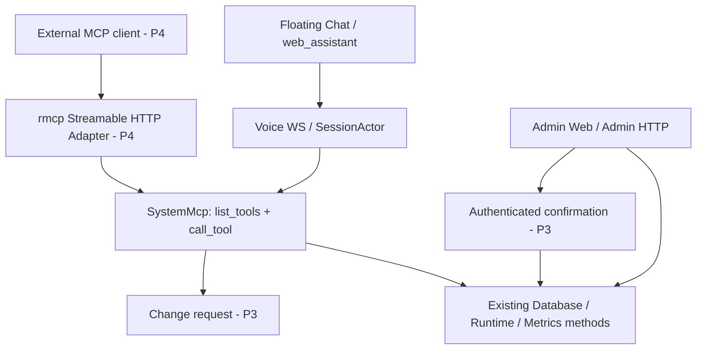

# System Management MCP — Hướng dẫn triển khai (bản tinh gọn)

> **Repository:** [hailp-vn38/ai-agent-voice](https://github.com/hailp-vn38/ai-agent-voice)\
> **Codebase đối chiếu:** `main` tại `20eec783417e3df92ba869c219dcc051b942997c` (11/10/2026)\
> **Trạng thái:** Thiết kế để coding agent triển khai; **P1 đã triển khai**; P2–P4 chưa triển khai.\
> **Mục tiêu:** Floating Chat dùng System MCP của Rust server; sau này có thể phục vụ MCP client ngoài qua **Streamable HTTP** mà không viết lại catalog và nghiệp vụ của tool.

## 1. Quyết định kiến trúc

1. Thêm **`tools::system_mcp::SystemMcp`**: một module nội bộ, không phụ thuộc WebSocket, Axum hay JSON-RPC. Interface chính gồm `list_tools(context)` và `call_tool(context, name, arguments)`.
2. **Floating Chat** chỉ sử dụng System MCP khi WebSocket ticket được xác thực thành công cho Virtual Device `kind=web_assistant`. `SessionActor` gọi Rust trực tiếp; **không gọi HTTP tới localhost**.
3. Tận dụng **shared sequential tool-round executor**, budget, `ToolResult`, cancellation và `tool` status hiện có. Chỉ thêm một `ToolTarget::SystemMcp` và dispatch tương ứng; **không tạo Voice Adapter riêng**.
4. **Read-only trước**. Các lệnh ghi ở P3 chỉ tạo *change request*; Admin phải xác nhận ngoài cuộc hội thoại. Không để LLM tự cấp quyền cho chính nó.
5. **HTTP Adapter là P4**, dùng `rmcp` làm MCP server trên `/mcp/system`. Adapter chỉ ánh xạ giao thức/xác thực vào interface của `SystemMcp`.
6. **Không đưa System MCP vào bảng `mcp_servers`**: bảng này đại diện cho External MCP outbound. `ClientHello.features.mcp=false` tiếp tục giữ nguyên (đó là Device MCP, không phải quyền System MCP).
7. **Không thêm WebSocket event**: `ClientHello.features.tool_status=true` và message `type="tool"` với `started/completed/failed` đã có trong `main`.

### Phạm vi

- **P1:** Sáu tool đọc trạng thái hệ thống/MCP, gọi được qua Floating Chat; giới hạn chỉ phiên `web_assistant` đã xác thực.
- **P2:** Discovery theo quyền riêng, cấu hình grants trong System page, nhãn tool thân thiện trên Floating Chat.
- **P3:** Các tool *đề xuất* thay đổi MCP, xác nhận độc lập qua Admin Web và dùng lại transaction/audit hiện có.
- **P4:** `/mcp/system` với MCP Streamable HTTP và xác thực remote riêng, mặc định **không được mount**.

**Không làm:** Mở System MCP cho Physical Device; cho LLM gọi Admin HTTP; auto-approve MCP tools; dùng Admin bearer làm remote MCP token; viết JSON-RPC stack riêng; retry tool có side effect; refactor toàn bộ Admin API trước P1.

## 2. Điểm nối với codebase hiện tại

| Đường dẫn hiện có | Sử dụng như thế nào |
|---|---|
| `apps/admin-web/src/lib/assistant/protocol.ts` | Giữ `mcp:false`, `tool_status:true`; không thay contract Voice WS. |
| `apps/admin-web/src/stores/assistant.ts` | Reuse `activeTool` và status `tool`. |
| `crates/voice-agent-server/src/app/websocket.rs` | Chỉ grant System MCP khi **server-side** `assistant_connection.is_some()` và admission là managed Virtual Device; không tin ClientHello. |
| `crates/voice-agent-server/src/app/state.rs` | Quản lý instance `Arc<SystemMcp>` và đưa context/capability qua admission. Không đưa `AppState` nguyên khối vào actor. |
| `crates/voice-agent-server/src/session/actor/tools/catalog.rs` | Bổ sung route `ToolTarget::SystemMcp` và LLM-visible definitions. |
| `crates/voice-agent-server/src/session/actor/tools/round.rs` | Dispatch bằng executor tuần tự có sẵn; reuse budget, outcome, status, cancellation. |
| `crates/voice-agent-server/src/database/security/tool_security.rs` | Dùng publication/revocation pattern hiện có để ngăn stale permissions. |
| `crates/voice-agent-server/src/database/mcp/tool_allowlist.rs` | Giữ nguyên External MCP allowlist, revision/fingerprint; System MCP không được bypass phê duyệt này. |
| `crates/voice-agent-server/src/app/admin/{system,mcp_servers,tool_allowlist}.rs` | Tái sử dụng truy vấn/DB mutations đã có; **không gọi HTTP handler từ tool**. Chỉ trích xuất helper nghiệp vụ khi có logic bị lặp thực sự. |
| `crates/voice-agent-server/src/app/mod.rs` | Chỉ P4 mới mount `/mcp/system`. `/mcp/vision/explain` hiện có không phải MCP Streamable HTTP server. |
| Root `Cargo.toml` | `rmcp = "=3.5.0"` hiện bật *client features*; khi làm P4 phải xác minh server features đúng version đã pin. |

Giữ các quyết định: **ADR 0051** (Admin bearer riêng), **0053** (External MCP + approval), **0054** (optimistic revision), **0058** (atomic audit), **0060** (bounded sequential tool round), **0066** (single-owner DB/lifecycle).

### Kiến trúc cần đạt



`SystemMcp` là **deep module**: catalog, validate arguments, authorization, output redaction và dispatch nằm phía sau interface nhỏ. Thay đổi transport không làm thay đổi logic tool.

## 3. Interface tối thiểu

Mã bên dưới là **định hướng**, không phải patch compile-ready. Tận dụng `providers::llm::ToolDefinition` thay vì định nghĩa lại kiểu; HTTP Adapter P4 map sang `rmcp::model::Tool`.

```rust
pub struct SystemMcp {
    // Dependencies được inject từ AppState: Database, metrics, lifecycle, ...
}

pub enum SystemCaller {
    WebAssistant { device_db_id: i64, agent_id: i64 },
    // Chỉ bổ sung biến thể remote khi triển khai P4.
}

// Chỉ trusted server code được tạo context, không deserialize từ tool args.
pub struct SystemToolContext {
    pub caller: SystemCaller,
    pub grants: SystemToolGrants,
    pub request_id: String,
    pub cancellation: tokio_util::sync::CancellationToken,
    pub deadline: tokio::time::Instant,
}

impl SystemMcp {
    pub fn list_tools(&self, ctx: &SystemToolContext)
        -> Vec<crate::providers::llm::ToolDefinition>;

    pub async fn call_tool(&self, ctx: &SystemToolContext, name: &str,
        arguments: serde_json::Value)
        -> Result<serde_json::Value, SystemToolError>;
}
```

- **Không tạo** `ToolBudget`, `ToolOutcome`, event bus hoặc `ToolResult` riêng nếu các kiểu/giới hạn sẵn có đủ dùng. Deadline/cancellation lấy từ caller context và execution budget hiện tại; normalized result đi qua **ToolResult path hiện có**. P4 chỉ chuyển envelope sang MCP `CallToolResult`.
- `SystemCaller` và grants chỉ có nguồn từ admission/authentication server-side. Người dùng hoặc model không được tự truyền `agent_id`, `scope`, `approved`, `confirmation` để tăng quyền.
- `list_tools` lọc catalog theo grants đã cấp; `call_tool` **kiểm tra lại policy** (kể cả khi tên tool đoán được), args schema, giới hạn response và cancellation tại lúc thực thi.
- Mọi tool name/schema cố định, không xung đột với `handle_exit_intent`, `server_switch_template`, Device MCP `self.*` hoặc External MCP `external.*`; resolve theo **typed target**, không dựa vào prefix của input chưa được kiểm tra.
- Tool thực hiện đọc/ghi qua **database/runtime methods**, không gọi `axum::Request`, route Admin hoặc HTTP loopback. Nếu cùng logic xuất hiện ở hai nơi thì trích xuất helper nhỏ tại đúng seam đó; **không cần `ManagementOperations` layer tổng quát**.
- Output phải bounded, không chứa secrets, private headers, full config, prompt hoặc raw internal errors. Tuân thủ `max_tool_result_chars` và cách tạo terminal ToolResult hiện tại.

## 4. Danh sách tool theo giai đoạn

| Phase | Tool | Arguments | Scope | Hành vi |
|---|---|---|---|---|
| P1 | `system_get_status` | `{}` | `system:read` | Readiness, uptime, DB, provider runtime, active sessions; safe fields. |
| P1 | `system_get_resources` | `{}` | `system:read` | Snapshot CPU/RAM từ `system_metrics.latest()`; không có history mới. |
| P1 | `mcp_list_servers` | `{page?,page_size?}` | `mcp:read` | Key, name, enabled, transport; không lộ credentials/URL nội bộ. |
| P1 | `mcp_get_server` | `{server_key}` | `mcp:read` | Metadata an toàn của MCP server; không trả secret ref/header. |
| P1 | `mcp_list_tools` | `{agent_key?,server_key?,page?}` | `mcp:read` | Observed/approved tools và trạng thái quyền; không cho phép chạy tool chưa duyệt. |
| P1 | `mcp_get_agent_bindings` | `{agent_key}` | `mcp:read` | Bindings và trạng thái enabled của Agent. |
| P2 | `mcp_discover_tools` | `{server_key}` | `mcp:discover` | Outbound discovery có quota/timeout; có thể cập nhật observation/revoke khi drift. |
| P3 | `mcp_request_server_change` | `{server_key,enabled,expected_revision}` | `mcp:manage:request` | **Chỉ tạo yêu cầu**, không đổi config ngay. |
| P3 | `mcp_request_agent_binding_change` | `{agent_key,server_key,enabled,expected_agent_revision}` | `mcp:manage:request` | **Chỉ tạo yêu cầu** thay binding. |
| P3 | `mcp_request_tool_review` | `{agent_key,server_key,tool_name,fingerprint,observed_revision,allow,sensitive,expected_revision}` | `mcp:manage:request` | **Chỉ tạo yêu cầu review**; không được tự approve. |

Trong P1 chỉ cần **2 scope**: `system:read` và `mcp:read`. Đến P2 thêm `mcp:discover`; P3 mới thêm `mcp:manage:request`. **Không có tool `mcp:manage:execute` cho LLM**: chỉ Admin confirmation path được quyền commit thay đổi.

### Ví dụ schema

```json
{
  "name": "mcp_get_agent_bindings",
  "description": "Read MCP server bindings of an Agent.",
  "parameters": {
    "type": "object",
    "properties": {"agent_key": {"type": "string"}},
    "required": ["agent_key"],
    "additionalProperties": false
  }
}
```

Khi triển khai phải validate độ dài `agent_key`, key format, page bounds và toàn bộ JSON body **trong Rust**, kể cả khi LLM/tool schema không biểu diễn được hết. Trả lỗi typed qua ToolResult đang có (`isError` chỉ map ở P4), không tạo thêm một envelope `ok/data/request_id/truncated` bắt buộc cho mọi tool.

## 5. Quyền, phiên và revocation

### Quy tắc admission

- Feature `[system_mcp] enabled=false` là **deployment ceiling**, mặc định deny. P1 khi bật flag này, chỉ **verified Web Assistant** được cấp 2 scope đọc; không bật cho Physical Device hay mọi Agent cùng tên.
- Identity lấy từ ticket + Device DB row + Agent admission, **không** từ `ClientHello.features.mcp`, `tool_status`, payload LLM hoặc text chat.
- Snapshot catalog được chốt khi admit; grant mới không tự xuất hiện trong session đang chạy. Nếu cần tool mới, tạo phiên mới.
- `SystemMcp::call_tool` xác minh quyền live trước dispatch, và phải tôn trọng shutdown/revocation. Khi grant bị thu hồi, dùng lock/guard/invalidation hiện có theo hướng fail-closed; không giữ publication lock xuyên qua network I/O.
- Existing External MCP allowlist vẫn độc lập. Có thể **xem** tool chưa duyệt, nhưng không thể biến tool đó thành callable bằng read scope.

### Cấu hình tối thiểu của P1

```toml
[system_mcp]
enabled = false  # Opt-in, mặc định tắt. Chỉ mở read-only cho verified web_assistant.
```

**Không thêm ngay** `[system_mcp.internal]`, `web_assistant_enabled`, `http.path` và nhiều cờ tương đương. Đường dẫn `/mcp/system` cố định; chỉ thêm `system_mcp.http.enabled` khi thực sự triển khai P4.

P2 nếu cần bật/tắt từng quyền qua Web thì lưu grants ở **một nguồn DB có revision**, dùng `enabled` deployment làm ceiling. Quy tắc chuyển tiếp: khi nâng cấp từ P1, grant đọc được khởi tạo tương ứng với quyền đã bật; scope discovery/mutation mặc định **deny**. Không có cả TOML grants lẫn DB grants cạnh tranh precedence.

## 6. P1 — Flow Floating Chat thực thi System MCP

1. Browser xin ticket hiện tại tại `POST /api/admin/assistant/ws-ticket` rồi kết nối `/voice/v1/`.
2. `app/websocket.rs` xác thực `kind=web_assistant`, ticket, origin; `app/state.rs` resolve admission graph. Chỉ khi thỏa điều kiện mới tạo **granted SystemMcp snapshot**; không đặt System MCP vào `resolve_external_mcp()`.
3. Chuyển catalog và context tối thiểu đến `SessionActor` bằng builder hoặc kiểu profile đang dùng. **Không chuyển `AppState`/Admin token vào actor**.
4. `available_llm_tools()` quảng bá System MCP đã grant; `offers_answer_changing_tools()` tính thêm chúng; `resolve_tool()` trả `ToolTarget::SystemMcp`.
5. `dispatch_next_tool()` reuse **sequential tool-round**. Với DB I/O hoặc discovery, chạy operation trong bounded async task và chuyển kết quả qua **completion mailbox hiện có** (chỉ mở rộng mailbox khi bắt buộc). Không `.await` DB/network dài trong vòng event loop của `SessionActor`.
6. Khi nhận completion, đối chiếu session generation + turn identity, bỏ late response sau abort/shutdown; **mỗi completed call đúng một ToolResult**, không retry side effect. LLM tiếp tục trả lời như External MCP.
7. `emit_tool_status()` hiện có gửi `type:"tool"` với `started/completed/failed`. Floating Chat hiển thị trạng thái và câu trả lời ASR/LLM/TTS như trước, không có API WebSocket mới.

Ví dụ: "Hãy kiểm tra CPU, RAM và những MCP Server đang hoạt động." → `system_get_resources` → `mcp_list_servers` → LLM tổng hợp → TTS. Trạng thái công cụ chỉ là **progress**, không phải permission grant hay bằng chứng thành công của request chưa terminalize.

**P1 không yêu cầu sửa Web UI** ngoài nhãn trạng thái nếu cần; xác minh trực tiếp qua Floating Chat. Khi server feature tắt, catalog System MCP phải trống và mọi direct call phải bị deny.

## 7. P2 — Discovery và quyền trong System UI

- Thêm `mcp_discover_tools` sau P1: thao tác này không phải read thuần túy vì có outbound request và có thể cập nhật observed contract/fingerprint. Chỉ chạy với `mcp:discover`, giới hạn network, concurrency, result và timeout bằng cơ chế hiện hữu.
- Thêm phần **System → Studio Assistant → System MCP** để Admin cấp/thu hồi 3 nhóm quyền: đọc trạng thái, đọc MCP, khám phá tool. Cấu hình ở DB có `revision`; UI chỉ sửa grants qua Admin bearer như các trang hiện có. Tool permission khác với `Agent–External MCP binding` và không được tự thêm grant khi chọn Agent.
- Tận dụng `apps/admin-web/src/stores/assistant.ts` `activeTool` để map tên thành nhãn "Đang kiểm tra hệ thống", "Đang khám phá tools"; **không render tool arguments, secret hoặc raw result**. Không tạo timeline tool mới nếu current Floating Chat đã đủ.
- Thu hồi grant chặn tool call mới ngay. Phiên cũ có thể bị đóng để đảm bảo hiệu lực; UI có thể yêu cầu reconnect để nhận catalog mới.

## 8. P3 — Yêu cầu thay đổi + Admin xác nhận (bản tối thiểu)

### Không để LLM tự thực hiện mutation

Các tool P3 (`mcp_request_*`) chỉ validate input và tạo **pending change request**. Một lời nói "đồng ý" hoặc phản hồi do LLM sinh **không** thay được thao tác xác nhận từ Admin UI có authentication riêng.

### Pending requests trong RAM, chưa cần migration

P3 dùng một **bounded in-memory pending registry** trong cùng process Rust, không tạo bảng `system_mcp_change_requests` hoặc proposal lifecycle dài ngay từ đầu:

- Dữ liệu tối thiểu: opaque `id`, caller identity, target, typed normalized command **không chứa secret**, expected revision/fingerprint, expiry và trạng thái `pending/claimed/terminal`.
- TTL ngắn (ví dụ 5 phút), giới hạn số pending toàn cục/theo caller; xóa khi hết hạn hoặc restart. Không coi pending requests là dữ liệu cần phục hồi xuyên restart.
- Claim **một lần bằng atomic state transition** sau khi HTTP Admin authentication thành công và trước khi dispatch mutation; hai admin confirm cùng lúc không được gọi DB mutation hai lần. Sau khi claim, **không retry** request ID đó kể cả khi response bị mất; Admin phải đọc lại trạng thái tài nguyên để đối chiếu.
- Registry chỉ giữ proposal/identity, **không** lưu authority từ lời nói. Confirmation kiểm tra lại Admin bearer, target, live permissions, expiry, expected revision và (khi review tool) fingerprint.
- Nếu triển khai nhiều replica, cần thiết kế persistence/coordination thật; **không** dùng registry per-process làm authority cross-node. P3 này chỉ áp dụng khi một process sở hữu cả proposal và confirmation.

### Admin confirmation routes tối thiểu

| Route dưới `/api/admin` | Mục đích |
|---|---|
| `GET /system-mcp/change-requests` | Xem pending proposals đã được redact. |
| `POST /system-mcp/change-requests/{id}/confirm` | Xác nhận **một** command đã chốt target/payload. |
| `POST /system-mcp/change-requests/{id}/reject` | Từ chối/consume pending proposal. |

**Chỉ thêm endpoint grant settings trong P2**, không thêm bản sao config route trong P3. Confirmation dùng Admin middleware hiện tại cộng Origin checks phù hợp với browser; không reuse WS ticket. UI phải hiển thị target, desired effect và revision để Admin nhấn xác nhận ngoài chat.

### Commit bằng nghiệp vụ DB đã có

1. Middleware kiểm tra Admin bearer + Origin **trước khi chạm registry**. Đọc pending và so khớp target/command; sau đó **atomically claim** để bảo đảm single-dispatch. Ngay trước mutation, tiếp tục revalidate grants, revision/fingerprint và shutdown gate theo publication/DB guard hiện có.
2. Gọi **existing database mutation method** (`mcp_servers`, binding, `tool_allowlist`) vốn giữ `mutation + audit` trong **cùng DB transaction**, thay vì xây dựng proposal transaction mới hoặc gọi HTTP Admin handler. Giữ nguyên `If-Match`/revision conflict, publication lock và invalidation.
3. Thành công: kết thúc request. Conflict/DB failure: đánh dấu terminal failed/uncertain; **không chạy lại mutation** trên cùng request. Nếu timeout hoặc network response không rõ, đọc lại tài nguyên và revision trước quyết định thao tác mới.
4. Chỉ trích xuất DB helper khi Admin handler và System MCP cần chia sẻ code mà chưa có phương thức dùng chung. Không refactor toàn bộ Admin trước.

Cách này **không bảo đảm proposal registry và DB commit là cùng một transaction**; đó là đánh đổi có chủ ý của registry RAM. Điều bắt buộc vẫn giữ là **mutation + audit** atomic ở database và proposal **at-most-once dispatch trong một process**. Nếu sản phẩm cần pending sống qua restart hoặc exactly-once trên nhiều node, khi ấy chuyển sang DB-backed approvals và transaction chung, không làm sớm.

## 9. P4 — Thêm MCP Streamable HTTP mà không sửa SystemMcp

Ở P4 mới tạo `app/mcp_server/mod.rs` (và tách `auth.rs` khi có nhu cầu), mount **`/mcp/system` cố định** khi `system_mcp.http.enabled=true` và remote auth đã được cấu hình hợp lệ.

- Reuse SDK `rmcp` với **server + Streamable HTTP server features** đúng tag đang pin (`rmcp = "=3.5.0"`); xác minh feature names qua Cargo manifest của tag, không tự triển khai JSON-RPC.
- HTTP Adapter chỉ: authenticate remote principal → tạo trusted `SystemToolContext` với scopes đã kiểm chứng → map `tools/list`/`tools/call` sang `SystemMcp` → map kết quả thành `rmcp::model::CallToolResult`. **Không thêm `match tool_name` thứ hai** vào HTTP layer.
- Mặc định **không có route** nếu feature HTTP tắt; không dùng Admin bearer, không forward token vào Admin/External MCP. Khi public, phải có token riêng dành cho resource này (issuer/audience/scope/expiry), HTTPS, Origin/Host validation, limits và revocation. Hỗ trợ OAuth/MCP authorization theo client mục tiêu khi triển khai thực tế.
- Không mô tả trước GET/DELETE/SSE theo các draft/version khác nhau: để `rmcp` quyết định theo phiên bản được hỗ trợ; integration tests với ít nhất hai MCP client tương thích.
- `SystemMcp` không phụ thuộc `rmcp`, nên P4 chỉ phát sinh transport/auth/config/tests, không sửa phần nghiệp vụ từng tool.

**Cấu hình P4 bổ sung (đề xuất):**

```toml
[system_mcp.http]
enabled = false  # Chỉ mount khi dedicated remote authorization verifier đã cấu hình.
```

## 10. File thay đổi và nghiệm thu theo từng phase

| Phase | File/module chính | Điều kiện nghiệm thu |
|---|---|---|
| **P1** | `tools/mod.rs`; **mới** `tools/system_mcp/{mod,catalog}.rs` (chưa cần 5 file con); `app/state.rs`; `config/mod.rs`; `app/websocket.rs`; `session/actor/{mod,construct}.rs`; `session/actor/tools/{catalog,round}.rs`; tests | 6 tool đọc được dữ liệu qua Floating Chat; physical Device bị deny; không có HTTP route; CPU/RAM & MCP metadata được redact/bounded; typecheck/test pass. |
| **P2** | `tools/system_mcp/*` nếu cần tách theo complexity thực; `app/admin/assistant_device.rs` hoặc `system_mcp.rs`; database grants có revision; `apps/admin-web/src/components/system/AssistantDeviceSettings.vue`; API web + Floating Chat labels | Admin bật/tắt grant; `mcp_discover_tools` có timeout, không tự approve; revoke chặn call mới; history/WS/TTS không regress. |
| **P3** | `tools/system_mcp/*` pending registry; `app/admin/system_mcp.rs`; existing `database/mcp/{mcp_servers/mod,tool_allowlist}.rs`; Admin confirmation UI; tests | Proposal không gây side effect; Admin confirm một lần; stale revision deny; mutation+audit atomic; không tự approve bằng LLM. **Không cần approval migration P3**. |
| **P4** | Root `Cargo.toml`, crate manifest; **mới** `app/mcp_server/mod.rs` (+ auth code cần thiết); `app/mod.rs`; `config/mod.rs`; integration tests + `docs/api/system-mcp.md` | Endpoint disabled mặc định; verified remote auth; `initialize/tools/list/tools/call` hoạt động bằng `rmcp`; hai client; core tool không đổi. |

### Test tối thiểu, dùng lại infrastructure sẵn có

- **P1:** unit tests `list_tools/call_tool` cho allowed/denied/schema/limits; integration test `web_assistant` happy path; physical device cùng Agent không thấy System MCP; guessed tool name deny; failure DB trả typed error; abort/late completion; status started→completed/failed.
- **P2:** revoke/grant race, no external tool self-approval; discovery timeout/drift; verify `activeTool` hiển thị tên an toàn, thu gọn Floating Chat không ngắt WS/TTS.
- **P3:** LLM "đồng ý" không confirm; expired/invalid Origin/unauthorized confirm deny; concurrent double-confirm chỉ **một dispatch**; stale revision/fingerprint deny; audit failure rollback mutation; restart xóa proposals.
- **P4:** route absent khi disabled; wrong audience/scope deny; invalid Origin; protocol negotiation; two-client interoperability; cùng tool output giữa Voice và HTTP (wire envelope khác nhau).

Chạy các lệnh phù hợp khi file đã tồn tại:

```bash
cargo fmt --all -- --check
cargo clippy -p voice-agent-server --all-targets -- -D warnings
cargo test -p voice-agent-server --test web_assistant
cargo test -p voice-agent-server --test tool_round_executor
cargo test -p voice-agent-server --test admin_api
# Thêm test system_mcp khi P1 tạo test file.
cd apps/admin-web
npm ci && npm run typecheck && npm test && npm run build
```

**Nguyên tắc khi coding agent thực hiện:** Chạy P1 và xác minh contract trước khi bổ sung P2/P3. Không thay đổi flow ASR/LLM/TTS, không dùng tool arguments làm security context, không hot-add tool trong session và không biến Streamable HTTP thành dependency bắt buộc của Floating Chat.

## 11. Nguồn đối chiếu

- Repository: [`tools/catalog.rs`](https://github.com/hailp-vn38/ai-agent-voice/blob/main/crates/voice-agent-server/src/session/actor/tools/catalog.rs), [`tools/round.rs`](https://github.com/hailp-vn38/ai-agent-voice/blob/main/crates/voice-agent-server/src/session/actor/tools/round.rs), [`app/state.rs`](https://github.com/hailp-vn38/ai-agent-voice/blob/main/crates/voice-agent-server/src/app/state.rs), [`app/websocket.rs`](https://github.com/hailp-vn38/ai-agent-voice/blob/main/crates/voice-agent-server/src/app/websocket.rs), [`database/security/tool_security.rs`](https://github.com/hailp-vn38/ai-agent-voice/blob/main/crates/voice-agent-server/src/database/security/tool_security.rs).
- Contracts: [`docs/api/studio-assistant.md`](https://github.com/hailp-vn38/ai-agent-voice/blob/main/docs/api/studio-assistant.md), ADR **0051, 0053, 0054, 0058, 0060, 0066**.
- MCP: [MCP specification](https://modelcontextprotocol.io/specification), [Rust SDK `rmcp`](https://github.com/modelcontextprotocol/rust-sdk). Xác minh source **tag version được pin** khi làm P4.

> Các file/type/config mới trong hướng dẫn là **đề xuất**, chưa tồn tại trong repository. Bản này áp dụng Ponytail Review: ưu tiên reuse module/tool execution sẵn có và chỉ tách khi có adapter/nhu cầu thứ hai thực sự.
