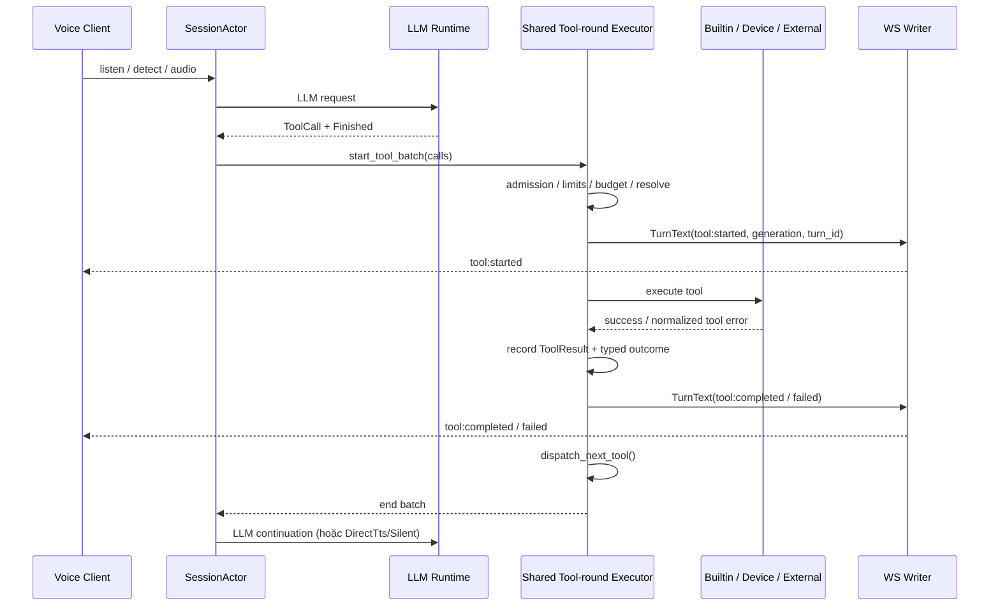

# Tool Execution Status qua Voice WebSocket — Hướng dẫn triển khai

> **Status:** Proposed / implementation guide (chưa triển khai code).
> **Target branch:** `main`. Nhánh `feat/compact-voice-live-conversation` đã merge vào `main`.
> **Scope:** Rust voice server + giao thức WebSocket V1 + Compact Voice Assistant của admin web.
> **Mục tiêu:** cho phép Voice Protocol Client biết Agent đang thực thi tool nào, trạng thái thành công/thất bại, mà không đổi ToolResult, LLM continuation hoặc audio pipeline.

## 1. Quyết định thiết kế

Bổ sung **server-to-client JSON message** `type: "tool"` với ba trạng thái `started`, `completed`, `failed`. Server chỉ phát khi client **opt-in** qua `ClientHello.features.tool_status=true`.

- Điểm phát sự kiện là **Tool-round Executor trong `SessionActor`**, không phải LLM provider, adapter MCP hay WebSocket reader.
- Dùng chính `OutboundMessage::TurnText` / `send_turn_control` và generation gate hiện có; không thêm kênh WebSocket hay queue riêng.
- Áp dụng đồng nhất cho **Builtin**, **Device MCP**, **External MCP**.
- Tool status là **advisory, best-effort**. Không được làm hỏng turn nếu control queue đầy; không thay đổi tool execution, ToolResult, dialogue history hoặc các side effect.
- Wire không chứa arguments, result, prompt, server URL, authentication metadata, credentials hoặc reasoning của LLM.
- Compact Voice hiện đã có trên `main`. UI hiển thị tên tool đang chạy dưới waveform và trạng thái ngắn trong Live Conversation; không biến status thành một tin nhắn assistant.

**Không làm trong V1:** streaming partial progress, `queued`/`cancelled`/`retrying`, lịch sử tool trong database, thay đổi ToolResult schema, thay đổi kết nối Device MCP, tương tác duyệt/cho phép tool, chạy các tool song song, sửa nội dung prompt hoặc thêm event bus.

## 2. Căn cứ từ main (kiểm tra 2026-10-11)

| Điểm trong codebase | Hiện trạng và seam cần dùng |
| --- | --- |
| `crates/voice-agent-server/src/providers/llm/mod.rs` | `LlmEvent::ToolCall(ToolCall { id, name, arguments })` đã có; không chỉnh interface. |
| `crates/voice-agent-server/src/workers/llm/mod.rs` | Forward `LlmRuntimeEvent::ToolCall` với worker identity; giữ nguyên. |
| `crates/voice-agent-server/src/session/actor/delivery.rs` | Buffer tool calls, kiểm tra identity/generation; chỉ gọi `start_tool_batch` sau `LlmRuntimeEvent::Finished`. Không phát `tool:started` tại `on_llm_event`. |
| `crates/voice-agent-server/src/session/actor/tools/round.rs` | `start_tool_batch` kiểm tra admission và call limit; `dispatch_next_tool` kiểm tra budget, resolve target và dispatch tuần tự; `record_tool_call` lưu kết quả. Đây là seam phát lifecycle. |
| `crates/voice-agent-server/src/session/actor/tools/catalog.rs` | `resolve_tool` trả về `ToolTarget::{Builtin,DeviceMcp,ExternalMcp}` từ catalog bất biến của session. |
| `crates/voice-agent-server/src/session/actor/tools/external.rs` | External MCP hoàn tất bất đồng bộ, kết quả muộn bị drop; phải giữ logic đó. |
| `crates/voice-agent-server/src/session/actor/mcp.rs` | Device MCP phản hồi/timeout kết thúc qua `complete_tool_call`. |
| `crates/voice-agent-server/src/session/actor/tools/builtin_actions.rs` | Builtin có thể thành công đồng bộ hoặc hoàn tất async (ví dụ prepare template). |
| `crates/voice-agent-server/src/session/actor/ingress.rs` | `send_turn_control` đã đóng gói generation + turn ID và dùng bounded control lane. |
| `crates/voice-agent-server/src/app/websocket.rs` | Writer serialize outbound; `TurnText` bị lọc theo `GenerationGate`. Hiện feature `turn_status` chỉ có trên Virtual Device; `tool_status` không được ngầm bật theo `turn_status`. |
| `crates/voice-agent-server/src/protocol/client.rs` | `ClientFeatures` dùng serde defaults và bỏ qua feature chưa biết, mở rộng opt-in được trong V1. |
| `apps/admin-web/src/lib/assistant/protocol.ts` | Parse union `hello/stt/llm/tts/turn_status`, chưa có `tool`. |
| `apps/admin-web/src/lib/assistant/voiceClient.ts` | Client phân phối ServerEvent qua callback và tự quản lý processing/speaking/aborting. |
| `apps/admin-web/src/stores/assistant.ts` | Store xử lý transcript và turn status, chưa có active tool. |
| `apps/admin-web/src/components/assistant/AssistantWidget.vue` | Compact Voice / waveform / Live Conversation đã nằm trên `main`. |

Tài liệu liên quan: `docs/flows/01-websocket.md`, `docs/flows/04-llm.md`, `docs/api/studio-assistant.md`, `docs/adr/0060-sequential-shared-tool-round-executor.md`.

### 2.1. Một chi tiết bắt buộc về failure

**Không** suy ra `completed/failed` từ một định dạng JSON duy nhất.

- Device MCP đã normalize thành `{"ok":false,"code":"..."}` khi lỗi.
- Builtin có các đường thành công/lỗi riêng.
- External MCP success dùng `{"ok":true,...}`, nhưng **external transport failure** đi qua `external_tool_error_result` có dạng `{"error":"external_tool_timeout"}`, không phải `{"ok":false,...}`.
- Với External MCP `Ok(outcome)`, `outcome.is_error=true` cũng là `failed` dù transport trả về bình thường.
- Với Device MCP `Ok(value)` nhưng `value.isError=true` cũng là `failed`.

Vì vậy implementation phải phân loại outcome bằng **thông tin typed tại call-completion seam**, không parse hay hiển thị raw ToolResult trên WebSocket. Giữ nguyên ToolResult JSON gửi lại LLM.

## 3. Wire contract V1

### 3.1. ClientHello opt-in

```json
{
  "type": "hello",
  "version": 1,
  "transport": "websocket",
  "audio_params": {
    "format": "opus",
    "sample_rate": 16000,
    "channels": 1,
    "frame_duration": 60
  },
  "features": {
    "tool_status": true,
    "turn_status": true,
    "mcp": false
  }
}
```

- Server bật `tool_status` **chỉ** khi client explicit opt-in; mặc định false, không gửi event đến thiết bị cũ.
- Cả Physical Device và authenticated Virtual Device **có thể** opt-in vì đây chỉ là thông tin quan sát. Giữ nguyên policy `turn_status` đang giới hạn cho Virtual Device.
- `features.mcp=false` trên Floating Chat **không** ngăn Agent sử dụng External MCP server-side. Không cần mở Device MCP cho web.
- Không đổi protocol version, không đổi `ServerHello`/audio codec, không bổ sung HTTP endpoint.

### 3.2. JSON payload

Started:

```json
{
  "type": "tool",
  "session_id": "session-123",
  "turn_id": 12,
  "call_id": "r1-c1",
  "name": "get_server_status",
  "source": "external_mcp",
  "state": "started"
}
```

Completed:

```json
{
  "type": "tool",
  "session_id": "session-123",
  "turn_id": 12,
  "call_id": "r1-c1",
  "name": "get_server_status",
  "source": "external_mcp",
  "state": "completed"
}
```

Failed:

```json
{
  "type": "tool",
  "session_id": "session-123",
  "turn_id": 12,
  "call_id": "r1-c1",
  "name": "get_server_status",
  "source": "external_mcp",
  "state": "failed",
  "reason": "external_tool_timeout"
}
```

| Field | Contract |
| --- | --- |
| `type` | Bắt buộc; literal `tool`. |
| `session_id` | Bắt buộc; đúng session hiện tại, cùng quy tắc với server events khác. |
| `turn_id` | Bắt buộc; integer dương, trong phạm vi JavaScript safe integer. |
| `call_id` | Bắt buộc; correlation ID **do server tạo**, ví dụ `r1-c1`: tool round 1, call thứ 1. Unique trong `turn_id`. Không dùng model-supplied `ToolCall.id` làm wire ID. |
| `name` | Bắt buộc; **LLM-visible resolved name**, không phải name thô từ untrusted call hay tool arguments. Dài tối đa 128 ký tự ASCII, chỉ `[A-Za-z0-9_.:-]`. |
| `source` | Bắt buộc: `builtin`, `device_mcp`, `external_mcp`. |
| `state` | Bắt buộc: `started`, `completed`, `failed`. |
| `reason` | Tùy chọn, chỉ với `failed`; bounded known-safe machine code, tối đa 64 ký tự, `[a-z_]`. |

`call_id` trên wire **không** phải LLM ToolCall ID dùng để ghép các `ChatMessage::ToolResult`. Trong V1 ID được tạo từ `tool_rounds.rounds+1` và index `batch.next` sau tăng (round executor tuần tự); không thay thế hay ghi đè `ToolCall.id` nội bộ. Client dùng composite key `(session_id, turn_id, call_id)`.

Tên tool chỉ được hiển thị khi resolve thành công từ immutable admitted catalog và vượt qua giới hạn/allowlist về cú pháp, chiều dài. Với `unknown_tool`, invalid/oversized name: **không phát tool status**, vẫn giữ đường lỗi ToolResult hiện hữu. Không thêm `source: "unknown"` trong V1.

Các `reason` hợp lệ được lấy từ lỗi đã normalize/bounded. Không chuyển exception, endpoint, raw JSON-RPC error hoặc bất kỳ nội dung tool response nào lên client. Nếu không map được mã lỗi theo allowlist, dùng `tool_failed`.

### 3.3. Semantics

- `started`: executor đã chấp nhận slot chạy (các guard trước dispatch đã pass) và đang bắt đầu thực thi/validate tool ở đúng thứ tự. Không đồng nghĩa tool đã tạo side effect thành công. Trường hợp validate arguments lỗi đồng bộ vẫn có `started` rồi `failed`.
- `completed`: đúng một result thành công đã hoàn tất và được ghi nhận tại `record_tool_call`. Không khẳng định người dùng đã nhận audio.
- `failed`: đúng một result tool-level failure đã hoàn tất, không khẳng định toàn bộ turn thất bại; LLM có thể tiếp tục.
- Không phát `started` khi LLM mới chỉ chọn tool/đang stream, trước `Finished`, hay khi round/call/budget bị reject trước dispatch.
- Không phát terminal giả khi turn bị cancel, admission đóng, execution budget kết thúc khi call còn dang dở, hoặc completion bị loại là stale: đó là **turn-level termination**, không phải một completed ToolResult.
- `tool` là message quan sát, **không phải** `mcp` envelope, không phải `turn_status`, không được cho client gửi ngược lại như command.

## 4. Luồng xử lý



Khi có 2 tool cùng round, executor vẫn tuần tự:
`tool(r1-c1):started -> terminal -> tool(r1-c2):started -> terminal`.
**Chỉ đảm bảo thứ tự giữa các tool status đã enqueue vào control queue**, không hứa mọi status được deliver khi queue đầy hoặc socket ngắt. Không làm đổi thứ tự ASR, LLM text segments và TTS.

`McpResultDelivery::{LlmThenTts,DirectTts,Silent}` không ảnh hưởng vòng đời `tool`: sự kiện terminal được phát trước bước delivery tiếp theo.

## 5. Thiết kế module Rust

### 5.1. Interface bên trong SessionActor

Ưu tiên thêm một file nhỏ `session/actor/tool_status.rs` hoặc giữ logic này private dưới `session/actor/tools/` nếu thuận lợi với visibility. **Không** tạo module event bus ngoài SessionActor, không thêm worker task, không tạo adapter mới cho mỗi origin.

Gợi ý các kiểu dữ liệu (pseudo-Rust):

```rust
#[derive(Clone, Copy)]
enum ToolStatusState { Started, Completed, Failed }

#[derive(Clone, Copy)]
enum ToolStatusSource { Builtin, DeviceMcp, ExternalMcp }

#[derive(Clone, Copy)]
enum ToolExecutionOutcome {
    Success,
    Failed(&'static str), // known-safe machine error
}

// Small private interface. The actor owns filtering, serialization and send.
fn emit_tool_status(
    &self,
    call: &ToolCall,
    source: ToolStatusSource,
    state: ToolStatusState,
    reason: Option<&'static str>,
)
```

Hàm phải tự kiểm tra `self.tool_status`, `current_turn_id`, `tool_batch`, tên tool, known-safe reason và server-generated correlation ID. Serialize JSON duy nhất tại đây. Gửi bằng `send_turn_control`; nếu channel full/closed, log metric/debug bounded và **bỏ qua status**. Không gọi `fail_closed`/`fail_speech_delivery` chỉ vì message tool status không enqueue được.

Không lưu raw `arguments` hoặc kết quả vào status state. Không thêm field `name`/`source` vào global history; derive từ batch hiện tại và `resolve_tool` (catalog immutable). Nếu cần identity ổn định khi async completion, lấy index từ current sequential batch và kiểm tra `generation`/`turn_id` như hiện tại.

### 5.2. Điểm phát started

Trong `dispatch_next_tool`:

1. Giữ nguyên kiểm tra batch generation, admission gate, next call và execution budget.
2. Giữ nguyên việc tăng `batch.next` và resolve từ `resolve_tool(&call.name)`.
3. Với **resolved target**, derive source và validated LLM-visible name.
4. Phát `started` theo best-effort rồi dispatch đúng một tool ở match branch hiện có.
5. Với `None`, giữ nguyên `complete_tool_call(..., Err("unknown_tool"))` nhưng không phát status.

Đây là seam đúng vì model may emit ToolCall trước khi round finish; có thể bị reject bởi quota hoặc cancel trước execution. `started` phải báo **attempt được executor chấp nhận**, không báo ý định của LLM.

### 5.3. Điểm phát terminal

Tập trung ở đường chung ghi nhận kết quả:
- `complete_tool_call` cho Device MCP, generic Builtin, action-envelope.
- `complete_builtin_tool_call` cho Builtin direct response.
- `complete_external_tool_call` cho External MCP.

**Khuyến nghị** mở rộng private recording seam để nhận `ToolExecutionOutcome` typed, ví dụ `record_tool_call_with_outcome(call, content, outcome)`, rồi:
1. Check call vẫn thuộc batch/generation hiện hành; không phát status cho kết quả muộn.
2. Ghi đúng một `ChatMessage::ToolResult` theo logic cũ (không đổi wire/tool result content của LLM).
3. Phát `completed` hoặc `failed` dựa trên typed outcome.
4. Tiếp tục `dispatch_next_tool`.

Không parse một JSON envelope duy nhất để đoán thành/bại. Mapping cụ thể:
- Device MCP: `Err(code)` => failed; `Ok(raw)` có `isError=true` => failed `device_tool_error`, còn lại completed.
- External MCP: `Err(ExternalMcpError)` => failed, map bằng `external_tool_error_class`; `Ok(outcome)` có `is_error=true` => failed `external_tool_error`; còn lại completed.
- Builtin: `Err(code)` => failed; các đường success => completed.
- Direct response/action-envelope: nếu kết quả là success thì vẫn emit completed **trước** early return/dispatch_next_tool.
- Khi result ghi nhưng turn kết thúc `Silent` hoặc `DirectTts`, terminal event vẫn phát độc lập với TTS.

Hạn chế đụng đến `tools/external_mcp`, `providers/llm` và `workers/llm`; có thể truyền outcome typed vào recorder từ điểm call hiện tại thay vì thiết kế một lớp adapter nữa.

### 5.4. Feature, transport, writer

- `protocol/client.rs`: thêm `#[serde(default)] pub tool_status: bool` vào `ClientFeatures`.
- `session/actor/mod.rs` + `construct.rs`: thêm cờ `tool_status: bool`, mặc định false, private setter `with_tool_status(bool)` nếu phù hợp với pattern hiện có.
- `app/websocket.rs`: khi hoàn tất ClientHello, gắn `with_tool_status(hello.features.tool_status)`; không phụ thuộc `assistant_connection`, `hello.features.turn_status` hoặc `hello.features.mcp`.
- `session/actor/ingress.rs`: dùng lại `send_turn_control` để đóng gói `OutboundMessage::TurnText { generation, turn_id, text }`.
- **Không** gửi tool status qua `OutboundMessage::Text`, `SpeakerStatus` hoặc `PipelineStatus`, vì các loại đó không có generation gating tương đương.
- Writer `send_outbound` đang filter `TurnText` theo `GenerationGate`; không thêm rewrite theo type ở writer. Tránh sửa các lane urgent/control/audio và semantics `BeginTurn`/`FinishTurn`/`AbortTurn`.

## 6. Thiết kế web (Compact Voice trên main)

### 6.1. Protocol Client

`apps/admin-web/src/lib/assistant/protocol.ts`:

```typescript
export type ToolState = 'started' | 'completed' | 'failed'
export type ToolSource = 'builtin' | 'device_mcp' | 'external_mcp'

export type ToolStatusEvent = {
  type: 'tool'
  session_id: string
  turn_id: number
  call_id: string
  name: string
  source: ToolSource
  state: ToolState
  reason?: string
}
```

- Bổ sung `ToolStatusEvent` vào union `ServerEvent` và parser strict cho từng field.
- `clientHello.features.tool_status = true`; **giữ** `mcp:false` và `turn_status:true`.
- Bảo toàn validation `session_id` hiện có, max frame bytes và reject invalid known-type events như các event khác.
- Trường `reason` chỉ hợp lệ ở `failed`; không hiển thị raw reason cho người dùng theo mặc định.
- `call_id` regex đề xuất `^r[1-9][0-9]*-c[1-9][0-9]*$` và giới hạn độ dài 32; `name` <=128 và regex `^[A-Za-z0-9_.:-]+$`. Dùng safe integer cho `turn_id`.
- `voiceClient.ts` chỉ forward status lên store; **không** chuyển state máy `processing` thành `speaking` hay `ready` do status `completed`.

### 6.2. Store

`apps/admin-web/src/stores/assistant.ts`:

- Thêm transient `activeTool: ToolStatusEvent | null`.
- Nếu cần hiển thị kết quả vừa chạy: `lastTool` (tùy chọn), giới hạn một phần tử. Tránh xây dựng một history store riêng trong V1.
- `started` của current turn => cập nhật `activeTool`.
- `completed/failed` khớp `(turn_id, call_id)` => clear `activeTool`, tùy chọn giữ `lastTool` để hiển thị status một thời điểm ngắn (không dùng timer để quyết định turn thành công).
- Terminal event đến khi started bị drop vẫn được chấp nhận và không xem là protocol failure; UI có thể hiển thị terminal trong status line.
- Với `turn_status` terminal, `abort` local, reconnect, disconnect, auth change, session close, next accepted turn: clear transient tool status. Bỏ status đến muộn của turn đã terminal hoặc không khớp turn đang active.
- UI phải giới hạn độ dài hiển thị, không dựa vào `tool` để xác định turn đã kết thúc.
- **Không** đẩy `tool` vào `AssistantMessage { role: 'assistant' }`; transcript chỉ phản ánh ASR và phản hồi thực của LLM.

### 6.3. AssistantWidget

`apps/admin-web/src/components/assistant/AssistantWidget.vue`:

- Dưới waveform, khi processing và `activeTool` tồn tại: hiển thị icon tool + `Đang dùng {name}...`. Giữ layout compact (không mở rộng panel).
- Sau completed: có thể hiển thị ngắn `Đã chạy {name}`. Sau failed: `Không thể hoàn tất {name}`. Không hiển thị stacktrace, raw reason, parameters hay body.
- Khi không có tool hoạt động: giữ trạng thái `processingHint` cũ.
- Có thể hiển thị một dòng status trong Live Conversation, nhưng **không** tạo thêm assistant bubble hoặc xáo trộn thứ tự STT/LLM.
- Bảo toàn UX hiện có: click ra ngoài chỉ collapse; không ngắt playback/WebSocket. Nếu microphone đang capture, giữ nguyên chính sách interrupt capture khi ẩn. Button đóng vẫn là disconnect.
- Accessibility: status dùng `role=status` và `aria-live=polite` phù hợp; tránh spam công bố khi tool rất nhanh. Giữ i18n tiếng Việt/Anh trong `apps/admin-web/src/i18n/messages.ts` (và điểm dùng `useI18n`).

## 7. Ordering, failure, cancellation và security

| Tình huống | Contract |
| --- | --- |
| LLM trả ToolCall nhưng stream chưa `Finished` | Không có status. |
| Tool round bị cap reject trước dispatch | Không có `started`; turn failure theo đường cũ. |
| Unknown / invalid tool name | Không phát `tool`; ToolResult lỗi vẫn dùng đường cũ. |
| Tool fail đồng bộ khi validate arguments | `started -> failed` (nếu đã pass dispatch gates). |
| Tool trả remote `isError` | `failed`, dù nhận HTTP/JSON-RPC response thành công. |
| Device MCP timeout | `failed(reason="timeout")` sau result timeout hiện có, nếu turn còn active. |
| External MCP network/auth/timeout | `failed` với bounded class do server sở hữu. |
| Multiple tools | Tuần tự; mỗi completed call có tối đa 1 terminal status. |
| DirectTts / Silent | Vẫn phát tool terminal; không phụ thuộc TTS hay LLM text. |
| Abort/barge-in khi tool đang chạy | Invalidate generation; có thể không có terminal status; client clear từ turn abort/status/local reset. |
| Late External/Device MCP completion | Drop như code cũ, không phát status và không restart continuation. |
| Control queue full | Drop riêng `tool` status, không fail session/turn. |
| Writer send failed | Writer close/failure logic cũ; không retry side effect, không retry tool status. |
| Opt-in false | Không phát `tool`; thiết bị cũ không thấy khác biệt. |
| Reconnect/new session | Client xóa transient state, không phục hồi/replay tool events. |

**Một `tool:started` không bắt buộc có terminal status trên wire**: event best-effort và có thể bị hủy giữa chừng. Tương tự `tool:completed` không chứng minh TTS đã phát xong; terminal của turn vẫn do `turn_status` (Virtual Device) hoặc voice protocol lifecycle sở hữu.

**Security:** không log hoặc gửi raw arguments, credential, URL nội bộ hay tool body. Chỉ tên tool đã admitted, capped/sanitized; không dùng user-provided display strings hoặc HTML rendering. Không bypass existing ACL, guards, revisions, snapshot hoặc Device MCP authorization. `tool_status` không cấp quyền gọi tool.

## 8. Thứ tự triển khai

1. **Contract tests trước**: cập nhật `ClientFeatures` tests, JSON event schema, assert opt-in false và trim/validation. Chốt danh sách enum/code và call ID server-generated.
2. **Rust actor implementation**: feature flag + private emitter; hook `started` tại `dispatch_next_tool` sau guards và resolve; hook terminal tại shared recorder qua typed outcomes; unit tests cho mỗi origin, direct response và error envelope.
3. **WebSocket tests**: chứng minh `TurnText` generation gate, FIFO được giữ, queue full drop status không fail turn; client không opt-in không nhận message.
4. **Web protocol/client**: typed parser, strict validation, hello opt-in, callback forwarding, cancellation cleanup.
5. **Web store & Compact Voice UI**: transient active tool, status line dưới waveform, i18n, accessibility, test branch-main UI regression.
6. **Documentation sync**: cập nhật `docs/flows/01-websocket.md`, `docs/flows/04-llm.md` và `docs/api/studio-assistant.md` với feature và ví dụ mới; không rewrite các flow khác nếu không thay đổi contract.

## 9. Test matrix cụ thể

### Rust

- `ClientHello` không có `tool_status` -> deserialize false; có true -> true; unknown features vẫn tương thích.
- `LlmEvent::ToolCall` trước `Finished` -> zero `tool` message.
- `start_tool_batch` reject vì max calls / shutdown -> zero tool started.
- `dispatch_next_tool`: Builtin, Device MCP, External MCP -> chính xác 1 `started` khi dispatch accepted; name/source/id an toàn.
- 2 calls tuần tự -> `started(r1-c1), terminal(r1-c1), started(r1-c2), terminal(r1-c2)`, đúng thứ tự.
- Hai rounds trên cùng turn -> call IDs `r1-c1` và `r2-c1` phân biệt.
- Builtin bad arguments -> `failed`; builtin direct action -> `completed`.
- Device MCP success/isError/timeout -> completed/failed/failed đúng mã, không leak body.
- External success/is_error/transport Err -> completed/failed/failed với reason mã bounded; đảm bảo trường hợp `{"error":...}` được phân loại đúng.
- Direct response early return -> terminal event vẫn được enqueue.
- `McpResultDelivery` DirectTts và Silent -> terminal status vẫn có.
- Abort/barged generation -> writer drop stale `TurnText`; late MCP completion không emit.
- Control channel full -> không gọi `fail_closed`, tool vẫn thực thi/tiếp tục, metrics/debug increment (nếu có telemetry phù hợp).
- Không raw args, result, secret, URL, raw provider toolcall ID trong payload.
- Tool status không đổi thứ tự `tts:start`, Opus, `tts:stop`.

### Web

- Parser nhận đúng 3 states và 3 source; reject malformed numeric/string fields, unauthorized shape hoặc mismatched session.
- `clientHello` có `tool_status:true`, `mcp:false`.
- `voiceClient` nhận `tool` không thay đổi state machine chuyển pha.
- `assistant store`: start -> active; completed/failed -> clear; unrelated call/turn -> ignore; terminal turn/abort/close -> clear.
- Status terminal không có started vẫn an toàn; dropped terminal không khiến UI mắc kẹt sau turn_status.
- `AssistantWidget` hiển thị dưới waveform, không làm tăng bubble của assistant và không phá compact layout.
- Collapse ngoài panel khi đang xử lý tool vẫn giữ WS/TTS, ẩn capture microphone vẫn tuân chính sách cũ.

### Lệnh kiểm tra

```bash
./scripts/test-module.sh ws
cargo test -p voice-agent-server --lib
cargo test -p voice-agent-server --test web_assistant
# Tại apps/admin-web: chạy script test, typecheck và build hiện khai báo trong package.json.
```

Kiểm tra lại tên target/script trước khi chạy; đây là test plan, **chưa có bằng chứng các bài test mới đã pass**.

## 10. Acceptance criteria / Definition of Done

- [ ] `main` có implementation hỗ trợ `features.tool_status` opt-in; thiết bị không opt-in không bị ảnh hưởng.
- [ ] Các tool từ ba nguồn sử dụng chung một wire contract và không thay đổi thực thi/tool result.
- [ ] `started` chỉ phát tại execution seam, không tại LLM token stream.
- [ ] `completed/failed` có phân loại typed chính xác, kể cả External `{"error":...}` và remote `isError`.
- [ ] Correlation ID do server tạo unique theo turn/round/call, không đụng model's ToolCall ID.
- [ ] Outbound status có generation gate, best-effort, bounded payload, không secret.
- [ ] Abort, stale results, queue full không tạo regression với LLM/TTS/Device MCP.
- [ ] Compact Voice trên `main` hiện được active tool trong processing và clear hợp lệ khi kết thúc.
- [ ] Hoàn thiện Rust/web tests và cập nhật các tài liệu flow/giao thức liên quan.

## 11. Các lựa chọn bị loại

- **Emit ngay tại `on_llm_event(ToolCall)`:** sai nghĩa đang thực thi vì tool call có thể bị reject hoặc LLM stream thất bại.
- **Tái sử dụng `type:"mcp"`:** đó là RPC với Device MCP, không đại diện Builtin/External.
- **Tái sử dụng `pipeline_status` hoặc `turn_status`:** trộn hai lifecycle khác nhau, tạo coupling không cần thiết.
- **Tool status as assistant transcript:** làm sai ngữ nghĩa nội dung hội thoại, dễ leak dữ liệu và phá Live Conversation.
- **New pubsub/event bus/worker:** tăng interface và thêm đường truyền không cần thiết khi actor đã sở hữu toàn bộ trạng thái.
- **Truyền tool arguments/results:** không cần để client biết tool đang chạy, có rủi ro privacy/secrets lớn.
- **Fail session nếu status queue đầy:** trạng thái quan sát không được quyết định kết quả nghiệp vụ.

---

**Triển khai được giao cho coding agent:** tuân thủ tài liệu này trên `main`, giữ nguyên Tool-round Executor tuần tự (ADR 0060), generation-gated outbound và UX Compact Voice hiện hành. Nếu phải chỉnh implementation chi tiết, ưu tiên ít thay đổi nhất tại private interfaces của SessionActor, không mở rộng public LLM/MCP interfaces.
