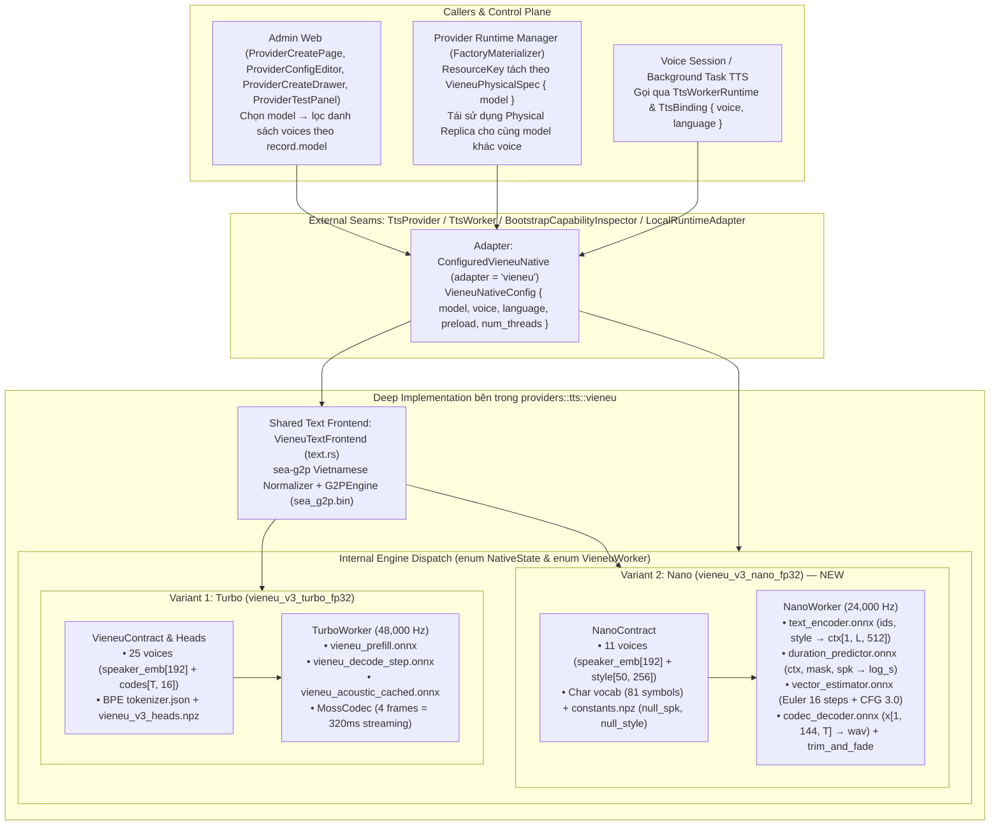

# VieNeu Multi-Model TTS Provider (`VieNeu-TTS-v3-Turbo` & `VieNeu-TTS-v3-Nano`) — Hướng dẫn Triển khai

> **Repository:** `AI_Agent_Voice_rust` (`voice-agent-server` & `admin-web`)  
> **Kỷ luật thiết kế:** [`/codebase-design`](file:///Users/lamphuchai/Desktop/project_rust/AI_Agent_Voice_rust/.agents/skills/codebase-design/SKILL.md) (**Module**, **Interface**, **Implementation**, **Depth**, **Seam**, **Adapter**, **Leverage**, **Locality**), [`DEEPENING.md`](file:///Users/lamphuchai/Desktop/project_rust/AI_Agent_Voice_rust/.agents/skills/codebase-design/DEEPENING.md), [`DESIGN-IT-TWICE.md`](file:///Users/lamphuchai/Desktop/project_rust/AI_Agent_Voice_rust/.agents/skills/codebase-design/DESIGN-IT-TWICE.md), [`CONTEXT.md`](file:///Users/lamphuchai/Desktop/project_rust/AI_Agent_Voice_rust/CONTEXT.md), [`ADR-0071`](file:///Users/lamphuchai/Desktop/project_rust/AI_Agent_Voice_rust/docs/adr/0071-versioned-provider-runtime-manager.md) & [`ADR-0076`](file:///Users/lamphuchai/Desktop/project_rust/AI_Agent_Voice_rust/docs/adr/0076-provider-owned-model-assets.md)  
> **Mục tiêu:** Mở rộng **Provider Adapter** [`"vieneu"`](file:///Users/lamphuchai/Desktop/project_rust/AI_Agent_Voice_rust/crates/voice-agent-server/src/providers/tts/vieneu/mod.rs) theo **Phương án A (Unified Deep Module)** để hỗ trợ đa model của họ VieNeu dưới cùng một adapter duy nhất — bao gồm model hiện hữu **`vieneu_v3_turbo_fp32`** (`pnnbao-ump/VieNeu-TTS-v3-Turbo`, Autoregressive LLM + MOSS Codec, 48 kHz) và model mới **`vieneu_v3_nano_fp32`** (`pnnbao-ump/VieNeu-TTS-v3-Nano`, Conditional Flow-Matching OT-CFM, 24 kHz).

---

## Bảng quyết định thiết kế (sau đánh giá `/codebase-design` & `/code-review`)

| # | Bẫy thiết kế nông (Shallow Trap) | Quyết định làm sâu (Deepened Decision) |
| :--- | :--- | :--- |
| 1 | Tách thêm một adapter mới `"vieneu_nano"` ở tầng `ProviderAdapterRegistry`, nhân đôi boilerplate tại `factory_registry.rs`, `local_runtime.rs`, `database/providers/config.rs`, `provider_catalog.rs` | **Giữ duy nhất 1 External Adapter `"vieneu"` (`ConfiguredVieneuNative`):** Mở rộng cấu hình với trường `model` (`vieneu_v3_turbo_fp32` mặc định, `vieneu_v3_nano_fp32`) và đóng gói hoàn toàn sự khác biệt giữa 2 kiến trúc suy luận bên trong **Implementation** của module `providers::tts::vieneu` (**Depth** & **Locality**) |
| 2 | Sửa trait [`ProviderAssetManager`](file:///Users/lamphuchai/Desktop/project_rust/AI_Agent_Voice_rust/crates/voice-agent-server/src/providers/assets.rs#L35-L42) để truyền `&serde_json::Value` chỉ phục vụ một adapter duy nhất → vi phạm *"One adapter means a hypothetical seam"* và làm gãy hợp đồng chuẩn bị asset toàn cục tại [`app/mod.rs:334`](file:///Users/lamphuchai/Desktop/project_rust/AI_Agent_Voice_rust/crates/voice-agent-server/src/app/mod.rs#L334) và [`provider-bench.rs:125`](file:///Users/lamphuchai/Desktop/project_rust/AI_Agent_Voice_rust/crates/voice-agent-server/src/bin/provider-bench.rs#L125) | **Giữ nguyên seam `ProviderAssetManager` ([ADR-0076](file:///Users/lamphuchai/Desktop/project_rust/AI_Agent_Voice_rust/docs/adr/0076-provider-owned-model-assets.md)):** `VieneuNativeAssetManager::ensure_assets()` đảm bảo đầy đủ tập file bất biến của adapter `"vieneu"` (`ALL_ASSETS` gồm Turbo + Nano + `sea_g2p.bin` dùng chung, chỉ tải 6 file cần cho preset inference của Nano), còn `ConfiguredVieneuNative::load` chỉ nạp lên RAM các đồ thị của đúng `VieneuModel` được cấu hình |
| 3 | Giữ `adapter_spec: json!({})` trong [`VieneuNativePlanner::physical_plan`](file:///Users/lamphuchai/Desktop/project_rust/AI_Agent_Voice_rust/crates/voice-agent-server/src/providers/local_runtime.rs#L234-L251) → vì [`PhysicalResourceIdentity`](file:///Users/lamphuchai/Desktop/project_rust/AI_Agent_Voice_rust/crates/voice-agent-server/src/services/provider/runtime/plan.rs#L146-L155) không băm `model_identity`, hai provider dùng Turbo và Nano sẽ **đụng độ cùng một `ResourceKey`** | **Đưa `VieneuPhysicalSpec { model }` vào `adapter_spec`:** Đảm bảo Turbo và Nano luôn có `ResourceKey` tách biệt, trong khi hai logical providers dùng **cùng một `model`** (khác `voice`) vẫn chia sẻ chung một **Physical Replica** pool qua `TtsBinding` |
| 4 | Giữ `local_model_identity("vieneu") -> Some(MODEL_ID)` ghi đè cứng `object.insert("model", MODEL_ID)` trong [`effective_local_config`](file:///Users/lamphuchai/Desktop/project_rust/AI_Agent_Voice_rust/crates/voice-agent-server/src/providers/factory_registry.rs#L890-L903), làm mất model `"vieneu_v3_nano_fp32"` do người dùng chọn | **Bảo toàn `model` hợp lệ trong `effective_local_config` và `VieneuNativeFactory`:** Nếu cấu hình chưa có `"model"` thì điền mặc định `"vieneu_v3_turbo_fp32"`; nếu đã có thì giữ nguyên để `VieneuNativeConfig::valid_selection()` kiểm tra cặp `(model, voice)` |
| 5 | Mặc định trường `voice` tĩnh là `"hai_dang"` bất kể `model` nào → khi người dùng cấu hình `{"model": "vieneu_v3_nano_fp32"}` mà lược bỏ `voice`, cấu hình bị lỗi vì `"hai_dang"` chỉ có ở Turbo | **Default `voice` theo ngữ cảnh `model` khi deserialize (`RawVieneuNativeConfig`):** Nếu `voice` bị lược bỏ, tự động chọn `"hai_dang"` cho `vieneu_v3_turbo_fp32` và `"minh_quan"` (`default_voice` upstream của Nano) cho `vieneu_v3_nano_fp32`. Nếu truyền tường minh `voice` không thuộc `model`, `valid_selection()` từ chối |
| 6 | Gọi `warmup_retained_worker` mặc định trên `NanoWorker` khi khởi tạo → chạy đủ 16 bước Euler × 2 nhánh CFG = 32 lần chạy `vector_estimator.onnx` trên mỗi worker, vi phạm quy chuẩn **Bounded Startup Warmup** ([`CONTEXT.md:620-622`](file:///Users/lamphuchai/Desktop/project_rust/AI_Agent_Voice_rust/CONTEXT.md#L620-L622)) | **Warmup một bước (`NanoWorker::warmup_single_step`) chạm đúng 1 lần vào từng đồ thị ONNX trên hot path** (`text_encoder` → `duration_predictor` → 1 pass `vector_estimator` → `codec_decoder`) và xác minh đầu ra PCM 24,000 Hz hữu hạn |

---

## 1. Kiến trúc Tổng thể & Kỷ luật Seam (`DEEPENING.md`)



### Phân loại Dependency theo [`DEEPENING.md`](file:///Users/lamphuchai/Desktop/project_rust/AI_Agent_Voice_rust/.agents/skills/codebase-design/DEEPENING.md)

1. **Chuẩn hóa văn bản tiếng Việt, G2P (`sea-g2p`), tách câu (`max_chars = 140`), ánh xạ vocab, đọc `.npz`, giải phương trình vi phân Euler (OT-CFM), hậu xử lý `trim_and_fade` và thực thi đồ thị ONNX trong tiến trình (`ort::session::Session`):**
   - Thuộc nhóm **In-process** (thuần tính toán trong bộ nhớ của tiến trình).
   - **Quyết định:** Giữ trọn vẹn bên trong **Implementation** của module `providers::tts::vieneu`. Việc điều phối giữa Turbo và Nano dùng `enum NativeState` và `enum VieneuWorker` nội bộ (không phơi bày ra ngoài và không tạo trait giả tạo chỉ có 1 người gọi).
2. **Tải tài nguyên từ Hugging Face / GitHub (`AssetAcquirer`):**
   - Thuộc nhóm **Local-substitutable** qua seam [`AssetAcquirer`](file:///Users/lamphuchai/Desktop/project_rust/AI_Agent_Voice_rust/crates/voice-agent-server/src/providers/assets.rs#L17-L19) sẵn có.
   - **Quyết định:** Giữ nguyên seam [`ProviderAssetManager`](file:///Users/lamphuchai/Desktop/project_rust/AI_Agent_Voice_rust/crates/voice-agent-server/src/providers/assets.rs#L35-L42) không tham số để mọi điểm gọi trong toàn hệ thống (`app::ensure_declared_assets`, `FactoryMaterializer::prepare_artifacts`, `loader::load_local`, `provider-bench`) hoạt động đồng nhất mà không cần sửa đổi.

---

## 2. Đặc tả Kỹ thuật `VieNeu-TTS-v3-Nano` (Từ Upstream Reference)

### 2.1. Nguồn tài nguyên ghim phiên bản (Pinned Revisions)

Theo quy tắc **Provider-Owned Model Assets ([ADR-0076](file:///Users/lamphuchai/Desktop/project_rust/AI_Agent_Voice_rust/docs/adr/0076-provider-owned-model-assets.md))**, mọi URL tài nguyên đều ghim chặt vào commit SHA 40 ký tự (tuyệt đối không dùng `/resolve/main/`):

- **Model Repo:** `https://huggingface.co/pnnbao-ump/VieNeu-TTS-v3-Nano`
  - `NANO_MODEL_REVISION`: `"aba295eb96a6fa6003ebe417cc1f2802a7adc1dc"`
- **Preset Voices Repo:** `https://github.com/pnnbao97/VieNeu-TTS`
  - `NANO_PRESET_REVISION`: `"04044e1b8f822f946bafb2c88b716459f4164152"`
  - Đường dẫn file: `src/vieneu/assets/voices_v3_nano.json`
- **G2P Dictionary Repo (Dùng chung với Turbo):** `https://github.com/pnnbao97/sea-g2p`
  - `G2P_REVISION`: `"e825173f235d08ea19315b2b279fb11153b44cea"`
  - Đường dẫn file: `python/sea_g2p/sea_g2p.bin`

### 2.2. Danh sách File Assets trên đĩa (`models/TTS/vieneu/`)

```text
models/TTS/vieneu/
├── sea_g2p.bin                                    # Dùng chung cho cả Turbo và Nano
├── voices_v3_turbo.json                           # Preset 25 giọng của Turbo
├── onnx_update/                                   # Đồ thị & cấu hình của v3 Turbo
│   ├── config.json
│   ├── tokenizer.json
│   ├── vieneu_prefill.onnx
│   ├── vieneu_decode_step.onnx
│   ├── vieneu_acoustic_cached.onnx
│   ├── vieneu_backbone_shared.data
│   └── vieneu_v3_heads.npz
├── onnx/codec/                                    # MOSS Codec của v3 Turbo
│   ├── moss_audio_tokenizer_decode_step.onnx
│   ├── moss_audio_tokenizer_decode_shared.data
│   ├── codec_browser_onnx_meta.json
│   └── LICENSE-Apache-2.0.txt
└── v3_nano/                                       # Đồ thị, hằng số & preset của v3 Nano (NEW)
    ├── config.json
    ├── constants.npz
    ├── voices_v3_nano.json
    ├── text_encoder.onnx
    ├── duration_predictor.onnx
    ├── vector_estimator.onnx
    └── codec_decoder.onnx
```

> [!IMPORTANT]
> Repo upstream `VieNeu-TTS-v3-Nano` có thêm 4 file (`speaker_encoder.onnx`, `codec_encoder.onnx`, `reference_encoder.onnx`, `denoiser.onnx`, tổng ~260 MB) chỉ dùng để trích xuất đặc trưng khi clone giọng từ file âm thanh mẫu. Vì hệ thống chỉ sử dụng **Preset Voices** đã trích xuất sẵn trong `voices_v3_nano.json`, ta **không tải và không nạp** 4 file này để tiết kiệm ~50% dung lượng đĩa và bộ nhớ.

### 2.3. Hợp đồng cấu trúc `v3_nano/config.json`, `constants.npz` & `voices_v3_nano.json`

1. **`v3_nano/config.json` (`NanoModelConfig` — khớp chính xác JSON tại commit `aba295eb...`)**:
   ```json
   {
     "model_type": "vieneu_v3_nano",
     "version": "3.0.0-nano",
     "sample_rate": 24000,
     "latent_dim": 24,
     "group": 6,
     "flow_fps": 15.625,
     "dim": 512,
     "style_dim": 256,
     "n_style": 50,
     "steps_default": 16,
     "cfg_default": 3.0,
     "pad_id": 0,
     "bos_id": 1,
     "eos_id": 2,
     "vocab": { "<pad>": 0, "<bos>": 1, "<eos>": 2, " ": 3, "...": 80 }
   }
   ```
   - **Điều kiện bất biến khi xác thực (`NanoModelConfig::parse`)**:
     - `model_type == "vieneu_v3_nano"`
     - `sample_rate == 24_000`
     - `latent_dim == 24` và `group == 6` (số kênh latent gộp `latent_channels() = latent_dim * group = 144`)
     - `dim == 512`
     - `style_dim == 256` và `n_style == 50`
     - `(1..=64).contains(&steps_default)` (mặc định `16`)
     - `cfg_default.is_finite() && (0.0..=16.0).contains(&cfg_default)` (mặc định `3.0`)
     - `(flow_fps - 15.625).abs() < 1e-4`
     - `pad_id == 0`, `bos_id == 1`, `eos_id == 2`
     - `vocab.len() >= 80`, ánh xạ đúng `<pad> -> 0`, `<bos> -> 1`, `<eos> -> 2`.

2. **`v3_nano/constants.npz` (`NanoConstants`)**:
   - Hằng số chiều speaker embedding: `pub const NANO_SPEAKER_DIM: usize = 192;`.
   - Đọc bằng `ndarray_npy::NpzReader`:
     - `"null_spk"`: `Array1<f32>` có chiều `[192]` (hoặc `Array2<f32>` `[1, 192]`), mọi phần tử phải `is_finite()`. Lưu thành `Vec<f32>` dài `192`.
     - `"null_style"`: `Array2<f32>` có chiều `[50, 256]` (hoặc `Array3<f32>` `[1, 50, 256]`), mọi phần tử phải `is_finite()`. Lưu thành `Vec<f32>` dài `50 * 256 = 12_800`.

3. **`v3_nano/voices_v3_nano.json` (`NanoVoiceRegistry`)**:
   - Gồm `default_voice: "Minh Quân"` và `presets: BTreeMap<String, NanoPresetEntry>`.
   - Mỗi entry có:
     - `speaker_emb: Vec<f32>` chiều đúng bằng `NANO_SPEAKER_DIM` (`192`), `all(is_finite)` và không phải vector 0.
     - `style: Vec<Vec<f32>>` kích thước `n_style × style_dim` (`50 × 256`), được làm phẳng thành `Vec<f32>` dài `12_800` phần tử, `all(is_finite)` và không phải vector 0.
   - **Danh mục 11 giọng của `VieNeu-TTS-v3-Nano` (`NANO_VOICES`)**:

     | Voice ID (`id`) | Tên hiển thị / `source_name` | Giới tính | Có trong Turbo? | Ghi chú |
     | :--- | :--- | :--- | :---: | :--- |
     | `minh_quan` | `"Minh Quân"` | Nam | Không | **`NANO_DEFAULT_VOICE`** (`default_voice` trong `voices_v3_nano.json`) |
     | `adam` | `"Adam"` | Nam | Có | Dùng chung ID với Turbo |
     | `my_duyen` | `"Mỹ Duyên"` | Nữ | Có | Dùng chung ID với Turbo |
     | `duc_tri` | `"Đức Trí"` | Nam | Có | Dùng chung ID với Turbo |
     | `mai_anh` | `"Mai Anh"` | Nữ | Có | Dùng chung ID với Turbo |
     | `truc_ly` | `"Trúc Ly"` | Nữ | Có | Dùng chung ID với Turbo |
     | `ai_han` | `"Ái Hân"` | Nữ | Không | Giọng mới của Nano |
     | `huu_quan` | `"Hữu Quân"` | Nam | Không | Giọng mới của Nano |
     | `xuan_tien` | `"Xuân Tiên"` | Nữ | Không | Giọng mới của Nano |
     | `anh_khoi` | `"Anh Khôi"` | Nam | Không | Giọng mới của Nano |
     | `manh_dung` | `"Mạnh Dũng"` | Nam | Không | Giọng mới của Nano |

### 2.4. Hợp đồng I/O của 4 Đồ thị ONNX trong `VieNeu-TTS-v3-Nano`

Khi mở `NanoWorker`, từng `ort::session::Session` phải được kiểm tra chữ ký đầu vào/đầu ra (tên, kiểu phần tử `TensorElementType`, và số chiều `rank`):

| Đồ thị ONNX | Inputs (`name: ElementType[rank]`) | Outputs (`name: ElementType[rank]`) |
| :--- | :--- | :--- |
| `text_encoder.onnx` | `ids: Int64[2]` (`[1, L]`)<br/>`style: Float32[3]` (`[1, 50, 256]`) | Output 0 (`ctx`): `Float32[3]` (`[1, L, 256]`) |
| `duration_predictor.onnx` | `ctx: Float32[3]` (`[1, L, 256]`)<br/>`ctx_mask: Bool[2]` (`[1, L]`)<br/>`spk: Float32[2]` (`[1, 192]`) | Output 0 (`log_s`): `Float32[0..=2]` (vô hướng hoặc `[1]`) |
| `vector_estimator.onnx` | `x: Float32[3]` (`[1, 144, T]`)<br/>`t: Float32[1]` (`[1]`)<br/>`ctx: Float32[3]` (`[1, L, 256]`)<br/>`ctx_mask: Bool[2]` (`[1, L]`)<br/>`spk: Float32[2]` (`[1, 192]`)<br/>`style: Float32[3]` (`[1, 50, 256]`) | Output 0 (`v`): `Float32[3]` (`[1, 144, T]`) |
| `codec_decoder.onnx` | `x: Float32[3]` (`[1, 144, T]`) | Output 0 (`wav`): `Float32[3]` (`[1, 1, N]`) |

---

## 3. Thiết kế Chi tiết từng Module

> [!NOTE]
> Tuân thủ quy chuẩn tại [`CONTEXT.md:28`](file:///Users/lamphuchai/Desktop/project_rust/AI_Agent_Voice_rust/CONTEXT.md#L28) (*"A module's tests must live in a separate test file within that module, rather than further expanding the implementation file"*), toàn bộ unit tests của `config.rs`, `assets.rs`, `contract.rs`, `descriptor.rs` và `runtime/nano.rs` được tách sang các file `*_tests.rs` tương ứng thông qua `#[cfg(test)] #[path = "..._tests.rs"] mod tests;`.

### 3.1. `crates/voice-agent-server/src/providers/tts/vieneu/config.rs` (+ `config_tests.rs`)

1. **Định nghĩa enum `VieneuModel` và các hằng số ID**:
   ```rust
   pub const TURBO_MODEL_ID: &str = "vieneu_v3_turbo_fp32";
   pub const NANO_MODEL_ID: &str = "vieneu_v3_nano_fp32";
   /// Giữ alias `MODEL_ID` trỏ tới `TURBO_MODEL_ID` để tương thích với các caller hiện hữu.
   pub const MODEL_ID: &str = TURBO_MODEL_ID;

   #[derive(Clone, Copy, Debug, Default, PartialEq, Eq, Deserialize, Serialize)]
   pub enum VieneuModel {
       #[default]
       #[serde(rename = "vieneu_v3_turbo_fp32")]
       V3TurboFp32,
       #[serde(rename = "vieneu_v3_nano_fp32")]
       V3NanoFp32,
   }

   impl VieneuModel {
       pub fn parse(id: &str) -> Option<Self> {
           match id {
               TURBO_MODEL_ID => Some(Self::V3TurboFp32),
               NANO_MODEL_ID => Some(Self::V3NanoFp32),
               _ => None,
           }
       }

       pub const fn as_str(self) -> &'static str {
           match self {
               Self::V3TurboFp32 => TURBO_MODEL_ID,
               Self::V3NanoFp32 => NANO_MODEL_ID,
           }
       }

       pub const fn default_voice(self) -> &'static str {
           match self {
               Self::V3TurboFp32 => super::assets::TURBO_DEFAULT_VOICE,
               Self::V3NanoFp32 => super::assets::NANO_DEFAULT_VOICE,
           }
       }

       pub const fn sample_rate_hz(self) -> u32 {
           match self {
               Self::V3TurboFp32 => 48_000,
               Self::V3NanoFp32 => 24_000,
           }
       }
   }
   ```

2. **Cấu trúc `VieneuNativeConfig` với default `voice` theo `model`**:
   - Dùng `#[serde(from = "RawVieneuNativeConfig")]` để khi người dùng chỉ truyền `{"model": "vieneu_v3_nano_fp32"}` mà không truyền `voice`, `voice` tự động nhận `"minh_quan"`; khi không truyền cả `model` lẫn `voice` (`{}`), nhận `model = "vieneu_v3_turbo_fp32"` và `voice = "hai_dang"`.
   - Trường `model` được serialize ra JSON chuẩn (`pub model: String`), trong khi `num_threads` vẫn giữ `#[serde(skip_serializing)]` vì thuộc quyền quản lý của deployment runtime (`runtime.onnx.threads`).
   - Tách khối `#[cfg(test)] mod tests` hiện tại ở cuối [`config.rs`](file:///Users/lamphuchai/Desktop/project_rust/AI_Agent_Voice_rust/crates/voice-agent-server/src/providers/tts/vieneu/config.rs#L60-L109) sang `config_tests.rs`, đồng thời cập nhật bài test `hides_deployment_owned_fields_when_serializing` để kiểm tra `value.get("num_threads").is_none()` và `value["model"] == TURBO_MODEL_ID`.
   ```rust
   #[derive(Clone, Debug, Deserialize, Serialize)]
   #[serde(from = "RawVieneuNativeConfig")]
   pub struct VieneuNativeConfig {
       pub model: String,
       #[serde(skip_serializing)]
       pub num_threads: i32,
       pub voice: String,
       pub language: String,
       pub preload: bool,
   }

   #[derive(Deserialize)]
   #[serde(deny_unknown_fields)]
   struct RawVieneuNativeConfig {
       #[serde(default = "default_model")]
       model: String,
       #[serde(default = "default_threads")]
       num_threads: i32,
       #[serde(default)]
       voice: Option<String>,
       #[serde(default = "default_language")]
       language: String,
       #[serde(default)]
       preload: bool,
   }

   impl From<RawVieneuNativeConfig> for VieneuNativeConfig {
       fn from(raw: RawVieneuNativeConfig) -> Self {
           let voice = raw.voice.unwrap_or_else(|| {
               VieneuModel::parse(&raw.model)
                   .map(VieneuModel::default_voice)
                   .unwrap_or(super::assets::DEFAULT_VOICE)
                   .to_owned()
           });
           Self {
               model: raw.model,
               num_threads: raw.num_threads,
               voice,
               language: raw.language,
               preload: raw.preload,
           }
       }
   }

   impl VieneuNativeConfig {
       pub fn parsed_model(&self) -> Option<VieneuModel> {
           VieneuModel::parse(&self.model)
       }

       pub fn valid_selection(&self) -> bool {
           let Some(model) = self.parsed_model() else {
               return false;
           };
           self.language == "vi-VN"
               && (1..=128).contains(&self.num_threads)
               && super::assets::voices_for_model(model)
                   .iter()
                   .any(|voice| voice.id == self.voice)
       }
   }
   ```

---

### 3.2. `crates/voice-agent-server/src/providers/tts/vieneu/assets.rs` (+ `assets_tests.rs`)

1. **Giữ nguyên seam `ProviderAssetManager` ([ADR-0076](file:///Users/lamphuchai/Desktop/project_rust/AI_Agent_Voice_rust/docs/adr/0076-provider-owned-model-assets.md))**:
   - Không sửa [`crates/voice-agent-server/src/providers/assets.rs`](file:///Users/lamphuchai/Desktop/project_rust/AI_Agent_Voice_rust/crates/voice-agent-server/src/providers/assets.rs).
   - Hằng số revision trong `vieneu/assets.rs`:
     ```rust
     pub const MODEL_REVISION: &str = "8b7e9cffb4b41918cb638b9f62f0a751184d14a6";
     pub const CODEC_REVISION: &str = "c2bfbd67dc648cac455077333f7cf5c18a2e3bb4";
     pub const PRESET_REVISION: &str = "85344322b7258b4e25479b692e8e3396baf9db34";
     pub const NANO_MODEL_REVISION: &str = "aba295eb96a6fa6003ebe417cc1f2802a7adc1dc";
     pub const NANO_PRESET_REVISION: &str = "04044e1b8f822f946bafb2c88b716459f4164152";
     pub const G2P_REVISION: &str = "e825173f235d08ea19315b2b279fb11153b44cea";

     pub const ASSET_REVISION: &str = concat!(
         "8b7e9cffb4b41918cb638b9f62f0a751184d14a6:",
         "c2bfbd67dc648cac455077333f7cf5c18a2e3bb4:",
         "85344322b7258b4e25479b692e8e3396baf9db34:",
         "aba295eb96a6fa6003ebe417cc1f2802a7adc1dc:",
         "04044e1b8f822f946bafb2c88b716459f4164152:",
         "e825173f235d08ea19315b2b279fb11153b44cea"
     );
     ```
   - Khai báo:
     - `CORE_ASSETS: &[Asset]` (13 file của Turbo + `sea_g2p.bin`).
     - `NANO_ASSETS: &[Asset]` (7 file riêng của Nano trong `v3_nano/` + `sea_g2p.bin`):
       - `v3_nano/config.json`
       - `v3_nano/constants.npz`
       - `v3_nano/text_encoder.onnx`
       - `v3_nano/duration_predictor.onnx`
       - `v3_nano/vector_estimator.onnx`
       - `v3_nano/codec_decoder.onnx`
       - `v3_nano/voices_v3_nano.json` (`https://raw.githubusercontent.com/pnnbao97/VieNeu-TTS/04044e1b8f822f946bafb2c88b716459f4164152/src/vieneu/assets/voices_v3_nano.json`)
       - `sea_g2p.bin`
     - `ALL_ASSETS: &[Asset]` (20 file duy nhất: 12 file riêng của Turbo + 7 file riêng của Nano + 1 `sea_g2p.bin` dùng chung).
   - `VieneuNativeAssetManager::ensure_assets(&self)` gọi `ensure_assets_into(http_acquirer(), &model_dir())` để đảm bảo toàn bộ `ALL_ASSETS` (phục vụ đồng nhất cho `app/mod.rs`, `FactoryMaterializer`, `loader.rs` và `provider-bench.rs`). Cung cấp thêm `ensure_model_assets_into(acquirer, root, model)` để các bài test hoặc công cụ chuyên biệt có thể chỉ chuẩn bị riêng từng model.

2. **Danh mục Giọng nói (`TURBO_VOICES` & `NANO_VOICES`)**:
   - `pub const TURBO_DEFAULT_VOICE: &str = "hai_dang";` (giữ `pub const DEFAULT_VOICE: &str = TURBO_DEFAULT_VOICE;`).
   - `pub const NANO_DEFAULT_VOICE: &str = "minh_quan";`.
   - `pub const TURBO_VOICES: &[PresetVoice]` (25 giọng, giữ `pub const VOICES: &[PresetVoice] = TURBO_VOICES;`).
   - `pub const NANO_VOICES: &[PresetVoice]` (11 giọng: `minh_quan`, `adam`, `my_duyen`, `duc_tri`, `mai_anh`, `truc_ly`, `ai_han`, `huu_quan`, `xuan_tien`, `anh_khoi`, `manh_dung`).
   - Hàm tra cứu giọng theo model:
     ```rust
     pub const fn voices_for_model(model: VieneuModel) -> &'static [PresetVoice] {
         match model {
             VieneuModel::V3TurboFp32 => TURBO_VOICES,
             VieneuModel::V3NanoFp32 => NANO_VOICES,
         }
     }
     ```

3. **Phân giải đường dẫn theo `VieneuModel`**:
   - Giữ nguyên `VieneuNativeAssets` và `resolve_assets()` / `resolve_assets_from(root)` cho Turbo để tương thích ngược với các bài test hiện hữu.
   - Bổ sung `VieneuNanoAssets`, `VieneuModelAssets` và `resolve_model_assets(model: VieneuModel)` / `resolve_model_assets_from(root: &Path, model: VieneuModel)`:
     ```rust
     pub struct VieneuNanoAssets {
         pub config: PathBuf,
         pub constants: PathBuf,
         pub text_encoder: PathBuf,
         pub duration_predictor: PathBuf,
         pub vector_estimator: PathBuf,
         pub codec_decoder: PathBuf,
         pub presets: PathBuf,
         pub g2p_dictionary: PathBuf,
     }

     pub enum VieneuModelAssets {
         Turbo(VieneuNativeAssets),
         Nano(VieneuNanoAssets),
     }
     ```

---

### 3.3. `crates/voice-agent-server/src/providers/tts/vieneu/contract.rs` (+ `contract_tests.rs`)

Giữ nguyên `VieneuContract` cho v3 Turbo và bổ sung `NanoContract` cho v3 Nano (tách khối `#[cfg(test)] mod tests` sang `contract_tests.rs`):

```rust
pub const NANO_SPEAKER_DIM: usize = 192;

#[derive(Clone, Debug, Deserialize)]
pub struct NanoModelConfig {
    pub model_type: String,
    pub sample_rate: u32,
    pub latent_dim: usize,
    pub group: usize,
    pub flow_fps: f32,
    pub dim: usize,
    pub style_dim: usize,
    pub n_style: usize,
    pub steps_default: usize,
    pub cfg_default: f32,
    pub pad_id: i64,
    pub bos_id: i64,
    pub eos_id: i64,
    pub vocab: BTreeMap<String, i64>,
}

impl NanoModelConfig {
    pub const fn latent_channels(&self) -> usize {
        self.latent_dim * self.group
    }
}

#[derive(Clone, Debug)]
pub struct NanoPresetVoice {
    pub speaker_embedding: Vec<f32>, // len = 192
    pub style: Vec<f32>,             // flattened [50 * 256] = 12,800
}

#[derive(Clone, Debug)]
pub struct NanoVoiceRegistry {
    pub default_voice: String,
    pub presets: BTreeMap<String, NanoPresetVoice>,
}

pub struct NanoContract {
    pub config: NanoModelConfig,
    pub null_spk: Vec<f32>,   // len = 192
    pub null_style: Vec<f32>, // len = 50 * 256 = 12,800
    pub voices: NanoVoiceRegistry,
}
```

- **Quy trình xác thực trong `NanoContract::load(assets: &VieneuNanoAssets)`**:
  1. Parse `v3_nano/config.json` qua `NanoModelConfig::parse`: kiểm tra `model_type == "vieneu_v3_nano"`, `sample_rate == 24_000`, `latent_dim == 24`, `group == 6`, `dim == 512`, `style_dim == 256`, `n_style == 50`, `(1..=64).contains(&steps_default)`, `cfg_default.is_finite() && (0.0..=16.0).contains(&cfg_default)`, `(flow_fps - 15.625).abs() < 1e-4`, `pad_id == 0`, `bos_id == 1`, `eos_id == 2`, `vocab.len() >= 80` và ánh xạ đúng `<pad>=0`, `<bos>=1`, `<eos>=2`.
  2. Đọc `v3_nano/constants.npz` bằng `NpzReader`:
     - Trích xuất `null_spk` (`NANO_SPEAKER_DIM = 192` phần tử `f32` hữu hạn).
     - Trích xuất `null_style` (`config.n_style * config.style_dim = 12,800` phần tử `f32` hữu hạn).
  3. Parse `v3_nano/voices_v3_nano.json` qua `NanoVoiceRegistry::parse`:
     - Kiểm tra `document.presets.len() == NANO_VOICES.len()` (`11`).
     - Với từng giọng trong `NANO_VOICES`, kiểm tra `speaker_emb.len() == NANO_SPEAKER_DIM` (`192`), `style.len() == config.n_style` (`50`) và mỗi hàng `row.len() == config.style_dim` (`256`), tất cả giá trị `is_finite()` và không toàn `0.0`.
  4. Kiểm tra 5 file nhị phân (`text_encoder.onnx`, `duration_predictor.onnx`, `vector_estimator.onnx`, `codec_decoder.onnx`, `sea_g2p.bin`) tồn tại và có `metadata().len() > 0`.

---

### 3.4. `crates/voice-agent-server/src/providers/tts/vieneu/runtime/` (Bổ sung `nano.rs` & `nano_tests.rs`)

#### 1. Điều phối `NativeState` và `VieneuWorker` trong `runtime/mod.rs`

```rust
pub(super) enum NativeState {
    Turbo(TurboNativeState),
    Nano(NanoNativeState),
}

impl NativeState {
    pub fn load(assets: &VieneuModelAssets) -> Result<Self, TtsError> {
        match assets {
            VieneuModelAssets::Turbo(turbo) => Ok(Self::Turbo(TurboNativeState::load(turbo)?)),
            VieneuModelAssets::Nano(nano) => Ok(Self::Nano(NanoNativeState::load(nano)?)),
        }
    }

    pub const fn sample_rate_hz(&self) -> u32 {
        match self {
            Self::Turbo(_) => 48_000,
            Self::Nano(_) => 24_000,
        }
    }

    pub fn supports_voice(&self, voice_id: &str) -> bool {
        match self {
            Self::Turbo(state) => state.contract.voices.presets.contains_key(voice_id),
            Self::Nano(state) => state.contract.voices.presets.contains_key(voice_id),
        }
    }
}

pub(super) enum VieneuWorker {
    Turbo(TurboWorker),
    Nano(NanoWorker),
}
```

#### 2. Chi tiết thuật toán trong `runtime/nano.rs`

1. **Khởi tạo `NanoWorker::open`**:
   - Nạp 4 `ort::session::Session` (`text_encoder`, `duration_predictor`, `vector_estimator`, `codec_decoder`) với `with_intra_threads(threads)` và `with_inter_threads(1)`, xác thực chữ ký I/O của từng đồ thị.
   - **Tính trước `_null_ctx` một lần duy nhất** lúc mở worker:
     - Chạy `text_encoder` với `ids = Tensor([1, 2], vec![bos_id, eos_id])` và `style = Tensor([1, 50, 256], contract.null_style.clone())`.
     - Thu được `null_ctx: Vec<f32>` có chiều `[1, 2, 512]` (1,024 phần tử `f32` hữu hạn) và `null_mask = vec![true, true]` (`[1, 2]`).

2. **Bounded Startup Warmup (`NanoWorker::warmup`)**:
   - Tuân thủ [`CONTEXT.md:620-622`](file:///Users/lamphuchai/Desktop/project_rust/AI_Agent_Voice_rust/CONTEXT.md#L620-L622) (*"Warmup must stay bounded and touch each graph on the hot path exactly once"*):
     - Phonemize câu ngắn `"Xin chào."` và lấy preset của `self.options.voice`.
     - Chạy **1 lần** `text_encoder.onnx` $\rightarrow$ `ctx`.
     - Chạy **1 lần** `duration_predictor.onnx` $\rightarrow$ `log_s` (giới hạn `latent_frames = 4`).
     - Chạy **1 lần** `vector_estimator.onnx` (1 bước Euler ở `t = 0.0`) $\rightarrow$ `v`.
     - Chạy **1 lần** `codec_decoder.onnx` $\rightarrow$ `wav`, xác minh `!wav.is_empty()` và mọi mẫu `is_finite()`.

3. **Tách đoạn văn bản (`split_text_into_chunks`, `NANO_MAX_CHUNK_CHARS = 140`)**:
   - Khớp với `v3nano.py:244, 267` (`max_chars: int = 140`), tách văn bản đầu vào thành các câu/đoạn tối đa `140` ký tự (ưu tiên ngắt tại `.`, `!`, `?`, `;`, `\n`, sau đó tới `,` hoặc khoảng trắng) để thời lượng mỗi đoạn luôn nằm dưới ngưỡng an toàn 15.0 giây của `duration_predictor`.

4. **Ánh xạ Phoneme sang Token IDs (`phonemes_to_ids`)**:
   - Gọi `frontend.phonemize(chunk)?`. (Không ánh xạ thẻ cảm xúc inline để tuân thủ cổng kiểm chứng tại [`text.rs:72-73`](file:///Users/lamphuchai/Desktop/project_rust/AI_Agent_Voice_rust/crates/voice-agent-server/src/providers/tts/vieneu/text.rs#L72-L73)).
   - Khởi tạo `ids = vec![config.bos_id]`.
   - Duyệt từng ký tự `ch` trong chuỗi phoneme: tra `config.vocab.get(&ch.to_string())`, nếu có thì đẩy `*id` vào `ids`.
   - Đẩy `config.eos_id` vào cuối `ids`. Nếu `ids.len() <= 2` (không có phoneme hợp lệ nào), trả về `Err(TtsError::Failed)`.
   - Tạo `ctx_mask: Vec<bool> = ids.iter().map(|&id| id != config.pad_id).collect()`.

5. **Chạy `text_encoder` và `duration_predictor`**:
   - `seq_len = ids.len()`.
   - Chạy `text_encoder` với `ids` (`[1, seq_len]`) và `voice.style` (`[1, 50, 256]`) $\rightarrow$ `ctx: Vec<f32>` (`[1, seq_len, 256]`).
   - Chạy `duration_predictor` với `ctx` (`[1, seq_len, 256]`), `ctx_mask` (`[1, seq_len]`), `voice.speaker_embedding` (`[1, 192]`) $\rightarrow$ trích xuất scalar `log_s: f32`.
   - Kiểm tra `log_s.is_finite()`. Tính:
     ```rust
     let secs = log_s.exp().clamp(0.05, 15.0);
     let latent_frames = ((secs * config.flow_fps).round() as usize).max(2);
     let channels = config.latent_channels(); // 24 * 6 = 144
     ```

6. **Vòng lặp OT-CFM Euler Solver (`steps = config.steps_default`, `cfg = config.cfg_default`)**:
   - Sinh vector nhiễu chuẩn `x: Vec<f32>` kích thước `channels * latent_frames` (`[1, 144, T]`) bằng biến đổi Box-Muller từ `rand::rng()`.
   - Với `steps = config.steps_default` (`16`), `dt = 1.0_f32 / steps as f32`, `cfg = config.cfg_default` (`3.0`):
   - Với mỗi bước `step in 0..steps`:
     - **Kiểm tra hủy tức thì:** `check_cancelled(cancelled)?;`
     - `t_val = step as f32 * dt`.
     - Chạy `vector_estimator` nhánh có điều kiện:
       `v_cond = vector_estimator(x, [t_val], ctx, ctx_mask, voice.speaker_embedding, voice.style)` (`[1, 144, T]`).
     - Kiểm tra `check_cancelled(cancelled)?;`
     - Chạy `vector_estimator` nhánh vô điều kiện:
       `v_uncond = vector_estimator(x, [t_val], null_ctx, null_mask, null_spk, null_style)` (`[1, 144, T]`).
     - Cập nhật Euler tại chỗ:
       ```rust
       for ((x_i, &vc), &vu) in x.iter_mut().zip(&v_cond).zip(&v_uncond) {
           let v = vu + cfg * (vc - vu);
           *x_i += dt * v;
       }
       ```

7. **Giải mã `codec_decoder` & Hậu xử lý `trim_and_fade` (24,000 Hz)**:
   - Kiểm tra `check_cancelled(cancelled)?;`
   - Chạy `codec_decoder` với `x` (`[1, 144, T]`) $\rightarrow$ trích xuất mảng mẫu `wav: Vec<f32>`, kiểm tra `!wav.is_empty()` và `all(is_finite)`.
   - Clamp từng mẫu vào `[-1.0, 1.0]`.
   - Áp dụng `trim_and_fade(samples, 24_000)` khớp chính xác với `core_utils.py:173-199`:
     - Cửa sổ năng lượng `win = 240` mẫu (`10 ms` ở 24 kHz), ngưỡng `thresh = 10.0_f32.powf(-45.0 / 20.0)` ($\approx 0.0056234$).
     - Nếu `samples.len() >= win * 4`: tìm cửa sổ đầu tiên và cuối cùng có trung bình `|x| > thresh`. Giữ khoảng đệm `pad = 960` mẫu (`40 ms`) ở hai đầu.
     - Giới hạn độ dài fade an toàn `let fade = ((0.015 * sample_rate as f32) as usize).min(trimmed.len() / 2);`. Chỉ khi `fade > 1` mới áp dụng cosine fade-in và fade-out:
       `ramp[i] = 0.5 * (1.0 - (PI * (i as f32 / (fade - 1) as f32)).cos())`.
   - Phát ngay chunk `on_pcm(PcmF32Mono::new(trimmed, 24_000))?`.

---

### 3.5. Cập nhật Descriptor, Inspector & Admin Web UI

#### 1. Trong [`crates/voice-agent-server/src/providers/tts/vieneu/descriptor.rs`](file:///Users/lamphuchai/Desktop/project_rust/AI_Agent_Voice_rust/crates/voice-agent-server/src/providers/tts/vieneu/descriptor.rs) (+ `descriptor_tests.rs`)

- **Khai báo `MODELS` gồm 2 model**:
  ```rust
  const MODELS: &[ModelOption] = &[
      ModelOption {
          id: TURBO_MODEL_ID,
          name: "VieNeu v3 Turbo (CPU FP32, 48kHz Streaming)",
          description: Some("Autoregressive LLM + MOSS Codec, 25 preset voices, 48 kHz frame streaming."),
      },
      ModelOption {
          id: NANO_MODEL_ID,
          name: "VieNeu v3 Nano (CPU FP32, 24kHz Flow-Matching)",
          description: Some("Ultra-lightweight 48M OT-CFM model, 11 preset voices, 24 kHz native output."),
      },
  ];
  ```
- **Khai báo `TURBO_VOICE_OPTIONS` (25 mục, `model: Some(TURBO_MODEL_ID)`), `NANO_VOICE_OPTIONS` (11 mục, `model: Some(NANO_MODEL_ID)`) và `ALL_VOICE_OPTIONS` (36 mục)**:
  - `DESCRIPTOR.capabilities.voices` trỏ tới `Some(ALL_VOICE_OPTIONS)`.
- **Thêm trường `"model"` vào đầu `FIELDS`**:
  ```rust
  const FIELDS: &[ProviderConfigField] = &[
      field(
          "model",
          "Model",
          ConfigFieldType::Select,
          true,
          Some(CapabilitySource::Models),
          None,
          None,
          Some(128),
      ),
      field(
          "voice",
          "Voice",
          ConfigFieldType::Select,
          true,
          Some(CapabilitySource::Voices),
          None,
          None,
          Some(128),
      ),
      // ... giữ nguyên language, preload ...
  ];
  ```
- **Cập nhật `DESCRIPTOR.capabilities`**:
  - `provider_output_sample_rates: Some(&[24_000, 48_000])`
  - `voice_delivery_sample_rates: Some(&[24_000])`
  - Giữ `display_name: "VieNeu v3 Turbo Native"` để tương thích ngược với bài kiểm thử danh mục adapter trong [`tests/admin_api.rs:1188`](file:///Users/lamphuchai/Desktop/project_rust/AI_Agent_Voice_rust/crates/voice-agent-server/tests/admin_api.rs#L1186-L1189).
- **Cập nhật `Inspector::inspect` dùng `ModelSelection` (`#[serde(deny_unknown_fields)]`) và `ProviderInspectError::InvalidSelection`**:
  ```rust
  impl BootstrapCapabilityInspector for Inspector {
      fn inspect(&self, selection: &Value) -> Result<DiscoveredCapabilities, ProviderInspectError> {
          let parsed: crate::providers::inspector::ModelSelection =
              serde_json::from_value(selection.clone())
                  .map_err(|_| ProviderInspectError::InvalidSelection)?;
          let model = match parsed.model.as_deref() {
              None => VieneuModel::V3TurboFp32,
              Some(id) => VieneuModel::parse(id).ok_or(ProviderInspectError::InvalidSelection)?,
          };
          let voices = match model {
              VieneuModel::V3TurboFp32 => TURBO_VOICE_OPTIONS,
              VieneuModel::V3NanoFp32 => NANO_VOICE_OPTIONS,
          };
          Ok(DiscoveredCapabilities {
              models: MODELS,
              voices,
              languages: LANGUAGES,
          })
      }
  }
  ```

#### 2. Trong `apps/admin-web` (4 Component UI)

Vì `DESCRIPTOR.capabilities.voices` chứa cả `TURBO_VOICE_OPTIONS` (25) và `NANO_VOICE_OPTIONS` (11, trong đó có 5 ID trùng với Turbo là `adam`, `my_duyen`, `duc_tri`, `mai_anh`, `truc_ly`), cả 4 nơi hiển thị dropdown `voices` trong `admin-web` đều phải lọc theo `model` đang chọn (hoặc khử trùng lặp khi không có `model`):

1. **[`apps/admin-web/src/pages/providers/ProviderCreatePage.vue`](file:///Users/lamphuchai/Desktop/project_rust/AI_Agent_Voice_rust/apps/admin-web/src/pages/providers/ProviderCreatePage.vue)**:
   - Tại `ADAPTER_CATALOG_META.vieneu.defaults` (dòng 143–145): thêm `model: 'vieneu_v3_turbo_fp32'`.
   - Tại `options(field: ProviderConfigField)` (dòng 400–430):
     ```ts
     const selectedModel =
       typeof form.config.model === 'string' && form.config.model ? form.config.model : ''
     ```
     Khi `field.enum_source === 'voices'`, nếu `selectedModel && typeof record.model === 'string' && record.model !== selectedModel` thì trả về `[]` (loại bỏ khỏi danh sách). Ngoài ra khử trùng lặp theo `value` nếu `selectedModel` đang trống.
   - Tại `watch(() => form.config.model)` (dòng 783–788): ngoài `if (step.value === 2 && supportsDiscovery.value) void discover()`, kiểm tra thêm `descriptor.value?.capabilities?.voices` theo `model` mới; nếu `form.config.voice` hiện tại không thuộc `model` mới thì tự động gán `form.config.voice = matching[0]!.id` (tương tự `watch(() => form.config.language)` ở dòng 790–810).

2. **[`apps/admin-web/src/components/providers/ProviderConfigEditor.vue`](file:///Users/lamphuchai/Desktop/project_rust/AI_Agent_Voice_rust/apps/admin-web/src/components/providers/ProviderConfigEditor.vue#L6-L41)** (dùng trong `ProviderDetailPage.vue`):
   - Tại `options(field: ProviderConfigField)` (dòng 6–19): lấy `selectedModel = typeof config.value.model === 'string' && config.value.model ? config.value.model : ''`. Khi `field.enum_source === 'voices'`, lọc `typeof (value as { model?: unknown }).model === 'string' && (value as { model: string }).model !== selectedModel`.
   - Tại `update(key: string, value: unknown)` (dòng 27–41): khi `key === 'model' && typeof value === 'string' && value && Array.isArray(props.capabilities?.voices)`, lọc các voice có `item.model === value` và nếu `next.voice` không nằm trong tập đó thì cập nhật `next.voice = matching[0]!.id`.

3. **[`apps/admin-web/src/components/providers/ProviderCreateDrawer.vue`](file:///Users/lamphuchai/Desktop/project_rust/AI_Agent_Voice_rust/apps/admin-web/src/components/providers/ProviderCreateDrawer.vue#L69-L92)**:
   - Tại `options(field: ProviderConfigField)` (dòng 69–92): lọc `field.enum_source === 'voices'` theo `selectedModel` (`typeof form.config.model === 'string'`) giống `ProviderCreatePage.vue`, và tự động đồng bộ lại `form.config.voice` khi `form.config.model` thay đổi.

4. **[`apps/admin-web/src/components/providers/ProviderTestPanel.vue`](file:///Users/lamphuchai/Desktop/project_rust/AI_Agent_Voice_rust/apps/admin-web/src/components/providers/ProviderTestPanel.vue#L24-L31)**:
   - Tại `options(key: 'voices' | 'languages')` (dòng 24–31): lấy `selectedModel = typeof props.draft?.config_json?.model === 'string' && props.draft.config_json.model ? props.draft.config_json.model : ''`, lọc `voices` theo `selectedModel` (nếu có) và khử trùng lặp theo `id` bằng `Set<string>` để không bao giờ render trùng `:key="option.id"`.

---

### 3.6. Các điểm chạm Registry, Planner & Database Validation

1. **[`crates/voice-agent-server/src/database/providers/config.rs`](file:///Users/lamphuchai/Desktop/project_rust/AI_Agent_Voice_rust/crates/voice-agent-server/src/database/providers/config.rs#L50-L55)**:
   - Cho phép trường `"model"` trong `config_json` của `"vieneu"` (vẫn chặn `"num_threads"`):
     ```rust
     "vieneu" if value.get("num_threads").is_none() => {
         canonical::<crate::config::VieneuNativeConfig, _>(
             &value,
             crate::config::VieneuNativeConfig::valid_selection,
         )
     }
     ```

2. **[`crates/voice-agent-server/src/providers/factory_registry.rs`](file:///Users/lamphuchai/Desktop/project_rust/AI_Agent_Voice_rust/crates/voice-agent-server/src/providers/factory_registry.rs#L445-L485)**:
   - Trong `effective_local_config` (dòng 890–903):
     - Với `"vieneu"`, chỉ chèn `"model": MODEL_ID` nếu `!object.contains_key("model")` (không ghi đè nếu người dùng đã chọn `"vieneu_v3_nano_fp32"`). Vẫn luôn gán `"num_threads": runtime.onnx.threads_for(adapter)`.
   - Trong `VieneuNativeFactory::model_identity` (dòng 450–460):
     ```rust
     match config {
         TtsInstanceConfig::Vieneu(options) => Ok(Some(options.model.as_str())),
         _ => Err(ProviderLoadError::Configuration(
             "vieneu factory received another adapter config".into(),
         )),
     }
     ```
   - Trong `VieneuNativeFactory::build` (dòng 462–485):
     - Giữ nguyên `options.model`, kiểm tra `let model = options.parsed_model().ok_or_else(|| ProviderLoadError::Configuration("unsupported VieNeu model".into()))?;`, gán `options.num_threads = runtime.onnx.threads_for(self.adapter())`.
     - Phân giải đúng bộ asset theo `model` qua `resolve(vieneu_assets::resolve_model_assets(model))?` và truyền vào `ConfiguredVieneuNative::load`.

3. **[`crates/voice-agent-server/src/providers/local_runtime.rs`](file:///Users/lamphuchai/Desktop/project_rust/AI_Agent_Voice_rust/crates/voice-agent-server/src/providers/local_runtime.rs#L229-L252)**:
   - Đưa `VieneuPhysicalSpec { model }` vào `adapter_spec` của `VieneuNativePlanner::physical_plan` để cô lập `ResourceKey` giữa `vieneu_v3_turbo_fp32` và `vieneu_v3_nano_fp32`:
     ```rust
     #[derive(serde::Serialize)]
     struct VieneuPhysicalSpec<'a> {
         model: &'a str,
     }

     impl LocalRuntimeAdapter for VieneuNativePlanner {
         fn adapter_id(&self) -> &'static str {
             "vieneu"
         }

         fn physical_plan(
             &self,
             effective_config: serde_json::Value,
         ) -> Result<LocalRuntimePlan, ProviderLoadError> {
             let config: VieneuNativeConfig = serde_json::from_value(effective_config)
                 .map_err(|_| ProviderLoadError::Configuration("invalid native VieNeu config".into()))?;
             if !config.valid_selection() {
                 return Err(ProviderLoadError::Configuration(
                     "invalid native VieNeu selection".into(),
                 ));
             }
             let spec = serde_json::to_value(VieneuPhysicalSpec {
                 model: &config.model,
             })
             .map_err(|_| ProviderLoadError::Configuration("invalid native VieNeu spec".into()))?;
             Ok(LocalRuntimePlan::onnx(
                 self.adapter_id(),
                 config.model,
                 spec,
             ))
         }
     }
     ```

---

## 4. Danh mục File Thay đổi (Change Inventory)

| # | File | Loại thay đổi | Trách nhiệm chính |
| :---: | :--- | :---: | :--- |
| 1 | [`crates/voice-agent-server/src/providers/tts/vieneu/config.rs`](file:///Users/lamphuchai/Desktop/project_rust/AI_Agent_Voice_rust/crates/voice-agent-server/src/providers/tts/vieneu/config.rs) & `config_tests.rs` | Modify / New | Thêm `VieneuModel` (`V3TurboFp32`, `V3NanoFp32`), `TURBO_MODEL_ID`, `NANO_MODEL_ID`, `RawVieneuNativeConfig` (default `voice` theo `model`), serialize `model`, validate cặp `(model, voice)`; tách unit tests sang `config_tests.rs` |
| 2 | [`crates/voice-agent-server/src/providers/tts/vieneu/assets.rs`](file:///Users/lamphuchai/Desktop/project_rust/AI_Agent_Voice_rust/crates/voice-agent-server/src/providers/tts/vieneu/assets.rs) & `assets_tests.rs` | Modify / New | Ghim `NANO_MODEL_REVISION` & `NANO_PRESET_REVISION`, thêm `NANO_ASSETS`, `ALL_ASSETS`, `NANO_VOICES` (11 giọng), `VieneuNanoAssets`, `VieneuModelAssets`; tách unit tests sang `assets_tests.rs` |
| 3 | [`crates/voice-agent-server/src/providers/tts/vieneu/contract.rs`](file:///Users/lamphuchai/Desktop/project_rust/AI_Agent_Voice_rust/crates/voice-agent-server/src/providers/tts/vieneu/contract.rs) & `contract_tests.rs` | Modify / New | Thêm `NanoModelConfig` (khớp schema `dim`, `n_style`, `group`, `steps_default`, `cfg_default`), `NanoPresetVoice`, `NanoVoiceRegistry`, `NanoContract::load`; tách unit tests sang `contract_tests.rs` |
| 4 | `crates/voice-agent-server/src/providers/tts/vieneu/runtime/nano.rs` & `nano_tests.rs` | **New** | Triển khai `NanoNativeState` và `NanoWorker` (4 ONNX sessions, `_null_ctx` cache, single-step warmup, sentence chunking `max_chars=140`, duration prediction, OT-CFM Euler 16-step solver với CFG 3.0 & cancellation check, `codec_decoder` 24 kHz, safe `trim_and_fade`) |
| 5 | [`crates/voice-agent-server/src/providers/tts/vieneu/runtime/mod.rs`](file:///Users/lamphuchai/Desktop/project_rust/AI_Agent_Voice_rust/crates/voice-agent-server/src/providers/tts/vieneu/runtime/mod.rs) | Modify | Chuyển `NativeState` và `VieneuWorker` sang enum điều phối giữa `Turbo` (48 kHz) và `Nano` (24 kHz) |
| 6 | [`crates/voice-agent-server/src/providers/tts/vieneu/mod.rs`](file:///Users/lamphuchai/Desktop/project_rust/AI_Agent_Voice_rust/crates/voice-agent-server/src/providers/tts/vieneu/mod.rs) | Modify | Cập nhật `ConfiguredVieneuNative::load` nhận `VieneuModelAssets`, `synthesize` dùng `self.state.sample_rate_hz()`, và `validate_diagnostic` kiểm tra `self.state.supports_voice(voice)` |
| 7 | [`crates/voice-agent-server/src/providers/tts/vieneu/descriptor.rs`](file:///Users/lamphuchai/Desktop/project_rust/AI_Agent_Voice_rust/crates/voice-agent-server/src/providers/tts/vieneu/descriptor.rs) & `descriptor_tests.rs` | Modify / New | Thêm field `"model"` vào `FIELDS`, thêm `NANO_MODEL_ID` vào `MODELS`, khai báo `ALL_VOICE_OPTIONS`, cập nhật `Inspector::inspect` dùng `ModelSelection` và `ProviderInspectError::InvalidSelection`; tách unit tests sang `descriptor_tests.rs` |
| 8 | [`crates/voice-agent-server/src/database/providers/config.rs`](file:///Users/lamphuchai/Desktop/project_rust/AI_Agent_Voice_rust/crates/voice-agent-server/src/database/providers/config.rs) | Modify | Cho phép `"model"` trong DB `config_json` của `"vieneu"` (`value.get("num_threads").is_none()`) |
| 9 | [`crates/voice-agent-server/src/providers/factory_registry.rs`](file:///Users/lamphuchai/Desktop/project_rust/AI_Agent_Voice_rust/crates/voice-agent-server/src/providers/factory_registry.rs) | Modify | Bảo toàn `model` của `"vieneu"` trong `effective_local_config`, `VieneuNativeFactory::model_identity` và `VieneuNativeFactory::build` |
| 10 | [`crates/voice-agent-server/src/providers/local_runtime.rs`](file:///Users/lamphuchai/Desktop/project_rust/AI_Agent_Voice_rust/crates/voice-agent-server/src/providers/local_runtime.rs) | Modify | Đưa `VieneuPhysicalSpec { model }` vào `VieneuNativePlanner::physical_plan` để cô lập `ResourceKey` giữa các model |
| 11 | [`apps/admin-web/src/pages/providers/ProviderCreatePage.vue`](file:///Users/lamphuchai/Desktop/project_rust/AI_Agent_Voice_rust/apps/admin-web/src/pages/providers/ProviderCreatePage.vue) | Modify | Thêm default `model: 'vieneu_v3_turbo_fp32'`, lọc `voices` theo `form.config.model` và tự động đồng bộ `form.config.voice` khi đổi `model` |
| 12 | [`apps/admin-web/src/components/providers/ProviderConfigEditor.vue`](file:///Users/lamphuchai/Desktop/project_rust/AI_Agent_Voice_rust/apps/admin-web/src/components/providers/ProviderConfigEditor.vue), [`ProviderCreateDrawer.vue`](file:///Users/lamphuchai/Desktop/project_rust/AI_Agent_Voice_rust/apps/admin-web/src/components/providers/ProviderCreateDrawer.vue) & [`ProviderTestPanel.vue`](file:///Users/lamphuchai/Desktop/project_rust/AI_Agent_Voice_rust/apps/admin-web/src/components/providers/ProviderTestPanel.vue) | Modify | Lọc `voices` theo `model` và khử trùng lặp ID giọng trên tất cả các màn hình chỉnh sửa / tạo nhanh / test chẩn đoán |
| 13 | [`crates/voice-agent-server/tests/vieneu.rs`](file:///Users/lamphuchai/Desktop/project_rust/AI_Agent_Voice_rust/crates/voice-agent-server/tests/vieneu.rs) | Modify | Bổ sung các bài kiểm thử tích hợp cho `vieneu_v3_nano_fp32` (config, discovery, planner `ResourceKey`, asset pinning, contract verification và end-to-end synthesis 24 kHz) |

---

## 5. Chiến lược Kiểm thử ("Replace, Don't Layer" — `AGENTS.md` & `DEEPENING.md`)

Tuân thủ nghiêm ngặt chính sách kiểm thử trong [`AGENTS.md`](file:///Users/lamphuchai/Desktop/project_rust/AI_Agent_Voice_rust/AGENTS.md) và [`CONTEXT.md:28`](file:///Users/lamphuchai/Desktop/project_rust/AI_Agent_Voice_rust/CONTEXT.md#L28):
- **Luôn sử dụng `scripts/agent-test.sh`**, chạy các bài test mục tiêu (targeted tests) trước khi chạy toàn workspace, không bao giờ gọi `cargo test` trực tiếp.
- Toàn bộ unit test của từng module con nằm trong file `*_tests.rs` riêng biệt (`config_tests.rs`, `assets_tests.rs`, `contract_tests.rs`, `descriptor_tests.rs`, `runtime/nano_tests.rs`).

### Các bài kiểm thử bắt buộc

1. **Test 1 — `config_supports_turbo_default_and_nano_model_with_model_scoped_voices` (`vieneu/config_tests.rs` & `tests/vieneu.rs`)**:
   - Deserialize `{}` $\rightarrow$ `model == "vieneu_v3_turbo_fp32"`, `voice == "hai_dang"`, `valid_selection() == true`.
   - Deserialize `{"model": "vieneu_v3_nano_fp32"}` $\rightarrow$ `model == "vieneu_v3_nano_fp32"`, `voice == "minh_quan"`, `valid_selection() == true`.
   - Kiểm tra serialize `VieneuNativeConfig::default()` giữ `value["model"] == "vieneu_v3_turbo_fp32"` và ẩn `value.get("num_threads").is_none()`.
   - Kiểm tra chéo: `{"model": "vieneu_v3_nano_fp32", "voice": "hai_dang"}` và `{"model": "vieneu_v3_turbo_fp32", "voice": "minh_quan"}` đều bị `valid_selection()` và `provider_config::validate("vieneu", ...)` từ chối.
   - Kiểm tra 5 giọng giao nhau (`adam`, `my_duyen`, `duc_tri`, `mai_anh`, `truc_ly`) hợp lệ trên cả 2 model.

2. **Test 2 — `inspector_discovers_model_scoped_voice_catalog_and_rejects_unknown_fields` (`vieneu/descriptor_tests.rs`)**:
   - `INSPECTOR.inspect(&json!({}))` và `INSPECTOR.inspect(&json!({"model": "vieneu_v3_turbo_fp32"}))` trả về đúng 25 giọng của Turbo.
   - `INSPECTOR.inspect(&json!({"model": "vieneu_v3_nano_fp32"}))` trả về đúng 11 giọng của Nano.
   - `INSPECTOR.inspect(&json!({"model": "vieneu_v4"}))` và `INSPECTOR.inspect(&json!({"api_key": "secret"}))` trả về `Err(ProviderInspectError::InvalidSelection)`.

3. **Test 3 — `planner_shares_worker_pool_within_same_model_and_isolates_across_models` (`tests/vieneu.rs`)**:
   - Hai cấu hình cùng `model = "vieneu_v3_nano_fp32"` nhưng khác giọng (`"minh_quan"` vs `"adam"`) sinh ra **cùng một `ResourceKey`**.
   - Hai cấu hình cùng giọng `"adam"` nhưng khác model (`"vieneu_v3_turbo_fp32"` vs `"vieneu_v3_nano_fp32"`) sinh ra **hai `ResourceKey` khác nhau**.

4. **Test 4 — `every_turbo_and_nano_asset_source_is_revision_pinned` (`vieneu/assets_tests.rs`)**:
   - Xác minh toàn bộ `ALL_ASSETS` (20 file), `CORE_ASSETS` (13 file) và `NANO_ASSETS` (8 file) đều dùng HTTPS và ghim đúng commit SHA 40 ký tự (`MODEL_REVISION`, `CODEC_REVISION`, `PRESET_REVISION`, `NANO_MODEL_REVISION`, `NANO_PRESET_REVISION`, `G2P_REVISION`).

5. **Test 5 — `nano_contract_verifies_config_constants_npz_and_style_presets` (`vieneu/contract_tests.rs` & `runtime/nano_tests.rs`)**:
   - Xác minh `NanoModelConfig::parse` chấp nhận đúng schema JSON thực tế của v3 Nano (`model_type`, `dim`, `n_style`, `group`, `steps_default`, `cfg_default`) và từ chối cấu hình sai chiều.
   - Xác minh `NanoVoiceRegistry::parse` kiểm tra chặt ma trận `style: [50, 256]` và `speaker_emb: [192]` của cả 11 giọng.
   - Xác minh `split_text_into_chunks` (`max_chars = 140`) và `trim_and_fade` (an toàn cả với mảng mẫu rất ngắn `< 360` mẫu).

6. **Test 6 — `retained_nano_worker_synthesizes_24khz_switches_voice_and_honors_cancellation` (`tests/vieneu.rs`, `#[ignore]` khi chạy không có ONNX model thực tế)**:
   - Khi có model files trong `models/TTS/vieneu/v3_nano/`, nạp `ConfiguredVieneuNative` với `model = "vieneu_v3_nano_fp32"`, chạy `warmup()` (single-step), tổng hợp giọng `"minh_quan"` và `"adam"`, xác minh `pcm.sample_rate_hz() == 24_000`, `rms > 0.001`, mọi mẫu `is_finite()`, và dừng ngay lập tức khi `cancelled` được bật.

### Lệnh chạy kiểm thử chuẩn

```bash
# 1. Chạy unit tests trong module vieneu
scripts/agent-test.sh test -p voice-agent-server providers::tts::vieneu

# 2. Chạy integration test vieneu
scripts/agent-test.sh test -p voice-agent-server --test vieneu

# 3. Chạy kiểm tra biên dịch & clippy
scripts/agent-test.sh check -p voice-agent-server
```
