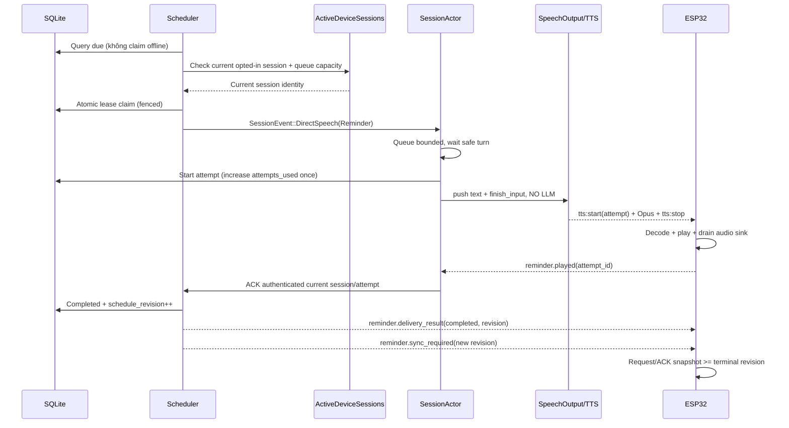
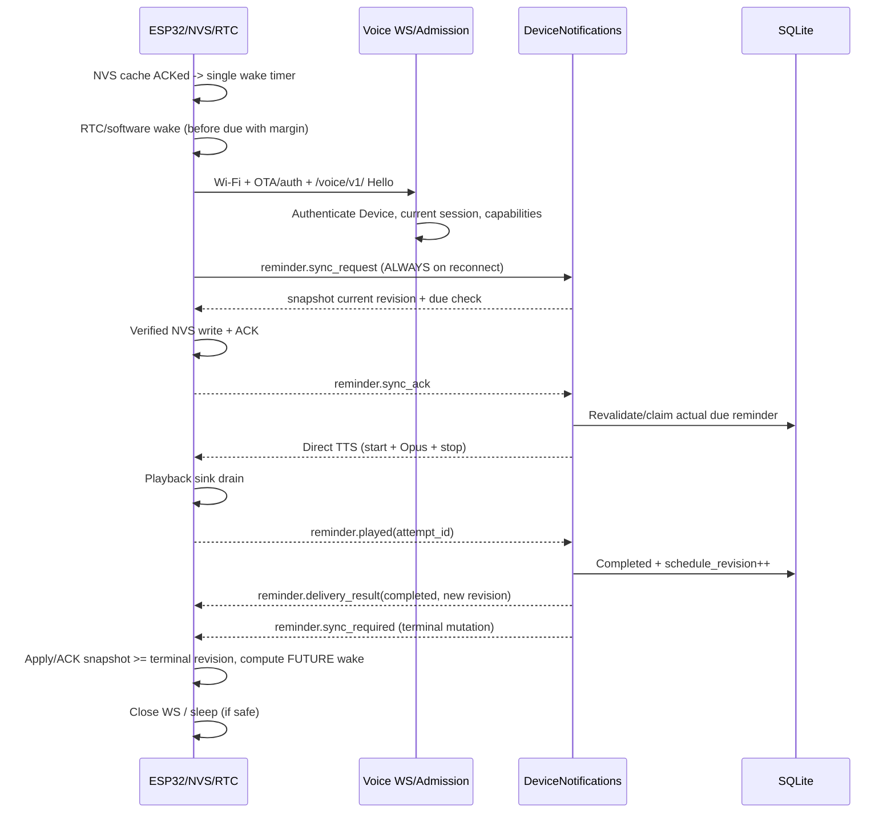

# Voice Reminders, Device Wake Scheduler & Direct TTS — Hướng dẫn triển khai

> **Repository đích:** `https://github.com/hailp-vn38/ai-agent-voice` (đối chiếu `main` ngày 2026-10-12).  
> **Repository tham khảo:** `https://github.com/xinnan-tech/xiaozhi-esp32-server`.  
> **Trạng thái:** SPEC / IMPLEMENTATION GUIDE **v1.1 (đã tích hợp Ponytail + Flow Audit 2026-10-12)**; **chưa triển khai hoặc hardware-test**.  
> **Đối tượng:** Agent phát triển Rust Server, Vue Admin Web và firmware ESP32.  
> **Nguyên tắc:** Đọc lại `main` và migration mới nhất trước khi sửa code. Tài liệu là hợp đồng hành vi và hướng dẫn, không phải khẳng định tính năng đã tồn tại. **Phase chỉ đạt khi acceptance gate chạy pass; build thành công không đủ.**

---

### Thay đổi v1.1 sau review

Đã xử lý 8 lỗ hổng flow bắt buộc: **(P0)** đẩy `reminder.sync_required` sau mọi biến đổi lịch, kể cả `completed/expired`; chạy duy nhất một scheduler trong production bootstrap; không đốt retry khi offline; xác thực playback ACK sau khi **audio sink drain**; chốt quyền Agent/target Floating Chat; **(P1)** unique idempotency và tổng retry bền vững; firmware chống vòng lặp wake với lịch quá hạn. Đồng thời bỏ handshake `prepare/ready` mặc định, rút gọn attempt states, cấu hình, prompt info, NVS layout và sync-status endpoint. Xem mục 15–16 để nghiệm thu từng vertical slice.

---

## 0. Mục tiêu và phạm vi

Xây dựng một khả năng nhắc việc theo **Device**, tạo từ hội thoại giọng nói, Floating Chat hoặc Admin Web. Khi đến hạn, lời nhắc phát qua TTS mà **không chạy LLM**. Thiết bị ESP32 có thể ngắt WebSocket khi rảnh, lưu lịch đánh thức cục bộ và chủ động kết nối lại server theo lịch. Cung cấp thêm message `type: "tts", action: "speak"` để yêu cầu chuyển text sang TTS trực tiếp trên Voice Session.

Yêu cầu bắt buộc:

1. **Đang kết nối WS:** server chủ động chuyển reminder đến `SessionActor` của Device, phát TTS qua đường Opus hiện có.
2. **Đã ngắt WS:** firmware dùng một logical wake timer (software hoặc RTC tùy power mode), khởi tạo Wi-Fi và reconnect `/voice/v1/`, đồng bộ lại trạng thái trước khi phát.
3. **LLM:** gọi tool tạo/liệt kê/sửa/hủy lịch. Scheduler và đồng hồ server thực thi, LLM không chạy nền và không tự canh giờ.
4. **Prompt:** block `<reminder_policy>` cung cấp quy tắc, `<reminders_info>` là dữ liệu bối cảnh **động, giới hạn**, không nhồi mọi lời nhắc vào prompt.
5. **Direct TTS:** message client→server `tts:speak` và yêu cầu từ server nội bộ đều tái sử dụng `SessionActor → SpeechOutput → TTS Worker → Opus → WS`, bỏ qua ASR/LLM.
6. **Web:** tab `Reminders` trong Agent Detail để tổng hợp lời nhắc của các Device hiện thuộc Agent; Device Detail có quản lý lịch riêng, trạng thái đồng bộ, thời điểm wake và công cụ thử Direct TTS.
7. **Đúng ngữ nghĩa:** lưu lịch, đồng bộ NVS, gửi đủ audio qua WS, phát hết tại loa là **bốn sự kiện khác nhau**.

**Ngoài phạm vi V1:** recurring/cron reminders, LLM viết lại lời nhắc khi đến hạn, gửi push đánh thức ESP32 ở Deep Sleep, tạo một WebSocket mới, MQTT broker mới, offline TTS, lịch có nhiều Device đích trong một bản ghi, cam kết exactly-once playback. Không thay đổi giao thức Opus hiện hành.

### 0.1 Quyết định kiến trúc

| Quyết định | Quy định |
|---|---|
| Nguồn dữ liệu chính | SQLite trên Rust Server; `device_id`/FK Device sở hữu lời nhắc |
| Firmware | NVS chỉ là cache kế hoạch thức dậy; dùng đúng một wake timer cho mốc gần nhất |
| Agent | Là phạm vi hiển thị và kiểm soát quyền, **không sở hữu** reminder |
| LLM | Tool execution để tạo/đổi/hủy; không thực hiện delivery |
| Online | Server-originated `SessionEvent::DirectSpeech` trên WS đang hoạt động |
| Offline | Device tự wake theo lịch **đã ACK**, sau đó reconnect và revalidate |
| TTS | `SpeechOutput` hiện hữu; phân biệt nguồn phát, không phát giả message `llm` |
| Khả năng tương thích | Các feature mới opt-in; client cũ giữ flow Voice/TTS cũ |
| An toàn | Cùng Device Admission, quyền Reminder **được lưu rõ ràng theo Agent**, Admin Auth và session generation fence |
| Sự thật của UI | Không suy luận WS online từ trường `devices.enabled` |

Các quyết định được ghi thành ADR **Proposed** (chưa triển khai/nghiệm thu):

- [ADR-0087 — Device sở hữu Reminder bền vững và application scheduler](adr/0087-device-owned-durable-reminders.md).
- [ADR-0088 — Direct Speech dùng chung Voice Session/SpeechOutput](adr/0088-shared-session-direct-speech.md).
- [ADR-0089 — Snapshot sync, durable cache ACK và một wake timer](adr/0089-reminder-snapshot-sync-and-device-wake.md).
- [ADR-0090 — Playback ACK và bounded delivery attempts](adr/0090-reminder-playback-ack-and-bounded-attempts.md).
- [ADR-0091 — Quyền Reminder, target authorization và turn context](adr/0091-reminder-authorization-and-turn-context.md).

Thuật ngữ canonical: [GLOSSARY.md](../GLOSSARY.md#reminders-and-direct-speech). Các ADR-0023/0032/0052/0084 ghi rõ phạm vi mở rộng dự kiến; acceptance gates ở mục 14–16 vẫn là điều kiện nghiệm thu.

### 0.2 Giới hạn vật lý không được che giấu

Server **không thể** chủ động đánh thức ESP32 đang Deep Sleep và không có kênh nhận tín hiệu. Một lịch được tạo từ Floating Chat/Web **sau khi device đã ngủ** sẽ chỉ đến firmware ở lần kết nối tiếp theo. Với lời nhắc mới có hạn sớm hơn lần wake kế tiếp, **không được hứa phát đúng giờ**. Web hiển thị `sync_pending`/`delivery_uncertain`; server vẫn giữ lịch, đợi Device reconnect. Periodic sync cải thiện độ trễ nhưng không tạo bảo đảm realtime.

Nếu firmware cần tiếp tục nghe wake word, **không** được áp dụng Deep Sleep mặc định: chọn giữ CPU/audio wake-word local hoạt động và chỉ ngắt WS; software timer vẫn chạy. RTC Deep Sleep chỉ dùng trên phần cứng có chính sách ngủ tương thích.

---

## 1. Các điểm tích hợp thực tế trên `main`

Các đường dẫn dưới đây đã được kiểm tra qua GitHub trên `main` lúc soạn tài liệu:

| Khu vực | Hiện trạng | Công việc |
|---|---|---|
| `crates/voice-agent-server/src/app/websocket.rs` | WS `/voice/v1/`, Device Admission, ClientHello, bounded queues, spawn actor/writer | Đăng ký phiên Device đang hoạt động, feature negotiation, sync sau hello, chuyển sự kiện từ scheduler vào actor; unregister có fencing |
| `crates/voice-agent-server/src/protocol/client.rs` | `ClientFeatures` hỗ trợ tool/pipeline/speaker/mcp; parser `hello`, `listen`, `abort`, `mcp` | Thêm `reminders`, `direct_tts` và các command tương ứng |
| `crates/voice-agent-server/src/protocol/server.rs` | ServerHello chuẩn 24 kHz / mono / Opus 60 ms | Định nghĩa serializer cho metadata Direct TTS và reminder; không thay định dạng frame |
| `crates/voice-agent-server/src/session/event.rs` | Mailbox `ClientMessage`, `ClientAudio`, `Shutdown`, `SecurityInvalidated` | Thêm server-originated `DirectSpeech`/`ReminderDue` hoặc event tương đương |
| `session/actor/ingress.rs` | Actor là nơi duy nhất mutate Voice Session | Nhận Direct TTS/reminder; xử lý busy/queue và ACK |
| `session/actor/delivery.rs` | `begin_direct_tool_speech(text)` bỏ qua LLM và dùng `SpeechOutput`; `SegmentReady` hiện phát message `type: llm` | Tổng quát hóa Direct Speech; **không** phát `llm` cho nội dung không do model tạo |
| `session/speech_output/mod.rs` | Resample, Opus, pacing, TTS worker bounded | Tái sử dụng nguyên; không viết pipeline TTS khác |
| `session/actor/tools/catalog.rs` | Catalog bất biến theo admission; builtin exit/switch template, MCP, External MCP, System MCP | Thêm reminder tools nếu Agent được cấp quyền; chặn tool name shadowing; cập nhật `offers_answer_changing_tools` |
| `session/actor/tools/builtin_actions.rs` và `tools/builtin.rs` | Builtin actions hiện tại | Bổ sung xử lý reminder nhưng I/O DB phải async, không chặn actor |
| `session/prompt.rs` | `render_system` cho phép các placeholder hữu hạn; `compose_turn_system` gắn speaker data từng turn | Append bounded `<reminders_info>` và quy tắc prompt; không cho phép placeholder tùy ý |
| `app/state.rs` | AppState application-owned | Thêm handle `Arc<DeviceNotifications>` và registry; gắn lifecycle/shutdown |
| `app/admin/mod.rs`, `app/admin/devices.rs` | Admin HTTP API và CRUD Device có revision | Thêm Admin routes riêng và tái dùng auth/middleware hiện hành |
| `database/mod.rs`, `database/devices.rs` | sqlx SQLite, migration, FK Device có `kind`, `agent_key` | Thêm repository riêng cho reminder và migration |
| `apps/admin-web/src/pages/agents/AgentDetailPage.vue` | Tabs `studio`, `tools`, `speakers`, `devices` | Thêm tab `reminders` |
| `apps/admin-web/src/components/studio/StudioTabs.vue` | Danh sách tab và keyboard navigation | Bổ sung tab và i18n key |
| `apps/admin-web/src/pages/devices/DeviceDetailPage.vue` | Identity, AI configuration, Device access | Thêm Reminder Schedule và danh sách quản lý |
| `apps/admin-web/src/api/devices.ts` | `requestJson`, `jsonRequest`, revision/CAS | Tạo `api/reminders.ts` theo pattern hiện có |
| `apps/admin-web/src/components/devices/presentation.ts` | Đang map `enabled` thành `online/offline` | Không sử dụng mapping này để kết luận có WS đang hoạt động |

Migration mới nhất thấy ở thời điểm viết: `0103_system_mcp_authority.sql`; migration kế tiếp **nếu chưa có migration khác** là `0104_device_reminders.sql`.

**Lưu ý:** Repository Rust đã kiểm tra **không chứa firmware ESP32 hoàn chỉnh**. Phần firmware ở tài liệu là hợp đồng triển khai cho repository firmware thực tế; **không** tạo giả một cây mã firmware trong Rust repo. Ghi rõ repo/commit firmware khi bắt đầu phase đó.

Tài liệu nền cần đọc: `docs/flows/01-websocket.md`, `docs/flows/05-tts.md`, `docs/flows/06-interrupt-cancellation.md`, `docs/adr/0002-session-actor.md`, `docs/adr/0084-per-turn-structured-system-prompt.md`, `docs/studio-assistant-virtual-device-ws-implementation-guide.md`, `docs/structured-voice-system-prompt.md`.

---

## 2. Domain model và những bất biến bắt buộc

### 2.1 Các khái niệm

- **Reminder**: nội dung và thời điểm đến hạn, do đúng một Device sở hữu. Agent/Template không sở hữu lịch.
- **Schedule Revision**: phiên bản tăng đơn điệu **trên mỗi Device** cho mọi thay đổi tập lịch pending: **create/update/cancel/completed/expired**; không tăng khi chỉ ghi telemetry/attempt. Dùng để đồng bộ snapshot firmware.
- **Device Cache ACK**: firmware xác nhận **đã lưu bền vững** snapshot vào NVS. Không đồng nghĩa đã phát.
- **Delivery Attempt**: một lần thử phát reminder đến hạn, có `attempt_id`, lease và session identity.
- **Playback ACK**: xác nhận firmware đã flush audio ra lớp phát. Không thể xác thực âm vật lý thực sự phát ra loa.
- **Direct Speech**: yêu cầu chuyển text→TTS→Opus không dùng LLM/ASR, với nguồn `tool_direct`, `client_direct`, `admin_direct` hoặc `reminder`.

### 2.2 Bất biến

1. Reminder lưu theo `devices.id`/`device_id`; không tự chuyển sang Device khác khi Agent hoặc Template thay đổi.
2. Giờ authoritative do Rust Server tính tại giao dịch tạo/sửa lịch; lưu UTC epoch milliseconds và timezone dùng để diễn giải đầu vào. Không tin giá trị `now` do LLM gửi.
3. Không phát reminder đã `cancelled`, `completed`, sai Device, hoặc thiếu quyền/Device bị disabled; kiểm tra lại ngay trước claim/playback, **không** tin NVS snapshot như quyền phát.
4. Cả Online và Offline sử dụng **một** module delivery và **một** `SpeechOutput` của SessionActor; tại một thời điểm actor phát tối đa một turn.
5. Không chạy LLM khi reminder đến hạn. Nội dung đã lưu là nguồn phát mặc định; có thể thêm tiền tố cố định như “Đến giờ: …”.
6. `tts:stop` chỉ báo writer kết thúc phát packet, **không** được map thành `played`.
7. Mọi mutation **ảnh hưởng tập lịch pending** + increment schedule revision phải atomic, kể cả playback `completed` và scheduler `expired`; CAS bằng row revision khi Admin PATCH/DELETE để chống lost update.
8. Mọi ACK có identity được xác thực (Device, current Session, request/attempt/snapshot token); ACK cũ không được hoàn thành một attempt mới.
9. Không cam kết exactly-once audio: network disconnect sau phát nhưng trước ACK là trạng thái `uncertain`; retry có giới hạn + client dedupe để hạn chế phát trùng.
10. SessionActor không query SQLite đồng bộ trong turn hot path; database access đi qua module application-owned và completion event bất đồng bộ.
11. Không claim/tiêu hao playback attempts khi device không có session đủ capability; server chỉ ghi nhận trạng thái suy ra `waiting_for_device`. Retry chỉ tính khi **bắt đầu lần phát thực tế**, không tính khi WS offline, actor busy hay enqueue thất bại trước playback.
12. `sync_required` phải được publish **sau commit** đến thiết bị đang online; device **không được chủ động đóng WS để ngủ** sau create nếu snapshot chứa lịch mới chưa được NVS ACK.
13. Scheduler phải tồn tại trên **production bootstrap**, đúng một worker/process, quản lý shutdown/restart/scan, không spawn khi router clone.
14. Toàn bộ queue, số lần retry, text và frame phải bounded, có metrics và lifecycle shutdown.

### 2.3 Trạng thái

**Reminder lifecycle** (canonical trong SQLite):

```text
pending ──due/claim──> pending (có delivery attempt đang active)
   │                       │
   │                       ├── playback ACK ──> completed
   │                       ├── timeout/failure -> pending + backoff
   │                       └── quá hạn chính sách -> expired
   ├── admin/tool cancel ──> cancelled
   └── grace deadline ─────> expired
```

Không ép `dispatching` thành trạng thái nghiệp vụ lâu dài: trạng thái đang xử lý được biểu diễn bằng lease của `DeliveryAttempt`, có thể khôi phục sau crash. `sync_status` là trạng thái **độc lập** (`unknown`, `pending`, `acked`, `out_of_window`, `unsupported`), được tính từ cache ACK và membership; tuyệt đối không dùng `completed` để mô tả sync.

**Attempt persisted states:** `claimed`, `played`, `failed`, `uncertain`. `tts:start`, audio streaming và writer `tts:stop` là **transient progress** trong SessionActor/metrics; không cần lưu mỗi bước vào DB. `streamed` **không** tương đương `played`. `waiting_for_device` là trạng thái delivery **suy ra**, không phải attempt đã claim.

---

## 3. Module design: seam/interface trước implementation

### 3.1 Application-owned `DeviceNotifications`

Module sâu duy nhất nắm toàn bộ quy tắc reminder: validate đầu vào, authorise target, transactions, lập lịch, sync snapshot, claim, retry, ACK, thống kê và audit. HTTP handlers, LLM tools và WS adapters **không tự chạy SQL/logic riêng**.

Pseudo-Rust, là interface mục tiêu (không yêu cầu copy nguyên cú pháp):

```rust
pub struct DeviceNotifications { /* DB, clock, delivery & policy dependencies */ }

impl DeviceNotifications {
    pub async fn create(&self, actor: Caller, input: CreateReminder) -> Result<Reminder, Error>;
    pub async fn list(&self, actor: Caller, filter: ReminderFilter) -> Result<Page<Reminder>, Error>;
    pub async fn update(&self, actor: Caller, id: ReminderId, revision: i64, patch: ReminderPatch)
        -> Result<Reminder, Error>;
    pub async fn cancel(&self, actor: Caller, id: ReminderId, revision: i64)
        -> Result<(), Error>;
    pub async fn snapshot(&self, device: AuthenticatedDevice) -> Result<ScheduleSnapshot, Error>;
    pub async fn acknowledge_snapshot(&self, device: AuthenticatedDevice, ack: SyncAck)
        -> Result<(), Error>;
    pub async fn claim_due(&self, device: AuthenticatedDevice) -> Result<Vec<DeliveryClaim>, Error>; // chỉ khi current capable session/queue slot tồn tại
    pub async fn complete_attempt(&self, device: AuthenticatedDevice, ack: PlaybackAck)
        -> Result<(), Error>; // active session + attempt fence; completed -> bump schedule_revision
}
```

Interface có thể được gộp/simplify khi implement; **không** tạo các lớp `ReminderService → ReminderManager → ReminderRepository` chỉ pass-through. Đặt seam tại app-to-DB, app-to-session và firmware-to-WS; bên trong có thể tách file theo trách nhiệm nếu cần.

**Dependency injection phục vụ test:** `Clock` giả lập, SQLite in-memory, `SessionRegistry` fake, TTS fake. Dùng giờ thật duy nhất ở adapter runtime. Không dùng `tokio::sleep(600s)` để quyết định lịch trong DB.

### 3.2 `ActiveDeviceSessions`

Application-owned registry ánh xạ **Device row ID** đến `SessionHandle` với instance nonce/epoch riêng, mailbox sender bounded, negotiated capabilities và trạng thái còn sống. Đăng ký **sau** Device Admission, ClientHello, Actor init thành công; gỡ đăng ký chỉ khi token đăng ký khớp, tránh kết nối cũ unregister kết nối mới. Kết nối mới thay thế theo các quy tắc session replacement hiện có, không tạo một cơ chế admission cạnh tranh.

```rust
pub struct SessionHandle { /* private token, sender, features */ }

pub enum QueueSpeechResult { Accepted, Busy, Offline, Unsupported, Denied }

pub async fn queue_speech(&self, device: DeviceId, speech: DirectSpeechRequest)
    -> QueueSpeechResult;
```

Một lần gửi `Accepted` chỉ là **actor đã nhận/được queue**. Không phải WS streamed hoặc speaker played. Registry không được giữ lock qua `await`. Không làm hỏng shutdown/drain hiện tại.

### 3.3 `DirectSpeechRequest`

```rust
pub enum SpeechOrigin {
    Llm,
    ToolDirect,
    ClientDirect,
    AdminDirect,
    Reminder { reminder_id: String, attempt_id: String },
}

pub struct DirectSpeechRequest {
    pub request_id: String,
    pub text: String,
    pub origin: SpeechOrigin,
}
```

`SpeechOrigin`/`SpeechRequest` là metadata logic trong actor, không cần nhân bản provider. Giới hạn V1: text **1–1.024 Unicode chars** và **4.096 UTF-8 bytes**; tái sử dụng mailbox/queue limits và admission capacity hiện có thay vì thêm nhiều knob. Client Direct TTS busy thì từ chối; queue reminder bounded theo capacity thực tế, không drop âm thầm.

---

## 4. SQLite: schema và concurrency

### 4.1 Migration

Migration kế tiếp theo `main` đã kiểm tra là **dự kiến** `0104_device_reminders.sql`; agent phải đọc lại migrations trước khi đặt tên. Tất cả thời gian nghiệp vụ là UTC epoch milliseconds. DDL khung phải được điều chỉnh theo convention SQLite/audit hiện tại:

```sql
-- Agent permission tối thiểu cho V1 (default deny). Mở rộng existing Agent GET/PATCH.
ALTER TABLE agents ADD COLUMN reminders_enabled INTEGER NOT NULL DEFAULT 0
  CHECK(reminders_enabled IN (0,1));

CREATE TABLE device_reminder_sync (
  device_row_id INTEGER PRIMARY KEY REFERENCES devices(id) ON DELETE CASCADE,
  schedule_revision INTEGER NOT NULL DEFAULT 0 CHECK(schedule_revision >= 0),
  last_acked_revision INTEGER NOT NULL DEFAULT 0 CHECK(last_acked_revision >= 0),
  last_acked_at_ms INTEGER,
  last_reported_wake_at_ms INTEGER
);

CREATE TABLE device_reminders (
  id TEXT PRIMARY KEY,
  device_row_id INTEGER NOT NULL REFERENCES devices(id) ON DELETE CASCADE,
  message TEXT NOT NULL CHECK(length(trim(message)) BETWEEN 1 AND 1024),
  due_at_ms INTEGER NOT NULL,
  timezone TEXT NOT NULL DEFAULT 'UTC',
  status TEXT NOT NULL DEFAULT 'pending'
    CHECK(status IN ('pending','completed','cancelled','expired')),
  row_revision INTEGER NOT NULL DEFAULT 1 CHECK(row_revision > 0),
  schedule_revision INTEGER NOT NULL CHECK(schedule_revision > 0),
  source TEXT NOT NULL CHECK(source IN ('voice','web','web_assistant')),
  attempts_used INTEGER NOT NULL DEFAULT 0 CHECK(attempts_used >= 0),
  next_attempt_at_ms INTEGER,
  created_at_ms INTEGER NOT NULL,
  updated_at_ms INTEGER NOT NULL,
  completed_at_ms INTEGER,
  cancelled_at_ms INTEGER
);
CREATE INDEX idx_device_reminders_due
  ON device_reminders(status, due_at_ms, next_attempt_at_ms, device_row_id);
CREATE INDEX idx_device_reminders_device
  ON device_reminders(device_row_id, status, due_at_ms);

CREATE TABLE reminder_delivery_attempts (
  attempt_id TEXT PRIMARY KEY,
  reminder_id TEXT NOT NULL REFERENCES device_reminders(id) ON DELETE CASCADE,
  session_instance_id TEXT NOT NULL,
  status TEXT NOT NULL CHECK(status IN ('claimed','played','failed','uncertain')),
  lease_until_ms INTEGER NOT NULL,
  error_code TEXT,
  created_at_ms INTEGER NOT NULL,
  updated_at_ms INTEGER NOT NULL
);
CREATE INDEX idx_reminder_attempt_lease
  ON reminder_delivery_attempts(status, lease_until_ms);

-- Idempotency bền vững: request retry sau crash không tạo lịch thứ hai.
CREATE TABLE reminder_mutation_keys (
  caller_namespace TEXT NOT NULL,
  request_id TEXT NOT NULL,
  operation TEXT NOT NULL,
  device_row_id INTEGER NOT NULL REFERENCES devices(id) ON DELETE CASCADE,
  payload_hash TEXT NOT NULL,
  response_json TEXT NOT NULL,
  created_at_ms INTEGER NOT NULL,
  PRIMARY KEY (caller_namespace, request_id, operation, device_row_id)
);

-- Chỉ những ID đã được firmware NVS ACK; snapshot >64 là out_of_window.
CREATE TABLE device_reminder_cached_items (
  device_row_id INTEGER NOT NULL REFERENCES devices(id) ON DELETE CASCADE,
  reminder_id TEXT NOT NULL REFERENCES device_reminders(id) ON DELETE CASCADE,
  snapshot_revision INTEGER NOT NULL,
  PRIMARY KEY(device_row_id, reminder_id)
);
```

**Quy tắc:** Một `idempotency` key được ghi **cùng transaction** với mutation và revision; duplicate cùng payload trả response đã lưu, khác payload trả `409 idempotency_conflict`. `caller_namespace` do server xác thực tạo, không tin từ payload. `request_id` của LLM phải gắn với identity phiên/turn/tool-call **ổn định trong phạm vi retry cùng call**; nếu model tự tạo lại một tool call mới với ID khác thì không thể suy ra đây là cùng hành động — không hứa exactly-once cho các lời nói lặp lại.

`attempts_used` là bộ đếm **tổng** trên Reminder, không nằm trên mỗi attempt row. Nó chỉ tăng khi một lần **thực sự bắt đầu phát** qua actor/TTS, bằng transaction được fence bởi `attempt_id`; offline, queue full hoặc session biến mất trước điểm đó không được trừ quota retry. Có chính sách retention bounded cho key và attempts sau terminal; không xóa key trước khoảng retry client cho phép.

### 4.2 Atomic create/update/cancel/complete/expire

**Mọi mutation ảnh hưởng tới pending wake schedule** thực hiện trong một SQLite write transaction:

1. Xác thực caller/Agent permission, Device enabled, target scope, quota, `expected_revision` (nếu patch/cancel).
2. Kiểm tra idempotency key cho create/update/cancel (nếu có); duplicate cùng payload replay, không tăng revision.
3. Insert/update terminal state; tăng **đúng một** `device_reminder_sync.schedule_revision`; ghi `device_reminders.schedule_revision`/`row_revision` thích hợp và audit.
4. COMMIT; **sau commit** publish `reminder.sync_required{revision}` đến đúng active Device opt-in (best effort, coalesce). Không rollback dữ liệu vì WS offline.

**Bắt buộc:** `played → completed` và `deadline exceeded → expired` cũng loại lịch khỏi tập pending và tăng `schedule_revision`. `cancelled` tương tự. Đừng bump revision vì `last_attempt_error` hoặc session telemetry. Nếu publish thất bại, persisted `schedule_revision` mới bảo đảm `sync_request` trên reconnect lấy snapshot đúng.

### 4.3 Due detection, online eligibility, atomic claim và retries

1. Application scheduler tìm due reminder theo batch bounded với `status=pending`, `due_at<=now`, `next_attempt_at_ms<=now` hoặc NULL. Khi chưa có WS/Session **active và hỗ trợ reminders**: chuyển trạng thái hiển thị suy ra thành `waiting_for_device`; **không tạo attempt và không tăng attempts_used**.
2. Registry kiểm tra current session instance/capability/capacity; actor queue/capacity có thể thay đổi, nên nếu enqueue thất bại **trước khi start TTS**, release claim/lease sớm, không tiêu hao retry; không giữ DB mutex qua await. Scheduler không tạo unbounded tasks.
3. Khi actor báo **delivery thực sự bắt đầu** với attempt_id còn hợp lệ, dùng transaction fenced để tăng `device_reminders.attempts_used` **đúng một lần cho attempt đó**. Giới hạn retry tính tổng sau crash/reconnect. Kiểm tra lại Device enabled, reminder pending, session identity và policy ngay trước delivery; nếu đã cancel thì không synthesize audio.
4. ACK `played` thành công với `(device_row_id, session_instance_id, reminder_id, attempt_id)` đang active mới hoàn tất. Atomic `pending → completed`, close attempt, bump device schedule revision rồi gửi `sync_required`. ACK trùng trả kết quả idempotent; ACK phiên cũ không được hoàn tất phiên mới.
5. Nếu TTS lỗi, audio abort, WS mất khi đã bắt đầu phát, hoặc ACK timeout: kết thúc attempt `failed` hay `uncertain`, lưu `next_attempt_at_ms` theo bounded exponential backoff, thử lại nếu `attempts_used < retry_limit` và chưa quá lateness grace. Khi quá hạn/đã hết retry, chuyển `expired` với lý do failure thích hợp, bump revision.
6. Scheduler được signal **ngay lúc device reconnect/hello thành công**, ngoài scan loop định kỳ; gọi due check trước khi cho device ngủ lại. Claim qua SQL CAS/transaction + lease token để nhiều worker không tạo attempt trùng. Session replacement phải fence từ đầu đến ACK.

`waiting_for_device` **không** được coi như retry lỗi. `tts:stop` **không** tương đương `played`. Lease timeout cho attempt `claimed` chưa start được release/refund; đã started mà mất liên lạc là `uncertain` và theo retry policy.

### 4.4 Sync snapshot, push hint và giới hạn 64 lịch

Snapshot server lấy **64 reminder `pending` sớm nhất** của Device, sort `due_at_ms ASC, id ASC`, cộng `revision`, `snapshot_id` ngẫu nhiên, `has_more`, `next_sync_at_ms`. Sau một mutation commit trên device đang online, publish `reminder.sync_required`; coalesce để không flood WS, nhưng không được làm mất revision mới nhất. Snapshot được tạo từ một SQLite read transaction nhất quán. ACK có `snapshot_id` và revision, được session broker đối chiếu với snapshot thực sự đã phát đi; trên ACK hợp lệ, cập nhật `last_acked_revision` và thay thế `device_reminder_cached_items` bằng đúng tập ID ACK. ACK bản cũ không được làm `last_acked_revision` lùi.

`sync_status` cho một reminder chỉ là `acked` nếu ID của nó có trong membership của snapshot đã ACK **và** snapshot version không cũ hơn revision thay đổi của reminder. Reminder ở vị trí >64 phải hiển thị `out_of_window`, không nhầm `ack` dù Device đã ACK revision global. Firmware cần sync sau khi xử lý một batch để lấp lại 64 slot. **Trước khi tự ngắt WS để ngủ**, device phải ACK current revision hoặc chủ động gửi `sync_request` lần nữa; nếu không thể sync, phải áp dụng retry/backoff, không tuyên bố wake schedule đã được cập nhật. Trên reconnect **luôn** gửi `sync_request` ngay cả khi không thấy hint. `has_more=true` yêu cầu định kỳ replenish cache theo `next_sync_at_ms` sau khi giảm số item; không tạo timers cho toàn bộ DB.

### 4.5 Scheduler startup/lifecycle — điều kiện P0

- **Production bootstrap:** sau khi SQLite connect/migrate thành công và AppState có DB/runtime, khởi tạo đúng **một** `DeviceNotifications` scheduler **cho mỗi server process**; không spawn trong mỗi `router_with_state` clone, route handler hoặc mỗi websocket. Nếu app khởi tạo state ở nhiều entrypoints (production/test), cung cấp explicit `start_once()` gắn lifecycle hoặc production boot hook có `JoinHandle`/guard.
- Scanner bounded (ví dụ tick **1 giây** là internal constant V1), nhận notify khi create/update/cancel/complete/expire và khi Device kết nối; không dùng mỗi-reminder `tokio::sleep` hoặc task riêng. Recovery on startup quét các lease expired, phân loại `claimed` chưa phát và `uncertain` đúng chính sách, sau đó quét due ngay.
- Dừng nhận claims mới khi lifecycle admission gate đóng; yêu cầu task shutdown có cancellation/join, không để process shutdown bỏ lại task mồ côi. WS/actor registry tháo theo session instance token.
- **Test bắt buộc:** production boot chạy scan dù không có WS; sau restart claim/lease recovery chạy; tạo nhiều router clones **không** tạo nhiều scanner; reconnect gây due check trước tick kế tiếp.


---

## 5. WebSocket contract V1 mở rộng

### 5.1 Feature negotiation

Giữ nguyên `/voice/v1/`, Device Admission và ServerHello Opus hiện hành. ClientHello bổ sung optional, mặc định false:

```json
{
  "type": "hello", "version": 1, "transport": "websocket",
  "audio_params": {"format":"opus","sample_rate":16000,"channels":1,"frame_duration":60},
  "features": {"reminders":true,"direct_tts":true,"mcp":false}
}
```

- `reminders`: firmware hỗ trợ cache/sync/ACK/schedule wake và reminder playback.
- `direct_tts`: client hiểu `tts:speak` request/results và source metadata. **Feature không phải quyền**: server vẫn phải kiểm tra principal/policy.
- Unknown feature hiện đã tương thích trong parser, nhưng trường feature mới cần được định nghĩa/kiểm thử. Client cũ không nhận reminder control mới. Server vẫn có thể phát TTS truyền thống trên WS của client cũ khi được hỗ trợ, nhưng **không** quảng cáo bảo đảm offline wake.

`session_id` bắt buộc trên **mọi application message mới sau hello**; đối chiếu session hiện tại, không tin ID payload để định tuyến sang Device khác. JSON dưới đây dùng `event` cho `type:"reminder"`; `state` cho `type:"tts"` vốn có.

### 5.2 Reminder sync, kể cả server-push invalidation

Mọi thay đổi tập pending (create/update/cancel/**completed/expired**) tăng `schedule_revision` trong cùng transaction. **Ngay sau DB commit**, ứng dụng gửi đến active, opted-in Device (nếu có):

```json
{"type":"reminder","event":"sync_required","session_id":"s-123","revision":8}
```

Event là **revision hint**, không phải snapshot; có thể coalesce nhiều hint nhưng phải giữ revision lớn nhất và bảo đảm eventual sync. Device nhận hint → gửi request **trên cùng WS**:

```json
{"type":"reminder","event":"sync_request","session_id":"s-123","known_revision":7}
```

Server trả snapshot nhất quán:

```json
{
  "type":"reminder", "event":"sync", "session_id":"s-123",
  "snapshot_id":"snap-9", "revision":8,
  "server_time_ms":1791760000000,
  "items":[
    {"id":"r1","due_at_ms":1791762000000,"revision":2},
    {"id":"r2","due_at_ms":1791764000000,"revision":1}
  ],
  "has_more":false,
  "next_sync_at_ms":1791765000000
}
```

Chỉ **sau khi NVS commit và read-back/verification thành công**, firmware gửi:

```json
{"type":"reminder","event":"sync_ack","session_id":"s-123",
 "snapshot_id":"snap-9","revision":8,"next_wake_at_ms":1791761940000}
```

Firmware thất bại khi ghi NVS phải gửi `sync_failed` hoặc giữ kết nối để retry, **không ACK**. Snapshot thay thế cache hiện tại nguyên tử, không ghép partial add/delete. `next_wake_at_ms` chỉ là telemetry. Server xác thực ACK theo `snapshot_id`, **current session instance** và đúng Device; stale revision không lùi ACK. `known_revision` chỉ tối ưu truyền tải, không thay validation.

**Handshake/reconnect:** Sau ServerHello/ClientHello và admission, thiết bị opted-in **luôn** gửi `sync_request` (không đợi push), server kiểm tra due work ngay. Nếu snapshot cập nhật xảy ra giữa request và ACK, server vẫn giữ revision mới để đẩy hint tiếp. Device **không tự đóng WS để ngủ** trước khi đã nhận/ACK một revision hiện hành hoặc áp dụng retry/backoff an toàn. Client cũ không nhận các message này.

### 5.3 Reminder audio delivery + playback ACK (không prepare/ready V1)

**Không thêm handshake `reminder.prepare/ready` cho V1**: firmware đã biết `tts:start` và có đường decoder/playback. Nếu phần cứng cụ thể đòi preflight, chứng minh bằng integration test rồi mới mở rộng protocol.

Server dùng `SpeechOutput` hiện tại. Khi *lần phát thực sự bắt đầu* có audio hợp lệ, `tts:start` gắn identity của attempt (chỉ client `features.reminders=true`):

```json
{"type":"tts","state":"start","session_id":"s-123",
 "request_id":"a1","source":"reminder","reminder_id":"r1","attempt_id":"a1"}
```

Sau đó vẫn có `tts:sentence_start`, Binary Opus 24 kHz mono 60 ms và `tts:stop` có `attempt_id` tương ứng. Không emit `type:llm` giả cho reminder/direct speech. Actor giữ turn/generation và writer ordering hiện hành.

Firmware phải giải mã Opus, phát qua audio sink I2S/DAC, nhận `tts:stop` là **end-of-stream marker**, đợi **toàn bộ PCM/Opus buffered thực tế đã drain khỏi audio output**, rồi mới gửi:

```json
{"type":"reminder","event":"played","session_id":"s-123",
 "reminder_id":"r1","attempt_id":"a1"}
```

Nếu decode/output/buffer lỗi, gửi `event:"failed"` với bounded code (`output_unavailable`, `playback_aborted`, `decode_failed`), không gửi `played`. Server kiểm tra ACK theo `(authenticated Device, current session instance, reminder_id, attempt_id)` và lease. **Sau transaction `played → completed` commit**, server phản hồi cùng session bằng terminal confirmation gắn attempt:

```json
{"type":"reminder","event":"delivery_result","session_id":"s-123",
 "reminder_id":"r1","attempt_id":"a1","outcome":"completed","revision":9}
```

Firmware đợi `delivery_result` **đúng attempt**, sau đó đồng bộ/ACK snapshot có `revision >= 9` **trước khi tự ngủ**. Nếu result thất lạc, WS rớt hoặc server báo `uncertain`, dùng reconnect backoff, không suy đoán completed. Có thể đồng thời phát `sync_required(revision:9)` để invalidate mọi client đang online; confirmation gắn `attempt_id` giải quyết race giữa firmware `played`, DB commit và snapshot fetch. `tts:stop` không chứng minh đã nghe được âm thực tế; `played` chỉ xác nhận phần mềm đã hoàn tất sink drain. Nếu WS mất trước ACK: `uncertain`, retry/dedupe bounded. Firmware cũ không opt-in + không gửi playback ACK: **không bao giờ** được đánh dấu `completed` do chỉ gửi đủ socket bytes.

### 5.4 Client → Server `type:tts, action:speak` (Direct TTS)

```json
{"type":"tts","action":"speak","session_id":"s-123",
 "request_id":"client-tts-1","text":"Xin chào, đây là thông báo thử nghiệm."}
```

Đây là **request hướng lên**, không phải state message `tts:start/stop` hướng xuống. Chỉ chấp nhận khi `features.direct_tts=true`, session authenticated, quyền `direct_tts.speak` theo cấu hình server/Agent và rate/concurrency limit. Không cho request body chứa `device_id`, `provider_id`, `agent_key` hoặc `source` do client tự gán. Provider TTS dùng **effective session profile** đã được admit, không thể đổi provider bằng payload. Deny by default cho physical client nếu chưa bật chính sách; Admin sẽ dùng route riêng.

Server → Client phản hồi request (chỉ client opt-in):

```json
{"type":"tts","state":"accepted","session_id":"s-123","request_id":"client-tts-1"}
```

Hoặc:

```json
{"type":"tts","state":"rejected","session_id":"s-123",
 "request_id":"client-tts-1","reason":"session_busy"}
```

Sau `accepted`, phát downlink hiện có với `request_id` và `source:"client_direct"`, kết thúc `tts:stop`. Không chèn `stt` hoặc `llm` giả. `tts:accepted` chỉ là admitted, chưa phải audible. Lỗi sau accepted dùng terminal status/turn failure của hệ thống; cần test client biết thất bại.

Các lỗi machine-readable: `invalid_text`, `unauthorized`, `unsupported_feature`, `session_busy`, `capacity_reached`, `tts_unavailable`, `invalid_session`, `invalid_request_id`. Không echo toàn bộ input text trong log lỗi.

### 5.5 Tương thích và giới hạn khung

- Binary audio vẫn Opus downlink **24 kHz mono, frame 60 ms**, không chạm cấu trúc uplink.
- Giữ thứ tự `tts:start` trước packet đầu, `tts:stop` sau packet cuối **đã được writer phát ra socket**.
- `tts:sentence_start` tiếp tục dùng text được sanitize; Direct Speech không phát `type:"llm"` ở sự kiện `SegmentReady`.
- Bounded frame cap/queue/pacer từ config hiện tại; text request phải validate trước admission TTS.
- TTS status/source fields opt-in để không phá decoder nghiêm ngặt của client cũ; nâng parser của Floating Chat khi nó opt-in.
- Không tự động định nghĩa `tts:stop` là phát thành công tại loa.

---

## 6. Luồng Online: reminder đến hạn khi đã có WS



**Không có active-capable session:** reminder tiếp tục `pending`, hiển thị `waiting_for_device`, không tạo attempt, không tăng `attempts_used`. Reconnect signal cho Scheduler chạy due lookup ngay, không đợi tick định kỳ.

**Online sync invariant:** tạo/sửa/hủy lịch bằng voice/Web → DB commit → `sync_required` → Device lấy snapshot → NVS verified → `sync_ack`. Đây là điều kiện để user kết thúc trò chuyện, tắt WS mà firmware vẫn biết lịch wake. Nếu mất hint do rớt WS, reconnect sẽ chủ động `sync_request`.

**Policy V1 khi actor bận:** `Ready` phát ngay; `Speaking`/`Processing` queue sau turn; `Listening` đang có tiếng nói đợi hết utterance; `Listening` rảnh chỉ chuyển phase khi bảo toàn VAD/ASR state. Một actor chỉ có một active speech turn; không cắt lời mặc định. Busy/queue full trước lúc bắt đầu TTS: release claim và retry sau scheduler signal/backoff **không tiêu hao** attempts_used. Không gửi audio trực tiếp ngoài writer/generation gate.

**Terminal update:** server chỉ chuyển `completed` sau ACK từ firmware **sau sink drain**. Kết quả commit phải gửi `delivery_result` gắn attempt + revision, sau đó firmware sync/ACK revision này **trước khi ngủ**. Hoàn thành/hết hạn/hủy đều bump revision, push `sync_required` để firmware không giữ wake deadline cũ. Lỗi provider, WS disconnect, abort, old session ACK có failure/uncertain/retry path cụ thể.

## 7. Luồng Offline: ESP32 tự wake và reconnect



**Đánh thức sớm không có nghĩa là rời WS sớm:** nếu `connect_margin` khiến Device thức lúc 09:59 cho reminder 10:00, firmware phải **giữ phiên WS ngắn hạn đến khi server xác nhận due/delivery**, hoặc timeout/failure theo policy; không sync xong lúc 09:59 rồi ngủ lại bỏ lỡ hạn 10:00. Server **không** được phát trước UTC `due_at`. Những thiết bị duy trì wake-word local có thể giữ socket này chỉ trong cửa sổ reminder, không cần WS xuyên suốt mọi giờ trong ngày.

**One timer rule:** Device giữ tối đa 64 mục `(id,due_at_ms,revision)` theo thời gian; `next_wake=min(next_future_due-connect_margin,next_sync_at_ms)`. Không đặt timer cho từng lịch. Lịch cùng thời điểm dùng **một** WS, nhiều lượt TTS tuần tự. `has_more=true` yêu cầu replenish 64 slot ở lần sync kế tiếp, không để trống window sau khi xử lý batch.

**Delivery-ACK race:** khi firmware gửi `reminder.played`, chưa được coi là xong: đợi server `reminder.delivery_result` cho chính `attempt_id`, lấy/ACK snapshot tối thiểu tới `revision` đó, rồi mới recompute và ngủ. Chỉ nhận `sync_required` không đủ khi các mutation khác chen vào trước completion. Timeout/mất WS dùng backoff và reconnection sync.

**Overdue anti-loop — bắt buộc:** Tuyệt đối không arm timer cho deadline `<= now` hoặc một mốc UTC đã quá hạn. Từ lần reboot/wake/reconnect, trước khi ngủ: (1) hoàn thành/ACK hoặc ghi nhận pending due đang retry; (2) nhận/ACK snapshot revision mới nhất nếu có thể; (3) nếu due cũ chưa được server xác nhận, đưa nó vào **bounded reconnect backoff** (monotonic/local; không lập tức wake 0 ms); (4) tính **chỉ các mốc tương lai** và `next_sync`; (5) clamp timer tối thiểu theo firmware, validate clock/overflow. Nếu mạng lỗi, không lặp lại reconnect/sleep tức thời. Cần test Device clock lệch, power loss và `has_more=true`.

**NVS:** Dùng primitive durable/transaction của firmware/ESP-IDF thực tế cho **một bounded versioned blob** (schema version, revision, snapshot ID, checksum nếu native storage không cung cấp integrity thích hợp), ghi và verify trước `sync_ack`; **không mặc định triển khai two-slot journal + active pointer**. Nếu platform không bảo đảm khôi phục sau power cut với một blob, mới chọn atomic two-slot và ghi rõ hardware evidence. Khi lỗi ghi, giữ cache lành trước đó, `sync_failed`/retry.

**Wake word vs Deep Sleep:** Nếu thiết bị vẫn phải nghe wake-word, chỉ đóng WS, giữ software timer. Deep Sleep làm Wi-Fi ngắt và thường dừng phần wake-word local; chỉ gọi `esp_sleep_enable_timer_wakeup` khi sản phẩm cho phép. Clock dùng server UTC để ước lượng, monotonic/RTC để chờ, tính kết nối trước 15–60 s theo hardware đo được (không phát audio sớm). Reconnect xác thực lại cùng Device identity; không tự tạo WS thứ hai nếu session vẫn đang online.

**Giới hạn offline:** Web/Floating Chat tạo lịch trong khi ESP32 đang ngủ → lịch **không** thể tới firmware trước lần sync kế tiếp. UI hiển thị `sync_pending` và không hứa wake đúng giờ. Firmware không tự phát text chưa được server revalidate; local beep fallback chỉ khi policy explicit, không xác nhận `played` cho lời nhắc nếu chưa phát Direct TTS tương ứng.

**Hỗ trợ client cũ:** `features.reminders=false` không nhận control event mới và không thể báo `played` đáng tin cậy; không tuyên bố offline wake đã hoàn thành khi chưa có firmware được triển khai và test trên phần cứng thật.

## 8. LLM Tools và System Prompt

### 8.1 Các tool server-side

Tên cố định:

| Tool | Arguments | Hành vi |
|---|---|---|
| `server_create_reminder` | `message`, chính xác một trong `delay_seconds` hoặc `scheduled_at` | Server tính UTC time và tạo lịch |
| `server_list_reminders` | `status?`, `limit?`, `device_id?` nếu được phép | Truy vấn lịch hiện tại |
| `server_update_reminder` | `reminder_id`, `expected_revision`, `message?`, `delay_seconds?` hoặc `scheduled_at?` | CAS và tăng revision |
| `server_cancel_reminder` | `reminder_id`, `expected_revision` | Hủy idempotently |

Ví dụ:

```json
{"name":"server_create_reminder","arguments":{
  "message":"Kiểm tra máy giặt", "delay_seconds":600
}}
```

Input `delay_seconds` là relative duration **do server tính từ server clock tại lúc commit**; giới hạn V1 gợi ý 1–31.536.000 giây, `scheduled_at` là RFC3339 có offset hoặc yêu cầu timezone xác định. Người dùng nói “10 phút nữa” không cần LLM tự đưa giờ UTC. Người dùng nói “7 giờ sáng mai” cần timezone rõ; trường thiếu hỏi lại, không đoán im lặng.

Caller scope:

- **Physical Voice Device:** mặc định Device hiện tại đã admission; caller không thể tự tạo reminder cho ID khác.
- **Floating Chat (`web_assistant`):** Web phải có **Device selector explicit**. Qua Admin-authenticated endpoint nhỏ `PUT /api/admin/system/assistant-device/reminder-target` với `{session_id, device_id}`, backend kiểm tra *cùng phiên Floating Chat đang hoạt động*, principal Admin, Device physical/enabled/thuộc phạm vi cho phép, rồi lưu selected target **server-side với TTL ngắn** gắn instance WS. Tool executor đọc target **đã bound bởi server**; tool args/LLM không được thay `device_id` hoặc tăng quyền. Nếu chưa chọn hoặc stale/mismatch → `target_selection_required`, LLM yêu cầu người dùng chọn trên UI. Giọng nói chỉ nhắc tên device không được tự thay đổi target authorization. Không dùng Virtual Device làm đối tượng RTC wake.
- **Web Admin:** target từ route `/devices/{device_id}/reminders`; xác thực bằng Admin middleware hiện hữu.
- **Speaker recognition:** xác minh speaker **không tương đương authorization**, không tự cấp quyền từ speaker display name.
- **Permission V1 cụ thể:** global `reminders.enabled` (default false) **và** `agents.reminders_enabled` (default false) trong migration; expose qua existing Agent Admin GET/PATCH + revision. Admission lấy typed permission của Agent để xây tool catalog và per-turn prompt; executor **kiểm tra lại DB ngay trước mutation** để grant bị thu hồi không còn hiệu lực trên session cũ. Không dùng `system_mcp_grants` làm quyền cho Physical Devices; không dùng `tool_allowlist` MCP để suy đoán quyền builtin. Tạo/sửa/hủy/list default là **Device hiện tại** cho physical session. `features.mcp=false` vẫn có thể dùng server builtin tools.

Các reminder tools thay đổi kết quả trả lời: điều chỉnh `offers_answer_changing_tools`/tool-round buffering để **LLM không nói ‘đã tạo’ trước khi transaction thành công**. Tool DB async qua bounded executor/completion mailbox, không block `SessionActor`.

Ví dụ tool success:

```json
{
  "ok":true,
  "reminder_id":"r-123",
  "scheduled_at":"2026-10-12T10:02:00+07:00",
  "device_id":"esp32-living-room",
  "sync_status":"pending"
}
```

Prompt trả lời chính xác: “Đã lưu lời nhắc lúc 10:02, nhưng thiết bị chưa xác nhận đồng bộ lịch.” Không phát biểu “thiết bị chắc chắn sẽ thức dậy” nếu chưa ACK.

### 8.2 Block `<reminder_policy>`

Bổ sung một block quy tắc cho các Agent có quyền reminder tools. Có thể đặt trong prompt mặc định và trong tài liệu hướng dẫn cấu hình Templates; **không** bắt buộc rewrite mọi prompt đang lưu DB:

```xml
<reminder_policy>
Use server reminder tools for create/list/update/cancel.
Never pretend to run a countdown or schedule messages by yourself.
Use the server's clock and the specified timezone; clarify ambiguous times.
Confirm success only after the tool returns success.
Distinguish saved_on_server from synced_to_device and played.
For a physical device, default to the authenticated device.
For Floating Chat, require an explicitly authorized target physical device.
Do not claim offline wake guarantees for unsynced reminders.
The scheduler (not the model) executes due reminders.
</reminder_policy>
```

### 8.3 Bounded dynamic `<reminders_info>`

Tại **đầu một user turn**, chỉ khi khả năng reminder được cho phép, server gắn data block runtime (escaped JSON):

```xml
<reminders_info>
{"timezone":"Asia/Ho_Chi_Minh","current_time":"2026-10-12T09:52:00+07:00",
 "current_device_id":"esp32-living-room","device_kind":"physical",
 "reminder_tools_enabled":true}
</reminders_info>
```

Không đưa `pending_count`, full list reminders hoặc message do user nhập vào system prompt (tránh query DB biến động mỗi lượt). Khi LLM muốn biết danh sách thực tế, bắt buộc gọi `server_list_reminders`. Block `reminders_info` chỉ là **dữ liệu thấp độ tin cậy**; sanitize controls và escape `<`, `>`, đặt byte cap; không cho dữ liệu reminder chèn vào phần instruction. Reuse pattern `session/prompt.rs::compose_turn_system`/ADR-0084, duy trì hard limit 96 KiB của System Prompt và LLM request hard cap. Tool continuation dùng system message snapshot của **cùng turn**, không cập nhật giữa chừng.

**Không thêm `{{reminders_info}}` placeholder tùy tiện**: `config/mod.rs` và `session/prompt.rs` đang có strict placeholder allowlist; V1 nên append data block động tại compose seam khi enabled, để mọi template cũ tiếp tục chạy. Sau này nếu thật sự cần slot tùy chỉnh mới mở rộng validation và test đồng thời ở cả hai nơi.

### 8.4 Không chạy LLM lúc nhắc đến hạn

Reminder record giữ **nội dung final**; Scheduler gửi nguyên nội dung vào Direct TTS. Tính năng “LLM tạo câu nhắc tự nhiên lúc đến hạn” không thuộc V1 vì thêm latency, lỗi và rủi ro tự thay đổi ý nghĩa. Nếu mở rộng, phải có explicit mode/fallback và không cho tool side effects trong generation đó.

---

## 9. Direct TTS: chính sách và thực thi trong Actor

### 9.1 Không tạo pipeline thứ hai

`session/actor/delivery.rs::begin_direct_tool_speech(text)` đã chứng minh đường bypass LLM. Tổng quát thành nội bộ `begin_direct_speech(request)` (tên cụ thể tùy code) và giữ wrapper cho MCP. Reuse `SpeechOutput::push_delta` + `finish_input`, TTS runtime/Opus/pacing, control/audio writer và `begin_active_turn` limiter. Không đi qua `commit_user_text`, không bổ sung dialog history, không tạo ChatMessage::Assistant giả, không chạy provider LLM.

Sửa `SpeechOutputEvent::SegmentReady` để căn cứ `SpeechOrigin`: chỉ `Llm` mới được gửi `type:"llm"`; direct/reminder dùng `tts:sentence_start`/source metadata. Không đổi thứ tự `tts:start/stop`, không tạo `tts:start` khi provider chưa có audio hợp lệ (ADR-0031).

### 9.2 Client-requested TTS versus server-originated

- `ClientMessage::TtsSpeak` chỉ nhận trong cùng admitted WS; limit text, rate và quyền; không để client tác động Device khác.
- Server-origin từ Scheduler/Admin **không** chế một ClientMessage giả gửi qua socket; đi vào session mailbox bằng event typed và captured source/caller identity.
- `AdminDirect` chỉ thông qua authenticated Admin route đến Device **đang online**, trả `202 Accepted` khi actor đã enqueue; offline trả `409`/`404` theo policy định nghĩa. Không phát hàng chờ vô thời hạn khi WS offline.
- `Reminder` là persisted state từ SQLite, được retry có kiểm soát; `ClientDirect`/`AdminDirect` là **ephemeral** và kết thúc nếu session mất.
- Kiểm tra active turn/busy/managed-template-switch boundary, speaker security invalidation, device disable và generation gate trước khi nhận.

### 9.3 Quy tắc queue/priority

V1 dùng FIFO riêng cho reminder tới hạn (sort due_at, id), tối đa 16 item đang chờ trong mỗi SessionActor; một active TTS turn/Device. Khi actor đang `Speaking/Processing` → defer; khi `Listening` có speech → đợi kết thúc utterance; không tự cắt lời người dùng. Admin/Client Direct TTS busy → reject, không chen và không chiếm queue của Reminder. `abort`/security invalidation thắng priority; request bị cancel phải trả kết quả failure cho caller thích hợp. Actor không được tự lấy DB trong hot path.

### 9.4 Kết quả và audio lỗi

- Accepted ≠ streamed ≠ played.
- TTS lỗi trước `Started`: không gửi `tts:start/stop` giả; attempt `failed` và retry policy.
- TTS lỗi sau `Started`: generation gate invalidate, drop stale queued Opus, gửi stop theo quy định hiện hành; attempt failed/uncertain.
- Sender queue đầy: áp dụng backpressure; không im lặng bỏ text hoặc packet, đặc biệt với ZeroTTS stream.
- Device ACK không có attempt match: reject; attempt thất bại không làm `completed`.

---

## 10. Admin HTTP API hợp nhất

Mọi route dưới prefix `/api/admin` dùng auth, origin/security middleware, error schema, request ID, revision conventions và rate caps hiện có.

| Method | Endpoint | Mục đích |
|---|---|---|
| GET | `/agents/{key}/reminders` | Tổng hợp current Device reminders theo Agent; không thay đổi owner |
| GET | `/devices/{device_id}/reminders` | Danh sách có filter/status/page |
| POST | `/devices/{device_id}/reminders` | Tạo reminder |
| PATCH | `/devices/{device_id}/reminders/{id}` | Sửa nội dung/giờ, cần row revision |
| DELETE | `/devices/{device_id}/reminders/{id}` | Soft cancel, cần row revision |
| POST | `/devices/{device_id}/speak` | Direct TTS test trên active Device; không persist |
| PUT | `/system/assistant-device/reminder-target` | Bound Device vật lý được Admin chọn vào Floating Chat WS session hiện tại, TTL ngắn |

Ví dụ:

```http
POST /api/admin/devices/esp32-living-room/reminders
Content-Type: application/json

{"message":"Kiểm tra máy giặt","scheduled_at":"2026-10-12T10:00:00+07:00"}
```

Response `201`: `id`, `device_id`, `message`, `scheduled_at`, `row_revision`, `schedule_revision`, `status:"pending"`, `sync_status:"pending"`. **GET Device reminders** trả `{items, page, schedule_summary:{schedule_revision,last_acked_revision,last_acked_at_ms,last_reported_wake_at_ms,session_connected,reminder_capable}}` để UI quản lý đồng bộ **không cần endpoint `/reminder-sync` riêng**. Dùng `409 revision_conflict`, `422 validation_failed`, `403 unauthorized_target`, `404 not_found`, `503 device_notifications_unavailable`; convention HTTP code chính xác phải phù hợp các handlers hiện hữu. Timestamps trả RFC3339 và/hoặc `*_ms` thống nhất, không trộn tùy ý.

Ví dụ Direct TTS test:

```http
POST /api/admin/devices/esp32-living-room/speak
Content-Type: application/json

{"request_id":"ui-test-1","text":"Xin chào từ hệ thống."}
```

Response `202 {"request_id":"ui-test-1","status":"accepted"}` là đã queue, chưa phải audible; offline/occupied trả typed error. Tuyệt đối không cho Admin route đổi voice/provider tùy ý ngoài effective Device runtime; tránh làm API có khả năng chiếm quyền kết nối người khác.

**Agent chuyển chủ:** Query `GET /agents/{key}/reminders` join theo `devices.agent_id` **hiện tại**, không theo Agent lúc tạo. Reminders không bị xóa khi Device đổi Agent. Delivery tại thời điểm thực thi dùng **Agent/Template được admit hiện tại** và quyền hiện thời. Khi Device bị xóa, FK cascade hoặc chính sách retention có kiểm soát phải rõ và được test; V1 ưu tiên nhất quán với convention xóa Device của repo.

---

## 11. Admin Web UX và tổ chức Vue

### 11.1 Agent Detail — tab mới

Sửa `StudioTabs.vue` để thêm `reminders` sau `devices`, cập nhật union type trong `AgentDetailPage.vue`, `i18n/messages`, ARIA IDs và keyboard cycling. `Reminders` tab có:

- KPI nhỏ `Đang chờ`, `Đã phát`, `Thất bại/Quá hạn` (lấy thực tế từ HTTP, không tính giả trong FE).
- Bộ lọc Device, trạng thái, khoảng thời gian; bảng compact với nội dung, Device, đến hạn, `sync_status`, `delivery_status` và actions.
- Modal tạo/sửa: chọn Device vật lý bắt buộc, text, ngày giờ + timezone; khi đang trong Agent chỉ list Device thuộc Agent hiện tại.
- Hủy có confirm; sau mutation cập nhật dữ liệu với request/revision, giữ optimistic errors.
- Click Device mở Device Detail với view Reminders; không thêm mục sidebar chính ở V1.

### 11.2 Device Detail — quản lý lịch và chẩn đoán

Thêm `ReminderSchedule` gọn sau identity/config: `pending_count`, `last_ack_revision`, `last_ack_at`, `next_wake_at`, hỗ trợ firmware, `sync_pending/acked/unsupported`, không suy luận online từ `enabled`. Thêm danh sách reminders của Device và nút tạo. `kind='web_assistant'` không có RTC: Web UI phải ẩn wake controls và ngăn chọn làm target physical wake. Floating Chat bổ sung Device selector, chỉ phát quyền khi Admin endpoint gắn target với current WS session.

Thêm `DirectTtsTest` cho phép gõ text và bấm **Phát trên thiết bị** qua Admin HTTP `/speak` chỉ khi `schedule_summary.session_connected=true` từ active session registry (không phải `enabled`). Nếu server không có nguồn WS presence authoritative thì backend phải trả `offline`/`busy`, UI không giả success. Thông báo “Đã gửi yêu cầu phát” khi `202`, không ghi “Đã phát”.

### 11.3 Files đề xuất

```text
apps/admin-web/src/
  api/reminders.ts
  api/types/reminders.ts
  components/reminders/ReminderList.vue
  components/reminders/ReminderForm.vue
  components/reminders/ReminderSchedule.vue
  components/reminders/DirectTtsTest.vue
  pages/agents/AgentDetailPage.vue            # existing
  components/studio/StudioTabs.vue             # existing
  pages/devices/DeviceDetailPage.vue           # existing
  i18n/...                                     # keys vi/en theo cấu trúc repo
```

Tái sử dụng `requestJson`/`jsonRequest`, shared Button/Modal/ConfirmDialog, loading/errors skeletons và `formatDateTime`. Không tạo một state store toàn cục mới khi local page/composable đủ. FE không trực tiếp gửi TTS đến WS của Device khác.

---

## 12. Firmware ESP32 — implementation contract riêng

**Phạm vi:** Firmware ESP32 thật (repo/commit phải ghi khi Phase 4 bắt đầu), không viết mock firmware và tuyên bố hỗ trợ RTC production. Ưu tiên **một interface nhỏ** cho local wake/sync; tách thêm file/module nội bộ tùy kiến trúc firmware có sẵn, **không** ép tạo ba lớp `ReminderStore → Scheduler → WsSync` pass-through.

```cpp
struct ReminderWakeItem {
    std::string id;
    int64_t due_at_ms;
    uint32_t revision;
};
// Illustrative firmware interface; no separate framework is required.
apply_snapshot(snapshot);   // durable NVS commit & verify before sync_ack
compute_next_wake();        // only FUTURE due, next_sync, reconnect backoff
on_wake_or_reconnect();     // existing Wi-Fi/OTA/Auth/WS, then sync_request
```

**Firmware state machine:** `BOOT → LOAD_NVS → VERIFY_TIME → WAKE_PLAN → (WS_ACTIVE | WS_IDLE | DEEP_SLEEP) → TIMER_WAKE → WIFI/WS_AUTH → SYNC → DUE_DELIVERY → AUDIO_SINK_DRAIN → PLAYED_ACK → POST_TERMINAL_SYNC → RECOMPUTE_WAKE`. Ở boot/reconnect luôn `sync_request`, không trông chờ có `sync_required`.

**Quy tắc bắt buộc:**

1. **Single wake:** chính xác một logical wake timer cho `(earliest future due - connection margin, next_sync_at, local backoff deadline)`; không arm mốc quá khứ / 0ms. Dữ liệu cache tối đa 64 item, sorted stable, `has_more=true` dẫn đến replenish ở next sync.
2. **Durable ACK:** chỉ emit `sync_ack` sau khi NVS commit + verify revision/snapshot ID thành công. Dùng native bounded blob/transaction nếu đủ power-fail recovery; two-slot journal chỉ khi test yêu cầu. NVS không cần cache message đầy đủ.
3. **Online mutation:** khi WS đang mở nhận `sync_required`, lập tức fetch/ACK snapshot; không tự đóng WS để ngủ trước current revision ACK. Khi rớt kết nối, retry/backoff và hiển thị trạng thái chưa đồng bộ trên server.
4. **Playback ACK:** `tts:start` cung cấp reminder + attempt identity; decode Opus; `tts:stop` chỉ kết thúc network stream; gửi `reminder.played` **sau khi I2S/DAC output DMA/buffer đã drain**. Sau đó đợi server `reminder.delivery_result(completed,revision)`, sync/ACK ít nhất revision đó trước khi ngủ. `failed` nếu output không sẵn hoặc decode lỗi; duplicate-ACK an toàn và dedupe recent attempts nhỏ.
5. **Reconnect:** RTC hoặc software timer thức trước due với connection margin (đo thực tế, gợi ý 15–60s); Device xác thực lại `/voice/v1/`, sync/revalidate trước khi phát; **giữ WS tới UTC due/delivery_result** trong cửa sổ reminder, không ngủ sớm do thời gian connect margin. Không tạo WS thứ hai nếu đang online; 5 due cùng giờ phát tuần tự trên một socket.
6. **Overdue anti-loop:** nếu server unreachable, hoặc có pending due mà chưa phát, đặt `next_retry` theo bounded exponential backoff, không wake ngay vì old due. Trước khi sleep sau playback phải nhận/ACK terminal revision mới hoặc đặt fallback reconnect schedule an toàn.
7. **Time/power:** UTC từ server, NTP hoặc clock offset calibrated; dùng monotonic khi runtime đang sống, RTC khi Deep Sleep; không tin monotonic deadline sau reset. Power loss không thể tự RTC wake khi mất nguồn, boot phục hồi cache và due check.
8. **Power mode:** nếu wake word phải hoạt động, chỉ đóng WS và giữ audio/CPU; chỉ Deep Sleep trên hardware/profile cho phép. Deep Sleep phải khởi tạo lại Wi-Fi, OTA/auth và WS.
9. **Offline mới tạo:** firmware không thể biết lịch do Web/Floating Chat tạo lúc đã ngủ. Không bảo đảm đúng giờ nếu chưa nhận snapshot; `sync_pending` phải thể hiện thực tế. Có thể beep local khi policy rõ ràng, không giả `played`.
10. **Compatibility:** firmware cũ không quảng cáo `features.reminders` vẫn dùng Voice/TTS thường; không gửi reminder commands hoặc tự ghi `completed` khi không có playback ACK.

**Hardware acceptance:** Online create → `sync_required` → commit NVS → `sync_ack` → đóng WS → timer wake → reconnect + `sync_request` → giữ WS đến đúng hạn → server revalidate → Direct TTS → sink drain → `played` → DB completed/revision++ → `delivery_result` → firmware ACK snapshot ≥ terminal revision → recompute **future** wake → không wake loop.

## 13. Observability, vận hành và chính sách

**Operator config V1 tối thiểu** (giữ interface nhỏ):

| Config | Default đề nghị | Mục đích |
|---|---:|---|
| `reminders.enabled` | false khi rollout | Feature gate toàn server |
| `reminders.max_pending_per_device` | 500 | SQLite quota |
| `reminders.retry_limit` | 3 | Tổng attempts_used trên Reminder (không tính offline) |
| `reminders.max_delivery_lateness_ms` | 86400000 | Expiration/late grace window |
| `direct_tts.enabled` | false cho client inbound | Bật có chủ đích, vẫn kiểm tra authorization |

**Không thêm độc lập** config `scan_interval_ms`, `max_actor_queue`, `max_text_chars`, `max_cached_on_device`, `lease_ms` và 10+ knobs trước khi có dữ liệu benchmark/hardware: scan 1s, cache window 64, text validation 1024/4096 và lease cap là internal validated constants; queue/pacer/frame limits tái sử dụng runtime hiện có. Timeout playback ACK phải được bound từ runtime audio duration ước tính + sink latency budget, có hard cap và kiểm thử theo firmware; không cố định timeout ngắn khiến utterance dài bị retry.

**Metrics và logs:** `reminder_created_total`, `reminder_due_total`, `reminder_completed_total`, `reminder_delivery_retry_total`, `reminder_expired_total`, `reminder_sync_required_total`, `reminder_snapshot_ack_total`, `reminder_playback_ack_total`, `reminder_delivery_lateness_ms`, `direct_tts_requests_total{result}`. Không dùng Device ID/reminder ID/message làm metric labels. Structured logs có attempt/session correlation, không ghi full reminder text theo mặc định.

**Lifecycle:** scheduler và registry được application-owned, chỉ một scheduler loop/process, cancellation token từ lifecycle; startup recovery/scan trước khi coi feature healthy; shutdown dừng claim rồi drain/cancel bounded; unfinished leases recover sau restart. Firmware offline và persisted reminders vẫn giữ trong SQLite qua process reboot.

## 14. Test plan bắt buộc

### 14.1 Unit/domain

- [ ] Create `delay_seconds=600` sử dụng fake server clock, không tính từ clock LLM; valid timezone/RFC3339.
- [ ] Per-device revision tăng đúng một lần trên create/update/cancel/**completed/expired**; rollback không tăng; attempt telemetry không tăng.
- [ ] CAS conflict khi hai writer sửa cùng reminder; idempotency có UNIQUE `(caller_namespace,request_id,operation,device)`; duplicate concurrent/sau restart replay cùng response, khác payload trả 409.
- [ ] List Agent A chỉ cho những Device **đang** thuộc A; chuyển Device A→B không mất reminder.
- [ ] Snapshot 0/1/64/65/500 items, sort stable, has_more, ack membership chính xác.
- [ ] ACK snapshot stale/unknown/bad Device không cập nhật cache, không lùi revision.
- [ ] Lease claim atomic dưới concurrency; crash/restart recovery; `played` idempotent và đúng current session; `attempts_used` không reset qua retry/restart; offline/busy không tiêu quota.
- [ ] Hủy sau schedule nhưng trước playback: tuyệt đối không phát nội dung cũ; completed/expired bump revision và sync hint đến active client.
- [ ] UTC/DST, clock skew, due_at trong quá khứ, text Unicode/control/length invalid.

### 14.2 WS/Session/TTS

- [ ] Old Hello không có feature: voice flow không thay đổi; không gửi reminder new-format; không bao giờ giả `played` chỉ từ `tts:stop`.
- [ ] `tts:speak` hợp lệ và được cấp quyền: ASR=0 calls, LLM=0 calls, TTS=1; Opus 24 kHz 60 ms và đúng start/binary/stop order.
- [ ] `tts:speak` invalid session / spoof Device / không grant / quá rate / quá độ dài đều fail typed; không enqueue TTS.
- [ ] `SegmentReady` của `SpeechOrigin::ClientDirect`/`Reminder` **không** gửi message `type:"llm"`; đường LLM gốc vẫn gửi đúng.
- [ ] `Ready`, `Listening`, `Processing`, `Speaking`, busy queue, managed template switch, abort, barge-in, generation fencing.
- [ ] Same Device reconnect thay session trong lúc scheduler deliver; registration cũ không xóa registration mới; không rò session sender.
- [ ] 5 reminder cùng `due_at` → một WS và 5 lượt phát tuần tự; không audio interleave; full sink-drain ACK cho từng attempt.
- [ ] TTS failure trước first audio không gửi start; failure sau start có correct stop/generation handling; retry bounded.
- [ ] Mất kết nối sau `tts:stop` trước `reminder.played`: `uncertain` chứ không đánh dấu `completed`; ACK từ session bị thay không thể terminalize.
- [ ] Writer backpressure không làm mất text/Opus và không phá thứ tự.

### 14.3 Firmware/E2E

- [ ] 100 reminders cache window 64, chỉ một RTC/software wake timer.
- [ ] Snapshot ack chỉ sau durable NVS, reboot giữa ghi snapshot không làm hỏng lịch cũ.
- [ ] Firmware wake đúng lịch đã cache, Wi-Fi/auth/WS reconnect và `sync_request` trước playback; đóng WS online sau create chỉ khi đã nhận + NVS ACK current revision; wake sớm `connect_margin` giữ WS đến due.
- [ ] Cancel khi Device ngủ: firmware có thể wake thừa nhưng **không phát reminder bị hủy sau khi xác thực lại**.
- [ ] Mất Wi-Fi 10 phút, retry bounded, không đốt pin bởi reconnect loop; UI hiển thị late/offline.
- [ ] 2 reminders cùng thời điểm không mở 2 sockets; ACK riêng từng attempt **sau audio sink drain**; đợi đúng `delivery_result` rồi sync terminal revision trước khi ngủ lại.
- [ ] Wake-word local vẫn hoạt động khi chỉ ngắt WS; Deep Sleep chỉ bật khi firmware thực sự hỗ trợ use case.
- [ ] Lịch mới được tạo từ Web khi firmware offline: UI `sync_pending`, không báo đã đồng bộ; stale due không gây wake/reconnect busy-loop.

### 14.4 Web/Admin/LLM

- [ ] Agent tab hiện danh sách nhiều Device và bộ lọc; device edit/create route bound đúng ID.
- [ ] Device card và sync panel không gọi `enabled=1` là `WS online`.
- [ ] HTTP Admin unauthorized/CAS/Device not found/rate/pagination/validation đúng contract.
- [ ] Direct TTS Test chỉ báo `accepted` khi queue thành công; offline/busy hiển thị lỗi đúng.
- [ ] Câu “10 phút nữa nhắc tôi kiểm tra máy giặt” → LLM tool → DB reminder → xác nhận `saved` đúng; không giả `synced`.
- [ ] “Hủy lời nhắc …” dùng tool id+revision; “còn lịch nào?” query tool, không suy đoán từ `<reminders_info>`.
- [ ] Prompt chưa có reminder policy/feature disabled không lộ tool; legacy Template render vẫn hợp lệ; Agent permission mặc định deny, thu hồi grant chặn writes ngay cả với stale session.
- [ ] `features.mcp=false` không vô hiệu hóa server builtin reminder tools khi có quyền; Floating Chat không có admin-bound target trả `target_selection_required`.

**Chạy QA theo repo:** `cargo fmt --check`, `cargo clippy`/`cargo test` theo workspace/cargo version hiện tại, migration tests, Admin Web lint/typecheck/build theo scripts trong `apps/admin-web/package.json`. Bổ sung golden WS protocol tests, fake TTS, fake clock và firmware integration harness. Báo test nào chưa chạy vì thiếu ESP32 hardware; không ghi pass giả.

---

## 15. Hướng dẫn triển khai theo vertical slice (cho coding agent)

**Nguyên tắc:** Mỗi Phase cần code + runnable acceptance gate; compile không đồng nghĩa hoàn thành flow. Không cho hai phase đồng thời thay đổi cùng protocol/actor mà không chốt fixtures trước.

### Phase 0 — Baseline & compatibility

1. Checkout `main` mới nhất; xác nhận migrations, actor session replacement, `WriterTurnOutcome`, parser, provider fake và firmware repository/commit.
2. Chốt canonical WS request/response fixtures (`reminder.sync_required`, `sync_request`, `sync`, `sync_ack`, `tts:start(attempt)`, `reminder.played`, `tts:speak`) + policy deny-by-default; snapshot/generation identity.
3. **Gate:** golden protocol fixtures và regression Voice/MCP Direct TTS pass, kể cả client không opt-in; không có feature mới bật mặc định.

### Phase 1 — Direct TTS + Active Session Registry

1. Typed `ClientMessage::TtsSpeak`, validation/authorization; `SpeechOrigin`, generic `SessionEvent::DirectSpeech`; tái dùng `SpeechOutput`/writer/turn limiter và không phát `type:llm` giả.
2. App-owned `ActiveDeviceSessions` register **sau** session khởi tạo; unregister fenced. Admin `/devices/{id}/speak` trên active Device, ephemeral busy/unsupported typed.
3. **Gate:** fake TTS: ASR=0, LLM=0, TTS=1; Opus control ordering; Admin accept/reject; connection replacement không xóa handle mới; legacy Voice/MCP flow pass.

### Phase 2 — Reminder persistence, live sync và production scheduler

1. Migration `agents.reminders_enabled`, reminder + attempt + idempotency + cache-membership; DB repository/CAS/audit; `DeviceNotifications` interface.
2. Admin CRUD list theo Device/Agent, snapshot + validated NVS ACK và `reminder.sync_required` **sau mọi commit ảnh hưởng pending**. Event coalescing, on-reconnect sync, revision update kể cả complete/expire.
3. Production boot **một** scheduler loop gắn lifecycle, bounded scan + startup lease recovery + wake on DB mutation/Device reconnect. Không claim offline, không tiêu retry trước TTS start.
4. **Gate:** restart vẫn phát hiện due; router clone không spawn scanner; create khi Device online nhận hint; duplicate request sau restart không tạo hai rows; offline 1 giờ không tăng `attempts_used`.

### Phase 3 — Online reminder end-to-end

1. Scheduler eligibility → lease claim → actor bounded queue → Direct TTS; bỏ `prepare/ready` mặc định; `tts:start` bind `attempt_id`, audio Opus, `tts:stop`.
2. Client opted-in (firmware hoặc protocol-faithful playback harness) báo `reminder.played` **sau sink drain**; backend fence `(device, current session, attempt)` và completed → revision bump → `delivery_result` + push sync hint.
3. **Gate:** end-to-end 1 due reminder/active WS → 0 LLM on due, ACK thực tế → DB completed; busy/interleaving/cancel/provider failure/ACK timeout/replacement tests pass. Nếu firmware chưa hỗ trợ, gate chỉ đạt bằng playback-sink harness trung thực và chưa tuyên bố hardware verified.

### Phase 4 — ESP32 offline wake/reconnect end-to-end

1. Trên **firmware repo thực tế**, triển khai nhỏ nhất: NVS bounded snapshot, một logical wake timer, UTC/RTC/software wake policy, WS connect/reconnect + explicit `sync_request`.
2. Ghi NVS/verify **trước** `sync_ack`, nhận `sync_required` ngay khi đang WS, `tts:stop` → wait sink drain → `reminder.played` → đợi `delivery_result` → ACK terminal snapshot và safe wake recomputation (anti-overdue-loop); wake sớm giữ WS tới due.
3. **Gate hardware:** Online voice/Admin create → hint → durable NVS ACK → disconnect → RTC/software wake → authenticate WS → due Direct TTS → sink-drain ACK → DB complete+revision → device post-terminal ACK → future wake. Reboot/power loss, 5 same-time due/one WS, 64/65/100 items và offline retry backoff pass.

### Phase 5 — LLM + prompt + target authorization

1. `reminders.enabled` global + `agents.reminders_enabled` explicit persisted/admited/revalidated; 4 server builtin tools execute DB async, physical self-target; Floating Chat Admin-bound per-session target selection, không nhận target tự model-generated.
2. `tool_round` buffer lời khẳng định đến khi commit; append bounded `<reminders_info>` **không pending_count** và conditional `<reminder_policy>`; legacy Templates không hỏng.
3. **Gate:** voice “10 phút nữa nhắc tôi…” tạo **một** bản ghi, correct server clock, đúng physical Device; Float Chat chưa chọn target bị deny, chọn bằng Admin verified thì đúng Device, revoke grant giữa session vẫn chặn mutation; `features.mcp=false` vẫn gọi builtin có phép.

### Phase 6 — Web Admin + toàn luồng observability

1. Agent Detail tab Reminders, Device Detail ReminderSchedule/CRUD/Direct TTS Test, Floating Chat target selector; GET Device reminder trả `{items,schedule_summary}` không cần riêng `/reminder-sync`.
2. UI phân biệt `saved`, `sync_pending`, `acked`, `out_of_window`, `waiting_for_device`, `played/completed`, `uncertain`, `expired`, và **live WS presence** lấy registry, không dùng `enabled`.
3. **Gate:** E2E Web mutation/409 CAS/auth/race; đúng Agent hiện tại; Device unsupported/offline phản ánh trung thực; Admin Direct TTS trả accepted ≠ played; pass test suite Rust/Web và ghi hardware logs Phase 4.

**Được phép triển khai song song UI/LLM sau khi chốt Phase 2 contract. Không đánh dấu phase complete chỉ nhờ files/build xanh.** Không được đưa stub/simulated success vào production path.

### 15.1 Traceability: lỗ hổng review → gate

| Finding | Đặc tả đóng lỗ hổng | Phase/gate |
|---|---|---|
| P0 online mutation không sync | 4.2, 4.4, 5.2 `sync_required` + ACK | 2 + 4 |
| P0 complete/expire stale wake | 2.2, 4.2, 5.2, 7 | 2 + 3 + 4 |
| P0 scheduler chưa start | 4.5 production bootstrap/lifecycle | 2 |
| P0 offline đốt retry | 4.3 eligibility / attempts_used | 2 + 3 |
| P0 played quá sớm | 5.3 sink drain ACK/session fence | 3 + 4 |
| P0 tool permission/target | 4.1 `agents.reminders_enabled`, 8.1 per-session admin-bound target | 5 + 6 |
| P1 idempotency/total attempts | 4.1 mutation keys + aggregate attempts | 2 |
| P1 past-due wake loop | 7, 12 future timer + backoff | 4 |

## 16. Definition of Done / bàn giao

### 16.1 Bắt buộc chứng minh luồng sau khi hoàn thành toàn bộ phase

| Test end-to-end | Chuỗi sự kiện phải thấy | Điều kiện pass |
|---|---|---|
| Online Voice reminder | ASR/LLM tạo → DB commit → sync_required/ACK → due → Direct TTS → sink drain ACK → DB completed + revision++ → delivery_result → post-terminal ACK | Không chạy LLM ở thời điểm due, không duplicate audio |
| Offline wake | ACK NVS khi WS online → WS close → 1 RTC/software timer → reconnect trước due + giữ WS đến due → sync/revalidate → TTS → played ACK → delivery_result → terminal sync/ACK → safe sleep | Hardware logs/firmware real; không wake loop |
| Multiple reminders | 100 reminder → window 64 → 5 cùng thời điểm → 1 connection → 5 TTS tuần tự → replenish | Không trộn Opus, không nhiều timers |
| Cancel while asleep | đã cache → Web cancel → Device vẫn có thể wake → reconnect validate | Không phát mục cancelled; revision mới xóa lịch |
| Web create while asleep | Web tạo lịch chưa được Device sync | UI `sync_pending`, không cam kết phát đúng giờ |
| Legacy firmware | old hello không `features.reminders` → voice cũ | Không gửi reminder frames, không `played` giả |
| Recovery & duplicates | DB create crash/retry; claim crash; WS lost after playback; old session ACK | Key unique/lease fence; không complete sai; bounded retry |

**Sign-off:** Rust integration tests + Web tests + fake clock/TTS chỉ chứng minh server logic. *Offline Wake* phải có firmware implementation và hardware acceptance, nếu thiếu chỉ được báo `server-ready, firmware-unverified`. V1 không bảo đảm offline wake cho lịch chưa ACK xuống thiết bị, bất kể các gate khác xanh.

Hoàn thành chỉ khi:

1. Từ ESP32 nói “10 phút nữa nhắc tôi kiểm tra máy giặt”, tool commit lịch vào DB; server trả `saved`; nếu đang online gửi `sync_required`, nhận NVS `sync_ack` trước khi firmware tự ngủ.
2. Nếu WS vẫn mở khi đến hạn, server phát bằng Direct TTS trên WS đó **không gọi LLM**; nhận `reminder.played` sau **audio sink drain**, DB thành `completed`, phản hồi `delivery_result` gắn attempt, bump schedule revision và sync firmware lại.
3. Nếu WS đã đóng **và lịch đã sync ACK**, firmware tự wake qua một timer, reconnect cùng Device identity, sync/revalidate và phát; sync terminal revision trước khi ngủ, không wake lặp bằng deadline quá hạn.
4. Nếu tạo/hủy lịch trên Web lúc firmware offline, UI cho biết chưa sync; lời nhắc đã hủy không được phát khi thiết bị reconnect; không hứa delivery đúng giờ nếu firmware chưa biết lịch.
5. Nhiều lời nhắc dùng một wake timer, nhiều due cùng giờ phát tuần tự, queue/rate/DB retries bounded.
6. Direct TTS `type:"tts", action:"speak"` và Admin `/speak` đều sử dụng provider TTS của effective session, không gọi ASR/LLM và không giả message `llm`.
7. Agent Detail có tab Reminders; Device Detail có quản lý + trạng thái wake/sync + nút thử phát; quyền Admin/device/LLM tool được kiểm tra.
8. Scheduler thực sự chạy từ production bootstrap, phục hồi sau restart, **không claim/đốt retry khi offline**; idempotency và session fence có regression tests.
9. Test của Rust/Web chạy pass, firmware hardware validation ghi lại; feature flags có rollback an toàn; thiếu hardware test **không** được báo full E2E pass.

### Bàn giao coding agent bắt buộc

- Danh sách file sửa/migration, sơ đồ luồng và example payload cập nhật thành tài liệu protocol chính thức.
- Kết quả `cargo test`, lint/typecheck/build Web và firmware build/test; logs E2E chính xác.
- Ma trận tương thích `old firmware`, `new firmware`, `Floating Chat`, `server reminders disabled`.
- Tài liệu vận hành: bật tính năng/rollout, quyền tools, TTL/retention, theo dõi failed/late, xử lý đổi Device Agent, rollback.
- Không push/merge lên `main` nếu chưa kiểm tra hoặc không có lệnh của người dùng cho thao tác Git tương ứng.

---

## 17. Những điều **không được làm**

- Không xây dựng `Notification WebSocket` hay TTS runtime thứ hai.
- Không nhúng full reminders vào prompt mỗi turn; không dùng LLM làm scheduler.
- Không cho Frontend trực tiếp giả lập Device WS hoặc vượt qua Admin auth.
- Không để SessionActor query DB sync/blocking hoặc gửi Opus bypass writer.
- Không dùng mỗi reminder một `tokio::sleep` hay một RTC timer riêng.
- Không coi `tts:stop` hoặc `202 Accepted` là phát xong trên loa; `reminder.played` phải đến sau drain audio sink.
- Không xác nhận `synced` chỉ vì SQLite commit thành công; online DB mutation bắt buộc sinh `sync_required` và xử lý `sync_ack`.
- Không cam kết offline wake cho lịch chưa sync xuống firmware.
- Không tự động bật Deep Sleep nếu sẽ làm mất khả năng nhận wake word.
- Không biến `features.direct_tts` thành quyền tự cấp; phải kiểm tra grant server-side.
- Không claim/tiêu hao retry vì Device offline; không spawn scheduler trên mỗi Router clone.
- Không làm hỏng `MCP Direct TTS`, Voice Session cancellation, Device Admission và stored Agent Templates.

**Kết luận:** `DeviceNotifications` giữ logic lịch đáng tin cậy; `SessionActor` giữ quyền sở hữu audio/turn; ESP32 giữ kế hoạch tự thức dậy tối giản; Web và LLM là hai adapter thao tác trên **cùng một** domain model. Direct TTS là khả năng dùng chung của Voice Session, không phải implementation riêng chỉ cho Reminder.